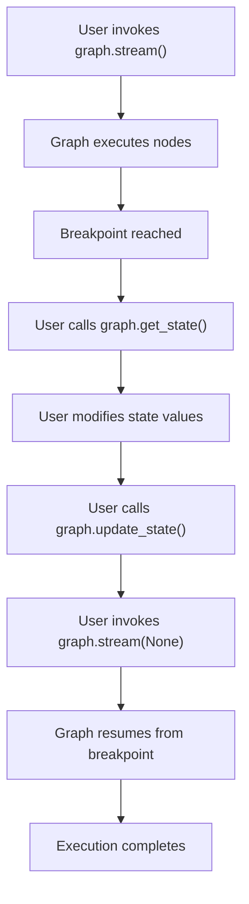
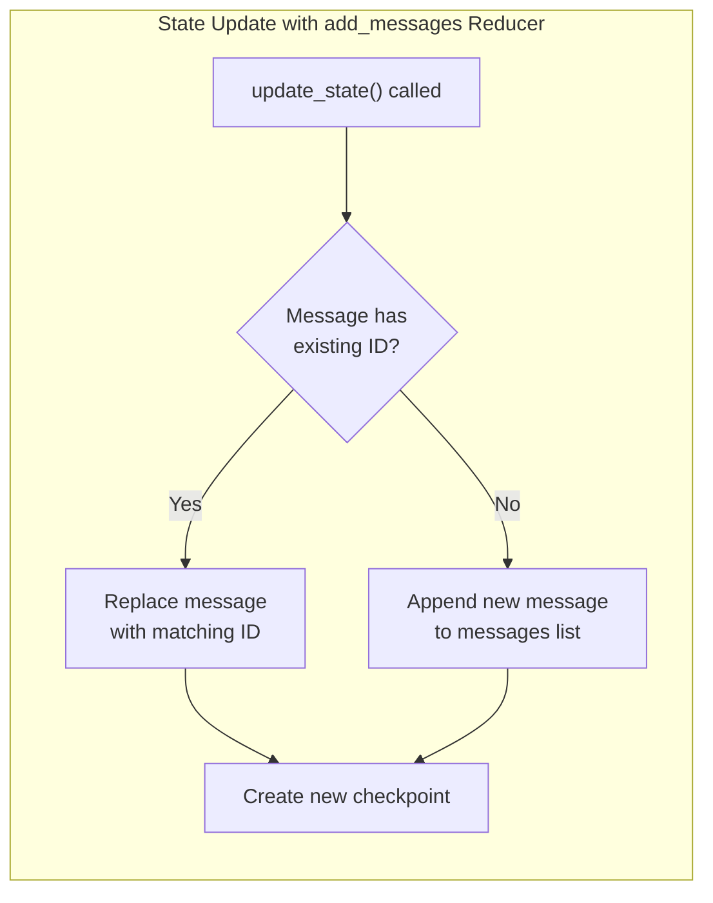
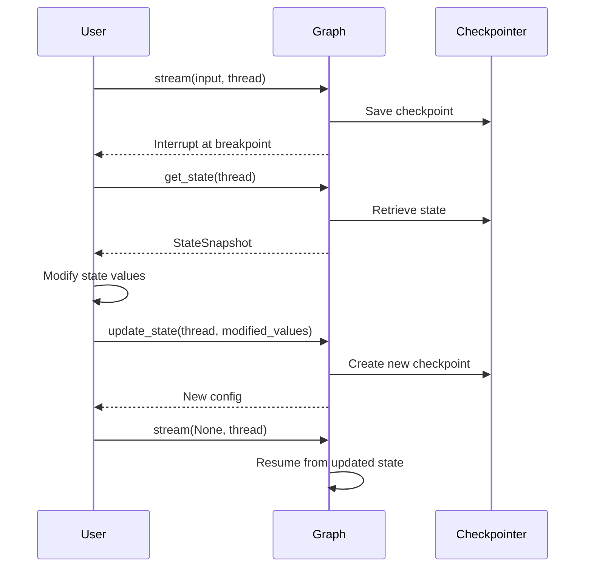
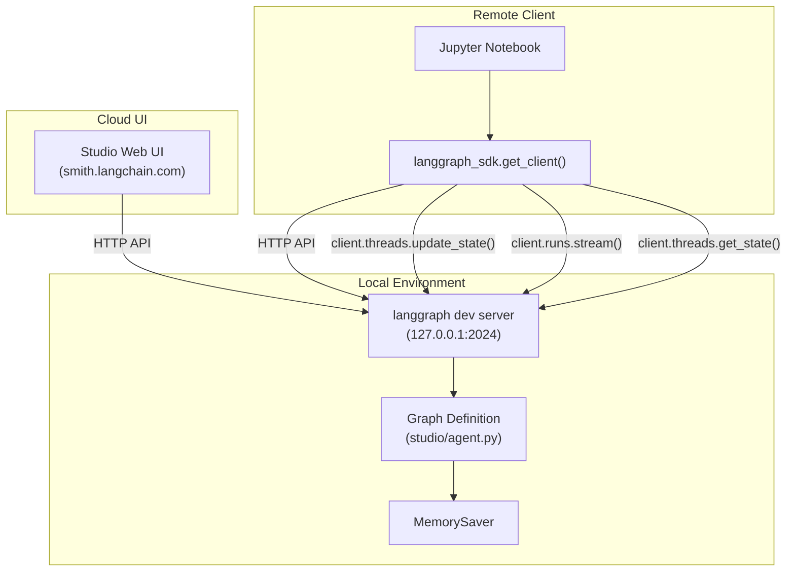
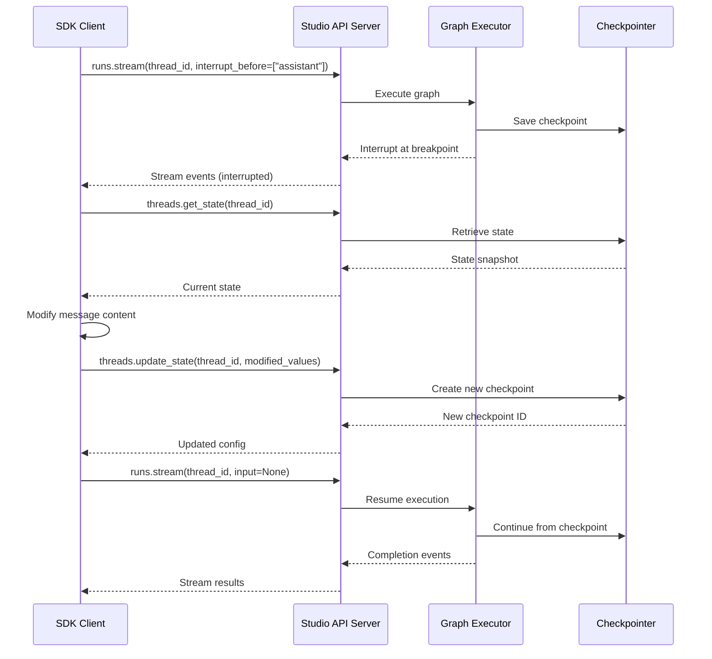
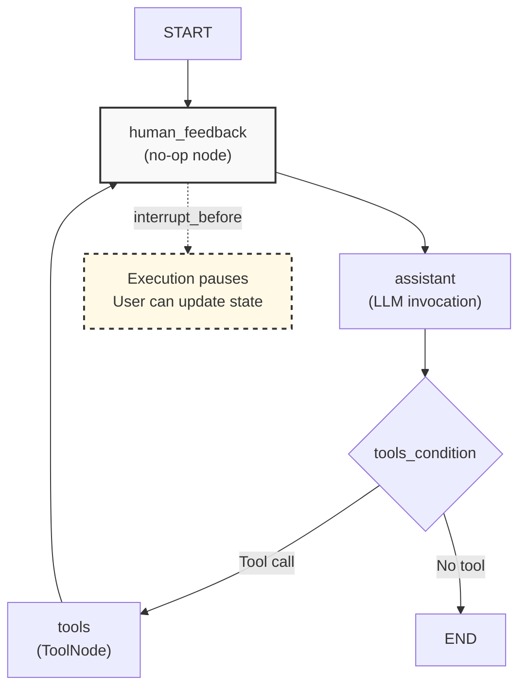
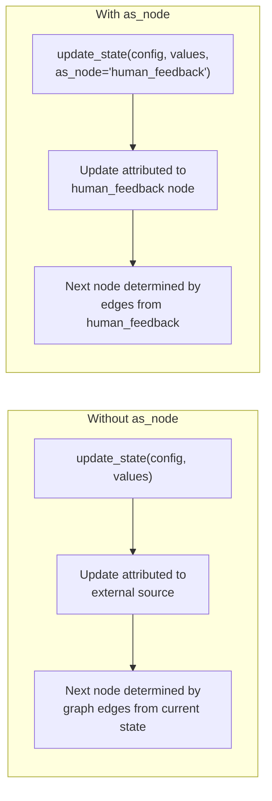
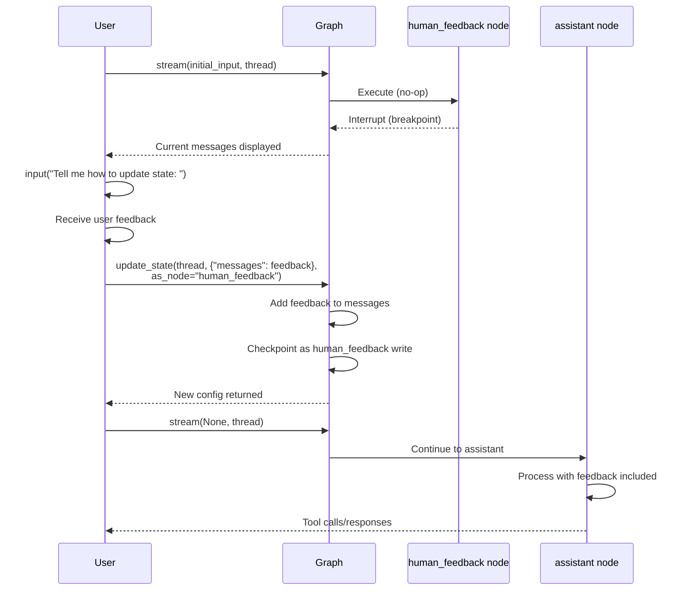

<!-- source: DeepWiki mcp.deepwiki.com · repo langchain-ai/langchain-academy · page 6.2 State Editing and Human Feedback · fetched 2026-10-26 -->

# State Editing and Human Feedback

<details>
<summary>Relevant source files</summary>

The following files were used as context for generating this wiki page:

- [module-3/edit-state-human-feedback.ipynb](module-3/edit-state-human-feedback.ipynb)

</details>


## Purpose and Scope

This document covers techniques for modifying graph state during execution and incorporating human feedback into LangGraph workflows. State editing enables three primary use cases: (1) human approval workflows where users can modify agent decisions before proceeding, (2) debugging by manually correcting state to reproduce or avoid issues, and (3) intervention where humans can redirect agent behavior mid-execution.

For information on pausing execution at specific nodes, see [Breakpoints and Interruptions](#6.1). For monitoring execution without intervention, see [Streaming Events and Modes](#6.3).

Sources: [module-3/edit-state-human-feedback.ipynb:16-33]()

---

## Core Concepts

### State Modification API

The `update_state()` method provides direct access to modify graph state at any checkpoint. When a graph is interrupted via `interrupt_before`, the state becomes mutable, allowing external updates before resuming execution.



**Key Method Signatures:**

- `graph.update_state(config, values)` - Updates state and creates new checkpoint
- `graph.update_state(config, values, as_node="node_name")` - Updates state as if specified node wrote the values
- `graph.get_state(config)` - Retrieves current state snapshot

Sources: [module-3/edit-state-human-feedback.ipynb:67-76, 243-287]()

### Message Reducer Behavior

The `add_messages` reducer used by `MessagesState` has special semantics for state updates:

| Update Type | Message ID | Behavior |
|------------|-----------|----------|
| Append | No ID specified | Adds new message to list |
| Overwrite | Existing message ID | Replaces message with matching ID |
| Append | New unique ID | Adds new message to list |



This allows precise control over whether updates modify existing messages or extend the conversation history.

Sources: [module-3/edit-state-human-feedback.ipynb:243-249, 271-287]()

---

## Direct State Editing Patterns

### Local Graph Execution

When running graphs locally with a `MemorySaver` or `SqliteSaver` checkpointer, state editing follows this pattern:



**Example Workflow:**

1. Graph interrupts before `assistant` node ([module-3/edit-state-human-feedback.ipynb:172]())
2. User retrieves state: `state = graph.get_state(thread)` ([module-3/edit-state-human-feedback.ipynb:234]())
3. User modifies state: `graph.update_state(thread, {"messages": [modified_message]})` ([module-3/edit-state-human-feedback.ipynb:271-274]())
4. User resumes: `graph.stream(None, thread)` ([module-3/edit-state-human-feedback.ipynb:352]())

Sources: [module-3/edit-state-human-feedback.ipynb:79-176, 189-274, 325-354]()

### Appending vs Overwriting Messages

The distinction between appending and overwriting is controlled through message IDs:

**Appending (No ID Specified):**
```python
# This creates a NEW message and appends to the list
graph.update_state(
    thread,
    {"messages": [HumanMessage(content="Additional context")]}
)
```

**Overwriting (Existing ID):**
```python
# This REPLACES the existing message with matching ID
existing_message = state['messages'][-1]
existing_message['content'] = "Corrected content"
graph.update_state(
    thread,
    {"messages": [existing_message]}  # ID preserved from original
)
```

The `add_messages` reducer inspects the `id` field of each message to determine behavior. If the ID matches an existing message, that message is replaced; otherwise, the message is appended.

Sources: [module-3/edit-state-human-feedback.ipynb:243-249, 271-287, 650-655]()

---

## State Editing via LangGraph Studio

### Studio SDK Architecture

LangGraph Studio provides remote state editing capabilities through the `langgraph_sdk` client. The architecture separates local graph execution from cloud-based UI:



Sources: [module-3/edit-state-human-feedback.ipynb:397-417, 437-440]()

### Remote State Modification

The SDK client provides async methods for state management:

**Client Initialization:**
```python
from langgraph_sdk import get_client
client = get_client(url="http://127.0.0.1:2024")
```

**Thread and State Operations:**

| Method | Purpose | Returns |
|--------|---------|---------|
| `client.threads.create()` | Create new conversation thread | Thread ID |
| `client.threads.get_state(thread_id)` | Retrieve current state | State snapshot dict |
| `client.threads.update_state(thread_id, values)` | Modify state | New checkpoint config |
| `client.runs.stream(thread_id, assistant_id, input)` | Execute graph | Async event stream |

Sources: [module-3/edit-state-human-feedback.ipynb:432-440, 475-489, 542-544]()

### Studio State Editing Workflow



**Complete Example:**

```python
# 1. Start run with breakpoint
async for chunk in client.runs.stream(
    thread["thread_id"],
    "agent",
    input={"messages": "Multiply 2 and 3"},
    interrupt_before=["assistant"]
):
    print(chunk.data)

# 2. Retrieve and modify state
current_state = await client.threads.get_state(thread['thread_id'])
last_message = current_state['values']['messages'][-1]
last_message['content'] = "No, multiply 3 and 3!"

# 3. Update state
await client.threads.update_state(
    thread['thread_id'], 
    {"messages": last_message}
)

# 4. Resume execution
async for chunk in client.runs.stream(
    thread["thread_id"],
    assistant_id="agent",
    input=None
):
    print(chunk.data)
```

Sources: [module-3/edit-state-human-feedback.ipynb:457-489, 500-544, 590-726]()

---

## Human Feedback Node Pattern

### No-op Node Design

The human feedback pattern introduces a dedicated placeholder node where execution pauses for human input. This differs from editing state at arbitrary breakpoints by creating an explicit intervention point in the graph structure.



The `human_feedback` node is a no-op function that returns immediately without modifying state:

```python
def human_feedback(state: MessagesState):
    pass
```

This serves solely as an intervention point. The graph is compiled with `interrupt_before=["human_feedback"]`, causing execution to pause whenever this node is reached.

Sources: [module-3/edit-state-human-feedback.ipynb:777-843]()

### as_node Parameter

The `as_node` parameter in `update_state()` specifies which node should be credited with writing the state update. This affects the graph's execution flow and next node selection:



**Usage Pattern:**

```python
# Graph interrupted before human_feedback node
for event in graph.stream(initial_input, thread, stream_mode="values"):
    print(event["messages"][-1])

# Get user input
user_input = input("Tell me how you want to update the state: ")

# Update state AS IF human_feedback node wrote it
graph.update_state(
    thread, 
    {"messages": user_input}, 
    as_node="human_feedback"
)

# Resume - graph will proceed from human_feedback to next node (assistant)
for event in graph.stream(None, thread, stream_mode="values"):
    print(event["messages"][-1])
```

This ensures the graph resumes at the correct position in the workflow, following edges defined from the `human_feedback` node to subsequent nodes.

Sources: [module-3/edit-state-human-feedback.ipynb:847-906]()

### User Input Integration

The complete human feedback workflow combines breakpoints, user prompts, and state updates:



**Complete Implementation:**

The graph structure includes the `human_feedback` node in the feedback loop:

```python
# Build graph
builder = StateGraph(MessagesState)
builder.add_node("assistant", assistant)
builder.add_node("tools", ToolNode(tools))
builder.add_node("human_feedback", human_feedback)  # No-op node

# Flow: START -> human_feedback -> assistant -> tools -> human_feedback
builder.add_edge(START, "human_feedback")
builder.add_edge("human_feedback", "assistant")
builder.add_conditional_edges("assistant", tools_condition)
builder.add_edge("tools", "human_feedback")

# Compile with breakpoint at human_feedback
graph = builder.compile(
    interrupt_before=["human_feedback"], 
    checkpointer=MemorySaver()
)
```

This pattern creates a consistent intervention point after every tool execution, allowing continuous human oversight.

Sources: [module-3/edit-state-human-feedback.ipynb:809-906]()

---

## Key Implementation Details

### Thread Configuration

State updates require proper thread configuration to target the correct conversation:

```python
thread = {"configurable": {"thread_id": "unique_id"}}
```

All state operations (`get_state`, `update_state`, `stream`) must use the same thread configuration to operate on the same checkpoint history.

### Checkpoint Creation

Each call to `update_state()` creates a new checkpoint in the checkpoint history. This allows:
- Time travel to pre-update states (see [Time Travel Debugging](#6.4))
- Branching from updated states
- Audit trail of human interventions

### Resume Semantics

Passing `None` as input to `stream()` instructs the graph to resume from the current checkpoint without providing new input:

```python
for event in graph.stream(None, thread, stream_mode="values"):
    process_event(event)
```

This is distinct from passing a new input dictionary, which would append to the state rather than continuing from the interrupted point.

Sources: [module-3/edit-state-human-feedback.ipynb:189-214, 271-287, 325-354]()

---

