<!-- source: DeepWiki mcp.deepwiki.com · repo langchain-ai/langchain-academy · page 6.3 Streaming Events and Modes · fetched 2026-10-26 -->

# Streaming Events and Modes

<details>
<summary>Relevant source files</summary>

The following files were used as context for generating this wiki page:

- [module-3/streaming-interruption.ipynb](module-3/streaming-interruption.ipynb)

</details>


## Purpose and Scope

This document covers LangGraph's streaming capabilities, which enable real-time monitoring of graph execution and token-by-token output from language models. Streaming is essential for building responsive user interfaces and providing immediate feedback during long-running agent operations.

This page focuses on streaming mechanisms available during graph execution. For information about pausing execution and human intervention, see [Breakpoints and Interruptions](#6.1). For state manipulation after streaming, see [State Editing and Human Feedback](#6.2).

**Sources:** [module-3/streaming-interruption.ipynb:16-28]()

## Streaming Modes Overview

LangGraph provides multiple streaming modes that control what data is emitted during graph execution. The choice of mode depends on whether you need complete state snapshots, incremental updates, or fine-grained events.

### Streaming Modes Comparison

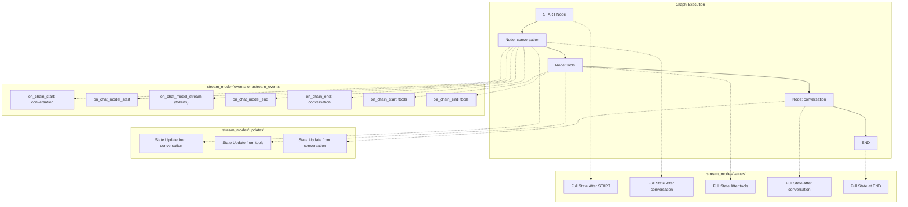

**Sources:** [module-3/streaming-interruption.ipynb:196-213]()

## Streaming Full Graph State

### Values Mode

The `stream_mode="values"` returns the complete graph state after each node execution. This mode is useful when you need access to all state variables at each step.

| Feature | Description |
|---------|-------------|
| **Output Frequency** | After every node completes |
| **Data Returned** | Full state snapshot including all keys |
| **Use Case** | Debugging, displaying complete conversation history |
| **Memory Overhead** | Higher (sends complete state each time) |

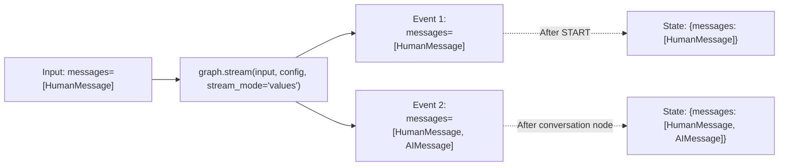

**Implementation Example:**

The graph streams complete state dictionaries where each event contains the full `messages` list:

```python
for event in graph.stream({"messages": [input_message]}, config, stream_mode="values"):
    for m in event['messages']:
        m.pretty_print()
```

**Sources:** [module-3/streaming-interruption.ipynb:274-312]()

### Updates Mode

The `stream_mode="updates"` returns only the state changes produced by each node. This mode is more efficient as it transmits less data.

| Feature | Description |
|---------|-------------|
| **Output Frequency** | After every node completes |
| **Data Returned** | Only the state delta from that node |
| **Use Case** | Efficient state monitoring, incremental UI updates |
| **Memory Overhead** | Lower (sends only changes) |

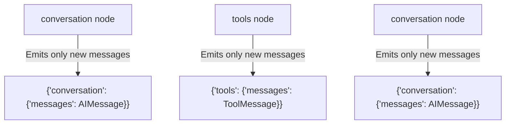

**Implementation Example:**

Each chunk is a dictionary with the node name as key and the state update as value:

```python
for chunk in graph.stream({"messages": [input_message]}, config, stream_mode="updates"):
    print(chunk)  # {'conversation': {'messages': AIMessage(...)}}
```

**Sources:** [module-3/streaming-interruption.ipynb:209-236](), [module-3/streaming-interruption.ipynb:244-266]()

## Streaming LLM Tokens

### Event Streaming Architecture

For real-time token streaming from chat models, LangGraph provides the `astream_events()` method. This is essential for creating responsive chat interfaces where users see text appear incrementally.

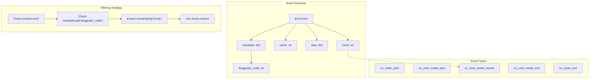

**Sources:** [module-3/streaming-interruption.ipynb:320-335]()

### Token-Level Streaming Implementation

The `astream_events()` method emits events as they occur within nodes. Each event contains:

- **event**: Event type identifier (e.g., `"on_chat_model_stream"`)
- **name**: Component name (e.g., `"ChatOpenAI"`)
- **data**: Event-specific data (e.g., `{"chunk": AIMessageChunk}`)
- **metadata**: Context including `langgraph_node`

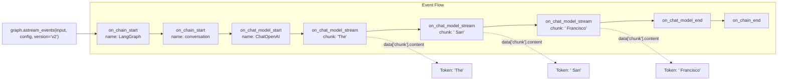

**Filtering for Specific Node Tokens:**

```python
node_to_stream = 'conversation'
async for event in graph.astream_events({"messages": [input_message]}, config, version="v2"):
    if event["event"] == "on_chat_model_stream" and \
       event['metadata'].get('langgraph_node','') == node_to_stream:
        print(event["data"]["chunk"].content, end="|")
```

**Sources:** [module-3/streaming-interruption.ipynb:770-774](), [module-3/streaming-interruption.ipynb:1189-1233]()

### Event Data Structure

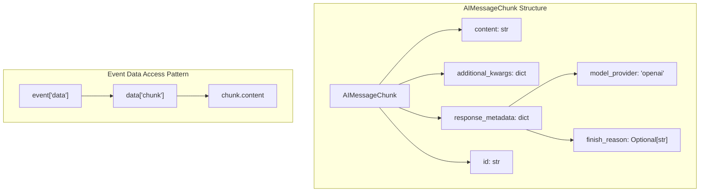

**Sources:** [module-3/streaming-interruption.ipynb:782-786](), [module-3/streaming-interruption.ipynb:1199-1203]()

## Streaming with LangGraph API

### SDK Client Setup

When using LangGraph Studio or deployed graphs, streaming occurs through the `langgraph_sdk` client. The API provides both standard streaming modes and API-specific modes like `messages`.

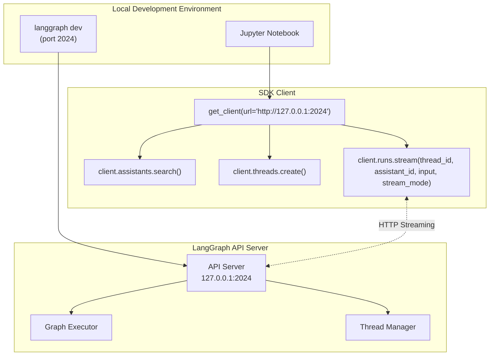

**Sources:** [module-3/streaming-interruption.ipynb:1242-1260](), [module-3/streaming-interruption.ipynb:1282-1289]()

### Values Mode via API

The API-based streaming returns `StreamPart` objects containing event type and data:

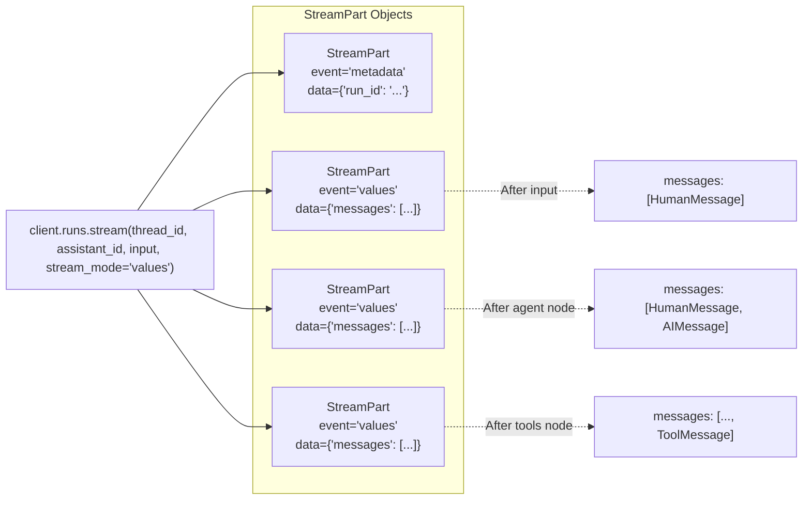

**Implementation:**

```python
async for event in client.runs.stream(
    thread["thread_id"], 
    assistant_id="agent", 
    input={"messages": [input_message]}, 
    stream_mode="values"
):
    messages = event.data.get('messages', None)
    if messages:
        print(convert_to_messages(messages)[-1])
```

**Sources:** [module-3/streaming-interruption.ipynb:1296-1327](), [module-3/streaming-interruption.ipynb:1363-1372]()

### Messages Mode (API-Specific)

The `stream_mode="messages"` is only available through the LangGraph API and provides specialized handling for message-based state. This mode assumes your graph has a `messages` key containing a list of messages.

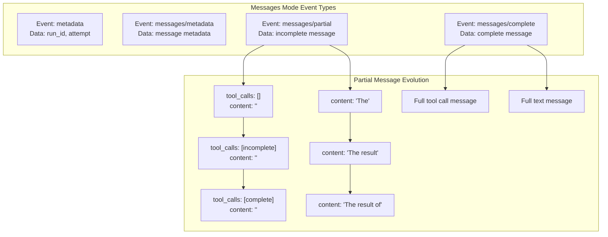

**Event Type Descriptions:**

| Event Type | Description | When Emitted |
|------------|-------------|--------------|
| `metadata` | Run metadata (run_id, attempt) | At run start |
| `messages/metadata` | Message-level metadata | Before message content |
| `messages/partial` | Incomplete message chunk | During streaming (tokens, partial tool calls) |
| `messages/complete` | Fully formed message | After message completion |

**Sources:** [module-3/streaming-interruption.ipynb:1378-1389](), [module-3/streaming-interruption.ipynb:1439-1446]()

### Messages Mode Implementation

The `messages` mode allows fine-grained control over message rendering, including incremental tool call construction and token-by-token text display:

```mermaid
graph TB
    subgraph "Tool Call Message Lifecycle"
        TOOL_START["messages/partial<br/>tool_calls: [{'id': 'call_xxx', 'name': 'multiply', 'args': {}}]"]
        TOOL_ARGS1["messages/partial<br/>args: {'a': 2}"]
        TOOL_ARGS2["messages/partial<br/>args: {'a': 2, 'b': 3}"]
        TOOL_COMPLETE["messages/complete<br/>Full tool call with metadata"]
    end
    
    subgraph "Text Message Lifecycle"
        TEXT_START["messages/partial<br/>content: 'The'"]
        TEXT_MID["messages/partial<br/>content: 'The result of'"]
        TEXT_END["messages/partial<br/>content: 'The result of multiplying 2 and 3 is 6.'"]
        TEXT_COMPLETE["messages/complete<br/>Full message with response_metadata"]
    end
    
    TOOL_START --> TOOL_ARGS1
    TOOL_ARGS1 --> TOOL_ARGS2
    TOOL_ARGS2 --> TOOL_COMPLETE
    
    TEXT_START --> TEXT_MID
    TEXT_MID --> TEXT_END
    TEXT_END --> TEXT_COMPLETE
```

**Message Event Data Structure:**

```python
# Event structure
{
    "event": "messages/partial",
    "data": [
        {
            "role": "user",  # or absent for AI messages
            "content": "partial text",
            "tool_calls": [{"id": "...", "name": "...", "args": {...}}],
            "invalid_tool_calls": [...],
            "response_metadata": {"finish_reason": "..."}
        }
    ]
}
```

**Processing Messages Mode Events:**

```python
async for event in client.runs.stream(
    thread["thread_id"],
    assistant_id="agent",
    input={"messages": [input_message]},
    stream_mode="messages"
):
    if event.event == "messages/partial":
        for data_item in event.data:
            content = data_item.get("content", "")
            tool_calls = data_item.get("tool_calls", [])
            
            if content:
                print(f"AI: {content}")
            if tool_calls:
                print(f"Tool Calls: {format_tool_calls(tool_calls)}")
```

**Sources:** [module-3/streaming-interruption.ipynb:1450-1462](), [module-3/streaming-interruption.ipynb:1560-1624]()

## Streaming Mode Selection Guide

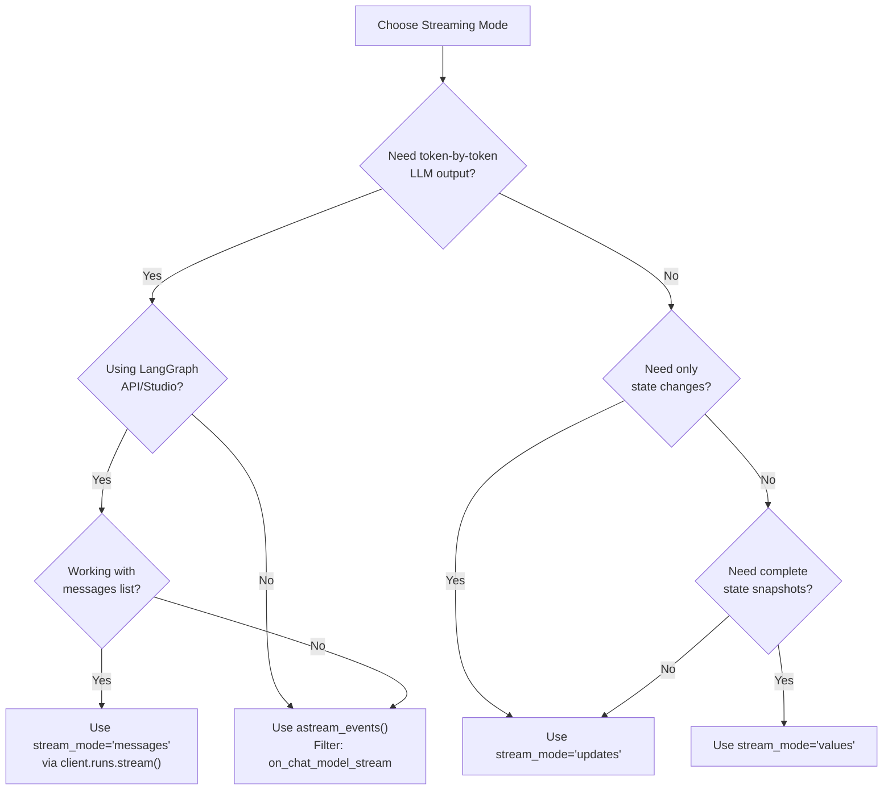

**Decision Criteria:**

| Use Case | Recommended Mode | Method |
|----------|------------------|--------|
| Real-time chat UI with typing effect | `messages` or `astream_events()` | API or direct |
| Debugging full state transitions | `values` | Direct or API |
| Efficient state updates for UI | `updates` | Direct or API |
| Tool call tracking with partial args | `messages` | API only |
| Filtering events by specific node | `astream_events()` | Direct only |

**Sources:** [module-3/streaming-interruption.ipynb:196-213](), [module-3/streaming-interruption.ipynb:1378-1389]()

---

