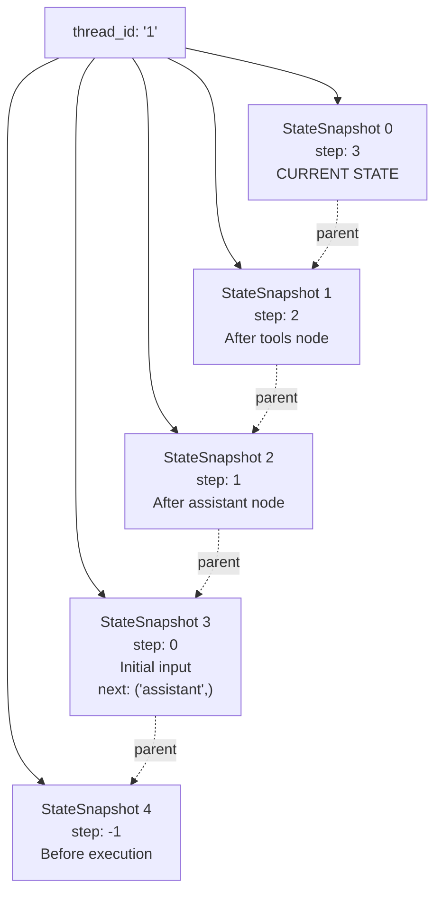
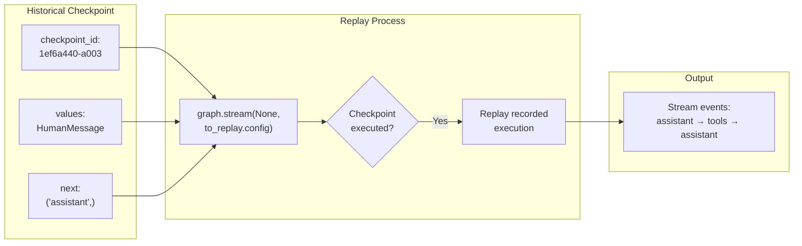
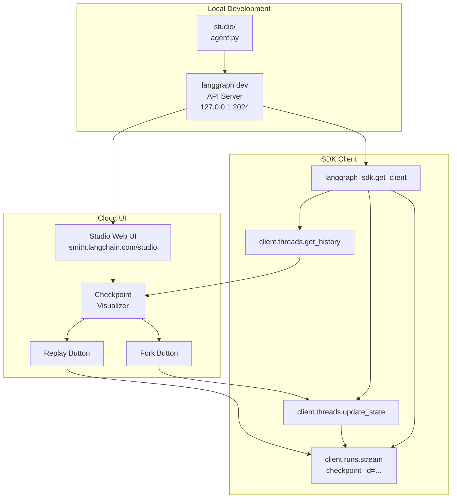
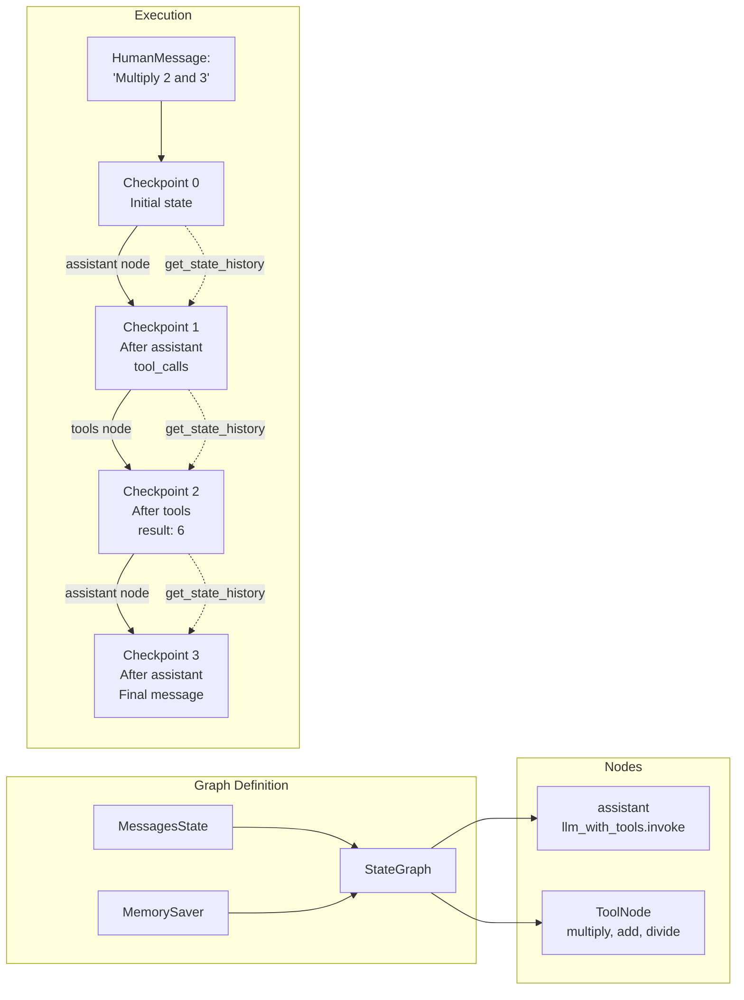

<!-- source: DeepWiki mcp.deepwiki.com · repo langchain-ai/langchain-academy · page 6.4 Time Travel Debugging · fetched 2026-10-26 -->

# Time Travel Debugging

<details>
<summary>Relevant source files</summary>

The following files were used as context for generating this wiki page:

- [module-3/time-travel.ipynb](module-3/time-travel.ipynb)

</details>


## Purpose and Scope

This document covers LangGraph's time travel debugging capabilities, which enable viewing historical execution states, replaying graph execution from specific checkpoints, and forking alternative execution paths. Time travel provides powerful debugging and testing workflows by allowing inspection and manipulation of graph state at any point in execution history.

For information about interrupting execution for human approval, see [Breakpoints and Interruptions](#6.1). For editing state during execution, see [State Editing and Human Feedback](#6.2). For real-time execution monitoring, see [Streaming Events and Modes](#6.3).

## Core Concepts

Time travel debugging relies on LangGraph's checkpointing system to create snapshots of graph state at each execution step. These checkpoints can be retrieved, inspected, and used as starting points for new executions.

### StateSnapshot Structure

Each checkpoint is represented as a `StateSnapshot` object containing:

| Field | Description |
|-------|-------------|
| `values` | Current state dictionary (e.g., `{"messages": [...]}`) |
| `next` | Tuple of next nodes to execute (e.g., `("assistant",)`) |
| `config` | Configuration dict with `thread_id`, `checkpoint_ns`, `checkpoint_id` |
| `metadata` | Execution metadata including `step`, `source`, `writes`, `parents` |
| `created_at` | Timestamp of checkpoint creation |
| `parent_config` | Configuration of the parent checkpoint |
| `tasks` | Tuple of pending tasks with error and interrupt information |

**Sources:** [module-3/time-travel.ipynb:236-253]()

### Checkpoint Identification

Checkpoints are uniquely identified by:

- **thread_id**: Identifies the conversation/execution thread
- **checkpoint_id**: Unique identifier for the specific state snapshot

These identifiers are contained in the `config` dictionary and are essential for replaying or forking from checkpoints.

**Sources:** [module-3/time-travel.ipynb:455-475]()

## State History Retrieval

### Local Graph Usage

For graphs compiled with a checkpointer, the `get_state_history()` method retrieves all historical states:

```python
# Get all checkpoints for a thread
all_states = [s for s in graph.get_state_history(thread)]
```

States are returned in reverse chronological order, with the current state first:

```python
# Current state (same as graph.get_state())
current = all_states[0]

# Initial state with human input
initial = all_states[-2]
```

**Sources:** [module-3/time-travel.ipynb:266-323]()

#### State History Diagram



**Sources:** [module-3/time-travel.ipynb:266-323]()

### LangGraph Studio/SDK Usage

When using the LangGraph API via `langgraph_sdk`, history retrieval uses the client interface:

```python
from langgraph_sdk import get_client

client = get_client(url="http://127.0.0.1:2024")
states = await client.threads.get_history(thread['thread_id'])
```

The returned states have the same structure but are accessed as dictionaries:

```python
checkpoint_id = states[0]['checkpoint_id']
state_values = states[0]['values']
next_nodes = states[0]['next']
```

**Sources:** [module-3/time-travel.ipynb:824-940]()

## Replaying from Checkpoints

Replaying re-executes the graph from a historical checkpoint without modifying state. The graph recognizes the checkpoint has already been executed and simply replays the recorded execution.

### Local Replay

To replay from a checkpoint, pass its config to `graph.stream()` with `None` as input:

```python
# Select a checkpoint to replay
to_replay = all_states[-2]

# Replay from that checkpoint
for event in graph.stream(None, to_replay.config, stream_mode="values"):
    event['messages'][-1].pretty_print()
```

The graph uses the checkpoint's `config` dictionary (containing `thread_id` and `checkpoint_id`) to locate and replay from that exact state.

**Sources:** [module-3/time-travel.ipynb:358-522]()

### Replay Execution Flow



**Sources:** [module-3/time-travel.ipynb:477-522]()

### SDK Replay

With LangGraph Studio/SDK, specify the `checkpoint_id` parameter:

```python
async for chunk in client.runs.stream(
    thread["thread_id"],
    assistant_id="agent",
    input=None,
    stream_mode="values",
    checkpoint_id=to_replay['checkpoint_id']
):
    print(chunk.data)
```

**Sources:** [module-3/time-travel.ipynb:987-999]()

## Forking Alternative Paths

Forking creates a new execution branch from a historical checkpoint with modified state. This enables "what-if" analysis and testing alternative scenarios.

### Fork Creation Process

1. Retrieve the checkpoint to fork from
2. Modify state using `graph.update_state()`
3. Execute from the new forked checkpoint

### Local Forking

```python
# Select checkpoint to fork
to_fork = all_states[-2]

# Update state with new values
fork_config = graph.update_state(
    to_fork.config,
    {"messages": [HumanMessage(
        content='Multiply 5 and 3',
        id=to_fork.values["messages"][0].id  # Overwrite by ID
    )]},
)

# Execute from forked state
for event in graph.stream(None, fork_config, stream_mode="values"):
    event['messages'][-1].pretty_print()
```

**Sources:** [module-3/time-travel.ipynb:548-752]()

### Message Reducer Behavior

The fork operation leverages message reducer semantics:

| Scenario | Behavior |
|----------|----------|
| New message without ID | Append to message list |
| Message with existing ID | Overwrite message with that ID |
| Used for forking | Provide original message ID to replace it |

This allows precise state modification while preserving checkpoint metadata (next nodes, step information, etc.).

**Sources:** [module-3/time-travel.ipynb:601-629]()

### Fork State Diagram

```mermaid
graph TD
    Original["Original Checkpoint<br/>step: 0<br/>content: 'Multiply 2 and 3'<br/>checkpoint_id: ...a003"]
    
    Fork["Forked Checkpoint<br/>step: 1<br/>content: 'Multiply 5 and 3'<br/>checkpoint_id: ...f98b<br/>source: 'update'"]
    
    OrigExec["Original Execution<br/>result: 6"]
    ForkExec["Fork Execution<br/>result: 15"]
    
    Original -->|update_state| Fork
    Original -->|stream(replay)| OrigExec
    Fork -->|stream(execute)| ForkExec
    
    Original -.parent.-> Fork
```

**Sources:** [module-3/time-travel.ipynb:548-752]()

### SDK Forking

With the LangGraph API, use `client.threads.update_state()`:

```python
# Prepare forked input with same message ID
forked_input = {
    "messages": HumanMessage(
        content="Multiply 3 and 3",
        id=to_fork['values']['messages'][0]['id']
    )
}

# Create fork
forked_config = await client.threads.update_state(
    thread["thread_id"],
    forked_input,
    checkpoint_id=to_fork['checkpoint_id']
)

# Execute from fork
async for chunk in client.runs.stream(
    thread["thread_id"],
    assistant_id="agent",
    input=None,
    stream_mode="updates",
    checkpoint_id=forked_config['checkpoint_id']
):
    # Process forked execution
```

**Sources:** [module-3/time-travel.ipynb:1209-1342]()

## Integration with LangGraph Studio

LangGraph Studio provides visual time travel debugging through its web UI when running a local development server.

### Studio Setup

Start the local development server from the studio directory:

```bash
langgraph dev
```

This starts:
- API server on `http://127.0.0.1:2024`
- Studio UI at `https://smith.langchain.com/studio/?baseUrl=http://127.0.0.1:2024`

**Sources:** [module-3/time-travel.ipynb:789-809]()

### Studio Time Travel Workflow



**Sources:** [module-3/time-travel.ipynb:789-809](), [module-3/time-travel.ipynb:1346-1352]()

### Streaming Modes with Time Travel

Both replay and fork operations support multiple streaming modes:

| Mode | Output |
|------|--------|
| `values` | Full state after each node |
| `updates` | Only state changes from each node |
| `events` | Detailed event stream including metadata |

Example with updates mode:

```python
async for chunk in client.runs.stream(
    thread["thread_id"],
    assistant_id="agent",
    input=None,
    stream_mode="updates",  # Only show node changes
    checkpoint_id=checkpoint_id
):
    assistant_update = chunk.data.get('assistant', {}).get('messages', [])
    tool_update = chunk.data.get('tools', {}).get('messages', [])
```

**Sources:** [module-3/time-travel.ipynb:862-880](), [module-3/time-travel.ipynb:1029-1045]()

## Use Cases

### Debugging Failed Executions

1. Run graph until failure
2. Use `get_state_history()` to retrieve all checkpoints
3. Examine state at each step to identify where issue occurred
4. Replay from checkpoint before failure to reproduce

### Testing Alternative Inputs

1. Execute graph with initial input
2. Fork from early checkpoint
3. Modify state with alternative input
4. Compare results between original and forked executions

### Reproducing Issues

1. Identify problematic checkpoint from production logs
2. Fork from that checkpoint in development
3. Test fixes by replaying with corrections
4. Verify solution before deploying

**Sources:** [module-3/time-travel.ipynb:16-36]()

## Implementation Example

### Basic Agent with Time Travel



**Sources:** [module-3/time-travel.ipynb:75-172]()

### Key Components

| Component | Purpose |
|-----------|---------|
| `StateGraph(MessagesState)` | Graph builder with message-based state |
| `MemorySaver()` | In-memory checkpointer for state persistence |
| `graph.compile(checkpointer=...)` | Enable checkpoint creation |
| `thread_id` | Identifies execution thread for checkpoint retrieval |
| `graph.get_state_history(thread)` | Retrieves all checkpoints |
| `graph.update_state(config, values)` | Creates fork from checkpoint |

**Sources:** [module-3/time-travel.ipynb:117-172]()

## Technical Considerations

### Checkpoint Storage

- **MemorySaver**: Stores checkpoints in memory (development only)
- **SqliteSaver**: Persists checkpoints to SQLite database (production)
- Checkpoint ID generation is deterministic based on state content
- Parent-child relationships preserved through `parent_config`

### State Consistency

- Checkpoint metadata (next nodes, step count) is preserved during forks
- Forking creates a new checkpoint with updated values but same execution context
- Graph distinguishes between replayed checkpoints (already executed) and new forks (needs execution)

### Performance

- State history retrieval loads all checkpoints into memory
- For long-running threads, consider limiting history depth
- Forking is lightweight—only modified state is stored in new checkpoint

**Sources:** [module-3/time-travel.ipynb:666-707](), [module-3/time-travel.ipynb:714-752]()

---

