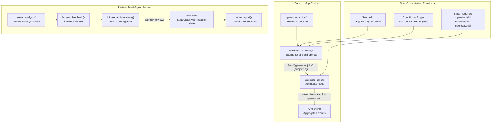
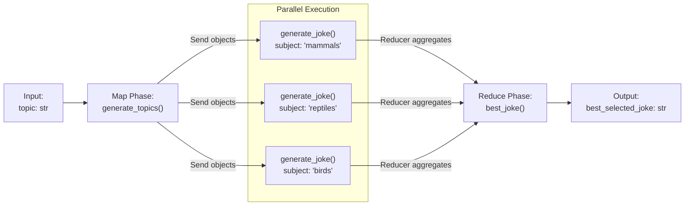
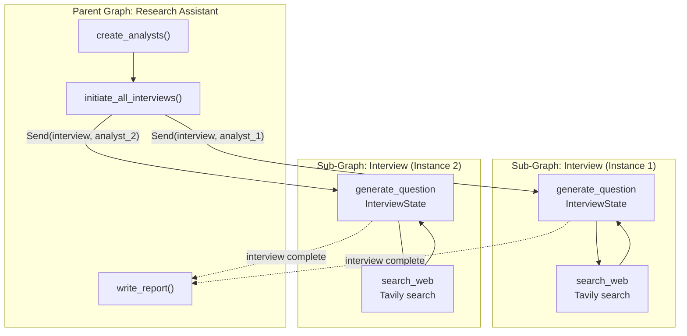
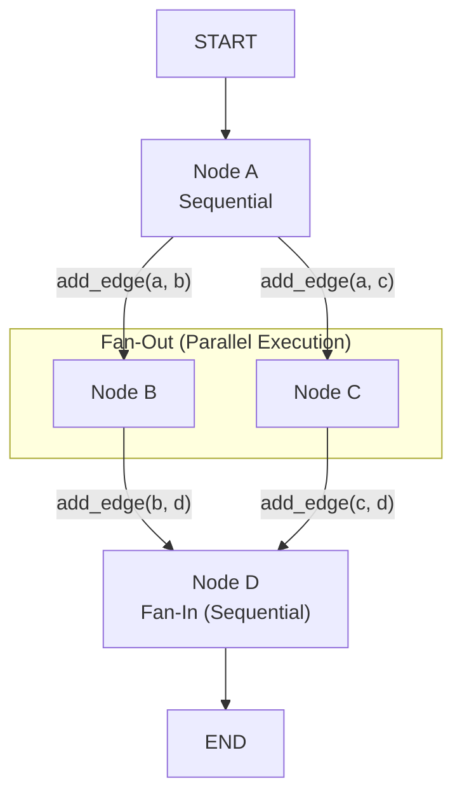
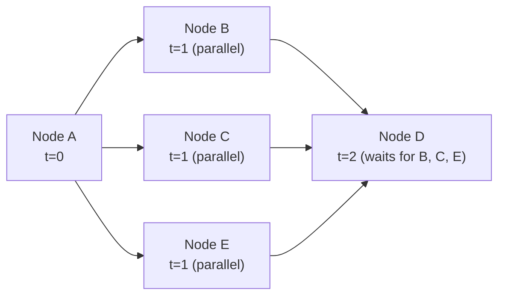
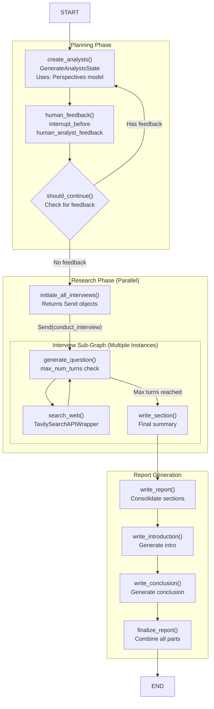

<!-- source: DeepWiki mcp.deepwiki.com · repo langchain-ai/langchain-academy · page 7 Advanced Agent Patterns · fetched 2026-10-26 -->

# Advanced Agent Patterns

<details>
<summary>Relevant source files</summary>

The following files were used as context for generating this wiki page:

- [module-4/map-reduce.ipynb](module-4/map-reduce.ipynb)
- [module-4/parallelization.ipynb](module-4/parallelization.ipynb)
- [module-4/research-assistant.ipynb](module-4/research-assistant.ipynb)
- [module-4/sub-graph.ipynb](module-4/sub-graph.ipynb)

</details>


## Purpose and Scope

This document covers sophisticated orchestration patterns in LangGraph for building scalable, multi-agent systems. The patterns include parallelization, map-reduce, sub-graphs, and multi-agent coordination. These techniques enable complex workflows that decompose tasks, execute them concurrently, and aggregate results efficiently.

For basic agent construction, see [Building Agents with LangGraph](#4). For human-in-the-loop features used in these patterns, see [Human-in-the-Loop Features](#6). For memory systems in multi-agent contexts, see [Memory Systems](#8).

## Architecture Overview

Advanced agent patterns build on LangGraph's core primitives to enable sophisticated orchestration. The key capability is the `Send` API, which allows dynamic fan-out to create parallel execution branches at runtime. Combined with reducers, this enables map-reduce workflows where tasks are decomposed, processed in parallel, and results are aggregated.



**Sources:** [module-4/map-reduce.ipynb:28-29](), [module-4/parallelization.ipynb:36-38](), [module-4/research-assistant.ipynb:17-60]()

## 7.1 Map-Reduce Pattern

### Conceptual Model

Map-reduce consists of two phases:
1. **Map**: Decompose a task into sub-tasks and process them in parallel
2. **Reduce**: Aggregate results from all parallel executions



**Sources:** [module-4/map-reduce.ipynb:16-29]()

### State Definition

The state schema uses `Annotated` with `operator.add` to accumulate results from parallel executions:

```python
class OverallState(TypedDict):
    topic: str
    subjects: list
    jokes: Annotated[list, operator.add]  # Reducer
    best_selected_joke: str
```

The `jokes` field uses `operator.add` as a reducer, which concatenates lists. When multiple parallel nodes write to `jokes`, LangGraph automatically merges them using this reducer.

**Sources:** [module-4/map-reduce.ipynb:144-160]()

### Send API for Dynamic Fan-Out

The `Send` API creates parallel execution branches dynamically:

```python
from langgraph.types import Send

def continue_to_jokes(state: OverallState):
    return [Send("generate_joke", {"subject": s}) for s in state["subjects"]]
```

Each `Send` object specifies:
- Target node name (`"generate_joke"`)
- State to pass (can be different from `OverallState`)

This enables N-way parallelization where N is determined at runtime based on the number of subjects.

**Sources:** [module-4/map-reduce.ipynb:189-211]()

### Map Node with Independent State

The map phase node (`generate_joke`) uses its own state schema:

```python
class JokeState(TypedDict):
    subject: str

class Joke(BaseModel):
    joke: str

def generate_joke(state: JokeState):
    prompt = joke_prompt.format(subject=state["subject"])
    response = model.with_structured_output(Joke).invoke(prompt)
    return {"jokes": [response.joke]}
```

Key points:
- `JokeState` is simpler than `OverallState`
- Node receives only what was passed via `Send`
- Returns results using `OverallState` key names for aggregation

**Sources:** [module-4/map-reduce.ipynb:228-244]()

### Reduce Node

The reduce phase aggregates all parallel results:

```python
def best_joke(state: OverallState):
    jokes = "\n\n".join(state["jokes"])
    prompt = best_joke_prompt.format(topic=state["topic"], jokes=jokes)
    response = model.with_structured_output(BestJoke).invoke(prompt)
    return {"best_selected_joke": state["jokes"][response.id]}
```

At this point, `state["jokes"]` contains all results from parallel `generate_joke` executions, merged by the reducer.

**Sources:** [module-4/map-reduce.ipynb:257-268]()

### Graph Construction

```python
graph = StateGraph(OverallState)
graph.add_node("generate_topics", generate_topics)
graph.add_node("generate_joke", generate_joke)
graph.add_node("best_joke", best_joke)
graph.add_edge(START, "generate_topics")
graph.add_conditional_edges("generate_topics", continue_to_jokes, ["generate_joke"])
graph.add_edge("generate_joke", "best_joke")
graph.add_edge("best_joke", END)
```

The conditional edge from `generate_topics` calls `continue_to_jokes`, which returns a list of `Send` objects. LangGraph automatically creates parallel branches.

**Sources:** [module-4/map-reduce.ipynb:296-312]()

### Execution Flow

| Step | Node | Action | State Update |
|------|------|--------|--------------|
| 1 | `generate_topics` | LLM generates list of subjects | `subjects: ['mammals', 'reptiles', 'birds']` |
| 2 | `continue_to_jokes` | Creates 3 `Send` objects | (routing only) |
| 3 | `generate_joke` (3x parallel) | Each generates one joke | `jokes` list grows from reducer |
| 4 | `best_joke` | LLM selects best joke | `best_selected_joke: str` |

**Sources:** [module-4/map-reduce.ipynb:316-337]()

## 7.2 Sub-Graphs for Modularity

### Purpose

Sub-graphs encapsulate reusable workflows with their own state schemas. In the research assistant, the interview process is a sub-graph that can be instantiated multiple times in parallel.



**Sources:** [module-4/research-assistant.ipynb:42-60]()

### Sub-Graph State Schema

Each sub-graph defines its own state, separate from the parent graph:

```python
class InterviewState(TypedDict):
    analyst: Analyst
    messages: Annotated[list, add_messages]
    max_num_turns: int
    context: Annotated[list, operator.add]
    interview: str
    sections: list
```

The parent graph has a different schema:

```python
class ResearchGraphState(TypedDict):
    topic: str
    analysts: List[Analyst]
    sections: Annotated[list, operator.add]
    introduction: str
    conclusion: str
    final_report: str
```

**Sources:** [module-4/research-assistant.ipynb]() (interview state), [module-4/studio/research_assistant.py]() (research graph state)

### Hierarchical Composition

Sub-graphs are added to the parent graph using `add_node`:

```python
builder.add_node("conduct_interview", interview_builder.compile())
```

The compiled sub-graph becomes a node in the parent graph. State is passed via `Send`:

```python
def initiate_all_interviews(state: ResearchGraphState):
    return [
        Send("conduct_interview", {"analyst": analyst, "messages": [...]})
        for analyst in state["analysts"]
    ]
```

**Sources:** [module-4/studio/research_assistant.py]()

### Input/Output Filtering

Only the state fields specified in `Send` are passed to the sub-graph. Results are written back to parent state using keys that exist in both schemas (e.g., `sections`).

## 7.3 Parallelization Techniques

### Fan-Out and Fan-In



When multiple edges point from one node to multiple targets, LangGraph executes them in parallel. When multiple nodes point to the same target, execution waits for all to complete (fan-in).

**Sources:** [module-4/parallelization.ipynb:16-41]()

### Concurrent Write Conflict

Without a reducer, concurrent writes to the same state key fail:

```python
class State(TypedDict):
    state: str  # No reducer - ERROR on concurrent writes

builder.add_edge("a", "b")
builder.add_edge("a", "c")  # b and c write to 'state' simultaneously
```

Execution produces: `InvalidUpdateError: Can receive only one value per step`

**Sources:** [module-4/parallelization.ipynb:219-254]()

### Reducer Solution

Adding a reducer allows concurrent writes:

```python
class State(TypedDict):
    state: Annotated[list, operator.add]  # Reducer enables concurrent writes

# Now parallel execution works
```

The `operator.add` reducer concatenates lists from parallel nodes.

**Sources:** [module-4/parallelization.ipynb:256-350]()

### Waiting for Parallel Completion

The graph automatically waits for all parallel branches to complete before proceeding to the fan-in node:



**Sources:** [module-4/parallelization.ipynb:358-361]()

## 7.4 Multi-Agent Research Assistant

### System Architecture

The research assistant implements a complete multi-agent workflow with human-in-the-loop, parallel interviews, and report generation.



**Sources:** [module-4/research-assistant.ipynb:17-60](), [module-4/studio/research_assistant.py]()

### Analyst Generation with Human Approval

The system generates AI analyst personas using structured output:

```python
class Analyst(BaseModel):
    affiliation: str
    name: str
    role: str
    description: str

class Perspectives(BaseModel):
    analysts: List[Analyst]

def create_analysts(state: GenerateAnalystsState):
    structured_llm = llm.with_structured_output(Perspectives)
    system_message = analyst_instructions.format(...)
    analysts = structured_llm.invoke([SystemMessage(content=system_message)])
    return {"analysts": analysts.analysts}
```

The graph uses `interrupt_before=['human_feedback']` to pause for approval. Humans can provide feedback via `update_state`:

```python
graph.update_state(
    thread,
    {"human_analyst_feedback": "Add an entrepreneur perspective"},
    as_node="human_feedback"
)
```

**Sources:** [module-4/research-assistant.ipynb:136-178](), [module-4/research-assistant.ipynb:217-239]()

### Parallel Interview Execution

After approval, the system fans out to conduct parallel interviews:

```python
def initiate_all_interviews(state: ResearchGraphState):
    topic = state["topic"]
    return [
        Send(
            "conduct_interview",
            {
                "analyst": analyst,
                "messages": [
                    HumanMessage(
                        content=f"Research topic: {topic}. Generate questions."
                    )
                ],
            },
        )
        for analyst in state["analysts"]
    ]
```

Each `Send` creates an independent interview sub-graph instance.

**Sources:** [module-4/studio/research_assistant.py]()

### Interview Sub-Graph

The interview is a cyclic sub-graph with question generation and web search:

```python
class InterviewState(TypedDict):
    analyst: Analyst
    messages: Annotated[list, add_messages]
    max_num_turns: int
    context: Annotated[list, operator.add]
    interview: str
    sections: list

def generate_question(state: InterviewState):
    analyst = state["analyst"]
    messages = state["messages"]
    # Use analyst persona to generate next question
    ...

def search_web(state: InterviewState):
    # Extract search query from last message
    # Use TavilySearchAPIWrapper
    ...

interview_builder = StateGraph(InterviewState)
interview_builder.add_node("generate_question", generate_question)
interview_builder.add_node("search_web", search_web)
interview_builder.add_node("write_section", write_section)
interview_builder.add_conditional_edges(
    "generate_question",
    route_messages,
    ["search_web", "write_section"]
)
```

The loop continues until `max_num_turns` is reached.

**Sources:** [module-4/studio/research_assistant.py]()

### Report Compilation

After all interviews complete, sections are aggregated and combined:

```python
def write_report(state: ResearchGraphState):
    sections = state["sections"]
    # Combine all interview summaries
    ...

def write_introduction(state: ResearchGraphState):
    # Generate intro based on topic and sections
    ...

def write_conclusion(state: ResearchGraphState):
    # Generate conclusion
    ...

def finalize_report(state: ResearchGraphState):
    intro = state["introduction"]
    sections = "\n\n".join(state["sections"])
    conclusion = state["conclusion"]
    return {"final_report": f"{intro}\n\n{sections}\n\n{conclusion}"}
```

**Sources:** [module-4/studio/research_assistant.py]()

### State Schema Design

| Schema | Purpose | Key Fields |
|--------|---------|------------|
| `GenerateAnalystsState` | Analyst creation phase | `topic`, `max_analysts`, `human_analyst_feedback`, `analysts` |
| `InterviewState` | Individual interview sub-graph | `analyst`, `messages`, `max_num_turns`, `context`, `sections` |
| `ResearchGraphState` | Overall orchestration | `topic`, `analysts`, `sections` (reducer), `introduction`, `conclusion`, `final_report` |

The `sections` field uses `operator.add` to accumulate results from parallel interviews.

**Sources:** [module-4/research-assistant.ipynb:140-178](), [module-4/studio/research_assistant.py]()

### Integration with External Tools

The system integrates with:
- **Tavily Search API**: Web search during interviews ([module-4/research-assistant.ipynb:72]())
- **LangSmith**: Tracing for debugging ([module-4/research-assistant.ipynb:115-128]())
- **LangGraph Studio**: Visualization and deployment ([module-4/studio/]())

### Deployment

Production deployment uses `langgraph.json` configuration:

```json
{
  "dependencies": ["."],
  "graphs": {
    "research_assistant": "./research_assistant.py:graph"
  },
  "env": ".env"
}
```

The `.env` file contains:
- `OPENAI_API_KEY`
- `TAVILY_API_KEY`
- `LANGSMITH_API_KEY`

**Sources:** [module-4/studio/]()

---

