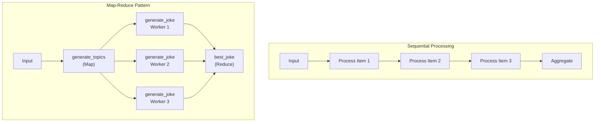
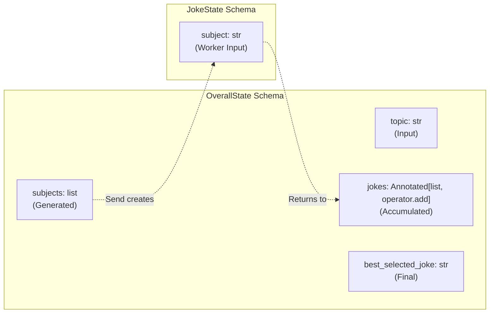
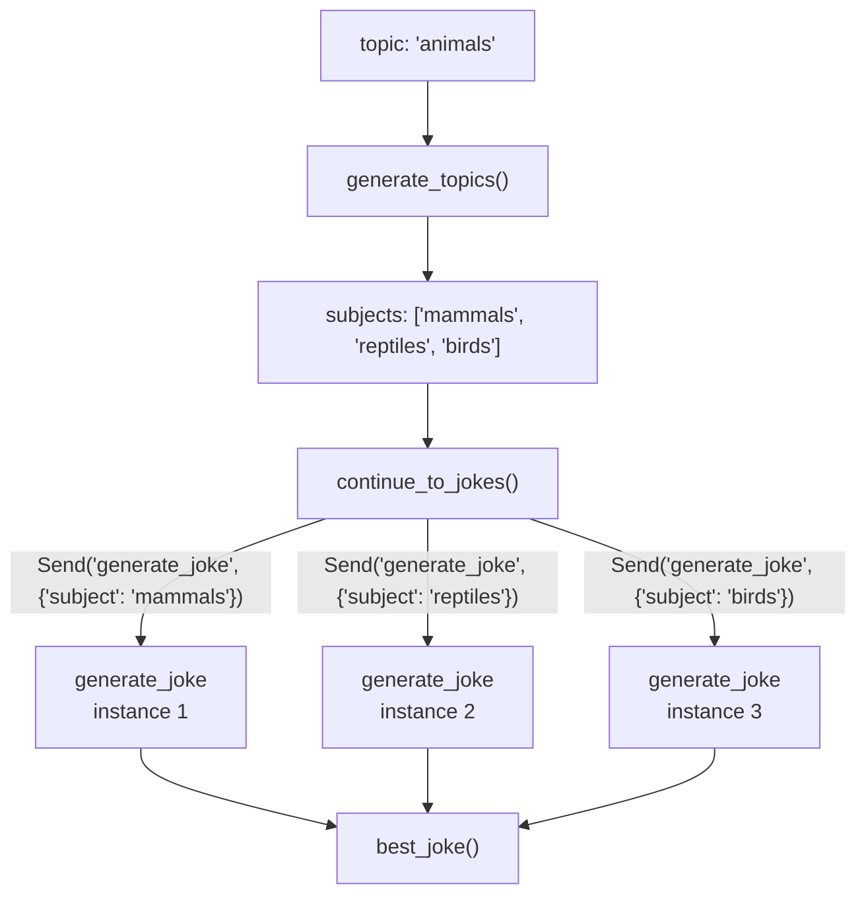
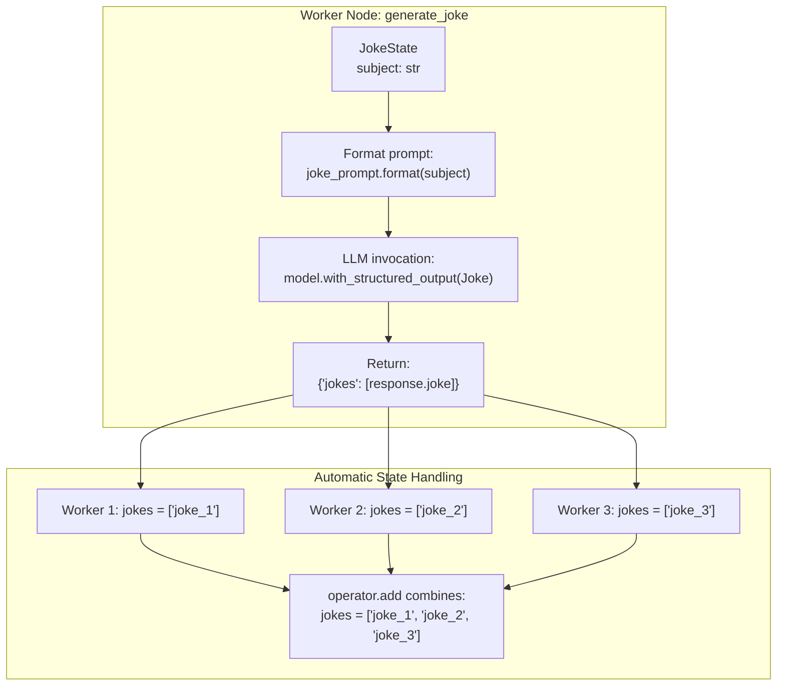
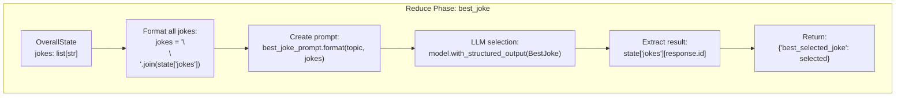
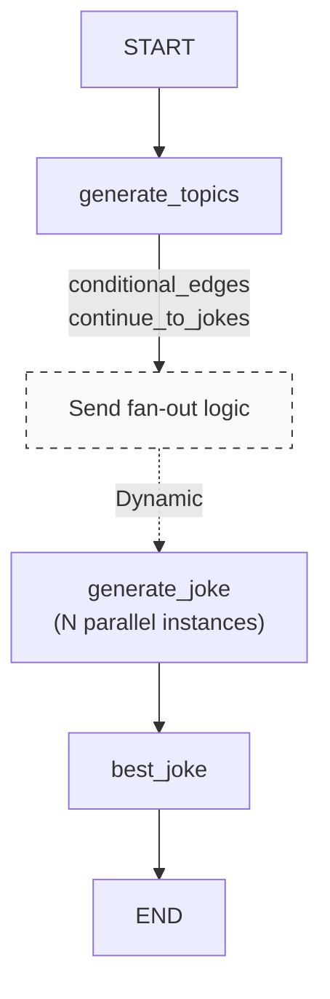
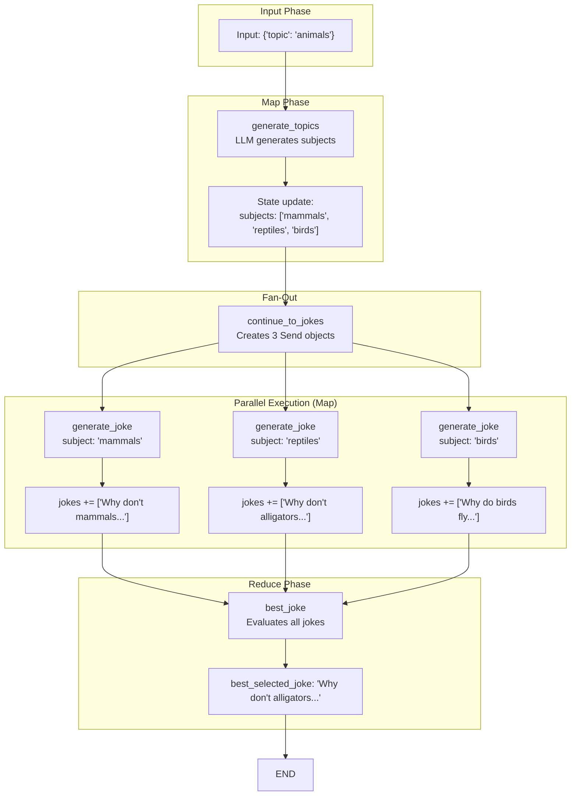
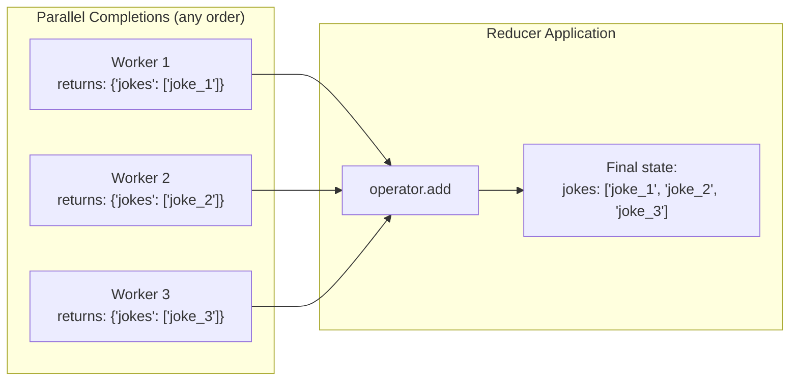

<!-- source: DeepWiki mcp.deepwiki.com · repo langchain-ai/langchain-academy · page 7.1 Map-Reduce Pattern · fetched 2026-10-26 -->

# Map-Reduce Pattern

<details>
<summary>Relevant source files</summary>

The following files were used as context for generating this wiki page:

- [module-4/map-reduce.ipynb](module-4/map-reduce.ipynb)
- [module-4/sub-graph.ipynb](module-4/sub-graph.ipynb)

</details>


## Purpose and Scope

This page describes the map-reduce pattern implementation in LangGraph, which enables parallel task decomposition and result aggregation. The pattern consists of two phases: (1) **Map** - breaking a task into smaller sub-tasks that execute in parallel, and (2) **Reduce** - aggregating results from all completed parallel operations. This pattern is essential for efficient processing of independent operations and is demonstrated through a joke generation system.

For information about combining map-reduce with sub-graphs, see [Sub-Graphs for Modularity](#7.2). For general parallelization techniques, see [Parallelization Techniques](#7.3).

## Pattern Overview

The map-reduce pattern in LangGraph addresses the need to process multiple independent operations efficiently by executing them concurrently and then combining their results. The key enabling technology is the `Send` API, which provides dynamic fan-out capabilities.

### Core Components

The pattern requires three essential elements:

| Component | Purpose | Implementation |
|-----------|---------|----------------|
| **Map Node** | Generates sub-tasks and initiates parallel execution | Uses `Send` API to dispatch work |
| **Worker Node** | Processes individual sub-tasks in parallel | Can have independent state schema |
| **Reduce Node** | Aggregates results from all parallel workers | Operates on combined results |

### Map-Reduce vs Traditional Sequential Processing



Sources: [module-4/map-reduce.ipynb:83-100]()

## State Architecture

### State Schema with Reducers

The map-reduce pattern relies on state reducers to safely combine results from parallel executions. The `operator.add` reducer is used for list-based aggregation.



The critical distinction is that `jokes` uses the `operator.add` reducer annotation. This enables multiple parallel nodes to safely append to the list without conflicts.

**Key State Components:**

```python
# Parent graph state with reducer
class OverallState(TypedDict):
    topic: str
    subjects: list
    jokes: Annotated[list, operator.add]  # Reducer enables parallel writes
    best_selected_joke: str

# Worker node state
class JokeState(TypedDict):
    subject: str
```

Sources: [module-4/map-reduce.ipynb:139-161]()

### Why Reducers Are Required

When parallel nodes complete and write back to parent state, their updates must be combined. Without a reducer, concurrent writes would conflict. The `operator.add` reducer concatenates lists from all parallel executions.

| Scenario | Without Reducer | With `operator.add` |
|----------|----------------|---------------------|
| Worker 1 returns `["joke_1"]` | Last write wins | Combined result |
| Worker 2 returns `["joke_2"]` | Overwrites previous | `["joke_1", "joke_2"]` |
| Worker 3 returns `["joke_3"]` | Final state: `["joke_3"]` | `["joke_1", "joke_2", "joke_3"]` |

Sources: [module-4/map-reduce.ipynb:218-225]()

## Map Phase Implementation

### Dynamic Fan-Out with Send API

The map phase uses the `Send` API to create an arbitrary number of parallel executions based on runtime data. The `Send` object specifies the target node and the state to pass to it.



### Code Implementation

The fan-out node returns a list of `Send` objects rather than state updates:

```python
def continue_to_jokes(state: OverallState):
    return [Send("generate_joke", {"subject": s}) for s in state["subjects"]]
```

**Key characteristics of Send:**
- **Target node**: `"generate_joke"` - the node name to execute
- **Custom state**: `{"subject": s}` - state passed to worker (not restricted to parent schema)
- **List comprehension**: Creates one Send per subject dynamically
- **Automatic parallelization**: LangGraph executes all Send targets concurrently

Sources: [module-4/map-reduce.ipynb:189-211]()

### Topic Generation Node

The initial map node generates the list of items to process in parallel:

```python
def generate_topics(state: OverallState):
    prompt = subjects_prompt.format(topic=state["topic"])
    response = model.with_structured_output(Subjects).invoke(prompt)
    return {"subjects": response.subjects}
```

This node uses structured output to ensure the LLM returns a properly formatted list of subjects. The `Subjects` Pydantic model guarantees type safety:

```python
class Subjects(BaseModel):
    subjects: list[str]
```

Sources: [module-4/map-reduce.ipynb:150-152](), [module-4/map-reduce.ipynb:178-182]()

## Parallel Worker Nodes

### Worker Node State and Logic

The parallel worker nodes operate with their own independent state schema. This allows the Send API to pass exactly what each worker needs, without conforming to the parent graph's state structure.



### Worker Implementation

```python
class JokeState(TypedDict):
    subject: str

class Joke(BaseModel):
    joke: str

def generate_joke(state: JokeState):
    prompt = joke_prompt.format(subject=state["subject"])
    response = model.with_structured_output(Joke).invoke(prompt)
    return {"jokes": [response.joke]}
```

**Critical points:**
- `JokeState` is independent from `OverallState` - only contains what the worker needs
- Returns to parent state key `"jokes"` which has the `operator.add` reducer
- Each worker returns a list with one element: `[response.joke]`
- The reducer automatically concatenates all returned lists

Sources: [module-4/map-reduce.ipynb:234-244]()

### Why Workers Return Lists

Even though each worker generates a single joke, it returns `{"jokes": [response.joke]}` as a list. This is required because:

1. The parent state defines `jokes` as `Annotated[list, operator.add]`
2. The reducer `operator.add` expects lists to concatenate
3. Returning a single string would cause a type mismatch

## Reduce Phase Implementation

### Aggregation and Selection

The reduce node receives the combined state after all parallel workers complete. It operates on the full list of results accumulated through the reducer.



### Reduce Node Code

```python
class BestJoke(BaseModel):
    id: int

def best_joke(state: OverallState):
    jokes = "\n\n".join(state["jokes"])
    prompt = best_joke_prompt.format(topic=state["topic"], jokes=jokes)
    response = model.with_structured_output(BestJoke).invoke(prompt)
    return {"best_selected_joke": state["jokes"][response.id]}
```

**Reduction logic:**
- Receives all jokes in `state["jokes"]` after parallel execution completes
- Formats jokes for LLM evaluation with newline separation
- Uses structured output to get an index selection (`BestJoke.id`)
- Returns the selected joke to final state key `"best_selected_joke"`

Sources: [module-4/map-reduce.ipynb:153-155](), [module-4/map-reduce.ipynb:263-268]()

## Complete Graph Construction

### Graph Assembly

The map-reduce graph connects the map, parallel workers, and reduce nodes using conditional edges and the Send API.



### Graph Construction Code

```python
from langgraph.graph import END, StateGraph, START

graph = StateGraph(OverallState)
graph.add_node("generate_topics", generate_topics)
graph.add_node("generate_joke", generate_joke)
graph.add_node("best_joke", best_joke)

graph.add_edge(START, "generate_topics")
graph.add_conditional_edges("generate_topics", continue_to_jokes, ["generate_joke"])
graph.add_edge("generate_joke", "best_joke")
graph.add_edge("best_joke", END)

app = graph.compile()
```

**Key construction patterns:**
- `add_node` registers both the orchestrator nodes and the worker node
- `add_conditional_edges` connects the map node to the Send logic
- The conditional edge specifies `continue_to_jokes` as the routing function
- The target list `["generate_joke"]` is required but the Send API determines actual targets
- Normal edges connect worker output to reduce node and reduce to END

Sources: [module-4/map-reduce.ipynb:297-312]()

### Conditional Edge with Send

The conditional edge signature is different from standard conditional routing:

```python
graph.add_conditional_edges(
    "generate_topics",           # Source node
    continue_to_jokes,           # Function returning list of Send objects
    ["generate_joke"]            # Possible target nodes (for validation)
)
```

The `continue_to_jokes` function doesn't return a string key like normal routing - it returns a list of `Send` objects. LangGraph recognizes this and automatically creates parallel executions.

## Execution Flow

### Complete Execution Trace

The following diagram shows the actual execution flow with concrete data from the joke generation example:



### Sample Execution Output

When invoked with `{"topic": "animals"}`, the execution produces:

```
{'generate_topics': {'subjects': ['mammals', 'reptiles', 'birds']}}
{'generate_joke': {'jokes': ["Why don't mammals ever get lost? Because they always follow their 'instincts'!"]}}
{'generate_joke': {'jokes': ["Why don't alligators like fast food? Because they can't catch it!"]}}
{'generate_joke': {'jokes': ["Why do birds fly south for the winter? Because it's too far to walk!"]}}
{'best_joke': {'best_selected_joke': "Why don't alligators like fast food? Because they can't catch it!"}}
```

**Execution characteristics:**
- `generate_topics` executes once, producing three subjects
- Three `generate_joke` outputs appear (parallel execution)
- Order of parallel completions is non-deterministic
- `best_joke` executes only after all parallel nodes complete
- Final state contains both the list of all jokes and the selected winner

Sources: [module-4/map-reduce.ipynb:334-337]()

## State Management Details

### Reducer Behavior

The `operator.add` reducer concatenates lists from parallel executions in completion order:



### State Keys and Data Flow

| State Key | Set By | Used By | Reducer | Purpose |
|-----------|--------|---------|---------|---------|
| `topic` | User input | `generate_topics`, `best_joke` | None | Original task description |
| `subjects` | `generate_topics` | `continue_to_jokes` | None | List of sub-tasks to parallelize |
| `jokes` | `generate_joke` (parallel) | `best_joke` | `operator.add` | Accumulated results from workers |
| `best_selected_joke` | `best_joke` | Final output | None | Aggregated result |

Sources: [module-4/map-reduce.ipynb:156-161]()

## Advanced Patterns

### Dynamic Parallelism

Unlike fixed parallel execution, the Send API enables runtime-determined parallelism. The number of parallel executions depends on data:

```python
# Generates N Send objects based on runtime data
def continue_to_jokes(state: OverallState):
    # If state["subjects"] has 5 elements, creates 5 parallel executions
    # If state["subjects"] has 100 elements, creates 100 parallel executions
    return [Send("generate_joke", {"subject": s}) for s in state["subjects"]]
```

This contrasts with fixed parallel execution patterns where the number of concurrent branches is determined at graph construction time.

### Multiple Send Targets

The Send API can dispatch to different node types:

```python
def dynamic_routing(state):
    sends = []
    for item in state["items"]:
        if item["type"] == "A":
            sends.append(Send("process_a", {"data": item}))
        else:
            sends.append(Send("process_b", {"data": item}))
    return sends
```

This enables heterogeneous parallel processing where different items route to different worker nodes.

## Prompts and Model Configuration

The example uses three distinct prompts for different phases:

```python
subjects_prompt = """Generate a list of 3 sub-topics that are all related to this overall topic: {topic}."""
joke_prompt = """Generate a joke about {subject}"""
best_joke_prompt = """Below are a bunch of jokes about {topic}. Select the best one! Return the ID of the best one, starting 0 as the ID for the first joke. Jokes: \n\n  {jokes}"""

model = ChatOpenAI(model="gpt-4o", temperature=0)
```

**Prompt design considerations:**
- **Map prompt**: Generates structured list of items for parallelization
- **Worker prompt**: Simple, focused on single item processing
- **Reduce prompt**: Requires context of all results for comparison/selection
- **Temperature 0**: Ensures deterministic behavior for reproducibility

Sources: [module-4/map-reduce.ipynb:109-118]()

## Comparison with Other Patterns

### Map-Reduce vs Sub-Graphs

| Pattern | Use Case | State Handling | Complexity |
|---------|----------|----------------|------------|
| **Map-Reduce** | Parallel processing of similar tasks | Shared parent state with reducers | Lower - flat structure |
| **Sub-Graphs** | Modular workflows with distinct state | Isolated child state schemas | Higher - nested structure |

Map-reduce is suitable when all parallel operations are similar and return to the same parent state. Sub-graphs (see [Sub-Graphs for Modularity](#7.2)) are better when parallel operations need completely independent state management.

### Map-Reduce vs Simple Parallelization

Map-reduce with Send API provides **dynamic** parallelism (runtime-determined), while simple parallelization (see [Parallelization Techniques](#7.3)) typically uses fixed parallel branches defined at graph construction time.

Sources: [module-4/map-reduce.ipynb:16-28]()

## LangGraph Studio Integration

The map-reduce graph can be deployed to LangGraph Studio for visualization and testing. The studio configuration requires:

```
module-4/studio/map_reduce.py      # Production implementation
module-4/studio/langgraph.json     # Studio configuration
```

To run the local development server:

```bash
cd module-4/studio
langgraph dev
```

This starts the API server at `http://127.0.0.1:2024` with the Studio UI accessible at `https://smith.langchain.com/studio/?baseUrl=http://127.0.0.1:2024`.

For complete Studio setup instructions, see [Local Development Setup](#9.1).

Sources: [module-4/map-reduce.ipynb:345-365]()

## Summary

The map-reduce pattern in LangGraph provides efficient parallel task execution through three key mechanisms:

1. **Send API** - Enables dynamic fan-out of arbitrary numbers of parallel tasks
2. **State Reducers** - Safely combines results from concurrent executions using `operator.add`
3. **Independent Worker State** - Workers use custom state schemas independent of parent graph

This pattern is essential for scalable processing of independent operations and forms a foundation for more complex multi-agent systems explored in [Multi-Agent Research Assistant](#7.4).

Sources: [module-4/map-reduce.ipynb]()

---

