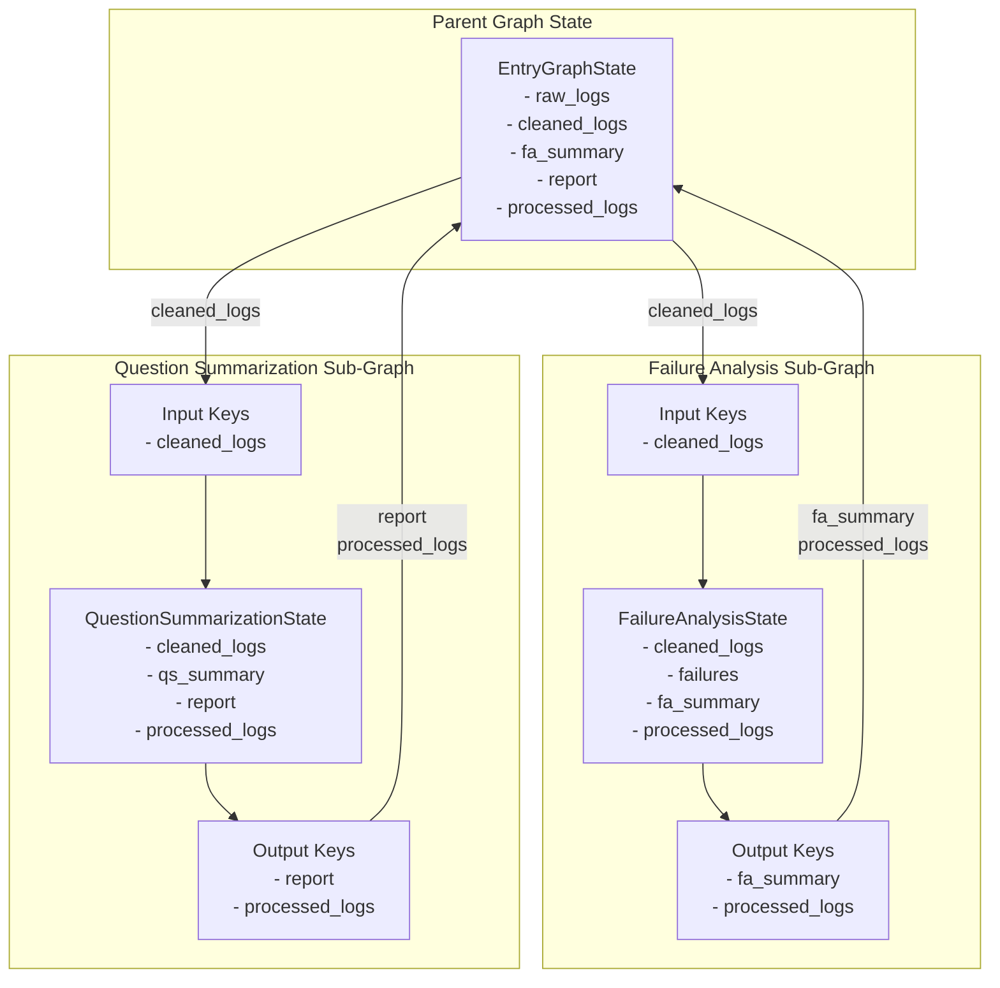
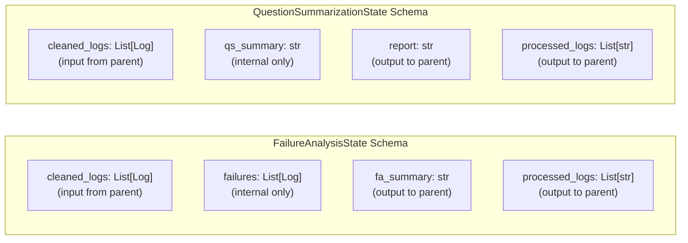
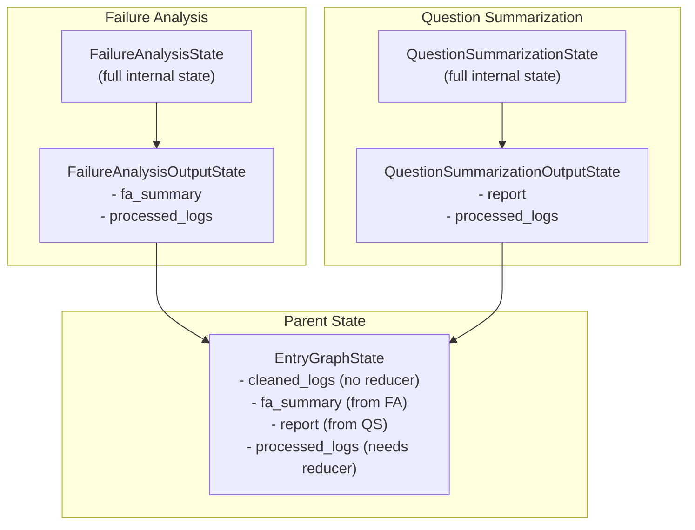
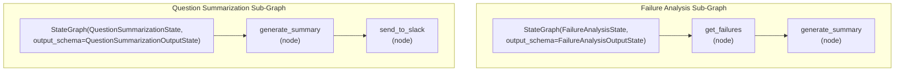
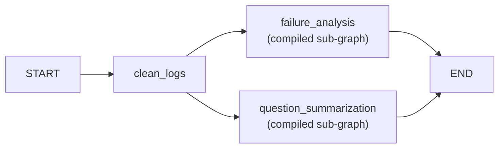
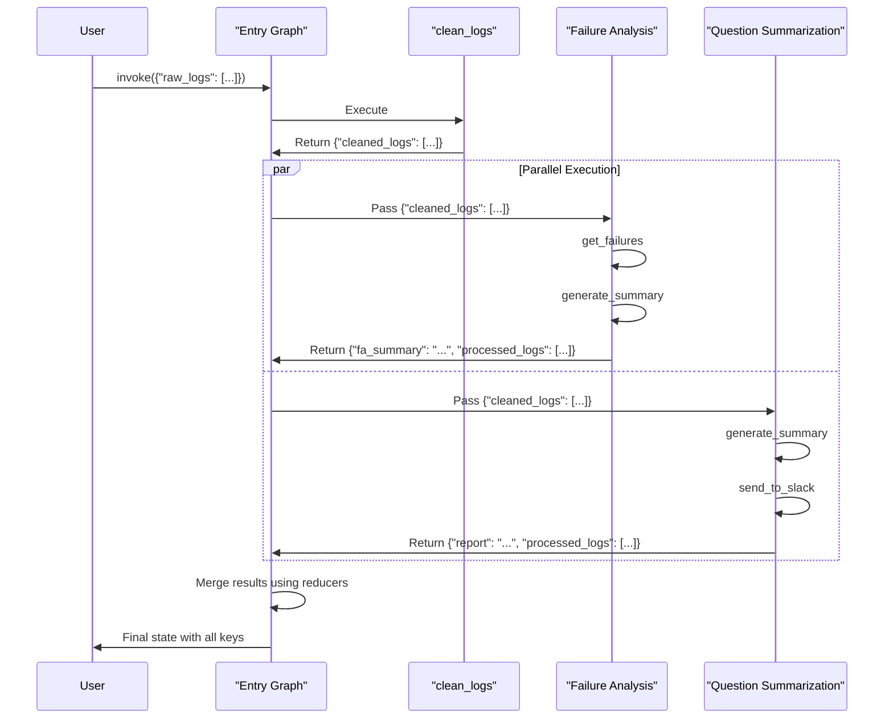

<!-- source: DeepWiki mcp.deepwiki.com · repo langchain-ai/langchain-academy · page 7.2 Sub-Graphs for Modularity · fetched 2026-10-26 -->

# Sub-Graphs for Modularity

<details>
<summary>Relevant source files</summary>

The following files were used as context for generating this wiki page:

- [module-4/map-reduce.ipynb](module-4/map-reduce.ipynb)
- [module-4/sub-graph.ipynb](module-4/sub-graph.ipynb)

</details>


## Purpose and Scope

This document explains how to create modular, reusable graph components using sub-graphs in LangGraph. Sub-graphs enable hierarchical graph composition where smaller graphs with independent state schemas can be embedded as nodes within larger graphs. This pattern is essential for building complex multi-agent systems like the research assistant (see [7.4](#7.4)).

For information about parallel execution patterns, see [7.1](#7.1). For general parallelization techniques, see [7.3](#7.3).

---

## Sub-Graph Fundamentals

Sub-graphs are independently compiled StateGraph instances that can be added as nodes to parent graphs. Each sub-graph maintains its own state schema, enabling clean separation of concerns and reusability across different workflows.

**Key Benefits:**
- **Modularity**: Encapsulate distinct workflow logic in separate graphs
- **Independent State**: Each sub-graph manages its own state schema
- **Reusability**: Sub-graphs can be used in multiple parent graphs
- **Parallel Execution**: Multiple sub-graphs can run concurrently
- **State Isolation**: Parent and child graphs communicate via explicit key overlap

Sources: [module-4/sub-graph.ipynb:16-53]()

---

## Communication Pattern: Overlapping Keys



**Title:** Sub-Graph Communication via Overlapping State Keys

Parent graphs pass data to sub-graphs and receive results through overlapping state keys:

1. **Input Keys**: Sub-graphs access specific keys from parent state
2. **Internal State**: Sub-graphs maintain additional internal keys
3. **Output Keys**: Sub-graphs return specific keys to parent state

Sources: [module-4/sub-graph.ipynb:29-47](), [module-4/sub-graph.ipynb:266-274]()

---

## State Schema Design

### Sub-Graph State Definition

Each sub-graph defines its complete internal state, including:
- Keys it will read from the parent (input)
- Keys for internal processing
- Keys it will write back to the parent (output)



**Title:** Sub-Graph State Schema Components

The `FailureAnalysisState` includes:
- `cleaned_logs`: Shared input from parent
- `failures`: Internal processing state
- `fa_summary`: Output to parent
- `processed_logs`: Output to parent (requires reducer)

The `QuestionSummarizationState` includes:
- `cleaned_logs`: Shared input from parent  
- `qs_summary`: Internal processing state
- `report`: Output to parent
- `processed_logs`: Output to parent (requires reducer)

Sources: [module-4/sub-graph.ipynb:145-154](), [module-4/sub-graph.ipynb:206-215]()

---

## Output State Schemas

### Purpose

When multiple sub-graphs run in parallel and return the same keys, the parent state must use reducers to combine the results. However, if sub-graphs return **different** keys, reducers are unnecessary. Output state schemas enable this by filtering which keys are returned from a sub-graph.

### Without Output Schemas

```python
class EntryGraphState(TypedDict):
    cleaned_logs: Annotated[List[Log], add]  # Requires reducer!
    # Both sub-graphs return this key
```

The `cleaned_logs` key needs the `add` reducer because both parallel sub-graphs would return it, causing a conflict.

### With Output Schemas

By defining `FailureAnalysisOutputState` and `QuestionSummarizationOutputState`, each sub-graph only returns distinct keys:



**Title:** Output State Schema Filtering

The output schemas filter the returned keys:
- `FailureAnalysisOutputState` returns only `fa_summary` and `processed_logs`
- `QuestionSummarizationOutputState` returns only `report` and `processed_logs`
- `cleaned_logs` is NOT returned by either sub-graph, so no reducer needed
- `processed_logs` IS returned by both, so it needs the `add` reducer

Sources: [module-4/sub-graph.ipynb:152-154](), [module-4/sub-graph.ipynb:213-215](), [module-4/sub-graph.ipynb:279-297]()

---

## Complete Implementation Pattern

### Step 1: Define Sub-Graph States



**Title:** Sub-Graph Construction with Output Schemas

Each sub-graph is constructed with:
1. A complete state schema for internal processing
2. An output schema to filter returned keys
3. Node functions that operate on the internal state

Sources: [module-4/sub-graph.ipynb:169-177](), [module-4/sub-graph.ipynb:229-237]()

### Step 2: Add Sub-Graphs as Nodes



**Title:** Parent Graph with Sub-Graph Nodes

Sub-graphs are added to the parent using `add_node()`:

```python
entry_builder.add_node("question_summarization", qs_builder.compile())
entry_builder.add_node("failure_analysis", fa_builder.compile())
```

The compiled sub-graphs become nodes that execute their entire internal workflow when reached.

Sources: [module-4/sub-graph.ipynb:332-342]()

### Step 3: Define Parent State

The parent state includes:
- Keys for its own processing
- Keys that sub-graphs will write to
- Reducers for keys written by multiple sub-graphs

| Key | Type | Reducer | Source |
|-----|------|---------|--------|
| `raw_logs` | `List[Log]` | None | Parent input |
| `cleaned_logs` | `List[Log]` | None | Parent processing |
| `fa_summary` | `str` | None | Failure analysis output |
| `report` | `str` | None | Question summarization output |
| `processed_logs` | `List[int]` | `add` | Both sub-graphs output |

The `processed_logs` key uses `Annotated[List[int], add]` because both sub-graphs return it.

Sources: [module-4/sub-graph.ipynb:317-324]()

---

## Execution Flow



**Title:** Sub-Graph Execution Sequence with Parallel Processing

The execution follows this pattern:
1. Parent processes initial state
2. Parent passes overlapping keys to sub-graphs
3. Sub-graphs execute their complete workflows in parallel
4. Output schemas filter returned keys
5. Parent merges results using reducers where needed
6. Final state contains all accumulated results

Sources: [module-4/sub-graph.ipynb:391-409]()

---

## Key Implementation Details

### Node Function Signatures

Sub-graph node functions receive the sub-graph's state:

```python
def get_failures(state: FailureAnalysisState) -> dict:
    cleaned_logs = state["cleaned_logs"]  # Access input
    failures = [log for log in cleaned_logs if "grade" in log]
    return {"failures": failures}  # Update state
```

Sources: [module-4/sub-graph.ipynb:156-160]()

### Compilation Pattern

Sub-graphs are compiled before being added as nodes:

```python
# Compile sub-graph
fa_graph = fa_builder.compile()

# Add compiled graph as node
entry_builder.add_node("failure_analysis", fa_graph)
```

Sources: [module-4/sub-graph.ipynb:334-335]()

### State Flow Visualization

The `xray=1` parameter visualizes internal sub-graph structure:

```python
Image(graph.get_graph(xray=1).draw_mermaid_png())
```

This displays both parent and sub-graph nodes in a single diagram.

Sources: [module-4/sub-graph.ipynb:347-348]()

---

## Use Cases

Sub-graphs are ideal for:

1. **Multi-Agent Systems**: Each agent as a sub-graph with its own state (see [7.4](#7.4))
2. **Reusable Workflows**: Common processing steps used across multiple graphs
3. **Team Organization**: Different teams own different sub-graphs
4. **Parallel Processing**: Independent workflows that can run concurrently
5. **State Isolation**: Components that need separate state management

Sources: [module-4/sub-graph.ipynb:29-40]()

---

## Complete Code Structure

| Component | Type | Purpose |
|-----------|------|---------|
| `FailureAnalysisState` | TypedDict | Full internal state for failure analysis |
| `FailureAnalysisOutputState` | TypedDict | Filtered output keys from failure analysis |
| `get_failures` | Function | Node to extract failed logs |
| `generate_summary` (FA) | Function | Node to summarize failures |
| `QuestionSummarizationState` | TypedDict | Full internal state for question summarization |
| `QuestionSummarizationOutputState` | TypedDict | Filtered output keys from question summarization |
| `generate_summary` (QS) | Function | Node to summarize questions |
| `send_to_slack` | Function | Node to send report |
| `EntryGraphState` | TypedDict | Parent graph state with reducers |
| `clean_logs` | Function | Parent node for data cleaning |

Sources: [module-4/sub-graph.ipynb:145-344]()

---

