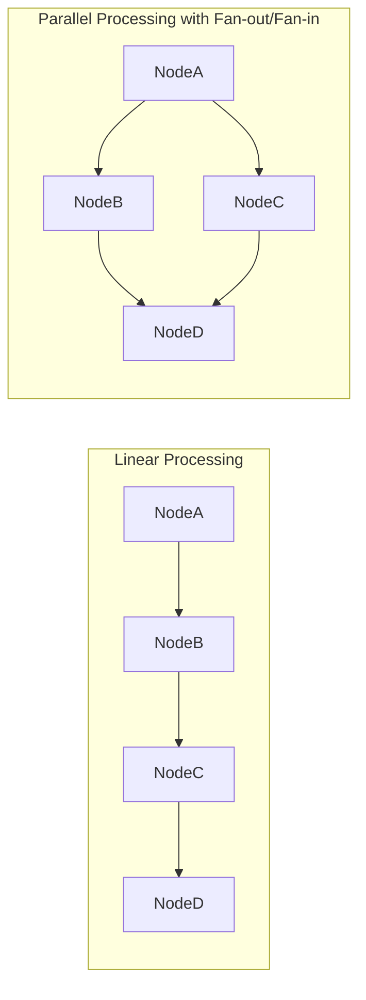
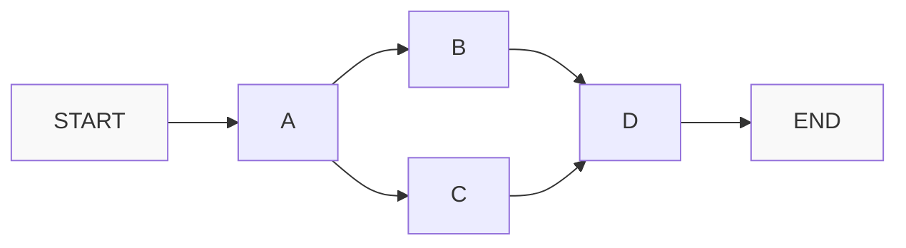
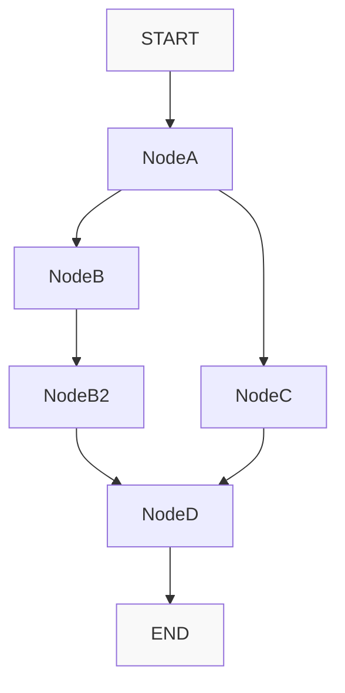
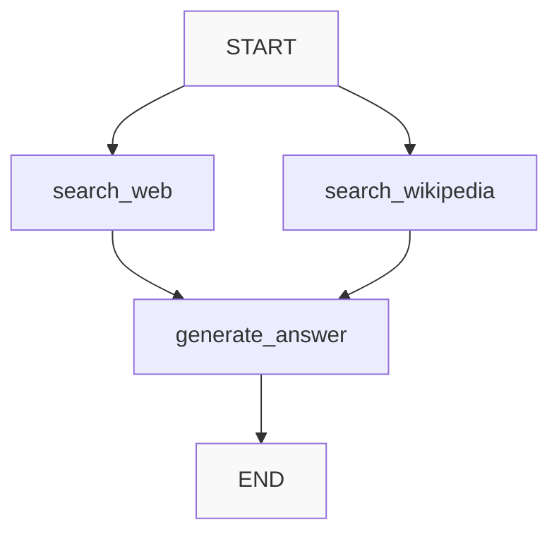

<!-- source: DeepWiki mcp.deepwiki.com · repo langchain-ai/langchain-academy · page 7.3 Parallelization Techniques · fetched 2026-10-26 -->

# Parallelization Techniques

<details>
<summary>Relevant source files</summary>

The following files were used as context for generating this wiki page:

- [module-4/parallelization.ipynb](module-4/parallelization.ipynb)

</details>


This document explains how to execute nodes in parallel within LangGraph, allowing for concurrent processing of different tasks to improve efficiency. Parallelization is essential when building complex agent workflows that need to gather information from multiple sources simultaneously or process data in parallel paths before combining results.

For information about related patterns like Map-Reduce, see [Map-Reduce Pattern](7.1), and for more advanced modular design using sub-graphs, see [Sub-Graphs](7.4).

## Core Concepts: Fan-out and Fan-in

LangGraph allows for executing multiple nodes in parallel by implementing a "fan-out and fan-in" pattern. This pattern consists of:

1. **Fan-out**: Starting from a single node and branching out to multiple parallel nodes
2. **Parallel execution**: Running multiple nodes concurrently
3. **Fan-in**: Combining the results from parallel nodes back into a single path

The key difference from a linear processing flow is shown in the diagram below:



In the parallel processing model, NodeB and NodeC run concurrently after NodeA completes, and NodeD only runs after both NodeB and NodeC have completed.

Sources: [module-4/parallelization.ipynb:166-180]()

## State Updates in Parallel Execution

When executing nodes in parallel, special care must be taken to manage state updates. If parallel nodes try to update the same state key, LangGraph needs a way to handle the conflict.

### The Challenge with Parallel State Updates

The basic challenge is illustrated in this graph, where both Node B and Node C update the same state key after Node A:



Without proper handling, this results in an error:

```
At key 'state': Can receive only one value per step. Use an Annotated key to handle multiple values.
```

Sources: [module-4/parallelization.ipynb:200-245]()

### Using Reducers for Parallel State Updates

To handle parallel state updates, LangGraph uses **reducers** - functions that define how to combine multiple state updates into a single value. The most common reducer is `operator.add` which concatenates lists:

```python
class State(TypedDict):
    # The operator.add reducer fn makes this append-only
    state: Annotated[list, operator.add]
```

With this reducer defined, parallel nodes B and C can both update the same state field, and their updates will be combined into a list.

Sources: [module-4/parallelization.ipynb:285-308]()

## Waiting for Nodes to Complete

In more complex parallel flows, you might have different "branches" with varying numbers of steps. LangGraph handles this by ensuring that all parallel branches complete before continuing to the next step.



In this example, one branch has `A → B → B2 → D` while the other has `A → C → D`. The graph will wait for both branches to complete their execution before continuing to node D.

Sources: [module-4/parallelization.ipynb:360-409]()

## Controlling Execution Order

When parallel nodes run, the order of state updates within a step is not guaranteed. LangGraph determines this order based on graph topology, but you cannot directly control it.

### Custom Reducers for Ordering

You can implement custom reducers to control how state updates are combined. For example, a sorting reducer can ensure that the state updates from parallel nodes are combined in a specific order:

```python
def sorting_reducer(left, right):
    """ Combines and sorts the values in a list"""
    if not isinstance(left, list):
        left = [left]

    if not isinstance(right, list):
        right = [right]
    
    return sorted(left + right, reverse=False)

class State(TypedDict):
    # sorting_reducer will sort the values in state
    state: Annotated[list, sorting_reducer]
```

Sources: [module-4/parallelization.ipynb:477-508]()

## Practical Example: Parallel Search and Retrieval

A common use case for parallelization is gathering information from multiple sources simultaneously. The example below shows how to create a system that searches both Wikipedia and the web in parallel before generating an answer:



This pattern is particularly useful for:
- Retrieving information from multiple sources
- Running different analysis tools on the same input
- Performing independent operations that can be executed simultaneously

Sources: [module-4/parallelization.ipynb:634-713]()

## Implementation of Parallel Nodes

### Setting Up the State

To implement parallel processing, first define a state schema that can handle parallel updates:

```python
class State(TypedDict):
    question: str
    answer: str
    context: Annotated[list, operator.add]
```

The `Annotated[list, operator.add]` syntax tells LangGraph to use the `operator.add` reducer for the `context` field, allowing parallel nodes to append to this list.

Sources: [module-4/parallelization.ipynb:585-594]()

### Node Functions for Parallel Processing

Each node in a parallel process is a function that takes the current state and returns updates:

```python
def search_web(state):
    """ Retrieve docs from web search """
    # Search
    tavily_search = TavilySearchResults(max_results=3)
    search_docs = tavily_search.invoke(state['question'])
    # Format
    formatted_search_docs = "..."
    return {"context": [formatted_search_docs]} 

def search_wikipedia(state):
    """ Retrieve docs from wikipedia """
    # Search
    search_docs = WikipediaLoader(query=state['question'], 
                               load_max_docs=2).load()
    # Format
    formatted_search_docs = "..."
    return {"context": [formatted_search_docs]}
```

These functions run independently and in parallel, with each adding its results to the `context` list.

Sources: [module-4/parallelization.ipynb:640-676]()

### Combining Results

After parallel execution, a final node processes the combined results:

```python
def generate_answer(state):
    """ Node to answer a question """
    # Get state
    context = state["context"]
    question = state["question"]
    # Process combined results
    answer = llm.invoke([...])
    return {"answer": answer}
```

Sources: [module-4/parallelization.ipynb:678-695]()

### Building the Graph

The parallel graph is constructed by:

1. Adding all nodes
2. Creating edges from START to all parallel nodes
3. Creating edges from all parallel nodes to the combining node
4. Creating an edge from the combining node to END

```python
builder = StateGraph(State)
builder.add_node("search_web", search_web)
builder.add_node("search_wikipedia", search_wikipedia)
builder.add_node("generate_answer", generate_answer)

builder.add_edge(START, "search_wikipedia")
builder.add_edge(START, "search_web")
builder.add_edge("search_wikipedia", "generate_answer")
builder.add_edge("search_web", "generate_answer")
builder.add_edge("generate_answer", END)
```

Sources: [module-4/parallelization.ipynb:697-713]()

## Integration with LangGraph API

You can use parallel graphs with the LangGraph API and Studio for visualization and interaction:

```python
thread = await client.threads.create()
input_question = {"question": "How were Nvidia Q2 2024 earnings?"}
async for event in client.runs.stream(thread["thread_id"], 
                                     assistant_id="parallelization", 
                                     input=input_question, 
                                     stream_mode="values"):
    # Check if answer has been added to state  
    answer = event.data.get('answer', None)
    if answer:
        print(answer['content'])
```

This allows you to deploy and interact with parallel processing flows through the LangGraph API.

Sources: [module-4/parallelization.ipynb:778-811]()

## Best Practices for Parallelization

1. **Use Annotated State Keys** - Always use annotated state keys with appropriate reducers for fields that will be updated by parallel nodes.

2. **Consistent Return Types** - Ensure parallel nodes return the same data structure for the fields they update.

3. **Minimize Dependencies** - Design parallel nodes to be as independent as possible to maximize concurrent execution benefits.

4. **Handle Errors Gracefully** - Consider how errors in one parallel branch should affect the overall execution. In some cases, you may want to continue even if one branch fails.

5. **Custom Reducers** - Implement custom reducers for complex state merging requirements beyond simple list concatenation.

Sources: [module-4/parallelization.ipynb:547-558]()

## Summary

Parallelization in LangGraph provides a powerful way to execute multiple operations concurrently, improving efficiency for tasks like multi-source retrieval, distributed processing, and concurrent operations. The fan-out and fan-in pattern, combined with appropriate state management through reducers, allows for building complex parallel workflows while maintaining clean data flow and state consistency.

---

