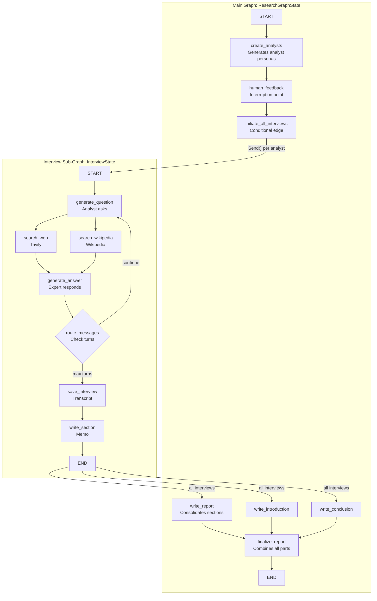
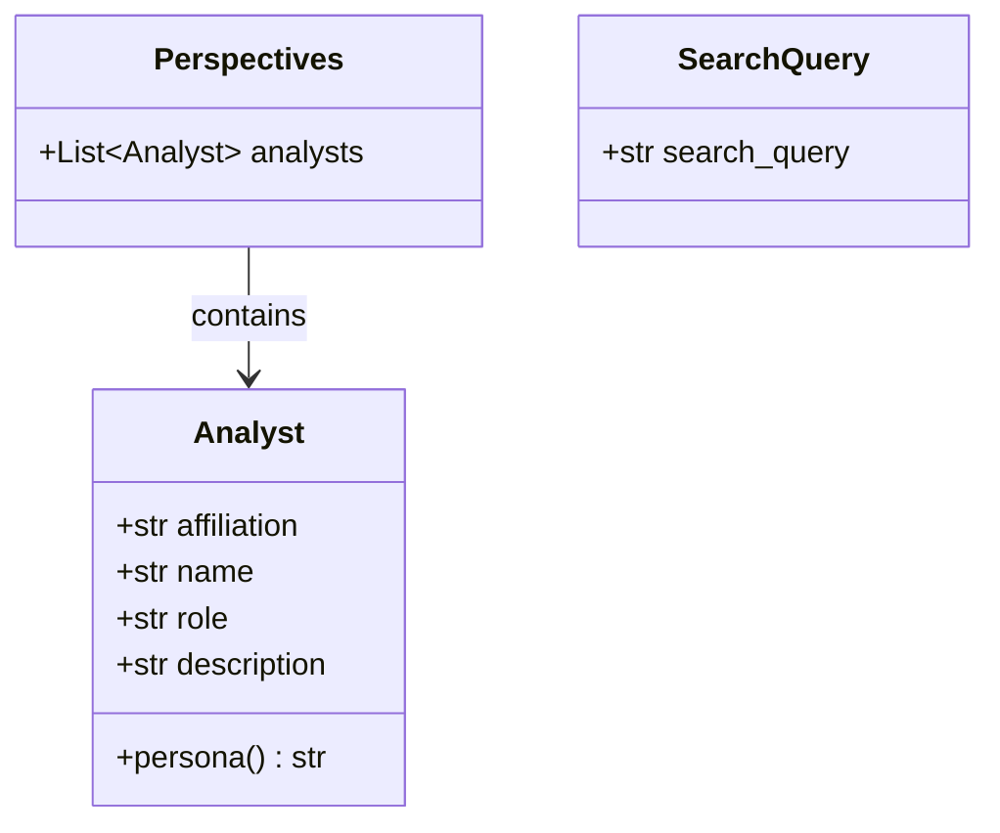
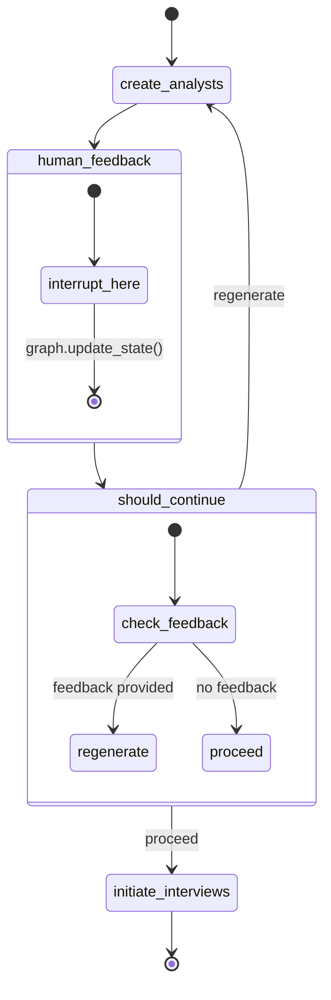
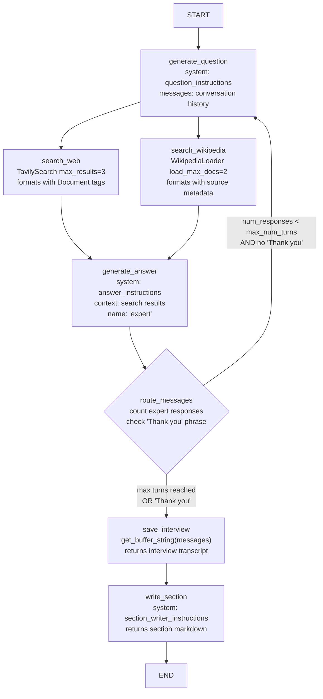
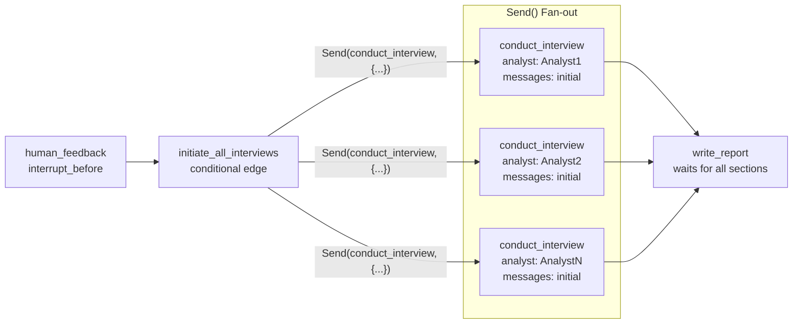
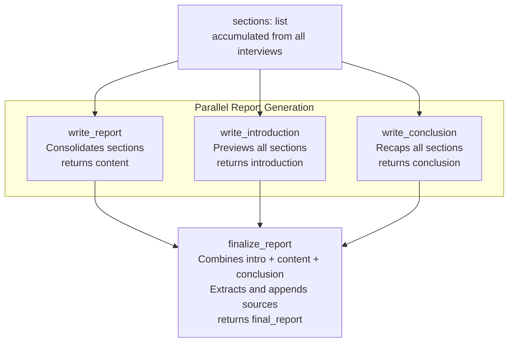

<!-- source: DeepWiki mcp.deepwiki.com · repo langchain-ai/langchain-academy · page 7.4 Multi-Agent Research Assistant · fetched 2026-10-26 -->

# Multi-Agent Research Assistant

<details>
<summary>Relevant source files</summary>

The following files were used as context for generating this wiki page:

- [module-0/basics.ipynb](module-0/basics.ipynb)
- [module-4/research-assistant.ipynb](module-4/research-assistant.ipynb)
- [module-4/studio/parallelization.py](module-4/studio/parallelization.py)
- [module-4/studio/research_assistant.py](module-4/studio/research_assistant.py)
- [requirements.txt](requirements.txt)

</details>


## Purpose and Scope

This document describes the Multi-Agent Research Assistant, a sophisticated LangGraph application that automates research and report generation through coordinated AI analysts. The system demonstrates the integration of human-in-the-loop approval, parallel sub-graph execution via the Send API, and multi-stage report synthesis.

For information about the Send API and map-reduce fundamentals, see [Map-Reduce Pattern](#7.1). For sub-graph concepts, see [Sub-Graphs for Modularity](#7.2). For parallel execution patterns, see [Parallelization Techniques](#7.3).

**Sources:** [module-4/research-assistant.ipynb:17-59]()

## System Architecture Overview

The research assistant consists of three main phases: analyst generation with human approval, parallel interview execution, and report compilation. Each interview runs as an independent sub-graph with its own state and conversation loop.



**Sources:** [module-4/research-assistant.ipynb:186-269](), [module-4/studio/research_assistant.py:359-377,526-544]()

## State Schemas

The system uses three distinct state schemas for different graph scopes.

### Analyst Data Models



`Analyst` is a Pydantic BaseModel defining individual analyst personas. The `persona` property formats the analyst's attributes into a prompt-ready string for the LLM.

**Sources:** [module-4/research-assistant.ipynb:147-172](), [module-4/studio/research_assistant.py:20-40]()

### GenerateAnalystsState

`GenerateAnalystsState` manages the analyst creation phase:

| Field | Type | Purpose |
|-------|------|---------|
| `topic` | `str` | Research topic provided by user |
| `max_analysts` | `int` | Number of analyst personas to generate |
| `human_analyst_feedback` | `str` | Editorial feedback to refine analysts |
| `analysts` | `List[Analyst]` | Generated analyst personas |

**Sources:** [module-4/research-assistant.ipynb:173-178](), [module-4/studio/research_assistant.py:42-46]()

### InterviewState

`InterviewState` extends `MessagesState` for individual interview sub-graphs:

| Field | Type | Reducer | Purpose |
|-------|------|---------|---------|
| (inherited) | `List[BaseMessage]` | `add_messages` | Conversation history |
| `max_num_turns` | `int` | None | Maximum question-answer rounds |
| `context` | `list` | `operator.add` | Accumulated source documents |
| `analyst` | `Analyst` | None | Analyst conducting interview |
| `interview` | `str` | None | Formatted transcript |
| `sections` | `list` | None | Written section (for Send to outer state) |

The `context` field uses `operator.add` as a reducer to safely aggregate documents from parallel search operations.

**Sources:** [module-4/research-assistant.ipynb:48-53](), [module-4/studio/research_assistant.py:48-53]()

### ResearchGraphState

`ResearchGraphState` manages the outer graph state:

| Field | Type | Reducer | Purpose |
|-------|------|---------|---------|
| `topic` | `str` | None | Research topic |
| `max_analysts` | `int` | None | Number of analysts |
| `human_analyst_feedback` | `str` | None | Human feedback |
| `analysts` | `List[Analyst]` | None | Generated analysts |
| `sections` | `list` | `operator.add` | Aggregated sections from all interviews |
| `introduction` | `str` | None | Report introduction |
| `content` | `str` | None | Main report body |
| `conclusion` | `str` | None | Report conclusion |
| `final_report` | `str` | None | Complete formatted report |

The `sections` field uses `operator.add` to safely collect sections from parallel interview executions via the Send API.

**Sources:** [module-4/research-assistant.ipynb:58-67](), [module-4/studio/research_assistant.py:58-67]()

## Analyst Generation Phase

The analyst generation phase creates specialized personas and allows human review before proceeding.



### create_analysts Node

The `create_analysts` node generates analyst personas using structured output:

1. Formats the `analyst_instructions` prompt with topic, feedback, and max_analysts
2. Uses `llm.with_structured_output(Perspectives)` to enforce schema
3. Invokes LLM with SystemMessage containing instructions
4. Returns `{"analysts": analysts.analysts}` to state

**Sources:** [module-4/research-assistant.ipynb:203-238](), [module-4/studio/research_assistant.py:71-106]()

### human_feedback Interruption

The `human_feedback` node is a no-op function that serves as an interruption point. The graph is compiled with `interrupt_before=['human_feedback']`, causing execution to pause when reaching this node.

Users can:
- Call `graph.get_state(thread)` to inspect generated analysts
- Call `graph.update_state(thread, {"human_analyst_feedback": "..."}, as_node="human_feedback")` to provide feedback
- Call `graph.stream(None, thread)` to resume execution

If feedback is provided, the `should_continue` conditional edge routes back to `create_analysts` for regeneration. If `human_analyst_feedback` is `None`, execution proceeds to interview initiation.

**Sources:** [module-4/research-assistant.ipynb:240-447](), [module-4/studio/research_assistant.py:108-110]()

### Execution Example

```python
# Initial invocation
graph.stream({"topic": topic, "max_analysts": 3}, thread)

# Inspect and provide feedback
graph.update_state(thread, 
    {"human_analyst_feedback": "Add entrepreneur perspective"}, 
    as_node="human_feedback")

# Continue with regeneration
graph.stream(None, thread)

# Approve by providing no feedback
graph.update_state(thread, {"human_analyst_feedback": None}, 
    as_node="human_feedback")

# Continue to interviews
graph.stream(None, thread)
```

**Sources:** [module-4/research-assistant.ipynb:300-461]()

## Interview Sub-Graph

Each interview executes as an independent sub-graph with cyclic conversation flow.



### Question Generation

The `generate_question` node creates analyst questions:

1. Retrieves `analyst.persona` and conversation `messages` from state
2. Formats `question_instructions` with analyst's goals
3. Invokes LLM with SystemMessage + conversation history
4. Returns AIMessage as new question

The analyst is instructed to introduce themselves on first turn and signal completion with "Thank you so much for your help!" when satisfied.

**Sources:** [module-4/research-assistant.ipynb:113-144](), [module-4/studio/research_assistant.py:112-144]()

### Parallel Search Operations

Both `search_web` and `search_wikipedia` execute in parallel after question generation:

**search_web:**
1. Uses `llm.with_structured_output(SearchQuery)` to extract search query from conversation
2. Invokes `TavilySearch(max_results=3)`
3. Formats results with `<Document href="...">` tags
4. Returns `{"context": [formatted_docs]}`

**search_wikipedia:**
1. Extracts search query via structured output
2. Uses `WikipediaLoader(query=..., load_max_docs=2).load()`
3. Formats with source and page metadata
4. Returns `{"context": [formatted_docs]}`

The `context` reducer (`operator.add`) safely merges results from both searches.

**Sources:** [module-4/research-assistant.ipynb:146-202](), [module-4/studio/research_assistant.py:146-202]()

### Answer Generation

The `generate_answer` node produces expert responses:

1. Formats `answer_instructions` with analyst persona and accumulated context
2. Invokes LLM with SystemMessage + conversation messages
3. Sets `answer.name = "expert"` to track response count
4. Returns `{"messages": [answer]}`

The expert is instructed to cite sources using `[1]`, `[2]` notation and list sources at the end.

**Sources:** [module-4/research-assistant.ipynb:204-250](), [module-4/studio/research_assistant.py:204-250]()

### Conversation Control

The `route_messages` function controls the interview loop:

```python
def route_messages(state: InterviewState, name: str = "expert"):
    messages = state["messages"]
    max_num_turns = state.get('max_num_turns', 2)
    
    # Count expert responses
    num_responses = len([m for m in messages 
                         if isinstance(m, AIMessage) and m.name == name])
    
    # Check turn limit
    if num_responses >= max_num_turns:
        return 'save_interview'
    
    # Check completion phrase
    last_question = messages[-2]
    if "Thank you so much for your help" in last_question.content:
        return 'save_interview'
    
    return "ask_question"
```

Routes to `save_interview` when max turns reached or analyst signals completion, otherwise continues to `ask_question`.

**Sources:** [module-4/research-assistant.ipynb:265-289](), [module-4/studio/research_assistant.py:265-289]()

### Interview Persistence and Section Writing

`save_interview` converts the conversation to a string using `get_buffer_string(messages)` and stores it in the `interview` field.

`write_section` generates a markdown section from the interview:

1. Formats `section_writer_instructions` with analyst's focus area
2. Provides the accumulated `context` documents as source material
3. Invokes LLM to write structured markdown with:
   - `##` title based on analyst focus
   - `###` subsections for summary and sources
   - Numbered citations (e.g., `[1]`)
   - Source list with no duplicates
4. Returns `{"sections": [section.content]}` for aggregation in outer state

**Sources:** [module-4/research-assistant.ipynb:252-357](), [module-4/studio/research_assistant.py:252-357]()

## Parallel Interview Execution

The system uses the Send API to fan out interview sub-graphs in parallel.



### initiate_all_interviews Conditional Edge

The `initiate_all_interviews` function implements the Send API pattern:

```python
def initiate_all_interviews(state: ResearchGraphState):
    human_analyst_feedback = state.get('human_analyst_feedback', 'approve')
    
    # Check for rejection
    if human_analyst_feedback.lower() != 'approve':
        return "create_analysts"
    
    # Fan out to parallel interviews
    topic = state["topic"]
    return [Send("conduct_interview", {
        "analyst": analyst,
        "messages": [HumanMessage(content=f"So you said you were writing an article on {topic}?")]
    }) for analyst in state["analysts"]]
```

Each `Send` invocation:
- Targets the `conduct_interview` node (the compiled interview sub-graph)
- Provides independent `InterviewState` with specific analyst and initial message
- Executes in parallel with other interviews

The sub-graph's `sections` field is duplicated into the outer `ResearchGraphState.sections` list via the `operator.add` reducer.

**Sources:** [module-4/research-assistant.ipynb:378-395](), [module-4/studio/research_assistant.py:378-395]()

## Report Synthesis Phase

After all interviews complete, the system synthesizes the final report through multiple stages.



### write_report Node

The `write_report` node consolidates analyst sections:

1. Retrieves all `sections` from state
2. Concatenates sections with `\n\n` separators
3. Formats `report_writer_instructions` with topic and formatted sections
4. Invokes LLM to:
   - Analyze insights from each section
   - Create cohesive narrative tying central ideas
   - Preserve citations from sections
   - Create consolidated source list with `## Sources` header
5. Returns `{"content": report.content}`

**Sources:** [module-4/research-assistant.ipynb:397-446](), [module-4/studio/research_assistant.py:397-446]()

### Introduction and Conclusion

Both `write_introduction` and `write_conclusion` use the same instruction template with different final prompts:

**write_introduction:**
- Creates compelling title with `#` header
- Uses `## Introduction` section header
- Previews all sections in ~100 words
- Returns `{"introduction": intro.content}`

**write_conclusion:**
- Uses `## Conclusion` section header
- Recaps all sections in ~100 words
- Returns `{"conclusion": conclusion.content}`

These nodes execute in parallel with `write_report`.

**Sources:** [module-4/research-assistant.ipynb:448-503](), [module-4/studio/research_assistant.py:448-503]()

### finalize_report Node

The `finalize_report` node combines all report components:

1. Retrieves `introduction`, `content`, and `conclusion` from state
2. Strips `## Insights` header from content if present
3. Extracts sources section if it exists using `content.split("\n## Sources\n")`
4. Concatenates: `introduction + "\n\n---\n\n" + content + "\n\n---\n\n" + conclusion`
5. Appends sources section if present
6. Returns `{"final_report": final_report}`

**Sources:** [module-4/research-assistant.ipynb:505-524](), [module-4/studio/research_assistant.py:505-524]()

## Code Organization

### Notebook Implementation

The notebook [module-4/research-assistant.ipynb]() demonstrates the system incrementally:

1. **Lines 140-269:** Analyst generation graph with human-in-the-loop demonstration
2. **Lines 300-472:** Full execution with interruption handling, state updates, and feedback loop
3. **Lines 500-1175:** Complete interview sub-graph and outer graph construction
4. **Lines 1200-end:** Full system execution with example topic

The notebook uses inline graph visualization with `display(Image(graph.get_graph(xray=1).draw_mermaid_png()))` to show structure.

**Sources:** [module-4/research-assistant.ipynb:1-end]()

### Studio Implementation

The production implementation [module-4/studio/research_assistant.py]() is structured for LangGraph Studio deployment:

| Lines | Component | Purpose |
|-------|-----------|---------|
| 1-12 | Imports and LLM | Dependencies and ChatOpenAI initialization |
| 20-67 | Schemas | Pydantic models and TypedDict state definitions |
| 71-110 | Analyst generation | create_analysts, human_feedback nodes |
| 112-289 | Interview nodes | Question, search, answer, routing logic |
| 291-357 | Section writing | save_interview, write_section nodes |
| 359-377 | Interview graph | Sub-graph compilation with StateGraph(InterviewState) |
| 378-395 | Send API | initiate_all_interviews conditional edge |
| 397-524 | Report synthesis | write_report, intro, conclusion, finalize nodes |
| 526-547 | Main graph | ResearchGraphState graph compilation and edges |

The main graph is compiled with `interrupt_before=['human_feedback']` for human approval workflow.

**Sources:** [module-4/studio/research_assistant.py:1-547]()

### Key Differences

| Aspect | Notebook | Studio |
|--------|----------|--------|
| Purpose | Educational demonstration | Production deployment |
| Organization | Incremental cells | Single module |
| Execution | Step-by-step with output | Compiled graph for runtime |
| Visualization | Inline image display | Studio UI visualization |
| Configuration | In-cell variables | Environment variables via .env |

Both implementations share identical graph logic and node functions.

**Sources:** [module-4/research-assistant.ipynb:1-end](), [module-4/studio/research_assistant.py:1-547]()

## Related Patterns

This application integrates several advanced LangGraph patterns:

- **Map-Reduce:** Send API fan-out for parallel interviews, operator.add reducer for aggregation. See [Map-Reduce Pattern](#7.1).
- **Sub-Graphs:** Interview sub-graph with independent InterviewState. See [Sub-Graphs for Modularity](#7.2).
- **Parallelization:** Parallel search operations and parallel report section writing. See [Parallelization Techniques](#7.3).
- **Human-in-the-Loop:** Interrupt before human_feedback node with update_state. See [Breakpoints and Interruptions](#6.1).
- **State Management:** Multiple state schemas with appropriate reducers. See [State Schemas and Reducers](#5.1).

**Sources:** [module-4/research-assistant.ipynb:17-59]()

---

