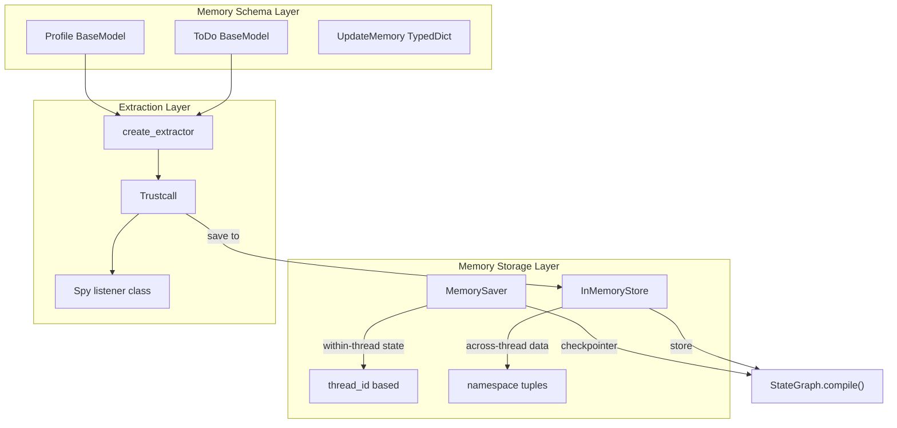
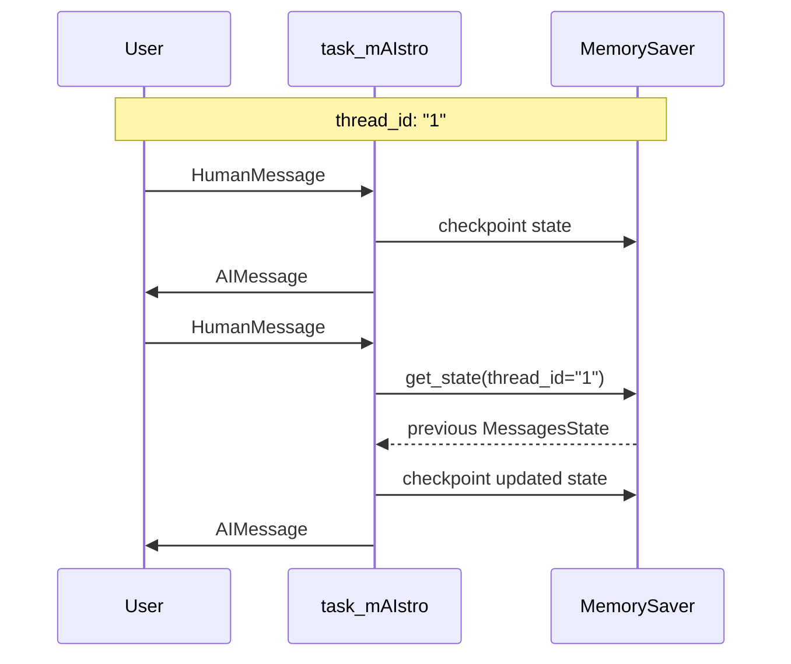
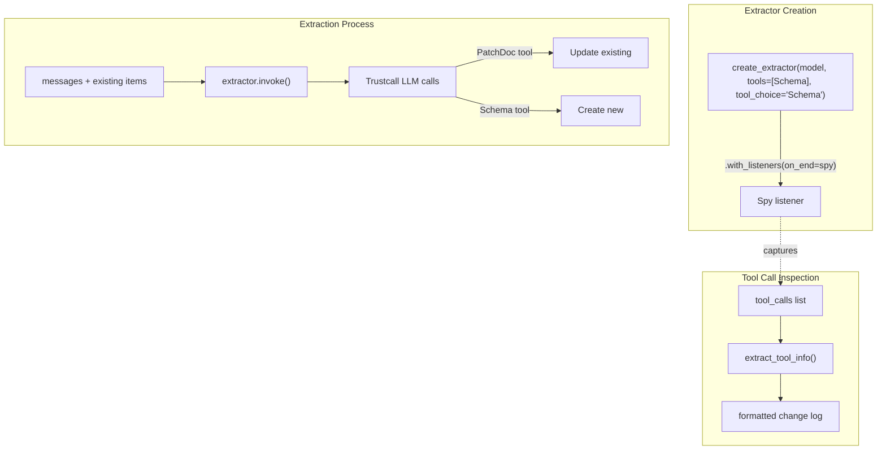
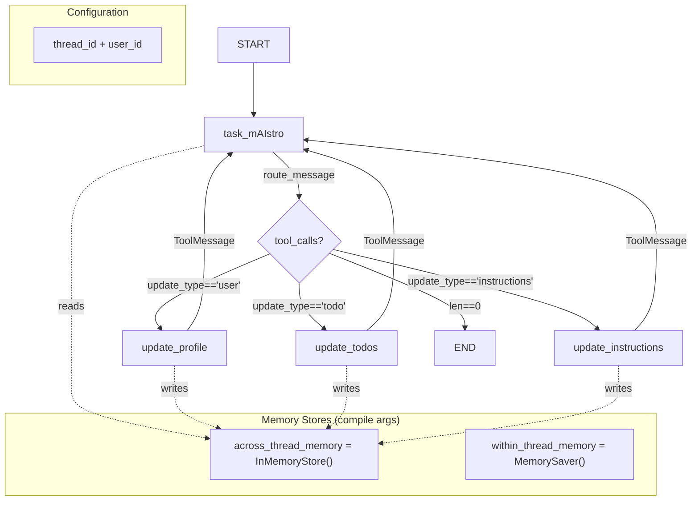
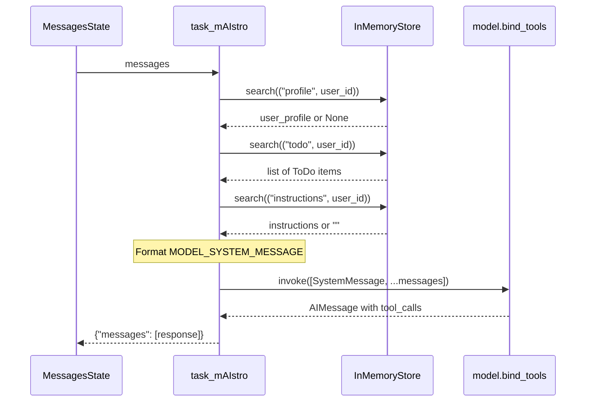
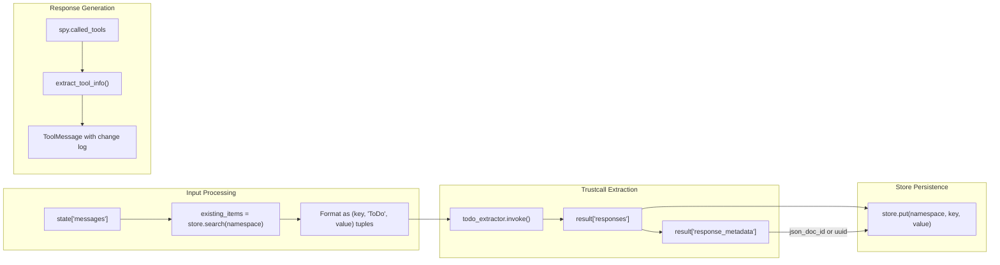

<!-- source: DeepWiki mcp.deepwiki.com · repo langchain-ai/langchain-academy · page 8 Memory Systems · fetched 2026-10-26 -->

# Memory Systems

<details>
<summary>Relevant source files</summary>

The following files were used as context for generating this wiki page:

- [module-5/memory_agent.ipynb](module-5/memory_agent.ipynb)
- [module-5/studio/memory_agent.py](module-5/studio/memory_agent.py)

</details>


## Purpose and Scope

This document covers memory systems in LangGraph, which allow agents to maintain state and context over time. We'll explore how to design memory schemas, connect to memory stores, extract information for storage, and implement agents with both short-term (within-session) and long-term (across-session) memory capabilities.

For information about basic state management without persistent memory, see [State Management](#5).

## Memory Architecture Overview

LangGraph memory systems use two distinct storage mechanisms: `MemorySaver` for within-thread state and `InMemoryStore` for across-thread persistence.



Sources: [module-5/memory_agent.ipynb:841-847](), [module-5/studio/memory_agent.py:16-20](), [module-5/studio/memory_agent.py:393]()

### Short-Term Memory (MemorySaver)

`MemorySaver` stores `MessagesState` within a conversation thread, keyed by `thread_id`. This enables conversation continuity within a single session.



Sources: [module-5/memory_agent.ipynb:841-847](), [module-5/studio/memory_agent.py:393]()

### Long-Term Memory (InMemoryStore)

`InMemoryStore` persists structured data across conversation threads, keyed by `(namespace, user_id)` tuples. The task_mAIstro agent uses three namespaces:

- `("profile", user_id)`: User profile data
- `("todo", user_id)`: ToDo items collection
- `("instructions", user_id)`: User preferences

Data persists across different `thread_id` values for the same `user_id`.

```mermaid
graph LR
    subgraph "Thread 1"
        T1[thread_id: "1"] --> TM1[task_mAIstro]
    end
    
    subgraph "Thread 2"
        T2[thread_id: "2"] --> TM2[task_mAIstro]
    end
    
    subgraph "InMemoryStore"
        P["('profile', 'Lance')"]
        TD["('todo', 'Lance')"]
        I["('instructions', 'Lance')"]
    end
    
    TM1 -.-> P
    TM1 -.-> TD
    TM1 -.-> I
    TM2 -.-> P
    TM2 -.-> TD
    TM2 -.-> I
```

Sources: [module-5/memory_agent.ipynb:841-847](), [module-5/memory_agent.ipynb:668-686](), [module-5/studio/memory_agent.py:213-231]()

## Memory Schemas

Three Pydantic/TypedDict schemas define memory structure:

| Schema | Type | Purpose | Fields |
|--------|------|---------|--------|
| `Profile` | `BaseModel` | User information | `name`, `location`, `job`, `connections`, `interests` |
| `ToDo` | `BaseModel` | Task tracking | `task`, `time_to_complete`, `deadline`, `solutions`, `status` |
| `UpdateMemory` | `TypedDict` | Tool routing | `update_type: Literal['user', 'todo', 'instructions']` |

```mermaid
classDiagram
    class Profile {
        <<BaseModel>>
        +name: Optional[str]
        +location: Optional[str]
        +job: Optional[str]
        +connections: list[str]
        +interests: list[str]
    }
    
    class ToDo {
        <<BaseModel>>
        +task: str
        +time_to_complete: Optional[int]
        +deadline: Optional[datetime]
        +solutions: list[str]
        +status: Literal
    }
    
    class UpdateMemory {
        <<TypedDict>>
        +update_type: Literal
    }
    
    Profile -.-> profile_extractor
    ToDo -.-> todo_extractor
    UpdateMemory -.-> model.bind_tools
```

The `UpdateMemory` tool determines which memory update node to execute via `route_message()`.

Sources: [module-5/memory_agent.ipynb:554-586](), [module-5/memory_agent.ipynb:491-494](), [module-5/studio/memory_agent.py:88-125]()

## Trustcall Integration

`create_extractor()` from the trustcall library constructs extractors that convert conversation text into structured Pydantic objects. Two extractors are used:

| Extractor | Schema | Enable Inserts | Usage |
|-----------|--------|----------------|-------|
| `profile_extractor` | `Profile` | False | Update user profile |
| `todo_extractor` | `ToDo` | True | Create/update ToDo items |



### Spy Class

The `Spy` class captures Trustcall's internal tool calls, enabling visibility into what changes were made:

```python
class Spy:
    def __init__(self):
        self.called_tools = []
    def __call__(self, run):
        # Traverses run tree to collect tool_calls from chat_model runs
```

When Trustcall updates an existing ToDo item, `Spy.called_tools` contains both `PatchDoc` (for updates) and `ToDo` (for new items). The `extract_tool_info()` function parses these to generate user-facing change descriptions.

Sources: [module-5/memory_agent.ipynb:127-164](), [module-5/memory_agent.ipynb:411-458](), [module-5/studio/memory_agent.py:26-83]()

## Namespace Organization

`InMemoryStore` uses `(type, user_id)` tuples to partition memory:

```python
namespace = ("profile", user_id)       # Single profile document
namespace = ("todo", user_id)          # Collection of ToDo items
namespace = ("instructions", user_id)  # Single instructions document
```

Store operations:

```python
# Search namespace (returns list of Item objects)
memories = store.search(namespace)

# Put item in namespace
store.put(namespace, key, value_dict)

# Get specific item
item = store.get(namespace, key)
```

Each node function receives `store: BaseStore` as a parameter and uses these operations to read/write memory.

Sources: [module-5/memory_agent.ipynb:668-686](), [module-5/memory_agent.ipynb:741-756](), [module-5/studio/memory_agent.py:213-231]()

## task_mAIstro Agent Graph

The agent uses a cyclic graph pattern where the main node routes to memory update nodes, which return to the main node:



### Node Functions

| Node | Purpose | Memory Operation | Returns |
|------|---------|------------------|---------|
| `task_mAIstro` | Main agent logic | `store.search()` to load memories | AIMessage with `UpdateMemory` tool calls |
| `update_profile` | Update user profile | `store.put()` with `profile_extractor` | ToolMessage |
| `update_todos` | Update ToDo list | `store.put()` with `todo_extractor` | ToolMessage with change log |
| `update_instructions` | Update preferences | `store.put()` with LLM-generated instructions | ToolMessage |
| `route_message` | Conditional router | None | Node name string or END |

Sources: [module-5/memory_agent.ipynb:827-847](), [module-5/studio/memory_agent.py:204-393]()

## Node Implementation Details

### task_mAIstro Function

Main node that loads memories, formats system prompt, and calls LLM with `UpdateMemory` tool:



Key steps in [module-5/studio/memory_agent.py:204-238]():
1. Extract `user_id` from `config["configurable"]`
2. Search three namespaces: `("profile", user_id)`, `("todo", user_id)`, `("instructions", user_id)`
3. Format `MODEL_SYSTEM_MESSAGE` with retrieved memories
4. Call `model.bind_tools([UpdateMemory])` with formatted prompt + message history
5. Return AIMessage (may contain `UpdateMemory` tool call)

Sources: [module-5/memory_agent.ipynb:660-693](), [module-5/studio/memory_agent.py:204-238]()

### update_todos Function

Updates ToDo items using Trustcall extraction with `enable_inserts=True`:



Implementation pattern in [module-5/studio/memory_agent.py:280-333]():
1. Create `namespace = ("todo", user_id)`
2. Retrieve `existing_items` via `store.search(namespace)`
3. Format as `[(key, "ToDo", value)]` for Trustcall
4. Create `todo_extractor` with `Spy` listener
5. Invoke extractor with `TRUSTCALL_INSTRUCTION_FORMATTED + messages`
6. Save `result["responses"]` to store with `json_doc_id` as key
7. Return ToolMessage with formatted changes from `extract_tool_info()`

Sources: [module-5/memory_agent.ipynb:733-785](), [module-5/studio/memory_agent.py:280-333]()

### route_message Function

Conditional edge function that inspects `tool_calls` to determine next node:

```python
# From module-5/studio/memory_agent.py:359-374
def route_message(state: MessagesState, config: RunnableConfig, store: BaseStore):
    message = state['messages'][-1]
    if len(message.tool_calls) == 0:
        return END
    else:
        tool_call = message.tool_calls[0]
        if tool_call['args']['update_type'] == "user":
            return "update_profile"
        elif tool_call['args']['update_type'] == "todo":
            return "update_todos"
        elif tool_call['args']['update_type'] == "instructions":
            return "update_instructions"
```

Returns a string matching node name or `END` constant. The `update_type` field comes from the `UpdateMemory` TypedDict bound as a tool to the model in `task_mAIstro`.

Sources: [module-5/memory_agent.ipynb:809-824](), [module-5/studio/memory_agent.py:359-374]()

## Graph Construction

Graph assembly in [module-5/studio/memory_agent.py:377-393]():

```python
builder = StateGraph(MessagesState, config_schema=configuration.Configuration)

builder.add_node(task_mAIstro)
builder.add_node(update_todos)
builder.add_node(update_profile)
builder.add_node(update_instructions)

builder.add_edge(START, "task_mAIstro")
builder.add_conditional_edges("task_mAIstro", route_message)
builder.add_edge("update_todos", "task_mAIstro")
builder.add_edge("update_profile", "task_mAIstro")
builder.add_edge("update_instructions", "task_mAIstro")

graph = builder.compile()
```

The compiled graph is deployed to LangGraph Studio where `MemorySaver` and `InMemoryStore` instances are injected at runtime. The cyclic edges (`update_*` → `task_mAIstro`) enable iterative memory updates followed by final response generation.

Sources: [module-5/memory_agent.ipynb:827-850](), [module-5/studio/memory_agent.py:377-393]()

## Cross-Session Memory Access

Different `thread_id` values access the same `user_id` memories:

```python
# Session 1 - Create profile and ToDo
config = {"configurable": {"thread_id": "1", "user_id": "Lance"}}
graph.stream({"messages": [HumanMessage("My name is Lance...")]}, config)

# Session 2 - Access same memories with different thread_id
config = {"configurable": {"thread_id": "2", "user_id": "Lance"}}
graph.stream({"messages": [HumanMessage("What tasks can I get done?")]}, config)
```

Memory persistence table:

| Memory Type | Storage | Key | Persistence Scope |
|-------------|---------|-----|-------------------|
| Conversation history | MemorySaver | `thread_id` | Single session |
| Profile data | InMemoryStore | `("profile", user_id)` | All sessions for user |
| ToDo items | InMemoryStore | `("todo", user_id)` | All sessions for user |
| Instructions | InMemoryStore | `("instructions", user_id)` | All sessions for user |

Thread 2 has no `MessagesState` from thread 1, but shares all `InMemoryStore` data for `user_id="Lance"`.

Sources: [module-5/memory_agent.ipynb:880-891](), [module-5/memory_agent.ipynb:1203-1213]()

## Tool Call Inspection

`extract_tool_info()` parses `Spy.called_tools` to generate change descriptions for ToolMessage content:

```python
# From module-5/studio/memory_agent.py:42-83
def extract_tool_info(tool_calls, schema_name="Memory"):
    changes = []
    for call_group in tool_calls:
        for call in call_group:
            if call['name'] == 'PatchDoc':  # Trustcall update tool
                changes.append({
                    'type': 'update',
                    'doc_id': call['args']['json_doc_id'],
                    'planned_edits': call['args']['planned_edits'],
                    'value': call['args']['patches'][0]['value']
                })
            elif call['name'] == schema_name:  # New document creation
                changes.append({'type': 'new', 'value': call['args']})
    
    # Format as string for ToolMessage content
    result_parts = []
    for change in changes:
        if change['type'] == 'update':
            result_parts.append(f"Document {change['doc_id']} updated:\n"
                               f"Plan: {change['planned_edits']}\n"
                               f"Added content: {change['value']}")
        else:
            result_parts.append(f"New {schema_name} created:\n"
                               f"Content: {change['value']}")
    return "\n\n".join(result_parts)
```

This formatted string becomes the `content` field of the ToolMessage returned by `update_todos()`, informing `task_mAIstro` what memory operations occurred.

Sources: [module-5/memory_agent.ipynb:411-458](), [module-5/studio/memory_agent.py:42-83]()

## Conclusion

Memory systems in LangGraph provide powerful capabilities for maintaining context and personalizing interactions over time. By using a combination of short-term and long-term memory, structured schemas, and sophisticated extraction techniques, agents can remember user information, preferences, and tasks across multiple conversations.

The task_mAIstro agent demonstrates these capabilities, using:

1. Short-term memory (MemorySaver) for within-session context
2. Long-term memory (InMemoryStore) for across-session persistence
3. Structured schemas (Profile, ToDo) for organizing memory
4. Trustcall for extracting and updating memory
5. A graph-based architecture for handling different memory operations

This approach enables building more helpful, context-aware, and personalized agents that can maintain meaningful interactions with users over time.

---

