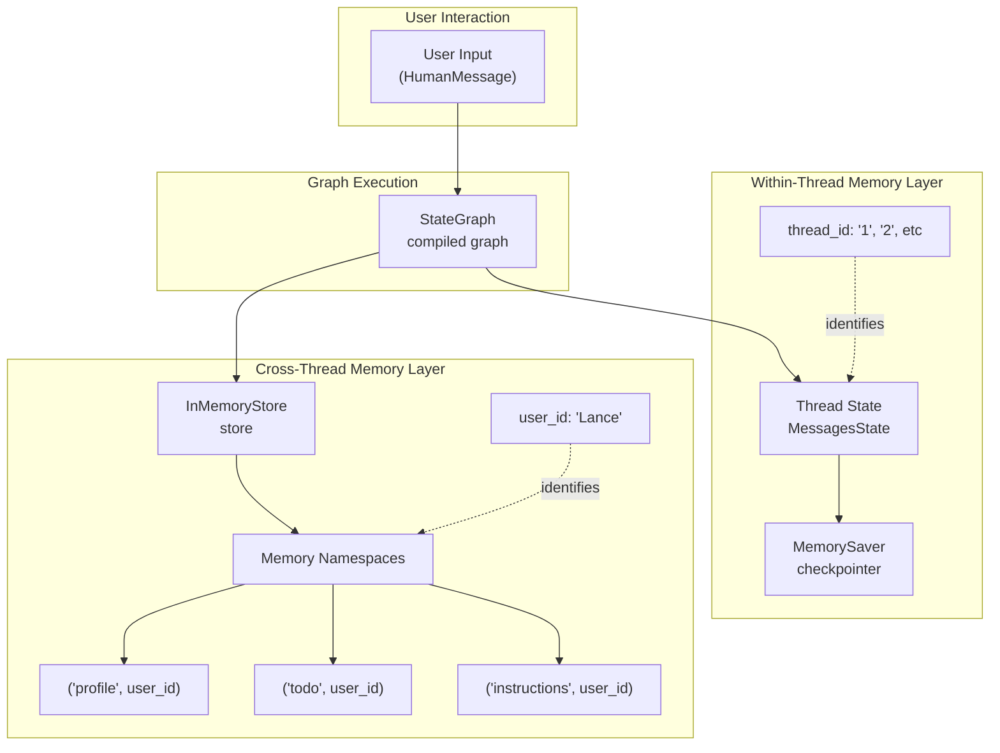
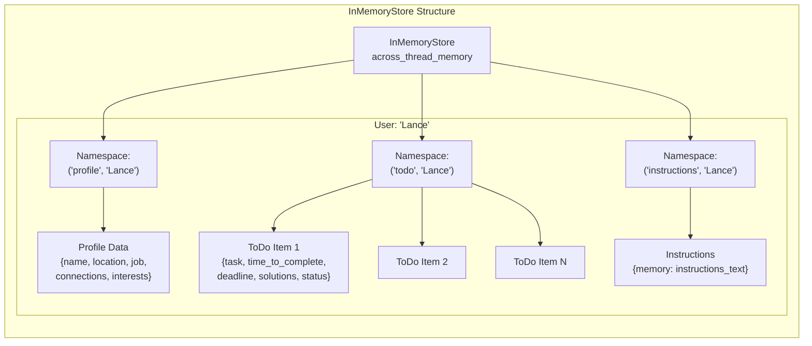
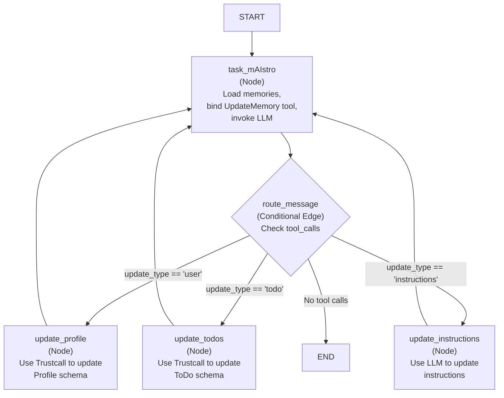
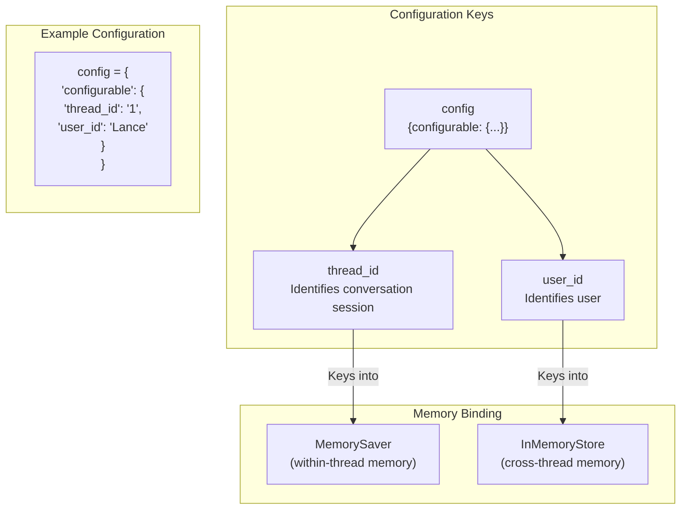
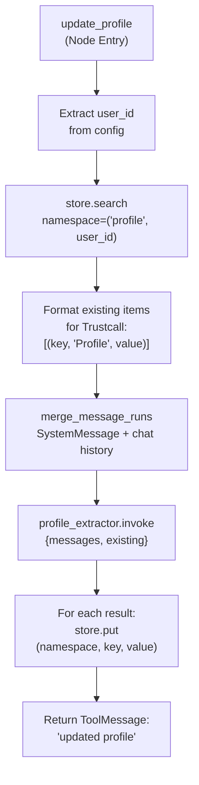
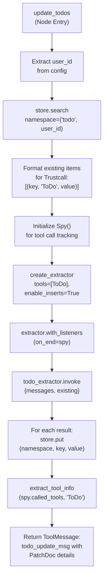
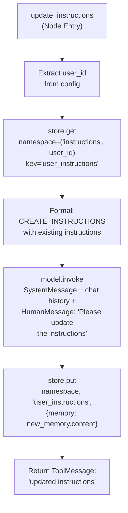
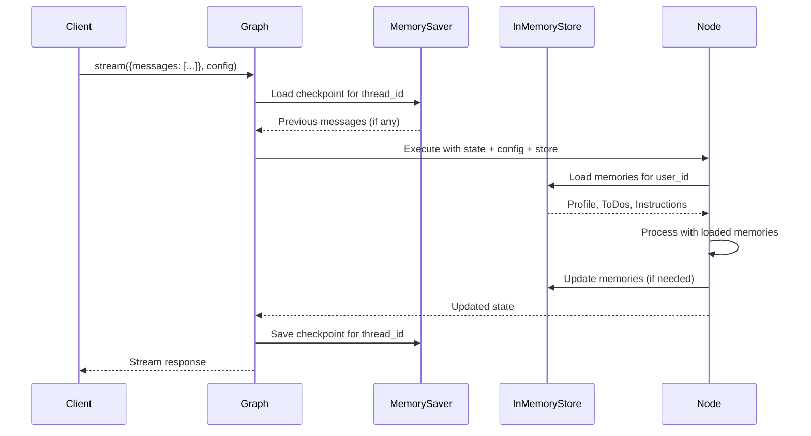

<!-- source: DeepWiki mcp.deepwiki.com · repo langchain-ai/langchain-academy · page 8.1 Long-Term Memory Architecture · fetched 2026-10-26 -->

# Long-Term Memory Architecture

<details>
<summary>Relevant source files</summary>

The following files were used as context for generating this wiki page:

- [module-5/memory_agent.ipynb](module-5/memory_agent.ipynb)
- [module-5/studio/memory_agent.py](module-5/studio/memory_agent.py)

</details>


## Purpose and Scope

This document describes the dual-memory system architecture used in Module 5's task management agent (`task_mAIstro`). The system combines two types of memory: **within-thread memory** using `MemorySaver` for conversation state, and **cross-thread memory** using `InMemoryStore` for persistent user data. This architecture enables the agent to maintain both short-term conversational context and long-term user information across multiple conversation sessions.

For information about basic agent memory using only checkpointers, see [Agent Memory with Checkpointers](#4.2). For details on the specific memory schemas and Trustcall integration, see [Memory Schemas and Trustcall](#8.2). For the complete agent implementation, see [task_mAIstro Agent Implementation](#8.3).

---

## Dual-Memory System Overview

The memory architecture separates concerns between two distinct memory layers, each serving different persistence needs.

### Memory Layer Separation



**Sources:** [module-5/memory_agent.ipynb:840-847](), [module-5/studio/memory_agent.py:376-393]()

### Memory Persistence Characteristics

| Memory Type | Implementation | Scope | Persistence | Use Case |
|-------------|---------------|-------|-------------|----------|
| **Within-Thread** | `MemorySaver` | Single conversation session | Cleared on thread change | Conversation history, message flow |
| **Cross-Thread** | `InMemoryStore` | All conversations for a user | Persists across threads | User profile, ToDo items, custom instructions |

The dual system enables scenarios like:
- User starts conversation in thread "1", adds ToDo items
- User starts new conversation in thread "2" with empty message history
- Thread "2" still has access to all ToDo items from thread "1" via `InMemoryStore`
- Each thread maintains its own independent conversation history via `MemorySaver`

**Sources:** [module-5/memory_agent.ipynb:840-847](), [module-5/memory_agent.ipynb:1175-1214]()

---

## Memory Namespace Architecture

The `InMemoryStore` organizes memories using a hierarchical namespace structure: `(namespace_type, user_id)`. This enables efficient storage and retrieval of different memory types for each user.

### Namespace Organization



**Sources:** [module-5/memory_agent.ipynb:660-686](), [module-5/studio/memory_agent.py:204-238]()

### Namespace Access Patterns

Each node in the graph accesses namespaces using the user ID from the configuration:

**Profile Memory Access:**
```python
# Retrieve profile memory
user_id = config["configurable"]["user_id"]
namespace = ("profile", user_id)
memories = store.search(namespace)
if memories:
    user_profile = memories[0].value  # Single profile per user
```

**ToDo Memory Access:**
```python
# Retrieve all ToDo items
namespace = ("todo", user_id)
memories = store.search(namespace)
todo = "\n".join(f"{mem.value}" for mem in memories)  # Multiple items
```

**Instructions Memory Access:**
```python
# Retrieve custom instructions
namespace = ("instructions", user_id)
existing_memory = store.get(namespace, "user_instructions")
if existing_memory:
    instructions = existing_memory.value
```

**Sources:** [module-5/memory_agent.ipynb:667-686](), [module-5/studio/memory_agent.py:212-231]()

### Storage Operations

The `InMemoryStore` provides three primary operations:

| Operation | Method | Purpose | Example Usage |
|-----------|--------|---------|---------------|
| **Retrieve Single** | `store.get(namespace, key)` | Get specific item by key | Get user instructions by "user_instructions" key |
| **Retrieve Multiple** | `store.search(namespace)` | Get all items in namespace | Get all ToDo items for a user |
| **Store/Update** | `store.put(namespace, key, value)` | Create or update item | Save profile or ToDo item |

**Sources:** [module-5/memory_agent.ipynb:724-729](), [module-5/studio/memory_agent.py:270-275]()

---

## Graph Flow and Routing Logic

The graph implements a decision-making pattern where the main agent node (`task_mAIstro`) decides which type of memory to update, then routes to the appropriate update node.

### Graph Structure



**Sources:** [module-5/memory_agent.ipynb:826-850](), [module-5/studio/memory_agent.py:376-393]()

### Memory Update Decision Flow

The `task_mAIstro` node makes the routing decision:

```mermaid
sequenceDiagram
    participant User
    participant task_mAIstro
    participant LLM
    participant route_message
    participant UpdateNode
    participant InMemoryStore
    
    User->>task_mAIstro: HumanMessage
    
    task_mAIstro->>InMemoryStore: Load all memories<br/>(profile, todo, instructions)
    InMemoryStore-->>task_mAIstro: Current memory state
    
    task_mAIstro->>task_mAIstro: Format MODEL_SYSTEM_MESSAGE<br/>with loaded memories
    
    task_mAIstro->>LLM: Invoke with UpdateMemory tool<br/>bound, parallel_tool_calls=False
    
    LLM-->>task_mAIstro: AIMessage with tool_calls<br/>or no tool_calls
    
    task_mAIstro->>route_message: Pass state with AIMessage
    
    alt Tool call present
        route_message->>route_message: Extract update_type from<br/>tool_calls[0]['args']['update_type']
        
        alt update_type == 'user'
            route_message->>UpdateNode: Route to update_profile
        else update_type == 'todo'
            route_message->>UpdateNode: Route to update_todos
        else update_type == 'instructions'
            route_message->>UpdateNode: Route to update_instructions
        end
        
        UpdateNode->>InMemoryStore: Update memory in namespace
        UpdateNode->>task_mAIstro: Return ToolMessage
        task_mAIstro->>User: Final response
    else No tool calls
        route_message->>END: Terminate
    end
```

**Sources:** [module-5/memory_agent.ipynb:660-693](), [module-5/memory_agent.ipynb:809-824](), [module-5/studio/memory_agent.py:204-238](), [module-5/studio/memory_agent.py:359-374]()

### UpdateMemory Tool Definition

The `UpdateMemory` tool is a simple routing mechanism:

```python
class UpdateMemory(TypedDict):
    """ Decision on what memory type to update """
    update_type: Literal['user', 'todo', 'instructions']
```

The LLM invokes this tool to signal which memory type should be updated. The `route_message` function extracts the `update_type` argument and routes accordingly.

**Sources:** [module-5/memory_agent.ipynb:488-493](), [module-5/studio/memory_agent.py:122-125]()

---

## Configuration and Threading Model

The system uses a two-dimensional configuration space to separate conversation sessions from user identity.

### Configuration Structure



**Sources:** [module-5/memory_agent.ipynb:880-891](), [module-5/memory_agent.ipynb:1204-1214]()

### Thread vs User Scoping

The configuration enables flexible memory scoping:

| Configuration | Within-Thread Memory | Cross-Thread Memory | Use Case |
|---------------|---------------------|-------------------|----------|
| `thread_id: "1"`, `user_id: "Lance"` | Session 1 conversation history | Lance's profile, ToDos, instructions | First conversation |
| `thread_id: "2"`, `user_id: "Lance"` | Session 2 conversation history (empty) | Lance's profile, ToDos, instructions (same) | New conversation, same user |
| `thread_id: "1"`, `user_id: "Sarah"` | Session 1 conversation history (same) | Sarah's profile, ToDos, instructions (different) | Same thread, different user (rare) |

**Example: Multiple Threads for Same User**

Thread 1 creates ToDo items:
```python
config = {"configurable": {"thread_id": "1", "user_id": "Lance"}}
# User adds swim lessons ToDo
# MemorySaver stores conversation in thread "1"
# InMemoryStore stores ToDo under ("todo", "Lance")
```

Thread 2 accesses same ToDo items:
```python
config = {"configurable": {"thread_id": "2", "user_id": "Lance"}}
# No conversation history from thread "1"
# But ToDo items are still accessible from ("todo", "Lance")
```

**Sources:** [module-5/memory_agent.ipynb:1175-1214]()

### Configuration Access in Nodes

Nodes retrieve configuration using `RunnableConfig`:

**Notebook version:**
```python
def task_mAIstro(state: MessagesState, config: RunnableConfig, store: BaseStore):
    user_id = config["configurable"]["user_id"]
    namespace = ("profile", user_id)
    memories = store.search(namespace)
```

**Studio version with configuration schema:**
```python
def task_mAIstro(state: MessagesState, config: RunnableConfig, store: BaseStore):
    configurable = configuration.Configuration.from_runnable_config(config)
    user_id = configurable.user_id
    namespace = ("profile", user_id)
    memories = store.search(namespace)
```

The studio version uses a structured `Configuration` class for type safety and validation.

**Sources:** [module-5/memory_agent.ipynb:660-665](), [module-5/studio/memory_agent.py:204-210]()

---

## Memory Update Nodes

Each memory type has a dedicated update node that handles the specific logic for that namespace.

### Profile Update Flow



**Sources:** [module-5/memory_agent.ipynb:695-731](), [module-5/studio/memory_agent.py:240-278]()

### ToDo Update Flow with Spy

The `update_todos` node adds visibility into Trustcall's internal operations using a `Spy` listener:



The `Spy` class captures internal Trustcall tool calls (like `PatchDoc` for updates), which are then formatted and returned to the agent for transparency.

**Sources:** [module-5/memory_agent.ipynb:733-785](), [module-5/memory_agent.ipynb:132-163](), [module-5/studio/memory_agent.py:280-333](), [module-5/studio/memory_agent.py:25-40]()

### Instructions Update Flow

Unlike profile and ToDo updates which use Trustcall, instructions are updated directly by the LLM:



This node uses `store.get` (single item) instead of `store.search` (multiple items) because there is only one instruction document per user.

**Sources:** [module-5/memory_agent.ipynb:787-806](), [module-5/studio/memory_agent.py:335-356]()

---

## System Prompts and Instructions

The agent uses three distinct system prompts for different purposes.

### MODEL_SYSTEM_MESSAGE

Used in `task_mAIstro` to guide the LLM's decision-making about which memories to update:

```
You are a helpful chatbot. 

You are designed to be a companion to a user, helping them keep track of their ToDo list.

You have a long term memory which keeps track of three things:
1. The user's profile (general information about them) 
2. The user's ToDo list
3. General instructions for updating the ToDo list

Here is the current User Profile: {user_profile}
Here is the current ToDo List: {todo}
Here are the current user-specified preferences: {instructions}

Instructions for reasoning:
1. Reason carefully about the user's messages
2. Decide whether to update memories:
   - If personal information → call UpdateMemory with type `user`
   - If tasks mentioned → call UpdateMemory with type `todo`
   - If preferences specified → call UpdateMemory with type `instructions`
3. Tell user about todo updates, but not profile/instruction updates
4. Err on the side of updating the todo list
5. Respond naturally after tool calls
```

**Sources:** [module-5/memory_agent.ipynb:594-635](), [module-5/studio/memory_agent.py:139-180]()

### TRUSTCALL_INSTRUCTION

Used in `update_profile` and `update_todos` to guide Trustcall extraction:

```
Reflect on following interaction. 

Use the provided tools to retain any necessary memories about the user. 

Use parallel tool calling to handle updates and insertions simultaneously.

System Time: {time}
```

The instruction is formatted with `datetime.now().isoformat()` and merged with the conversation history before invoking Trustcall.

**Sources:** [module-5/memory_agent.ipynb:637-644](), [module-5/memory_agent.ipynb:717-718](), [module-5/studio/memory_agent.py:182-189]()

### CREATE_INSTRUCTIONS

Used in `update_instructions` to generate custom instructions based on user feedback:

```
Reflect on the following interaction.

Based on this interaction, update your instructions for how to update ToDo list items. 
Use any feedback from the user to update how they like to have items added, etc.

Your current instructions are:
<current_instructions>
{current_instructions}
</current_instructions>
```

**Sources:** [module-5/memory_agent.ipynb:646-657](), [module-5/studio/memory_agent.py:191-200]()

---

## Graph Compilation and Execution

The graph is compiled with both memory systems attached:

```python
# Store for long-term (cross-thread) memory
across_thread_memory = InMemoryStore()

# Checkpointer for short-term (within-thread) memory
within_thread_memory = MemorySaver()

# Compile graph with both memory systems
graph = builder.compile(
    checkpointer=within_thread_memory,
    store=across_thread_memory
)
```

### Execution Flow



Each node receives three arguments:
- `state`: Current `MessagesState` with conversation history
- `config`: `RunnableConfig` with `thread_id` and `user_id`
- `store`: `BaseStore` reference to `InMemoryStore`

**Sources:** [module-5/memory_agent.ipynb:840-850](), [module-5/studio/memory_agent.py:376-393]()

---

