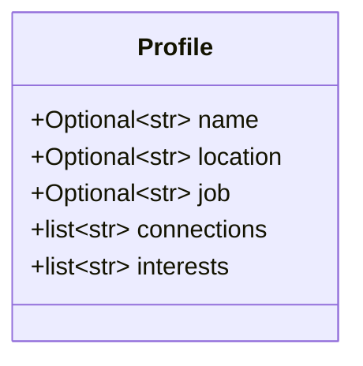
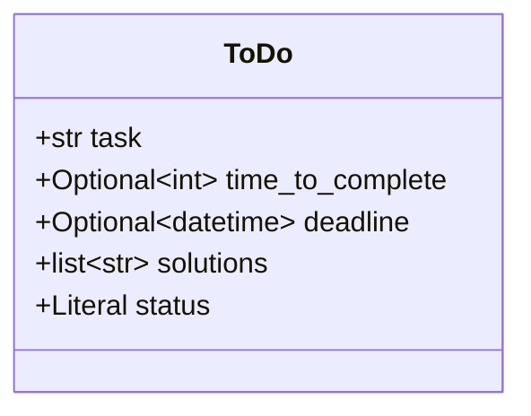
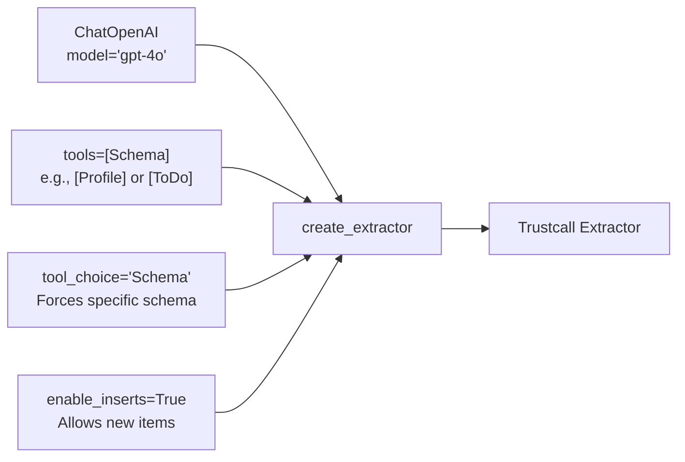
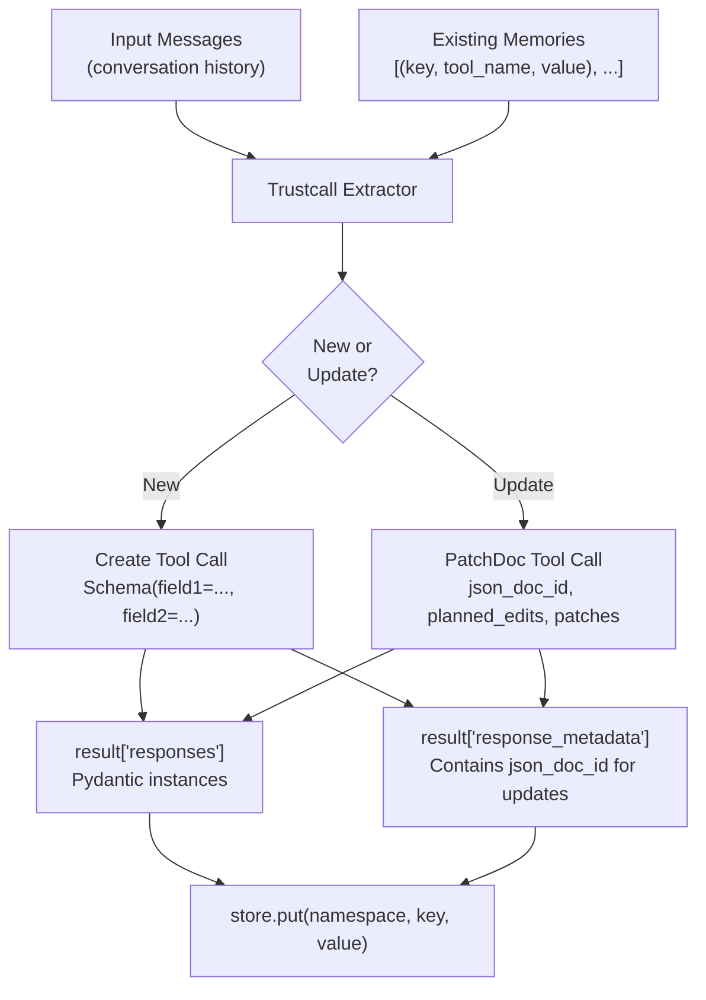
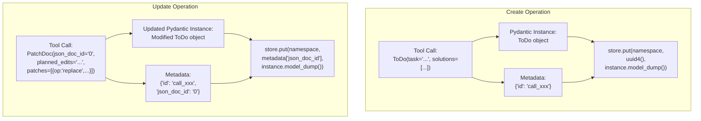
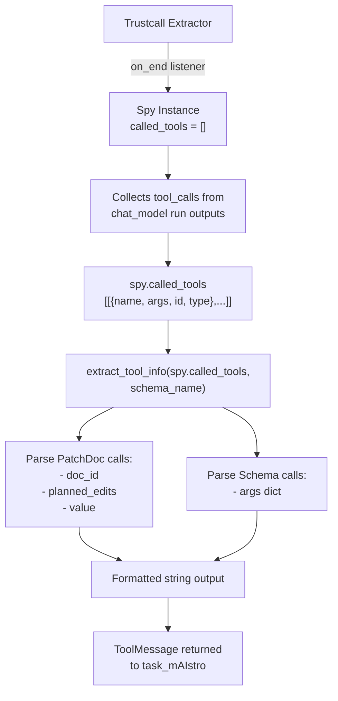
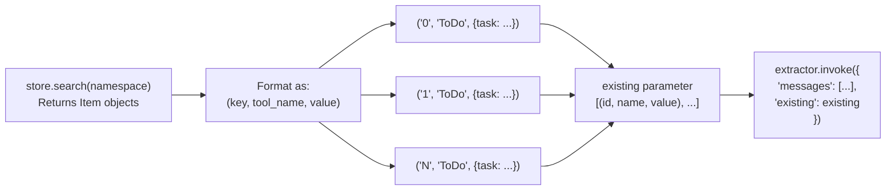

<!-- source: DeepWiki mcp.deepwiki.com · repo langchain-ai/langchain-academy · page 8.2 Memory Schemas and Trustcall · fetched 2026-10-26 -->

# Memory Schemas and Trustcall

<details>
<summary>Relevant source files</summary>

The following files were used as context for generating this wiki page:

- [module-5/memory_agent.ipynb](module-5/memory_agent.ipynb)
- [module-5/studio/memory_agent.py](module-5/studio/memory_agent.py)

</details>


## Purpose and Scope

This page details the memory schema definitions and Trustcall integration used in the task management agent (`task_mAIstro`). It covers three distinct memory schemas (Profile, ToDo, and Instructions), how Trustcall performs structured extraction and updates, and utilities for monitoring Trustcall operations. For the overall memory architecture using `MemorySaver` and `InMemoryStore`, see [Long-Term Memory Architecture](#8.1). For the complete agent implementation that uses these schemas, see [task_mAIstro Agent Implementation](#8.3).

## Memory Schema Definitions

The system defines three separate memory types, each stored in a different namespace within `InMemoryStore`:

### Profile Schema

The `Profile` schema captures general user information stored in the `("profile", user_id)` namespace:



**Profile Schema Structure**

| Field | Type | Description | Default |
|-------|------|-------------|---------|
| `name` | `Optional[str]` | User's name | `None` |
| `location` | `Optional[str]` | User's location | `None` |
| `job` | `Optional[str]` | User's job | `None` |
| `connections` | `list[str]` | Personal connections (family, friends, coworkers) | `[]` |
| `interests` | `list[str]` | User interests | `[]` |

Sources: [module-5/memory_agent.ipynb:554-567](), [module-5/studio/memory_agent.py:87-100]()

### ToDo Schema

The `ToDo` schema represents task items stored in the `("todo", user_id)` namespace:



**ToDo Schema Structure**

| Field | Type | Description | Default |
|-------|------|-------------|---------|
| `task` | `str` | Task description | Required |
| `time_to_complete` | `Optional[int]` | Estimated completion time in minutes | `None` |
| `deadline` | `Optional[datetime]` | Task deadline | `None` |
| `solutions` | `list[str]` | Specific actionable solutions (min 1 item) | `[]` |
| `status` | `Literal` | One of: "not started", "in progress", "done", "archived" | `"not started"` |

Sources: [module-5/memory_agent.ipynb:569-585](), [module-5/studio/memory_agent.py:102-118]()

### Instructions Schema

Unlike Profile and ToDo, instructions are not defined as a Pydantic schema. Instead, they are stored as a simple dictionary in the `("instructions", user_id)` namespace with a fixed key `"user_instructions"`. The LLM generates natural language instructions based on user preferences for how to create/update ToDo items.

Sources: [module-5/memory_agent.ipynb:787-806](), [module-5/studio/memory_agent.py:335-356]()

## Trustcall Extractor Creation

Trustcall provides intelligent structured extraction with automatic validation, correction, and update capabilities. Extractors are created using `create_extractor()`:



**Trustcall Extractor Configuration**

### Profile Extractor

The profile extractor is initialized once at module level since profiles don't support inserts (only updates):

[module-5/memory_agent.ipynb:587-592]()
[module-5/studio/memory_agent.py:131-135]()

**Configuration:**
- `tools=[Profile]`: Only the Profile schema
- `tool_choice="Profile"`: Forces Profile tool usage
- No `enable_inserts`: Profile updates only (patching existing)

### ToDo Extractor

The ToDo extractor is created dynamically in the `update_todos` node to attach a `Spy` listener:

[module-5/memory_agent.ipynb:761-767]()
[module-5/studio/memory_agent.py:309-315]()

**Configuration:**
- `tools=[ToDo]`: Only the ToDo schema
- `tool_choice="ToDo"`: Forces ToDo tool usage
- `enable_inserts=True`: Allows creating new ToDo items
- `.with_listeners(on_end=spy)`: Attaches monitoring

Sources: [module-5/memory_agent.ipynb:587-592](), [module-5/memory_agent.ipynb:761-767](), [module-5/studio/memory_agent.py:131-135](), [module-5/studio/memory_agent.py:309-315]()

## Trustcall Extraction Workflow

Trustcall processes conversation history and existing memories to produce structured outputs:



**Trustcall Invocation Pattern**

### Input Structure

Trustcall extractors are invoked with two key arguments:

```python
result = extractor.invoke({
    "messages": [...],      # Conversation + system instruction
    "existing": [...]       # List of (id, tool_name, value) tuples
})
```

Sources: [module-5/memory_agent.ipynb:288-291](), [module-5/memory_agent.ipynb:721-722](), [module-5/memory_agent.ipynb:770-771]()

### Output Structure

The extractor returns a dictionary with three keys:

| Key | Type | Description |
|-----|------|-------------|
| `"messages"` | `list` | AI messages with tool calls |
| `"responses"` | `list` | Parsed Pydantic instances from tool calls |
| `"response_metadata"` | `list` | Metadata dicts, including `json_doc_id` for updates |

Sources: [module-5/memory_agent.ipynb:205-246](), [module-5/memory_agent.ipynb:724-729](), [module-5/memory_agent.ipynb:773-777]()

## Trustcall Operations: Create vs Update

Trustcall automatically decides whether to create new memories or update existing ones:



**Create vs Update Trustcall Operations**

### Creating New Memories

When no matching existing memory is found, Trustcall creates a new instance:

**Example from trace:** [module-5/memory_agent.ipynb:913-914]()

```
New ToDo created:
Content: {'task': 'Book swim lessons for 1-year-old daughter.', ...}
```

The tool call directly invokes the schema (e.g., `ToDo`) with field values. A new UUID is generated as the key.

### Updating Existing Memories

When an existing memory should be modified, Trustcall uses the `PatchDoc` tool:

**Example from trace:** [module-5/memory_agent.ipynb:1072-1074]()

```
Document ed0af900-52fa-4f15-907c-1aed1e17b0ce updated:
Plan: Add a deadline for the swim lessons task...
Added content: 2024-11-30T23:59:59
```

The `PatchDoc` tool includes:
- `json_doc_id`: ID of the document to update
- `planned_edits`: Human-readable explanation of changes
- `patches`: JSON patch operations (RFC 6902 format)

Sources: [module-5/memory_agent.ipynb:369-386](), [module-5/memory_agent.ipynb:1011-1014](), [module-5/memory_agent.ipynb:1072-1074]()

## Visibility into Trustcall Updates

The system provides visibility into Trustcall's internal operations through the `Spy` class and `extract_tool_info` utility:



**Spy and Extract Tool Info Workflow**

### Spy Class

The `Spy` class uses LangChain's listener pattern to intercept Trustcall's internal tool calls:

[module-5/memory_agent.ipynb:132-146]()
[module-5/studio/memory_agent.py:25-39]()

**How Spy Works:**
1. Attached to extractor via `.with_listeners(on_end=spy)`
2. Receives run objects when extractor completes
3. Traverses child runs to find `chat_model` run types
4. Extracts `tool_calls` from outputs
5. Appends to `called_tools` list

### extract_tool_info Utility

The `extract_tool_info` function parses the collected tool calls into human-readable format:

[module-5/memory_agent.ipynb:412-459]()
[module-5/studio/memory_agent.py:42-83]()

**Function Signature:**
```python
def extract_tool_info(tool_calls, schema_name="Memory") -> str
```

**Processing Logic:**

| Tool Type | Extracted Information | Output Format |
|-----------|----------------------|---------------|
| `PatchDoc` | `doc_id`, `planned_edits`, `patches[0]['value']` | "Document {id} updated:\nPlan: {...}\nAdded content: {...}" |
| Schema (e.g., `ToDo`) | `args` dict | "New {schema_name} created:\nContent: {...}" |

**Example Output:**

```
Document ed0af900-52fa-4f15-907c-1aed1e17b0ce updated:
Plan: Add specific local businesses or vendors to the solutions for booking swim lessons.
Added content: ['Check local swim schools in SF', 'Look for baby swim classes online', ...]

New ToDo created:
Content: {'task': 'Call back City Toyota to schedule car service.', ...}
```

Sources: [module-5/memory_agent.ipynb:132-146](), [module-5/memory_agent.ipynb:412-459](), [module-5/memory_agent.ipynb:784](), [module-5/studio/memory_agent.py:25-39](), [module-5/studio/memory_agent.py:42-83](), [module-5/studio/memory_agent.py:332]()

## Memory Formatting for Trustcall

Existing memories must be formatted correctly before passing to Trustcall extractors:



**Existing Memory Formatting Pattern**

### Retrieval and Formatting

The pattern is consistent across Profile and ToDo update nodes:

**For Profile:** [module-5/memory_agent.ipynb:706-714]()

**For ToDo:** [module-5/memory_agent.ipynb:744-752]()

**Format Requirements:**
- Each existing memory is a 3-tuple: `(key, tool_name, value)`
- `key`: The store item's key (string)
- `tool_name`: Schema name (e.g., "Profile", "ToDo")
- `value`: The store item's value dict
- If no existing memories, pass `None`

### Instructions (Non-Trustcall Pattern)

Instructions use a simpler pattern without Trustcall extraction:

[module-5/memory_agent.ipynb:796-800]()

1. Retrieve with `store.get(namespace, "user_instructions")`
2. Pass `existing_memory.value` to LLM prompt
3. LLM generates new instructions
4. Overwrite with `store.put(namespace, "user_instructions", {"memory": new_content})`

Sources: [module-5/memory_agent.ipynb:706-714](), [module-5/memory_agent.ipynb:744-752](), [module-5/memory_agent.ipynb:796-800](), [module-5/studio/memory_agent.py:252-260](), [module-5/studio/memory_agent.py:294-300](), [module-5/studio/memory_agent.py:345-353]()

## Trustcall System Messages

Trustcall extractors use specialized system messages to guide extraction:

### TRUSTCALL_INSTRUCTION

Used for Profile and ToDo extraction:

[module-5/memory_agent.ipynb:637-644]()
[module-5/studio/memory_agent.py:182-189]()

```
Reflect on following interaction. 

Use the provided tools to retain any necessary memories about the user. 

Use parallel tool calling to handle updates and insertions simultaneously.

System Time: {time}
```

**Key directives:**
- "Reflect on following interaction" - triggers memory extraction
- "Use parallel tool calling" - enables batch operations
- Includes current timestamp for deadline/time-aware fields

### CREATE_INSTRUCTIONS

Used for generating instructions from user feedback:

[module-5/memory_agent.ipynb:646-657]()
[module-5/studio/memory_agent.py:191-200]()

```
Reflect on the following interaction.

Based on this interaction, update your instructions for how to update ToDo list items. 
Use any feedback from the user to update how they like to have items added, etc.

Your current instructions are:

<current_instructions>
{current_instructions}
</current_instructions>
```

Sources: [module-5/memory_agent.ipynb:637-657](), [module-5/memory_agent.ipynb:717-718](), [module-5/memory_agent.ipynb:755-756](), [module-5/studio/memory_agent.py:182-200](), [module-5/studio/memory_agent.py:263-264](), [module-5/studio/memory_agent.py:303-304]()

## Code Entity Reference

Key classes, functions, and constants involved in memory schemas and Trustcall integration:

| Entity | Type | Location | Purpose |
|--------|------|----------|---------|
| `Profile` | Pydantic `BaseModel` | [module-5/studio/memory_agent.py:88-100]() | User profile schema definition |
| `ToDo` | Pydantic `BaseModel` | [module-5/studio/memory_agent.py:103-118]() | Task item schema definition |
| `Spy` | Class | [module-5/studio/memory_agent.py:26-39]() | Monitors Trustcall internal tool calls |
| `extract_tool_info` | Function | [module-5/studio/memory_agent.py:42-83]() | Parses Trustcall tool calls to human-readable format |
| `profile_extractor` | Trustcall extractor | [module-5/studio/memory_agent.py:131-135]() | Extracts Profile updates |
| `todo_extractor` | Trustcall extractor | [module-5/studio/memory_agent.py:310-315]() | Extracts ToDo inserts/updates |
| `TRUSTCALL_INSTRUCTION` | String constant | [module-5/studio/memory_agent.py:183-189]() | System message for Trustcall |
| `CREATE_INSTRUCTIONS` | String constant | [module-5/studio/memory_agent.py:192-200]() | System message for instruction generation |
| `update_profile` | Node function | [module-5/studio/memory_agent.py:240-278]() | Invokes profile_extractor and saves to store |
| `update_todos` | Node function | [module-5/studio/memory_agent.py:280-333]() | Invokes todo_extractor with Spy and saves to store |
| `update_instructions` | Node function | [module-5/studio/memory_agent.py:335-356]() | Generates instructions without Trustcall |

Sources: [module-5/studio/memory_agent.py:1-393](), [module-5/memory_agent.ipynb:1-1288]()

---

