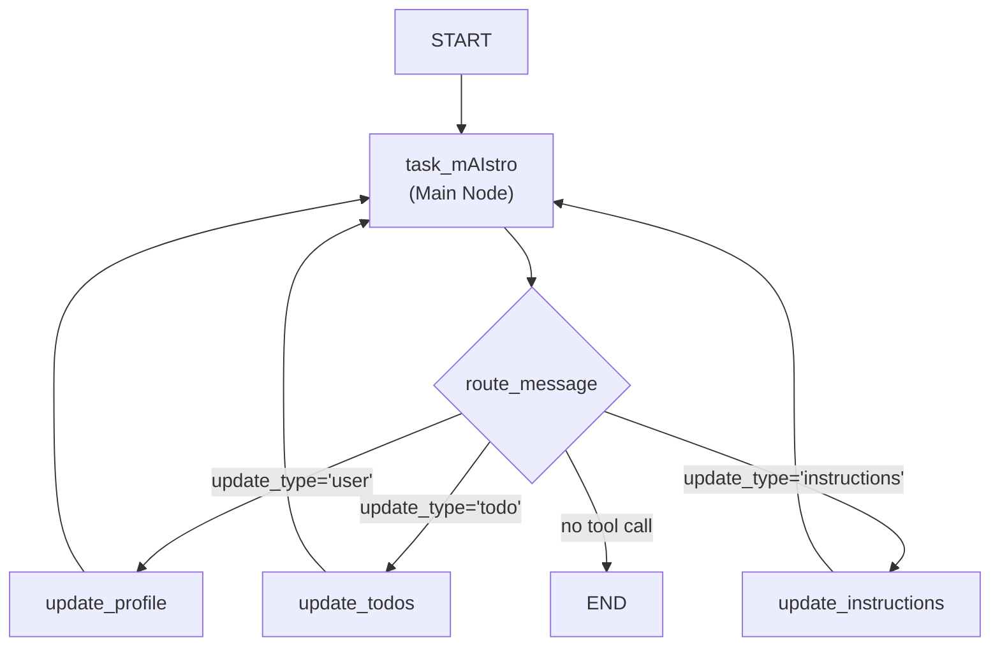
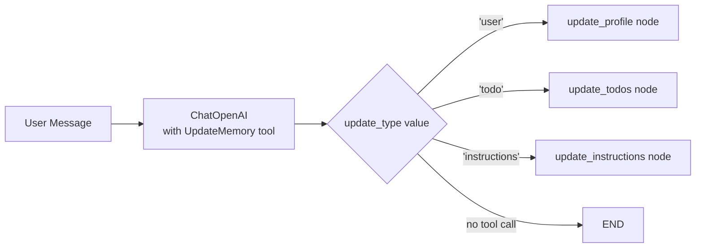
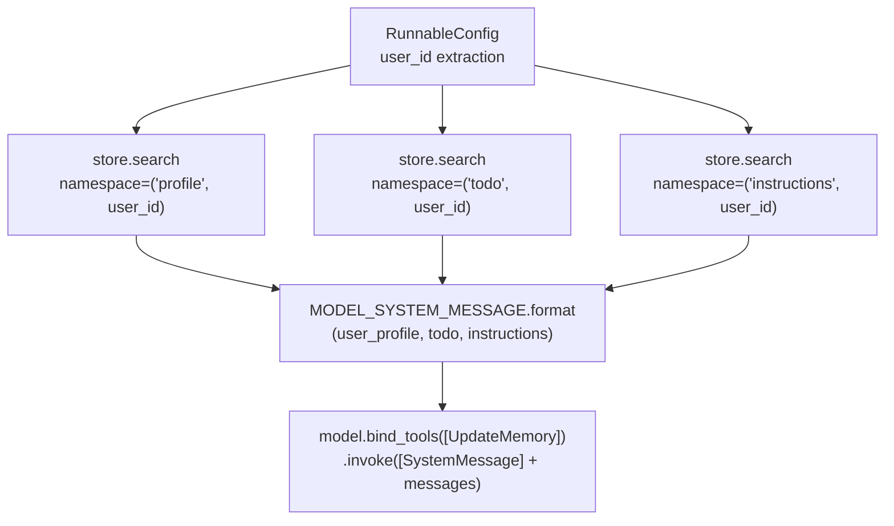
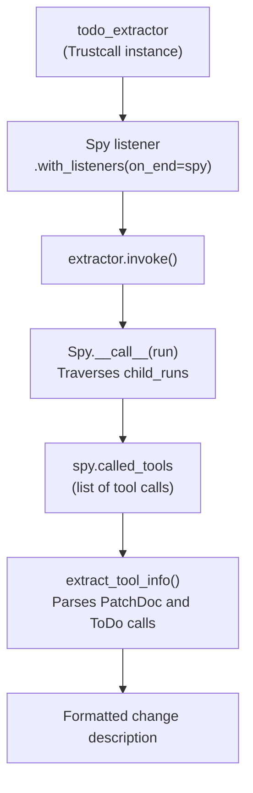
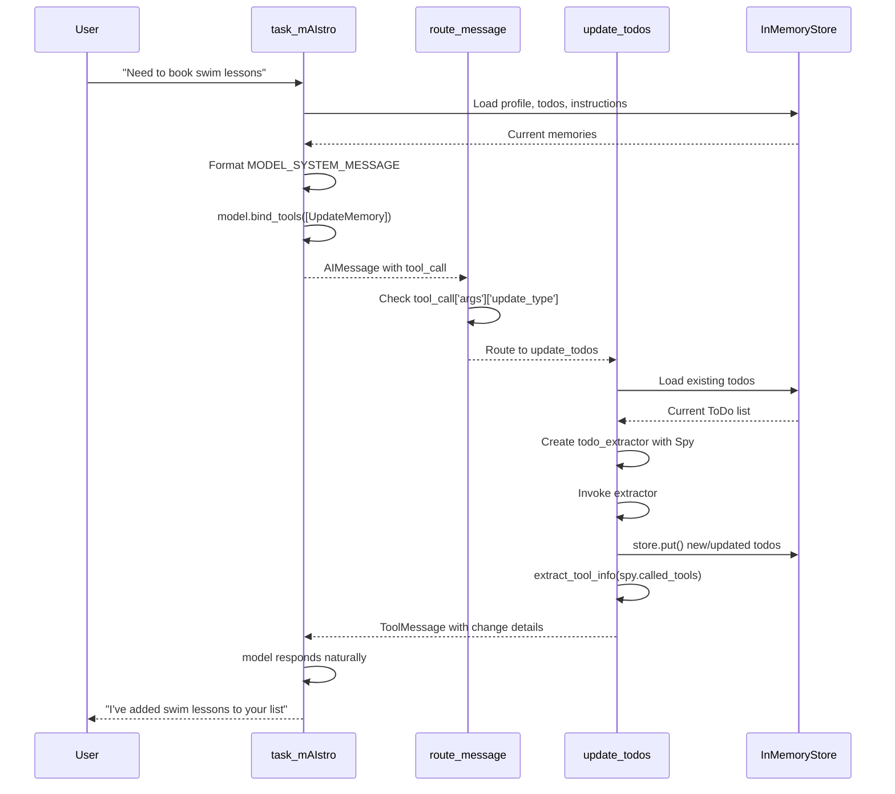

<!-- source: DeepWiki mcp.deepwiki.com · repo langchain-ai/langchain-academy · page 8.3 task_mAIstro Agent Implementation · fetched 2026-10-26 -->

# task_mAIstro Agent Implementation

<details>
<summary>Relevant source files</summary>

The following files were used as context for generating this wiki page:

- [module-5/memory_agent.ipynb](module-5/memory_agent.ipynb)
- [module-5/studio/memory_agent.py](module-5/studio/memory_agent.py)

</details>


## Purpose and Scope

This page documents the complete implementation of the **task_mAIstro** agent, a conversational task management assistant with sophisticated multi-schema long-term memory capabilities. The agent decides when to update different types of memory (user profile, ToDo list, or custom instructions) based on natural language conversations, demonstrating autonomous memory management patterns.

For the underlying memory architecture and dual-storage pattern, see [Long-Term Memory Architecture](#8.1). For the memory schemas (Profile, ToDo, Instructions) and Trustcall integration patterns, see [Memory Schemas and Trustcall](#8.2).

## System Architecture

The task_mAIstro agent orchestrates four primary nodes in a cyclic graph pattern, with conditional routing to determine which memory type to update:



**Sources:** [module-5/memory_agent.ipynb:826-850](), [module-5/studio/memory_agent.py:376-393]()

### Node Responsibilities

| Node | Primary Function | Memory Operations | Returns To |
|------|------------------|-------------------|------------|
| `task_mAIstro` | Loads all memories, responds to user, decides what to update | Read: profile, todo, instructions namespaces | `route_message` (conditional) |
| `update_profile` | Updates user profile using Trustcall | Write: `("profile", user_id)` namespace | `task_mAIstro` |
| `update_todos` | Updates ToDo list using Trustcall with Spy | Write: `("todo", user_id)` namespace | `task_mAIstro` |
| `update_instructions` | Updates preferences via LLM reflection | Write: `("instructions", user_id)` namespace | `task_mAIstro` |

**Sources:** [module-5/memory_agent.ipynb:660-807](), [module-5/studio/memory_agent.py:204-375]()

## UpdateMemory Tool and Routing Logic

The agent uses a custom tool, `UpdateMemory`, to make routing decisions. The LLM bound to this tool determines which type of memory requires updating:



**UpdateMemory Tool Definition:**

```python
class UpdateMemory(TypedDict):
    """ Decision on what memory type to update """
    update_type: Literal['user', 'todo', 'instructions']
```

**Sources:** [module-5/memory_agent.ipynb:488-493](), [module-5/studio/memory_agent.py:123-125]()

The `route_message` conditional edge inspects the tool call to determine the next node:

**Sources:** [module-5/memory_agent.ipynb:809-824](), [module-5/studio/memory_agent.py:359-374]()

| Routing Condition | Next Node |
|-------------------|-----------|
| `tool_call['args']['update_type'] == "user"` | `update_profile` |
| `tool_call['args']['update_type'] == "todo"` | `update_todos` |
| `tool_call['args']['update_type'] == "instructions"` | `update_instructions` |
| `len(message.tool_calls) == 0` | `END` |

## Main Node: task_mAIstro

The `task_mAIstro` node is the central orchestrator, responsible for:
1. Loading all three memory types from `InMemoryStore`
2. Formatting memories into the system prompt
3. Invoking the LLM with `UpdateMemory` tool binding
4. Returning the LLM response with optional tool call

**Memory Loading Pattern:**



**Sources:** [module-5/memory_agent.ipynb:660-693](), [module-5/studio/memory_agent.py:204-238]()

**Key Implementation Details:**

- **User ID Extraction:** `user_id = config["configurable"]["user_id"]` (notebook) or via `configuration.Configuration.from_runnable_config(config)` (studio)
- **Profile Memory:** Single item from `("profile", user_id)` namespace, returns `None` if empty
- **ToDo Memory:** All items concatenated with newlines from `("todo", user_id)` namespace
- **Instructions Memory:** Single item from `("instructions", user_id)` namespace, empty string if absent
- **Tool Binding:** `parallel_tool_calls=False` ensures sequential updates

## Memory Update Operations

### update_profile Node

Updates the user's profile (name, location, job, connections, interests) using the `profile_extractor` Trustcall instance:

**Sources:** [module-5/memory_agent.ipynb:695-732](), [module-5/studio/memory_agent.py:240-278]()

**Execution Flow:**

1. **Load Existing Profile:** `store.search(("profile", user_id))`
2. **Format for Trustcall:** Create tuples `(key, "Profile", value)` for existing items
3. **Merge Messages:** Prepend `TRUSTCALL_INSTRUCTION` with current timestamp
4. **Invoke Extractor:** `profile_extractor.invoke({"messages": ..., "existing": ...})`
5. **Save Results:** `store.put(namespace, key, value)` for each response
6. **Return Tool Message:** Confirms "updated profile" to `task_mAIstro`

### update_todos Node

Updates the ToDo list using Trustcall with the `Spy` utility for visibility into operations:

**Sources:** [module-5/memory_agent.ipynb:733-785](), [module-5/studio/memory_agent.py:280-333]()

**Unique Features:**

- **Spy Listener:** Attaches `spy` via `.with_listeners(on_end=spy)` to capture Trustcall's internal tool calls
- **Dynamic Extractor Creation:** Creates `todo_extractor` on each invocation (unlike profile which is pre-created)
- **Enable Inserts:** `enable_inserts=True` allows creation of new ToDo items
- **Detailed Feedback:** Uses `extract_tool_info(spy.called_tools, "ToDo")` to generate human-readable change descriptions

**Return Message Format:**

The tool message returned to `task_mAIstro` includes details like:
```
New ToDo created:
Content: {'task': 'Book swim lessons', ...}

Document abc123 updated:
Plan: Add deadline to existing task
Added content: 2024-11-30T23:59:59
```

### update_instructions Node

Updates user preferences for how ToDo items should be created/managed:

**Sources:** [module-5/memory_agent.ipynb:787-806](), [module-5/studio/memory_agent.py:335-356]()

**Distinct Approach:**

Unlike profile and todos, this node does **not** use Trustcall. Instead:
1. Retrieves existing instructions via `store.get(("instructions", user_id), "user_instructions")`
2. Uses `CREATE_INSTRUCTIONS` prompt to have LLM reflect on conversation
3. Invokes model with conversation history + prompt asking to update instructions
4. Overwrites memory with `store.put(namespace, "user_instructions", {"memory": content})`

This approach allows the LLM to synthesize natural language preferences into updated instructions without structured extraction.

## The Spy Utility

The `Spy` class provides visibility into Trustcall's internal operations by capturing tool calls made during extraction:

**Sources:** [module-5/memory_agent.ipynb:132-163](), [module-5/studio/memory_agent.py:26-83]()

**Architecture:**



**Spy Implementation Details:**

- **Recursive Traversal:** Uses queue (`q`) to visit all child runs
- **Chat Model Detection:** Filters for `r.run_type == "chat_model"`
- **Tool Call Extraction:** Accesses `r.outputs["generations"][0][0]["message"]["kwargs"]["tool_calls"]`

**extract_tool_info Function:**

Processes two types of Trustcall operations:

| Tool Call Name | Type | Description | Output Format |
|----------------|------|-------------|---------------|
| `PatchDoc` | update | Trustcall's JSON patch operation | "Document {id} updated: Plan: {edits} Added content: {value}" |
| `{schema_name}` (e.g., "ToDo") | new | New schema insertion | "New {schema} created: Content: {value}" |

**Sources:** [module-5/memory_agent.ipynb:412-459](), [module-5/studio/memory_agent.py:42-83]()

## Graph Construction

The graph is compiled with both short-term and long-term memory:

**Sources:** [module-5/memory_agent.ipynb:826-850](), [module-5/studio/memory_agent.py:376-393]()

```python
# Store for long-term (across-thread) memory
across_thread_memory = InMemoryStore()

# Checkpointer for short-term (within-thread) memory
within_thread_memory = MemorySaver()

# Compile with both
graph = builder.compile(checkpointer=within_thread_memory, store=across_thread_memory)
```

**Configuration:**

Invocations require both `thread_id` (for `MemorySaver`) and `user_id` (for `InMemoryStore` namespaces):

```python
config = {"configurable": {"thread_id": "1", "user_id": "Lance"}}
```

**Studio Version Differences:**

- Uses `configuration.Configuration` Pydantic schema instead of raw dict
- Extracts user_id via `Configuration.from_runnable_config(config)`
- Passes `config_schema=configuration.Configuration` to `StateGraph`

**Sources:** [module-5/studio/memory_agent.py:377]()

## Execution Flow Example



**Sources:** [module-5/memory_agent.ipynb:880-927]()

### Cross-Thread Memory Persistence

A key feature is that changing threads preserves long-term memories:

```python
# Thread 1: Create memories
config = {"configurable": {"thread_id": "1", "user_id": "Lance"}}
# ... conversations that create profile, todos, instructions ...

# Thread 2: New session, same user_id
config = {"configurable": {"thread_id": "2", "user_id": "Lance"}}
# Profile, todos, and instructions are still available
```

**Sources:** [module-5/memory_agent.ipynb:1177-1251]()

The `user_id` serves as the key for all three namespaces, while `thread_id` controls conversation history via `MemorySaver`.

## System Prompts

### MODEL_SYSTEM_MESSAGE

Instructs the LLM on when to call `UpdateMemory` and how to respond:

**Key Instructions:**
1. Reason about user messages
2. Decide memory updates:
   - Personal info → `update_type='user'`
   - Task mentions → `update_type='todo'`
   - Preferences → `update_type='instructions'`
3. Communication rules:
   - Don't mention profile updates
   - Do mention todo updates
   - Don't mention instruction updates
4. Err on side of updating todos without explicit permission

**Sources:** [module-5/memory_agent.ipynb:595-635](), [module-5/studio/memory_agent.py:140-180]()

### TRUSTCALL_INSTRUCTION

Passed to Trustcall extractors to guide memory extraction:

```
Reflect on following interaction. 
Use the provided tools to retain any necessary memories about the user. 
Use parallel tool calling to handle updates and insertions simultaneously.
System Time: {time}
```

**Sources:** [module-5/memory_agent.ipynb:638-644](), [module-5/studio/memory_agent.py:183-189]()

### CREATE_INSTRUCTIONS

Used by `update_instructions` to synthesize user preferences:

```
Reflect on the following interaction.
Based on this interaction, update your instructions for how to update ToDo list items.
Use any feedback from the user to update how they like to have items added, etc.
```

**Sources:** [module-5/memory_agent.ipynb:647-657](), [module-5/studio/memory_agent.py:192-200]()

## Studio Deployment

The production version at [module-5/studio/memory_agent.py]() includes:

**Differences from Notebook:**

1. **Configuration Schema:** Uses `configuration.Configuration` Pydantic model
2. **No Store/Checkpointer Initialization:** Studio manages these externally
3. **User ID Extraction:** `configuration.Configuration.from_runnable_config(config)`
4. **No Graph Display:** Removes Jupyter-specific visualization code
5. **Import Structure:** Adds `import configuration` for config schema

**Sources:** [module-5/studio/memory_agent.py:1-393]()

**Studio Invocation:**

Uses `langgraph dev` command from `module-5/studio/` directory. The graph is exposed via the Studio API and UI for visualization, debugging, and interaction.

**Sources:** [module-5/memory_agent.ipynb:1257-1264]()

---

**Complete Implementation Sources:**
- Notebook: [module-5/memory_agent.ipynb:1-1288]()
- Studio: [module-5/studio/memory_agent.py:1-393]()

---

