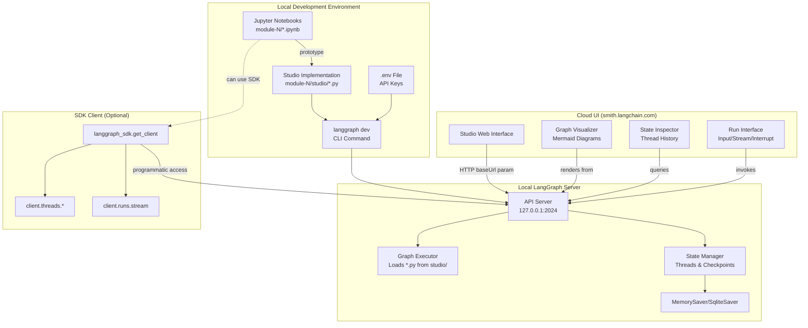
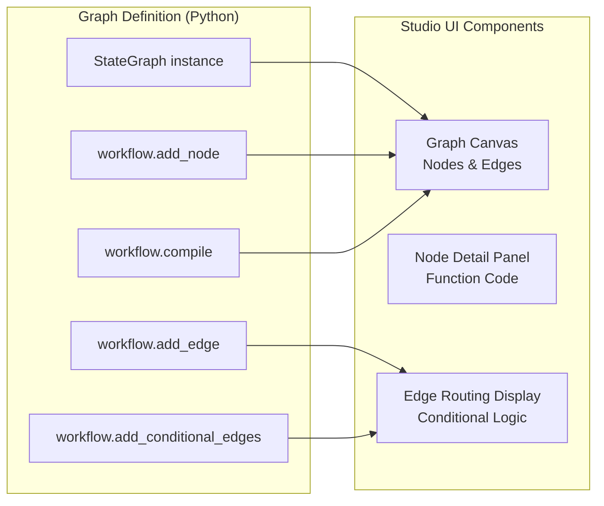
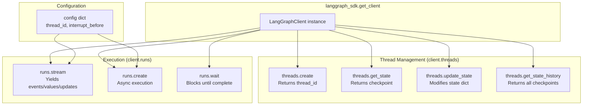
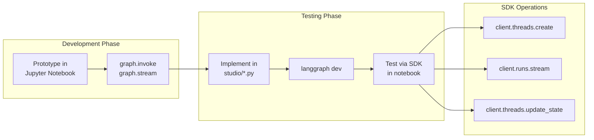
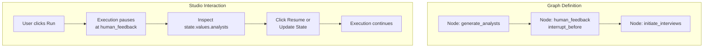

<!-- source: DeepWiki mcp.deepwiki.com · repo langchain-ai/langchain-academy · page 9 LangGraph Studio · fetched 2026-10-26 -->

# LangGraph Studio

<details>
<summary>Relevant source files</summary>

The following files were used as context for generating this wiki page:

- [README.md](README.md)
- [module-3/streaming-interruption.ipynb](module-3/streaming-interruption.ipynb)
- [module-3/time-travel.ipynb](module-3/time-travel.ipynb)

</details>


LangGraph Studio is a development environment for visualizing, debugging, and testing LangGraph agents. It provides a local API server that executes graphs while offering a web-based UI for interactive inspection and control. Studio enables developers to prototype graphs in Jupyter notebooks, then deploy production-ready implementations in dedicated `studio/` directories with visualization and debugging capabilities.

For information about building agents with LangGraph, see [Building Agents with LangGraph](#4). For human-in-the-loop features used with Studio, see [Human-in-the-Loop Features](#6).

## Architecture Overview

**Hybrid Local-Cloud Architecture**



Sources: [README.md:80-110](), Diagram 6 from provided high-level overview

The architecture separates execution (local) from visualization (cloud), allowing LangChain to maintain the UI without requiring local frontend installation while keeping code and data local.

## Local Development Server

### Starting the Server

The `langgraph dev` command starts a local development server that hosts the LangGraph API:

```bash
langgraph dev
```

When executed from a `module-N/studio/` directory, the server outputs:

```
- 🚀 API: http://127.0.0.1:2024
- 🎨 Studio UI: https://smith.langchain.com/studio/?baseUrl=http://127.0.0.1:2024
- 📚 API Docs: http://127.0.0.1:2024/docs
```

Sources: [README.md:86-97]()

### Directory Structure

Each module with Studio support follows this structure:

```
module-N/
├── *.ipynb              # Learning notebooks
└── studio/
    ├── .env             # API keys (OPENAI_API_KEY, etc.)
    ├── .env.example     # Template for .env
    └── *.py             # Graph implementations
```

**Graph Discovery**: The server automatically loads Python files from the `studio/` directory, detecting any `StateGraph` instances defined in them. Each graph becomes available as a separate agent in the UI.

Sources: [README.md:85-86](), [README.md:101-109]()

### Environment Configuration

Studio requires API keys in a `.env` file within the `studio/` directory:

```bash
# Create .env files for modules 1-5
for i in {1..5}; do
  cp module-$i/studio/.env.example module-$i/studio/.env
  echo "OPENAI_API_KEY=\"$OPENAI_API_KEY\"" > module-$i/studio/.env
done

# Module 4 additionally requires Tavily
echo "TAVILY_API_KEY=\"$TAVILY_API_KEY\"" >> module-4/studio/.env
```

Sources: [README.md:101-109]()

## Studio UI Features

### Accessing the UI

Navigate to `https://smith.langchain.com/studio/?baseUrl=http://127.0.0.1:2024` while the local server runs. The `baseUrl` parameter connects the cloud UI to your local API server.

Sources: [README.md:99]()

### Graph Visualization

**Interactive State Graph Rendering**



Sources: [README.md:82-84](), [module-3/streaming-interruption.ipynb:96-187]()

The visualizer renders graphs as Mermaid diagrams, showing:
- Nodes as Python function names
- Normal edges as solid arrows
- Conditional edges with decision logic
- START/END special nodes

### State Inspection

The State Inspector provides:
- **Thread History**: All checkpoint states for a conversation thread
- **State Snapshots**: Complete state dict at each node execution
- **Message Display**: Formatted view of `MessagesState.messages`
- **Checkpoint Metadata**: Timestamps, node names, next steps

Sources: Diagram 6 from high-level overview

### Run Interface

The Run Interface enables:
- **Input Submission**: JSON state or natural language messages
- **Streaming Output**: Real-time state updates as nodes execute
- **Breakpoint Interaction**: Resume or modify state at `interrupt_before` nodes
- **Thread Management**: Create, list, and switch between conversation threads

Sources: Diagram 6 from high-level overview, [module-3/streaming-interruption.ipynb]()

## SDK Client Integration

### Client Initialization

The `langgraph_sdk` package provides programmatic access to the Studio API server:

```python
from langgraph_sdk import get_client

# Connect to local Studio server
client = get_client(url="http://127.0.0.1:2024")
```

**Key Client APIs**:



Sources: [README.md:39](), Diagram 6 from high-level overview

### Thread Operations

**Creating and Managing Threads**:

Threads represent conversation sessions with persistent state via checkpointers.

```python
# Create a new thread
thread = client.threads.create()
thread_id = thread["thread_id"]

# Get current state
state = client.threads.get_state(thread_id)
print(state["values"])  # Current state dict
print(state["next"])    # Next scheduled nodes

# Update state (e.g., add human feedback)
client.threads.update_state(
    thread_id,
    values={"user_feedback": "approved"}
)

# Get full history (time travel debugging)
history = client.threads.get_state_history(thread_id)
for checkpoint in history:
    print(checkpoint["values"]["messages"])
```

Sources: Diagram 6 from high-level overview, Section 6.4 reference for time travel

### Streaming Execution

**Streaming with Interrupts**:

```python
# Stream with breakpoint before "human_feedback" node
config = {
    "configurable": {
        "thread_id": thread_id
    },
    "interrupt_before": ["human_feedback"]
}

for chunk in client.runs.stream(
    thread_id=thread_id,
    assistant_id="research_assistant",
    input={"messages": [{"role": "user", "content": "Research AI safety"}]},
    config=config,
    stream_mode="values"  # or "updates", "events"
):
    print(chunk)  # State updates or node outputs
```

**Stream Modes**:
- `"values"`: Full state after each node
- `"updates"`: Only changes to state
- `"events"`: Low-level events including token streams

Sources: [module-3/streaming-interruption.ipynb:196-313](), Section 6.3 reference for streaming modes

### Programmatic Control Pattern

**Notebook-to-SDK Workflow**:



Sources: [README.md:8-10](), Diagram 6 from high-level overview

## Module-Specific Studio Implementations

### Module 4: Advanced Patterns

**Map-Reduce and Research Assistant**:

Module 4's `studio/` directory contains production implementations of parallel processing patterns:

- `map_reduce.py`: Dynamic fan-out with `Send` API
- `parallelization.py`: Concurrent Wikipedia queries
- `research_assistant.py`: Multi-agent interview system with `interrupt_before` human approval

Sources: [README.md:85](), Diagram 5 from high-level overview

### Module 5: Memory Systems

**task_mAIstro Agent**:

Module 5's `studio/` contains:

- `memory_agent.py`: Implements multi-schema memory with `InMemoryStore`, `UpdateMemory` tool, and Trustcall integration

Sources: [README.md:85](), Diagram 5 from high-level overview

### Studio vs Notebook Files

| Aspect | Notebooks (`*.ipynb`) | Studio (`studio/*.py`) |
|--------|----------------------|------------------------|
| Purpose | Learning & experimentation | Production-ready graphs |
| Execution | Direct `graph.invoke()` | Via Studio API server |
| Visualization | Manual `graph.get_graph().draw_mermaid_png()` | Automatic in UI |
| State Inspection | Print statements | Interactive State Inspector |
| Debugging | Re-run cells | Time travel + breakpoints |
| Deployment | Not suitable | Ready for cloud deployment |

Sources: [README.md:8-10]()

## Common Studio Workflows

### Debugging with Breakpoints

**Human-in-the-Loop with Studio**:



Sources: Section 6.1 reference for breakpoints, [module-4/research_assistant implementation]()

### Streaming Token-by-Token Output

**Real-Time LLM Response Display**:

Studio's streaming interface shows tokens as they're generated when using `stream_mode="events"`:

```python
# In studio/*.py, ensure RunnableConfig is used
from langchain_core.runnables import RunnableConfig

def call_model(state: State, config: RunnableConfig):
    response = model.invoke(state["messages"], config)
    return {"messages": response}
```

The `config` parameter enables Studio to intercept and stream `on_chat_model_stream` events.

Sources: [module-3/streaming-interruption.ipynb:74-76](), [module-3/streaming-interruption.ipynb:337-775]()

### Time Travel Debugging

**Replaying from Historical States**:

1. Open State Inspector in Studio UI
2. View checkpoint history for a thread
3. Click a historical checkpoint
4. Fork execution from that point with modified state

The SDK equivalent:

```python
# Get state history
history = list(client.threads.get_state_history(thread_id))

# Select a checkpoint
old_checkpoint = history[5]  # 5 steps back

# Update from that checkpoint
client.threads.update_state(
    thread_id,
    values={"new_field": "modified_value"},
    checkpoint_id=old_checkpoint["checkpoint_id"]
)
```

Sources: Section 6.4 reference for time travel debugging

## API Server Endpoints

The local server exposes OpenAPI-documented endpoints at `http://127.0.0.1:2024/docs`:

| Endpoint | Method | Purpose |
|----------|--------|---------|
| `/threads` | POST | Create new thread |
| `/threads/{thread_id}/state` | GET | Get current state |
| `/threads/{thread_id}/state` | PATCH | Update state |
| `/threads/{thread_id}/history` | GET | Get checkpoint history |
| `/threads/{thread_id}/runs` | POST | Execute graph |
| `/threads/{thread_id}/runs/stream` | POST | Stream execution |

Sources: [README.md:96]()

## Integration with LangSmith

Studio integrates with LangSmith tracing when `LANGSMITH_API_KEY` and `LANGSMITH_TRACING_V2=true` are set in `.env`:

- Each graph execution creates a trace in LangSmith
- Studio UI links to LangSmith trace viewer
- Traces include node timings, LLM calls, and tool executions

Sources: [README.md:66-69]()

---

