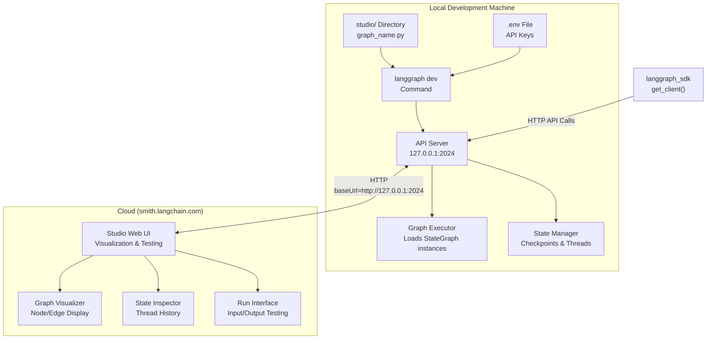

<!-- source: DeepWiki mcp.deepwiki.com · repo langchain-ai/langchain-academy · page 9.1 Local Development Setup · fetched 2026-10-26 -->

# Local Development Setup

<details>
<summary>Relevant source files</summary>

The following files were used as context for generating this wiki page:

- [README.md](README.md)

</details>


This document explains how to set up the LangGraph Studio local development environment. It covers the studio directory structure, environment variable configuration, the `langgraph dev` command, and the local server architecture. For information about using Studio UI and the SDK client, see page 9.2.

## Overview

The LangChain Academy repository includes production-ready graph implementations in `studio/` subdirectories within module folders. These studio directories are designed to work with the `langgraph dev` command, which starts a local development server that:

- Loads and executes graph code from the studio directory
- Provides an HTTP API for graph interaction
- Enables visualization and testing through the cloud-hosted Studio UI
- Manages state, threads, and checkpoints locally

This setup allows development with local code execution while using LangChain's hosted UI for visualization and interaction.

Sources: [README.md:80-100]()

## Studio Directory Structure

Each module in the academy (Modules 1-5) contains a `studio/` subdirectory with production-ready graph implementations. The typical structure is:

```
module-X/
├── notebook1.ipynb          # Learning notebooks
├── notebook2.ipynb
└── studio/                  # Production code for Studio
    ├── .env.example         # Template for API keys
    ├── .env                 # Actual API keys (not in version control)
    ├── graph_name.py        # Graph implementation
    └── langgraph.json       # Studio configuration (if present)
```

### Key Files

| File | Purpose |
|------|---------|
| `*.py` | Python files containing `StateGraph` definitions, node functions, and compiled graphs |
| `.env.example` | Template showing required environment variables |
| `.env` | Actual API keys and configuration (created by developer) |
| `langgraph.json` | Optional Studio configuration for graph metadata |

### Example Studio Implementations

The academy includes these studio directories:

- `module-1/studio/` - Basic agent with ReAct pattern
- `module-2/studio/` - Chatbot with external memory
- `module-3/studio/` - Agent with breakpoints and streaming
- `module-4/studio/` - Research assistant and parallelization examples
- `module-5/studio/` - Task management agent with Trustcall

Sources: [README.md:9-10](), [README.md:85-86]()

## Environment Configuration

Before running `langgraph dev`, you must configure environment variables for API access. Each module's studio directory requires its own `.env` file.

### Creating .env Files

Each studio directory includes an `.env.example` file as a template. To create the actual `.env` file:

**Manual Method** (per module):
```bash
cd module-1/studio
cp .env.example .env
# Edit .env to add your actual API keys
```

**Automated Method** (all modules):
```bash
# From repository root
for i in {1..5}; do
  cp module-$i/studio/.env.example module-$i/studio/.env
  echo "OPENAI_API_KEY=\"$OPENAI_API_KEY\"" > module-$i/studio/.env
done
echo "TAVILY_API_KEY=\"$TAVILY_API_KEY\"" >> module-4/studio/.env
```

Sources: [README.md:101-109]()

### Required API Keys

Different modules require different API keys:

| Module | Required Keys | Purpose |
|--------|--------------|---------|
| Module 1 | `OPENAI_API_KEY` | LLM access for basic agent |
| Module 2 | `OPENAI_API_KEY` | LLM access for chatbot |
| Module 3 | `OPENAI_API_KEY` | LLM access for agent with breakpoints |
| Module 4 | `OPENAI_API_KEY`, `TAVILY_API_KEY` | LLM + web search for research assistant |
| Module 5 | `OPENAI_API_KEY` | LLM access for task management agent |

### API Key Setup

Obtain API keys from these sources:

- **OpenAI**: Sign up at [openai.com](https://openai.com/index/openai-api/) for `OPENAI_API_KEY`
- **Tavily**: Sign up at [tavily.com](https://tavily.com/) for `TAVILY_API_KEY` (Module 4 only)
- **LangSmith** (optional): Sign up at [smith.langchain.com](https://smith.langchain.com/) for tracing

Set environment variables in your shell session:

**Mac/Linux/WSL**:
```bash
export OPENAI_API_KEY="your-api-key-here"
export TAVILY_API_KEY="your-api-key-here"
```

**Windows PowerShell**:
```powershell
$env:OPENAI_API_KEY = "your-api-key-here"
$env:TAVILY_API_KEY = "your-api-key-here"
```

Sources: [README.md:50-78]()

## The langgraph dev Command

The `langgraph dev` command starts a local development server that loads and executes graphs from the current studio directory.

### Running the Command

Navigate to a module's studio directory and start the server:

```bash
cd module-1/studio
langgraph dev
```

### Server Output

When the server starts successfully, you'll see:

```
- 🚀 API: http://127.0.0.1:2024
- 🎨 Studio UI: https://smith.langchain.com/studio/?baseUrl=http://127.0.0.1:2024
- 📚 API Docs: http://127.0.0.1:2024/docs
```

### Output Components

| Component | URL | Purpose |
|-----------|-----|---------|
| **API** | `http://127.0.0.1:2024` | HTTP REST API for graph operations |
| **Studio UI** | `https://smith.langchain.com/studio/?baseUrl=http://127.0.0.1:2024` | Cloud-hosted UI connecting to local server |
| **API Docs** | `http://127.0.0.1:2024/docs` | Interactive API documentation (Swagger/OpenAPI) |

### What the Command Does

When you run `langgraph dev`, the server:

1. Scans the current directory for Python files containing graph definitions
2. Loads all `StateGraph` instances and compiles them
3. Starts an HTTP server on port 2024
4. Registers endpoints for thread management, state operations, and graph execution
5. Provides real-time graph execution with state persistence

Sources: [README.md:86-99]()

## Local Server Architecture

The local development server creates a hybrid architecture where computation runs locally but visualization happens in the cloud.

### Local Server Architecture Diagram



Sources: [README.md:92-99]()

### Component Interactions

The local server architecture involves these interactions:

| Component | Location | Function |
|-----------|----------|----------|
| **studio/ Python files** | Local | Contains `StateGraph` definitions, node functions, compiled graphs |
| **.env file** | Local | Stores API keys loaded by graph code |
| **langgraph dev** | Local | CLI command that starts the development server |
| **API Server (127.0.0.1:2024)** | Local | HTTP REST API handling graph operations |
| **Graph Executor** | Local | Loads and executes `StateGraph` instances from Python files |
| **State Manager** | Local | Persists thread state and checkpoints in memory |
| **Studio UI** | Cloud | Hosted at smith.langchain.com, connects to local API via baseUrl parameter |
| **langgraph_sdk** | Either | Python client library for programmatic API access |

### How Graphs Are Loaded

When `langgraph dev` starts:

1. Scans the current directory for Python files
2. Imports each file and looks for compiled `StateGraph` objects
3. Registers each graph with a unique identifier
4. Creates API endpoints for each graph's operations (create thread, run, stream, get state)
5. Loads environment variables from `.env` for use in node functions

### Connection Flow

The Studio UI connects to the local server using the `baseUrl` query parameter:

```
https://smith.langchain.com/studio/?baseUrl=http://127.0.0.1:2024
```

This tells the cloud-hosted UI to send all API requests to the local server instead of a cloud deployment. All graph execution, state management, and persistence happens locally on your machine.

Sources: [README.md:80-99]()

## Verifying Setup

After starting the local server, verify that it's working correctly.

### Check API Server

Visit the API endpoint in your browser:
```
http://127.0.0.1:2024
```

You should see a JSON response with server information.

### Check API Documentation

Visit the interactive API docs:
```
http://127.0.0.1:2024/docs
```

This provides a Swagger/OpenAPI interface for testing API endpoints directly.

### Access Studio UI

Open the Studio UI in your browser:
```
https://smith.langchain.com/studio/?baseUrl=http://127.0.0.1:2024
```

You should see:
- Your graph(s) listed in the sidebar
- A visual representation of the graph structure
- An input panel for testing

### Test with SDK

Create a simple Python script to verify SDK connectivity:

```python
from langgraph_sdk import get_client

# Connect to local server
client = get_client(url="http://127.0.0.1:2024")

# List available graphs
assistants = await client.assistants.search()
print(f"Found {len(assistants)} graphs")
```

If this runs without errors and prints the number of available graphs, your setup is complete.

Sources: [README.md:92-99]()

## Best Practices for Local Development

When developing LangGraph applications locally, consider these best practices:

1. **Environment Management**: Use virtual environments to isolate dependencies
2. **Version Control**: Track your changes with Git to facilitate collaboration and rollbacks
3. **API Key Management**: Use environment variables to manage API keys securely
4. **Testing Strategy**: Build comprehensive tests for your graphs and tools
5. **Documentation**: Document your graph's purpose, inputs, outputs, and expected behaviors

| Area | Best Practice |
|------|---------------|
| Environment | Use virtual environments (`venv`, `conda`, etc.) |
| Security | Store API keys in `.env` files (never commit to version control) |
| Testing | Test each tool and node individually before testing the entire graph |
| Development | Use Studio for visual debugging and SDK for automated testing |
| Deployment | Create a clear separation between development and production environments |

Sources: [module-1/deployment.ipynb:286-293]()

## Troubleshooting Common Issues

When developing locally, you might encounter these common issues:

1. **API Connection Issues**: Ensure your local development server is running
2. **Missing Dependencies**: Verify all required packages are installed
3. **Authentication Errors**: Check that your API keys are set correctly
4. **Graph Execution Errors**: Use stream mode to debug step-by-step execution
5. **Performance Issues**: Monitor resource usage for memory-intensive operations

For most issues, examining the detailed execution trace through Studio or SDK streaming can help identify the exact point of failure.

Sources: [module-1/deployment.ipynb:198-224]()

---

