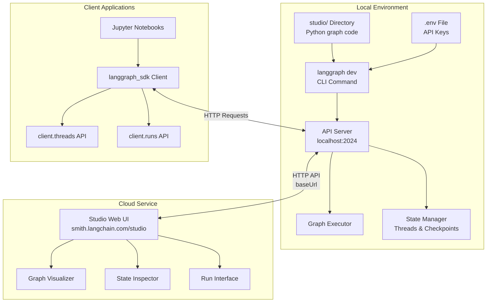
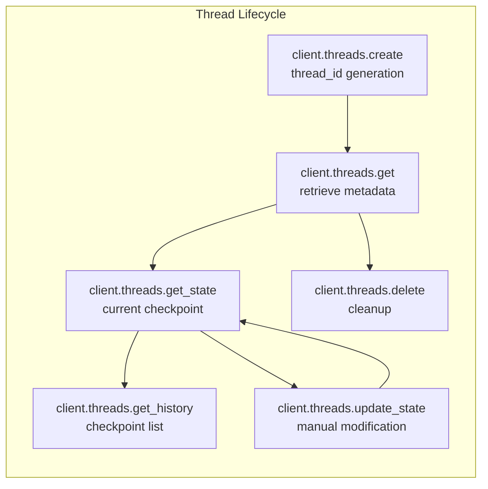
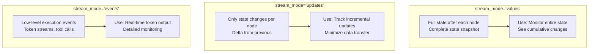
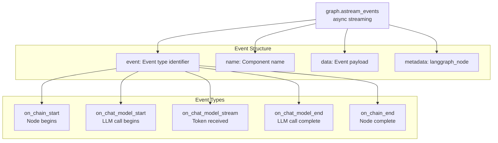
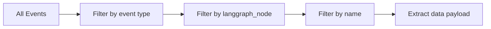
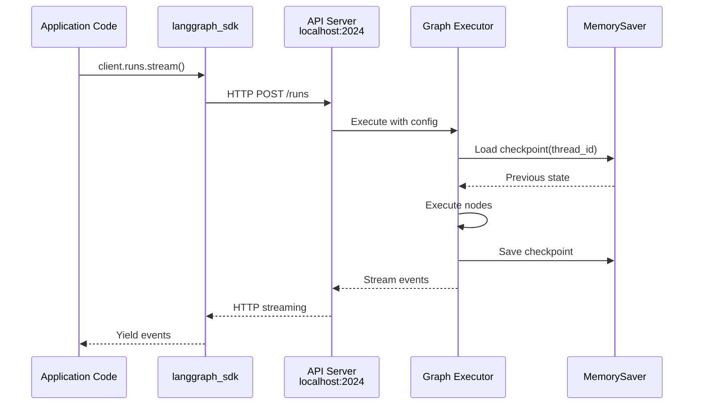

<!-- source: DeepWiki mcp.deepwiki.com · repo langchain-ai/langchain-academy · page 9.2 Studio UI and SDK Client · fetched 2026-10-26 -->

# Studio UI and SDK Client

<details>
<summary>Relevant source files</summary>

The following files were used as context for generating this wiki page:

- [module-3/streaming-interruption.ipynb](module-3/streaming-interruption.ipynb)
- [module-3/time-travel.ipynb](module-3/time-travel.ipynb)

</details>


This document covers the LangGraph Studio web interface and the `langgraph_sdk` client library for programmatic interaction with LangGraph graphs running in the Studio development environment. For information about local Studio setup and directory structure, see [Local Development Setup](#9.1).

The Studio UI provides graph visualization, state inspection, and interactive debugging capabilities through a web browser. The SDK client (`langgraph_sdk`) enables programmatic control of graphs from Python code, including thread management, run execution, and event streaming.

## Studio Architecture Overview

LangGraph Studio operates as a hybrid system with local execution and cloud-hosted visualization.



**Sources:** [module-3/streaming-interruption.ipynb:39](), Diagram 6 from high-level overview

The development workflow involves:
1. Graph code resides in `studio/` directory with production-ready implementations
2. `langgraph dev` starts local API server on port 2024
3. Studio UI connects to local server for visualization
4. SDK client provides programmatic access from notebooks or applications

## SDK Client Installation and Setup

The `langgraph_sdk` package provides the client interface:

```python
pip install langgraph_sdk
```

**Sources:** [module-3/streaming-interruption.ipynb:39]()

To connect to a running Studio server:

```python
from langgraph_sdk import get_client

# Connect to local Studio server
client = get_client(url="http://localhost:2024")

# Or connect to deployed instance
client = get_client(url="https://your-deployment-url")
```

The `get_client` function returns a client instance with two primary API surfaces:
- `client.threads`: Thread lifecycle and state management
- `client.runs`: Graph execution and streaming

## Thread Operations

Threads represent independent conversation or execution contexts. Each thread maintains its own state history through checkpoints.



**Sources:** Diagram 6 from high-level overview, inference from SDK architecture

### Thread Configuration

Threads are identified by `thread_id` in the configuration dict:

```python
config = {"configurable": {"thread_id": "1"}}
```

This configuration pattern appears throughout graph invocations to associate execution with a specific thread.

**Sources:** [module-3/streaming-interruption.ipynb:232](), [module-3/streaming-interruption.ipynb:305](), [module-3/streaming-interruption.ipynb:771]()

### State Access Patterns

The SDK enables multiple state access patterns:

| Operation | Purpose | Returns |
|-----------|---------|---------|
| `get_state` | Current state snapshot | State dict with values |
| `get_history` | Checkpoint history | List of StateSnapshot objects |
| `update_state` | Manual state modification | Updated state |

## Run Operations and Streaming

The `client.runs` API executes graphs with various streaming modes.

### Streaming Modes

LangGraph supports three primary streaming modes for graph state:



**Sources:** [module-3/streaming-interruption.ipynb:196-207]()

#### Updates Mode

Returns only the changes made by each node:

```python
for chunk in graph.stream(
    {"messages": [HumanMessage(content="hi! I'm Lance")]}, 
    config, 
    stream_mode="updates"
):
    print(chunk)
    # Output: {'conversation': {'messages': AIMessage(...)}}
```

Each chunk is a dict with node name as key and state update as value.

**Sources:** [module-3/streaming-interruption.ipynb:218-237]()

#### Values Mode

Returns the complete state after each node execution:

```python
for event in graph.stream(
    {"messages": [input_message]}, 
    config, 
    stream_mode="values"
):
    for m in event['messages']:
        m.pretty_print()
```

Shows cumulative state including all previous updates.

**Sources:** [module-3/streaming-interruption.ipynb:280-313]()

### Token-Level Streaming

The `astream_events` method enables token-by-token streaming from chat models.



**Sources:** [module-3/streaming-interruption.ipynb:326-336](), [module-3/streaming-interruption.ipynb:773-775]()

Example token streaming implementation:

```python
async for event in graph.astream_events(
    {"messages": [input_message]}, 
    config, 
    version="v2"
):
    node = event['metadata'].get('langgraph_node', '')
    event_type = event['event']
    name = event['name']
    print(f"Node: {node}. Type: {event_type}. Name: {name}")
```

**Sources:** [module-3/streaming-interruption.ipynb:771-774]()

### Event Filtering

Filter streaming events by type and metadata:



**Sources:** [module-3/streaming-interruption.ipynb:782-786]()

Target `on_chat_model_stream` events from specific nodes:

```python
if event['event'] == 'on_chat_model_stream':
    if event['metadata'].get('langgraph_node') == 'conversation':
        chunk = event['data']['chunk']
        # Process AIMessageChunk
```

The `data` field contains an `AIMessageChunk` object with token content.

**Sources:** [module-3/streaming-interruption.ipynb:786](), [module-3/streaming-interruption.ipynb:799-1010]()

## Studio UI Features

The web interface at smith.langchain.com/studio provides visual debugging tools.

### Graph Visualization

The visualizer displays:
- Node structure with connections
- Edge types (normal, conditional)
- Current execution position
- State schema

### State Inspector

The inspector shows:
- Current state values by key
- Message history
- Checkpoint metadata
- Thread configuration

### Run Interface

The run interface enables:
- Manual graph execution
- Input message composition
- Streaming output display
- Breakpoint interaction (see [Breakpoints and Interruptions](#6.1))

**Sources:** Diagram 6 from high-level overview

## SDK vs Direct Graph Usage

| Feature | Direct Graph | SDK Client |
|---------|-------------|------------|
| Execution Location | Local process | Remote server |
| State Access | Memory/checkpointer | HTTP API |
| Streaming | Native Python | HTTP streaming |
| Breakpoints | In-process pause | Remote resume |
| Use Case | Development/testing | Production/remote control |

The SDK enables remote control patterns:
- Web applications invoking graphs
- Monitoring dashboards
- Human approval workflows
- Multi-tenant deployments

**Sources:** Diagram 6 from high-level overview, inference from architecture

## Integration Example

Combining SDK with Studio server for chatbot with memory:



**Sources:** [module-3/streaming-interruption.ipynb:79-187]() (graph definition), inference from streaming architecture

The chatbot from Module 3 demonstrates state management with streaming:
- `State` class with `summary` field ([module-3/streaming-interruption.ipynb:110-112]())
- `call_model` node with `RunnableConfig` ([module-3/streaming-interruption.ipynb:115]())
- `MemorySaver` checkpointer ([module-3/streaming-interruption.ipynb:185]())
- Conditional routing to summarization ([module-3/streaming-interruption.ipynb:161-172]())

This pattern extends to SDK usage where the graph runs in Studio server while client code streams events.

## Event Structure Reference

Token streaming events contain:

```python
{
    'event': 'on_chat_model_stream',
    'name': 'ChatOpenAI',
    'data': {
        'chunk': AIMessageChunk(
            content='token text',
            response_metadata={'model_provider': 'openai'}
        )
    },
    'metadata': {
        'langgraph_node': 'conversation'
    }
}
```

**Sources:** [module-3/streaming-interruption.ipynb:799-1010]()

Key fields:
- `event`: Event type identifier (e.g., `on_chat_model_stream`)
- `name`: Component name (e.g., `ChatOpenAI`)
- `data.chunk`: `AIMessageChunk` with token content
- `metadata.langgraph_node`: Originating graph node

## Python Version Considerations

Token streaming requires different configuration based on Python version:

For Python < 3.11:
```python
from langchain_core.runnables import RunnableConfig

def call_model(state: State, config: RunnableConfig):
    response = model.invoke(messages, config)
```

For Python >= 3.11, the `config` parameter is optional for token streaming.

**Sources:** [module-3/streaming-interruption.ipynb:75-76]()