# Page: Introduction to LangChain Academy

# Introduction to LangChain Academy

<details>
<summary>Relevant source files</summary>

The following files were used as context for generating this wiki page:

- [README.md](README.md)

</details>


LangChain Academy is a comprehensive educational resource designed to teach developers the foundational concepts of the LangChain ecosystem, with a particular focus on LangGraph - a framework for building language model applications using a graph-based approach. This repository provides structured, hands-on learning materials that progressively build knowledge from basic concepts to advanced techniques.

For detailed setup instructions and environment configuration, see [Getting Started](#2).

## Purpose and Scope

LangChain Academy aims to provide a structured learning path for developers interested in building sophisticated AI applications using the LangGraph framework. The curriculum is organized into progressive modules that cover fundamental concepts, state management, human-in-the-loop interactions, multi-agent systems, memory handling, and deployment techniques.

The materials are designed to be hands-on, allowing learners to experiment with working examples while understanding the underlying principles of graph-based language model applications.

Sources: [README.md:3-10]()

## Repository Structure

LangChain Academy is organized into modules that build upon each other, progressively introducing more advanced concepts:

**Repository Structure by Module**

```mermaid
flowchart TD
    root["langchain-academy/"]
    readme["README.md"]
    reqs["requirements.txt"]
    
    m0["module-0/\nbasics.ipynb"]
    
    m1["module-1/"]
    m1_agent["agent.ipynb"]
    m1_mem["agent-memory.ipynb"]
    m1_chain["chain.ipynb"]
    m1_graph["simple-graph.ipynb"]
    m1_router["router.ipynb"]
    
    m2["module-2/"]
    m2_schema["multiple-schemas.ipynb"]
    m2_reducer["state-reducers.ipynb"]
    m2_chatbot["chatbot-summarization.ipynb"]
    m2_external["chatbot-external-memory.ipynb"]
    m2_trim["trim-filter-messages.ipynb"]
    
    m3["module-3/"]
    m3_stream["streaming-interruption.ipynb"]
    m3_time["time-travel.ipynb"]
    m3_break["breakpoints.ipynb"]
    m3_edit["edit-state-human-feedback.ipynb"]
    
    m4["module-4/"]
    m4_map["map-reduce.ipynb"]
    m4_sub["sub-graph.ipynb"]
    m4_par["parallelization.ipynb"]
    m4_res["research-assistant.ipynb"]
    m4_studio["studio/"]
    
    m5["module-5/"]
    m5_mem["memory_agent.ipynb"]
    m5_studio["studio/"]
    
    root --> readme
    root --> reqs
    root --> m0
    root --> m1
    root --> m2
    root --> m3
    root --> m4
    root --> m5
    
    m1 --> m1_agent
    m1 --> m1_mem
    m1 --> m1_chain
    m1 --> m1_graph
    m1 --> m1_router
    
    m2 --> m2_schema
    m2 --> m2_reducer
    m2 --> m2_chatbot
    m2 --> m2_external
    m2 --> m2_trim
    
    m3 --> m3_stream
    m3 --> m3_time
    m3 --> m3_break
    m3 --> m3_edit
    
    m4 --> m4_map
    m4 --> m4_sub
    m4 --> m4_par
    m4 --> m4_res
    m4 --> m4_studio
    
    m5 --> m5_mem
    m5 --> m5_studio
```

Each module contains:

1. **Jupyter Notebooks (.ipynb)**: Executable code examples demonstrating specific concepts
2. **Studio Directory**: Modules 4-5 include `studio/` subdirectories containing production-ready graph implementations for deployment with LangGraph Studio

Sources: [README.md:5-10]()

Sources: [README.md:5-10]()

## Learning Path and Module Progression

LangChain Academy follows a carefully designed learning path that builds competency in LangGraph development:

**Learning Progression and Key Technologies**

```mermaid
graph TD
    subgraph Module_0["Module 0: Foundations"]
        M0_setup["Environment Setup"]
        M0_llm["ChatOpenAI Invocation"]
        M0_tools["TavilySearchResults Tool"]
    end
    
    subgraph Module_1["Module 1: Agent Basics"]
        M1_sg["StateGraph Construction"]
        M1_react["ReAct Pattern\nassistant node + tools node"]
        M1_mem["MemorySaver with thread_id"]
        M1_router["tools_condition Routing"]
    end
    
    subgraph Module_2["Module 2: State Management"]
        M2_schema["TypedDict vs Pydantic Schemas"]
        M2_reducer["add_messages Reducer\noperator.add"]
        M2_sqlite["SqliteSaver Persistence"]
        M2_trim["Message Trimming & Filtering"]
    end
    
    subgraph Module_3["Module 3: Production Features"]
        M3_stream["Streaming Modes\nvalues/updates/events"]
        M3_time["get_state_history\nTime Travel"]
        M3_break["interrupt_before Breakpoints"]
        M3_edit["update_state Editing"]
    end
    
    subgraph Module_4["Module 4: Advanced Patterns"]
        M4_map["Send API\nMap-Reduce Pattern"]
        M4_sub["Sub-Graphs with StateGraph"]
        M4_par["Parallel Execution"]
        M4_res["Multi-Agent Research Assistant"]
    end
    
    subgraph Module_5["Module 5: Memory Systems"]
        M5_store["InMemoryStore\nCross-Thread Persistence"]
        M5_trust["Trustcall Extraction"]
        M5_agent["task_mAIstro Agent\nUpdateMemory Tool"]
    end
    
    M0_setup --> M0_llm
    M0_llm --> M0_tools
    M0_tools --> M1_sg
    
    M1_sg --> M1_react
    M1_react --> M1_mem
    M1_mem --> M1_router
    M1_router --> M2_schema
    
    M2_schema --> M2_reducer
    M2_reducer --> M2_sqlite
    M2_sqlite --> M2_trim
    M2_trim --> M3_stream
    
    M3_stream --> M3_time
    M3_time --> M3_break
    M3_break --> M3_edit
    M3_edit --> M4_map
    
    M4_map --> M4_sub
    M4_sub --> M4_par
    M4_par --> M4_res
    M4_res --> M5_store
    
    M5_store --> M5_trust
    M5_trust --> M5_agent
```

The modules follow a progression from basic to advanced concepts:

| Module | Focus | Key Notebooks | Core Classes/Functions |
|--------|-------|---------------|------------------------|
| **Module 0** | Environment setup and basic LLM usage | `basics.ipynb` | `ChatOpenAI`, `TavilySearchResults` |
| **Module 1** | LangGraph fundamentals and ReAct agents | `agent.ipynb`, `agent-memory.ipynb`, `simple-graph.ipynb`, `router.ipynb`, `chain.ipynb` | `StateGraph`, `MessagesState`, `MemorySaver`, `ToolNode` |
| **Module 2** | State schemas, reducers, and persistence | `multiple-schemas.ipynb`, `state-reducers.ipynb`, `chatbot-external-memory.ipynb`, `trim-filter-messages.ipynb` | `TypedDict`, `add_messages`, `SqliteSaver`, `operator.add` |
| **Module 3** | Streaming, debugging, and human-in-the-loop | `streaming-interruption.ipynb`, `time-travel.ipynb`, `breakpoints.ipynb`, `edit-state-human-feedback.ipynb` | `interrupt_before`, `get_state_history`, `update_state` |
| **Module 4** | Parallel processing and multi-agent systems | `map-reduce.ipynb`, `sub-graph.ipynb`, `parallelization.ipynb`, `research-assistant.ipynb` | `Send` API, sub-graphs, `create_analysts`, `initiate_all_interviews` |
| **Module 5** | Long-term memory and structured extraction | `memory_agent.ipynb` | `InMemoryStore`, `Trustcall`, `UpdateMemory` tool |

Sources: [README.md:5-10]()

Sources: [README.md:5-10]()

## Core Technology Overview

LangChain Academy focuses on teaching LangGraph, which is part of the broader LangChain ecosystem.

**Core Technology Stack**

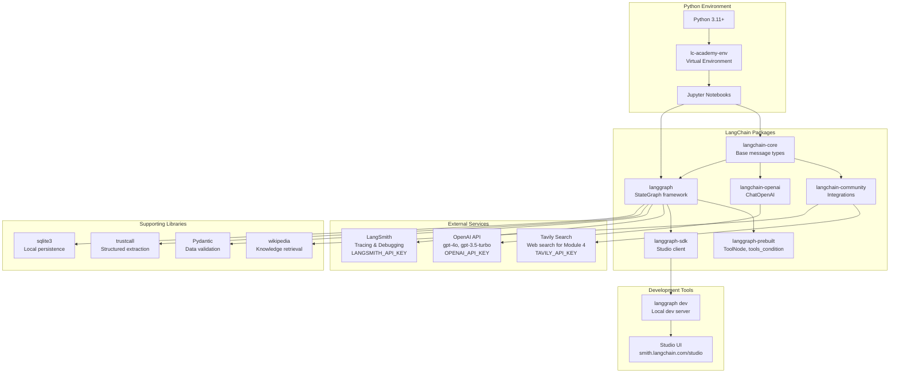

**LangGraph Core Components**

The curriculum progressively introduces these core LangGraph classes and patterns:

| Component | Purpose | Introduced In |
|-----------|---------|---------------|
| `StateGraph` | Main graph orchestrator that defines workflow structure | Module 1: `simple-graph.ipynb` |
| `MessagesState` | Built-in state schema for conversation tracking | Module 1: `agent.ipynb` |
| `ToolNode` | Pre-built node for tool execution | Module 1: `agent.ipynb` |
| `MemorySaver` | In-memory checkpointer for within-session persistence | Module 1: `agent-memory.ipynb` |
| `SqliteSaver` | Persistent checkpointer using SQLite database | Module 2: `chatbot-external-memory.ipynb` |
| `InMemoryStore` | Cross-thread storage for long-term memory | Module 5: `memory_agent.ipynb` |
| `add_messages` | Reducer for appending/updating messages in state | Module 2: `state-reducers.ipynb` |
| `Send` API | Dynamic fan-out for parallel execution | Module 4: `map-reduce.ipynb` |
| `Trustcall` | Structured extraction and validation | Module 5: `memory_agent.ipynb` |

**Application Patterns**

The curriculum emphasizes practical applications:

- **ReAct Agents**: Tool-augmented agents with reasoning-action-observation loops (`agent.ipynb`)
- **Conditional Routing**: Dynamic flow control using `tools_condition` (`router.ipynb`)
- **Map-Reduce**: Parallel task execution with result aggregation (`map-reduce.ipynb`)
- **Sub-Graphs**: Modular, composable workflows (`sub-graph.ipynb`)
- **Multi-Agent Systems**: Coordinated agent interactions (`research-assistant.ipynb`)
- **Human-in-the-Loop**: Breakpoints and state editing (`breakpoints.ipynb`, `edit-state-human-feedback.ipynb`)
- **Memory Systems**: Multi-schema long-term memory (`memory_agent.ipynb`)

Sources: [README.md:5-10]()

Sources: [README.md:5-10]()

## Development Environment

LangChain Academy requires specific environment configurations to run the examples effectively:

**Environment Requirements**

| Component | Requirement | Configuration | Used In |
|-----------|-------------|---------------|---------|
| Python    | 3.11+       | System installation | All modules |
| Virtual Environment | `lc-academy-env` | Created with `python3 -m venv` | All modules |
| OpenAI API| API Key     | `OPENAI_API_KEY` environment variable | All modules |
| LangSmith | API Key     | `LANGSMITH_API_KEY`, `LANGSMITH_TRACING_V2=true` | All modules (optional but recommended) |
| Tavily API| API Key     | `TAVILY_API_KEY` environment variable | Module 4: `research-assistant.ipynb` |
| LangGraph Studio | Local Dev Server | `langgraph dev` in `studio/` directories | Modules 4-5 |
| Dependencies | Python packages | `pip install -r requirements.txt` | All modules |

**Key Dependencies from requirements.txt**

The academy uses these core packages:

- `langgraph` - Main state graph framework
- `langchain-core` - Base abstractions and message types
- `langchain-openai` - OpenAI integration (`ChatOpenAI` class)
- `langchain-community` - Community integrations (Tavily, Wikipedia)
- `langgraph-prebuilt` - Pre-built components (`ToolNode`, `tools_condition`)
- `langgraph-sdk` - SDK for interacting with LangGraph Studio
- `pydantic` - Data validation for state schemas
- `trustcall` - Structured extraction (Module 5)

For detailed setup instructions, see [Getting Started](#2).

Sources: [README.md:12-109]()

Sources: [README.md:12-109]()

## Using LangGraph Studio

LangGraph Studio is used in advanced modules (4-5) for visualizing and testing production-ready graph implementations:

**LangGraph Studio Architecture**

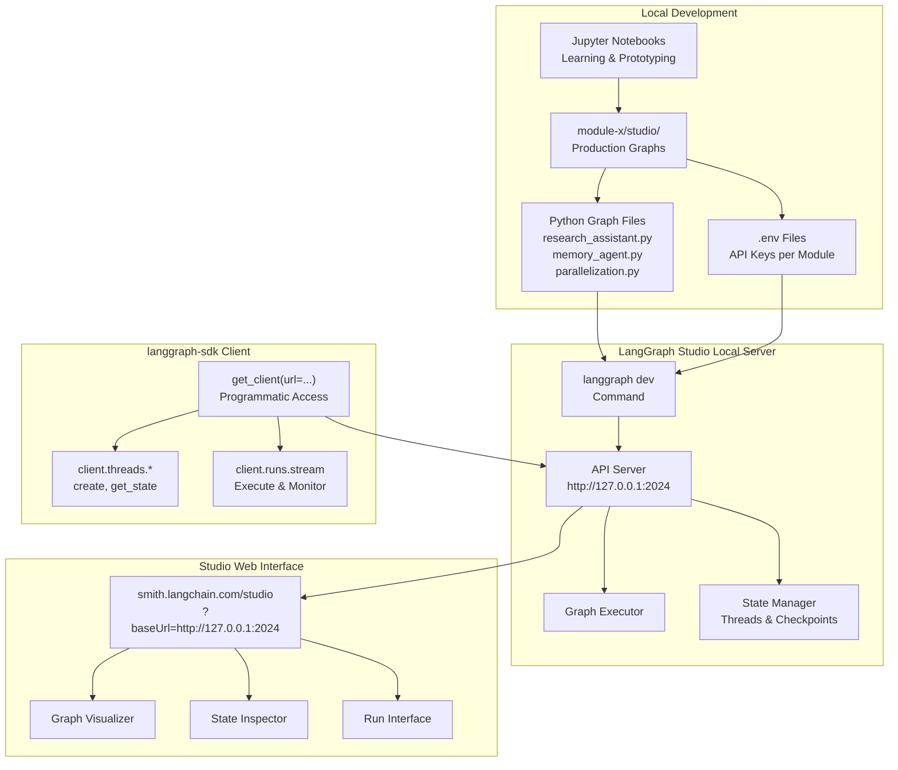

**Studio Directory Structure**

Modules 4 and 5 include production-ready implementations in their `studio/` directories:

- **Module 4 Studio**: 
  - `research_assistant.py` - Multi-agent research system
  - `parallelization.py` - Parallel Wikipedia processing
  - `.env.example` - Template for API keys

- **Module 5 Studio**:
  - `memory_agent.py` - task_mAIstro agent with long-term memory
  - `.env.example` - Template for API keys

To use Studio, navigate to the `studio/` directory and run:
```bash
langgraph dev
```

This starts a local server at `http://127.0.0.1:2024` and provides a UI link for visualization at `https://smith.langchain.com/studio/?baseUrl=http://127.0.0.1:2024`.

Sources: [README.md:80-109]()

Sources: [README.md:80-109]()

## Getting Started

To begin your journey with LangChain Academy:

1. Ensure you have Python 3.11 or later installed
2. Clone the repository from GitHub
3. Set up the required environment variables (OpenAI API key, LangSmith API key)
4. Install dependencies using the provided requirements file
5. Follow the module progression starting with Module 0

For complete setup instructions and environment configuration details, see [Getting Started](#2).

Sources: [README.md:12-79]()

---

# Page: Getting Started

# Getting Started

<details>
<summary>Relevant source files</summary>

The following files were used as context for generating this wiki page:

- [README.md](README.md)
- [module-0/basics.ipynb](module-0/basics.ipynb)
- [module-4/studio/parallelization.py](module-4/studio/parallelization.py)
- [module-4/studio/research_assistant.py](module-4/studio/research_assistant.py)
- [requirements.txt](requirements.txt)

</details>


This guide walks you through setting up your environment to run the LangChain Academy examples and explore the LangGraph framework. You'll learn how to configure your development environment, set up necessary API keys, and run both the example notebooks and LangGraph Studio.

For an introduction to LangChain Academy and its purpose, see [Introduction to LangChain Academy](#1).

## System Requirements

### Python Version

LangChain Academy requires **Python 3.11 or later** for optimal compatibility with LangGraph. You can check your Python version with:

```bash
python3 --version
```

### Dependencies

The repository relies on several key packages:

| Package | Purpose |
|---------|---------|
| langgraph | Core library for graph-based LLM applications |
| langgraph-prebuilt | Prebuilt components for LangGraph |
| langgraph-sdk | SDK for working with LangGraph |
| langgraph-checkpoint-sqlite | SQLite-based checkpoint system |
| langsmith | Debugging, testing and monitoring LLM applications |
| langchain-community | Community components for LangChain |
| langchain-core | Core LangChain functionality |
| langchain-openai | OpenAI integrations for LangChain |
| tavily-python | Python client for Tavily search API |
| trustcall | Framework for building trustworthy agents |
| langgraph-cli | Command-line interface for LangGraph |

Sources:
- [requirements.txt:1-13]()

## Setup Process

### LangChain Academy Setup Workflow

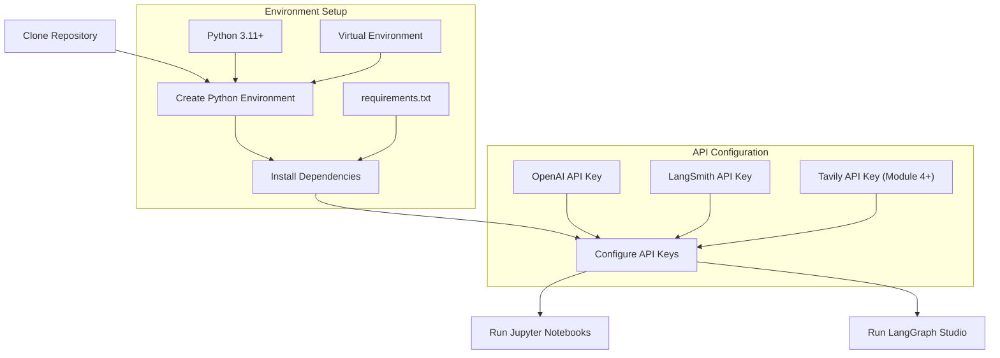

Sources:
- [README.md:12-69]()

### Cloning the Repository

First, clone the LangChain Academy repository:

```bash
git clone https://github.com/langchain-ai/langchain-academy.git
cd langchain-academy
```

Sources:
- [README.md:23-27]()

### Creating a Virtual Environment

Create a Python virtual environment to isolate the dependencies:

#### Mac/Linux/WSL
```bash
python3 -m venv lc-academy-env
source lc-academy-env/bin/activate
```

#### Windows PowerShell
```bash
python3 -m venv lc-academy-env
Set-ExecutionPolicy -ExecutionPolicy RemoteSigned -Scope Process
lc-academy-env\scripts\activate
```

Sources:
- [README.md:29-42]()

### Installing Dependencies

Install all required packages:

```bash
pip install -r requirements.txt
```

Sources:
- [README.md:34-35]()
- [README.md:41-42]()

## API Keys Configuration

The examples in LangChain Academy require several API keys to function properly. You can set these as environment variables or use a `.env` file with the `python-dotenv` library.

### OpenAI API Key

Required for accessing OpenAI models:

```bash
# Mac/Linux/WSL
export OPENAI_API_KEY="your-openai-api-key"

# Windows PowerShell
$env:OPENAI_API_KEY = "your-openai-api-key"
```

If you don't have an OpenAI API key, you can sign up at OpenAI's website.

Sources:
- [README.md:62-64]()

### LangSmith API Key

LangSmith is used for debugging, testing, and monitoring:

```bash
# Mac/Linux/WSL
export LANGCHAIN_API_KEY="your-langchain-api-key"
export LANGCHAIN_TRACING_V2=true

# Windows PowerShell
$env:LANGCHAIN_API_KEY = "your-langchain-api-key"
$env:LANGCHAIN_TRACING_V2 = "true"
```

Sign up for LangSmith at smith.langchain.com.

Sources:
- [README.md:66-69]()

### Tavily API Key (for Web Search)

Required for modules that use web search capabilities (primarily Module 4):

```bash
# Mac/Linux/WSL
export TAVILY_API_KEY="your-tavily-api-key"

# Windows PowerShell
$env:TAVILY_API_KEY = "your-tavily-api-key"
```

Sign up for a Tavily API key at tavily.com.

Sources:
- [README.md:71-78]()

## Running the Notebooks

To run the tutorial notebooks, you'll need Jupyter:

```bash
jupyter notebook
```

This will open a browser window where you can navigate to the module notebooks.

Sources:
- [README.md:44-48]()

## Module Structure and Dependencies

### LangChain Academy Module Organization

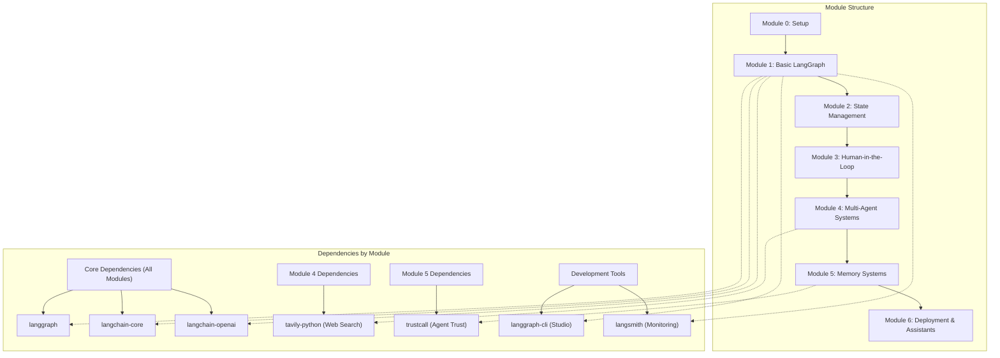

Sources:
- [requirements.txt:1-13]()
- [module-1/studio/requirements.txt:1-6]()
- [module-3/studio/requirements.txt:1-5]()
- [README.md:3-10]()

## Setting Up LangGraph Studio

LangGraph Studio is a custom IDE for viewing and testing agents. Each module includes a `studio` directory with graphs you can explore.

### LangGraph Studio Configuration

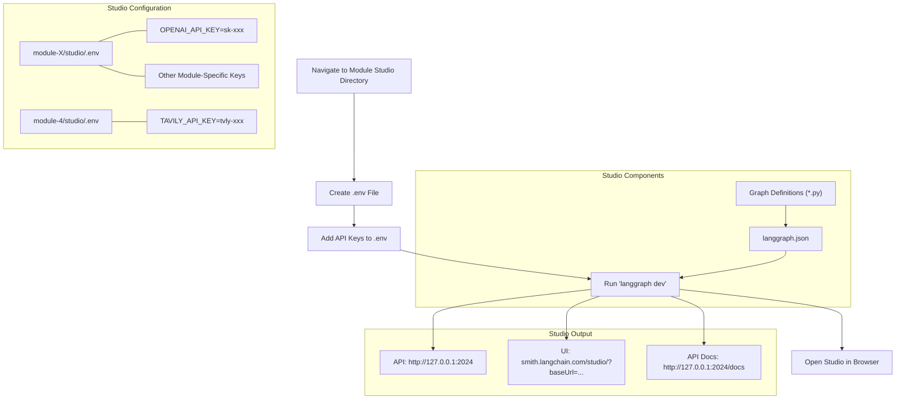

Sources:
- [README.md:80-109]()
- [module-1/studio/.env.example:1]()
- [module-1/studio/langgraph.json:1-13]()

### Starting the Development Server

Navigate to a module's studio directory and run:

```bash
cd module-X/studio
langgraph dev
```

You should see output like:
```
- 🚀 API: http://127.0.0.1:2024
- 🎨 Studio UI: https://smith.langchain.com/studio/?baseUrl=http://127.0.0.1:2024
- 📚 API Docs: http://127.0.0.1:2024/docs
```

Open your browser and navigate to the Studio UI URL.

Sources:
- [README.md:88-97]()

### Configuring Environment for Studio

Each module's studio directory requires its own environment configuration. Create a `.env` file in each module's studio directory with your API keys:

```bash
for i in {1..6}; do
  cp module-$i/studio/.env.example module-$i/studio/.env
  echo "OPENAI_API_KEY=\"$OPENAI_API_KEY\"" > module-$i/studio/.env
done
echo "TAVILY_API_KEY=\"$TAVILY_API_KEY\"" >> module-4/studio/.env
```

Sources:
- [README.md:101-109]()

## Next Steps

Now that your environment is set up, you're ready to begin exploring the modules. Start with Module 0 for basic concepts, then progress through the modules in order for a comprehensive understanding of LangGraph.

For more information on core concepts in LangGraph, see [LangGraph Core Concepts](#3).

---

# Page: LangGraph Core Concepts

# LangGraph Core Concepts

<details>
<summary>Relevant source files</summary>

The following files were used as context for generating this wiki page:

- [module-0/basics.ipynb](module-0/basics.ipynb)
- [module-1/chain.ipynb](module-1/chain.ipynb)
- [module-1/simple-graph.ipynb](module-1/simple-graph.ipynb)
- [module-4/studio/parallelization.py](module-4/studio/parallelization.py)
- [module-4/studio/research_assistant.py](module-4/studio/research_assistant.py)
- [requirements.txt](requirements.txt)

</details>


LangGraph is a framework for building language model applications using a directed graph-based approach. This page explains the fundamental building blocks of LangGraph and how they work together to create complex applications.

For detailed information about specific implementations like agents, router patterns, or human-in-the-loop features, refer to the dedicated pages on [Building Agents with LangGraph](#4), [State Management](#5), and [Human-in-the-Loop Features](#6).

## Overview of LangGraph Architecture

LangGraph follows a directed graph architecture where nodes represent processing steps and edges determine the flow of execution. The framework is designed around several core components imported from the `langgraph` package:

### Core Components Map

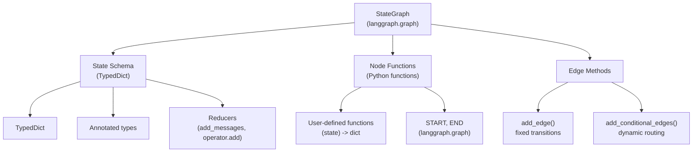

**Key Imports:**
- `StateGraph` from `langgraph.graph`
- `START`, `END` from `langgraph.graph`
- `MessagesState` from `langgraph.graph`
- `add_messages` from `langgraph.graph.message`

Sources: [module-1/simple-graph.ipynb:146-164](), [module-1/chain.ipynb:393-426]()
</thinking>

The LangGraph execution model progresses through these phases:

| Phase | Component | Code Entity |
|-------|-----------|-------------|
| 1. Define | State schema | `TypedDict` class |
| 2. Initialize | Graph builder | `StateGraph(State)` |
| 3. Populate | Add nodes | `builder.add_node(name, func)` |
| 4. Connect | Add edges | `builder.add_edge()` / `builder.add_conditional_edges()` |
| 5. Prepare | Compile | `builder.compile()` |
| 6. Execute | Invoke | `graph.invoke(input)` |

Sources: [module-1/simple-graph.ipynb:187-200](), [module-1/chain.ipynb:497-512]()

## StateGraph

The `StateGraph` class from `langgraph.graph` is the primary interface for building LangGraph applications. It orchestrates the execution flow between nodes based on the defined edges.

### StateGraph Construction Pattern

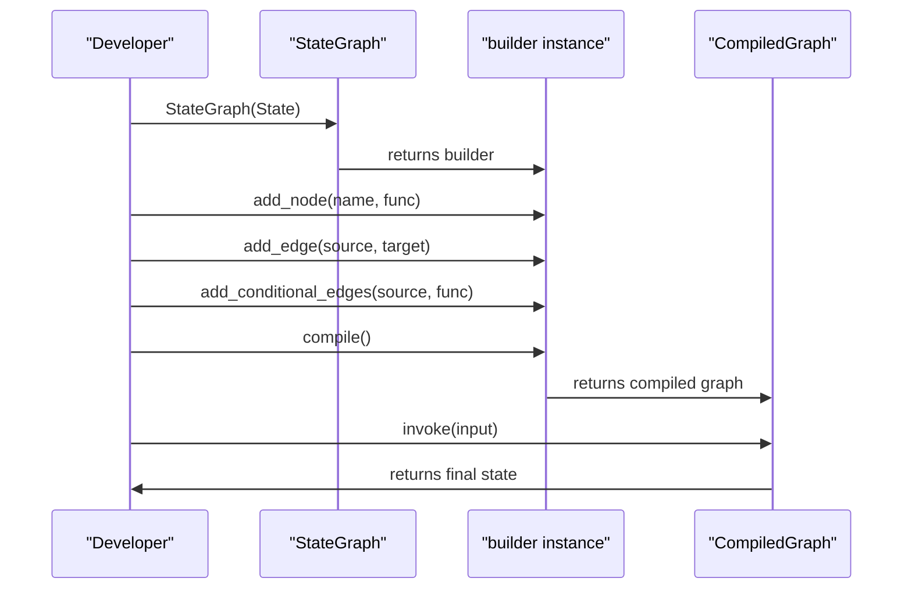

Sources: [module-1/simple-graph.ipynb:187-200](), [module-1/chain.ipynb:497-512]()

### StateGraph API Methods

| Method | Parameters | Purpose | Example |
|--------|-----------|---------|---------|
| `__init__` | `state_schema` | Initialize with state type | `StateGraph(State)` |
| `add_node` | `name: str`, `func: callable` | Register a processing node | `builder.add_node("node_1", node_1)` |
| `add_edge` | `source: str`, `target: str` | Connect nodes with fixed transition | `builder.add_edge(START, "node_1")` |
| `add_conditional_edges` | `source: str`, `path: callable` | Connect nodes with dynamic routing | `builder.add_conditional_edges("node_1", decide_mood)` |
| `compile` | `checkpointer=None`, `interrupt_before=[]` | Finalize graph for execution | `builder.compile()` |

Sources: [module-1/simple-graph.ipynb:187-203](), [module-1/chain.ipynb:497-512]()

### Construction Example

The following code demonstrates the complete construction pattern:

```python
from langgraph.graph import StateGraph, START, END

# 1. Initialize with state schema
builder = StateGraph(State)

# 2. Register nodes
builder.add_node("node_1", node_1)
builder.add_node("node_2", node_2)

# 3. Define flow with edges
builder.add_edge(START, "node_1")
builder.add_edge("node_1", "node_2")
builder.add_edge("node_2", END)

# 4. Compile for execution
graph = builder.compile()
```

Sources: [module-1/simple-graph.ipynb:187-200]()

## State Schema Definition

State in LangGraph represents the data that flows through the graph. The state schema defines the structure and types of data available to nodes during execution.

### TypedDict-Based State

The simplest state definition uses `TypedDict` from the `typing_extensions` module:

```python
from typing_extensions import TypedDict

class State(TypedDict):
    graph_state: str
```

This defines a state with a single key `graph_state` of type `str`. Each node can access this value using dictionary-style access: `state['graph_state']`.

Sources: [module-1/simple-graph.ipynb:55-59]()

### State Update Behavior

By default, when a node returns a dictionary, the values **override** the existing state:

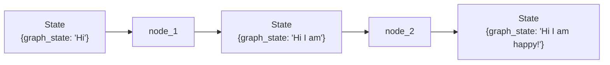

Each node's return value replaces the corresponding state keys, not merges with them.

Sources: [module-1/simple-graph.ipynb:77-97]()

### Annotated State with Reducers

To customize how state updates are applied (e.g., appending instead of replacing), use `Annotated` types with reducer functions:

```python
from typing import Annotated
from langgraph.graph.message import add_messages
from langchain_core.messages import AnyMessage

class MessagesState(TypedDict):
    messages: Annotated[list[AnyMessage], add_messages]
```

The `add_messages` reducer appends new messages to the list instead of replacing it entirely.

Sources: [module-1/chain.ipynb:387-396]()

### State as Node Input/Output Contract

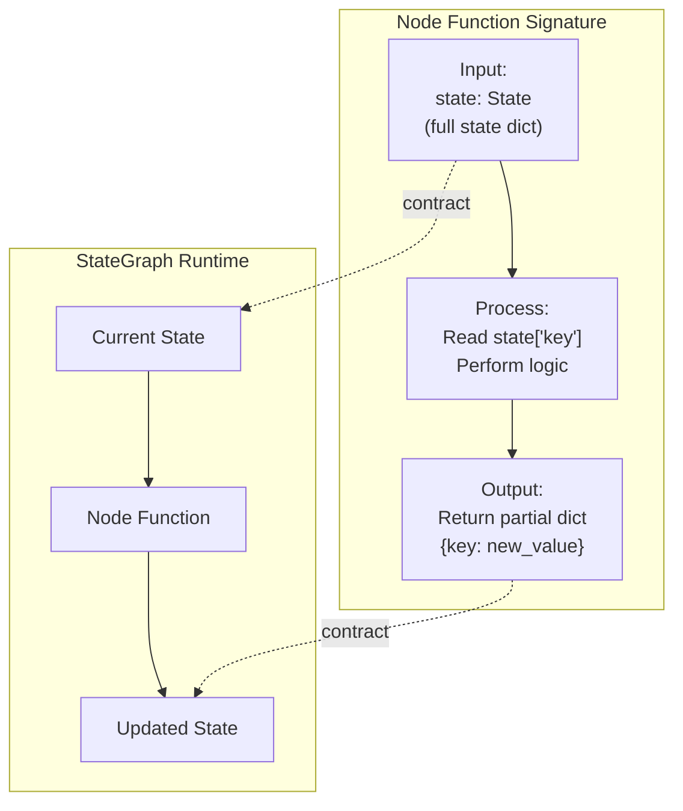

Sources: [module-1/simple-graph.ipynb:72-97]()

### State Execution Flow

```mermaid
sequenceDiagram
    participant User as "User Input"
    participant Start as "START"
    participant Node1 as "Node 1"
    participant Node2 as "Node 2"
    participant End as "END"
    participant Output as "Final State"
    
    User->>Start: Initial State
    Start->>Node1: Pass State
    Node1->>Node1: Process State
    Node1->>Node2: Updated State
    Node2->>Node2: Process State
    Node2->>End: Updated State
    End->>Output: Return Final State
```

Sources: [module-1/simple-graph.ipynb:218-229]()

## Node Functions

Nodes are Python functions that process state. Each node function has a standardized signature and return contract.

### Node Function Signature

```python
def node_name(state: StateType) -> dict:
    """
    Args:
        state: The full current state (TypedDict)
    
    Returns:
        A dict with keys to update in state
    """
    # Read from state
    value = state['some_key']
    
    # Perform processing
    new_value = process(value)
    
    # Return partial state update
    return {"some_key": new_value}
```

**Key Points:**
- First parameter must accept the state (can be typed with the state schema)
- Return value must be a dictionary containing state keys to update
- Only returned keys are updated; other state keys remain unchanged
- Side effects (printing, logging, API calls) are allowed

Sources: [module-1/simple-graph.ipynb:86-97]()

### Node Examples from Codebase

| Node Function | Purpose | State Keys Read | State Keys Written |
|---------------|---------|-----------------|-------------------|
| `node_1` (simple-graph) | Append text | `graph_state` | `graph_state` |
| `tool_calling_llm` (chain) | Invoke LLM | `messages` | `messages` |
| `search_web` (parallelization) | Search web | `question` | `context` |
| `generate_answer` (parallelization) | Generate answer | `question`, `context` | `answer` |

Sources: [module-1/simple-graph.ipynb:86-97](), [module-1/chain.ipynb:500-502](), [module-4/studio/parallelization.py:22-76]()

### Special Nodes: START and END

LangGraph provides two built-in sentinel nodes:

- **`START`**: Entry point for the graph; user input is passed to the first node connected from `START`
- **`END`**: Exit point; when reached, execution stops and the final state is returned

These are imported from `langgraph.graph`:

```python
from langgraph.graph import START, END

builder.add_edge(START, "first_node")
builder.add_edge("last_node", END)
```

Neither `START` nor `END` needs to be added with `add_node()` — they exist automatically.

Sources: [module-1/simple-graph.ipynb:185-197]()

## Edges: Controlling Execution Flow

Edges define the transitions between nodes. LangGraph provides two types of edges: normal (static) and conditional (dynamic).

### Normal Edges

Normal edges created with `add_edge()` establish fixed transitions between nodes:

```python
builder.add_edge(source="node_1", target="node_2")
```

When `node_1` completes, execution **always** proceeds to `node_2`.

**Common patterns:**

| Pattern | Code | Purpose |
|---------|------|---------|
| Entry point | `builder.add_edge(START, "first_node")` | Connect graph input to first node |
| Sequential flow | `builder.add_edge("node_1", "node_2")` | Chain nodes in sequence |
| Exit point | `builder.add_edge("last_node", END)` | Terminate execution |
| Parallel fan-out | Multiple edges from one source | Execute multiple nodes (advanced) |

Sources: [module-1/simple-graph.ipynb:193-197]()

### Conditional Edges

Conditional edges use `add_conditional_edges()` with a routing function to enable dynamic branching:

```python
def decide_mood(state) -> Literal["node_2", "node_3"]:
    """
    Routing function signature:
    - Takes state as input
    - Returns the name of the next node (as string)
    - Return type can be annotated with Literal for type safety
    """
    user_input = state['graph_state']
    
    if random.random() < 0.5:
        return "node_2"
    return "node_3"

builder.add_conditional_edges(source="node_1", path=decide_mood)
```

The routing function is invoked after the source node completes. Based on the returned string, execution routes to the corresponding node.

Sources: [module-1/simple-graph.ipynb:123-138]()

### Edge Execution Flow Diagram

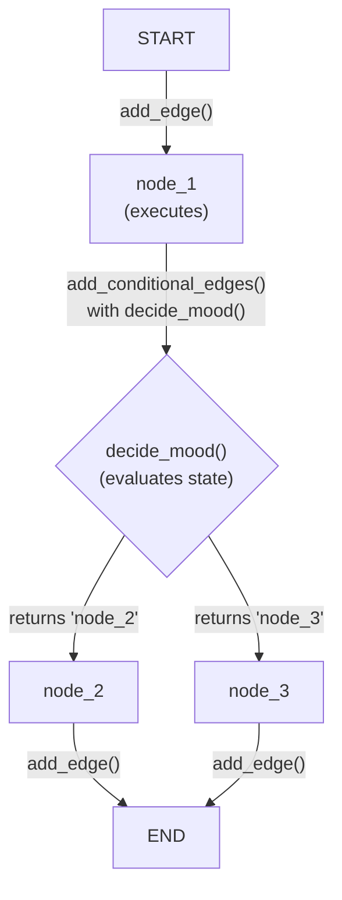

Sources: [module-1/simple-graph.ipynb:186-203]()

### Conditional Edge Return Type Annotation

Using `Literal` from `typing` provides type safety:

```python
from typing import Literal

def route_func(state) -> Literal["path_a", "path_b", "path_c"]:
    # Type checker knows only these strings are valid
    return "path_a"
```

This helps catch errors where the routing function returns a node name that doesn't exist.

Sources: [module-1/simple-graph.ipynb:124-138]()

## Example Graph Structure

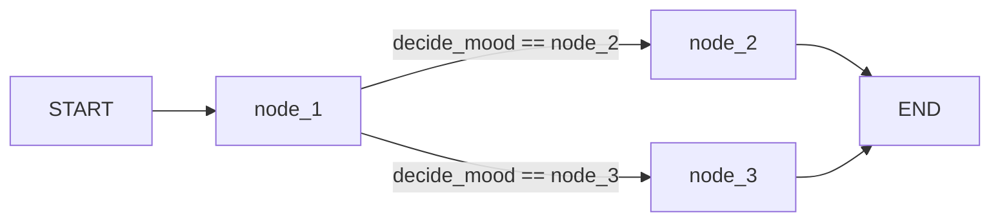

Sources: [module-1/simple-graph.ipynb:186-203]()

## MessagesState and Message Types

LangGraph applications frequently model conversations as sequences of messages. Each message has a role indicating who sent it (user, AI, system, or tool).

### Message Types from langchain_core.messages

| Class | Purpose | Typical Content |
|-------|---------|----------------|
| `HumanMessage` | User input | Questions, commands, natural language requests |
| `AIMessage` | Model responses | Answers, tool calls, generated text |
| `SystemMessage` | Model instructions | System prompts, behavior guidelines |
| `ToolMessage` | Tool results | Return values from executed tools |

Sources: [module-1/chain.ipynb:51-65](), [module-0/basics.ipynb:110-138]()

### Message Structure

Each message instance contains:

```python
from langchain_core.messages import HumanMessage

msg = HumanMessage(
    content="Hello world",  # The actual message text
    name="Lance"            # Optional: sender name
)

# Messages have these key attributes:
# - content: str (the message text)
# - name: str | None (optional identifier)
# - response_metadata: dict (for AI messages, contains token usage, etc.)
# - id: str (unique identifier, auto-generated)
```

Sources: [module-1/chain.ipynb:60-107]()

### Using MessagesState

The pre-built `MessagesState` from `langgraph.graph` combines message lists with the `add_messages` reducer:

```python
from langgraph.graph import MessagesState

class State(MessagesState):
    # Already includes: messages: Annotated[list[AnyMessage], add_messages]
    pass  # Or add additional keys if needed
```

This state type automatically:
- Appends new messages to the conversation history
- Allows message-by-message updates (by ID)
- Maintains conversation order

Sources: [module-1/chain.ipynb:404-426]()

### Message Flow in Conversational Graphs

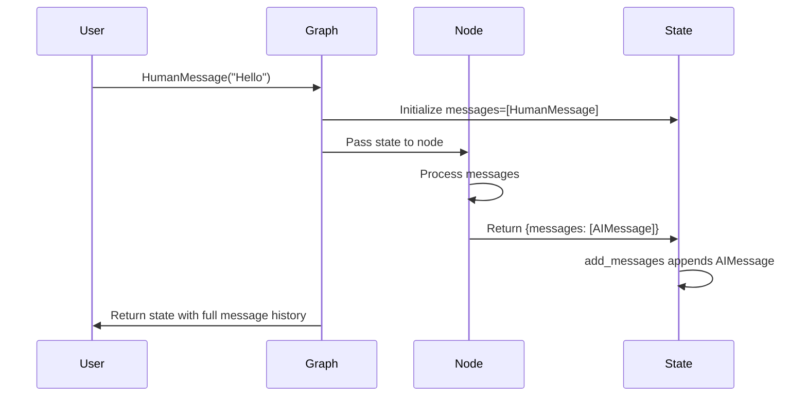

Sources: [module-1/chain.ipynb:337-355]()

## Reducers: Custom State Update Logic

Reducers control how state updates are applied when a node returns a value for a state key. Without a reducer, the default behavior is to replace the existing value.

### Default Behavior: Override

```python
class State(TypedDict):
    value: str

# Without reducer:
# If state = {"value": "old"} and node returns {"value": "new"}
# Result: state = {"value": "new"}  (replaced)
```

### Reducer Annotation

Use `Annotated` to specify a reducer function:

```python
from typing import Annotated

class State(TypedDict):
    values: Annotated[list, operator.add]

# With operator.add reducer:
# If state = {"values": [1, 2]} and node returns {"values": [3, 4]}
# Result: state = {"values": [1, 2, 3, 4]}  (appended)
```

Sources: [module-1/chain.ipynb:387-396]()

### Built-in Reducers

| Reducer | Import | Behavior | Common Use |
|---------|--------|----------|------------|
| `add_messages` | `langgraph.graph.message` | Appends messages to list, handles ID-based updates | Message history in conversations |
| `operator.add` | `operator` module | Concatenates lists, sums numbers | Aggregating parallel results |

### add_messages Reducer

The `add_messages` reducer is specialized for message lists:

```python
from typing import Annotated
from langgraph.graph.message import add_messages
from langchain_core.messages import AnyMessage

class MessagesState(TypedDict):
    messages: Annotated[list[AnyMessage], add_messages]
```

**Features:**
- Appends new messages to the end of the list
- If a message with the same ID exists, it replaces that message (for updates)
- Preserves message order

Example behavior:

```python
# Initial state
initial_messages = [
    AIMessage(content="Hello!", name="Model"),
    HumanMessage(content="Hi there.", name="User")
]

# New message
new_message = AIMessage(content="How can I help?", name="Model")

# Result with add_messages
# [AIMessage("Hello!"), HumanMessage("Hi there."), AIMessage("How can I help?")]
```

Sources: [module-1/chain.ipynb:387-396](), [module-1/chain.ipynb:456-467]()

### Pre-built MessagesState

For convenience, LangGraph provides a pre-configured `MessagesState`:

```python
from langgraph.graph import MessagesState

# Use directly or extend:
class MyState(MessagesState):
    # Inherits: messages: Annotated[list[AnyMessage], add_messages]
    custom_key: str  # Add additional keys as needed
```

This eliminates the need to manually annotate the `messages` field.

Sources: [module-1/chain.ipynb:404-426]()

### operator.add Reducer

For general list concatenation or numeric addition:

```python
import operator
from typing import Annotated

class State(TypedDict):
    context: Annotated[list, operator.add]
    counter: Annotated[int, operator.add]
```

**Behavior:**
- Lists: `[1, 2] + [3, 4] = [1, 2, 3, 4]`
- Numbers: `5 + 3 = 8`
- Strings: `"hello" + "world" = "helloworld"`

This is commonly used in parallel execution patterns to aggregate results from multiple nodes.

Sources: [module-4/studio/parallelization.py:17-20](), [module-4/studio/research_assistant.py:50-53]()

## Tools and Tool Calling

Tools allow language models to interact with external systems (APIs, databases, calculators) through well-defined Python functions.

### Tool Definition

A tool is a Python function with:
- Type-annotated parameters
- A docstring describing the function's purpose
- A return value

```python
def multiply(a: int, b: int) -> int:
    """Multiply a and b.
    
    Args:
        a: first int
        b: second int
    """
    return a * b
```

The LLM uses the function signature and docstring to determine when and how to call the tool.

Sources: [module-1/chain.ipynb:263-276]()

### Binding Tools to Models

Use the `bind_tools()` method to attach tools to a chat model:

```python
from langchain_openai import ChatOpenAI

llm = ChatOpenAI(model="gpt-4o", temperature=0)
llm_with_tools = llm.bind_tools([multiply])
```

The model now has access to the `multiply` tool and can decide when to use it based on user input.

Sources: [module-1/chain.ipynb:269-278]()

### Tool Call Structure

When the model decides to use a tool, it returns an `AIMessage` with `tool_calls`:

```python
# User input: "What is 2 multiplied by 3"

result = llm_with_tools.invoke([HumanMessage(content="What is 2 multiplied by 3")])

# result.tool_calls contains:
[{
    'name': 'multiply',
    'args': {'a': 2, 'b': 3},
    'id': 'call_lBBBNo5oYpHGRqwxNaNRbsiT',
    'type': 'tool_call'
}]
```

The `args` dictionary contains the parsed parameters based on the function signature.

Sources: [module-1/chain.ipynb:302-327]()

### Tool Calling Flow

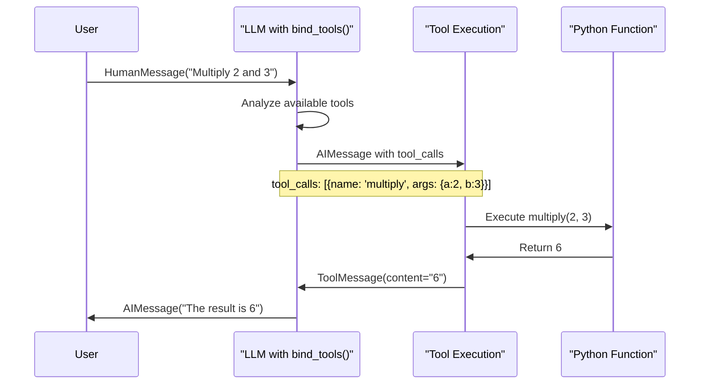

Sources: [module-1/chain.ipynb:233-249]()

### Tool Selection Logic

The model decides whether to call a tool based on:
1. The user's natural language input
2. The tool's name and docstring
3. The parameter types and descriptions

**Example:**
- Input: `"Hello!"` → No tool call, just responds with text
- Input: `"Multiply 2 and 3"` → Calls `multiply` tool with `args={'a': 2, 'b': 3}`

Sources: [module-1/chain.ipynb:520-583]()

## Graph Compilation and Invocation

After defining the graph structure, you must compile it before execution.

### The compile() Method

```python
graph = builder.compile()
```

Compilation performs several tasks:
- Validates the graph structure (checks for disconnected nodes, missing edges)
- Prepares the execution runtime
- Returns a `CompiledGraph` object that implements the Runnable protocol

Sources: [module-1/simple-graph.ipynb:197-200]()

### The invoke() Method

The compiled graph can be executed with `invoke()`:

```python
initial_state = {"graph_state": "Hi, this is Lance."}
final_state = graph.invoke(initial_state)
```

**Execution behavior:**
- Takes an initial state dictionary as input
- Executes nodes following the edge definitions
- Returns the final state after reaching `END`
- Runs synchronously (waits for each node to complete)

Sources: [module-1/simple-graph.ipynb:257-258]()

### Complete Example: Tool-Calling Chain

```python
from langgraph.graph import StateGraph, MessagesState, START, END
from langchain_openai import ChatOpenAI
from langchain_core.messages import HumanMessage

# 1. Define tool
def multiply(a: int, b: int) -> int:
    """Multiply a and b."""
    return a * b

# 2. Create LLM with tools
llm = ChatOpenAI(model="gpt-4o")
llm_with_tools = llm.bind_tools([multiply])

# 3. Define node function
def tool_calling_llm(state: MessagesState):
    return {"messages": [llm_with_tools.invoke(state["messages"])]}

# 4. Build graph
builder = StateGraph(MessagesState)
builder.add_node("tool_calling_llm", tool_calling_llm)
builder.add_edge(START, "tool_calling_llm")
builder.add_edge("tool_calling_llm", END)

# 5. Compile
graph = builder.compile()

# 6. Invoke
result = graph.invoke({"messages": [HumanMessage(content="Multiply 2 and 3")]})
```

Sources: [module-1/chain.ipynb:497-583]()

### Runnable Protocol

The compiled graph implements LangChain's Runnable interface, providing standardized methods:

| Method | Purpose | Behavior |
|--------|---------|----------|
| `invoke(input)` | Synchronous execution | Waits for completion, returns final state |
| `stream(input)` | Streaming execution | Yields state updates as they occur |
| `batch(inputs)` | Batch execution | Processes multiple inputs in parallel |

Sources: [module-1/simple-graph.ipynb:212-217]()

## Concept-to-Code Mapping

### Natural Language Concepts → Code Entities

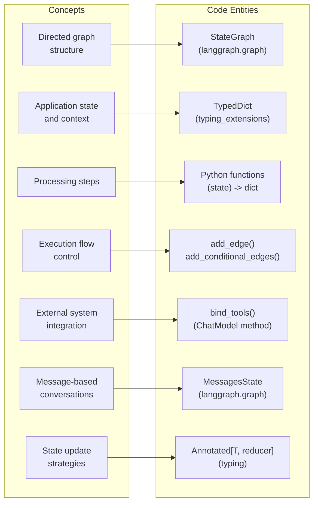

Sources: [module-1/simple-graph.ipynb:40-47](), [module-1/chain.ipynb:24-32]()

### Code Import Reference

| Concept | Import Statement | Module |
|---------|-----------------|---------|
| Graph builder | `from langgraph.graph import StateGraph` | `langgraph.graph` |
| Graph nodes | `from langgraph.graph import START, END` | `langgraph.graph` |
| Message state | `from langgraph.graph import MessagesState` | `langgraph.graph` |
| Message reducer | `from langgraph.graph.message import add_messages` | `langgraph.graph.message` |
| Message types | `from langchain_core.messages import HumanMessage, AIMessage` | `langchain_core.messages` |
| Chat models | `from langchain_openai import ChatOpenAI` | `langchain_openai` |
| State typing | `from typing_extensions import TypedDict` | `typing_extensions` |
| Reducer annotation | `from typing import Annotated` | `typing` |

Sources: [module-1/simple-graph.ipynb:185](), [module-1/chain.ipynb:98-100, 393, 422](), [requirements.txt]()

## Practical Application Patterns

### Simple Sequential Chain

This pattern demonstrates the basic execution flow without conditional routing:

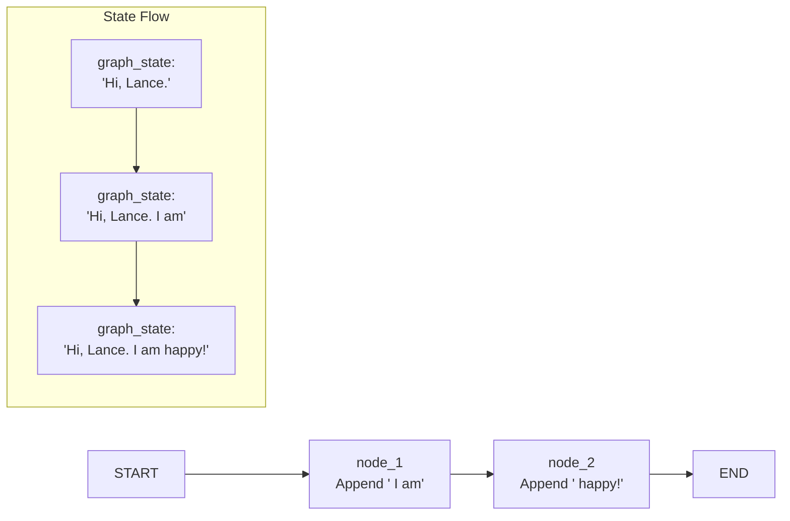

Sources: [module-1/simple-graph.ipynb:16-21]()

### Conditional Routing Pattern

This pattern shows dynamic branching based on state:

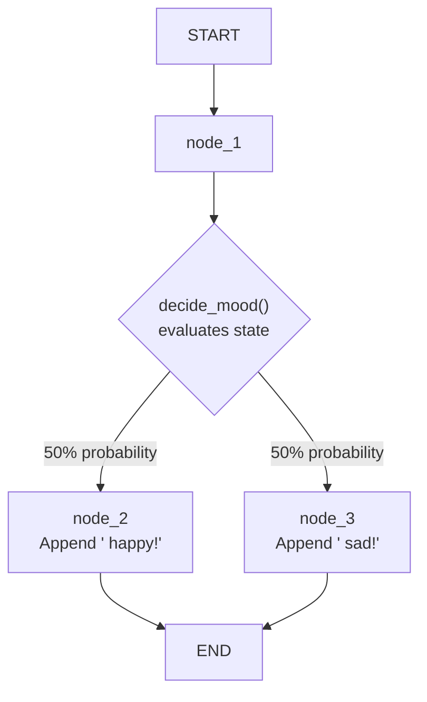

Sources: [module-1/simple-graph.ipynb:16-21]()

### Message-Based Conversational Pattern

This pattern uses `MessagesState` for conversation management:

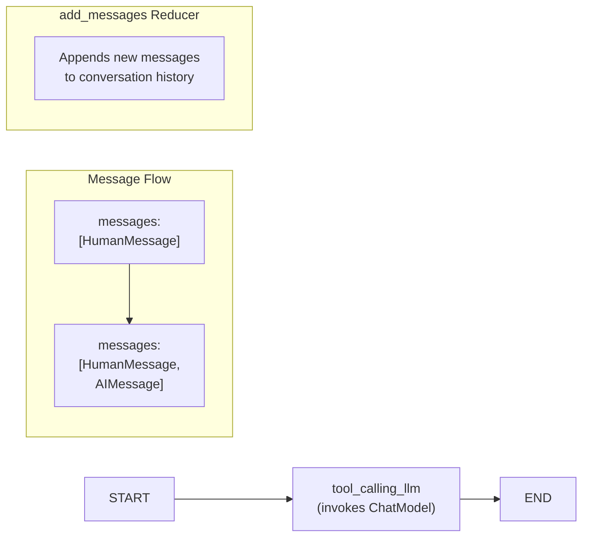

Sources: [module-1/chain.ipynb:474-512]()

## Summary

LangGraph provides a powerful framework for structuring language model applications as directed graphs. By understanding the core concepts of:

- StateGraph for defining the overall structure
- State management for tracking application context
- Nodes for processing state
- Edges for controlling flow
- Messages for handling conversations
- Reducers for customizing state updates
- Tools for extending functionality

Developers can build complex, modular, and maintainable applications that leverage language models effectively.

---

# Page: StateGraph and MessagesState

# StateGraph and MessagesState

<details>
<summary>Relevant source files</summary>

The following files were used as context for generating this wiki page:

- [module-1/chain.ipynb](module-1/chain.ipynb)
- [module-1/simple-graph.ipynb](module-1/simple-graph.ipynb)

</details>


## Purpose and Scope

This document explains the fundamental components of LangGraph: the `StateGraph` class for defining workflow orchestration and the `MessagesState` schema for managing conversation history. It covers state schema design using `TypedDict`, the reducer pattern for state updates, node functions as computational units, edge types for controlling execution flow, and the basic graph construction and invocation model.

For information about tools and tool calling patterns, see [Tools and Tool Calling](#3.2). For complete agent implementations using these primitives, see [Basic Agent Architecture](#4.1).

---

## StateGraph: The Core Orchestrator

The `StateGraph` class is the primary workflow orchestrator in LangGraph. It manages state transitions through a directed graph of nodes connected by edges.

### Class Initialization

`StateGraph` is initialized with a state schema that defines the structure of data flowing through the graph:

```python
from langgraph.graph import StateGraph

builder = StateGraph(State)
```

The state schema serves as the input schema for all nodes and edges in the graph [module-1/simple-graph.ipynb:42-46]().

### Key Methods

| Method | Purpose |
|--------|---------|
| `add_node(name, function)` | Registers a node function with a given name |
| `add_edge(from_node, to_node)` | Creates a fixed transition between nodes |
| `add_conditional_edges(from_node, router_function)` | Creates dynamic routing based on function output |
| `compile()` | Validates and prepares the graph for execution |

**Sources:** [module-1/simple-graph.ipynb:148-163](), [module-1/chain.ipynb:497-512]()

---

## State Schemas: TypedDict Basics

State schemas define the structure of data in the graph. The simplest approach uses Python's `TypedDict` from the `typing` module:

```python
from typing_extensions import TypedDict

class State(TypedDict):
    graph_state: str
```

This schema provides type hints for state keys. Each node can access `state['graph_state']` and return a dictionary with updated values [module-1/simple-graph.ipynb:50-60]().

### State Update Behavior

By default, when a node returns a new value for a state key, it **overrides** the previous value. This means:

```python
def node_1(state):
    return {"graph_state": state['graph_state'] + " I am"}
```

The string returned completely replaces the prior `graph_state` value [module-1/simple-graph.ipynb:78-98]().

### State Schema to Code Entity Mapping

```mermaid
graph TB
    TypedDict["TypedDict (typing module)"]
    State["State class"]
    StateGraph["StateGraph(State)"]
    NodeFunc["node_1(state)"]
    StateAccess["state['graph_state']"]
    
    TypedDict -->|"defines"| State
    State -->|"passed to"| StateGraph
    StateGraph -->|"provides to"| NodeFunc
    NodeFunc -->|"accesses"| StateAccess
    
    style StateGraph fill:#fff,stroke:#333,stroke-width:2px
```

**Sources:** [module-1/simple-graph.ipynb:38-78]()

---

## MessagesState: Pre-Built Conversation Schema

`MessagesState` is a pre-built state schema optimized for conversational applications. It eliminates boilerplate by providing a standard structure for message handling.

### Definition

```python
from langgraph.graph import MessagesState

class MessagesState(MessagesState):
    # Add any keys needed beyond messages, which is pre-built
    pass
```

`MessagesState` is defined with:
- A single `messages` key (a list of `AnyMessage` objects)
- The `add_messages` reducer automatically applied

[module-1/chain.ipynb:416-427]()

### Message Types

LangGraph supports multiple message types for different conversation roles:

| Message Type | Purpose |
|--------------|---------|
| `HumanMessage` | Messages from the user |
| `AIMessage` | Messages from the chat model |
| `SystemMessage` | Instructions for the chat model behavior |
| `ToolMessage` | Results from tool execution |

Each message can contain:
- `content`: The message text
- `name`: Optional author identifier
- `response_metadata`: Optional metadata dictionary (often populated by LLM providers)

[module-1/chain.ipynb:51-108]()

### MessagesState Component Diagram

```mermaid
graph LR
    subgraph "Message Types"
        HumanMsg["HumanMessage"]
        AIMsg["AIMessage"]
        SysMsg["SystemMessage"]
        ToolMsg["ToolMessage"]
    end
    
    subgraph "MessagesState Schema"
        MsgList["messages: Annotated[list[AnyMessage], add_messages]"]
    end
    
    subgraph "StateGraph"
        Graph["StateGraph(MessagesState)"]
    end
    
    HumanMsg -->|"contained in"| MsgList
    AIMsg -->|"contained in"| MsgList
    SysMsg -->|"contained in"| MsgList
    ToolMsg -->|"contained in"| MsgList
    MsgList -->|"defines state for"| Graph
    
    style MsgList fill:#fff,stroke:#333,stroke-width:2px
    style Graph fill:#fff,stroke:#333,stroke-width:2px
```

**Sources:** [module-1/chain.ipynb:51-66](), [module-1/chain.ipynb:404-427]()

---

## Reducers: Controlling State Updates

Reducers specify how state updates are performed. Without a reducer, state updates override previous values. Reducers enable alternative behaviors like appending, merging, or custom logic.

### The `add_messages` Reducer

The `add_messages` reducer appends new messages to the existing list instead of replacing it:

```python
from typing import Annotated
from langgraph.graph.message import add_messages
from langchain_core.messages import AnyMessage

class MessagesState(TypedDict):
    messages: Annotated[list[AnyMessage], add_messages]
```

The `Annotated` type attaches the `add_messages` function as metadata to the `messages` key [module-1/chain.ipynb:386-397]().

### Reducer Behavior Example

```python
# Initial state
initial_messages = [
    AIMessage(content="Hello! How can I assist you?", name="Model"),
    HumanMessage(content="I'm looking for information on marine biology.", name="Lance")
]

# New message
new_message = AIMessage(content="Sure, I can help with that.", name="Model")

# Result: all three messages preserved
add_messages(initial_messages, new_message)
# Returns: [initial_messages[0], initial_messages[1], new_message]
```

[module-1/chain.ipynb:438-467]()

### Reducer Execution Flow

```mermaid
graph TB
    Node1["Node 1 returns<br/>{'messages': [new_msg]}"]
    Reducer["add_messages reducer"]
    CurrentState["Current state:<br/>messages: [msg1, msg2]"]
    UpdatedState["Updated state:<br/>messages: [msg1, msg2, new_msg]"]
    
    Node1 -->|"new value"| Reducer
    CurrentState -->|"existing value"| Reducer
    Reducer -->|"combines"| UpdatedState
    
    style Reducer fill:#fff,stroke:#333,stroke-width:2px
```

**Sources:** [module-1/chain.ipynb:359-397](), [module-1/chain.ipynb:434-467]()

---

## Node Functions: Computational Units

Nodes are Python functions that perform computation and return state updates. They form the operational building blocks of the graph.

### Node Function Signature

```python
def node_1(state):
    print("---Node 1---")
    return {"graph_state": state['graph_state'] + " I am"}
```

- **Input**: The current state (matches the StateGraph schema)
- **Output**: Dictionary with updated state keys
- **Access**: Nodes access state keys using dictionary syntax: `state['key_name']`

[module-1/simple-graph.ipynb:81-98]()

### Node Function with MessagesState

When using `MessagesState`, node functions typically invoke LLMs and return message lists:

```python
def tool_calling_llm(state: MessagesState):
    return {"messages": [llm_with_tools.invoke(state["messages"])]}
```

The returned message is appended to the existing message list due to the `add_messages` reducer [module-1/chain.ipynb:500-502]().

### Node Registration

Nodes are registered with the `StateGraph` builder:

```python
builder.add_node("node_1", node_1)
builder.add_node("tool_calling_llm", tool_calling_llm)
```

The first argument is the node name (used in edge definitions), and the second is the function reference [module-1/simple-graph.ipynb:188-191](), [module-1/chain.ipynb:505-506]().

### Node Execution Model

```mermaid
graph TB
    StateIn["State Input:<br/>{'graph_state': 'Hi'}"]
    Node["node_1(state)"]
    Process["Processing:<br/>state['graph_state'] + ' I am'"]
    StateOut["State Output:<br/>{'graph_state': 'Hi I am'}"]
    
    StateIn -->|"passed to"| Node
    Node -->|"executes"| Process
    Process -->|"returns"| StateOut
    
    style Node fill:#fff,stroke:#333,stroke-width:2px
```

**Sources:** [module-1/simple-graph.ipynb:68-98](), [module-1/chain.ipynb:497-513]()

---

## Edge Types: Controlling Execution Flow

Edges define transitions between nodes. LangGraph supports two edge types: normal edges for fixed transitions and conditional edges for dynamic routing.

### Normal Edges

Normal edges create **fixed, unconditional** transitions:

```python
builder.add_edge(START, "node_1")
builder.add_edge("node_2", END)
```

The graph always follows these edges when the source node completes [module-1/simple-graph.ipynb:194-197]().

### Special Nodes

| Node | Purpose |
|------|---------|
| `START` | Entry point for user input; begins graph execution |
| `END` | Terminal node; marks workflow completion |

[module-1/simple-graph.ipynb:157-160]()

### Conditional Edges

Conditional edges enable **dynamic routing** based on logic:

```python
def decide_mood(state) -> Literal["node_2", "node_3"]:
    user_input = state['graph_state']
    if random.random() < 0.5:
        return "node_2"
    return "node_3"

builder.add_conditional_edges("node_1", decide_mood)
```

The router function:
- Receives the current state
- Returns the name of the next node to execute
- Uses type hints (`Literal["node_2", "node_3"]`) to specify valid destinations

[module-1/simple-graph.ipynb:117-139](), [module-1/simple-graph.ipynb:195]()

### Edge Types Comparison

```mermaid
graph TB
    Start["START"]
    Node1["node_1"]
    Node2["node_2"]
    Node3["node_3"]
    End1["END"]
    End2["END"]
    
    Start -->|"Normal Edge<br/>(always)"| Node1
    Node1 -.->|"Conditional Edge<br/>(decide_mood)"| Node2
    Node1 -.->|"Conditional Edge<br/>(decide_mood)"| Node3
    Node2 -->|"Normal Edge<br/>(always)"| End1
    Node3 -->|"Normal Edge<br/>(always)"| End2
    
    style Node1 fill:#fff,stroke:#333,stroke-width:2px
```

**Sources:** [module-1/simple-graph.ipynb:105-139](), [module-1/simple-graph.ipynb:186-198]()

---

## Graph Construction and Compilation

### Building a Graph

Graph construction follows a consistent pattern:

1. **Initialize StateGraph** with a state schema
2. **Add nodes** with `add_node(name, function)`
3. **Add edges** with `add_edge()` or `add_conditional_edges()`
4. **Compile** with `compile()` to validate and prepare for execution

Example with basic state:

```python
from langgraph.graph import StateGraph, START, END

builder = StateGraph(State)
builder.add_node("node_1", node_1)
builder.add_node("node_2", node_2)
builder.add_node("node_3", node_3)

builder.add_edge(START, "node_1")
builder.add_conditional_edges("node_1", decide_mood)
builder.add_edge("node_2", END)
builder.add_edge("node_3", END)

graph = builder.compile()
```

[module-1/simple-graph.ipynb:167-203]()

### Compilation Purpose

The `compile()` method:
- Validates graph structure (e.g., all referenced nodes exist)
- Performs basic sanity checks
- Returns a compiled graph implementing the `Runnable` protocol

[module-1/simple-graph.ipynb:161]()

### Graph Construction Flow

```mermaid
graph TB
    Schema["Define State Schema<br/>(TypedDict or MessagesState)"]
    Init["StateGraph(State)"]
    Nodes["Add Nodes:<br/>add_node(name, func)"]
    Edges["Add Edges:<br/>add_edge() or<br/>add_conditional_edges()"]
    Compile["graph = builder.compile()"]
    Ready["Runnable Graph"]
    
    Schema -->|"passed to"| Init
    Init -->|"builder"| Nodes
    Nodes -->|"builder"| Edges
    Edges -->|"builder"| Compile
    Compile -->|"returns"| Ready
    
    style Compile fill:#fff,stroke:#333,stroke-width:2px
    style Ready fill:#fff,stroke:#333,stroke-width:2px
```

**Sources:** [module-1/simple-graph.ipynb:142-203](), [module-1/chain.ipynb:497-513]()

---

## Graph Invocation: The Execution Model

### The Runnable Protocol

Compiled graphs implement the `Runnable` protocol, providing a standard interface for executing LangChain components. The primary method is `invoke()` [module-1/simple-graph.ipynb:212-217]().

### Invoking a Graph

```python
result = graph.invoke({"graph_state": "Hi, this is Lance."})
```

When `invoke()` is called:

1. **Initialization**: The input dictionary sets the initial state
2. **Execution Start**: Graph begins at the `START` node
3. **Node Traversal**: Progresses through nodes following edges
4. **State Updates**: Each node returns updated state values
5. **Conditional Routing**: Router functions determine dynamic paths
6. **Completion**: Execution ends at the `END` node
7. **Return**: Final state dictionary is returned

[module-1/simple-graph.ipynb:218-230](), [module-1/simple-graph.ipynb:233-259]()

### Synchronous Execution

`invoke()` runs the entire graph **synchronously**:
- Waits for each step to complete before proceeding
- Returns only after reaching `END`
- Returns the final state as a dictionary

Example output:
```python
{'graph_state': 'Hi, this is Lance. I am sad!'}
```

[module-1/simple-graph.ipynb:266-277]()

### Graph Invocation Flow

```mermaid
graph TB
    Input["Input:<br/>{'graph_state': 'Hi, this is Lance.'}"]
    Start["START Node"]
    Node1["node_1<br/>Returns: {'graph_state': 'Hi, this is Lance. I am'}"]
    Router["decide_mood()<br/>Returns: 'node_3'"]
    Node3["node_3<br/>Returns: {'graph_state': 'Hi, this is Lance. I am sad!'}"]
    End["END Node"]
    Output["Output:<br/>{'graph_state': 'Hi, this is Lance. I am sad!'}"]
    
    Input -->|"invoke()"| Start
    Start --> Node1
    Node1 --> Router
    Router --> Node3
    Node3 --> End
    End --> Output
    
    style Node1 fill:#fff,stroke:#333,stroke-width:2px
    style Router fill:#fff,stroke:#333,stroke-width:2px
    style Node3 fill:#fff,stroke:#333,stroke-width:2px
```

**Sources:** [module-1/simple-graph.ipynb:207-277]()

---

## Complete Examples

### Simple Graph with TypedDict

This example demonstrates basic `StateGraph` usage with a custom state schema:

- **State Schema**: Single string key `graph_state`
- **Nodes**: Three functions that append text
- **Edges**: Fixed edge to `node_1`, conditional routing to `node_2` or `node_3`
- **Execution**: Random 50/50 split in routing logic

File: [module-1/simple-graph.ipynb:1-309]()

### Message-Based Graph with MessagesState

This example demonstrates `MessagesState` for conversational workflows:

- **State Schema**: `MessagesState` with `add_messages` reducer
- **Nodes**: LLM invocation with tool binding
- **Tools**: `multiply` function bound to chat model
- **Execution**: Single node that processes messages and returns LLM response

File: [module-1/chain.ipynb:1-615]()

### Key Differences

| Aspect | Simple Graph | Message Graph |
|--------|--------------|---------------|
| State Schema | Custom `TypedDict` | Pre-built `MessagesState` |
| State Updates | Override (default) | Append (via `add_messages`) |
| Node Purpose | String manipulation | LLM invocation |
| Complexity | Minimal (3 nodes) | Conversational (tools, messages) |

---

## Summary

The `StateGraph` and `MessagesState` components provide the foundation for building LangGraph workflows:

- **`StateGraph`**: Orchestrates execution through nodes and edges
- **State Schemas**: Define data structure (TypedDict or MessagesState)
- **Reducers**: Control state update behavior (override vs. append)
- **Nodes**: Python functions performing computation
- **Edges**: Normal (fixed) or conditional (dynamic) transitions
- **Compilation**: Validates and prepares graphs for execution
- **Invocation**: Executes graphs synchronously via `invoke()`

These primitives combine to create flexible, stateful workflows ranging from simple sequential processes to complex conversational agents.

**Sources:** [module-1/simple-graph.ipynb:1-309](), [module-1/chain.ipynb:1-615]()

---

# Page: Tools and Tool Calling

# Tools and Tool Calling

<details>
<summary>Relevant source files</summary>

The following files were used as context for generating this wiki page:

- [module-0/basics.ipynb](module-0/basics.ipynb)
- [module-1/agent-memory.ipynb](module-1/agent-memory.ipynb)
- [module-1/agent.ipynb](module-1/agent.ipynb)
- [module-4/studio/parallelization.py](module-4/studio/parallelization.py)
- [module-4/studio/research_assistant.py](module-4/studio/research_assistant.py)
- [requirements.txt](requirements.txt)

</details>


This page documents the tool calling mechanism in LangGraph, which allows language models to invoke Python functions as structured tools. Tool calling enables an LLM to convert natural language requests into function calls with properly typed arguments.

## Overview

Tools are Python functions that can be invoked by an LLM. Instead of the LLM generating unstructured text that must be parsed, the model outputs a structured `AIMessage` containing `tool_calls` - explicit invocations with typed arguments matching the function signature.

**Tool Calling Flow with LangGraph Components**

```mermaid
graph TB
    HumanMessage["HumanMessage: 'Add 3 and 4'"] --> llm_with_tools["llm.bind_tools(tools).invoke()"]
    llm_with_tools --> AIMessage["AIMessage with tool_calls"]
    AIMessage --> tools_condition["tools_condition()"]
    tools_condition -->|"Has tool_calls"| ToolNode["ToolNode(tools)"]
    tools_condition -->|"No tool_calls"| END["END"]
    ToolNode --> ToolMessage["ToolMessage: result=7"]
    ToolMessage --> END
```

Sources: [module-1/agent.ipynb:100-142](), [module-1/agent.ipynb:195-237]()

The flow consists of:
1. `HumanMessage` input provided to LLM
2. LLM with `bind_tools()` decides whether to call a tool
3. If tool call generated, `tools_condition` routes to `ToolNode`
4. `ToolNode` executes the function and returns `ToolMessage`
5. If no tool call, flow proceeds to END

## Tool Definition Pattern

Tools are standard Python functions with type annotations and docstrings. The LLM uses these signatures to generate properly formatted tool calls.

**Example Tool Definitions**

```python
def multiply(a: int, b: int) -> int:
    """Multiply a and b.

    Args:
        a: first int
        b: second int
    """
    return a * b

def add(a: int, b: int) -> int:
    """Adds a and b.

    Args:
        a: first int
        b: second int
    """
    return a + b

def divide(a: int, b: int) -> float:
    """Divide a and b.

    Args:
        a: first int
        b: second int
    """
    return a / b
```

Sources: [module-1/agent.ipynb:107-134](), [module-1/agent-memory.ipynb:98-125]()

Required elements:
- Type annotations on all parameters (e.g., `a: int`)
- Return type annotation (e.g., `-> int`)
- Docstring describing the function purpose
- `Args:` section documenting each parameter
- Function name becomes the tool name

## Binding Tools with bind_tools()

The `bind_tools()` method attaches tool schemas to the LLM, enabling it to generate tool calls.

```python
from langchain_openai import ChatOpenAI

tools = [add, multiply, divide]
llm = ChatOpenAI(model="gpt-4o")
llm_with_tools = llm.bind_tools(tools, parallel_tool_calls=False)
```

Sources: [module-1/agent.ipynb:135-141](), [module-1/agent-memory.ipynb:126-128]()

The `bind_tools()` method:
- Accepts a list of tool functions
- Converts function signatures into JSON schemas
- Sends schemas to the LLM during inference
- Returns a new LLM instance with tools attached

The `parallel_tool_calls=False` parameter forces sequential tool execution, useful for operations that must occur in order (e.g., arithmetic sequences).

Sources: [module-1/agent.ipynb:138-141]()

## Tool Call Output Structure

When an LLM decides to call a tool, it returns an `AIMessage` with a `tool_calls` attribute containing structured invocation data.

**AIMessage with Tool Calls**

```mermaid
graph LR
    AIMessage["AIMessage"] --> tool_calls["tool_calls: list"]
    tool_calls --> call1["tool_call dict"]
    call1 --> name["name: 'add'"]
    call1 --> args["args: {'a': 3, 'b': 4}"]
    call1 --> id["id: 'call_xyz...'"]
    call1 --> type["type: 'tool_call'"]
```

Sources: [module-1/agent.ipynb:264-270]()

Each tool call dictionary contains:
- `name`: Function name to invoke (e.g., `"add"`)
- `args`: Dictionary mapping parameter names to values (e.g., `{"a": 3, "b": 4}`)
- `id`: Unique identifier for this tool call
- `type`: Always `"tool_call"`

The LLM generates these structured outputs based on the schemas provided via `bind_tools()`.

Sources: [module-1/agent.ipynb:217-223]()

## MessagesState for Tool Workflows

`MessagesState` is the standard state schema for graphs involving tool calls. It maintains a list of messages with the `add_messages` reducer.

```python
from langgraph.graph import MessagesState

class MessagesState(TypedDict):
    messages: Annotated[list[AnyMessage], add_messages]
```

Sources: [module-1/agent.ipynb:159](), [module-1/agent-memory.ipynb:138]()

Message types in the list include:
- `HumanMessage`: User input
- `AIMessage`: LLM output (may contain `tool_calls`)
- `ToolMessage`: Tool execution result
- `SystemMessage`: System instructions

The `add_messages` reducer automatically appends new messages while handling `ToolMessage` association with corresponding `AIMessage` tool calls.

Sources: [module-1/agent.ipynb:160-167]()

## ToolNode for Tool Execution

`ToolNode` is a prebuilt component that executes tools when `AIMessage.tool_calls` is present.

```python
from langgraph.prebuilt import ToolNode

tools = [add, multiply, divide]
builder.add_node("tools", ToolNode(tools))
```

Sources: [module-1/agent.ipynb:214-222](), [module-1/agent-memory.ipynb:168-176]()

`ToolNode` behavior:
1. Receives state containing `AIMessage` with `tool_calls`
2. Finds matching function from tools list by name
3. Invokes function with arguments from `args`
4. Returns `ToolMessage` with function output
5. `ToolMessage.name` set to tool name
6. `ToolMessage.tool_call_id` links to originating `AIMessage.tool_calls[i].id`

**ToolNode Execution Flow**

```mermaid
graph TB
    Input["State with AIMessage.tool_calls"] --> ToolNode["ToolNode(tools)"]
    ToolNode --> Extract["Extract tool_calls"]
    Extract --> Match["Match name to function in tools list"]
    Match --> Invoke["Invoke function with args"]
    Invoke --> Create["Create ToolMessage"]
    Create --> Output["Return ToolMessage in state"]
```

Sources: [module-1/agent.ipynb:214-222]()

## tools_condition for Routing

`tools_condition` is a prebuilt conditional edge function that routes based on whether the latest message contains tool calls.

```python
from langgraph.prebuilt import tools_condition

builder.add_conditional_edges(
    "assistant",
    tools_condition,
)
```

Sources: [module-1/agent.ipynb:226-231]()

Routing logic:
- If `messages[-1]` is `AIMessage` with `tool_calls` → routes to `"tools"` node
- If `messages[-1]` has no `tool_calls` → routes to `END`

This enables the LLM to dynamically decide whether to invoke tools or return a final response.

**tools_condition Routing Behavior**

```mermaid
graph TB
    LastMessage["messages[-1]"] --> CheckType{"Is AIMessage?"}
    CheckType -->|"No"| END1["Route to END"]
    CheckType -->|"Yes"| CheckCalls{"Has tool_calls?"}
    CheckCalls -->|"No"| END2["Route to END"]
    CheckCalls -->|"Yes"| Tools["Route to 'tools' node"]
```

Sources: [module-1/agent.ipynb:226-231]()

## Complete Agent Graph with Tools

A typical tool-enabled agent combines an assistant node with `ToolNode` and `tools_condition` routing.

**Agent Graph Structure**

```mermaid
graph TB
    START["START"] --> assistant["assistant node"]
    assistant --> invoke["llm_with_tools.invoke(messages)"]
    invoke --> tools_condition["tools_condition()"]
    tools_condition -->|"Has tool_calls"| tools["tools node: ToolNode(tools)"]
    tools_condition -->|"No tool_calls"| END["END"]
    tools --> assistant
```

Sources: [module-1/agent.ipynb:195-237]()

### Assistant Node Implementation

The assistant node invokes the LLM with bound tools:

```python
from langchain_core.messages import SystemMessage

sys_msg = SystemMessage(content="You are a helpful assistant tasked with performing arithmetic on a set of inputs.")

def assistant(state: MessagesState):
    return {"messages": [llm_with_tools.invoke([sys_msg] + state["messages"])]}
```

Sources: [module-1/agent.ipynb:162-167](), [module-1/agent-memory.ipynb:141-146]()

The assistant:
1. Prepends a `SystemMessage` to define behavior
2. Invokes `llm_with_tools` with full message history
3. Returns updated messages list containing new `AIMessage`

### Graph Construction Pattern

```python
from langgraph.graph import START, StateGraph
from langgraph.prebuilt import tools_condition, ToolNode

builder = StateGraph(MessagesState)

builder.add_node("assistant", assistant)
builder.add_node("tools", ToolNode(tools))

builder.add_edge(START, "assistant")
builder.add_conditional_edges(
    "assistant",
    tools_condition,
)
builder.add_edge("tools", "assistant")

react_graph = builder.compile()
```

Sources: [module-1/agent.ipynb:212-233](), [module-1/agent-memory.ipynb:167-187]()

Graph edges:
- `START → "assistant"`: Begin with LLM invocation
- `"assistant" → tools_condition`: Route based on tool call presence
- `"tools" → "assistant"`: Loop back after tool execution for continued reasoning

This creates a ReAct (Reasoning-Action) loop where the agent can call multiple tools in sequence.

Sources: [module-1/agent.ipynb:17-46]()

## Multi-Step Tool Execution

The ReAct loop allows the agent to execute multiple tools in sequence to answer complex queries.

**Example: Multi-Step Arithmetic**

```python
from langchain_core.messages import HumanMessage

messages = [HumanMessage(content="Add 3 and 4. Multiply the output by 2. Divide the output by 5")]
messages = react_graph.invoke({"messages": messages})
```

Sources: [module-1/agent.ipynb:246-247]()

Message sequence:
1. `HumanMessage`: "Add 3 and 4..."
2. `AIMessage`: tool_calls=[add(a=3, b=4)]
3. `ToolMessage`: 7
4. `AIMessage`: tool_calls=[multiply(a=7, b=2)]
5. `ToolMessage`: 14
6. `AIMessage`: tool_calls=[divide(a=14, b=5)]
7. `ToolMessage`: 2.8
8. `AIMessage`: "The final result is 2.8"

Sources: [module-1/agent.ipynb:256-299]()

The agent autonomously determines:
- Which tool to call at each step
- Arguments to pass to each tool
- When to stop calling tools and provide final answer

**Multi-Turn Tool Execution Flow**

```mermaid
graph TB
    Input["HumanMessage: complex task"] --> A1["assistant: call add(3,4)"]
    A1 --> T1["tools: ToolMessage=7"]
    T1 --> A2["assistant: call multiply(7,2)"]
    A2 --> T2["tools: ToolMessage=14"]
    T2 --> A3["assistant: call divide(14,5)"]
    A3 --> T3["tools: ToolMessage=2.8"]
    T3 --> A4["assistant: final response"]
    A4 --> END["END"]
```

Sources: [module-1/agent.ipynb:246-299]()

## Integration with LangGraph Studio

LangGraph Studio provides a visual interface for debugging and developing tool-enabled graphs. It allows you to:

- Visualize the execution flow
- See when tools are called
- Inspect state at each step
- Debug tool call issues

```
langgraph dev
```

Sources: [module-1/router.ipynb:188-206]()

## Comparison of Tool Calling Options

| Approach | Advantages | Considerations |
|----------|------------|----------------|
| Direct Tool Binding | Simple setup, direct integration with LLM | Limited to single LLM node |
| ToolNode | Pre-built solution, easy integration | Requires StateGraph |
| Custom Tool Implementation | Maximum flexibility | More complex to implement |
| Multiple Tools | Allows for diverse capabilities | Requires careful routing logic |

Sources: [module-1/router.ipynb:19-43](), [module-1/chain.ipynb:233-249]()

## Extending Tool Functionality

Tools can be extended beyond simple functions to include:

1. API integrations
2. Database queries
3. File operations
4. Custom calculations
5. External service calls

The same patterns apply regardless of tool complexity - define a function with clear input/output schemas and bind it to the LLM.

---

# Page: Building Agents with LangGraph

# Building Agents with LangGraph

<details>
<summary>Relevant source files</summary>

The following files were used as context for generating this wiki page:

- [module-1/agent-memory.ipynb](module-1/agent-memory.ipynb)
- [module-1/agent.ipynb](module-1/agent.ipynb)
- [module-1/router.ipynb](module-1/router.ipynb)

</details>


## Purpose and Scope

This page demonstrates how to construct functional agents using LangGraph patterns, including ReAct (Reasoning-Action-Observation) loops, conversational memory through checkpointers, and basic routing patterns. Agents are systems where an LLM directs control flow by deciding whether to call tools, respond directly, or continue reasoning.

For foundational LangGraph concepts like `StateGraph`, nodes, and edges, see [LangGraph Core Concepts](#3). For advanced patterns like parallelization and multi-agent systems, see [Advanced Agent Patterns](#7). For sophisticated memory architectures beyond basic checkpointing, see [Memory Systems](#8).

## Agent Architecture Overview

LangGraph agents are state machines where the LLM acts as the control mechanism. The core pattern involves:

1. **Assistant Node**: LLM with bound tools that decides next action
2. **Tools Node**: Executes tool calls and returns results
3. **Conditional Edges**: Route execution based on LLM output (tool call vs. direct response)
4. **State**: Maintains conversation history using `MessagesState`

The following table summarizes the three agent patterns covered in this module:

| Pattern | Loop Structure | Memory | Use Case |
|---------|---------------|---------|----------|
| **ReAct Agent** | Tools → Assistant | Optional | Multi-step reasoning with tool access |
| **Router** | Tools → END | None | Single decision routing |
| **Stateful Agent** | Tools → Assistant | MemorySaver + thread_id | Multi-turn conversations |

**Key LangGraph Components**

```mermaid
graph TB
    subgraph "Core Abstractions"
        MessagesState["MessagesState<br/>(State Schema)"]
        StateGraph["StateGraph<br/>(Orchestrator)"]
    end
    
    subgraph "Node Functions"
        assistant["assistant()<br/>(LLM with tools)"]
        tools["ToolNode<br/>(Tool executor)"]
    end
    
    subgraph "Edge Logic"
        tools_condition["tools_condition<br/>(Routing logic)"]
        normal_edge["add_edge()<br/>(Fixed transition)"]
        cond_edge["add_conditional_edges()<br/>(Dynamic routing)"]
    end
    
    subgraph "Memory Layer"
        MemorySaver["MemorySaver<br/>(Checkpointer)"]
        thread_id["thread_id<br/>(Conversation identifier)"]
    end
    
    StateGraph --> MessagesState
    StateGraph --> assistant
    StateGraph --> tools
    
    assistant --> tools_condition
    tools_condition --> tools
    tools_condition --> END
    tools --> normal_edge
    
    StateGraph -.persists with.-> MemorySaver
    MemorySaver -.identifies.-> thread_id
```

Sources: [module-1/agent.ipynb:159-168](), [module-1/agent-memory.ipynb:138-147](), [module-1/router.ipynb:80-93]()

## Basic Agent Architecture

### ReAct Agent Pattern

The ReAct (Reasoning-Action-Observation) pattern creates a loop where the LLM can:
- **Reason**: Analyze the current state and decide what to do
- **Act**: Call tools to gather information or perform actions
- **Observe**: Receive tool outputs and incorporate them into reasoning

**ReAct Loop Execution Flow**

```mermaid
graph LR
    START --> assistant
    assistant --> tools_condition{"tools_condition"}
    tools_condition -->|"Tool Call"| tools["ToolNode"]
    tools_condition -->|"No Tool Call"| END
    tools --> assistant
    
    assistant:::agent
    tools:::execution
    
    classDef agent fill:#fff,stroke:#333,stroke-width:2px
    classDef execution fill:#fff,stroke:#333,stroke-width:2px
```

### Implementation Components

**Assistant Node Function**

The assistant node invokes the LLM with tools bound and prepends a system message:

```python
# Node definition from agent.ipynb
def assistant(state: MessagesState):
   return {"messages": [llm_with_tools.invoke([sys_msg] + state["messages"])]}
```

Key elements:
- **Input**: `MessagesState` containing conversation history
- **Processing**: LLM with tools via `bind_tools()` 
- **Output**: Either `AIMessage` with tool calls or direct text response

Sources: [module-1/agent.ipynb:166-167]()

**Tool Configuration**

Tools are Python functions with docstrings that become tool schemas:

```python
# Tool definitions
def multiply(a: int, b: int) -> int:
    """Multiply a and b.
    Args:
        a: first int
        b: second int
    """
    return a * b

def add(a: int, b: int) -> int:
    """Adds a and b.
    Args:
        a: first int
        b: second int
    """
    return a + b
```

The LLM accesses these via `llm.bind_tools(tools)`, which exposes their schemas for function calling.

Sources: [module-1/agent.ipynb:107-124]()

**Tools Node**

LangGraph provides `ToolNode` from `langgraph.prebuilt` to execute tool calls:

```python
from langgraph.prebuilt import ToolNode

builder.add_node("tools", ToolNode(tools))
```

`ToolNode` automatically:
1. Extracts tool call information from `AIMessage`
2. Executes the corresponding Python function
3. Returns `ToolMessage` with results

Sources: [module-1/agent.ipynb:222]()

### Graph Construction

The complete ReAct agent graph assembly:

```python
from langgraph.graph import START, StateGraph
from langgraph.prebuilt import tools_condition, ToolNode

# Initialize graph with MessagesState
builder = StateGraph(MessagesState)

# Add nodes
builder.add_node("assistant", assistant)
builder.add_node("tools", ToolNode(tools))

# Add edges
builder.add_edge(START, "assistant")
builder.add_conditional_edges(
    "assistant",
    tools_condition,  # Routes to tools or END
)
builder.add_edge("tools", "assistant")  # Loop back

react_graph = builder.compile()
```

**Execution sequence**:
1. `START` → `assistant`: Initial LLM invocation
2. `assistant` → `tools_condition`: Check if tool call present
3. If tool call: `tools_condition` → `tools` → `assistant` (loop)
4. If no tool call: `tools_condition` → `END`

Sources: [module-1/agent.ipynb:212-236]()

### tools_condition Logic

The `tools_condition` function from `langgraph.prebuilt` inspects the last message:

- If `AIMessage` contains `tool_calls` → route to `"tools"` node
- Otherwise → route to `END`

This creates dynamic routing where the LLM controls flow by deciding whether to call tools.

**Example Execution Trace**

Given input: `"Add 3 and 4. Multiply the output by 2. Divide the output by 5"`

| Step | Node | Action | Output |
|------|------|--------|--------|
| 1 | assistant | LLM decides to call `add(3, 4)` | AIMessage with tool_calls |
| 2 | tools | Executes add function | ToolMessage: "7" |
| 3 | assistant | LLM decides to call `multiply(7, 2)` | AIMessage with tool_calls |
| 4 | tools | Executes multiply function | ToolMessage: "14" |
| 5 | assistant | LLM decides to call `divide(14, 5)` | AIMessage with tool_calls |
| 6 | tools | Executes divide function | ToolMessage: "2.8" |
| 7 | assistant | LLM responds with final answer | AIMessage: "The final result... is 2.8" |
| 8 | - | No tool call, route to END | Graph terminates |

The loop continues until the LLM decides no more tools are needed.

Sources: [module-1/agent.ipynb:246-305]()

**Parallel Tool Calling Configuration**

By default, OpenAI models enable parallel tool calling for efficiency. For sequential operations like arithmetic, this can be disabled:

```python
llm_with_tools = llm.bind_tools(tools, parallel_tool_calls=False)
```

This forces sequential tool execution, ensuring proper order of operations.

Sources: [module-1/agent.ipynb:141]()

## Agent Memory with Checkpointers

### Transient State Problem

Without persistence, graph state only exists during a single invocation. This prevents multi-turn conversations:

```python
# First invocation
messages = [HumanMessage(content="Add 3 and 4.")]
result = react_graph.invoke({"messages": messages})
# Result: "The sum of 3 and 4 is 7."

# Second invocation - NO MEMORY
messages = [HumanMessage(content="Multiply that by 2.")]
result = react_graph.invoke({"messages": messages})
# Result: "The result of multiplying 2 by 2 is 4."
# (LLM doesn't remember "that" = 7)
```

The second invocation has no access to the first conversation's state.

Sources: [module-1/agent-memory.ipynb:234-283]()

### MemorySaver Checkpointer

LangGraph's persistence layer uses checkpointers to save state after each step. `MemorySaver` is an in-memory key-value store:

```python
from langgraph.checkpoint.memory import MemorySaver

memory = MemorySaver()
react_graph_memory = builder.compile(checkpointer=memory)
```

**Checkpoint Storage Model**

```mermaid
graph TB
    subgraph "Thread 1"
        direction LR
        cp1_1["Checkpoint 1<br/>HumanMessage: Add 3 and 4"]
        cp1_2["Checkpoint 2<br/>AIMessage: tool_call add"]
        cp1_3["Checkpoint 3<br/>ToolMessage: 7"]
        cp1_4["Checkpoint 4<br/>AIMessage: Sum is 7"]
        
        cp1_1 --> cp1_2 --> cp1_3 --> cp1_4
    end
    
    subgraph "Thread 2"
        direction LR
        cp2_1["Checkpoint 1<br/>HumanMessage: Hi"]
        cp2_2["Checkpoint 2<br/>AIMessage: Hello"]
        
        cp2_1 --> cp2_2
    end
    
    MemorySaver["MemorySaver<br/>(In-memory store)"]
    
    MemorySaver --> Thread1
    MemorySaver --> Thread2
```

Each node execution creates a checkpoint containing the full `MessagesState`.

Sources: [module-1/agent-memory.ipynb:314-316]()

### thread_id Configuration

To use persistence, specify a `thread_id` in the configuration:

```python
config = {"configurable": {"thread_id": "1"}}

# First message
messages = [HumanMessage(content="Add 3 and 4.")]
result = react_graph_memory.invoke({"messages": messages}, config)

# Second message - SAME thread_id
messages = [HumanMessage(content="Multiply that by 2.")]
result = react_graph_memory.invoke({"messages": messages}, config)
# Result: "The result of multiplying 7 by 2 is 14."
# (LLM remembers "that" = 7)
```

**Key behaviors**:
- Same `thread_id` → Continues existing conversation
- Different `thread_id` → Starts new conversation
- No `thread_id` → Error (required with checkpointer)

Sources: [module-1/agent-memory.ipynb:369-447]()

### State Accumulation

When invoking with an existing `thread_id`, the input messages are **appended** to the checkpoint:

**Thread State Evolution**

| Invocation | Input | State After Execution |
|------------|-------|----------------------|
| 1 | `[HumanMessage("Add 3 and 4")]` | `[HumanMessage, AIMessage(tool_call), ToolMessage, AIMessage("7")]` |
| 2 | `[HumanMessage("Multiply that by 2")]` | `[Previous 4 messages, HumanMessage, AIMessage(tool_call), ToolMessage, AIMessage("14")]` |

The LLM sees the full history, enabling contextual understanding of "that" and other references.

Sources: [module-1/agent-memory.ipynb:390-392]()

### Checkpoint Writing

The checkpointer writes state after **every node execution**, not just at graph completion:

1. `START` → `assistant` → **Checkpoint 1**
2. `assistant` → `tools` → **Checkpoint 2**
3. `tools` → `assistant` → **Checkpoint 3**
4. `assistant` → `END` → **Checkpoint 4**

This granular persistence enables features like time travel debugging (see [Time Travel Debugging](#6.4)) and interruptions (see [Breakpoints and Interruptions](#6.1)).

Sources: [module-1/agent-memory.ipynb:325-336]()

## Router Pattern

### Simplified Routing

The router pattern is a simplified agent that makes a **single routing decision** without looping:

**Router vs. ReAct Agent**

```mermaid
graph TB
    subgraph "Router Pattern"
        direction LR
        START1[START] --> tool_calling_llm["tool_calling_llm<br/>(Node)"]
        tool_calling_llm --> tc1{"tools_condition"}
        tc1 -->|"Tool Call"| tools1["tools<br/>(ToolNode)"]
        tc1 -->|"No Tool"| END1[END]
        tools1 --> END1
    end
    
    subgraph "ReAct Agent Pattern"
        direction LR
        START2[START] --> assistant["assistant<br/>(Node)"]
        assistant --> tc2{"tools_condition"}
        tc2 -->|"Tool Call"| tools2["tools<br/>(ToolNode)"]
        tc2 -->|"No Tool"| END2[END]
        tools2 --> assistant
    end
```

Key difference: Router's `tools` node connects to `END`, not back to `assistant`.

Sources: [module-1/router.ipynb:17-43]()

### Use Cases

Routers are appropriate when:
- Single tool call is sufficient (no multi-step reasoning)
- Need to choose between tool execution and direct response
- Simplicity is preferred over flexibility

**Example**: Question answering where the LLM either:
- Calls a search tool if information is needed
- Responds directly if it knows the answer

### Implementation

**Router Graph Construction**

```python
from langgraph.graph import StateGraph, START, END
from langgraph.graph import MessagesState
from langgraph.prebuilt import ToolNode, tools_condition

def tool_calling_llm(state: MessagesState):
    return {"messages": [llm_with_tools.invoke(state["messages"])]}

builder = StateGraph(MessagesState)
builder.add_node("tool_calling_llm", tool_calling_llm)
builder.add_node("tools", ToolNode([multiply]))
builder.add_edge(START, "tool_calling_llm")
builder.add_conditional_edges(
    "tool_calling_llm",
    tools_condition,  # Routes to tools or END
)
builder.add_edge("tools", END)  # No loop - terminates after tool

graph = builder.compile()
```

The `tools` node has a direct edge to `END`, preventing further LLM invocations.

Sources: [module-1/router.ipynb:122-148]()

### Execution Example

Given input: `"What is 2 multiplied by 2?"`

1. `START` → `tool_calling_llm`: LLM decides to call `multiply(2, 2)`
2. `tool_calling_llm` → `tools_condition` → `tools`: Execute multiply
3. `tools` → `END`: Return `ToolMessage("4")` and terminate

The LLM never sees the tool result - the graph just returns the raw `ToolMessage`. This is suitable for scenarios where downstream processing handles the tool output.

Sources: [module-1/router.ipynb:152-177]()

### Router vs. Agent Decision Matrix

| Requirement | Use Router | Use ReAct Agent |
|-------------|-----------|----------------|
| Multi-step reasoning | ❌ | ✅ |
| Tool chaining | ❌ | ✅ |
| Natural language response to tool output | ❌ | ✅ |
| Simple tool/no-tool decision | ✅ | ✅ |
| Minimal execution steps | ✅ | ❌ |

For production applications requiring multi-step reasoning, the ReAct agent pattern is typically more appropriate.

Sources: [module-1/router.ipynb:1-251]()

## LangGraph Studio Integration

Both agent patterns can be tested in LangGraph Studio, a local development server with a cloud-hosted UI. Studio provides:
- Visual graph representation
- State inspection at each checkpoint
- Interactive execution with inputs
- Debugging capabilities

To run Studio for Module 1:

```bash
cd module-1/studio/
langgraph dev
```

This starts a local server at `http://127.0.0.1:2024` with UI at `https://smith.langchain.com/studio/?baseUrl=http://127.0.0.1:2024`.

The studio directory contains production-ready implementations:
- `module-1/studio/router.py`: Router pattern from [module-1/router.ipynb]()
- Configuration in `module-1/studio/langgraph.json`

For detailed Studio usage, see [LangGraph Studio](#9).

Sources: [module-1/router.ipynb:179-207](), [module-1/agent-memory.ipynb:454-463]()

## Summary

Building agents with LangGraph involves three core patterns:

1. **ReAct Agent**: Cyclical reasoning-action-observation loop for multi-step problem solving
2. **Stateful Agent**: ReAct + `MemorySaver` + `thread_id` for multi-turn conversations
3. **Router**: Simplified single-decision routing without loops

All patterns use:
- `MessagesState` for conversation state management
- `tools_condition` for dynamic routing logic
- `ToolNode` for tool execution
- LLM with `bind_tools()` for function calling

The ReAct pattern with memory provides the foundation for more complex agent systems covered in later modules, including parallelization ([Advanced Agent Patterns](#7)) and sophisticated memory architectures ([Memory Systems](#8)).

Sources: [module-1/agent.ipynb](), [module-1/agent-memory.ipynb](), [module-1/router.ipynb]()

---

# Page: Basic Agent Architecture

# Basic Agent Architecture

<details>
<summary>Relevant source files</summary>

The following files were used as context for generating this wiki page:

- [module-1/agent-memory.ipynb](module-1/agent-memory.ipynb)
- [module-1/agent.ipynb](module-1/agent.ipynb)

</details>


## Purpose and Scope

This document details the fundamental ReAct agent architecture pattern as implemented in Module 1 of LangChain Academy. It covers the core components required to build a functional agent: the assistant node (LLM with tool-calling capability), the tools node (tool execution), conditional routing via `tools_condition`, and the control flow that creates the reasoning-action-observation cycle.

For information about adding conversational memory to agents using checkpointers, see [Agent Memory with Checkpointers](#4.2). For routing patterns without tool execution loops, see [Router Pattern](#4.3).

**Sources:** [module-1/agent.ipynb:17-46]()

---

## The ReAct Pattern

The ReAct (Reasoning and Acting) architecture is a general-purpose agent pattern that alternates between three phases:

| Phase | Description | Responsible Component |
|-------|-------------|----------------------|
| **Reason** | The LLM analyzes the current state and decides whether to call a tool or respond directly | Assistant node |
| **Act** | If the LLM decides to call a tool, the tool is executed with the specified parameters | Tools node |
| **Observe** | The tool output is passed back to the LLM, which can then reason about it and decide the next action | Assistant node (next iteration) |

This cycle continues until the LLM determines no further tool calls are needed and provides a final response.

```mermaid
graph TB
    User["User Input<br/>(HumanMessage)"]
    Assistant["Assistant Node<br/>llm_with_tools.invoke()"]
    Decision{"tools_condition<br/>Check AI message"}
    Tools["Tools Node<br/>ToolNode.invoke()"]
    Response["Final Response<br/>(AIMessage)"]
    
    User --> Assistant
    Assistant -->|"Reason"| Decision
    Decision -->|"AI message contains tool_calls"| Tools
    Decision -->|"No tool_calls"| Response
    Tools -->|"Act + Observe<br/>(ToolMessage)"| Assistant
    
    Assistant -.->|"ReAct Cycle"| Assistant
```

**Sources:** [module-1/agent.ipynb:17-46](), [module-1/agent.ipynb:171-192]()

---

## Core Components

### StateGraph and MessagesState

The agent is built using `StateGraph` from LangGraph, which orchestrates the execution flow between nodes. The state schema is `MessagesState`, a pre-built schema that maintains a list of messages in the conversation.

```mermaid
graph LR
    StateGraph["StateGraph(MessagesState)"]
    MessagesState["MessagesState<br/>{'messages': List[BaseMessage]}"]
    
    StateGraph -.uses schema.-> MessagesState
    
    subgraph "Message Types in State"
        HM["HumanMessage"]
        AM["AIMessage"]
        TM["ToolMessage"]
        SM["SystemMessage"]
    end
    
    MessagesState -.contains.-> HM
    MessagesState -.contains.-> AM
    MessagesState -.contains.-> TM
    MessagesState -.contains.-> SM
```

The `MessagesState` schema provides automatic message list management with the `add_messages` reducer, which appends new messages to the existing list rather than replacing it.

**Sources:** [module-1/agent.ipynb:159-168](), [module-1/agent-memory.ipynb:138-147]()

---

### Assistant Node

The assistant node is a Python function that takes the current `MessagesState` and returns an updated state containing the LLM's response. The LLM is configured with tools bound via `bind_tools()`.

**Key Implementation Details:**

```mermaid
graph TB
    Input["assistant(state: MessagesState)"]
    SysMsg["SystemMessage<br/>'You are a helpful assistant...'"]
    StateMsg["state['messages']<br/>(conversation history)"]
    Concat["[sys_msg] + state['messages']"]
    LLM["llm_with_tools.invoke()"]
    Output["Return {'messages': [AIMessage]}"]
    
    Input --> SysMsg
    Input --> StateMsg
    SysMsg --> Concat
    StateMsg --> Concat
    Concat --> LLM
    LLM --> Output
```

The assistant node implementation pattern:
1. Retrieves the message history from `state["messages"]`
2. Prepends a system message defining the agent's behavior
3. Invokes the LLM with tools bound: `llm.bind_tools(tools, parallel_tool_calls=False)`
4. Returns the LLM's response (either an AIMessage with tool calls or a final answer)

**Sources:** [module-1/agent.ipynb:104-142](), [module-1/agent.ipynb:159-168]()

---

### Tools Node

The tools node executes tool calls requested by the LLM. It is created using the `ToolNode` prebuilt component, which automatically:
- Parses tool call arguments from the AIMessage
- Executes the corresponding Python functions
- Returns ToolMessage objects containing the results

```mermaid
graph LR
    ToolDef["Tool Definitions<br/>add(), multiply(), divide()"]
    BindTools["llm.bind_tools(tools)"]
    ToolNode["ToolNode(tools)"]
    
    ToolDef --> BindTools
    ToolDef --> ToolNode
    
    subgraph "Tool Execution Flow"
        AIMsg["AIMessage with tool_calls"]
        Parse["Parse tool_calls"]
        Execute["Execute Python function"]
        Result["ToolMessage with result"]
        
        AIMsg --> Parse
        Parse --> Execute
        Execute --> Result
    end
    
    ToolNode -.implements.-> Parse
    ToolNode -.implements.-> Execute
```

Tool functions are standard Python functions with type hints and docstrings. The docstrings are used to generate tool schemas that the LLM uses to understand how to call the tools.

**Sources:** [module-1/agent.ipynb:104-142](), [module-1/agent.ipynb:214-222]()

---

### Conditional Routing with tools_condition

The `tools_condition` function is a prebuilt conditional edge that inspects the last message in the state and routes execution accordingly:

| Condition | Route Target |
|-----------|-------------|
| Last message is `AIMessage` with `tool_calls` | `"tools"` node |
| Last message is `AIMessage` without `tool_calls` | `END` |

This routing logic creates the loop: if the LLM calls a tool, execution routes to the tools node, which returns control to the assistant node for the next iteration.

```mermaid
graph TB
    Assistant["assistant node"]
    ToolsCond["tools_condition<br/>(conditional edge)"]
    Tools["tools node"]
    End["END"]
    
    Assistant --> ToolsCond
    ToolsCond -->|"if msg.tool_calls exists"| Tools
    ToolsCond -->|"if no tool_calls"| End
    Tools -->|"normal edge"| Assistant
    
    style ToolsCond fill:#fff,stroke:#333,stroke-width:2px
```

**Sources:** [module-1/agent.ipynb:171-192](), [module-1/agent.ipynb:226-231]()

---

## Graph Construction

The complete agent graph is constructed using the following steps:

1. **Initialize StateGraph** with `MessagesState` schema
2. **Add nodes**: `assistant` and `tools`
3. **Add edges**:
   - Entry edge: `START` → `assistant`
   - Conditional edge: `assistant` → `tools_condition` (routes to `tools` or `END`)
   - Loop edge: `tools` → `assistant`
4. **Compile** the graph into an executable runnable

```mermaid
graph TB
    Start["START"]
    Assistant["assistant<br/>(node function)"]
    Tools["tools<br/>(ToolNode)"]
    End["END"]
    
    Start -->|"add_edge"| Assistant
    Assistant -->|"add_conditional_edges<br/>(tools_condition)"| Decision{"tools_condition"}
    Decision -->|"tool calls present"| Tools
    Decision -->|"no tool calls"| End
    Tools -->|"add_edge"| Assistant
    
    subgraph "Graph Builder API"
        AddNode["builder.add_node(name, function)"]
        AddEdge["builder.add_edge(source, target)"]
        AddCondEdge["builder.add_conditional_edges(source, condition)"]
        Compile["builder.compile()"]
    end
```

The compiled graph is a runnable that can be invoked with an initial state containing messages.

**Sources:** [module-1/agent.ipynb:195-237](), [module-1/agent-memory.ipynb:150-191]()

---

## Execution Flow

### Single-Turn Execution

When the graph is invoked, execution proceeds as follows:

1. **START** → **assistant node**
   - Receives user input as `HumanMessage`
   - LLM reasons about the input and decides to call tools or respond

2. **assistant** → **tools_condition**
   - Checks if the AIMessage contains `tool_calls`

3. **Routing decision:**
   - If `tool_calls` exist: → **tools node**
   - If no `tool_calls`: → **END**

4. **tools node** (if called)
   - Executes the requested tool(s)
   - Returns `ToolMessage` with results
   - Routes back to **assistant node**

5. **Loop continues** until LLM provides final response without tool calls

```mermaid
sequenceDiagram
    participant U as User
    participant G as Graph
    participant A as assistant node
    participant TC as tools_condition
    participant T as tools node
    
    U->>G: invoke({"messages": [HumanMessage]})
    G->>A: Execute with state
    A->>A: llm_with_tools.invoke()
    A->>TC: AIMessage with tool_calls
    TC->>T: Route to tools
    T->>T: Execute tool function
    T->>A: ToolMessage with result
    A->>A: llm_with_tools.invoke()
    A->>TC: AIMessage (no tool_calls)
    TC->>G: Route to END
    G->>U: Return final state
```

### Multi-Step Tool Calling

The architecture supports sequential tool calling for complex queries. For example, with the query "Add 3 and 4. Multiply the output by 2. Divide the output by 5":

1. **Iteration 1:** LLM calls `add(3, 4)` → returns `7`
2. **Iteration 2:** LLM observes result, calls `multiply(7, 2)` → returns `14`
3. **Iteration 3:** LLM observes result, calls `divide(14, 5)` → returns `2.8`
4. **Iteration 4:** LLM observes result, provides final answer without tool calls

Note that `parallel_tool_calls=False` is set in the implementation to ensure sequential execution for mathematical operations where order matters.

**Sources:** [module-1/agent.ipynb:240-305](), [module-1/agent.ipynb:138-141]()

---

## Code Implementation Map

The following diagram maps the conceptual architecture to specific code constructs in the implementation:

```mermaid
graph TB
    subgraph "Python Functions & Classes"
        multiply["multiply(a, b)<br/>line 107"]
        add["add(a, b)<br/>line 117"]
        divide["divide(a, b)<br/>line 126"]
        assistant_fn["assistant(state)<br/>line 166"]
        sys_msg["sys_msg<br/>line 163"]
    end
    
    subgraph "LangChain Components"
        ChatOpenAI["ChatOpenAI(model='gpt-4o')<br/>line 136"]
        bind_tools["llm.bind_tools(tools)<br/>line 141"]
    end
    
    subgraph "LangGraph Components"
        StateGraph_class["StateGraph(MessagesState)<br/>line 218"]
        ToolNode_class["ToolNode(tools)<br/>line 222"]
        tools_condition_fn["tools_condition<br/>line 230"]
        add_node["builder.add_node()<br/>lines 221-222"]
        add_edge["builder.add_edge()<br/>line 225"]
        add_conditional_edges["builder.add_conditional_edges()<br/>lines 226-231"]
        compile["builder.compile()<br/>line 233"]
    end
    
    multiply --> bind_tools
    add --> bind_tools
    divide --> bind_tools
    
    bind_tools --> assistant_fn
    ChatOpenAI --> bind_tools
    sys_msg --> assistant_fn
    
    StateGraph_class --> add_node
    assistant_fn --> add_node
    ToolNode_class --> add_node
    
    add_node --> add_edge
    add_node --> add_conditional_edges
    tools_condition_fn --> add_conditional_edges
    
    add_edge --> compile
    add_conditional_edges --> compile
    
    compile --> react_graph["react_graph<br/>(compiled graph)"]
```

**Sources:** [module-1/agent.ipynb:104-142](), [module-1/agent.ipynb:159-168](), [module-1/agent.ipynb:195-237]()

---

## Invocation Pattern

The compiled graph is invoked with an input dictionary containing the initial messages:

```python
messages = [HumanMessage(content="Add 3 and 4.")]
result = react_graph.invoke({"messages": messages})
```

The graph returns the complete state, including all messages (human, AI, and tool messages) accumulated during execution. The conversation history can be accessed via `result['messages']`.

**State Lifecycle:**
- **Transient by default:** State exists only for the duration of a single `invoke()` call
- **No cross-invocation memory:** Each invocation starts with the provided input state
- **Message accumulation:** Within a single invocation, messages accumulate as the agent loops through tool calls

For persistent memory across multiple invocations, see [Agent Memory with Checkpointers](#4.2).

**Sources:** [module-1/agent.ipynb:240-305](), [module-1/agent-memory.ipynb:286-293]()

---

## Message Flow Architecture

The following table summarizes the message types and their roles in the agent architecture:

| Message Type | Created By | Contains | Purpose |
|-------------|------------|----------|---------|
| `HumanMessage` | User input | User query text | Initiates agent reasoning |
| `SystemMessage` | Assistant node | Agent instructions | Defines agent behavior |
| `AIMessage` (with tool_calls) | LLM | Tool name, arguments | Requests tool execution |
| `ToolMessage` | Tools node | Tool execution result | Provides observation to LLM |
| `AIMessage` (no tool_calls) | LLM | Final answer text | Terminates execution |

The assistant node always receives the full message history, allowing the LLM to maintain context across multiple tool calls within a single invocation.

**Sources:** [module-1/agent.ipynb:159-168](), [module-1/agent.ipynb:240-305]()

---

## Summary

The basic agent architecture consists of:

- **StateGraph with MessagesState:** Orchestrates execution and maintains conversation history
- **Assistant node:** LLM with bound tools that reasons and decides actions
- **Tools node:** Executes tool calls and returns results
- **tools_condition:** Routes based on whether tool calls are present
- **Loop edge:** Connects tools back to assistant for iterative reasoning

This architecture implements the ReAct pattern, enabling agents to reason about problems, take actions via tools, observe results, and iterate until providing a final answer. The pattern is extensible to any set of tools and can handle complex multi-step reasoning tasks.

**Sources:** [module-1/agent.ipynb:17-46](), [module-1/agent.ipynb:171-237]()

---

# Page: Agent Memory with Checkpointers

# Agent Memory with Checkpointers

<details>
<summary>Relevant source files</summary>

The following files were used as context for generating this wiki page:

- [module-1/agent-memory.ipynb](module-1/agent-memory.ipynb)
- [module-1/agent.ipynb](module-1/agent.ipynb)

</details>


## Purpose and Scope

This document explains how to add conversational memory to LangGraph agents using checkpointers. It demonstrates the `MemorySaver` class for in-memory state persistence, `thread_id` configuration for conversation threading, and enabling multi-turn interactions where agents can reference prior conversation context.

This page builds on the basic agent architecture covered in [Basic Agent Architecture](#4.1). For persistent storage beyond in-memory solutions, see [External Memory with SqliteSaver](#5.3). For advanced multi-schema memory systems, see [Long-Term Memory Architecture](#8.1).

---

## The State Persistence Problem

Agents built with the basic ReAct pattern from Module 1 have a critical limitation: **state is transient to a single graph execution**. Each time the graph is invoked, it starts with a clean state containing only the new input message, with no memory of previous interactions.

### Stateless Agent Behavior

```mermaid
sequenceDiagram
    participant User
    participant Graph as "react_graph (no checkpointer)"
    participant State as "MessagesState"
    
    User->>Graph: invoke({"messages": ["Add 3 and 4"]})
    Graph->>State: Initialize new state
    State-->>Graph: messages=["Add 3 and 4"]
    Graph-->>User: Result: "The sum is 7"
    Note over State: State discarded
    
    User->>Graph: invoke({"messages": ["Multiply that by 2"]})
    Graph->>State: Initialize new state (no memory)
    State-->>Graph: messages=["Multiply that by 2"]
    Note over Graph: "that" has no referent
    Graph-->>User: Result: "2 × 2 = 4" (incorrect)
```

The second invocation demonstrates the problem: the agent cannot resolve the pronoun "that" because it has no memory of the value 7 from the first interaction. The model incorrectly interprets "that" as 2.

**Sources:** [module-1/agent-memory.ipynb:279-283](), [module-1/agent-memory.ipynb:286-305]()

---

## Checkpointers Overview

LangGraph solves the state persistence problem through **checkpointers**: objects that automatically save the graph state after each execution step. This built-in persistence layer provides memory, allowing subsequent graph invocations to pick up from the last saved checkpoint.

### Checkpointer Architecture

```mermaid
graph TB
    Graph["StateGraph"]
    Checkpointer["Checkpointer Interface"]
    MemorySaver["MemorySaver<br/>(in-memory)"]
    SqliteSaver["SqliteSaver<br/>(persistent)"]
    
    Graph -->|"compile(checkpointer=...)"| Checkpointer
    Checkpointer -.implements.-> MemorySaver
    Checkpointer -.implements.-> SqliteSaver
    
    subgraph "After Each Step"
        SaveState["checkpoint = state.snapshot()"]
        Store["store(thread_id, checkpoint)"]
    end
    
    subgraph "On Invocation"
        LoadState["checkpoint = load(thread_id)"]
        Resume["state = restore(checkpoint)"]
    end
    
    Checkpointer --> SaveState
    SaveState --> Store
    LoadState --> Resume
    Resume --> Graph
```

The checkpointer interface defines two operations:
- **Save**: After each node executes, the checkpointer serializes and stores the current state
- **Load**: Before graph execution begins, the checkpointer retrieves the most recent state for the given thread

**Sources:** [module-1/agent-memory.ipynb:296-305]()

---

## MemorySaver Implementation

The `MemorySaver` class is an in-memory key-value store for graph state, suitable for development and testing. It stores checkpoints in RAM and does not persist across process restarts.

### Basic Usage Pattern

To add memory to an agent graph, compile it with a `MemorySaver` instance:

```python
from langgraph.checkpoint.memory import MemorySaver

# Create checkpointer
memory = MemorySaver()

# Compile graph with checkpointer
react_graph_memory = builder.compile(checkpointer=memory)
```

This single change transforms a stateless graph into a stateful one. The graph now automatically saves state after each step and can resume from saved checkpoints.

### MemorySaver Data Structure

```mermaid
graph LR
    MemorySaver["MemorySaver"]
    ThreadStore["threads: Dict[str, List[Checkpoint]]"]
    Thread1["thread_id='1'"]
    Thread2["thread_id='2'"]
    
    MemorySaver --> ThreadStore
    ThreadStore --> Thread1
    ThreadStore --> Thread2
    
    subgraph "Thread '1' Checkpoints"
        CP1["Checkpoint 0<br/>messages=[HumanMessage]"]
        CP2["Checkpoint 1<br/>messages=[Human, AI, Tool]"]
        CP3["Checkpoint 2<br/>messages=[..., AI]"]
        CP1 --> CP2 --> CP3
    end
    
    subgraph "Thread '2' Checkpoints"
        CP4["Checkpoint 0<br/>messages=[HumanMessage]"]
        CP4
    end
    
    Thread1 --> CP1
    Thread2 --> CP4
```

Each thread maintains an ordered list of checkpoints, allowing the graph to resume from the latest state or even replay from earlier checkpoints (time travel).

**Sources:** [module-1/agent-memory.ipynb:308-317]()

---

## Thread ID Configuration

When using a checkpointer, each graph invocation must specify a **`thread_id`** to identify which conversation thread to use. The `thread_id` is passed in a configuration dictionary:

```python
config = {"configurable": {"thread_id": "1"}}

messages = react_graph_memory.invoke(
    {"messages": [HumanMessage(content="Add 3 and 4.")]},
    config
)
```

### Thread Isolation

```mermaid
graph TB
    User1["User Session 1"]
    User2["User Session 2"]
    Graph["react_graph_memory"]
    Memory["MemorySaver"]
    
    User1 -->|"config={'thread_id': '1'}"| Graph
    User2 -->|"config={'thread_id': '2'}"| Graph
    
    Graph -->|read/write| Memory
    
    subgraph "Thread '1'"
        T1M1["Add 3 and 4"]
        T1M2["Result: 7"]
        T1M3["Multiply that by 2"]
        T1M4["Result: 14"]
        T1M1 --> T1M2 --> T1M3 --> T1M4
    end
    
    subgraph "Thread '2'"
        T2M1["What is 5 + 5?"]
        T2M2["Result: 10"]
        T2M1 --> T2M2
    end
    
    Memory --> T1M1
    Memory --> T2M1
```

Different `thread_id` values create isolated conversation contexts. Thread "1" and Thread "2" have completely separate state and message histories. This enables multi-user scenarios where each user has their own conversation thread.

### Thread ID Requirements

The `thread_id` can be any string value:
- **Session IDs**: `thread_id = session.user_id`
- **Conversation IDs**: `thread_id = conversation.uuid`
- **Sequential numbers**: `thread_id = "1"`, `"2"`, `"3"`, etc.

The only requirement is consistency: use the same `thread_id` to continue the same conversation.

**Sources:** [module-1/agent-memory.ipynb:320-337](), [module-1/agent-memory.ipynb:369-379]()

---

## Multi-turn Conversations

With checkpointing enabled, agents can maintain context across multiple invocations, enabling natural multi-turn conversations with pronoun resolution and context carryover.

### Stateful Multi-turn Flow

```mermaid
sequenceDiagram
    participant User
    participant Graph as "react_graph_memory"
    participant Memory as "MemorySaver"
    participant State as "MessagesState"
    
    Note over User,State: First Turn (thread_id='1')
    User->>Graph: invoke({"messages": ["Add 3 and 4"]}, config)
    Graph->>Memory: load_checkpoint(thread_id='1')
    Memory-->>Graph: None (new thread)
    Graph->>State: Initialize state
    State->>Graph: Execute: assistant → tools → assistant
    Graph->>Memory: save_checkpoint(thread_id='1', state)
    Graph-->>User: "The sum of 3 and 4 is 7"
    
    Note over User,State: Second Turn (same thread_id)
    User->>Graph: invoke({"messages": ["Multiply that by 2"]}, config)
    Graph->>Memory: load_checkpoint(thread_id='1')
    Memory-->>Graph: Previous state with ["Add 3 and 4", "The sum is 7"]
    Graph->>State: Append new message to loaded state
    Note over State: state["messages"] = [<br/>  "Add 3 and 4",<br/>  "The sum is 7",<br/>  "Multiply that by 2"<br/>]
    State->>Graph: Execute with full context
    Graph->>Memory: save_checkpoint(thread_id='1', updated_state)
    Graph-->>User: "The result of multiplying 7 by 2 is 14"
```

The key difference from stateless execution:
1. **First invocation**: `load_checkpoint` returns `None`, so the graph starts fresh
2. **Second invocation**: `load_checkpoint` retrieves the full conversation history
3. **Message appending**: The new `HumanMessage` is appended to the existing messages list
4. **Context resolution**: The model sees the full conversation and correctly resolves "that" to 7

### Complete Conversation Example

| Turn | User Input | Messages State After Turn | Model Reasoning |
|------|-----------|---------------------------|-----------------|
| 1 | "Add 3 and 4." | `[Human("Add 3 and 4."), AI(tool_call: add(3,4)), Tool("7"), AI("The sum is 7.")]` | Direct tool call |
| 2 | "Multiply that by 2." | `[...previous..., Human("Multiply that by 2."), AI(tool_call: multiply(7,2)), Tool("14"), AI("...7 by 2 is 14.")]` | Resolves "that"→7 from turn 1 |

The conversation state grows monotonically, maintaining complete context for pronoun resolution, multi-step tasks, and conversational coherence.

**Sources:** [module-1/agent-memory.ipynb:382-448]()

---

## How Checkpointing Works

### Step-by-step Checkpoint Lifecycle

```mermaid
graph TB
    Invoke["graph.invoke(input, config)"]
    Extract["Extract thread_id from config"]
    Load["checkpointer.load(thread_id)"]
    
    HasCheckpoint{"Checkpoint<br/>exists?"}
    NewState["state = MessagesState(input)"]
    ResumeState["state = checkpoint.state"]
    AppendInput["state['messages'].append(input)"]
    
    Execute["Execute graph nodes"]
    Step1["Node: assistant"]
    Step2["Node: tools (conditional)"]
    Step3["Node: assistant"]
    
    Save1["checkpointer.save(thread_id, state)"]
    Save2["checkpointer.save(thread_id, state)"]
    Save3["checkpointer.save(thread_id, state)"]
    
    Return["Return final state"]
    
    Invoke --> Extract
    Extract --> Load
    Load --> HasCheckpoint
    
    HasCheckpoint -->|No| NewState
    HasCheckpoint -->|Yes| ResumeState
    ResumeState --> AppendInput
    NewState --> Execute
    AppendInput --> Execute
    
    Execute --> Step1
    Step1 --> Save1
    Save1 --> Step2
    Step2 --> Save2
    Save2 --> Step3
    Step3 --> Save3
    Save3 --> Return
```

The checkpointer saves state **after every node execution**, not just at the end of the graph. This granular checkpointing enables:
- **Interruption recovery**: If execution fails mid-graph, state is preserved up to the last completed node
- **Time travel debugging**: Inspect or replay from any intermediate checkpoint
- **Breakpoint patterns**: Pause execution for human input (covered in [Breakpoints and Interruptions](#6.1))

### MessagesState Reducer Behavior

The `MessagesState` schema uses the `add_messages` reducer for the `messages` field, which has special behavior during checkpoint restoration:

```python
# From MessagesState definition
class MessagesState(TypedDict):
    messages: Annotated[list[AnyMessage], add_messages]
```

When new input is provided to a checkpointed graph:
1. **Load**: Previous messages are loaded from checkpoint
2. **Append**: New messages from input are appended (not replaced)
3. **Execute**: Graph runs with combined message list

This append-only behavior is critical for conversation continuity. Without it, each invocation would overwrite the message history.

**Sources:** [module-1/agent-memory.ipynb:296-305](), [module-1/agent-memory.ipynb:320-337]()

---

## Code Implementation

The complete implementation showing the transition from stateless to stateful agent:

### Graph Definition (Shared)
[module-1/agent-memory.ipynb:90-147]()

Defines the `assistant` node and tools, identical to the stateless version.

### Stateless Compilation
[module-1/agent-memory.ipynb:150-191]()
```python
react_graph = builder.compile()  # No checkpointer
```

### Stateful Compilation
[module-1/agent-memory.ipynb:308-317]()
```python
from langgraph.checkpoint.memory import MemorySaver
memory = MemorySaver()
react_graph_memory = builder.compile(checkpointer=memory)
```

### Invocation with Thread ID
[module-1/agent-memory.ipynb:369-379]()
```python
config = {"configurable": {"thread_id": "1"}}
messages = react_graph_memory.invoke({"messages": messages}, config)
```

The only changes required:
1. Import `MemorySaver`
2. Create a `MemorySaver` instance
3. Pass it to `compile(checkpointer=...)`
4. Include `config` with `thread_id` in all `invoke()` calls

---

## Limitations of MemorySaver

`MemorySaver` has important limitations:

| Limitation | Description | Alternative |
|------------|-------------|-------------|
| **Volatility** | State lost on process restart | Use `SqliteSaver` ([External Memory](#5.3)) |
| **Memory usage** | Full state history kept in RAM | Implement message trimming ([Message Handling](#5.2)) |
| **Single process** | Cannot share state across processes/machines | Use persistent checkpointers |
| **No expiration** | Threads never automatically cleaned up | Implement manual cleanup logic |

For production deployments, use `SqliteSaver` or other persistent checkpointers. `MemorySaver` is best suited for:
- Local development
- Testing
- Jupyter notebooks
- Short-lived processes

**Sources:** [module-1/agent-memory.ipynb:308-317](), documentation context from Diagram 2 and Diagram 3

---

## Summary

Key concepts for agent memory with checkpointers:

1. **Checkpointers** provide automatic state persistence after each graph step
2. **`MemorySaver`** is an in-memory checkpointer for development use
3. **`thread_id`** identifies conversation threads in the configuration
4. **Message appending** preserves conversation context across invocations
5. **Multi-turn conversations** work naturally with pronoun resolution and context carryover

The pattern is simple: compile with a checkpointer and pass a `thread_id` in the config. LangGraph handles the rest.

**Sources:** [module-1/agent-memory.ipynb:1-497]()

---

# Page: Router Pattern

# Router Pattern

<details>
<summary>Relevant source files</summary>

The following files were used as context for generating this wiki page:

- [module-1/router.ipynb](module-1/router.ipynb)

</details>


## Overview

The Router Pattern demonstrates how a language model can dynamically control execution flow by routing between direct responses and tool calls. This pattern uses `tools_condition` to inspect LLM output and determine whether to execute a tool or terminate the conversation turn. The router serves as a foundational building block for more complex agent architectures described in [Building Agents with LangGraph](#4).

This page covers the Router Pattern implementation, focusing on the `tools_condition` conditional edge, `ToolNode` execution, and graph construction patterns.

## Routing Mechanism

The router enables the LLM to choose between two execution paths:

1. **Direct Response**: Return a natural language message and route to `END`
2. **Tool Call**: Return a tool call message and route to `tools` node

The `tools_condition` function from `langgraph.prebuilt` inspects the most recent message in the state. If it contains tool calls, routing proceeds to the `ToolNode`. Otherwise, execution ends.

### Router Pattern Graph Structure

```mermaid
graph TB
    START["START"] --> tool_calling_llm["tool_calling_llm node"]
    tool_calling_llm -->|"tools_condition:<br/>has tool_calls"| tools["tools node<br/>(ToolNode)"]
    tool_calling_llm -->|"tools_condition:<br/>no tool_calls"| END["END"]
    tools --> END
    
    subgraph State["MessagesState"]
        messages["messages: list[BaseMessage]"]
    end
    
    State -.state.-> tool_calling_llm
    State -.state.-> tools
```

Sources: [module-1/router.ipynb:16-44](), [module-1/router.ipynb:134-145]()

## Key Components

| Component | Code Entity | Purpose |
|-----------|-------------|---------|
| **State Schema** | `MessagesState` | Contains `messages` list for conversation history |
| **LLM with Tools** | `llm_with_tools = llm.bind_tools([multiply])` | LLM configured to potentially call tools |
| **LLM Node** | `tool_calling_llm(state: MessagesState)` | Node function that invokes LLM and returns response |
| **Tool Execution** | `ToolNode([multiply])` | Prebuilt node that executes tool calls from messages |
| **Conditional Edge** | `tools_condition` | Function that routes based on presence of tool calls |

### Code Entity Relationships

```mermaid
graph LR
    multiply["multiply(a, b)"] -->|"bind_tools"| llm_with_tools["llm_with_tools"]
    ChatOpenAI["ChatOpenAI(model='gpt-4o')"] -->|"bind_tools"| llm_with_tools
    
    llm_with_tools -->|"invoked in"| tool_calling_llm["tool_calling_llm node"]
    multiply -->|"passed to"| ToolNode["ToolNode([multiply])"]
    
    tools_condition["tools_condition"] -.inspects.-> tool_calling_llm
    tools_condition -.routes to.-> ToolNode
```

Sources: [module-1/router.ipynb:80-93](), [module-1/router.ipynb:123-136]()

## Graph Construction

The router graph is built using `StateGraph` with `MessagesState` and combines normal edges with conditional edges:

```mermaid
graph TB
    subgraph builder["StateGraph(MessagesState)"]
        direction TB
        node1["builder.add_node('tool_calling_llm', tool_calling_llm)"]
        node2["builder.add_node('tools', ToolNode([multiply]))"]
        edge1["builder.add_edge(START, 'tool_calling_llm')"]
        edge2["builder.add_conditional_edges('tool_calling_llm', tools_condition)"]
        edge3["builder.add_edge('tools', END)"]
    end
    
    compile["graph = builder.compile()"]
    builder --> compile
```

The `add_conditional_edges` call with `tools_condition` creates the routing logic. When `tool_calling_llm` returns:
- Message with `tool_calls`: routes to `"tools"`
- Message without `tool_calls`: routes to `END`

Sources: [module-1/router.ipynb:134-145]()

## Implementation Pattern

### Step 1: Define Tool and Create LLM with Tools

```python
# Tool definition with docstring for LLM
def multiply(a: int, b: int) -> int:
    """Multiply a and b.
    
    Args:
        a: first int
        b: second int
    """
    return a * b

# Bind tool to LLM
llm = ChatOpenAI(model="gpt-4o")
llm_with_tools = llm.bind_tools([multiply])
```

Sources: [module-1/router.ipynb:82-92]()

### Step 2: Define Node Function

The node function invokes the LLM and returns the updated messages:

```python
def tool_calling_llm(state: MessagesState):
    return {"messages": [llm_with_tools.invoke(state["messages"])]}
```

This function:
- Takes `MessagesState` containing conversation history
- Invokes `llm_with_tools` with the message list
- Returns a state update with the LLM's response (which may contain tool calls)

Sources: [module-1/router.ipynb:130-131]()

### Step 3: Build Graph with Conditional Edges

```python
from langgraph.graph import StateGraph, START, END
from langgraph.prebuilt import ToolNode, tools_condition

builder = StateGraph(MessagesState)
builder.add_node("tool_calling_llm", tool_calling_llm)
builder.add_node("tools", ToolNode([multiply]))
builder.add_edge(START, "tool_calling_llm")
builder.add_conditional_edges(
    "tool_calling_llm",
    tools_condition,  # Routes to "tools" or END based on tool_calls
)
builder.add_edge("tools", END)
graph = builder.compile()
```

Sources: [module-1/router.ipynb:123-145]()

## tools_condition Routing Logic

The `tools_condition` function from `langgraph.prebuilt` implements the conditional edge logic. It inspects the last message in the state:

### Routing Behavior

| Condition | Message Type | Route Destination |
|-----------|--------------|-------------------|
| Message has `tool_calls` attribute with calls | `AIMessage` with tool calls | `"tools"` node |
| Message has no tool calls | `AIMessage` without tool calls | `END` |

### Message Flow Example

```mermaid
sequenceDiagram
    participant User
    participant tool_calling_llm
    participant tools_condition
    participant tools
    participant END

    User->>tool_calling_llm: "What is 3 * 4?"
    tool_calling_llm->>tools_condition: AIMessage(tool_calls=[multiply(3, 4)])
    tools_condition->>tools: Route to tools
    tools->>END: ToolMessage(result=12)
    
    User->>tool_calling_llm: "Hello"
    tool_calling_llm->>tools_condition: AIMessage("Hello! How can I help?")
    tools_condition->>END: Route to END
```

The `tools_condition` function checks for the presence of `tool_calls` in the `AIMessage` returned by the LLM. When tool calls exist, the message is routed to the `ToolNode` for execution. The `ToolNode` then executes the tool and appends a `ToolMessage` to the state.

Sources: [module-1/router.ipynb:138-143](), [module-1/router.ipynb:100-103]()

## Execution Example

The compiled graph can be invoked with a message to see the routing in action:

```python
from langchain_core.messages import HumanMessage

# Example 1: Tool call required
messages = [HumanMessage(content="What is 2 multiplied by 2?")]
result = graph.invoke({"messages": messages})
# Result contains: HumanMessage -> AIMessage(tool_calls) -> ToolMessage(result=4)

# Example 2: Direct response
messages = [HumanMessage(content="Hello world.")]
result = graph.invoke({"messages": messages})
# Result contains: HumanMessage -> AIMessage("Hello! How can I assist you today?")
```

### Execution Flow Visualization

```mermaid
graph TB
    subgraph Example1["Example 1: 'What is 2 * 2?'"]
        start1[START] --> llm1["tool_calling_llm<br/>Returns AIMessage<br/>with tool_calls"]
        llm1 --> cond1{"tools_condition<br/>checks tool_calls"}
        cond1 -->|"Has tool_calls"| exec1["tools<br/>Executes multiply(2,2)<br/>Returns ToolMessage"]
        exec1 --> end1[END]
    end
    
    subgraph Example2["Example 2: 'Hello world'"]
        start2[START] --> llm2["tool_calling_llm<br/>Returns AIMessage<br/>'Hello! How can I assist?'"]
        llm2 --> cond2{"tools_condition<br/>checks tool_calls"}
        cond2 -->|"No tool_calls"| end2[END]
    end
```

Sources: [module-1/router.ipynb:171-176]()

## LangGraph Studio Integration

The router implementation can be visualized and tested in LangGraph Studio. The studio provides graph visualization and execution tracing.

### Setup

1. Navigate to `module-1/studio/` directory
2. Run `langgraph dev` to start local server at `http://127.0.0.1:2024`
3. Open Studio UI at `https://smith.langchain.com/studio/?baseUrl=http://127.0.0.1:2024`
4. Load the `router` graph defined in `module-1/studio/router.py`

The `langgraph.json` configuration file specifies the graph location:
```json
{
  "dependencies": [...],
  "graphs": {
    "router": "./router.py:graph"
  }
}
```

Studio allows interactive testing of the router by sending messages and observing whether the graph routes to the `tools` node or terminates at `END`.

Sources: [module-1/router.ipynb:188-206]()

## Use Cases

The Router Pattern is ideal for:

1. **Simple question-answering systems** that occasionally need to call tools
2. **Calculator-like applications** where mathematical operations may be required
3. **Foundational components** in more complex agent architectures
4. **Prototyping agent behaviors** before building more sophisticated systems

## Related Patterns

The Router Pattern can be used as a building block for more complex patterns:

- **ReAct Pattern**: Extends the router with reasoning and action steps
- **Map-Reduce Pattern**: Uses multiple routers to process and aggregate information
- **Agent Supervision**: Adds human oversight to the routing decisions

For more information on these advanced patterns, see [Advanced Agent Patterns](#7).

Sources: [module-1/router.ipynb:17-37]()

---

# Page: State Management

# State Management

<details>
<summary>Relevant source files</summary>

The following files were used as context for generating this wiki page:

- [module-2/chatbot-summarization.ipynb](module-2/chatbot-summarization.ipynb)
- [module-2/multiple-schemas.ipynb](module-2/multiple-schemas.ipynb)
- [module-2/state-reducers.ipynb](module-2/state-reducers.ipynb)
- [module-2/state-schema.ipynb](module-2/state-schema.ipynb)
- [module-2/trim-filter-messages.ipynb](module-2/trim-filter-messages.ipynb)

</details>


## Purpose and Scope

This document covers advanced state management techniques in LangGraph, including state schema design, reducer patterns, and persistence strategies. State management is fundamental to building LangGraph applications, as it defines how data flows through the graph, how concurrent updates are merged, and how conversation history is maintained across invocations.

For basic graph construction and agent patterns, see [Building Agents with LangGraph](#4). For human-in-the-loop features that interact with state, see [Human-in-the-Loop Features](#6). For advanced memory systems that build on these state management concepts, see [Memory Systems](#8).

## State Schema Fundamentals

In LangGraph, a state schema defines the structure and types of data that flows through a graph. All nodes communicate through this shared schema, reading from and writing to specific state channels (keys).

### Schema Definition Approaches

LangGraph supports three primary approaches for defining state schemas:

**TypedDict**: The most lightweight approach using Python's `typing` module. Type hints are used for static type checking but are not enforced at runtime.

```python
from typing_extensions import TypedDict

class TypedDictState(TypedDict):
    foo: str
    bar: str
```

**Literal Types**: For constraining values to specific options:

```python
from typing import Literal

class TypedDictState(TypedDict):
    name: str
    mood: Literal["happy", "sad"]
```

**Pydantic**: Provides runtime validation and more sophisticated type constraints:

```python
from pydantic import BaseModel, field_validator

class PydanticState(BaseModel):
    name: str
    
    @field_validator('name')
    @classmethod
    def validate_name(cls, value: str) -> str:
        if value.strip() == "":
            raise ValueError("Name cannot be empty")
        return value
```

Sources: [module-2/state-schema.ipynb:38-111]()

### State as Channels

Each key in the state schema represents a "channel" - a data pathway that nodes can read from and write to. When a node returns a dictionary, it overwrites the values for those specific channels, leaving other channels unchanged.

**State Channel Write Behavior**

```mermaid
graph TB
    subgraph "Node Execution"
        State["State: {foo: 1, bar: 2}"]
        Node["node_1 returns {foo: 3}"]
        NewState["State: {foo: 3, bar: 2}"]
        
        State --> Node
        Node --> NewState
    end
    
    Note["Only 'foo' channel is updated<br/>bar channel remains unchanged"]
    NewState -.-> Note
```

Sources: [module-2/state-schema.ipynb:119-187]()

## Reducer Patterns

Reducers define how state updates are merged when multiple writes occur to the same channel. Without a reducer, the default behavior is to overwrite the previous value.

### Built-in Reducers

**add_messages Reducer**: Specialized reducer for managing conversation messages. Handles message addition, updating, and deletion.

```mermaid
graph LR
    subgraph "add_messages Behavior"
        M1["Message List: [msg1, msg2]"]
        Update["Node returns [msg3]"]
        Result["Message List: [msg1, msg2, msg3]"]
        
        M1 --> Update
        Update --> Result
    end
    
    subgraph "RemoveMessage Behavior"
        M2["Message List: [msg1, msg2, msg3]"]
        Remove["Node returns [RemoveMessage(id=msg2.id)]"]
        Result2["Message List: [msg1, msg3]"]
        
        M2 --> Remove
        Remove --> Result2
    end
```

The `add_messages` reducer is used with `MessagesState`:

```python
from langgraph.graph import MessagesState

class State(MessagesState):
    # MessagesState includes:
    # messages: Annotated[list, add_messages]
    pass
```

**operator.add Reducer**: For numeric or list concatenation:

```python
from typing import Annotated
import operator

class State(TypedDict):
    count: Annotated[int, operator.add]  # Adds to previous value
    items: Annotated[list, operator.add]  # Concatenates lists
```

Sources: [module-2/state-reducers.ipynb]() (referenced in TOC), [module-2/trim-filter-messages.ipynb:264-276]()

### Custom Reducers

Reducers are functions that take the current value and new value, returning the merged result:

```python
def custom_reducer(current: list, new: list) -> list:
    # Custom merge logic
    return current + new
```

Sources: [module-2/state-reducers.ipynb]() (referenced in TOC)

## Message State Management

`MessagesState` is a specialized state schema for conversational agents, with built-in support for message history management.

### MessagesState Architecture

**MessagesState Components**

```mermaid
graph TB
    subgraph "MessagesState"
        MS["MessagesState"]
        Messages["messages: Annotated[list, add_messages]"]
        MS --> Messages
    end
    
    subgraph "Message Operations"
        Add["Add: Return new messages"]
        Update["Update: Return message with same ID"]
        Remove["Remove: Return RemoveMessage(id)"]
    end
    
    Messages --> Add
    Messages --> Update
    Messages --> Remove
    
    subgraph "Common Extensions"
        Custom["class State(MessagesState):<br/>    summary: str"]
    end
    
    MS --> Custom
```

Sources: [module-2/chatbot-summarization.ipynb:105-115](), [module-2/trim-filter-messages.ipynb:156-199]()

### Message Filtering and Trimming

Long conversations lead to high token usage and latency. LangGraph provides several strategies for managing message history:

**RemoveMessage Pattern**: Explicitly remove messages by ID after processing:

```python
from langchain_core.messages import RemoveMessage

def summarize_conversation(state: State):
    # Generate summary from messages
    summary = model.invoke(state["messages"])
    
    # Remove all but last 2 messages
    delete_messages = [RemoveMessage(id=m.id) for m in state["messages"][:-2]]
    
    return {
        "summary": summary.content,
        "messages": delete_messages
    }
```

**Trim by Count**: Use `trim_messages` utility (referenced but not shown in detail in provided files).

**Conditional Trimming**: Trigger summarization based on message count:

```python
def should_continue(state: State) -> Literal["summarize_conversation", END]:
    messages = state["messages"]
    
    # If more than 6 messages, summarize
    if len(messages) > 6:
        return "summarize_conversation"
    
    return END
```

Sources: [module-2/chatbot-summarization.ipynb:167-229](), [module-2/trim-filter-messages.ipynb:263-315]()

### Summarization Strategy

**Summarization Graph Pattern**

```mermaid
graph LR
    Start["START"] --> Call["call_model<br/>Generate response"]
    Call --> Check{"len(messages) > 6?"}
    Check -->|"Yes"| Sum["summarize_conversation<br/>- Generate summary<br/>- Delete old messages"]
    Check -->|"No"| End["END"]
    Sum --> End
    
    Note["Summary stored in<br/>separate state key"]
    Sum -.-> Note
```

The summarization node combines summary generation with message removal:

```python
def summarize_conversation(state: State):
    summary = state.get("summary", "")
    
    if summary:
        summary_message = (
            f"This is summary of the conversation to date: {summary}\n\n"
            "Extend the summary by taking into account the new messages above:"
        )
    else:
        summary_message = "Create a summary of the conversation above:"
    
    messages = state["messages"] + [HumanMessage(content=summary_message)]
    response = model.invoke(messages)
    
    # Delete all but 2 most recent messages
    delete_messages = [RemoveMessage(id=m.id) for m in state["messages"][:-2]]
    
    return {"summary": response.content, "messages": delete_messages}
```

Sources: [module-2/chatbot-summarization.ipynb:167-196]()

## Multiple Schema Patterns

LangGraph supports using multiple schemas within a single graph for advanced use cases.

### Private State

Private state allows nodes to pass internal data that isn't exposed in the graph's input/output:

**Private State Pattern**

```mermaid
graph LR
    subgraph "Schema Definitions"
        Overall["OverallState<br/>{foo: int}"]
        Private["PrivateState<br/>{baz: int}"]
    end
    
    subgraph "Node Execution"
        N1["node_1(OverallState)<br/>returns PrivateState"]
        N2["node_2(PrivateState)<br/>returns OverallState"]
    end
    
    Start["START"] --> N1
    N1 -->|"baz value"| N2
    N2 --> End["END"]
    
    Note["'baz' not in graph output<br/>Only 'foo' is returned"]
    N2 -.-> Note
```

Type hints specify which schema each node uses:

```python
def node_1(state: OverallState) -> PrivateState:
    return {"baz": state['foo'] + 1}

def node_2(state: PrivateState) -> OverallState:
    return {"foo": state['baz'] + 1}
```

Sources: [module-2/multiple-schemas.ipynb:64-145]()

### Input/Output Schemas

Graphs can define explicit input and output schemas that differ from the internal schema:

**Input/Output Schema Flow**

```mermaid
graph TB
    subgraph "Schema Separation"
        Input["InputState<br/>{question: str}"]
        Internal["InternalState<br/>{question: str,<br/>answer: str,<br/>notes: str}"]
        Output["OutputState<br/>{answer: str}"]
    end
    
    subgraph "Graph Execution"
        Start["graph.invoke<br/>{question: 'hi'}"] --> Think["thinking_node<br/>Sets answer and notes"]
        Think --> Answer["answer_node<br/>Updates answer"]
        Answer --> End["Returns<br/>{answer: 'bye Lance'}"]
    end
    
    Input --> Start
    Think --> Internal
    Answer --> Internal
    Internal --> Output
    Output --> End
    
    Note["Internal notes channel<br/>not included in output"]
    Internal -.-> Note
```

Input/output schemas perform filtering on what channels are permitted:

```python
class InputState(TypedDict):
    question: str

class InternalState(TypedDict):
    question: str
    answer: str
    notes: str  # Not exposed in output

class OutputState(TypedDict):
    answer: str

# Build with schema separation
graph = StateGraph(InternalState, input=InputState, output=OutputState)
```

Sources: [module-2/multiple-schemas.ipynb:148-245]()

## Persistence and Memory

Persistence allows graphs to maintain state across invocations, enabling long-running conversations and stateful applications.

### Checkpointer Interface

The checkpointer interface provides a pluggable mechanism for state persistence:

**Checkpointer Architecture**

```mermaid
graph TB
    subgraph "Checkpointer Types"
        Interface["Checkpointer Interface"]
        Memory["MemorySaver<br/>In-memory storage"]
        SQLite["SqliteSaver<br/>Persistent DB storage"]
        
        Interface --> Memory
        Interface --> SQLite
    end
    
    subgraph "Graph Integration"
        Graph["StateGraph.compile(checkpointer=...)"]
        Invoke["graph.invoke(input, config)"]
    end
    
    Graph --> Interface
    Invoke --> Thread["thread_id in config<br/>Groups checkpoints"]
    
    subgraph "Operations"
        Save["Auto-save after each step"]
        Load["Auto-load on invoke"]
        History["get_state_history()"]
    end
    
    Interface --> Save
    Interface --> Load
    Interface --> History
```

Sources: [module-2/chatbot-summarization.ipynb:236-289](), [module-2/chatbot-external-memory.ipynb]() (referenced in TOC)

### MemorySaver

`MemorySaver` provides in-memory checkpointing for development and testing:

```python
from langgraph.checkpoint.memory import MemorySaver
from langgraph.graph import StateGraph

# Create graph with memory
memory = MemorySaver()
graph = workflow.compile(checkpointer=memory)

# Use with thread_id for conversation grouping
config = {"configurable": {"thread_id": "1"}}
output = graph.invoke({"messages": [input_message]}, config)
```

Sources: [module-2/chatbot-summarization.ipynb:255-289]()

### Thread-Based Conversations

Threads group checkpoints into logical conversation units, analogous to Slack channels:

**Thread Management**

```mermaid
graph TB
    subgraph "Thread Concept"
        Thread1["Thread 1<br/>config: {thread_id: '1'}"]
        Thread2["Thread 2<br/>config: {thread_id: '2'}"]
        
        CP1["Checkpoints:<br/>Step 1, Step 2, Step 3"]
        CP2["Checkpoints:<br/>Step 1, Step 2"]
        
        Thread1 --> CP1
        Thread2 --> CP2
    end
    
    subgraph "State Persistence"
        Invoke1["graph.invoke(input, config1)"]
        Invoke2["graph.invoke(input, config2)"]
        
        Invoke1 --> Thread1
        Invoke2 --> Thread2
    end
    
    Note["Each thread maintains<br/>independent state history"]
    Thread1 -.-> Note
    Thread2 -.-> Note
```

Configuration structure:

```python
# Create thread
config = {"configurable": {"thread_id": "1"}}

# First invocation
output = graph.invoke({"messages": [msg1]}, config)

# Continues from previous state
output = graph.invoke({"messages": [msg2]}, config)

# Access current state
current_state = graph.get_state(config)
summary = current_state.values.get("summary", "")
```

Sources: [module-2/chatbot-summarization.ipynb:297-444]()

### SqliteSaver

`SqliteSaver` provides persistent storage using SQLite, enabling cross-session continuity:

```python
from langgraph.checkpoint.sqlite import SqliteSaver

# Create persistent checkpointer
memory = SqliteSaver.from_conn_string("checkpoints.db")
graph = workflow.compile(checkpointer=memory)

# State persists across Python sessions
config = {"configurable": {"thread_id": "1"}}
output = graph.invoke({"messages": [msg]}, config)
```

The database stores serialized checkpoints with thread isolation, allowing the application to resume conversations after restart.

Sources: [module-2/chatbot-external-memory.ipynb]() (referenced in TOC and Module 2 description)

## State Access and Manipulation

Graphs provide methods to access and modify state outside of normal execution flow.

### State Inspection

```python
# Get current state
state = graph.get_state(config)
print(state.values)  # Access state values
print(state.next)    # Next node(s) to execute

# Get state history
for state in graph.get_state_history(config):
    print(state.values)
```

### State Updates

```python
# Update state programmatically
graph.update_state(
    config,
    {"messages": [new_message]},
    as_node="node_name"  # Optional: attribute update to specific node
)
```

These operations are explored in detail in [Time Travel Debugging](#6.4).

Sources: [module-2/chatbot-summarization.ipynb:390-444](), [module-3/time-travel.ipynb]() (referenced in Module 3)

## Code Entity Reference

| Concept | Primary Code Entity | Location |
|---------|-------------------|----------|
| State Schema | `StateGraph(schema)` | `langgraph.graph.StateGraph` |
| Message State | `MessagesState` | `langgraph.graph.MessagesState` |
| Message Reducer | `add_messages` | `langgraph.graph.add_messages` |
| Message Removal | `RemoveMessage` | `langchain_core.messages.RemoveMessage` |
| Numeric Reducer | `operator.add` | `operator.add` |
| In-Memory Persistence | `MemorySaver` | `langgraph.checkpoint.memory.MemorySaver` |
| SQLite Persistence | `SqliteSaver` | `langgraph.checkpoint.sqlite.SqliteSaver` |
| Thread Configuration | `config["configurable"]["thread_id"]` | Dictionary key path |
| State Access | `graph.get_state(config)` | Method on compiled graph |
| State History | `graph.get_state_history(config)` | Method on compiled graph |
| State Update | `graph.update_state(config, values)` | Method on compiled graph |

Sources: [module-2/chatbot-summarization.ipynb:89-289](), [module-2/multiple-schemas.ipynb:82-115](), [module-2/trim-filter-messages.ipynb:156-315]()

---

# Page: State Schemas and Reducers

# State Schemas and Reducers

<details>
<summary>Relevant source files</summary>

The following files were used as context for generating this wiki page:

- [module-2/multiple-schemas.ipynb](module-2/multiple-schemas.ipynb)
- [module-2/state-reducers.ipynb](module-2/state-reducers.ipynb)
- [module-2/state-schema.ipynb](module-2/state-schema.ipynb)

</details>


## Purpose and Scope

This page explains state schemas and reducers in LangGraph - two fundamental concepts that control how data flows through a graph. You'll learn how to define state schemas, customize state reducers, and apply these concepts to create more sophisticated graph applications. For information about message processing techniques like filtering and summarization, see [Message Handling Techniques](#5.2).

## State Schemas

A state schema defines the structure and types of data that nodes in a graph communicate through. When constructing a `StateGraph`, you provide a schema that all nodes use for reading and updating state.

### Schema Definition Patterns

LangGraph supports three primary patterns for defining state schemas, each with different characteristics:

**Comparison of State Schema Types**

| Schema Type | Runtime Validation | Access Pattern | Use Case |
|-------------|-------------------|----------------|----------|
| `TypedDict` | No | `state["key"]` | Simple dictionary-like state |
| `dataclass` | No | `state.key` | Object-oriented access patterns |
| `BaseModel` (Pydantic) | Yes | `state.key` | Complex validation requirements |

Sources: [module-2/state-schema.ipynb:64-111](), [module-2/state-schema.ipynb:234-251](), [module-2/state-schema.ipynb:385-421]()

### TypedDict Schemas

`TypedDict` from Python's `typing` module provides type hints without runtime enforcement:

```mermaid
flowchart TD
    subgraph Schema["TypedDictState Definition"]
        A["class TypedDictState(TypedDict):
        name: str
        mood: Literal['happy', 'sad']"]
    end
    
    subgraph Nodes["Node Functions"]
        B["node_1(state)
        Returns: {'name': ...}"]
        C["node_2(state)
        Returns: {'mood': 'happy'}"]
        D["node_3(state)
        Returns: {'mood': 'sad'}"]
    end
    
    subgraph Graph["StateGraph Construction"]
        E["builder = StateGraph(TypedDictState)
        builder.add_node('node_1', node_1)
        builder.add_node('node_2', node_2)
        builder.add_node('node_3', node_3)"]
    end
    
    Schema --> Graph
    Nodes --> Graph
```

Each key in the `TypedDict` defines a "channel" in the graph. Nodes read from state using dictionary access (`state["name"]`) and return dictionaries with keys to update.

Sources: [module-2/state-schema.ipynb:76-187]()

The `Literal` type provides specific value constraints:

```python
from typing import Literal

class TypedDictState(TypedDict):
    name: str
    mood: Literal["happy","sad"]  # Only these two values allowed
```

Sources: [module-2/state-schema.ipynb:99-111]()

### Dataclass Schemas

Python dataclasses provide an alternative schema definition with object-oriented access:

```python
from dataclasses import dataclass

@dataclass
class DataclassState:
    name: str
    mood: Literal["happy","sad"]
```

**Key Differences from TypedDict:**

State Access Pattern:
- TypedDict: `state["name"]`
- Dataclass: `state.name`

State Update Pattern (both):
- Return dictionaries: `{"name": "value"}`

Despite different access patterns, nodes still return dictionaries for updates in both cases. This is because LangGraph stores each key separately and only needs matching attribute names in the returned object.

Sources: [module-2/state-schema.ipynb:232-310]()

### Pydantic Schemas

`BaseModel` from Pydantic provides runtime validation, making it suitable when you need to enforce data constraints:

```mermaid
flowchart LR
    subgraph InvalidData["Invalid State Creation"]
        A["PydanticState(name='John', mood='mad')"]
        A --> B["ValidationError:
        mood must be 'happy' or 'sad'"]
    end
    
    subgraph ValidData["Valid State Creation"]
        C["PydanticState(name='John', mood='happy')"]
        C --> D["State object created successfully"]
    end
```

Example with field validation:

```python
from pydantic import BaseModel, field_validator

class PydanticState(BaseModel):
    name: str
    mood: str
    
    @field_validator('mood')
    @classmethod
    def validate_mood(cls, value):
        if value not in ["happy", "sad"]:
            raise ValueError("mood must be 'happy' or 'sad'")
        return value
```

Unlike `TypedDict` and `dataclass`, Pydantic enforces type constraints at runtime. Attempting to create `PydanticState(name="John", mood="mad")` raises a `ValidationError`.

Sources: [module-2/state-schema.ipynb:385-466]()

### Node Update Pattern

All schema types follow the same update pattern in LangGraph:

```mermaid
flowchart LR
    subgraph NodeExecution["Node Execution Flow"]
        A["Current State
        {'name': 'Lance', 'mood': None}"]
        A --> B["node_1 executes"]
        B --> C["Returns: {'name': 'Lance is ...'}"]
        C --> D["State Updated
        {'name': 'Lance is ...', 'mood': None}"]
        D --> E["node_2 executes"]
        E --> F["Returns: {'mood': 'happy'}"]
        F --> G["Final State
        {'name': 'Lance is ...', 'mood': 'happy'}"]
    end
```

Node functions follow this pattern:
1. Receive current state as input
2. Process data using schema-appropriate access pattern
3. Return dictionary with keys to update
4. LangGraph merges returned values into state

The returned dictionary needs only the keys the node wants to modify - unchanged keys are preserved.

Sources: [module-2/state-schema.ipynb:142-224]()

## State Reducers

Reducers control how node outputs combine with existing state. When a node returns a value for a state key, the reducer determines the merge strategy.

### Default Reducer: Replacement

By default, LangGraph uses a replacement strategy - new values overwrite existing values:

```mermaid
flowchart LR
    subgraph DefaultReducer["Default Replacement Reducer"]
        A["State Before
        {'name': 'Alice'}"]
        B["Node Returns
        {'name': 'Bob'}"]
        C["State After
        {'name': 'Bob'}"]
        
        A --> D["Apply Reducer"]
        B --> D
        D --> C
    end
```

This works for scalar values (strings, numbers, booleans) where replacement is the desired behavior.

Sources: Implicit default behavior in [module-2/state-schema.ipynb:76-224]()

### Custom Reducers with Annotated

For complex types like lists, you can specify custom reducers using `Annotated` from the `typing` module:

```mermaid
flowchart TD
    subgraph ReducerTypes["Common Reducer Patterns"]
        A["Replacement
        value = new_value"]
        B["Append (operator.add)
        value = current + new"]
        C["add_messages
        Specialized message handling"]
    end
    
    subgraph Usage["Usage with Annotated"]
        D["from typing import Annotated
        messages: Annotated[list, add_messages]"]
    end
    
    B --> D
    C --> D
```

Example with `operator.add` for list concatenation:

```python
from typing import Annotated
import operator

class State(TypedDict):
    items: Annotated[list, operator.add]  # Appends instead of replaces
```

When a node returns `{"items": [4, 5]}` and the current state has `{"items": [1, 2, 3]}`, the reducer produces `{"items": [1, 2, 3, 4, 5]}`.

The `add_messages` reducer provides specialized behavior for message lists, including support for message deletion and updates by ID.

Sources: Usage demonstrated in [module-2/chatbot-summarization.ipynb:103-115](), message filtering in [module-2/trim-filter-messages.ipynb:254-305]()

### Using RemoveMessage for Message Filtering

When working with message state, LangGraph provides a special `RemoveMessage` type that allows you to filter messages by ID instead of just appending:

```python
def filter_messages(state: MessagesState):
    # Delete all but the 2 most recent messages
    delete_messages = [RemoveMessage(id=m.id) for m in state["messages"][:-2]]
    return {"messages": delete_messages}
```

This is a powerful pattern for managing conversation history in chatbots.

Sources: [module-2/trim-filter-messages.ipynb:282-304]()

## Working with Multiple Schemas

### Private State Pattern

Private state enables nodes to exchange information that isn't part of the graph's public interface:

```mermaid
flowchart LR
    subgraph PrivateStateFlow["Private State Communication Pattern"]
        A["OverallState
        {foo: int}"]
        B["PrivateState
        {baz: int}"]
        
        C["node_1(state: OverallState)
        Returns: PrivateState"]
        D["node_2(state: PrivateState)
        Returns: OverallState"]
        
        A --> C
        C --> B
        B --> D
        D --> E["OverallState
        {foo: int}"]
    end
```

Implementation example:

```python
class OverallState(TypedDict):
    foo: int

class PrivateState(TypedDict):
    baz: int

def node_1(state: OverallState) -> PrivateState:
    return {"baz": state['foo'] + 1}

def node_2(state: PrivateState) -> OverallState:
    return {"foo": state['baz'] + 1}
```

The type hints indicate which schema each node reads from and writes to. `node_1` reads `OverallState` but returns `PrivateState`, allowing `node_2` to access `baz` without exposing it in the graph's final output.

Sources: [module-2/multiple-schemas.ipynb:63-156]()

### Input/Output Schema Filtering

`StateGraph` supports separate input and output schemas to control the graph's external interface:

```mermaid
flowchart LR
    subgraph SchemaFiltering["Input/Output Schema Pattern"]
        A["Input
        InputState
        {question: str}"]
        
        B["Internal Processing
        OverallState
        {question: str
        answer: str
        notes: str}"]
        
        C["Output
        OutputState
        {answer: str}"]
        
        A --> B
        B --> C
    end
```

Example implementation:

```python
class OverallState(TypedDict):
    question: str
    answer: str
    notes: str

class InputState(TypedDict):
    question: str

class OutputState(TypedDict):
    answer: str

builder = StateGraph(
    OverallState,
    input_schema=InputState,
    output_schema=OutputState
)
```

This pattern enables:
- **Internal state richness**: `OverallState` contains all keys nodes need for processing
- **Input restriction**: Users can only provide `question` 
- **Output filtering**: Graph returns only `answer`, hiding internal `notes`

When invoked, the graph accepts `{"question": "hi"}` and returns `{"answer": "bye Lance"}`, even though internal nodes used `notes` during processing.

Sources: [module-2/multiple-schemas.ipynb:163-329]()

## Building Advanced State Patterns

### Custom State Types

You can extend existing state types to create customized state objects. For example, you can extend the `MessagesState` to include additional fields:

```python
from langgraph.graph import MessagesState

class State(MessagesState):
    summary: str
```

This creates a state that has both the standard `messages` functionality and a custom `summary` field.

Sources: [module-2/chatbot-summarization.ipynb:103-115]()

### State with Memory

State is normally transient within a single graph execution. For conversational applications that need to maintain state between runs, you can use LangGraph's checkpointing functionality:

```python
from langgraph.checkpoint import MemorySaver

# Build graph with memory persistence
memory = MemorySaver()
graph = builder.compile(checkpointer=memory)
```

This allows the graph to:
1. Save the state after each execution
2. Retrieve and resume from the previous state on the next call
3. Support long-running conversations with interruptions

Sources: [module-2/chatbot-summarization.ipynb:235-252]()

## Practical Implementation Examples

### Basic State Schema with Conditional Routing

This example demonstrates `TypedDict` schema with conditional edge routing:

```mermaid
flowchart TD
    START --> node_1
    node_1 --> decide_mood
    decide_mood -->|"50% probability"| node_2
    decide_mood -->|"50% probability"| node_3
    node_2 --> END
    node_3 --> END
    
    node_1["node_1
    Updates: name"]
    node_2["node_2
    Updates: mood='happy'"]
    node_3["node_3
    Updates: mood='sad'"]
    decide_mood["decide_mood()
    Returns: 'node_2' or 'node_3'"]
```

Implementation with type hints and conditional logic:

```python
class TypedDictState(TypedDict):
    name: str
    mood: Literal["happy","sad"]

def node_1(state):
    return {"name": state['name'] + " is ... "}

def node_2(state):
    return {"mood": "happy"}

def node_3(state):
    return {"mood": "sad"}

def decide_mood(state) -> Literal["node_2", "node_3"]:
    return "node_2" if random.random() < 0.5 else "node_3"

builder = StateGraph(TypedDictState)
builder.add_node("node_1", node_1)
builder.add_node("node_2", node_2)
builder.add_node("node_3", node_3)
builder.add_edge(START, "node_1")
builder.add_conditional_edges("node_1", decide_mood)
builder.add_edge("node_2", END)
builder.add_edge("node_3", END)
graph = builder.compile()

result = graph.invoke({"name":"Lance"})
# Returns: {'name': 'Lance is ... ', 'mood': 'happy'} or 
#          {'name': 'Lance is ... ', 'mood': 'sad'}
```

Sources: [module-2/state-schema.ipynb:142-224]()

### Conversation Summarization with Custom State

```python
# Define custom state with summary
class State(MessagesState):
    summary: str

# Define summarizer node
def summarize_conversation(state: State):
    summary = state.get("summary", "")
    # [Summarization logic]
    delete_messages = [RemoveMessage(id=m.id) for m in state["messages"][:-2]]
    return {"summary": response.content, "messages": delete_messages}

# Define conditional logic
def should_continue(state: State):
    if len(state["messages"]) > 6:
        return "summarize_conversation"
    return END
```

This example shows how to create a chatbot that summarizes the conversation history when it gets too long, allowing for efficient long-running conversations without increasing token usage.

Sources: [module-2/chatbot-summarization.ipynb:168-227]()

## Best Practices

1. **Choose the right schema type** for your application:
   - `TypedDict` for simple dictionary-like state
   - `dataclass` for more object-oriented access patterns
   - `MessagesState` for conversation-based applications

2. **Use custom reducers** for complex data types like lists or specialized objects where the default replacement behavior isn't appropriate.

3. **Consider multiple schemas** when you need to:
   - Pass private information between specific nodes
   - Restrict inputs or outputs of your graph
   - Handle different data structures in different parts of your graph

4. **Add persistence** with checkpointers when building applications that need to maintain state across multiple calls.

5. **Use schema type hints** to improve code readability and enable better IDE support, even though they aren't enforced at runtime.

---

# Page: Message Handling and Summarization

# Message Handling and Summarization

<details>
<summary>Relevant source files</summary>

The following files were used as context for generating this wiki page:

- [module-2/chatbot-summarization.ipynb](module-2/chatbot-summarization.ipynb)
- [module-2/trim-filter-messages.ipynb](module-2/trim-filter-messages.ipynb)

</details>


This page documents techniques for managing conversation length in LangGraph applications. Long-running conversations can result in high token usage and increased latency. This page covers three primary approaches: message filtering, message trimming, and LLM-based summarization. For more information about state schemas and reducers, see [State Schemas and Reducers](#5.1).

## The Challenge: Managing Conversation Length

In conversational AI applications, each interaction with the LLM typically includes the full message history to maintain context. However, as conversations grow longer:

- **Token costs increase**: More tokens are consumed with each LLM call
- **Latency increases**: Processing time grows with conversation length
- **Context window limits**: LLMs have maximum token limits
- **Relevance decreases**: Older messages may become less relevant

LangGraph provides three complementary techniques to address these challenges:

| Technique | Modifies State | Retains Context | Best For |
|-----------|----------------|-----------------|----------|
| **Filtering** | No | Partial | Simple use cases with limited history needs |
| **Trimming** | No | Partial | Token-based limits with recent context |
| **Summarization** | Yes | Full | Long conversations requiring complete context |

## MessagesState Foundation

All message handling techniques work with `MessagesState`, which provides the standard schema for storing conversation messages. It contains a `messages` key that holds the list of messages with the `add_messages` reducer.

```mermaid
graph TD
    MS["MessagesState"]
    MS --> MK["messages: Annotated[list, add_messages]"]
    MK --> ML["Message List"]
    ML --> HM["HumanMessage"]
    ML --> AM["AIMessage"]
    ML --> SM["SystemMessage"]
```

Sources: [module-2/trim-filter-messages.ipynb:89-123](), [module-2/chatbot-summarization.ipynb:112-115]()

## Approach 1: Message Filtering

Message filtering allows selective control over which messages are passed to the LLM or retained in state.

### Using RemoveMessage for State Modification

The `RemoveMessage` class enables targeted removal of messages from graph state. The `filter_messages` node uses `RemoveMessage` to delete all but the most recent messages.

**Graph Structure with RemoveMessage**

```mermaid
flowchart TD
    START["START"] --> filter["filter_messages node"]
    filter --> chat["chat_model node"]
    chat --> END["END"]
    
    subgraph "filter_messages Implementation"
        fm1["Get state messages"] --> fm2["Create RemoveMessage\nfor messages[:-2]"]
        fm2 --> fm3["Return delete_messages list"]
    end
    
    subgraph "State Updates"
        s1["State: 4 messages"] --> s2["After filter: 2 messages"]
        s2 --> s3["After LLM: 3 messages"]
    end
```

Sources: [module-2/trim-filter-messages.ipynb:266-304]()

**Implementation Details**

The `filter_messages` node creates `RemoveMessage` instances for each message to be deleted, identified by message `id`:

```python
def filter_messages(state: MessagesState):
    # Delete all but the 2 most recent messages
    delete_messages = [RemoveMessage(id=m.id) for m in state["messages"][:-2]]
    return {"messages": delete_messages}
```

This modifies the graph state directly, reducing both storage and processing overhead.

Sources: [module-2/trim-filter-messages.ipynb:286-289]()

### Direct Filtering Without State Modification

An alternative approach filters messages only during the LLM invocation, keeping full history in state.

**Direct Filtering Flow**

```mermaid
flowchart LR
    START["START"] --> chat["chat_model node"]
    chat --> END["END"]
    
    subgraph "chat_model Implementation"
        c1["Get state messages"] --> c2["Filter: messages[-1:]"]
        c2 --> c3["llm.invoke filtered"]
        c3 --> c4["Return LLM response"]
    end
    
    subgraph "State Behavior"
        sb1["State retains\nall messages"] --> sb2["LLM only sees\nfiltered subset"]
    end
```

Sources: [module-2/trim-filter-messages.ipynb:373-403]()

**Implementation Details**

The `chat_model` node filters messages before invoking the LLM:

```python
def chat_model_node(state: MessagesState):
    return {"messages": [llm.invoke(state["messages"][-1:])]}
```

This approach is useful when you want to maintain a complete audit trail in state while limiting what the LLM processes.

Sources: [module-2/trim-filter-messages.ipynb:391-392]()

**Comparison: State Modification vs. Direct Filtering**

| Aspect | RemoveMessage (State Modification) | Direct Filtering |
|--------|-----------------------------------|------------------|
| State Size | Reduced | Full history maintained |
| Implementation | Separate filter node | In chat_model node |
| Use Case | Long-term conversations | Audit trails, debugging |
| Complexity | Higher (two nodes) | Lower (one node) |

Sources: [module-2/trim-filter-messages.ipynb:266-584]()

## Approach 2: Message Trimming

Message trimming uses token counting to limit conversation length, providing more precise control than simple message filtering.

### Token-Based Trimming with trim_messages

The `trim_messages` function from `langchain_core.messages` limits messages based on token count rather than message count.

**Trimming Configuration**

```mermaid
flowchart TD
    subgraph "trim_messages Parameters"
        p1["messages: list"] --> trim["trim_messages"]
        p2["max_tokens: int"] --> trim
        p3["strategy: 'last'"] --> trim
        p4["token_counter: LLM"] --> trim
        p5["allow_partial: bool"] --> trim
        trim --> result["Trimmed messages\nunder token limit"]
    end
    
    subgraph "Token Counting Process"
        tc1["Count tokens using LLM"] --> tc2["Keep messages from end\nuntil max_tokens reached"]
        tc2 --> tc3["Optionally allow\npartial messages"]
    end
```

Sources: [module-2/trim-filter-messages.ipynb:615-654]()

**Implementation in Graph**

The `chat_model_node` applies trimming before invoking the LLM:

```python
def chat_model_node(state: MessagesState):
    messages = trim_messages(
        state["messages"],
        max_tokens=100,
        strategy="last",
        token_counter=ChatOpenAI(model="gpt-4o"),
        allow_partial=False,
    )
    return {"messages": [llm.invoke(messages)]}
```

Sources: [module-2/trim-filter-messages.ipynb:635-643]()

**Trimming Example**

Given a conversation with 7 messages totaling 500 tokens, with `max_tokens=100`:

```mermaid
flowchart LR
    subgraph "Before Trimming"
        b1["Message 1: 80 tokens"] --> b2["Message 2: 70 tokens"]
        b2 --> b3["Message 3: 90 tokens"]
        b3 --> b4["Message 4: 75 tokens"]
        b4 --> b5["Message 5: 85 tokens"]
        b5 --> b6["Message 6: 50 tokens"]
        b6 --> b7["Message 7: 50 tokens"]
    end
    
    subgraph "After Trimming"
        a1["Message 7: 50 tokens\nKept: recent, under limit"]
    end
```

Only the most recent message that fits within the token limit is retained.

Sources: [module-2/trim-filter-messages.ipynb:669-692]()

**Key Parameters**

| Parameter | Purpose | Example Values |
|-----------|---------|----------------|
| `max_tokens` | Maximum token count | 100, 1000, 4000 |
| `strategy` | Which messages to keep | "last" (most recent) |
| `token_counter` | LLM for counting tokens | `ChatOpenAI(model="gpt-4o")` |
| `allow_partial` | Allow incomplete messages | `True`, `False` |

Setting `allow_partial=False` ensures only complete messages are included, preventing mid-message truncation.

Sources: [module-2/trim-filter-messages.ipynb:603-650]()

## Approach 3: LLM-Based Summarization

LLM-based summarization compresses conversation history while retaining semantic context, making it ideal for long conversations where earlier context remains relevant.

### Summary-Enhanced State Schema

To support summarization, extend `MessagesState` with a `summary` field:

**Custom State Schema**

```mermaid
classDiagram
    class MessagesState {
        +messages: list
    }
    
    class State {
        +messages: list
        +summary: str
    }
    
    MessagesState <|-- State
    
    note for State "Extends MessagesState\nwith summary field"
```

Sources: [module-2/chatbot-summarization.ipynb:112-115]()

**Implementation**

```python
from langgraph.graph import MessagesState

class State(MessagesState):
    summary: str
```

The `summary` field stores the compressed conversation history as a string.

Sources: [module-2/chatbot-summarization.ipynb:113-114]()

### Summarization Process

The `summarize_conversation` node generates a summary and removes old messages:

**Summarization Node Flow**

```mermaid
flowchart TD
    subgraph "summarize_conversation Node"
        sc1["Get existing summary\nfrom state"] --> sc2["Build summarization prompt"]
        sc2 --> sc3["Add prompt to messages"]
        sc3 --> sc4["Invoke LLM for summary"]
        sc4 --> sc5["Create RemoveMessage\nfor messages[:-2]"]
        sc5 --> sc6["Return summary + delete_messages"]
    end
    
    subgraph "State Updates"
        su1["Before: 7 messages\nNo summary"] --> su2["After: 2 messages\nSummary present"]
    end
```

Sources: [module-2/chatbot-summarization.ipynb:173-196]()

**Implementation Details**

```python
def summarize_conversation(state: State):
    # Get any existing summary
    summary = state.get("summary", "")
    
    # Create summarization prompt
    if summary:
        summary_message = (
            f"This is summary of the conversation to date: {summary}\n\n"
            "Extend the summary by taking into account the new messages above:"
        )
    else:
        summary_message = "Create a summary of the conversation above:"
    
    # Generate new summary
    messages = state["messages"] + [HumanMessage(content=summary_message)]
    response = model.invoke(messages)
    
    # Delete all but the 2 most recent messages
    delete_messages = [RemoveMessage(id=m.id) for m in state["messages"][:-2]]
    return {"summary": response.content, "messages": delete_messages}
```

Key aspects:
- Extends existing summary if present
- Uses LLM to compress conversation history
- Removes old messages to prevent state growth
- Maintains 2 most recent messages for immediate context

Sources: [module-2/chatbot-summarization.ipynb:173-196]()

### Using Summary in Conversation

The `call_model` node incorporates the summary when present:

**Model Invocation with Summary**

```mermaid
flowchart TD
    subgraph "call_model Node"
        cm1["Get summary from state"] --> cm2{"Summary exists?"}
        cm2 -->|"Yes"| cm3["Create SystemMessage\nwith summary"]
        cm2 -->|"No"| cm4["Use messages only"]
        cm3 --> cm5["Prepend summary\nto messages"]
        cm4 --> cm6["Invoke LLM"]
        cm5 --> cm6
        cm6 --> cm7["Return response"]
    end
    
    subgraph "Message Structure with Summary"
        ms1["SystemMessage: Summary of earlier conversation"] --> ms2["Recent messages"]
        ms2 --> ms3["LLM processes combined context"]
    end
```

Sources: [module-2/chatbot-summarization.ipynb:132-153]()

**Implementation**

```python
def call_model(state: State):
    # Get summary if it exists
    summary = state.get("summary", "")
    
    # If there is summary, add it
    if summary:
        system_message = f"Summary of conversation earlier: {summary}"
        messages = [SystemMessage(content=system_message)] + state["messages"]
    else:
        messages = state["messages"]
    
    response = model.invoke(messages)
    return {"messages": response}
```

This approach provides full conversation context to the LLM while keeping token usage manageable.

Sources: [module-2/chatbot-summarization.ipynb:132-153]()

### Conditional Summarization Trigger

Use conditional edges to trigger summarization based on conversation length:

**Graph with Conditional Summarization**

```mermaid
flowchart TD
    START["START"] --> conversation["conversation node\ncall_model"]
    conversation --> decision{"should_continue"}
    decision -->|"messages > 6"| summarize["summarize_conversation node"]
    decision -->|"messages <= 6"| END["END"]
    summarize --> END
    
    subgraph "should_continue Logic"
        sc1["Count messages"] --> sc2{"len messages > 6?"}
        sc2 -->|"Yes"| sc3["Return 'summarize_conversation'"]
        sc2 -->|"No"| sc4["Return END"]
    end
```

Sources: [module-2/chatbot-summarization.ipynb:208-229]()

**Implementation**

```python
def should_continue(state: State) -> Literal["summarize_conversation", END]:
    """Return the next node to execute."""
    messages = state["messages"]
    
    # If there are more than six messages, then we summarize the conversation
    if len(messages) > 6:
        return "summarize_conversation"
    
    # Otherwise we can just end
    return END
```

This automatically manages conversation length without manual intervention.

Sources: [module-2/chatbot-summarization.ipynb:217-228]()

## Memory Integration with MemorySaver

All message handling techniques work with LangGraph's checkpointing system for persistent conversations.

### Compiling with MemorySaver

The `MemorySaver` checkpointer enables conversations to persist across multiple invocations:

**Graph Compilation with Memory**

```mermaid
flowchart TD
    subgraph "Graph Setup"
        gs1["Build StateGraph"] --> gs2["Add nodes"]
        gs2 --> gs3["Add edges"]
        gs3 --> gs4["Compile with\nMemorySaver"]
    end
    
    subgraph "Runtime Behavior"
        rb1["First Invocation"] --> rb2["Save state checkpoint"]
        rb2 --> rb3["Second Invocation\n(same thread_id)"]
        rb3 --> rb4["Load previous checkpoint"]
        rb4 --> rb5["Continue conversation"]
    end
    
    subgraph "MemorySaver Implementation"
        mi1["MemorySaver"] --> mi2["In-memory storage"]
        mi2 --> mi3["Key-value store\nby thread_id"]
    end
```

Sources: [module-2/chatbot-summarization.ipynb:254-288]()

**Implementation**

```python
from langgraph.checkpoint.memory import MemorySaver
from langgraph.graph import StateGraph, START

# Define graph
workflow = StateGraph(State)
workflow.add_node("conversation", call_model)
workflow.add_node(summarize_conversation)
workflow.add_edge(START, "conversation")
workflow.add_conditional_edges("conversation", should_continue)
workflow.add_edge("summarize_conversation", END)

# Compile with checkpointer
memory = MemorySaver()
graph = workflow.compile(checkpointer=memory)
```

The `checkpointer=memory` parameter enables automatic state persistence.

Sources: [module-2/chatbot-summarization.ipynb:271-287]()

### Thread-Based Conversation Management

Conversations are organized into threads using `thread_id` in the configuration:

**Thread Configuration Usage**

```mermaid
flowchart TD
    subgraph "Thread-Based Sessions"
        t1["Thread 1\nthread_id: '1'"] --> t1a["Conversation A"]
        t2["Thread 2\nthread_id: '2'"] --> t2a["Conversation B"]
        t3["Thread 1\nthread_id: '1'"] --> t3a["Continue\nConversation A"]
    end
    
    subgraph "Configuration Structure"
        cs1["config dict"] --> cs2["configurable dict"]
        cs2 --> cs3["thread_id value"]
    end
    
    note1["Same thread_id loads\nsame conversation state"]
```

Sources: [module-2/chatbot-summarization.ipynb:297-310]()

**Implementation**

```python
# Create a thread
config = {"configurable": {"thread_id": "1"}}

# First interaction
input_message = HumanMessage(content="hi! I'm Lance")
output = graph.invoke({"messages": [input_message]}, config)

# Continue same conversation
input_message = HumanMessage(content="what's my name?")
output = graph.invoke({"messages": [input_message]}, config)
```

The same `thread_id` ensures the conversation context is maintained across invocations.

Sources: [module-2/chatbot-summarization.ipynb:336-347]()

### Accessing State History

Use `get_state` to inspect the current conversation state:

**State Inspection**

```mermaid
flowchart LR
    subgraph "State Access"
        sa1["graph.get_state config"] --> sa2["Returns StateSnapshot"]
        sa2 --> sa3["Contains values dict"]
        sa3 --> sa4["Access summary messages"]
    end
    
    subgraph "Summary Access Pattern"
        sp1["graph.get_state config.values"] --> sp2["get summary ''"]
        sp2 --> sp3["Returns summary string\nor empty if none"]
    end
```

Sources: [module-2/chatbot-summarization.ipynb:390-391](), [module-2/chatbot-summarization.ipynb:442-443]()

**Implementation**

```python
# Check summary in state
summary = graph.get_state(config).values.get("summary", "")
```

This allows inspection of the summarized conversation history at any point.

Sources: [module-2/chatbot-summarization.ipynb:391]()

## Complete Summarization System

The following diagram shows a complete chatbot implementation with summarization and memory:

**Full Chatbot Architecture with Summarization**

```mermaid
flowchart TD
    START["START"] --> conversation["conversation node"]
    
    subgraph "conversation: call_model"
        cm1["Load state with\nMemorySaver"] --> cm2{"Has summary?"}
        cm2 -->|"Yes"| cm3["Prepend SystemMessage\nwith summary"]
        cm2 -->|"No"| cm4["Use messages only"]
        cm3 --> cm5["llm.invoke combined"]
        cm4 --> cm5
        cm5 --> cm6["Return AIMessage"]
    end
    
    conversation --> decision["should_continue"]
    
    subgraph "should_continue Logic"
        sc1{"len messages > 6?"} -->|"Yes"| sc2["Return 'summarize_conversation'"]
        sc1 -->|"No"| sc3["Return END"]
    end
    
    decision -->|"summarize"| summarize["summarize_conversation node"]
    decision -->|"END"| END["END"]
    
    subgraph "summarize_conversation"
        sum1["Get existing summary"] --> sum2["Build prompt"]
        sum2 --> sum3["llm.invoke for summary"]
        sum3 --> sum4["Create RemoveMessage\nfor old messages"]
        sum4 --> sum5["Return summary\nand delete_messages"]
    end
    
    summarize --> END
    
    subgraph "Persistence Layer"
        p1["MemorySaver"] --> p2["Auto-save after\neach node"]
        p2 --> p3["Keyed by\nthread_id"]
    end
```

Sources: [module-2/chatbot-summarization.ipynb:254-288]()

**Key Components**

| Component | Implementation | Purpose |
|-----------|----------------|---------|
| `State` class | Extends `MessagesState` + `summary: str` | Stores summary and messages |
| `call_model` node | Prepends summary to messages if present | Provides full context to LLM |
| `summarize_conversation` node | Uses LLM to create summary, removes old messages | Compresses history |
| `should_continue` edge | Checks `len(messages) > 6` | Triggers summarization |
| `MemorySaver` checkpointer | Saves state after each step | Enables persistence |
| `thread_id` config | Identifies conversation thread | Organizes sessions |

Sources: [module-2/chatbot-summarization.ipynb:1-455]()

## Summary

Message handling techniques in LangGraph provide powerful ways to manage conversation flows, control token usage, and optimize performance. By using techniques like filtering, trimming, summarization, and memory integration, you can build efficient conversational applications that maintain context while minimizing computational overhead.

The table below summarizes the key message handling techniques:

| Technique | Purpose | When to Use |
|-----------|---------|------------|
| RemoveMessage | Remove specific messages from state | When you want to selectively trim history |
| Direct Filtering | Filter messages during LLM call | When you want to keep full history in state |
| Private State | Pass data between nodes without exposing it | For intermediate processing |
| Input/Output Schema | Control graph inputs and outputs | For cleaner APIs |
| Summarization | Compress conversation history | For long conversations requiring context |
| Checkpointing | Add memory to conversations | For stateful interactions that can be interrupted |

By combining these techniques, you can create sophisticated conversation flows that balance context retention with computational efficiency.

---

# Page: External Memory with SqliteSaver

# External Memory with SqliteSaver

<details>
<summary>Relevant source files</summary>

The following files were used as context for generating this wiki page:

- [module-2/chatbot-external-memory.ipynb](module-2/chatbot-external-memory.ipynb)

</details>


## Overview and Purpose

This document explains how to implement persistent state storage in LangGraph applications using `SqliteSaver`. While `MemorySaver` (covered in page 4.2) stores state only in memory and is lost on application restart, `SqliteSaver` persists conversation state across sessions using SQLite database files.

This builds on concepts from page 5.1 (State Schemas and Reducers) and page 5.2 (Message Handling and Summarization) by adding persistent storage to the state management stack.

Sources: [module-2/chatbot-external-memory.ipynb:15-32]()

## Dependencies

The implementation requires the following packages:

| Package | Purpose |
|---------|---------|
| `langgraph-checkpoint-sqlite` | Provides `SqliteSaver` class |
| `langchain_core` | Core message types (`HumanMessage`, `SystemMessage`, `RemoveMessage`) |
| `langgraph` | `StateGraph`, `MessagesState`, checkpointer interface |
| `langchain_openai` | `ChatOpenAI` LLM integration |

Sources: [module-2/chatbot-external-memory.ipynb:36-44]()

## SqliteSaver Checkpointer

`SqliteSaver` is a checkpointer implementation in LangGraph that persists graph state to SQLite databases. It implements the checkpointer interface that enables:

1. State persistence across application restarts
2. Historical state retrieval via `get_state()` and `get_state_history()`
3. Thread-based conversation management
4. Multi-user conversation isolation

SQLite is an embedded SQL database engine that requires no separate server process, making it suitable for local development and single-machine deployments.

```mermaid
graph TB
    subgraph "Checkpointer_Interface"
        CP["Checkpointer Interface"]
    end
    
    subgraph "Implementations"
        CP --> MS["MemorySaver"]
        CP --> SS["SqliteSaver"]
        CP --> PS["PostgresSaver"]
    end
    
    subgraph "SqliteSaver_Configuration"
        SS --> MEM["sqlite3.connect(':memory:')"]
        SS --> FILE["sqlite3.connect('db_path.db')"]
    end
    
    subgraph "Persistence_Behavior"
        MEM --> TEMP["Temporary: Lost on restart"]
        FILE --> PERSIST["Persistent: Survives restart"]
    end
    
    MS --> INMEM["In-memory dict: Lost on restart"]
    PS --> PG["PostgreSQL server: External persistence"]
```

**Diagram: Checkpointer implementations and SqliteSaver connection modes**

Sources: [module-2/chatbot-external-memory.ipynb:67-73](), [module-2/chatbot-external-memory.ipynb:115-120]()

## Setting Up SqliteSaver

`SqliteSaver` requires a `sqlite3.Connection` object for database access. The connection mode determines persistence behavior.

### Connection Modes

| Mode | Connection String | Persistence | Use Case |
|------|------------------|-------------|----------|
| In-memory | `":memory:"` | Lost on restart | Testing, temporary sessions |
| File-based | `"path/to/db.db"` | Survives restart | Production, long-term memory |

### In-Memory Database

Suitable for testing or temporary storage:

```python
import sqlite3
conn = sqlite3.connect(":memory:", check_same_thread=False)
```

The `check_same_thread=False` parameter allows the connection to be used across multiple threads, which is necessary for LangGraph's execution model.

Sources: [module-2/chatbot-external-memory.ipynb:77-85]()

### File-Based Database

For persistent storage that survives application restarts:

```python
import sqlite3
db_path = "state_db/example.db"
conn = sqlite3.connect(db_path, check_same_thread=False)
```

The example notebook downloads a pre-populated database file from the repository for demonstration purposes.

Sources: [module-2/chatbot-external-memory.ipynb:97-107]()

### Creating SqliteSaver Instance

Once the connection is established, instantiate the checkpointer:

```python
from langgraph.checkpoint.sqlite import SqliteSaver
memory = SqliteSaver(conn)
```

This `memory` object implements the checkpointer interface and can be passed to `StateGraph.compile()`.

Sources: [module-2/chatbot-external-memory.ipynb:115-120]()

## Chatbot Implementation with SqliteSaver

The example chatbot demonstrates persistent memory with conversation summarization, building on the patterns from page 5.2.

### State Schema Definition

The `State` class extends `MessagesState` to include a `summary` field for storing conversation summaries:

```mermaid
classDiagram
    class MessagesState {
        +messages: List~BaseMessage~
        +add_messages() reducer
    }
    class State {
        +messages: List~BaseMessage~
        +summary: str
    }
    MessagesState <|-- State
    
    note for State "Persisted by SqliteSaver\nto database file"
```

**Diagram: State schema with summary field for persistent storage**

The `State` class definition:

```python
from langgraph.graph import MessagesState

class State(MessagesState):
    summary: str
```

All fields in `State` (both `messages` and `summary`) are persisted to the SQLite database on each checkpoint.

Sources: [module-2/chatbot-external-memory.ipynb:147-149]()

### Node Functions

The graph consists of three node functions that handle conversation flow and summarization:

#### 1. call_model Node

The `call_model` function invokes the LLM with conversation context, prepending the summary if it exists:

- Retrieves `state.get("summary", "")` to check for existing summary
- If summary exists, prepends `SystemMessage` with summary content
- Invokes `ChatOpenAI` model with message history
- Returns `{"messages": response}` to update state

Sources: [module-2/chatbot-external-memory.ipynb:151-169]()

#### 2. summarize_conversation Node

The `summarize_conversation` function creates or extends the conversation summary:

- Checks for existing summary in `state.get("summary", "")`
- Prompts LLM to create/extend summary based on message history
- Uses `RemoveMessage` to delete all but last 2 messages: `[RemoveMessage(id=m.id) for m in state["messages"][:-2]]`
- Returns `{"summary": response.content, "messages": delete_messages}`

This prevents unbounded message list growth while maintaining conversation context via summary.

Sources: [module-2/chatbot-external-memory.ipynb:171-194]()

#### 3. should_continue Conditional Function

The `should_continue` function routes execution based on message count:

```python
def should_continue(state: State) -> Literal["summarize_conversation", END]:
    messages = state["messages"]
    if len(messages) > 6:
        return "summarize_conversation"
    return END
```

When message count exceeds 6, triggers summarization to condense conversation history.

Sources: [module-2/chatbot-external-memory.ipynb:196-208]()

### Graph Construction and Compilation

The graph is built using `StateGraph` with three nodes and conditional routing:

```mermaid
graph TB
    START["START"] --> conversation["conversation node\n(call_model function)"]
    conversation --> should_continue{"should_continue\nconditional edge"}
    should_continue -->|"len(messages) > 6"| summarize["summarize_conversation node\n(summarize_conversation function)"]
    should_continue -->|"len(messages) <= 6"| END["END"]
    summarize --> END
```

**Diagram: Graph structure with conversation and summarization nodes**

Sources: [module-2/chatbot-external-memory.ipynb:229-237]()

#### Compilation with SqliteSaver

The critical step is passing the `SqliteSaver` instance to `workflow.compile()`:

```python
from langgraph.graph import StateGraph, START

workflow = StateGraph(State)
workflow.add_node("conversation", call_model)
workflow.add_node(summarize_conversation)
workflow.add_edge(START, "conversation")
workflow.add_conditional_edges("conversation", should_continue)
workflow.add_edge("summarize_conversation", END)

graph = workflow.compile(checkpointer=memory)
```

The `checkpointer=memory` argument connects the compiled graph to the `SqliteSaver` instance, enabling automatic state persistence after each node execution.

Sources: [module-2/chatbot-external-memory.ipynb:229-241]()

## Working with Persisted State

### Thread-Based Conversation Management

LangGraph uses thread IDs to isolate different conversations in the same database. Each thread maintains independent state:

```mermaid
graph TB
    subgraph "SQLite_Database_File"
        DB["state_db/example.db"]
    end
    
    DB --> T1["thread_id: '1'"]
    DB --> T2["thread_id: '2'"]
    DB --> T3["thread_id: '3'"]
    
    T1 --> S1["State:\nmessages + summary"]
    T2 --> S2["State:\nmessages + summary"]
    T3 --> S3["State:\nmessages + summary"]
```

**Diagram: Thread-based state isolation in SqliteSaver**

#### Invoking with Thread Configuration

The `config` dictionary specifies which thread to use:

```python
config = {"configurable": {"thread_id": "1"}}
input_message = HumanMessage(content="hi! I'm Lance")
output = graph.invoke({"messages": [input_message]}, config)
```

Each invocation with the same `thread_id` accesses and updates the same persisted state.

Sources: [module-2/chatbot-external-memory.ipynb:259-276]()

### Retrieving State

The `graph.get_state()` method retrieves the current state snapshot for a thread:

```python
config = {"configurable": {"thread_id": "1"}}
graph_state = graph.get_state(config)
```

Returns a `StateSnapshot` object containing:

| Field | Type | Description |
|-------|------|-------------|
| `values` | `dict` | Current state including `messages` and `summary` |
| `next` | `tuple` | Next nodes to execute (empty if at END) |
| `config` | `dict` | Thread configuration including `thread_id` |
| `metadata` | `dict` | Checkpoint metadata (step count, source, etc.) |
| `parent_config` | `dict` | Previous checkpoint configuration |

Sources: [module-2/chatbot-external-memory.ipynb:288-296]()

### Persistence Across Sessions

File-based SqliteSaver persists state across application restarts. The notebook demonstrates this by noting that state can be retrieved even after restarting the kernel:

```python
# After restarting notebook kernel
config = {"configurable": {"thread_id": "1"}}
graph_state = graph.get_state(config)
# Returns previously saved state from database file
```

This enables:
- Long-term conversation memory
- Crash recovery
- Multi-session user experiences
- Development iteration without losing test data

Sources: [module-2/chatbot-external-memory.ipynb:304-322]()

## Execution Flow with Persistent State

The following sequence shows how SqliteSaver interacts with the graph during execution:

```mermaid
sequenceDiagram
    participant User
    participant graph["compiled graph\n(StateGraph)"]
    participant memory["memory\n(SqliteSaver)"]
    participant DB["state_db/example.db\n(SQLite file)"]

    User->>graph: "graph.invoke({'messages': [msg]},\nconfig={'thread_id': '1'})"
    graph->>memory: "Load checkpoint for thread_id='1'"
    memory->>DB: "SELECT state WHERE thread_id='1'"
    DB-->>memory: "Return persisted State (or None)"
    memory-->>graph: "Provide State with messages + summary"
    
    graph->>graph: "Execute conversation node\n(call_model)"
    graph->>graph: "Execute should_continue conditional"
    
    alt "len(messages) > 6"
        graph->>graph: "Execute summarize_conversation node"
    end
    
    graph->>memory: "Save checkpoint"
    memory->>DB: "INSERT/UPDATE state for thread_id='1'"
    DB-->>memory: "Confirm saved"
    memory-->>graph: "Checkpoint saved"
    graph-->>User: "Return output state"
    
    Note over User,DB: "Application restart..."
    
    User->>graph: "graph.get_state(\nconfig={'thread_id': '1'})"
    graph->>memory: "Retrieve state"
    memory->>DB: "SELECT state WHERE thread_id='1'"
    DB-->>memory: "Return persisted state"
    memory-->>graph: "Return StateSnapshot"
    graph-->>User: "Return state with full history"
```

**Diagram: Sequence of SqliteSaver operations during graph execution**

Sources: [module-2/chatbot-external-memory.ipynb:259-322]()

## Checkpointer Comparison

Different checkpointer implementations suit different deployment scenarios:

| Checkpointer | Persistence | Multi-Process | Use Case |
|--------------|-------------|---------------|----------|
| `MemorySaver` | No (lost on restart) | No (single process) | Development, testing |
| `SqliteSaver` | Yes (file-based) | Limited (file locking) | Single-machine production |
| `PostgresSaver` | Yes (database server) | Yes (client-server) | Distributed systems, high scale |

### When to Use SqliteSaver

**Suitable for:**
- Local development with persistent state
- Single-machine deployments
- Applications with moderate concurrency
- Prototypes transitioning to production

**Not suitable for:**
- Distributed systems with multiple application servers
- High-concurrency scenarios requiring connection pooling
- Applications requiring advanced database features

For distributed deployments, migrate to `PostgresSaver` as referenced in the notebook.

Sources: [module-2/chatbot-external-memory.ipynb:30-32]()

## LangGraph Studio Integration

The notebook mentions LangGraph Studio for visual debugging and interaction. Studio can connect to applications using SqliteSaver for state inspection.

To run Studio with the chatbot implementation:

```bash
cd module-2/studio
langgraph dev
```

This starts a local API server that Studio UI can connect to, enabling:
- Graph visualization
- State inspection for specific thread IDs
- Interactive testing with persistent state
- Checkpoint history exploration

See page 9 for detailed Studio usage.

Sources: [module-2/chatbot-external-memory.ipynb:329-347]()

## Summary

SqliteSaver provides a straightforward way to add persistent memory to LangGraph applications. By connecting to a SQLite database, it enables conversation state to persist across sessions, allowing for the creation of chatbots and other applications that can remember previous interactions even after being restarted.

The implementation involves:
1. Setting up a SQLite connection
2. Creating a SqliteSaver instance
3. Compiling a graph with the SqliteSaver as the checkpointer
4. Using thread IDs to manage different conversations

This approach is particularly useful for developing applications that require state persistence without the complexity of setting up external database services.

---

# Page: Human-in-the-Loop Features

# Human-in-the-Loop Features

<details>
<summary>Relevant source files</summary>

The following files were used as context for generating this wiki page:

- [module-3/breakpoints.ipynb](module-3/breakpoints.ipynb)
- [module-3/streaming-interruption.ipynb](module-3/streaming-interruption.ipynb)
- [module-3/time-travel.ipynb](module-3/time-travel.ipynb)

</details>


Human-in-the-Loop (HITL) features in LangGraph enable developers to integrate human interaction, supervision, and feedback into automated agent workflows. Module 3 introduces these capabilities through four key notebooks that demonstrate debugging, monitoring, and intervention patterns.

## Overview of Human-in-the-Loop Capabilities

LangGraph provides several mechanisms for human intervention in agent workflows:

1. **Streaming** ([page 6.3](#6.3)) - Real-time monitoring with `stream()` method using `values`, `updates`, or `events` modes
2. **Breakpoints** ([page 6.1](#6.1)) - Pause execution at specific nodes using `interrupt_before` or `interrupt_after` parameters
3. **State Editing** ([page 6.2](#6.2)) - Modify state during execution with `update_state()` method
4. **Time Travel** ([page 6.4](#6.4)) - View, replay, and fork execution using `get_state_history()` method

**Architectural Overview**

```mermaid
flowchart TB
    subgraph "Core APIs"
        stream["graph.stream()"]
        compile["graph.compile(interrupt_before=[...])"]
        update["graph.update_state()"]
        history["graph.get_state_history()"]
    end
    
    subgraph "Streaming Modes"
        stream --> values["stream_mode='values'"]
        stream --> updates["stream_mode='updates'"]
        stream --> events["stream_mode='events'"]
    end
    
    subgraph "Interruption Control"
        compile --> interrupt_before["interrupt_before"]
        compile --> interrupt_after["interrupt_after"]
        compile --> NodeInterrupt["NodeInterrupt exception"]
    end
    
    subgraph "State Management"
        update --> modify["Modify existing state"]
        update --> fork["Create forked checkpoint"]
        history --> replay["Replay from checkpoint"]
        history --> inspect["Inspect past states"]
    end
    
    subgraph "Checkpointer Integration"
        MemorySaver["MemorySaver"] -.-> compile
        SqliteSaver["SqliteSaver"] -.-> compile
        compile --> checkpoint["Checkpoint persistence"]
    end
```

Sources: [module-3/streaming-interruption.ipynb:16-29](), [module-3/breakpoints.ipynb:16-28](), [module-3/edit-state-human-feedback.ipynb:16-29](), [module-3/time-travel.ipynb:16-36]()

## Motivations for Human Intervention

Human-in-the-loop capabilities serve three primary purposes in agent systems:

1. **Approval** - Interrupt agent execution, surface state to a human user, and allow approval or rejection of tool calls or actions before they execute
2. **Debugging** - Rewind and replay graph execution to reproduce or avoid issues, inspect intermediate states, and understand execution flow
3. **Editing** - Modify agent state to correct errors, provide guidance, or explore alternative execution paths

**Use Case Mapping**

| Capability | Primary Use Case | Key Method | Module 3 Notebook |
|------------|------------------|------------|-------------------|
| Streaming | Real-time monitoring of agent behavior | `graph.stream()` | [streaming-interruption.ipynb]() |
| Breakpoints | Tool call approval before execution | `interrupt_before` | [breakpoints.ipynb]() |
| State Editing | Correcting agent mistakes or providing feedback | `graph.update_state()` | [edit-state-human-feedback.ipynb]() |
| Time Travel | Debugging and replaying execution from past states | `graph.get_state_history()` | [time-travel.ipynb]() |

Sources: [module-3/time-travel.ipynb:16-37](), [module-3/breakpoints.ipynb:16-28](), [module-3/edit-state-human-feedback.ipynb:16-29]()

## Component Architecture

**StateGraph with Checkpointer**

```mermaid
flowchart LR
    subgraph "Graph Definition"
        StateGraph["StateGraph(MessagesState)"]
        add_node["add_node('assistant', assistant_fn)"]
        add_node2["add_node('tools', ToolNode)"]
        add_edge["add_edge(START, 'assistant')"]
        add_cond["add_conditional_edges('assistant', tools_condition)"]
        
        StateGraph --> add_node
        add_node --> add_node2
        add_node2 --> add_edge
        add_edge --> add_cond
    end
    
    subgraph "Compilation with HITL"
        compile["compile(checkpointer=memory, interrupt_before=['tools'])"]
        add_cond --> compile
    end
    
    subgraph "Execution & Control"
        stream["stream(input, config, stream_mode)"]
        get_state["get_state(config)"]
        update_state["update_state(config, values)"]
        get_history["get_state_history(config)"]
        
        compile --> stream
        compile --> get_state
        compile --> update_state
        compile --> get_history
    end
    
    subgraph "Checkpointer Types"
        MemorySaver["MemorySaver()"]
        SqliteSaver["SqliteSaver.from_conn_string()"]
        
        MemorySaver -.-> compile
        SqliteSaver -.-> compile
    end
```

Sources: [module-3/streaming-interruption.ipynb:79-188](), [module-3/breakpoints.ipynb:76-134](), [module-3/time-travel.ipynb:76-172]()

## Streaming for Real-Time Monitoring

Streaming provides real-time visibility into graph execution. LangGraph supports three streaming modes via the `stream_mode` parameter:

| Stream Mode | Returns | Use Case |
|-------------|---------|----------|
| `values` | Full state after each node | Displaying complete conversation history |
| `updates` | Only state changes from each node | Efficient monitoring of deltas |
| `events` | Low-level events including token streaming | Token-by-token LLM output for chat UIs |

**Streaming Execution Pattern**

```mermaid
sequenceDiagram
    participant User
    participant graph_stream as "graph.stream()"
    participant assistant as "assistant node"
    participant tools as "tools node"
    
    User->>graph_stream: "stream(input, config, stream_mode='updates')"
    graph_stream->>assistant: "Execute assistant node"
    assistant-->>graph_stream: "Return AIMessage with tool_calls"
    graph_stream-->>User: "Yield {'assistant': {'messages': [AIMessage]}}"
    graph_stream->>tools: "Execute tools node"
    tools-->>graph_stream: "Return ToolMessage"
    graph_stream-->>User: "Yield {'tools': {'messages': [ToolMessage]}}"
    graph_stream->>assistant: "Execute assistant node"
    assistant-->>graph_stream: "Return final AIMessage"
    graph_stream-->>User: "Yield {'assistant': {'messages': [AIMessage]}}"
```

For token-by-token streaming from LLM calls within nodes, use `stream_mode="events"` with `.astream_events()` method and filter for `on_chat_model_stream` events. See [page 6.3](#6.3) for detailed streaming patterns.

Sources: [module-3/streaming-interruption.ipynb:47-314](), [module-3/streaming-interruption.ipynb:318-775]()

## Breakpoints for Human Approval

Breakpoints pause execution at specific nodes, allowing human review before proceeding. Configure breakpoints using the `interrupt_before` or `interrupt_after` parameters in `compile()`:

```python
# Interrupt before tools node executes
graph = builder.compile(
    checkpointer=memory,
    interrupt_before=["tools"]
)
```

When a breakpoint is hit:
1. `graph.stream()` returns control without executing the interrupted node
2. Call `graph.get_state(config)` to inspect current state and `next` node(s)
3. Optionally call `graph.update_state(config, values)` to modify state
4. Resume execution by calling `graph.stream(None, config)` again

Nodes can also dynamically interrupt themselves by raising `NodeInterrupt` exception. See [page 6.1](#6.1) for detailed breakpoint patterns including the `human_feedback` node pattern.

Sources: [module-3/breakpoints.ipynb:16-28](), [module-3/edit-state-human-feedback.ipynb:16-29]()

## State Editing During Execution

The `graph.update_state()` method modifies state at any checkpoint, enabling human feedback and corrections:

```python
# Modify state at current checkpoint
new_config = graph.update_state(
    config,
    {"messages": [HumanMessage(content="Modified input")]}
)
```

Key behaviors:
- Returns new `RunnableConfig` with updated `checkpoint_id`
- Creates a new checkpoint preserving the old one (time travel enabled)
- Can modify message history using message IDs to overwrite specific messages
- When resuming with `stream(None, new_config)`, graph executes from modified state

See [page 6.2](#6.2) for detailed state editing patterns including the `human_feedback` node pattern and message ID-based overwrites.

Sources: [module-3/edit-state-human-feedback.ipynb:16-29](), [module-3/time-travel.ipynb:605-628]()

## Time Travel Debugging

Time travel enables viewing, replaying, and forking execution from past checkpoints:

```python
# Get all past states
states = [s for s in graph.get_state_history(config)]

# Replay from a past state
for event in graph.stream(None, past_state.config, stream_mode="values"):
    # Graph re-executes from that checkpoint
    pass

# Fork from a past state with modified input
fork_config = graph.update_state(
    past_state.config,
    {"messages": [HumanMessage(content="Different input", id=original_msg_id)]}
)
for event in graph.stream(None, fork_config):
    # Graph executes new path from fork point
    pass
```

Each `StateSnapshot` from `get_state_history()` contains:
- `values`: Complete state at that checkpoint
- `config`: Contains `thread_id` and `checkpoint_id` for replay/fork
- `next`: Node(s) scheduled for next execution
- `metadata`: Step number, writes made, etc.

See [page 6.4](#6.4) for detailed time travel patterns.

Sources: [module-3/time-travel.ipynb:232-782]()

## Thread and Checkpoint Configuration

All HITL features operate through the `RunnableConfig` object containing thread and checkpoint identifiers:

```python
# Configuration structure
config = {
    "configurable": {
        "thread_id": "1",              # Isolates conversations
        "checkpoint_id": "abc123..."   # Specific checkpoint for replay/fork
    }
}
```

**Thread Isolation**: Different `thread_id` values create independent execution contexts. Each thread maintains its own checkpoint history.

**Checkpoint Identifiers**: The `checkpoint_id` is automatically assigned by the checkpointer after each node execution. Use it to replay or fork from specific execution points.

Sources: [module-3/streaming-interruption.ipynb:231-237](), [module-3/time-travel.ipynb:213-222]()

## LangGraph Studio Integration

LangGraph Studio provides a visual interface for HITL features via the `langgraph_sdk` client. Studio runs locally with `langgraph dev` and connects to `http://127.0.0.1:2024`:

```python
from langgraph_sdk import get_client

client = get_client(url="http://127.0.0.1:2024")

# Create thread
thread = await client.threads.create()

# Stream execution
async for chunk in client.runs.stream(
    thread["thread_id"],
    assistant_id="agent",
    input=initial_input,
    stream_mode="updates"
):
    # Process streamed updates
    pass

# Access state history
states = await client.threads.get_history(thread["thread_id"])

# Replay from checkpoint
async for chunk in client.runs.stream(
    thread["thread_id"],
    assistant_id="agent",
    input=None,
    checkpoint_id=past_state["checkpoint_id"]
):
    pass
```

Studio UI provides graph visualization, state inspection, and interactive debugging at `https://smith.langchain.com/studio/?baseUrl=http://127.0.0.1:2024`.

Sources: [module-3/time-travel.ipynb:783-811](), [module-3/time-travel.ipynb:822-1342]()

## Best Practices

When implementing human-in-the-loop features:

1. **Checkpoint Management**: Use appropriate checkpoint handlers for your needs (MemorySaver for development, SqliteSaver for persistence)

2. **Thread Isolation**: Use thread IDs to isolate different conversations and execution paths

3. **Selective Interruption**: Only interrupt at critical decision points to avoid overwhelming human operators

4. **Meaningful State Display**: Format state information for easy human comprehension

5. **Efficient Streaming**: Choose the appropriate stream mode based on UI needs

6. **Idempotent Node Design**: Design nodes that can be replayed predictably

7. **User Experience**: Provide clear context and options for human decision-making

Sources: [module-3/time-travel.ipynb:16-37]()

## Conclusion

Human-in-the-loop features in LangGraph provide powerful mechanisms for integrating human judgment, supervision, and feedback into agent workflows. These capabilities are essential for building reliable, safe, and effective agent systems, especially in contexts where high-stakes decisions are being made or where agent behavior needs to be closely monitored and guided.

Through time travel, breakpoints, state editing, and streaming, developers can create agent systems that combine the efficiency of automation with the judgment and oversight of human operators.

For more detailed information on specific features, see the following related pages:
- [Time Travel Debugging](#6.1)
- [Breakpoints and Interruptions](#6.2)
- [Streaming and State Editing](#6.3)

---

# Page: Breakpoints and Interruptions

# Breakpoints and Interruptions

<details>
<summary>Relevant source files</summary>

The following files were used as context for generating this wiki page:

- [module-3/breakpoints.ipynb](module-3/breakpoints.ipynb)

</details>


## Purpose and Overview

This document describes the breakpoint and interruption mechanisms in LangGraph that enable human-in-the-loop workflows. LangGraph provides two main methods for pausing graph execution:

1. **Static Breakpoints**: Pre-defined points where execution will pause before specific nodes
2. **Dynamic Interruptions**: Runtime-determined pauses raised by conditional logic within nodes

These features support three key use cases:
- **Approval**: Allowing users to review and approve actions (like tool calls) before execution
- **Debugging**: Examining state during execution to identify and fix issues 
- **Editing**: Modifying state during pauses to influence subsequent execution

For information about streaming and state editing, see [Streaming and State Editing](#6.3).

## Graph Execution Flow with Breakpoints

```mermaid
sequenceDiagram
    autonumber
    participant User
    participant Graph as "LangGraph"
    participant State
    
    User->>+Graph: Initialize with interrupt_before=["nodeX"]
    Graph-->>-User: Compiled graph
    
    User->>+Graph: stream(initial_input)
    Graph->>State: Process nodes until "nodeX"
    Graph-->>-User: Return current state
    
    User->>+Graph: get_state()
    Graph->>State: Retrieve current state
    Graph-->>-User: Return state with next="nodeX"
    
    User->>+Graph: update_state(new_state)
    Graph->>State: Modify state
    Graph-->>-User: Confirm update
    
    User->>+Graph: stream(None)
    Graph->>State: Continue from "nodeX"
    Graph-->>-User: Return final state
```

Sources: [module-3/breakpoints.ipynb:72-90]()

## Static Breakpoints

Static breakpoints are defined during graph compilation using the `interrupt_before` parameter, which takes a list of node names where execution should pause.

### Implementation

```mermaid
flowchart TD
    A["Compile Graph"] --> B["Add interrupt_before=[nodeX]"]
    B --> C["Run Graph"]
    C --> D["Process Until nodeX"]
    D --> E["Execution Pauses"]
    E --> F["User Inspects State"]
    F --> G["User Modifies State (Optional)"]
    G --> H["User Continues Execution"]
    H --> I["Process Remaining Nodes"]
```

Sources: [module-3/breakpoints.ipynb:178-178]()

### Example: Tool Call Approval

A common use case is to add a breakpoint before a tool execution node, allowing a user to approve or reject the tool call:

```mermaid
flowchart TB
    subgraph "Graph Definition"
        START --> assistant["assistant()"]
        assistant --> condition{"tools_condition()"}
        condition -->|"Tool Call"| tools["tools()"]
        condition -->|"No Tool Call"| END
        tools --> assistant
    end
    
    subgraph "Execution with Breakpoint"
        A["User Query"] --> B["LLM Generates Tool Call"]
        B --> C["Breakpoint Before tools() Node"]
        C --> D["User Reviews Tool Call"]
        D -->|"Approve"| E["Execute Tool"]
        D -->|"Reject"| F["Update State & Retry"]
        E --> G["Continue Execution"]
    end
```

In this pattern:
1. The user submits a query
2. The LLM generates a tool call
3. Execution pauses before the tool node runs
4. The user reviews the proposed tool call
5. If approved, execution continues; if not, the state can be modified

Sources: [module-3/breakpoints.ipynb:90-123](), [module-3/breakpoints.ipynb:144-178]()

### Basic Usage

Here's how breakpoints work in practice:

1. **Add breakpoint during compilation**:
   ```python
   graph = builder.compile(interrupt_before=["tools"], checkpointer=memory)
   ```

2. **Run until the breakpoint**:
   ```python
   for event in graph.stream(initial_input, thread, stream_mode="values"):
       # Process events until breakpoint is reached
   ```

3. **Check state and next node**:
   ```python
   state = graph.get_state(thread)
   next_node = state.next  # Returns node name where execution paused
   ```

4. **Continue execution**:
   ```python
   for event in graph.stream(None, thread, stream_mode="values"):
       # Continue execution from breakpoint
   ```

Sources: [module-3/breakpoints.ipynb:178-182](), [module-3/breakpoints.ipynb:246-249](), [module-3/breakpoints.ipynb:297-300]()

## Dynamic Interruptions

While static breakpoints are defined at compile time, dynamic interruptions allow for conditional pausing based on runtime logic within node functions.

### The NodeInterrupt Mechanism

```mermaid
flowchart TD
    A["Node Function Execution"] -->|"Condition Met"| B["raise NodeInterrupt()"]
    A -->|"Condition Not Met"| C["Complete Normal Execution"]
    B --> D["Execution Pauses"]
    D --> E["User Inspects State"]
    E --> F["User Updates State"]
    F --> G["Continue Execution"]
    G -->|"Same Node Re-executes"| A
```

Dynamic interruptions use the `NodeInterrupt` exception class, which can be raised anywhere within a node function to pause execution.

Sources: [module-3/dynamic-breakpoints.ipynb:91-102]()

### Implementation Example

```python
def some_node(state):
    if condition_requiring_human_input(state):
        raise NodeInterrupt("Reason for interruption")
    # Normal processing continues if condition not met
```

This is particularly useful for:
- Conditional approvals based on dynamic content
- Handling edge cases that require human judgment
- Providing explanatory messages about why execution paused

Sources: [module-3/dynamic-breakpoints.ipynb:92-97]()

### State Handling with NodeInterrupt

When a `NodeInterrupt` is raised:

1. Execution stops and the current state is saved
2. The node that raised the interrupt remains as the next node to execute
3. The interrupt reason is stored in the state's tasks
4. When execution resumes, the same node will run again unless state is modified

This is important to understand: without modifying the state, the same `NodeInterrupt` will be raised repeatedly when execution resumes. This design ensures that the condition causing the interruption is addressed.

Sources: [module-3/dynamic-breakpoints.ipynb:201-207](), [module-3/dynamic-breakpoints.ipynb:222-226]()

## Human-in-the-Loop Implementation Patterns

Breakpoints and interruptions enable several human-in-the-loop patterns:

```mermaid
flowchart LR
    subgraph "Human-in-the-Loop Patterns"
        A["Tool Approval"] 
        B["Content Moderation"]
        C["Decision Verification"]
        D["Parameter Tuning"]
        E["Error Recovery"]
    end

    subgraph "Implementation Methods"
        X["Static Breakpoints"]
        Y["Dynamic Interruptions"]
        Z["State Editing"]
    end

    A --- X
    B --- Y
    C --- X & Y
    D --- Z
    E --- Z
```

### Tool Call Approval Pattern

The most common pattern is tool call approval:

1. Configure a breakpoint before the tools node
2. When the LLM generates a tool call, execution pauses
3. The user reviews the proposed action
4. If approved, continue execution without changes
5. If rejected, modify the state to prevent the tool call

Sources: [module-3/breakpoints.ipynb:359-369]()

### Dynamic Validation Pattern

For conditional checks:

1. Implement logic in a node to evaluate content
2. Raise `NodeInterrupt` when human review is needed
3. Include explanatory message in the interrupt
4. User reviews and modifies state if needed
5. Continue execution with modified state

Sources: [module-3/dynamic-breakpoints.ipynb:91-102]()

## Integration with LangGraph SDK

Both breakpoint types are supported in the LangGraph SDK:

### Static Breakpoints via SDK

```python
async for chunk in client.runs.stream(
    thread_id,
    assistant_id="agent",
    input=initial_input,
    stream_mode="values",
    interrupt_before=["tools"],  # Specify breakpoints here
):
    # Process stream events
```

Sources: [module-3/breakpoints.ipynb:457-469]()

### Dynamic Breakpoints via SDK

When a `NodeInterrupt` is raised in a graph running in LangGraph Studio:

1. The run is paused
2. The exception message is available in the state
3. You can use the SDK to modify the state
4. Resume execution with `input=None`

Sources: [module-3/dynamic-breakpoints.ipynb:367-375](), [module-3/dynamic-breakpoints.ipynb:404-419]()

## Practical Implementation

### State Inspection and Modification

During a breakpoint, you can:

1. **Get the current state**:
   ```python
   state = graph.get_state(thread)
   ```

2. **Check the next node to run**:
   ```python
   next_node = state.next  # Returns tuple of node names
   ```

3. **Check for interrupts**:
   ```python
   tasks = state.tasks  # Contains interrupt information
   ```

4. **Modify state**:
   ```python
   graph.update_state(thread, new_state)
   ```

5. **Continue execution**:
   ```python
   for event in graph.stream(None, thread, stream_mode="values"):
       # Execution continues
   ```

Sources: [module-3/breakpoints.ipynb:246-249](), [module-3/dynamic-breakpoints.ipynb:179-181](), [module-3/dynamic-breakpoints.ipynb:206-207]()

### User Approval Implementation

Here's a basic pattern for implementing user approval:

```python
# Run until breakpoint
for event in graph.stream(initial_input, thread, stream_mode="values"):
    # Display state to user
    print(event)

# Get user feedback
user_approval = input("Do you want to continue? (yes/no): ")

if user_approval.lower() == "yes":
    # Continue execution
    for event in graph.stream(None, thread, stream_mode="values"):
        print(event)
else:
    # Modify state or cancel operation
    print("Operation cancelled by user.")
```

Sources: [module-3/breakpoints.ipynb:358-369]()

## Best Practices

1. **Choose the right interruption type**:
   - Use static breakpoints for predictable approval points
   - Use dynamic interruptions for conditional checks

2. **Provide context in interruptions**:
   - Include clear messages in `NodeInterrupt` exceptions
   - Display relevant state information to users

3. **Always check the next node**:
   - Verify `state.next` to confirm where execution paused
   - Check `state.tasks` for interrupt details

4. **Handle resumption properly**:
   - For dynamic interrupts, ensure state changes address the interrupt condition
   - Pass `None` as input when resuming execution

5. **Use checkpointing**:
   - Always include a checkpointer (like `MemorySaver`) when using breakpoints
   - This ensures state is preserved between interruptions

Sources: [module-3/breakpoints.ipynb:177-178](), [module-3/dynamic-breakpoints.ipynb:114-117]()

## Summary

Breakpoints and interruptions are powerful mechanisms for implementing human-in-the-loop workflows in LangGraph. They allow for:

- Pre-defined pause points using `interrupt_before`
- Dynamic, conditional pauses using `NodeInterrupt`
- State inspection and modification during pauses
- Seamless continuation of execution

These features enable important use cases like approval workflows, content moderation, and interactive debugging that make AI systems more controllable and transparent.

---

# Page: State Editing and Human Feedback

# State Editing and Human Feedback

<details>
<summary>Relevant source files</summary>

The following files were used as context for generating this wiki page:

- [module-3/edit-state-human-feedback.ipynb](module-3/edit-state-human-feedback.ipynb)

</details>


## Purpose and Scope

This document covers techniques for modifying graph state during execution and incorporating human feedback into LangGraph workflows. State editing enables three primary use cases: (1) human approval workflows where users can modify agent decisions before proceeding, (2) debugging by manually correcting state to reproduce or avoid issues, and (3) intervention where humans can redirect agent behavior mid-execution.

For information on pausing execution at specific nodes, see [Breakpoints and Interruptions](#6.1). For monitoring execution without intervention, see [Streaming Events and Modes](#6.3).

Sources: [module-3/edit-state-human-feedback.ipynb:16-33]()

---

## Core Concepts

### State Modification API

The `update_state()` method provides direct access to modify graph state at any checkpoint. When a graph is interrupted via `interrupt_before`, the state becomes mutable, allowing external updates before resuming execution.

```mermaid
graph TB
    Start["User invokes graph.stream()"] --> Execute["Graph executes nodes"]
    Execute --> Interrupt["Breakpoint reached"]
    Interrupt --> GetState["User calls graph.get_state()"]
    GetState --> Modify["User modifies state values"]
    Modify --> UpdateState["User calls graph.update_state()"]
    UpdateState --> Resume["User invokes graph.stream(None)"]
    Resume --> Continue["Graph resumes from breakpoint"]
    Continue --> End["Execution completes"]
```

**Key Method Signatures:**

- `graph.update_state(config, values)` - Updates state and creates new checkpoint
- `graph.update_state(config, values, as_node="node_name")` - Updates state as if specified node wrote the values
- `graph.get_state(config)` - Retrieves current state snapshot

Sources: [module-3/edit-state-human-feedback.ipynb:67-76, 243-287]()

### Message Reducer Behavior

The `add_messages` reducer used by `MessagesState` has special semantics for state updates:

| Update Type | Message ID | Behavior |
|------------|-----------|----------|
| Append | No ID specified | Adds new message to list |
| Overwrite | Existing message ID | Replaces message with matching ID |
| Append | New unique ID | Adds new message to list |

```mermaid
graph LR
    subgraph "State Update with add_messages Reducer"
        Input["update_state() called"] --> Check{"Message has\nexisting ID?"}
        Check -->|Yes| Overwrite["Replace message\nwith matching ID"]
        Check -->|No| Append["Append new message\nto messages list"]
        Overwrite --> NewCheckpoint["Create new checkpoint"]
        Append --> NewCheckpoint
    end
```

This allows precise control over whether updates modify existing messages or extend the conversation history.

Sources: [module-3/edit-state-human-feedback.ipynb:243-249, 271-287]()

---

## Direct State Editing Patterns

### Local Graph Execution

When running graphs locally with a `MemorySaver` or `SqliteSaver` checkpointer, state editing follows this pattern:

```mermaid
sequenceDiagram
    participant User
    participant Graph
    participant Checkpointer
    
    User->>Graph: stream(input, thread)
    Graph->>Checkpointer: Save checkpoint
    Graph-->>User: Interrupt at breakpoint
    User->>Graph: get_state(thread)
    Graph->>Checkpointer: Retrieve state
    Graph-->>User: StateSnapshot
    User->>User: Modify state values
    User->>Graph: update_state(thread, modified_values)
    Graph->>Checkpointer: Create new checkpoint
    Graph-->>User: New config
    User->>Graph: stream(None, thread)
    Graph->>Graph: Resume from updated state
```

**Example Workflow:**

1. Graph interrupts before `assistant` node ([module-3/edit-state-human-feedback.ipynb:172]())
2. User retrieves state: `state = graph.get_state(thread)` ([module-3/edit-state-human-feedback.ipynb:234]())
3. User modifies state: `graph.update_state(thread, {"messages": [modified_message]})` ([module-3/edit-state-human-feedback.ipynb:271-274]())
4. User resumes: `graph.stream(None, thread)` ([module-3/edit-state-human-feedback.ipynb:352]())

Sources: [module-3/edit-state-human-feedback.ipynb:79-176, 189-274, 325-354]()

### Appending vs Overwriting Messages

The distinction between appending and overwriting is controlled through message IDs:

**Appending (No ID Specified):**
```python
# This creates a NEW message and appends to the list
graph.update_state(
    thread,
    {"messages": [HumanMessage(content="Additional context")]}
)
```

**Overwriting (Existing ID):**
```python
# This REPLACES the existing message with matching ID
existing_message = state['messages'][-1]
existing_message['content'] = "Corrected content"
graph.update_state(
    thread,
    {"messages": [existing_message]}  # ID preserved from original
)
```

The `add_messages` reducer inspects the `id` field of each message to determine behavior. If the ID matches an existing message, that message is replaced; otherwise, the message is appended.

Sources: [module-3/edit-state-human-feedback.ipynb:243-249, 271-287, 650-655]()

---

## State Editing via LangGraph Studio

### Studio SDK Architecture

LangGraph Studio provides remote state editing capabilities through the `langgraph_sdk` client. The architecture separates local graph execution from cloud-based UI:

```mermaid
graph TB
    subgraph "Local Environment"
        Studio["langgraph dev server<br/>(127.0.0.1:2024)"]
        Graph["Graph Definition<br/>(studio/agent.py)"]
        Checkpointer["MemorySaver"]
        Studio --> Graph
        Graph --> Checkpointer
    end
    
    subgraph "Remote Client"
        SDK["langgraph_sdk.get_client()"]
        Notebook["Jupyter Notebook"]
        Notebook --> SDK
    end
    
    subgraph "Cloud UI"
        StudioUI["Studio Web UI<br/>(smith.langchain.com)"]
    end
    
    SDK -->|HTTP API| Studio
    StudioUI -->|HTTP API| Studio
    
    SDK -->|"client.threads.update_state()"| Studio
    SDK -->|"client.runs.stream()"| Studio
    SDK -->|"client.threads.get_state()"| Studio
```

Sources: [module-3/edit-state-human-feedback.ipynb:397-417, 437-440]()

### Remote State Modification

The SDK client provides async methods for state management:

**Client Initialization:**
```python
from langgraph_sdk import get_client
client = get_client(url="http://127.0.0.1:2024")
```

**Thread and State Operations:**

| Method | Purpose | Returns |
|--------|---------|---------|
| `client.threads.create()` | Create new conversation thread | Thread ID |
| `client.threads.get_state(thread_id)` | Retrieve current state | State snapshot dict |
| `client.threads.update_state(thread_id, values)` | Modify state | New checkpoint config |
| `client.runs.stream(thread_id, assistant_id, input)` | Execute graph | Async event stream |

Sources: [module-3/edit-state-human-feedback.ipynb:432-440, 475-489, 542-544]()

### Studio State Editing Workflow

```mermaid
sequenceDiagram
    participant Client as SDK Client
    participant API as Studio API Server
    participant Graph as Graph Executor
    participant Store as Checkpointer
    
    Client->>API: runs.stream(thread_id, interrupt_before=["assistant"])
    API->>Graph: Execute graph
    Graph->>Store: Save checkpoint
    Graph-->>API: Interrupt at breakpoint
    API-->>Client: Stream events (interrupted)
    
    Client->>API: threads.get_state(thread_id)
    API->>Store: Retrieve state
    Store-->>API: State snapshot
    API-->>Client: Current state
    
    Client->>Client: Modify message content
    Client->>API: threads.update_state(thread_id, modified_values)
    API->>Store: Create new checkpoint
    Store-->>API: New checkpoint ID
    API-->>Client: Updated config
    
    Client->>API: runs.stream(thread_id, input=None)
    API->>Graph: Resume execution
    Graph->>Store: Continue from checkpoint
    Graph-->>API: Completion events
    API-->>Client: Stream results
```

**Complete Example:**

```python
# 1. Start run with breakpoint
async for chunk in client.runs.stream(
    thread["thread_id"],
    "agent",
    input={"messages": "Multiply 2 and 3"},
    interrupt_before=["assistant"]
):
    print(chunk.data)

# 2. Retrieve and modify state
current_state = await client.threads.get_state(thread['thread_id'])
last_message = current_state['values']['messages'][-1]
last_message['content'] = "No, multiply 3 and 3!"

# 3. Update state
await client.threads.update_state(
    thread['thread_id'], 
    {"messages": last_message}
)

# 4. Resume execution
async for chunk in client.runs.stream(
    thread["thread_id"],
    assistant_id="agent",
    input=None
):
    print(chunk.data)
```

Sources: [module-3/edit-state-human-feedback.ipynb:457-489, 500-544, 590-726]()

---

## Human Feedback Node Pattern

### No-op Node Design

The human feedback pattern introduces a dedicated placeholder node where execution pauses for human input. This differs from editing state at arbitrary breakpoints by creating an explicit intervention point in the graph structure.

```mermaid
graph TB
    START["START"] --> HumanFeedback["human_feedback<br/>(no-op node)"]
    HumanFeedback --> Assistant["assistant<br/>(LLM invocation)"]
    Assistant --> Condition{"tools_condition"}
    Condition -->|"Tool call"| Tools["tools<br/>(ToolNode)"]
    Condition -->|"No tool"| END["END"]
    Tools --> HumanFeedback
    
    HumanFeedback -.->|"interrupt_before"| Breakpoint["Execution pauses<br/>User can update state"]
    
    style HumanFeedback fill:#f9f9f9,stroke:#333,stroke-width:2px
    style Breakpoint fill:#fff9e6,stroke:#333,stroke-width:2px,stroke-dasharray: 5 5
```

The `human_feedback` node is a no-op function that returns immediately without modifying state:

```python
def human_feedback(state: MessagesState):
    pass
```

This serves solely as an intervention point. The graph is compiled with `interrupt_before=["human_feedback"]`, causing execution to pause whenever this node is reached.

Sources: [module-3/edit-state-human-feedback.ipynb:777-843]()

### as_node Parameter

The `as_node` parameter in `update_state()` specifies which node should be credited with writing the state update. This affects the graph's execution flow and next node selection:

```mermaid
graph LR
    subgraph "Without as_node"
        Update1["update_state(config, values)"] --> External1["Update attributed to<br/>external source"]
        External1 --> Next1["Next node determined by<br/>graph edges from current state"]
    end
    
    subgraph "With as_node"
        Update2["update_state(config, values,<br/>as_node='human_feedback')"] --> Node2["Update attributed to<br/>human_feedback node"]
        Node2 --> Next2["Next node determined by<br/>edges from human_feedback"]
    end
```

**Usage Pattern:**

```python
# Graph interrupted before human_feedback node
for event in graph.stream(initial_input, thread, stream_mode="values"):
    print(event["messages"][-1])

# Get user input
user_input = input("Tell me how you want to update the state: ")

# Update state AS IF human_feedback node wrote it
graph.update_state(
    thread, 
    {"messages": user_input}, 
    as_node="human_feedback"
)

# Resume - graph will proceed from human_feedback to next node (assistant)
for event in graph.stream(None, thread, stream_mode="values"):
    print(event["messages"][-1])
```

This ensures the graph resumes at the correct position in the workflow, following edges defined from the `human_feedback` node to subsequent nodes.

Sources: [module-3/edit-state-human-feedback.ipynb:847-906]()

### User Input Integration

The complete human feedback workflow combines breakpoints, user prompts, and state updates:

```mermaid
sequenceDiagram
    participant User
    participant Graph
    participant HumanNode as human_feedback node
    participant Assistant as assistant node
    
    User->>Graph: stream(initial_input, thread)
    Graph->>HumanNode: Execute (no-op)
    HumanNode-->>Graph: Interrupt (breakpoint)
    Graph-->>User: Current messages displayed
    
    User->>User: input("Tell me how to update state: ")
    User->>User: Receive user feedback
    
    User->>Graph: update_state(thread, {"messages": feedback},<br/>as_node="human_feedback")
    Graph->>Graph: Add feedback to messages
    Graph->>Graph: Checkpoint as human_feedback write
    Graph-->>User: New config returned
    
    User->>Graph: stream(None, thread)
    Graph->>Assistant: Continue to assistant
    Assistant->>Assistant: Process with feedback included
    Assistant-->>User: Tool calls/responses
```

**Complete Implementation:**

The graph structure includes the `human_feedback` node in the feedback loop:

```python
# Build graph
builder = StateGraph(MessagesState)
builder.add_node("assistant", assistant)
builder.add_node("tools", ToolNode(tools))
builder.add_node("human_feedback", human_feedback)  # No-op node

# Flow: START -> human_feedback -> assistant -> tools -> human_feedback
builder.add_edge(START, "human_feedback")
builder.add_edge("human_feedback", "assistant")
builder.add_conditional_edges("assistant", tools_condition)
builder.add_edge("tools", "human_feedback")

# Compile with breakpoint at human_feedback
graph = builder.compile(
    interrupt_before=["human_feedback"], 
    checkpointer=MemorySaver()
)
```

This pattern creates a consistent intervention point after every tool execution, allowing continuous human oversight.

Sources: [module-3/edit-state-human-feedback.ipynb:809-906]()

---

## Key Implementation Details

### Thread Configuration

State updates require proper thread configuration to target the correct conversation:

```python
thread = {"configurable": {"thread_id": "unique_id"}}
```

All state operations (`get_state`, `update_state`, `stream`) must use the same thread configuration to operate on the same checkpoint history.

### Checkpoint Creation

Each call to `update_state()` creates a new checkpoint in the checkpoint history. This allows:
- Time travel to pre-update states (see [Time Travel Debugging](#6.4))
- Branching from updated states
- Audit trail of human interventions

### Resume Semantics

Passing `None` as input to `stream()` instructs the graph to resume from the current checkpoint without providing new input:

```python
for event in graph.stream(None, thread, stream_mode="values"):
    process_event(event)
```

This is distinct from passing a new input dictionary, which would append to the state rather than continuing from the interrupted point.

Sources: [module-3/edit-state-human-feedback.ipynb:189-214, 271-287, 325-354]()

---

# Page: Streaming Events and Modes

# Streaming Events and Modes

<details>
<summary>Relevant source files</summary>

The following files were used as context for generating this wiki page:

- [module-3/streaming-interruption.ipynb](module-3/streaming-interruption.ipynb)

</details>


## Purpose and Scope

This document covers LangGraph's streaming capabilities, which enable real-time monitoring of graph execution and token-by-token output from language models. Streaming is essential for building responsive user interfaces and providing immediate feedback during long-running agent operations.

This page focuses on streaming mechanisms available during graph execution. For information about pausing execution and human intervention, see [Breakpoints and Interruptions](#6.1). For state manipulation after streaming, see [State Editing and Human Feedback](#6.2).

**Sources:** [module-3/streaming-interruption.ipynb:16-28]()

## Streaming Modes Overview

LangGraph provides multiple streaming modes that control what data is emitted during graph execution. The choice of mode depends on whether you need complete state snapshots, incremental updates, or fine-grained events.

### Streaming Modes Comparison

```mermaid
graph TB
    subgraph "Graph Execution"
        START["START Node"]
        NODE1["Node: conversation"]
        NODE2["Node: tools"]
        NODE3["Node: conversation"]
        END["END"]
        START --> NODE1
        NODE1 --> NODE2
        NODE2 --> NODE3
        NODE3 --> END
    end
    
    subgraph "stream_mode='values'"
        V1["Full State After START"]
        V2["Full State After conversation"]
        V3["Full State After tools"]
        V4["Full State After conversation"]
        V5["Full State at END"]
    end
    
    subgraph "stream_mode='updates'"
        U1["State Update from conversation"]
        U2["State Update from tools"]
        U3["State Update from conversation"]
    end
    
    subgraph "stream_mode='events' or astream_events"
        E1["on_chain_start: conversation"]
        E2["on_chat_model_start"]
        E3["on_chat_model_stream (tokens)"]
        E4["on_chat_model_end"]
        E5["on_chain_end: conversation"]
        E6["on_chain_start: tools"]
        E7["on_chain_end: tools"]
    end
    
    START -.-> V1
    NODE1 -.-> V2
    NODE1 -.-> U1
    NODE1 -.-> E1
    NODE1 -.-> E2
    NODE1 -.-> E3
    NODE1 -.-> E4
    NODE1 -.-> E5
    NODE2 -.-> V3
    NODE2 -.-> U2
    NODE2 -.-> E6
    NODE2 -.-> E7
    NODE3 -.-> V4
    NODE3 -.-> U3
    END -.-> V5
```

**Sources:** [module-3/streaming-interruption.ipynb:196-213]()

## Streaming Full Graph State

### Values Mode

The `stream_mode="values"` returns the complete graph state after each node execution. This mode is useful when you need access to all state variables at each step.

| Feature | Description |
|---------|-------------|
| **Output Frequency** | After every node completes |
| **Data Returned** | Full state snapshot including all keys |
| **Use Case** | Debugging, displaying complete conversation history |
| **Memory Overhead** | Higher (sends complete state each time) |

```mermaid
graph LR
    INPUT["Input: messages=[HumanMessage]"]
    INVOKE["graph.stream(input, config, stream_mode='values')"]
    EVENT1["Event 1:<br/>messages=[HumanMessage]"]
    EVENT2["Event 2:<br/>messages=[HumanMessage, AIMessage]"]
    
    INPUT --> INVOKE
    INVOKE --> EVENT1
    INVOKE --> EVENT2
    
    EVENT1 -.->|"After START"| STATE1["State: {messages: [HumanMessage]}"]
    EVENT2 -.->|"After conversation node"| STATE2["State: {messages: [HumanMessage, AIMessage]}"]
```

**Implementation Example:**

The graph streams complete state dictionaries where each event contains the full `messages` list:

```python
for event in graph.stream({"messages": [input_message]}, config, stream_mode="values"):
    for m in event['messages']:
        m.pretty_print()
```

**Sources:** [module-3/streaming-interruption.ipynb:274-312]()

### Updates Mode

The `stream_mode="updates"` returns only the state changes produced by each node. This mode is more efficient as it transmits less data.

| Feature | Description |
|---------|-------------|
| **Output Frequency** | After every node completes |
| **Data Returned** | Only the state delta from that node |
| **Use Case** | Efficient state monitoring, incremental UI updates |
| **Memory Overhead** | Lower (sends only changes) |

```mermaid
graph TB
    NODE1["conversation node"]
    NODE2["tools node"]
    NODE3["conversation node"]
    
    UPDATE1["{'conversation': {'messages': AIMessage}}"]
    UPDATE2["{'tools': {'messages': ToolMessage}}"]
    UPDATE3["{'conversation': {'messages': AIMessage}}"]
    
    NODE1 -->|"Emits only new messages"| UPDATE1
    NODE2 -->|"Emits only new messages"| UPDATE2
    NODE3 -->|"Emits only new messages"| UPDATE3
```

**Implementation Example:**

Each chunk is a dictionary with the node name as key and the state update as value:

```python
for chunk in graph.stream({"messages": [input_message]}, config, stream_mode="updates"):
    print(chunk)  # {'conversation': {'messages': AIMessage(...)}}
```

**Sources:** [module-3/streaming-interruption.ipynb:209-236](), [module-3/streaming-interruption.ipynb:244-266]()

## Streaming LLM Tokens

### Event Streaming Architecture

For real-time token streaming from chat models, LangGraph provides the `astream_events()` method. This is essential for creating responsive chat interfaces where users see text appear incrementally.

```mermaid
graph TB
    subgraph "Event Structure"
        EVENT["Event Dict"]
        EVENT_TYPE["event: str"]
        EVENT_NAME["name: str"]
        EVENT_DATA["data: dict"]
        EVENT_META["metadata: dict"]
        
        EVENT --> EVENT_TYPE
        EVENT --> EVENT_NAME
        EVENT --> EVENT_DATA
        EVENT --> EVENT_META
        
        EVENT_META --> LANGGRAPH_NODE["langgraph_node: str"]
    end
    
    subgraph "Event Types"
        ON_CHAIN_START["on_chain_start"]
        ON_CHAT_MODEL_START["on_chat_model_start"]
        ON_CHAT_MODEL_STREAM["on_chat_model_stream"]
        ON_CHAT_MODEL_END["on_chat_model_end"]
        ON_CHAIN_END["on_chain_end"]
    end
    
    subgraph "Filtering Strategy"
        CHECK_EVENT["Check event['event']"]
        CHECK_NODE["Check metadata.get('langgraph_node')"]
        EXTRACT_DATA["Extract event['data']['chunk']"]
        GET_CONTENT["Get chunk.content"]
    end
    
    EVENT_TYPE -.-> ON_CHAT_MODEL_STREAM
    CHECK_EVENT --> CHECK_NODE
    CHECK_NODE --> EXTRACT_DATA
    EXTRACT_DATA --> GET_CONTENT
```

**Sources:** [module-3/streaming-interruption.ipynb:320-335]()

### Token-Level Streaming Implementation

The `astream_events()` method emits events as they occur within nodes. Each event contains:

- **event**: Event type identifier (e.g., `"on_chat_model_stream"`)
- **name**: Component name (e.g., `"ChatOpenAI"`)
- **data**: Event-specific data (e.g., `{"chunk": AIMessageChunk}`)
- **metadata**: Context including `langgraph_node`

```mermaid
graph LR
    STREAM["graph.astream_events(input, config, version='v2')"]
    
    subgraph "Event Flow"
        E1["on_chain_start<br/>name: LangGraph"]
        E2["on_chain_start<br/>name: conversation"]
        E3["on_chat_model_start<br/>name: ChatOpenAI"]
        E4["on_chat_model_stream<br/>chunk: 'The'"]
        E5["on_chat_model_stream<br/>chunk: ' San'"]
        E6["on_chat_model_stream<br/>chunk: ' Francisco'"]
        E7["on_chat_model_end"]
        E8["on_chain_end"]
    end
    
    STREAM --> E1
    E1 --> E2
    E2 --> E3
    E3 --> E4
    E4 --> E5
    E5 --> E6
    E6 --> E7
    E7 --> E8
    
    E4 -.->|"data['chunk'].content"| TOKEN1["Token: 'The'"]
    E5 -.->|"data['chunk'].content"| TOKEN2["Token: ' San'"]
    E6 -.->|"data['chunk'].content"| TOKEN3["Token: ' Francisco'"]
```

**Filtering for Specific Node Tokens:**

```python
node_to_stream = 'conversation'
async for event in graph.astream_events({"messages": [input_message]}, config, version="v2"):
    if event["event"] == "on_chat_model_stream" and \
       event['metadata'].get('langgraph_node','') == node_to_stream:
        print(event["data"]["chunk"].content, end="|")
```

**Sources:** [module-3/streaming-interruption.ipynb:770-774](), [module-3/streaming-interruption.ipynb:1189-1233]()

### Event Data Structure

```mermaid
graph TB
    subgraph "AIMessageChunk Structure"
        CHUNK["AIMessageChunk"]
        CONTENT["content: str"]
        ADDITIONAL["additional_kwargs: dict"]
        RESPONSE_META["response_metadata: dict"]
        ID["id: str"]
        
        CHUNK --> CONTENT
        CHUNK --> ADDITIONAL
        CHUNK --> RESPONSE_META
        CHUNK --> ID
        
        RESPONSE_META --> MODEL_PROVIDER["model_provider: 'openai'"]
        RESPONSE_META --> FINISH_REASON["finish_reason: Optional[str]"]
    end
    
    subgraph "Event Data Access Pattern"
        EVENT_DATA["event['data']"]
        CHUNK_KEY["data['chunk']"]
        CONTENT_ACCESS["chunk.content"]
        
        EVENT_DATA --> CHUNK_KEY
        CHUNK_KEY --> CONTENT_ACCESS
    end
```

**Sources:** [module-3/streaming-interruption.ipynb:782-786](), [module-3/streaming-interruption.ipynb:1199-1203]()

## Streaming with LangGraph API

### SDK Client Setup

When using LangGraph Studio or deployed graphs, streaming occurs through the `langgraph_sdk` client. The API provides both standard streaming modes and API-specific modes like `messages`.

```mermaid
graph TB
    subgraph "Local Development Environment"
        NOTEBOOK["Jupyter Notebook"]
        LANGGRAPH_DEV["langgraph dev<br/>(port 2024)"]
    end
    
    subgraph "LangGraph API Server"
        API_SERVER["API Server<br/>127.0.0.1:2024"]
        GRAPH_EXECUTOR["Graph Executor"]
        THREAD_MANAGER["Thread Manager"]
    end
    
    subgraph "SDK Client"
        GET_CLIENT["get_client(url='http://127.0.0.1:2024')"]
        ASSISTANTS["client.assistants.search()"]
        THREADS["client.threads.create()"]
        RUNS_STREAM["client.runs.stream(thread_id, assistant_id, input, stream_mode)"]
    end
    
    NOTEBOOK --> GET_CLIENT
    LANGGRAPH_DEV --> API_SERVER
    GET_CLIENT --> ASSISTANTS
    GET_CLIENT --> THREADS
    GET_CLIENT --> RUNS_STREAM
    
    RUNS_STREAM <-.->|"HTTP Streaming"| API_SERVER
    API_SERVER --> GRAPH_EXECUTOR
    API_SERVER --> THREAD_MANAGER
```

**Sources:** [module-3/streaming-interruption.ipynb:1242-1260](), [module-3/streaming-interruption.ipynb:1282-1289]()

### Values Mode via API

The API-based streaming returns `StreamPart` objects containing event type and data:

```mermaid
graph LR
    STREAM_CALL["client.runs.stream(thread_id, assistant_id, input, stream_mode='values')"]
    
    subgraph "StreamPart Objects"
        META["StreamPart<br/>event='metadata'<br/>data={'run_id': '...'}"]
        VALUES1["StreamPart<br/>event='values'<br/>data={'messages': [...]}"]
        VALUES2["StreamPart<br/>event='values'<br/>data={'messages': [...]}"]
        VALUES3["StreamPart<br/>event='values'<br/>data={'messages': [...]}"]
    end
    
    STREAM_CALL --> META
    STREAM_CALL --> VALUES1
    STREAM_CALL --> VALUES2
    STREAM_CALL --> VALUES3
    
    VALUES1 -.->|"After input"| STATE1["messages: [HumanMessage]"]
    VALUES2 -.->|"After agent node"| STATE2["messages: [HumanMessage, AIMessage]"]
    VALUES3 -.->|"After tools node"| STATE3["messages: [..., ToolMessage]"]
```

**Implementation:**

```python
async for event in client.runs.stream(
    thread["thread_id"], 
    assistant_id="agent", 
    input={"messages": [input_message]}, 
    stream_mode="values"
):
    messages = event.data.get('messages', None)
    if messages:
        print(convert_to_messages(messages)[-1])
```

**Sources:** [module-3/streaming-interruption.ipynb:1296-1327](), [module-3/streaming-interruption.ipynb:1363-1372]()

### Messages Mode (API-Specific)

The `stream_mode="messages"` is only available through the LangGraph API and provides specialized handling for message-based state. This mode assumes your graph has a `messages` key containing a list of messages.

```mermaid
graph TB
    subgraph "Messages Mode Event Types"
        METADATA["Event: metadata<br/>Data: run_id, attempt"]
        MSG_METADATA["Event: messages/metadata<br/>Data: message metadata"]
        MSG_PARTIAL["Event: messages/partial<br/>Data: incomplete message"]
        MSG_COMPLETE["Event: messages/complete<br/>Data: complete message"]
    end
    
    subgraph "Partial Message Evolution"
        PARTIAL1["tool_calls: []<br/>content: ''"]
        PARTIAL2["tool_calls: [incomplete]<br/>content: ''"]
        PARTIAL3["tool_calls: [complete]<br/>content: ''"]
        COMPLETE1["Full tool call message"]
        
        PARTIAL4["content: 'The'"]
        PARTIAL5["content: 'The result'"]
        PARTIAL6["content: 'The result of'"]
        COMPLETE2["Full text message"]
    end
    
    MSG_PARTIAL --> PARTIAL1
    PARTIAL1 --> PARTIAL2
    PARTIAL2 --> PARTIAL3
    MSG_COMPLETE --> COMPLETE1
    
    MSG_PARTIAL --> PARTIAL4
    PARTIAL4 --> PARTIAL5
    PARTIAL5 --> PARTIAL6
    MSG_COMPLETE --> COMPLETE2
```

**Event Type Descriptions:**

| Event Type | Description | When Emitted |
|------------|-------------|--------------|
| `metadata` | Run metadata (run_id, attempt) | At run start |
| `messages/metadata` | Message-level metadata | Before message content |
| `messages/partial` | Incomplete message chunk | During streaming (tokens, partial tool calls) |
| `messages/complete` | Fully formed message | After message completion |

**Sources:** [module-3/streaming-interruption.ipynb:1378-1389](), [module-3/streaming-interruption.ipynb:1439-1446]()

### Messages Mode Implementation

The `messages` mode allows fine-grained control over message rendering, including incremental tool call construction and token-by-token text display:

```mermaid
graph TB
    subgraph "Tool Call Message Lifecycle"
        TOOL_START["messages/partial<br/>tool_calls: [{'id': 'call_xxx', 'name': 'multiply', 'args': {}}]"]
        TOOL_ARGS1["messages/partial<br/>args: {'a': 2}"]
        TOOL_ARGS2["messages/partial<br/>args: {'a': 2, 'b': 3}"]
        TOOL_COMPLETE["messages/complete<br/>Full tool call with metadata"]
    end
    
    subgraph "Text Message Lifecycle"
        TEXT_START["messages/partial<br/>content: 'The'"]
        TEXT_MID["messages/partial<br/>content: 'The result of'"]
        TEXT_END["messages/partial<br/>content: 'The result of multiplying 2 and 3 is 6.'"]
        TEXT_COMPLETE["messages/complete<br/>Full message with response_metadata"]
    end
    
    TOOL_START --> TOOL_ARGS1
    TOOL_ARGS1 --> TOOL_ARGS2
    TOOL_ARGS2 --> TOOL_COMPLETE
    
    TEXT_START --> TEXT_MID
    TEXT_MID --> TEXT_END
    TEXT_END --> TEXT_COMPLETE
```

**Message Event Data Structure:**

```python
# Event structure
{
    "event": "messages/partial",
    "data": [
        {
            "role": "user",  # or absent for AI messages
            "content": "partial text",
            "tool_calls": [{"id": "...", "name": "...", "args": {...}}],
            "invalid_tool_calls": [...],
            "response_metadata": {"finish_reason": "..."}
        }
    ]
}
```

**Processing Messages Mode Events:**

```python
async for event in client.runs.stream(
    thread["thread_id"],
    assistant_id="agent",
    input={"messages": [input_message]},
    stream_mode="messages"
):
    if event.event == "messages/partial":
        for data_item in event.data:
            content = data_item.get("content", "")
            tool_calls = data_item.get("tool_calls", [])
            
            if content:
                print(f"AI: {content}")
            if tool_calls:
                print(f"Tool Calls: {format_tool_calls(tool_calls)}")
```

**Sources:** [module-3/streaming-interruption.ipynb:1450-1462](), [module-3/streaming-interruption.ipynb:1560-1624]()

## Streaming Mode Selection Guide

```mermaid
graph TB
    START["Choose Streaming Mode"]
    
    Q1{"Need token-by-token<br/>LLM output?"}
    Q2{"Using LangGraph<br/>API/Studio?"}
    Q3{"Need only<br/>state changes?"}
    Q4{"Need complete<br/>state snapshots?"}
    Q5{"Working with<br/>messages list?"}
    
    ASTREAM_EVENTS["Use astream_events()<br/>Filter: on_chat_model_stream"]
    MESSAGES_MODE["Use stream_mode='messages'<br/>via client.runs.stream()"]
    UPDATES_MODE["Use stream_mode='updates'"]
    VALUES_MODE["Use stream_mode='values'"]
    
    START --> Q1
    Q1 -->|"Yes"| Q2
    Q1 -->|"No"| Q3
    
    Q2 -->|"Yes"| Q5
    Q2 -->|"No"| ASTREAM_EVENTS
    
    Q5 -->|"Yes"| MESSAGES_MODE
    Q5 -->|"No"| ASTREAM_EVENTS
    
    Q3 -->|"Yes"| UPDATES_MODE
    Q3 -->|"No"| Q4
    
    Q4 -->|"Yes"| VALUES_MODE
    Q4 -->|"No"| UPDATES_MODE
```

**Decision Criteria:**

| Use Case | Recommended Mode | Method |
|----------|------------------|--------|
| Real-time chat UI with typing effect | `messages` or `astream_events()` | API or direct |
| Debugging full state transitions | `values` | Direct or API |
| Efficient state updates for UI | `updates` | Direct or API |
| Tool call tracking with partial args | `messages` | API only |
| Filtering events by specific node | `astream_events()` | Direct only |

**Sources:** [module-3/streaming-interruption.ipynb:196-213](), [module-3/streaming-interruption.ipynb:1378-1389]()

---

# Page: Time Travel Debugging

# Time Travel Debugging

<details>
<summary>Relevant source files</summary>

The following files were used as context for generating this wiki page:

- [module-3/time-travel.ipynb](module-3/time-travel.ipynb)

</details>


## Purpose and Scope

This document covers LangGraph's time travel debugging capabilities, which enable viewing historical execution states, replaying graph execution from specific checkpoints, and forking alternative execution paths. Time travel provides powerful debugging and testing workflows by allowing inspection and manipulation of graph state at any point in execution history.

For information about interrupting execution for human approval, see [Breakpoints and Interruptions](#6.1). For editing state during execution, see [State Editing and Human Feedback](#6.2). For real-time execution monitoring, see [Streaming Events and Modes](#6.3).

## Core Concepts

Time travel debugging relies on LangGraph's checkpointing system to create snapshots of graph state at each execution step. These checkpoints can be retrieved, inspected, and used as starting points for new executions.

### StateSnapshot Structure

Each checkpoint is represented as a `StateSnapshot` object containing:

| Field | Description |
|-------|-------------|
| `values` | Current state dictionary (e.g., `{"messages": [...]}`) |
| `next` | Tuple of next nodes to execute (e.g., `("assistant",)`) |
| `config` | Configuration dict with `thread_id`, `checkpoint_ns`, `checkpoint_id` |
| `metadata` | Execution metadata including `step`, `source`, `writes`, `parents` |
| `created_at` | Timestamp of checkpoint creation |
| `parent_config` | Configuration of the parent checkpoint |
| `tasks` | Tuple of pending tasks with error and interrupt information |

**Sources:** [module-3/time-travel.ipynb:236-253]()

### Checkpoint Identification

Checkpoints are uniquely identified by:

- **thread_id**: Identifies the conversation/execution thread
- **checkpoint_id**: Unique identifier for the specific state snapshot

These identifiers are contained in the `config` dictionary and are essential for replaying or forking from checkpoints.

**Sources:** [module-3/time-travel.ipynb:455-475]()

## State History Retrieval

### Local Graph Usage

For graphs compiled with a checkpointer, the `get_state_history()` method retrieves all historical states:

```python
# Get all checkpoints for a thread
all_states = [s for s in graph.get_state_history(thread)]
```

States are returned in reverse chronological order, with the current state first:

```python
# Current state (same as graph.get_state())
current = all_states[0]

# Initial state with human input
initial = all_states[-2]
```

**Sources:** [module-3/time-travel.ipynb:266-323]()

#### State History Diagram

```mermaid
graph TD
    Thread["thread_id: '1'"] --> State0["StateSnapshot 0<br/>step: 3<br/>CURRENT STATE"]
    Thread --> State1["StateSnapshot 1<br/>step: 2<br/>After tools node"]
    Thread --> State2["StateSnapshot 2<br/>step: 1<br/>After assistant node"]
    Thread --> State3["StateSnapshot 3<br/>step: 0<br/>Initial input<br/>next: ('assistant',)"]
    Thread --> State4["StateSnapshot 4<br/>step: -1<br/>Before execution"]
    
    State0 -.parent.-> State1
    State1 -.parent.-> State2
    State2 -.parent.-> State3
    State3 -.parent.-> State4
```

**Sources:** [module-3/time-travel.ipynb:266-323]()

### LangGraph Studio/SDK Usage

When using the LangGraph API via `langgraph_sdk`, history retrieval uses the client interface:

```python
from langgraph_sdk import get_client

client = get_client(url="http://127.0.0.1:2024")
states = await client.threads.get_history(thread['thread_id'])
```

The returned states have the same structure but are accessed as dictionaries:

```python
checkpoint_id = states[0]['checkpoint_id']
state_values = states[0]['values']
next_nodes = states[0]['next']
```

**Sources:** [module-3/time-travel.ipynb:824-940]()

## Replaying from Checkpoints

Replaying re-executes the graph from a historical checkpoint without modifying state. The graph recognizes the checkpoint has already been executed and simply replays the recorded execution.

### Local Replay

To replay from a checkpoint, pass its config to `graph.stream()` with `None` as input:

```python
# Select a checkpoint to replay
to_replay = all_states[-2]

# Replay from that checkpoint
for event in graph.stream(None, to_replay.config, stream_mode="values"):
    event['messages'][-1].pretty_print()
```

The graph uses the checkpoint's `config` dictionary (containing `thread_id` and `checkpoint_id`) to locate and replay from that exact state.

**Sources:** [module-3/time-travel.ipynb:358-522]()

### Replay Execution Flow

```mermaid
graph LR
    subgraph "Historical Checkpoint"
        HC["checkpoint_id:<br/>1ef6a440-a003"]
        HV["values:<br/>HumanMessage"]
        HN["next:<br/>('assistant',)"]
    end
    
    subgraph "Replay Process"
        Stream["graph.stream(None,<br/>to_replay.config)"]
        Check{"Checkpoint<br/>executed?"}
        Replay["Replay recorded<br/>execution"]
    end
    
    subgraph "Output"
        Events["Stream events:<br/>assistant → tools → assistant"]
    end
    
    HC --> Stream
    HV --> Stream
    HN --> Stream
    Stream --> Check
    Check -->|Yes| Replay
    Replay --> Events
```

**Sources:** [module-3/time-travel.ipynb:477-522]()

### SDK Replay

With LangGraph Studio/SDK, specify the `checkpoint_id` parameter:

```python
async for chunk in client.runs.stream(
    thread["thread_id"],
    assistant_id="agent",
    input=None,
    stream_mode="values",
    checkpoint_id=to_replay['checkpoint_id']
):
    print(chunk.data)
```

**Sources:** [module-3/time-travel.ipynb:987-999]()

## Forking Alternative Paths

Forking creates a new execution branch from a historical checkpoint with modified state. This enables "what-if" analysis and testing alternative scenarios.

### Fork Creation Process

1. Retrieve the checkpoint to fork from
2. Modify state using `graph.update_state()`
3. Execute from the new forked checkpoint

### Local Forking

```python
# Select checkpoint to fork
to_fork = all_states[-2]

# Update state with new values
fork_config = graph.update_state(
    to_fork.config,
    {"messages": [HumanMessage(
        content='Multiply 5 and 3',
        id=to_fork.values["messages"][0].id  # Overwrite by ID
    )]},
)

# Execute from forked state
for event in graph.stream(None, fork_config, stream_mode="values"):
    event['messages'][-1].pretty_print()
```

**Sources:** [module-3/time-travel.ipynb:548-752]()

### Message Reducer Behavior

The fork operation leverages message reducer semantics:

| Scenario | Behavior |
|----------|----------|
| New message without ID | Append to message list |
| Message with existing ID | Overwrite message with that ID |
| Used for forking | Provide original message ID to replace it |

This allows precise state modification while preserving checkpoint metadata (next nodes, step information, etc.).

**Sources:** [module-3/time-travel.ipynb:601-629]()

### Fork State Diagram

```mermaid
graph TD
    Original["Original Checkpoint<br/>step: 0<br/>content: 'Multiply 2 and 3'<br/>checkpoint_id: ...a003"]
    
    Fork["Forked Checkpoint<br/>step: 1<br/>content: 'Multiply 5 and 3'<br/>checkpoint_id: ...f98b<br/>source: 'update'"]
    
    OrigExec["Original Execution<br/>result: 6"]
    ForkExec["Fork Execution<br/>result: 15"]
    
    Original -->|update_state| Fork
    Original -->|stream(replay)| OrigExec
    Fork -->|stream(execute)| ForkExec
    
    Original -.parent.-> Fork
```

**Sources:** [module-3/time-travel.ipynb:548-752]()

### SDK Forking

With the LangGraph API, use `client.threads.update_state()`:

```python
# Prepare forked input with same message ID
forked_input = {
    "messages": HumanMessage(
        content="Multiply 3 and 3",
        id=to_fork['values']['messages'][0]['id']
    )
}

# Create fork
forked_config = await client.threads.update_state(
    thread["thread_id"],
    forked_input,
    checkpoint_id=to_fork['checkpoint_id']
)

# Execute from fork
async for chunk in client.runs.stream(
    thread["thread_id"],
    assistant_id="agent",
    input=None,
    stream_mode="updates",
    checkpoint_id=forked_config['checkpoint_id']
):
    # Process forked execution
```

**Sources:** [module-3/time-travel.ipynb:1209-1342]()

## Integration with LangGraph Studio

LangGraph Studio provides visual time travel debugging through its web UI when running a local development server.

### Studio Setup

Start the local development server from the studio directory:

```bash
langgraph dev
```

This starts:
- API server on `http://127.0.0.1:2024`
- Studio UI at `https://smith.langchain.com/studio/?baseUrl=http://127.0.0.1:2024`

**Sources:** [module-3/time-travel.ipynb:789-809]()

### Studio Time Travel Workflow

```mermaid
graph TD
    subgraph "Local Development"
        Studio["studio/<br/>agent.py"]
        Server["langgraph dev<br/>API Server<br/>127.0.0.1:2024"]
    end
    
    subgraph "Cloud UI"
        UI["Studio Web UI<br/>smith.langchain.com/studio"]
        Vis["Checkpoint<br/>Visualizer"]
        Replay["Replay Button"]
        Fork["Fork Button"]
    end
    
    subgraph "SDK Client"
        Client["langgraph_sdk.get_client"]
        History["client.threads.get_history"]
        UpdateState["client.threads.update_state"]
        Stream["client.runs.stream<br/>checkpoint_id=..."]
    end
    
    Studio --> Server
    Server --> UI
    Server --> Client
    UI --> Vis
    Vis --> Replay
    Vis --> Fork
    Client --> History
    Client --> UpdateState
    Client --> Stream
    History --> Vis
    Replay --> Stream
    Fork --> UpdateState
    UpdateState --> Stream
```

**Sources:** [module-3/time-travel.ipynb:789-809](), [module-3/time-travel.ipynb:1346-1352]()

### Streaming Modes with Time Travel

Both replay and fork operations support multiple streaming modes:

| Mode | Output |
|------|--------|
| `values` | Full state after each node |
| `updates` | Only state changes from each node |
| `events` | Detailed event stream including metadata |

Example with updates mode:

```python
async for chunk in client.runs.stream(
    thread["thread_id"],
    assistant_id="agent",
    input=None,
    stream_mode="updates",  # Only show node changes
    checkpoint_id=checkpoint_id
):
    assistant_update = chunk.data.get('assistant', {}).get('messages', [])
    tool_update = chunk.data.get('tools', {}).get('messages', [])
```

**Sources:** [module-3/time-travel.ipynb:862-880](), [module-3/time-travel.ipynb:1029-1045]()

## Use Cases

### Debugging Failed Executions

1. Run graph until failure
2. Use `get_state_history()` to retrieve all checkpoints
3. Examine state at each step to identify where issue occurred
4. Replay from checkpoint before failure to reproduce

### Testing Alternative Inputs

1. Execute graph with initial input
2. Fork from early checkpoint
3. Modify state with alternative input
4. Compare results between original and forked executions

### Reproducing Issues

1. Identify problematic checkpoint from production logs
2. Fork from that checkpoint in development
3. Test fixes by replaying with corrections
4. Verify solution before deploying

**Sources:** [module-3/time-travel.ipynb:16-36]()

## Implementation Example

### Basic Agent with Time Travel

```mermaid
graph LR
    subgraph "Graph Definition"
        MS["MessagesState"]
        Checkpointer["MemorySaver"]
        Builder["StateGraph"]
    end
    
    subgraph "Nodes"
        Assistant["assistant<br/>llm_with_tools.invoke"]
        Tools["ToolNode<br/>multiply, add, divide"]
    end
    
    subgraph "Execution"
        Input["HumanMessage:<br/>'Multiply 2 and 3'"]
        T0["Checkpoint 0<br/>Initial state"]
        T1["Checkpoint 1<br/>After assistant<br/>tool_calls"]
        T2["Checkpoint 2<br/>After tools<br/>result: 6"]
        T3["Checkpoint 3<br/>After assistant<br/>Final message"]
    end
    
    MS --> Builder
    Checkpointer --> Builder
    Builder --> Assistant
    Builder --> Tools
    
    Input --> T0
    T0 -->|assistant node| T1
    T1 -->|tools node| T2
    T2 -->|assistant node| T3
    
    T0 -.get_state_history.-> T1
    T1 -.get_state_history.-> T2
    T2 -.get_state_history.-> T3
```

**Sources:** [module-3/time-travel.ipynb:75-172]()

### Key Components

| Component | Purpose |
|-----------|---------|
| `StateGraph(MessagesState)` | Graph builder with message-based state |
| `MemorySaver()` | In-memory checkpointer for state persistence |
| `graph.compile(checkpointer=...)` | Enable checkpoint creation |
| `thread_id` | Identifies execution thread for checkpoint retrieval |
| `graph.get_state_history(thread)` | Retrieves all checkpoints |
| `graph.update_state(config, values)` | Creates fork from checkpoint |

**Sources:** [module-3/time-travel.ipynb:117-172]()

## Technical Considerations

### Checkpoint Storage

- **MemorySaver**: Stores checkpoints in memory (development only)
- **SqliteSaver**: Persists checkpoints to SQLite database (production)
- Checkpoint ID generation is deterministic based on state content
- Parent-child relationships preserved through `parent_config`

### State Consistency

- Checkpoint metadata (next nodes, step count) is preserved during forks
- Forking creates a new checkpoint with updated values but same execution context
- Graph distinguishes between replayed checkpoints (already executed) and new forks (needs execution)

### Performance

- State history retrieval loads all checkpoints into memory
- For long-running threads, consider limiting history depth
- Forking is lightweight—only modified state is stored in new checkpoint

**Sources:** [module-3/time-travel.ipynb:666-707](), [module-3/time-travel.ipynb:714-752]()

---

# Page: Advanced Agent Patterns

# Advanced Agent Patterns

<details>
<summary>Relevant source files</summary>

The following files were used as context for generating this wiki page:

- [module-4/map-reduce.ipynb](module-4/map-reduce.ipynb)
- [module-4/parallelization.ipynb](module-4/parallelization.ipynb)
- [module-4/research-assistant.ipynb](module-4/research-assistant.ipynb)
- [module-4/sub-graph.ipynb](module-4/sub-graph.ipynb)

</details>


## Purpose and Scope

This document covers sophisticated orchestration patterns in LangGraph for building scalable, multi-agent systems. The patterns include parallelization, map-reduce, sub-graphs, and multi-agent coordination. These techniques enable complex workflows that decompose tasks, execute them concurrently, and aggregate results efficiently.

For basic agent construction, see [Building Agents with LangGraph](#4). For human-in-the-loop features used in these patterns, see [Human-in-the-Loop Features](#6). For memory systems in multi-agent contexts, see [Memory Systems](#8).

## Architecture Overview

Advanced agent patterns build on LangGraph's core primitives to enable sophisticated orchestration. The key capability is the `Send` API, which allows dynamic fan-out to create parallel execution branches at runtime. Combined with reducers, this enables map-reduce workflows where tasks are decomposed, processed in parallel, and results are aggregated.

```mermaid
graph TB
    subgraph "Core Orchestration Primitives"
        Send["Send API<br/>langgraph.types.Send"]
        Reducer["State Reducers<br/>operator.add<br/>Annotated[list, operator.add]"]
        ConditionalEdge["Conditional Edges<br/>add_conditional_edges()"]
    end
    
    subgraph "Pattern: Map-Reduce"
        GenerateTopics["generate_topics()<br/>Creates subject list"]
        ContinueToJokes["continue_to_jokes()<br/>Returns list of Send objects"]
        GenerateJoke["generate_joke()<br/>JokeState input"]
        BestJoke["best_joke()<br/>Aggregates results"]
        
        GenerateTopics --> ContinueToJokes
        ContinueToJokes -->|"Send('generate_joke', {subject: s})"| GenerateJoke
        GenerateJoke -->|"jokes: Annotated[list, operator.add]"| BestJoke
    end
    
    subgraph "Pattern: Multi-Agent System"
        CreateAnalysts["create_analysts()<br/>GenerateAnalystsState"]
        HumanFeedback["human_feedback()<br/>interrupt_before"]
        InitiateInterviews["initiate_all_interviews()<br/>Send to sub-graphs"]
        InterviewSubGraph["interview<br/>StateGraph with internal state"]
        WriteReport["write_report()<br/>Consolidates sections"]
        
        CreateAnalysts --> HumanFeedback
        HumanFeedback --> InitiateInterviews
        InitiateInterviews -->|"Send(interview)"| InterviewSubGraph
        InterviewSubGraph --> WriteReport
    end
    
    Send --> ContinueToJokes
    Reducer --> GenerateJoke
    ConditionalEdge --> ContinueToJokes
```

**Sources:** [module-4/map-reduce.ipynb:28-29](), [module-4/parallelization.ipynb:36-38](), [module-4/research-assistant.ipynb:17-60]()

## 7.1 Map-Reduce Pattern

### Conceptual Model

Map-reduce consists of two phases:
1. **Map**: Decompose a task into sub-tasks and process them in parallel
2. **Reduce**: Aggregate results from all parallel executions

```mermaid
graph LR
    Input["Input:<br/>topic: str"]
    Map["Map Phase:<br/>generate_topics()"]
    
    subgraph "Parallel Execution"
        Job1["generate_joke()<br/>subject: 'mammals'"]
        Job2["generate_joke()<br/>subject: 'reptiles'"]
        Job3["generate_joke()<br/>subject: 'birds'"]
    end
    
    Reduce["Reduce Phase:<br/>best_joke()"]
    Output["Output:<br/>best_selected_joke: str"]
    
    Input --> Map
    Map -->|"Send objects"| Job1
    Map -->|"Send objects"| Job2
    Map -->|"Send objects"| Job3
    Job1 -->|"Reducer aggregates"| Reduce
    Job2 -->|"Reducer aggregates"| Reduce
    Job3 -->|"Reducer aggregates"| Reduce
    Reduce --> Output
```

**Sources:** [module-4/map-reduce.ipynb:16-29]()

### State Definition

The state schema uses `Annotated` with `operator.add` to accumulate results from parallel executions:

```python
class OverallState(TypedDict):
    topic: str
    subjects: list
    jokes: Annotated[list, operator.add]  # Reducer
    best_selected_joke: str
```

The `jokes` field uses `operator.add` as a reducer, which concatenates lists. When multiple parallel nodes write to `jokes`, LangGraph automatically merges them using this reducer.

**Sources:** [module-4/map-reduce.ipynb:144-160]()

### Send API for Dynamic Fan-Out

The `Send` API creates parallel execution branches dynamically:

```python
from langgraph.types import Send

def continue_to_jokes(state: OverallState):
    return [Send("generate_joke", {"subject": s}) for s in state["subjects"]]
```

Each `Send` object specifies:
- Target node name (`"generate_joke"`)
- State to pass (can be different from `OverallState`)

This enables N-way parallelization where N is determined at runtime based on the number of subjects.

**Sources:** [module-4/map-reduce.ipynb:189-211]()

### Map Node with Independent State

The map phase node (`generate_joke`) uses its own state schema:

```python
class JokeState(TypedDict):
    subject: str

class Joke(BaseModel):
    joke: str

def generate_joke(state: JokeState):
    prompt = joke_prompt.format(subject=state["subject"])
    response = model.with_structured_output(Joke).invoke(prompt)
    return {"jokes": [response.joke]}
```

Key points:
- `JokeState` is simpler than `OverallState`
- Node receives only what was passed via `Send`
- Returns results using `OverallState` key names for aggregation

**Sources:** [module-4/map-reduce.ipynb:228-244]()

### Reduce Node

The reduce phase aggregates all parallel results:

```python
def best_joke(state: OverallState):
    jokes = "\n\n".join(state["jokes"])
    prompt = best_joke_prompt.format(topic=state["topic"], jokes=jokes)
    response = model.with_structured_output(BestJoke).invoke(prompt)
    return {"best_selected_joke": state["jokes"][response.id]}
```

At this point, `state["jokes"]` contains all results from parallel `generate_joke` executions, merged by the reducer.

**Sources:** [module-4/map-reduce.ipynb:257-268]()

### Graph Construction

```python
graph = StateGraph(OverallState)
graph.add_node("generate_topics", generate_topics)
graph.add_node("generate_joke", generate_joke)
graph.add_node("best_joke", best_joke)
graph.add_edge(START, "generate_topics")
graph.add_conditional_edges("generate_topics", continue_to_jokes, ["generate_joke"])
graph.add_edge("generate_joke", "best_joke")
graph.add_edge("best_joke", END)
```

The conditional edge from `generate_topics` calls `continue_to_jokes`, which returns a list of `Send` objects. LangGraph automatically creates parallel branches.

**Sources:** [module-4/map-reduce.ipynb:296-312]()

### Execution Flow

| Step | Node | Action | State Update |
|------|------|--------|--------------|
| 1 | `generate_topics` | LLM generates list of subjects | `subjects: ['mammals', 'reptiles', 'birds']` |
| 2 | `continue_to_jokes` | Creates 3 `Send` objects | (routing only) |
| 3 | `generate_joke` (3x parallel) | Each generates one joke | `jokes` list grows from reducer |
| 4 | `best_joke` | LLM selects best joke | `best_selected_joke: str` |

**Sources:** [module-4/map-reduce.ipynb:316-337]()

## 7.2 Sub-Graphs for Modularity

### Purpose

Sub-graphs encapsulate reusable workflows with their own state schemas. In the research assistant, the interview process is a sub-graph that can be instantiated multiple times in parallel.

```mermaid
graph TB
    subgraph "Parent Graph: Research Assistant"
        CreateAnalysts["create_analysts()"]
        InitiateInterviews["initiate_all_interviews()"]
        WriteReport["write_report()"]
        
        CreateAnalysts --> InitiateInterviews
    end
    
    subgraph "Sub-Graph: Interview (Instance 1)"
        direction LR
        GenQ1["generate_question<br/>InterviewState"]
        Expert1["search_web<br/>Tavily search"]
        GenQ1 --> Expert1
        Expert1 --> GenQ1
    end
    
    subgraph "Sub-Graph: Interview (Instance 2)"
        direction LR
        GenQ2["generate_question<br/>InterviewState"]
        Expert2["search_web<br/>Tavily search"]
        GenQ2 --> Expert2
        Expert2 --> GenQ2
    end
    
    InitiateInterviews -->|"Send(interview, analyst_1)"| GenQ1
    InitiateInterviews -->|"Send(interview, analyst_2)"| GenQ2
    GenQ1 -.->|"interview complete"| WriteReport
    GenQ2 -.->|"interview complete"| WriteReport
```

**Sources:** [module-4/research-assistant.ipynb:42-60]()

### Sub-Graph State Schema

Each sub-graph defines its own state, separate from the parent graph:

```python
class InterviewState(TypedDict):
    analyst: Analyst
    messages: Annotated[list, add_messages]
    max_num_turns: int
    context: Annotated[list, operator.add]
    interview: str
    sections: list
```

The parent graph has a different schema:

```python
class ResearchGraphState(TypedDict):
    topic: str
    analysts: List[Analyst]
    sections: Annotated[list, operator.add]
    introduction: str
    conclusion: str
    final_report: str
```

**Sources:** [module-4/research-assistant.ipynb]() (interview state), [module-4/studio/research_assistant.py]() (research graph state)

### Hierarchical Composition

Sub-graphs are added to the parent graph using `add_node`:

```python
builder.add_node("conduct_interview", interview_builder.compile())
```

The compiled sub-graph becomes a node in the parent graph. State is passed via `Send`:

```python
def initiate_all_interviews(state: ResearchGraphState):
    return [
        Send("conduct_interview", {"analyst": analyst, "messages": [...]})
        for analyst in state["analysts"]
    ]
```

**Sources:** [module-4/studio/research_assistant.py]()

### Input/Output Filtering

Only the state fields specified in `Send` are passed to the sub-graph. Results are written back to parent state using keys that exist in both schemas (e.g., `sections`).

## 7.3 Parallelization Techniques

### Fan-Out and Fan-In

```mermaid
graph TB
    Start["START"]
    NodeA["Node A<br/>Sequential"]
    
    subgraph "Fan-Out (Parallel Execution)"
        NodeB["Node B"]
        NodeC["Node C"]
    end
    
    NodeD["Node D<br/>Fan-In (Sequential)"]
    End["END"]
    
    Start --> NodeA
    NodeA -->|"add_edge(a, b)"| NodeB
    NodeA -->|"add_edge(a, c)"| NodeC
    NodeB -->|"add_edge(b, d)"| NodeD
    NodeC -->|"add_edge(c, d)"| NodeD
    NodeD --> End
```

When multiple edges point from one node to multiple targets, LangGraph executes them in parallel. When multiple nodes point to the same target, execution waits for all to complete (fan-in).

**Sources:** [module-4/parallelization.ipynb:16-41]()

### Concurrent Write Conflict

Without a reducer, concurrent writes to the same state key fail:

```python
class State(TypedDict):
    state: str  # No reducer - ERROR on concurrent writes

builder.add_edge("a", "b")
builder.add_edge("a", "c")  # b and c write to 'state' simultaneously
```

Execution produces: `InvalidUpdateError: Can receive only one value per step`

**Sources:** [module-4/parallelization.ipynb:219-254]()

### Reducer Solution

Adding a reducer allows concurrent writes:

```python
class State(TypedDict):
    state: Annotated[list, operator.add]  # Reducer enables concurrent writes

# Now parallel execution works
```

The `operator.add` reducer concatenates lists from parallel nodes.

**Sources:** [module-4/parallelization.ipynb:256-350]()

### Waiting for Parallel Completion

The graph automatically waits for all parallel branches to complete before proceeding to the fan-in node:

```mermaid
graph LR
    A["Node A<br/>t=0"]
    B["Node B<br/>t=1 (parallel)"]
    C["Node C<br/>t=1 (parallel)"]
    E["Node E<br/>t=1 (parallel)"]
    D["Node D<br/>t=2 (waits for B, C, E)"]
    
    A --> B
    A --> C
    A --> E
    B --> D
    C --> D
    E --> D
```

**Sources:** [module-4/parallelization.ipynb:358-361]()

## 7.4 Multi-Agent Research Assistant

### System Architecture

The research assistant implements a complete multi-agent workflow with human-in-the-loop, parallel interviews, and report generation.

```mermaid
graph TB
    Start["START"]
    
    subgraph "Planning Phase"
        CreateAnalysts["create_analysts()<br/>GenerateAnalystsState<br/>Uses: Perspectives model"]
        HumanFeedback["human_feedback()<br/>interrupt_before<br/>human_analyst_feedback"]
        ShouldContinue{"should_continue()<br/>Check for feedback"}
        
        CreateAnalysts --> HumanFeedback
        HumanFeedback --> ShouldContinue
        ShouldContinue -->|"Has feedback"| CreateAnalysts
    end
    
    subgraph "Research Phase (Parallel)"
        InitiateInterviews["initiate_all_interviews()<br/>Returns Send objects"]
        
        subgraph "Interview Sub-Graph (Multiple Instances)"
            GenQuestion["generate_question()<br/>max_num_turns check"]
            SearchWeb["search_web()<br/>TavilySearchAPIWrapper"]
            WriteSection["write_section()<br/>Final summary"]
            
            GenQuestion --> SearchWeb
            SearchWeb --> GenQuestion
            GenQuestion -->|"Max turns reached"| WriteSection
        end
        
        InitiateInterviews -->|"Send(conduct_interview)"| GenQuestion
    end
    
    subgraph "Report Generation"
        WriteReport["write_report()<br/>Consolidate sections"]
        WriteIntro["write_introduction()<br/>Generate intro"]
        WriteConclusion["write_conclusion()<br/>Generate conclusion"]
        FinalizeReport["finalize_report()<br/>Combine all parts"]
        
        WriteSection --> WriteReport
        WriteReport --> WriteIntro
        WriteIntro --> WriteConclusion
        WriteConclusion --> FinalizeReport
    end
    
    End["END"]
    
    Start --> CreateAnalysts
    ShouldContinue -->|"No feedback"| InitiateInterviews
    FinalizeReport --> End
```

**Sources:** [module-4/research-assistant.ipynb:17-60](), [module-4/studio/research_assistant.py]()

### Analyst Generation with Human Approval

The system generates AI analyst personas using structured output:

```python
class Analyst(BaseModel):
    affiliation: str
    name: str
    role: str
    description: str

class Perspectives(BaseModel):
    analysts: List[Analyst]

def create_analysts(state: GenerateAnalystsState):
    structured_llm = llm.with_structured_output(Perspectives)
    system_message = analyst_instructions.format(...)
    analysts = structured_llm.invoke([SystemMessage(content=system_message)])
    return {"analysts": analysts.analysts}
```

The graph uses `interrupt_before=['human_feedback']` to pause for approval. Humans can provide feedback via `update_state`:

```python
graph.update_state(
    thread,
    {"human_analyst_feedback": "Add an entrepreneur perspective"},
    as_node="human_feedback"
)
```

**Sources:** [module-4/research-assistant.ipynb:136-178](), [module-4/research-assistant.ipynb:217-239]()

### Parallel Interview Execution

After approval, the system fans out to conduct parallel interviews:

```python
def initiate_all_interviews(state: ResearchGraphState):
    topic = state["topic"]
    return [
        Send(
            "conduct_interview",
            {
                "analyst": analyst,
                "messages": [
                    HumanMessage(
                        content=f"Research topic: {topic}. Generate questions."
                    )
                ],
            },
        )
        for analyst in state["analysts"]
    ]
```

Each `Send` creates an independent interview sub-graph instance.

**Sources:** [module-4/studio/research_assistant.py]()

### Interview Sub-Graph

The interview is a cyclic sub-graph with question generation and web search:

```python
class InterviewState(TypedDict):
    analyst: Analyst
    messages: Annotated[list, add_messages]
    max_num_turns: int
    context: Annotated[list, operator.add]
    interview: str
    sections: list

def generate_question(state: InterviewState):
    analyst = state["analyst"]
    messages = state["messages"]
    # Use analyst persona to generate next question
    ...

def search_web(state: InterviewState):
    # Extract search query from last message
    # Use TavilySearchAPIWrapper
    ...

interview_builder = StateGraph(InterviewState)
interview_builder.add_node("generate_question", generate_question)
interview_builder.add_node("search_web", search_web)
interview_builder.add_node("write_section", write_section)
interview_builder.add_conditional_edges(
    "generate_question",
    route_messages,
    ["search_web", "write_section"]
)
```

The loop continues until `max_num_turns` is reached.

**Sources:** [module-4/studio/research_assistant.py]()

### Report Compilation

After all interviews complete, sections are aggregated and combined:

```python
def write_report(state: ResearchGraphState):
    sections = state["sections"]
    # Combine all interview summaries
    ...

def write_introduction(state: ResearchGraphState):
    # Generate intro based on topic and sections
    ...

def write_conclusion(state: ResearchGraphState):
    # Generate conclusion
    ...

def finalize_report(state: ResearchGraphState):
    intro = state["introduction"]
    sections = "\n\n".join(state["sections"])
    conclusion = state["conclusion"]
    return {"final_report": f"{intro}\n\n{sections}\n\n{conclusion}"}
```

**Sources:** [module-4/studio/research_assistant.py]()

### State Schema Design

| Schema | Purpose | Key Fields |
|--------|---------|------------|
| `GenerateAnalystsState` | Analyst creation phase | `topic`, `max_analysts`, `human_analyst_feedback`, `analysts` |
| `InterviewState` | Individual interview sub-graph | `analyst`, `messages`, `max_num_turns`, `context`, `sections` |
| `ResearchGraphState` | Overall orchestration | `topic`, `analysts`, `sections` (reducer), `introduction`, `conclusion`, `final_report` |

The `sections` field uses `operator.add` to accumulate results from parallel interviews.

**Sources:** [module-4/research-assistant.ipynb:140-178](), [module-4/studio/research_assistant.py]()

### Integration with External Tools

The system integrates with:
- **Tavily Search API**: Web search during interviews ([module-4/research-assistant.ipynb:72]())
- **LangSmith**: Tracing for debugging ([module-4/research-assistant.ipynb:115-128]())
- **LangGraph Studio**: Visualization and deployment ([module-4/studio/]())

### Deployment

Production deployment uses `langgraph.json` configuration:

```json
{
  "dependencies": ["."],
  "graphs": {
    "research_assistant": "./research_assistant.py:graph"
  },
  "env": ".env"
}
```

The `.env` file contains:
- `OPENAI_API_KEY`
- `TAVILY_API_KEY`
- `LANGSMITH_API_KEY`

**Sources:** [module-4/studio/]()

---

# Page: Map-Reduce Pattern

# Map-Reduce Pattern

<details>
<summary>Relevant source files</summary>

The following files were used as context for generating this wiki page:

- [module-4/map-reduce.ipynb](module-4/map-reduce.ipynb)
- [module-4/sub-graph.ipynb](module-4/sub-graph.ipynb)

</details>


## Purpose and Scope

This page describes the map-reduce pattern implementation in LangGraph, which enables parallel task decomposition and result aggregation. The pattern consists of two phases: (1) **Map** - breaking a task into smaller sub-tasks that execute in parallel, and (2) **Reduce** - aggregating results from all completed parallel operations. This pattern is essential for efficient processing of independent operations and is demonstrated through a joke generation system.

For information about combining map-reduce with sub-graphs, see [Sub-Graphs for Modularity](#7.2). For general parallelization techniques, see [Parallelization Techniques](#7.3).

## Pattern Overview

The map-reduce pattern in LangGraph addresses the need to process multiple independent operations efficiently by executing them concurrently and then combining their results. The key enabling technology is the `Send` API, which provides dynamic fan-out capabilities.

### Core Components

The pattern requires three essential elements:

| Component | Purpose | Implementation |
|-----------|---------|----------------|
| **Map Node** | Generates sub-tasks and initiates parallel execution | Uses `Send` API to dispatch work |
| **Worker Node** | Processes individual sub-tasks in parallel | Can have independent state schema |
| **Reduce Node** | Aggregates results from all parallel workers | Operates on combined results |

### Map-Reduce vs Traditional Sequential Processing

```mermaid
graph TB
    subgraph "Sequential Processing"
        S1["Input"] --> S2["Process Item 1"]
        S2 --> S3["Process Item 2"]
        S3 --> S4["Process Item 3"]
        S4 --> S5["Aggregate"]
    end
    
    subgraph "Map-Reduce Pattern"
        M1["Input"] --> M2["generate_topics<br/>(Map)"]
        M2 --> M3a["generate_joke<br/>Worker 1"]
        M2 --> M3b["generate_joke<br/>Worker 2"]
        M2 --> M3c["generate_joke<br/>Worker 3"]
        M3a --> M4["best_joke<br/>(Reduce)"]
        M3b --> M4
        M3c --> M4
    end
```

Sources: [module-4/map-reduce.ipynb:83-100]()

## State Architecture

### State Schema with Reducers

The map-reduce pattern relies on state reducers to safely combine results from parallel executions. The `operator.add` reducer is used for list-based aggregation.

```mermaid
graph LR
    subgraph "OverallState Schema"
        OS1["topic: str<br/>(Input)"]
        OS2["subjects: list<br/>(Generated)"]
        OS3["jokes: Annotated[list, operator.add]<br/>(Accumulated)"]
        OS4["best_selected_joke: str<br/>(Final)"]
    end
    
    subgraph "JokeState Schema"
        JS1["subject: str<br/>(Worker Input)"]
    end
    
    OS2 -.->|"Send creates"| JS1
    JS1 -.->|"Returns to"| OS3
```

The critical distinction is that `jokes` uses the `operator.add` reducer annotation. This enables multiple parallel nodes to safely append to the list without conflicts.

**Key State Components:**

```python
# Parent graph state with reducer
class OverallState(TypedDict):
    topic: str
    subjects: list
    jokes: Annotated[list, operator.add]  # Reducer enables parallel writes
    best_selected_joke: str

# Worker node state
class JokeState(TypedDict):
    subject: str
```

Sources: [module-4/map-reduce.ipynb:139-161]()

### Why Reducers Are Required

When parallel nodes complete and write back to parent state, their updates must be combined. Without a reducer, concurrent writes would conflict. The `operator.add` reducer concatenates lists from all parallel executions.

| Scenario | Without Reducer | With `operator.add` |
|----------|----------------|---------------------|
| Worker 1 returns `["joke_1"]` | Last write wins | Combined result |
| Worker 2 returns `["joke_2"]` | Overwrites previous | `["joke_1", "joke_2"]` |
| Worker 3 returns `["joke_3"]` | Final state: `["joke_3"]` | `["joke_1", "joke_2", "joke_3"]` |

Sources: [module-4/map-reduce.ipynb:218-225]()

## Map Phase Implementation

### Dynamic Fan-Out with Send API

The map phase uses the `Send` API to create an arbitrary number of parallel executions based on runtime data. The `Send` object specifies the target node and the state to pass to it.

```mermaid
graph TB
    Input["topic: 'animals'"] --> GT["generate_topics()"]
    GT --> Subjects["subjects: ['mammals', 'reptiles', 'birds']"]
    Subjects --> CTJ["continue_to_jokes()"]
    
    CTJ -->|"Send('generate_joke', {'subject': 'mammals'})"| GJ1["generate_joke<br/>instance 1"]
    CTJ -->|"Send('generate_joke', {'subject': 'reptiles'})"| GJ2["generate_joke<br/>instance 2"]
    CTJ -->|"Send('generate_joke', {'subject': 'birds'})"| GJ3["generate_joke<br/>instance 3"]
    
    GJ1 --> Reduce["best_joke()"]
    GJ2 --> Reduce
    GJ3 --> Reduce
```

### Code Implementation

The fan-out node returns a list of `Send` objects rather than state updates:

```python
def continue_to_jokes(state: OverallState):
    return [Send("generate_joke", {"subject": s}) for s in state["subjects"]]
```

**Key characteristics of Send:**
- **Target node**: `"generate_joke"` - the node name to execute
- **Custom state**: `{"subject": s}` - state passed to worker (not restricted to parent schema)
- **List comprehension**: Creates one Send per subject dynamically
- **Automatic parallelization**: LangGraph executes all Send targets concurrently

Sources: [module-4/map-reduce.ipynb:189-211]()

### Topic Generation Node

The initial map node generates the list of items to process in parallel:

```python
def generate_topics(state: OverallState):
    prompt = subjects_prompt.format(topic=state["topic"])
    response = model.with_structured_output(Subjects).invoke(prompt)
    return {"subjects": response.subjects}
```

This node uses structured output to ensure the LLM returns a properly formatted list of subjects. The `Subjects` Pydantic model guarantees type safety:

```python
class Subjects(BaseModel):
    subjects: list[str]
```

Sources: [module-4/map-reduce.ipynb:150-152](), [module-4/map-reduce.ipynb:178-182]()

## Parallel Worker Nodes

### Worker Node State and Logic

The parallel worker nodes operate with their own independent state schema. This allows the Send API to pass exactly what each worker needs, without conforming to the parent graph's state structure.

```mermaid
graph TB
    subgraph "Worker Node: generate_joke"
        WS["JokeState<br/>subject: str"] --> WP["Format prompt:<br/>joke_prompt.format(subject)"]
        WP --> WL["LLM invocation:<br/>model.with_structured_output(Joke)"]
        WL --> WR["Return:<br/>{'jokes': [response.joke]}"]
    end
    
    subgraph "Automatic State Handling"
        WR --> R1["Worker 1: jokes = ['joke_1']"]
        WR --> R2["Worker 2: jokes = ['joke_2']"]
        WR --> R3["Worker 3: jokes = ['joke_3']"]
        R1 --> Combined["operator.add combines:<br/>jokes = ['joke_1', 'joke_2', 'joke_3']"]
        R2 --> Combined
        R3 --> Combined
    end
```

### Worker Implementation

```python
class JokeState(TypedDict):
    subject: str

class Joke(BaseModel):
    joke: str

def generate_joke(state: JokeState):
    prompt = joke_prompt.format(subject=state["subject"])
    response = model.with_structured_output(Joke).invoke(prompt)
    return {"jokes": [response.joke]}
```

**Critical points:**
- `JokeState` is independent from `OverallState` - only contains what the worker needs
- Returns to parent state key `"jokes"` which has the `operator.add` reducer
- Each worker returns a list with one element: `[response.joke]`
- The reducer automatically concatenates all returned lists

Sources: [module-4/map-reduce.ipynb:234-244]()

### Why Workers Return Lists

Even though each worker generates a single joke, it returns `{"jokes": [response.joke]}` as a list. This is required because:

1. The parent state defines `jokes` as `Annotated[list, operator.add]`
2. The reducer `operator.add` expects lists to concatenate
3. Returning a single string would cause a type mismatch

## Reduce Phase Implementation

### Aggregation and Selection

The reduce node receives the combined state after all parallel workers complete. It operates on the full list of results accumulated through the reducer.

```mermaid
graph TB
    subgraph "Reduce Phase: best_joke"
        RS["OverallState<br/>jokes: list[str]"] --> Format["Format all jokes:<br/>jokes = '\\n\\n'.join(state['jokes'])"]
        Format --> Prompt["Create prompt:<br/>best_joke_prompt.format(topic, jokes)"]
        Prompt --> LLM["LLM selection:<br/>model.with_structured_output(BestJoke)"]
        LLM --> Extract["Extract result:<br/>state['jokes'][response.id]"]
        Extract --> Return["Return:<br/>{'best_selected_joke': selected}"]
    end
```

### Reduce Node Code

```python
class BestJoke(BaseModel):
    id: int

def best_joke(state: OverallState):
    jokes = "\n\n".join(state["jokes"])
    prompt = best_joke_prompt.format(topic=state["topic"], jokes=jokes)
    response = model.with_structured_output(BestJoke).invoke(prompt)
    return {"best_selected_joke": state["jokes"][response.id]}
```

**Reduction logic:**
- Receives all jokes in `state["jokes"]` after parallel execution completes
- Formats jokes for LLM evaluation with newline separation
- Uses structured output to get an index selection (`BestJoke.id`)
- Returns the selected joke to final state key `"best_selected_joke"`

Sources: [module-4/map-reduce.ipynb:153-155](), [module-4/map-reduce.ipynb:263-268]()

## Complete Graph Construction

### Graph Assembly

The map-reduce graph connects the map, parallel workers, and reduce nodes using conditional edges and the Send API.

```mermaid
graph TB
    START["START"] --> GT["generate_topics"]
    GT -->|"conditional_edges<br/>continue_to_jokes"| SendLogic["Send fan-out logic"]
    SendLogic -.->|"Dynamic"| GJ["generate_joke<br/>(N parallel instances)"]
    GJ --> BJ["best_joke"]
    BJ --> END["END"]
    
    style SendLogic fill:#f9f9f9,stroke:#333,stroke-dasharray: 5 5
```

### Graph Construction Code

```python
from langgraph.graph import END, StateGraph, START

graph = StateGraph(OverallState)
graph.add_node("generate_topics", generate_topics)
graph.add_node("generate_joke", generate_joke)
graph.add_node("best_joke", best_joke)

graph.add_edge(START, "generate_topics")
graph.add_conditional_edges("generate_topics", continue_to_jokes, ["generate_joke"])
graph.add_edge("generate_joke", "best_joke")
graph.add_edge("best_joke", END)

app = graph.compile()
```

**Key construction patterns:**
- `add_node` registers both the orchestrator nodes and the worker node
- `add_conditional_edges` connects the map node to the Send logic
- The conditional edge specifies `continue_to_jokes` as the routing function
- The target list `["generate_joke"]` is required but the Send API determines actual targets
- Normal edges connect worker output to reduce node and reduce to END

Sources: [module-4/map-reduce.ipynb:297-312]()

### Conditional Edge with Send

The conditional edge signature is different from standard conditional routing:

```python
graph.add_conditional_edges(
    "generate_topics",           # Source node
    continue_to_jokes,           # Function returning list of Send objects
    ["generate_joke"]            # Possible target nodes (for validation)
)
```

The `continue_to_jokes` function doesn't return a string key like normal routing - it returns a list of `Send` objects. LangGraph recognizes this and automatically creates parallel executions.

## Execution Flow

### Complete Execution Trace

The following diagram shows the actual execution flow with concrete data from the joke generation example:

```mermaid
graph TB
    subgraph "Input Phase"
        I1["Input: {'topic': 'animals'}"]
    end
    
    subgraph "Map Phase"
        I1 --> GT["generate_topics<br/>LLM generates subjects"]
        GT --> S["State update:<br/>subjects: ['mammals', 'reptiles', 'birds']"]
    end
    
    subgraph "Fan-Out"
        S --> CTJ["continue_to_jokes<br/>Creates 3 Send objects"]
    end
    
    subgraph "Parallel Execution (Map)"
        CTJ --> P1["generate_joke<br/>subject: 'mammals'"]
        CTJ --> P2["generate_joke<br/>subject: 'reptiles'"]
        CTJ --> P3["generate_joke<br/>subject: 'birds'"]
        
        P1 --> J1["jokes += ['Why don't mammals...']"]
        P2 --> J2["jokes += ['Why don't alligators...']"]
        P3 --> J3["jokes += ['Why do birds fly...']"]
    end
    
    subgraph "Reduce Phase"
        J1 --> BJ["best_joke<br/>Evaluates all jokes"]
        J2 --> BJ
        J3 --> BJ
        BJ --> Final["best_selected_joke: 'Why don't alligators...'"]
    end
    
    Final --> END["END"]
```

### Sample Execution Output

When invoked with `{"topic": "animals"}`, the execution produces:

```
{'generate_topics': {'subjects': ['mammals', 'reptiles', 'birds']}}
{'generate_joke': {'jokes': ["Why don't mammals ever get lost? Because they always follow their 'instincts'!"]}}
{'generate_joke': {'jokes': ["Why don't alligators like fast food? Because they can't catch it!"]}}
{'generate_joke': {'jokes': ["Why do birds fly south for the winter? Because it's too far to walk!"]}}
{'best_joke': {'best_selected_joke': "Why don't alligators like fast food? Because they can't catch it!"}}
```

**Execution characteristics:**
- `generate_topics` executes once, producing three subjects
- Three `generate_joke` outputs appear (parallel execution)
- Order of parallel completions is non-deterministic
- `best_joke` executes only after all parallel nodes complete
- Final state contains both the list of all jokes and the selected winner

Sources: [module-4/map-reduce.ipynb:334-337]()

## State Management Details

### Reducer Behavior

The `operator.add` reducer concatenates lists from parallel executions in completion order:

```mermaid
graph LR
    subgraph "Parallel Completions (any order)"
        W1["Worker 1<br/>returns: {'jokes': ['joke_1']}"] 
        W2["Worker 2<br/>returns: {'jokes': ['joke_2']}"]
        W3["Worker 3<br/>returns: {'jokes': ['joke_3']}"]
    end
    
    subgraph "Reducer Application"
        W1 --> R["operator.add"]
        W2 --> R
        W3 --> R
        R --> Result["Final state:<br/>jokes: ['joke_1', 'joke_2', 'joke_3']"]
    end
```

### State Keys and Data Flow

| State Key | Set By | Used By | Reducer | Purpose |
|-----------|--------|---------|---------|---------|
| `topic` | User input | `generate_topics`, `best_joke` | None | Original task description |
| `subjects` | `generate_topics` | `continue_to_jokes` | None | List of sub-tasks to parallelize |
| `jokes` | `generate_joke` (parallel) | `best_joke` | `operator.add` | Accumulated results from workers |
| `best_selected_joke` | `best_joke` | Final output | None | Aggregated result |

Sources: [module-4/map-reduce.ipynb:156-161]()

## Advanced Patterns

### Dynamic Parallelism

Unlike fixed parallel execution, the Send API enables runtime-determined parallelism. The number of parallel executions depends on data:

```python
# Generates N Send objects based on runtime data
def continue_to_jokes(state: OverallState):
    # If state["subjects"] has 5 elements, creates 5 parallel executions
    # If state["subjects"] has 100 elements, creates 100 parallel executions
    return [Send("generate_joke", {"subject": s}) for s in state["subjects"]]
```

This contrasts with fixed parallel execution patterns where the number of concurrent branches is determined at graph construction time.

### Multiple Send Targets

The Send API can dispatch to different node types:

```python
def dynamic_routing(state):
    sends = []
    for item in state["items"]:
        if item["type"] == "A":
            sends.append(Send("process_a", {"data": item}))
        else:
            sends.append(Send("process_b", {"data": item}))
    return sends
```

This enables heterogeneous parallel processing where different items route to different worker nodes.

## Prompts and Model Configuration

The example uses three distinct prompts for different phases:

```python
subjects_prompt = """Generate a list of 3 sub-topics that are all related to this overall topic: {topic}."""
joke_prompt = """Generate a joke about {subject}"""
best_joke_prompt = """Below are a bunch of jokes about {topic}. Select the best one! Return the ID of the best one, starting 0 as the ID for the first joke. Jokes: \n\n  {jokes}"""

model = ChatOpenAI(model="gpt-4o", temperature=0)
```

**Prompt design considerations:**
- **Map prompt**: Generates structured list of items for parallelization
- **Worker prompt**: Simple, focused on single item processing
- **Reduce prompt**: Requires context of all results for comparison/selection
- **Temperature 0**: Ensures deterministic behavior for reproducibility

Sources: [module-4/map-reduce.ipynb:109-118]()

## Comparison with Other Patterns

### Map-Reduce vs Sub-Graphs

| Pattern | Use Case | State Handling | Complexity |
|---------|----------|----------------|------------|
| **Map-Reduce** | Parallel processing of similar tasks | Shared parent state with reducers | Lower - flat structure |
| **Sub-Graphs** | Modular workflows with distinct state | Isolated child state schemas | Higher - nested structure |

Map-reduce is suitable when all parallel operations are similar and return to the same parent state. Sub-graphs (see [Sub-Graphs for Modularity](#7.2)) are better when parallel operations need completely independent state management.

### Map-Reduce vs Simple Parallelization

Map-reduce with Send API provides **dynamic** parallelism (runtime-determined), while simple parallelization (see [Parallelization Techniques](#7.3)) typically uses fixed parallel branches defined at graph construction time.

Sources: [module-4/map-reduce.ipynb:16-28]()

## LangGraph Studio Integration

The map-reduce graph can be deployed to LangGraph Studio for visualization and testing. The studio configuration requires:

```
module-4/studio/map_reduce.py      # Production implementation
module-4/studio/langgraph.json     # Studio configuration
```

To run the local development server:

```bash
cd module-4/studio
langgraph dev
```

This starts the API server at `http://127.0.0.1:2024` with the Studio UI accessible at `https://smith.langchain.com/studio/?baseUrl=http://127.0.0.1:2024`.

For complete Studio setup instructions, see [Local Development Setup](#9.1).

Sources: [module-4/map-reduce.ipynb:345-365]()

## Summary

The map-reduce pattern in LangGraph provides efficient parallel task execution through three key mechanisms:

1. **Send API** - Enables dynamic fan-out of arbitrary numbers of parallel tasks
2. **State Reducers** - Safely combines results from concurrent executions using `operator.add`
3. **Independent Worker State** - Workers use custom state schemas independent of parent graph

This pattern is essential for scalable processing of independent operations and forms a foundation for more complex multi-agent systems explored in [Multi-Agent Research Assistant](#7.4).

Sources: [module-4/map-reduce.ipynb]()

---

# Page: Sub-Graphs for Modularity

# Sub-Graphs for Modularity

<details>
<summary>Relevant source files</summary>

The following files were used as context for generating this wiki page:

- [module-4/map-reduce.ipynb](module-4/map-reduce.ipynb)
- [module-4/sub-graph.ipynb](module-4/sub-graph.ipynb)

</details>


## Purpose and Scope

This document explains how to create modular, reusable graph components using sub-graphs in LangGraph. Sub-graphs enable hierarchical graph composition where smaller graphs with independent state schemas can be embedded as nodes within larger graphs. This pattern is essential for building complex multi-agent systems like the research assistant (see [7.4](#7.4)).

For information about parallel execution patterns, see [7.1](#7.1). For general parallelization techniques, see [7.3](#7.3).

---

## Sub-Graph Fundamentals

Sub-graphs are independently compiled StateGraph instances that can be added as nodes to parent graphs. Each sub-graph maintains its own state schema, enabling clean separation of concerns and reusability across different workflows.

**Key Benefits:**
- **Modularity**: Encapsulate distinct workflow logic in separate graphs
- **Independent State**: Each sub-graph manages its own state schema
- **Reusability**: Sub-graphs can be used in multiple parent graphs
- **Parallel Execution**: Multiple sub-graphs can run concurrently
- **State Isolation**: Parent and child graphs communicate via explicit key overlap

Sources: [module-4/sub-graph.ipynb:16-53]()

---

## Communication Pattern: Overlapping Keys

```mermaid
graph TB
    subgraph "Parent Graph State"
        PS["EntryGraphState<br/>- raw_logs<br/>- cleaned_logs<br/>- fa_summary<br/>- report<br/>- processed_logs"]
    end
    
    subgraph "Failure Analysis Sub-Graph"
        FA_IN["Input Keys<br/>- cleaned_logs"]
        FA_STATE["FailureAnalysisState<br/>- cleaned_logs<br/>- failures<br/>- fa_summary<br/>- processed_logs"]
        FA_OUT["Output Keys<br/>- fa_summary<br/>- processed_logs"]
        FA_IN --> FA_STATE
        FA_STATE --> FA_OUT
    end
    
    subgraph "Question Summarization Sub-Graph"
        QS_IN["Input Keys<br/>- cleaned_logs"]
        QS_STATE["QuestionSummarizationState<br/>- cleaned_logs<br/>- qs_summary<br/>- report<br/>- processed_logs"]
        QS_OUT["Output Keys<br/>- report<br/>- processed_logs"]
        QS_IN --> QS_STATE
        QS_STATE --> QS_OUT
    end
    
    PS -->|"cleaned_logs"| FA_IN
    PS -->|"cleaned_logs"| QS_IN
    FA_OUT -->|"fa_summary<br/>processed_logs"| PS
    QS_OUT -->|"report<br/>processed_logs"| PS
```

**Title:** Sub-Graph Communication via Overlapping State Keys

Parent graphs pass data to sub-graphs and receive results through overlapping state keys:

1. **Input Keys**: Sub-graphs access specific keys from parent state
2. **Internal State**: Sub-graphs maintain additional internal keys
3. **Output Keys**: Sub-graphs return specific keys to parent state

Sources: [module-4/sub-graph.ipynb:29-47](), [module-4/sub-graph.ipynb:266-274]()

---

## State Schema Design

### Sub-Graph State Definition

Each sub-graph defines its complete internal state, including:
- Keys it will read from the parent (input)
- Keys for internal processing
- Keys it will write back to the parent (output)

```mermaid
graph LR
    subgraph "FailureAnalysisState Schema"
        FA1["cleaned_logs: List[Log]<br/>(input from parent)"]
        FA2["failures: List[Log]<br/>(internal only)"]
        FA3["fa_summary: str<br/>(output to parent)"]
        FA4["processed_logs: List[str]<br/>(output to parent)"]
    end
    
    subgraph "QuestionSummarizationState Schema"
        QS1["cleaned_logs: List[Log]<br/>(input from parent)"]
        QS2["qs_summary: str<br/>(internal only)"]
        QS3["report: str<br/>(output to parent)"]
        QS4["processed_logs: List[str]<br/>(output to parent)"]
    end
```

**Title:** Sub-Graph State Schema Components

The `FailureAnalysisState` includes:
- `cleaned_logs`: Shared input from parent
- `failures`: Internal processing state
- `fa_summary`: Output to parent
- `processed_logs`: Output to parent (requires reducer)

The `QuestionSummarizationState` includes:
- `cleaned_logs`: Shared input from parent  
- `qs_summary`: Internal processing state
- `report`: Output to parent
- `processed_logs`: Output to parent (requires reducer)

Sources: [module-4/sub-graph.ipynb:145-154](), [module-4/sub-graph.ipynb:206-215]()

---

## Output State Schemas

### Purpose

When multiple sub-graphs run in parallel and return the same keys, the parent state must use reducers to combine the results. However, if sub-graphs return **different** keys, reducers are unnecessary. Output state schemas enable this by filtering which keys are returned from a sub-graph.

### Without Output Schemas

```python
class EntryGraphState(TypedDict):
    cleaned_logs: Annotated[List[Log], add]  # Requires reducer!
    # Both sub-graphs return this key
```

The `cleaned_logs` key needs the `add` reducer because both parallel sub-graphs would return it, causing a conflict.

### With Output Schemas

By defining `FailureAnalysisOutputState` and `QuestionSummarizationOutputState`, each sub-graph only returns distinct keys:

```mermaid
graph TB
    subgraph "Failure Analysis"
        FA_FULL["FailureAnalysisState<br/>(full internal state)"]
        FA_OUTPUT["FailureAnalysisOutputState<br/>- fa_summary<br/>- processed_logs"]
        FA_FULL --> FA_OUTPUT
    end
    
    subgraph "Question Summarization"
        QS_FULL["QuestionSummarizationState<br/>(full internal state)"]
        QS_OUTPUT["QuestionSummarizationOutputState<br/>- report<br/>- processed_logs"]
        QS_FULL --> QS_OUTPUT
    end
    
    subgraph "Parent State"
        PS["EntryGraphState<br/>- cleaned_logs (no reducer)<br/>- fa_summary (from FA)<br/>- report (from QS)<br/>- processed_logs (needs reducer)"]
    end
    
    FA_OUTPUT --> PS
    QS_OUTPUT --> PS
```

**Title:** Output State Schema Filtering

The output schemas filter the returned keys:
- `FailureAnalysisOutputState` returns only `fa_summary` and `processed_logs`
- `QuestionSummarizationOutputState` returns only `report` and `processed_logs`
- `cleaned_logs` is NOT returned by either sub-graph, so no reducer needed
- `processed_logs` IS returned by both, so it needs the `add` reducer

Sources: [module-4/sub-graph.ipynb:152-154](), [module-4/sub-graph.ipynb:213-215](), [module-4/sub-graph.ipynb:279-297]()

---

## Complete Implementation Pattern

### Step 1: Define Sub-Graph States

```mermaid
graph TB
    subgraph "Failure Analysis Sub-Graph"
        FA_BUILD["StateGraph(FailureAnalysisState,<br/>output_schema=FailureAnalysisOutputState)"]
        FA_N1["get_failures<br/>(node)"]
        FA_N2["generate_summary<br/>(node)"]
        FA_BUILD --> FA_N1
        FA_N1 --> FA_N2
    end
    
    subgraph "Question Summarization Sub-Graph"
        QS_BUILD["StateGraph(QuestionSummarizationState,<br/>output_schema=QuestionSummarizationOutputState)"]
        QS_N1["generate_summary<br/>(node)"]
        QS_N2["send_to_slack<br/>(node)"]
        QS_BUILD --> QS_N1
        QS_N1 --> QS_N2
    end
```

**Title:** Sub-Graph Construction with Output Schemas

Each sub-graph is constructed with:
1. A complete state schema for internal processing
2. An output schema to filter returned keys
3. Node functions that operate on the internal state

Sources: [module-4/sub-graph.ipynb:169-177](), [module-4/sub-graph.ipynb:229-237]()

### Step 2: Add Sub-Graphs as Nodes

```mermaid
graph LR
    START["START"]
    CLEAN["clean_logs"]
    FA["failure_analysis<br/>(compiled sub-graph)"]
    QS["question_summarization<br/>(compiled sub-graph)"]
    END["END"]
    
    START --> CLEAN
    CLEAN --> FA
    CLEAN --> QS
    FA --> END
    QS --> END
```

**Title:** Parent Graph with Sub-Graph Nodes

Sub-graphs are added to the parent using `add_node()`:

```python
entry_builder.add_node("question_summarization", qs_builder.compile())
entry_builder.add_node("failure_analysis", fa_builder.compile())
```

The compiled sub-graphs become nodes that execute their entire internal workflow when reached.

Sources: [module-4/sub-graph.ipynb:332-342]()

### Step 3: Define Parent State

The parent state includes:
- Keys for its own processing
- Keys that sub-graphs will write to
- Reducers for keys written by multiple sub-graphs

| Key | Type | Reducer | Source |
|-----|------|---------|--------|
| `raw_logs` | `List[Log]` | None | Parent input |
| `cleaned_logs` | `List[Log]` | None | Parent processing |
| `fa_summary` | `str` | None | Failure analysis output |
| `report` | `str` | None | Question summarization output |
| `processed_logs` | `List[int]` | `add` | Both sub-graphs output |

The `processed_logs` key uses `Annotated[List[int], add]` because both sub-graphs return it.

Sources: [module-4/sub-graph.ipynb:317-324]()

---

## Execution Flow

```mermaid
sequenceDiagram
    participant User
    participant Entry as "Entry Graph"
    participant Clean as "clean_logs"
    participant FA as "Failure Analysis"
    participant QS as "Question Summarization"
    
    User->>Entry: invoke({"raw_logs": [...]})
    Entry->>Clean: Execute
    Clean->>Entry: Return {"cleaned_logs": [...]}
    
    par Parallel Execution
        Entry->>FA: Pass {"cleaned_logs": [...]}
        FA->>FA: get_failures
        FA->>FA: generate_summary
        FA->>Entry: Return {"fa_summary": "...", "processed_logs": [...]}
    and
        Entry->>QS: Pass {"cleaned_logs": [...]}
        QS->>QS: generate_summary
        QS->>QS: send_to_slack
        QS->>Entry: Return {"report": "...", "processed_logs": [...]}
    end
    
    Entry->>Entry: Merge results using reducers
    Entry->>User: Final state with all keys
```

**Title:** Sub-Graph Execution Sequence with Parallel Processing

The execution follows this pattern:
1. Parent processes initial state
2. Parent passes overlapping keys to sub-graphs
3. Sub-graphs execute their complete workflows in parallel
4. Output schemas filter returned keys
5. Parent merges results using reducers where needed
6. Final state contains all accumulated results

Sources: [module-4/sub-graph.ipynb:391-409]()

---

## Key Implementation Details

### Node Function Signatures

Sub-graph node functions receive the sub-graph's state:

```python
def get_failures(state: FailureAnalysisState) -> dict:
    cleaned_logs = state["cleaned_logs"]  # Access input
    failures = [log for log in cleaned_logs if "grade" in log]
    return {"failures": failures}  # Update state
```

Sources: [module-4/sub-graph.ipynb:156-160]()

### Compilation Pattern

Sub-graphs are compiled before being added as nodes:

```python
# Compile sub-graph
fa_graph = fa_builder.compile()

# Add compiled graph as node
entry_builder.add_node("failure_analysis", fa_graph)
```

Sources: [module-4/sub-graph.ipynb:334-335]()

### State Flow Visualization

The `xray=1` parameter visualizes internal sub-graph structure:

```python
Image(graph.get_graph(xray=1).draw_mermaid_png())
```

This displays both parent and sub-graph nodes in a single diagram.

Sources: [module-4/sub-graph.ipynb:347-348]()

---

## Use Cases

Sub-graphs are ideal for:

1. **Multi-Agent Systems**: Each agent as a sub-graph with its own state (see [7.4](#7.4))
2. **Reusable Workflows**: Common processing steps used across multiple graphs
3. **Team Organization**: Different teams own different sub-graphs
4. **Parallel Processing**: Independent workflows that can run concurrently
5. **State Isolation**: Components that need separate state management

Sources: [module-4/sub-graph.ipynb:29-40]()

---

## Complete Code Structure

| Component | Type | Purpose |
|-----------|------|---------|
| `FailureAnalysisState` | TypedDict | Full internal state for failure analysis |
| `FailureAnalysisOutputState` | TypedDict | Filtered output keys from failure analysis |
| `get_failures` | Function | Node to extract failed logs |
| `generate_summary` (FA) | Function | Node to summarize failures |
| `QuestionSummarizationState` | TypedDict | Full internal state for question summarization |
| `QuestionSummarizationOutputState` | TypedDict | Filtered output keys from question summarization |
| `generate_summary` (QS) | Function | Node to summarize questions |
| `send_to_slack` | Function | Node to send report |
| `EntryGraphState` | TypedDict | Parent graph state with reducers |
| `clean_logs` | Function | Parent node for data cleaning |

Sources: [module-4/sub-graph.ipynb:145-344]()

---

# Page: Parallelization Techniques

# Parallelization Techniques

<details>
<summary>Relevant source files</summary>

The following files were used as context for generating this wiki page:

- [module-4/parallelization.ipynb](module-4/parallelization.ipynb)

</details>


This document explains how to execute nodes in parallel within LangGraph, allowing for concurrent processing of different tasks to improve efficiency. Parallelization is essential when building complex agent workflows that need to gather information from multiple sources simultaneously or process data in parallel paths before combining results.

For information about related patterns like Map-Reduce, see [Map-Reduce Pattern](7.1), and for more advanced modular design using sub-graphs, see [Sub-Graphs](7.4).

## Core Concepts: Fan-out and Fan-in

LangGraph allows for executing multiple nodes in parallel by implementing a "fan-out and fan-in" pattern. This pattern consists of:

1. **Fan-out**: Starting from a single node and branching out to multiple parallel nodes
2. **Parallel execution**: Running multiple nodes concurrently
3. **Fan-in**: Combining the results from parallel nodes back into a single path

The key difference from a linear processing flow is shown in the diagram below:

```mermaid
flowchart LR
    subgraph "Linear Processing"
        A1["NodeA"] --> B1["NodeB"] --> C1["NodeC"] --> D1["NodeD"]
    end
    
    subgraph "Parallel Processing with Fan-out/Fan-in"
        A2["NodeA"] --> B2["NodeB"]
        A2 --> C2["NodeC"]
        B2 --> D2["NodeD"]
        C2 --> D2
    end
```

In the parallel processing model, NodeB and NodeC run concurrently after NodeA completes, and NodeD only runs after both NodeB and NodeC have completed.

Sources: [module-4/parallelization.ipynb:166-180]()

## State Updates in Parallel Execution

When executing nodes in parallel, special care must be taken to manage state updates. If parallel nodes try to update the same state key, LangGraph needs a way to handle the conflict.

### The Challenge with Parallel State Updates

The basic challenge is illustrated in this graph, where both Node B and Node C update the same state key after Node A:

```mermaid
flowchart LR
    START --> A
    A --> B
    A --> C
    B --> D
    C --> D
    D --> END

    style START fill:#f9f9f9
    style END fill:#f9f9f9
```

Without proper handling, this results in an error:

```
At key 'state': Can receive only one value per step. Use an Annotated key to handle multiple values.
```

Sources: [module-4/parallelization.ipynb:200-245]()

### Using Reducers for Parallel State Updates

To handle parallel state updates, LangGraph uses **reducers** - functions that define how to combine multiple state updates into a single value. The most common reducer is `operator.add` which concatenates lists:

```python
class State(TypedDict):
    # The operator.add reducer fn makes this append-only
    state: Annotated[list, operator.add]
```

With this reducer defined, parallel nodes B and C can both update the same state field, and their updates will be combined into a list.

Sources: [module-4/parallelization.ipynb:285-308]()

## Waiting for Nodes to Complete

In more complex parallel flows, you might have different "branches" with varying numbers of steps. LangGraph handles this by ensuring that all parallel branches complete before continuing to the next step.

```mermaid
flowchart TD
    START --> A["NodeA"]
    A --> B["NodeB"]
    A --> C["NodeC"]
    B --> B2["NodeB2"]
    B2 --> D["NodeD"]
    C --> D
    D --> END

    style START fill:#f9f9f9
    style END fill:#f9f9f9
```

In this example, one branch has `A → B → B2 → D` while the other has `A → C → D`. The graph will wait for both branches to complete their execution before continuing to node D.

Sources: [module-4/parallelization.ipynb:360-409]()

## Controlling Execution Order

When parallel nodes run, the order of state updates within a step is not guaranteed. LangGraph determines this order based on graph topology, but you cannot directly control it.

### Custom Reducers for Ordering

You can implement custom reducers to control how state updates are combined. For example, a sorting reducer can ensure that the state updates from parallel nodes are combined in a specific order:

```python
def sorting_reducer(left, right):
    """ Combines and sorts the values in a list"""
    if not isinstance(left, list):
        left = [left]

    if not isinstance(right, list):
        right = [right]
    
    return sorted(left + right, reverse=False)

class State(TypedDict):
    # sorting_reducer will sort the values in state
    state: Annotated[list, sorting_reducer]
```

Sources: [module-4/parallelization.ipynb:477-508]()

## Practical Example: Parallel Search and Retrieval

A common use case for parallelization is gathering information from multiple sources simultaneously. The example below shows how to create a system that searches both Wikipedia and the web in parallel before generating an answer:

```mermaid
flowchart TD
    START --> SW["search_web"]
    START --> SWP["search_wikipedia"]
    SW --> GA["generate_answer"]
    SWP --> GA
    GA --> END

    style START fill:#f9f9f9
    style END fill:#f9f9f9
```

This pattern is particularly useful for:
- Retrieving information from multiple sources
- Running different analysis tools on the same input
- Performing independent operations that can be executed simultaneously

Sources: [module-4/parallelization.ipynb:634-713]()

## Implementation of Parallel Nodes

### Setting Up the State

To implement parallel processing, first define a state schema that can handle parallel updates:

```python
class State(TypedDict):
    question: str
    answer: str
    context: Annotated[list, operator.add]
```

The `Annotated[list, operator.add]` syntax tells LangGraph to use the `operator.add` reducer for the `context` field, allowing parallel nodes to append to this list.

Sources: [module-4/parallelization.ipynb:585-594]()

### Node Functions for Parallel Processing

Each node in a parallel process is a function that takes the current state and returns updates:

```python
def search_web(state):
    """ Retrieve docs from web search """
    # Search
    tavily_search = TavilySearchResults(max_results=3)
    search_docs = tavily_search.invoke(state['question'])
    # Format
    formatted_search_docs = "..."
    return {"context": [formatted_search_docs]} 

def search_wikipedia(state):
    """ Retrieve docs from wikipedia """
    # Search
    search_docs = WikipediaLoader(query=state['question'], 
                               load_max_docs=2).load()
    # Format
    formatted_search_docs = "..."
    return {"context": [formatted_search_docs]}
```

These functions run independently and in parallel, with each adding its results to the `context` list.

Sources: [module-4/parallelization.ipynb:640-676]()

### Combining Results

After parallel execution, a final node processes the combined results:

```python
def generate_answer(state):
    """ Node to answer a question """
    # Get state
    context = state["context"]
    question = state["question"]
    # Process combined results
    answer = llm.invoke([...])
    return {"answer": answer}
```

Sources: [module-4/parallelization.ipynb:678-695]()

### Building the Graph

The parallel graph is constructed by:

1. Adding all nodes
2. Creating edges from START to all parallel nodes
3. Creating edges from all parallel nodes to the combining node
4. Creating an edge from the combining node to END

```python
builder = StateGraph(State)
builder.add_node("search_web", search_web)
builder.add_node("search_wikipedia", search_wikipedia)
builder.add_node("generate_answer", generate_answer)

builder.add_edge(START, "search_wikipedia")
builder.add_edge(START, "search_web")
builder.add_edge("search_wikipedia", "generate_answer")
builder.add_edge("search_web", "generate_answer")
builder.add_edge("generate_answer", END)
```

Sources: [module-4/parallelization.ipynb:697-713]()

## Integration with LangGraph API

You can use parallel graphs with the LangGraph API and Studio for visualization and interaction:

```python
thread = await client.threads.create()
input_question = {"question": "How were Nvidia Q2 2024 earnings?"}
async for event in client.runs.stream(thread["thread_id"], 
                                     assistant_id="parallelization", 
                                     input=input_question, 
                                     stream_mode="values"):
    # Check if answer has been added to state  
    answer = event.data.get('answer', None)
    if answer:
        print(answer['content'])
```

This allows you to deploy and interact with parallel processing flows through the LangGraph API.

Sources: [module-4/parallelization.ipynb:778-811]()

## Best Practices for Parallelization

1. **Use Annotated State Keys** - Always use annotated state keys with appropriate reducers for fields that will be updated by parallel nodes.

2. **Consistent Return Types** - Ensure parallel nodes return the same data structure for the fields they update.

3. **Minimize Dependencies** - Design parallel nodes to be as independent as possible to maximize concurrent execution benefits.

4. **Handle Errors Gracefully** - Consider how errors in one parallel branch should affect the overall execution. In some cases, you may want to continue even if one branch fails.

5. **Custom Reducers** - Implement custom reducers for complex state merging requirements beyond simple list concatenation.

Sources: [module-4/parallelization.ipynb:547-558]()

## Summary

Parallelization in LangGraph provides a powerful way to execute multiple operations concurrently, improving efficiency for tasks like multi-source retrieval, distributed processing, and concurrent operations. The fan-out and fan-in pattern, combined with appropriate state management through reducers, allows for building complex parallel workflows while maintaining clean data flow and state consistency.

---

# Page: Multi-Agent Research Assistant

# Multi-Agent Research Assistant

<details>
<summary>Relevant source files</summary>

The following files were used as context for generating this wiki page:

- [module-0/basics.ipynb](module-0/basics.ipynb)
- [module-4/research-assistant.ipynb](module-4/research-assistant.ipynb)
- [module-4/studio/parallelization.py](module-4/studio/parallelization.py)
- [module-4/studio/research_assistant.py](module-4/studio/research_assistant.py)
- [requirements.txt](requirements.txt)

</details>


## Purpose and Scope

This document describes the Multi-Agent Research Assistant, a sophisticated LangGraph application that automates research and report generation through coordinated AI analysts. The system demonstrates the integration of human-in-the-loop approval, parallel sub-graph execution via the Send API, and multi-stage report synthesis.

For information about the Send API and map-reduce fundamentals, see [Map-Reduce Pattern](#7.1). For sub-graph concepts, see [Sub-Graphs for Modularity](#7.2). For parallel execution patterns, see [Parallelization Techniques](#7.3).

**Sources:** [module-4/research-assistant.ipynb:17-59]()

## System Architecture Overview

The research assistant consists of three main phases: analyst generation with human approval, parallel interview execution, and report compilation. Each interview runs as an independent sub-graph with its own state and conversation loop.

```mermaid
graph TB
    subgraph "Main Graph: ResearchGraphState"
        START_M["START"]
        CREATE["create_analysts<br/>Generates analyst personas"]
        HUMAN["human_feedback<br/>Interruption point"]
        INIT["initiate_all_interviews<br/>Conditional edge"]
        REPORT["write_report<br/>Consolidates sections"]
        INTRO["write_introduction"]
        CONCL["write_conclusion"]
        FINAL["finalize_report<br/>Combines all parts"]
        END_M["END"]
    end
    
    subgraph "Interview Sub-Graph: InterviewState"
        START_I["START"]
        ASK["generate_question<br/>Analyst asks"]
        SEARCH_W["search_web<br/>Tavily"]
        SEARCH_WIKI["search_wikipedia<br/>Wikipedia"]
        ANS["generate_answer<br/>Expert responds"]
        ROUTE{"route_messages<br/>Check turns"}
        SAVE["save_interview<br/>Transcript"]
        SECTION["write_section<br/>Memo"]
        END_I["END"]
    end
    
    START_M --> CREATE
    CREATE --> HUMAN
    HUMAN --> INIT
    INIT -->|"Send() per analyst"| START_I
    
    START_I --> ASK
    ASK --> SEARCH_W
    ASK --> SEARCH_WIKI
    SEARCH_W --> ANS
    SEARCH_WIKI --> ANS
    ANS --> ROUTE
    ROUTE -->|"continue"| ASK
    ROUTE -->|"max turns"| SAVE
    SAVE --> SECTION
    SECTION --> END_I
    
    END_I -->|"all interviews"| REPORT
    END_I -->|"all interviews"| INTRO
    END_I -->|"all interviews"| CONCL
    REPORT --> FINAL
    INTRO --> FINAL
    CONCL --> FINAL
    FINAL --> END_M
```

**Sources:** [module-4/research-assistant.ipynb:186-269](), [module-4/studio/research_assistant.py:359-377,526-544]()

## State Schemas

The system uses three distinct state schemas for different graph scopes.

### Analyst Data Models

```mermaid
classDiagram
    class Analyst {
        +str affiliation
        +str name
        +str role
        +str description
        +persona() str
    }
    
    class Perspectives {
        +List~Analyst~ analysts
    }
    
    class SearchQuery {
        +str search_query
    }
    
    Perspectives --> Analyst : contains
```

`Analyst` is a Pydantic BaseModel defining individual analyst personas. The `persona` property formats the analyst's attributes into a prompt-ready string for the LLM.

**Sources:** [module-4/research-assistant.ipynb:147-172](), [module-4/studio/research_assistant.py:20-40]()

### GenerateAnalystsState

`GenerateAnalystsState` manages the analyst creation phase:

| Field | Type | Purpose |
|-------|------|---------|
| `topic` | `str` | Research topic provided by user |
| `max_analysts` | `int` | Number of analyst personas to generate |
| `human_analyst_feedback` | `str` | Editorial feedback to refine analysts |
| `analysts` | `List[Analyst]` | Generated analyst personas |

**Sources:** [module-4/research-assistant.ipynb:173-178](), [module-4/studio/research_assistant.py:42-46]()

### InterviewState

`InterviewState` extends `MessagesState` for individual interview sub-graphs:

| Field | Type | Reducer | Purpose |
|-------|------|---------|---------|
| (inherited) | `List[BaseMessage]` | `add_messages` | Conversation history |
| `max_num_turns` | `int` | None | Maximum question-answer rounds |
| `context` | `list` | `operator.add` | Accumulated source documents |
| `analyst` | `Analyst` | None | Analyst conducting interview |
| `interview` | `str` | None | Formatted transcript |
| `sections` | `list` | None | Written section (for Send to outer state) |

The `context` field uses `operator.add` as a reducer to safely aggregate documents from parallel search operations.

**Sources:** [module-4/research-assistant.ipynb:48-53](), [module-4/studio/research_assistant.py:48-53]()

### ResearchGraphState

`ResearchGraphState` manages the outer graph state:

| Field | Type | Reducer | Purpose |
|-------|------|---------|---------|
| `topic` | `str` | None | Research topic |
| `max_analysts` | `int` | None | Number of analysts |
| `human_analyst_feedback` | `str` | None | Human feedback |
| `analysts` | `List[Analyst]` | None | Generated analysts |
| `sections` | `list` | `operator.add` | Aggregated sections from all interviews |
| `introduction` | `str` | None | Report introduction |
| `content` | `str` | None | Main report body |
| `conclusion` | `str` | None | Report conclusion |
| `final_report` | `str` | None | Complete formatted report |

The `sections` field uses `operator.add` to safely collect sections from parallel interview executions via the Send API.

**Sources:** [module-4/research-assistant.ipynb:58-67](), [module-4/studio/research_assistant.py:58-67]()

## Analyst Generation Phase

The analyst generation phase creates specialized personas and allows human review before proceeding.

```mermaid
stateDiagram-v2
    [*] --> create_analysts
    create_analysts --> human_feedback
    
    state human_feedback {
        [*] --> interrupt_here
        interrupt_here --> [*]: graph.update_state()
    }
    
    human_feedback --> should_continue
    
    state should_continue {
        [*] --> check_feedback
        check_feedback --> regenerate: feedback provided
        check_feedback --> proceed: no feedback
    }
    
    should_continue --> create_analysts: regenerate
    should_continue --> initiate_interviews: proceed
    initiate_interviews --> [*]
```

### create_analysts Node

The `create_analysts` node generates analyst personas using structured output:

1. Formats the `analyst_instructions` prompt with topic, feedback, and max_analysts
2. Uses `llm.with_structured_output(Perspectives)` to enforce schema
3. Invokes LLM with SystemMessage containing instructions
4. Returns `{"analysts": analysts.analysts}` to state

**Sources:** [module-4/research-assistant.ipynb:203-238](), [module-4/studio/research_assistant.py:71-106]()

### human_feedback Interruption

The `human_feedback` node is a no-op function that serves as an interruption point. The graph is compiled with `interrupt_before=['human_feedback']`, causing execution to pause when reaching this node.

Users can:
- Call `graph.get_state(thread)` to inspect generated analysts
- Call `graph.update_state(thread, {"human_analyst_feedback": "..."}, as_node="human_feedback")` to provide feedback
- Call `graph.stream(None, thread)` to resume execution

If feedback is provided, the `should_continue` conditional edge routes back to `create_analysts` for regeneration. If `human_analyst_feedback` is `None`, execution proceeds to interview initiation.

**Sources:** [module-4/research-assistant.ipynb:240-447](), [module-4/studio/research_assistant.py:108-110]()

### Execution Example

```python
# Initial invocation
graph.stream({"topic": topic, "max_analysts": 3}, thread)

# Inspect and provide feedback
graph.update_state(thread, 
    {"human_analyst_feedback": "Add entrepreneur perspective"}, 
    as_node="human_feedback")

# Continue with regeneration
graph.stream(None, thread)

# Approve by providing no feedback
graph.update_state(thread, {"human_analyst_feedback": None}, 
    as_node="human_feedback")

# Continue to interviews
graph.stream(None, thread)
```

**Sources:** [module-4/research-assistant.ipynb:300-461]()

## Interview Sub-Graph

Each interview executes as an independent sub-graph with cyclic conversation flow.

```mermaid
graph TB
    START["START"]
    GEN_Q["generate_question<br/>system: question_instructions<br/>messages: conversation history"]
    SEARCH_W["search_web<br/>TavilySearch max_results=3<br/>formats with Document tags"]
    SEARCH_WIKI["search_wikipedia<br/>WikipediaLoader load_max_docs=2<br/>formats with source metadata"]
    GEN_A["generate_answer<br/>system: answer_instructions<br/>context: search results<br/>name: 'expert'"]
    ROUTE{"route_messages<br/>count expert responses<br/>check 'Thank you' phrase"}
    SAVE["save_interview<br/>get_buffer_string(messages)<br/>returns interview transcript"]
    WRITE["write_section<br/>system: section_writer_instructions<br/>returns section markdown"]
    END["END"]
    
    START --> GEN_Q
    GEN_Q --> SEARCH_W
    GEN_Q --> SEARCH_WIKI
    SEARCH_W --> GEN_A
    SEARCH_WIKI --> GEN_A
    GEN_A --> ROUTE
    ROUTE -->|"num_responses < max_num_turns<br/>AND no 'Thank you'"| GEN_Q
    ROUTE -->|"max turns reached<br/>OR 'Thank you'"| SAVE
    SAVE --> WRITE
    WRITE --> END
```

### Question Generation

The `generate_question` node creates analyst questions:

1. Retrieves `analyst.persona` and conversation `messages` from state
2. Formats `question_instructions` with analyst's goals
3. Invokes LLM with SystemMessage + conversation history
4. Returns AIMessage as new question

The analyst is instructed to introduce themselves on first turn and signal completion with "Thank you so much for your help!" when satisfied.

**Sources:** [module-4/research-assistant.ipynb:113-144](), [module-4/studio/research_assistant.py:112-144]()

### Parallel Search Operations

Both `search_web` and `search_wikipedia` execute in parallel after question generation:

**search_web:**
1. Uses `llm.with_structured_output(SearchQuery)` to extract search query from conversation
2. Invokes `TavilySearch(max_results=3)`
3. Formats results with `<Document href="...">` tags
4. Returns `{"context": [formatted_docs]}`

**search_wikipedia:**
1. Extracts search query via structured output
2. Uses `WikipediaLoader(query=..., load_max_docs=2).load()`
3. Formats with source and page metadata
4. Returns `{"context": [formatted_docs]}`

The `context` reducer (`operator.add`) safely merges results from both searches.

**Sources:** [module-4/research-assistant.ipynb:146-202](), [module-4/studio/research_assistant.py:146-202]()

### Answer Generation

The `generate_answer` node produces expert responses:

1. Formats `answer_instructions` with analyst persona and accumulated context
2. Invokes LLM with SystemMessage + conversation messages
3. Sets `answer.name = "expert"` to track response count
4. Returns `{"messages": [answer]}`

The expert is instructed to cite sources using `[1]`, `[2]` notation and list sources at the end.

**Sources:** [module-4/research-assistant.ipynb:204-250](), [module-4/studio/research_assistant.py:204-250]()

### Conversation Control

The `route_messages` function controls the interview loop:

```python
def route_messages(state: InterviewState, name: str = "expert"):
    messages = state["messages"]
    max_num_turns = state.get('max_num_turns', 2)
    
    # Count expert responses
    num_responses = len([m for m in messages 
                         if isinstance(m, AIMessage) and m.name == name])
    
    # Check turn limit
    if num_responses >= max_num_turns:
        return 'save_interview'
    
    # Check completion phrase
    last_question = messages[-2]
    if "Thank you so much for your help" in last_question.content:
        return 'save_interview'
    
    return "ask_question"
```

Routes to `save_interview` when max turns reached or analyst signals completion, otherwise continues to `ask_question`.

**Sources:** [module-4/research-assistant.ipynb:265-289](), [module-4/studio/research_assistant.py:265-289]()

### Interview Persistence and Section Writing

`save_interview` converts the conversation to a string using `get_buffer_string(messages)` and stores it in the `interview` field.

`write_section` generates a markdown section from the interview:

1. Formats `section_writer_instructions` with analyst's focus area
2. Provides the accumulated `context` documents as source material
3. Invokes LLM to write structured markdown with:
   - `##` title based on analyst focus
   - `###` subsections for summary and sources
   - Numbered citations (e.g., `[1]`)
   - Source list with no duplicates
4. Returns `{"sections": [section.content]}` for aggregation in outer state

**Sources:** [module-4/research-assistant.ipynb:252-357](), [module-4/studio/research_assistant.py:252-357]()

## Parallel Interview Execution

The system uses the Send API to fan out interview sub-graphs in parallel.

```mermaid
graph LR
    HF["human_feedback<br/>interrupt_before"]
    INIT["initiate_all_interviews<br/>conditional edge"]
    
    subgraph "Send() Fan-out"
        I1["conduct_interview<br/>analyst: Analyst1<br/>messages: initial"]
        I2["conduct_interview<br/>analyst: Analyst2<br/>messages: initial"]
        I3["conduct_interview<br/>analyst: AnalystN<br/>messages: initial"]
    end
    
    WRITE["write_report<br/>waits for all sections"]
    
    HF --> INIT
    INIT -->|"Send(conduct_interview, {...})"| I1
    INIT -->|"Send(conduct_interview, {...})"| I2
    INIT -->|"Send(conduct_interview, {...})"| I3
    I1 --> WRITE
    I2 --> WRITE
    I3 --> WRITE
```

### initiate_all_interviews Conditional Edge

The `initiate_all_interviews` function implements the Send API pattern:

```python
def initiate_all_interviews(state: ResearchGraphState):
    human_analyst_feedback = state.get('human_analyst_feedback', 'approve')
    
    # Check for rejection
    if human_analyst_feedback.lower() != 'approve':
        return "create_analysts"
    
    # Fan out to parallel interviews
    topic = state["topic"]
    return [Send("conduct_interview", {
        "analyst": analyst,
        "messages": [HumanMessage(content=f"So you said you were writing an article on {topic}?")]
    }) for analyst in state["analysts"]]
```

Each `Send` invocation:
- Targets the `conduct_interview` node (the compiled interview sub-graph)
- Provides independent `InterviewState` with specific analyst and initial message
- Executes in parallel with other interviews

The sub-graph's `sections` field is duplicated into the outer `ResearchGraphState.sections` list via the `operator.add` reducer.

**Sources:** [module-4/research-assistant.ipynb:378-395](), [module-4/studio/research_assistant.py:378-395]()

## Report Synthesis Phase

After all interviews complete, the system synthesizes the final report through multiple stages.

```mermaid
graph TB
    SECTIONS["sections: list<br/>accumulated from all interviews"]
    
    subgraph "Parallel Report Generation"
        WRITE["write_report<br/>Consolidates sections<br/>returns content"]
        INTRO["write_introduction<br/>Previews all sections<br/>returns introduction"]
        CONCL["write_conclusion<br/>Recaps all sections<br/>returns conclusion"]
    end
    
    FINAL["finalize_report<br/>Combines intro + content + conclusion<br/>Extracts and appends sources<br/>returns final_report"]
    
    SECTIONS --> WRITE
    SECTIONS --> INTRO
    SECTIONS --> CONCL
    WRITE --> FINAL
    INTRO --> FINAL
    CONCL --> FINAL
```

### write_report Node

The `write_report` node consolidates analyst sections:

1. Retrieves all `sections` from state
2. Concatenates sections with `\n\n` separators
3. Formats `report_writer_instructions` with topic and formatted sections
4. Invokes LLM to:
   - Analyze insights from each section
   - Create cohesive narrative tying central ideas
   - Preserve citations from sections
   - Create consolidated source list with `## Sources` header
5. Returns `{"content": report.content}`

**Sources:** [module-4/research-assistant.ipynb:397-446](), [module-4/studio/research_assistant.py:397-446]()

### Introduction and Conclusion

Both `write_introduction` and `write_conclusion` use the same instruction template with different final prompts:

**write_introduction:**
- Creates compelling title with `#` header
- Uses `## Introduction` section header
- Previews all sections in ~100 words
- Returns `{"introduction": intro.content}`

**write_conclusion:**
- Uses `## Conclusion` section header
- Recaps all sections in ~100 words
- Returns `{"conclusion": conclusion.content}`

These nodes execute in parallel with `write_report`.

**Sources:** [module-4/research-assistant.ipynb:448-503](), [module-4/studio/research_assistant.py:448-503]()

### finalize_report Node

The `finalize_report` node combines all report components:

1. Retrieves `introduction`, `content`, and `conclusion` from state
2. Strips `## Insights` header from content if present
3. Extracts sources section if it exists using `content.split("\n## Sources\n")`
4. Concatenates: `introduction + "\n\n---\n\n" + content + "\n\n---\n\n" + conclusion`
5. Appends sources section if present
6. Returns `{"final_report": final_report}`

**Sources:** [module-4/research-assistant.ipynb:505-524](), [module-4/studio/research_assistant.py:505-524]()

## Code Organization

### Notebook Implementation

The notebook [module-4/research-assistant.ipynb]() demonstrates the system incrementally:

1. **Lines 140-269:** Analyst generation graph with human-in-the-loop demonstration
2. **Lines 300-472:** Full execution with interruption handling, state updates, and feedback loop
3. **Lines 500-1175:** Complete interview sub-graph and outer graph construction
4. **Lines 1200-end:** Full system execution with example topic

The notebook uses inline graph visualization with `display(Image(graph.get_graph(xray=1).draw_mermaid_png()))` to show structure.

**Sources:** [module-4/research-assistant.ipynb:1-end]()

### Studio Implementation

The production implementation [module-4/studio/research_assistant.py]() is structured for LangGraph Studio deployment:

| Lines | Component | Purpose |
|-------|-----------|---------|
| 1-12 | Imports and LLM | Dependencies and ChatOpenAI initialization |
| 20-67 | Schemas | Pydantic models and TypedDict state definitions |
| 71-110 | Analyst generation | create_analysts, human_feedback nodes |
| 112-289 | Interview nodes | Question, search, answer, routing logic |
| 291-357 | Section writing | save_interview, write_section nodes |
| 359-377 | Interview graph | Sub-graph compilation with StateGraph(InterviewState) |
| 378-395 | Send API | initiate_all_interviews conditional edge |
| 397-524 | Report synthesis | write_report, intro, conclusion, finalize nodes |
| 526-547 | Main graph | ResearchGraphState graph compilation and edges |

The main graph is compiled with `interrupt_before=['human_feedback']` for human approval workflow.

**Sources:** [module-4/studio/research_assistant.py:1-547]()

### Key Differences

| Aspect | Notebook | Studio |
|--------|----------|--------|
| Purpose | Educational demonstration | Production deployment |
| Organization | Incremental cells | Single module |
| Execution | Step-by-step with output | Compiled graph for runtime |
| Visualization | Inline image display | Studio UI visualization |
| Configuration | In-cell variables | Environment variables via .env |

Both implementations share identical graph logic and node functions.

**Sources:** [module-4/research-assistant.ipynb:1-end](), [module-4/studio/research_assistant.py:1-547]()

## Related Patterns

This application integrates several advanced LangGraph patterns:

- **Map-Reduce:** Send API fan-out for parallel interviews, operator.add reducer for aggregation. See [Map-Reduce Pattern](#7.1).
- **Sub-Graphs:** Interview sub-graph with independent InterviewState. See [Sub-Graphs for Modularity](#7.2).
- **Parallelization:** Parallel search operations and parallel report section writing. See [Parallelization Techniques](#7.3).
- **Human-in-the-Loop:** Interrupt before human_feedback node with update_state. See [Breakpoints and Interruptions](#6.1).
- **State Management:** Multiple state schemas with appropriate reducers. See [State Schemas and Reducers](#5.1).

**Sources:** [module-4/research-assistant.ipynb:17-59]()

---

# Page: Memory Systems

# Memory Systems

<details>
<summary>Relevant source files</summary>

The following files were used as context for generating this wiki page:

- [module-5/memory_agent.ipynb](module-5/memory_agent.ipynb)
- [module-5/studio/memory_agent.py](module-5/studio/memory_agent.py)

</details>


## Purpose and Scope

This document covers memory systems in LangGraph, which allow agents to maintain state and context over time. We'll explore how to design memory schemas, connect to memory stores, extract information for storage, and implement agents with both short-term (within-session) and long-term (across-session) memory capabilities.

For information about basic state management without persistent memory, see [State Management](#5).

## Memory Architecture Overview

LangGraph memory systems use two distinct storage mechanisms: `MemorySaver` for within-thread state and `InMemoryStore` for across-thread persistence.

```mermaid
graph TB
    subgraph "Memory Storage Layer"
        MS[MemorySaver] -->|"within-thread state"| TID["thread_id based"]
        IMS[InMemoryStore] -->|"across-thread data"| NS["namespace tuples"]
    end
    
    subgraph "Memory Schema Layer"
        Profile["Profile BaseModel"]
        ToDo["ToDo BaseModel"]
        UpdateMemory["UpdateMemory TypedDict"]
    end
    
    subgraph "Extraction Layer"
        CE["create_extractor"]
        TC["Trustcall"]
        Spy["Spy listener class"]
    end
    
    Profile --> CE
    ToDo --> CE
    CE --> TC
    TC --> Spy
    
    TC -->|"save to"| IMS
    MS -->|"checkpointer"| Graph["StateGraph.compile()"]
    IMS -->|"store"| Graph
```

Sources: [module-5/memory_agent.ipynb:841-847](), [module-5/studio/memory_agent.py:16-20](), [module-5/studio/memory_agent.py:393]()

### Short-Term Memory (MemorySaver)

`MemorySaver` stores `MessagesState` within a conversation thread, keyed by `thread_id`. This enables conversation continuity within a single session.

```mermaid
sequenceDiagram
    participant User
    participant task_mAIstro
    participant MemorySaver
    
    Note over User,MemorySaver: thread_id: "1"
    User->>task_mAIstro: HumanMessage
    task_mAIstro->>MemorySaver: checkpoint state
    task_mAIstro->>User: AIMessage
    User->>task_mAIstro: HumanMessage
    task_mAIstro->>MemorySaver: get_state(thread_id="1")
    MemorySaver-->>task_mAIstro: previous MessagesState
    task_mAIstro->>MemorySaver: checkpoint updated state
    task_mAIstro->>User: AIMessage
```

Sources: [module-5/memory_agent.ipynb:841-847](), [module-5/studio/memory_agent.py:393]()

### Long-Term Memory (InMemoryStore)

`InMemoryStore` persists structured data across conversation threads, keyed by `(namespace, user_id)` tuples. The task_mAIstro agent uses three namespaces:

- `("profile", user_id)`: User profile data
- `("todo", user_id)`: ToDo items collection
- `("instructions", user_id)`: User preferences

Data persists across different `thread_id` values for the same `user_id`.

```mermaid
graph LR
    subgraph "Thread 1"
        T1[thread_id: "1"] --> TM1[task_mAIstro]
    end
    
    subgraph "Thread 2"
        T2[thread_id: "2"] --> TM2[task_mAIstro]
    end
    
    subgraph "InMemoryStore"
        P["('profile', 'Lance')"]
        TD["('todo', 'Lance')"]
        I["('instructions', 'Lance')"]
    end
    
    TM1 -.-> P
    TM1 -.-> TD
    TM1 -.-> I
    TM2 -.-> P
    TM2 -.-> TD
    TM2 -.-> I
```

Sources: [module-5/memory_agent.ipynb:841-847](), [module-5/memory_agent.ipynb:668-686](), [module-5/studio/memory_agent.py:213-231]()

## Memory Schemas

Three Pydantic/TypedDict schemas define memory structure:

| Schema | Type | Purpose | Fields |
|--------|------|---------|--------|
| `Profile` | `BaseModel` | User information | `name`, `location`, `job`, `connections`, `interests` |
| `ToDo` | `BaseModel` | Task tracking | `task`, `time_to_complete`, `deadline`, `solutions`, `status` |
| `UpdateMemory` | `TypedDict` | Tool routing | `update_type: Literal['user', 'todo', 'instructions']` |

```mermaid
classDiagram
    class Profile {
        <<BaseModel>>
        +name: Optional[str]
        +location: Optional[str]
        +job: Optional[str]
        +connections: list[str]
        +interests: list[str]
    }
    
    class ToDo {
        <<BaseModel>>
        +task: str
        +time_to_complete: Optional[int]
        +deadline: Optional[datetime]
        +solutions: list[str]
        +status: Literal
    }
    
    class UpdateMemory {
        <<TypedDict>>
        +update_type: Literal
    }
    
    Profile -.-> profile_extractor
    ToDo -.-> todo_extractor
    UpdateMemory -.-> model.bind_tools
```

The `UpdateMemory` tool determines which memory update node to execute via `route_message()`.

Sources: [module-5/memory_agent.ipynb:554-586](), [module-5/memory_agent.ipynb:491-494](), [module-5/studio/memory_agent.py:88-125]()

## Trustcall Integration

`create_extractor()` from the trustcall library constructs extractors that convert conversation text into structured Pydantic objects. Two extractors are used:

| Extractor | Schema | Enable Inserts | Usage |
|-----------|--------|----------------|-------|
| `profile_extractor` | `Profile` | False | Update user profile |
| `todo_extractor` | `ToDo` | True | Create/update ToDo items |

```mermaid
flowchart TB
    subgraph "Extractor Creation"
        CE["create_extractor(model, tools=[Schema], tool_choice='Schema')"]
        SPY["Spy listener"]
        CE -->|".with_listeners(on_end=spy)"| SPY
    end
    
    subgraph "Extraction Process"
        MSG["messages + existing items"] --> INV["extractor.invoke()"]
        INV --> TC["Trustcall LLM calls"]
        TC -->|"PatchDoc tool"| PATCH["Update existing"]
        TC -->|"Schema tool"| NEW["Create new"]
    end
    
    subgraph "Tool Call Inspection"
        SPY -.->|"captures"| CALLS["tool_calls list"]
        CALLS --> ETI["extract_tool_info()"]
        ETI --> OUTPUT["formatted change log"]
    end
```

### Spy Class

The `Spy` class captures Trustcall's internal tool calls, enabling visibility into what changes were made:

```python
class Spy:
    def __init__(self):
        self.called_tools = []
    def __call__(self, run):
        # Traverses run tree to collect tool_calls from chat_model runs
```

When Trustcall updates an existing ToDo item, `Spy.called_tools` contains both `PatchDoc` (for updates) and `ToDo` (for new items). The `extract_tool_info()` function parses these to generate user-facing change descriptions.

Sources: [module-5/memory_agent.ipynb:127-164](), [module-5/memory_agent.ipynb:411-458](), [module-5/studio/memory_agent.py:26-83]()

## Namespace Organization

`InMemoryStore` uses `(type, user_id)` tuples to partition memory:

```python
namespace = ("profile", user_id)       # Single profile document
namespace = ("todo", user_id)          # Collection of ToDo items
namespace = ("instructions", user_id)  # Single instructions document
```

Store operations:

```python
# Search namespace (returns list of Item objects)
memories = store.search(namespace)

# Put item in namespace
store.put(namespace, key, value_dict)

# Get specific item
item = store.get(namespace, key)
```

Each node function receives `store: BaseStore` as a parameter and uses these operations to read/write memory.

Sources: [module-5/memory_agent.ipynb:668-686](), [module-5/memory_agent.ipynb:741-756](), [module-5/studio/memory_agent.py:213-231]()

## task_mAIstro Agent Graph

The agent uses a cyclic graph pattern where the main node routes to memory update nodes, which return to the main node:

```mermaid
graph TB
    START[START] --> task_mAIstro
    task_mAIstro -->|route_message| COND{tool_calls?}
    COND -->|"update_type=='user'"| update_profile
    COND -->|"update_type=='todo'"| update_todos
    COND -->|"update_type=='instructions'"| update_instructions
    COND -->|"len==0"| END[END]
    
    update_profile -->|ToolMessage| task_mAIstro
    update_todos -->|ToolMessage| task_mAIstro
    update_instructions -->|ToolMessage| task_mAIstro
    
    subgraph "Memory Stores (compile args)"
        IMS["across_thread_memory = InMemoryStore()"]
        MS["within_thread_memory = MemorySaver()"]
    end
    
    subgraph "Configuration"
        CFG["thread_id + user_id"]
    end
    
    task_mAIstro -.reads.-> IMS
    update_profile -.writes.-> IMS
    update_todos -.writes.-> IMS
    update_instructions -.writes.-> IMS
```

### Node Functions

| Node | Purpose | Memory Operation | Returns |
|------|---------|------------------|---------|
| `task_mAIstro` | Main agent logic | `store.search()` to load memories | AIMessage with `UpdateMemory` tool calls |
| `update_profile` | Update user profile | `store.put()` with `profile_extractor` | ToolMessage |
| `update_todos` | Update ToDo list | `store.put()` with `todo_extractor` | ToolMessage with change log |
| `update_instructions` | Update preferences | `store.put()` with LLM-generated instructions | ToolMessage |
| `route_message` | Conditional router | None | Node name string or END |

Sources: [module-5/memory_agent.ipynb:827-847](), [module-5/studio/memory_agent.py:204-393]()

## Node Implementation Details

### task_mAIstro Function

Main node that loads memories, formats system prompt, and calls LLM with `UpdateMemory` tool:

```mermaid
sequenceDiagram
    participant State as MessagesState
    participant Node as task_mAIstro
    participant Store as InMemoryStore
    participant LLM as model.bind_tools
    
    State->>Node: messages
    Node->>Store: search(("profile", user_id))
    Store-->>Node: user_profile or None
    Node->>Store: search(("todo", user_id))
    Store-->>Node: list of ToDo items
    Node->>Store: search(("instructions", user_id))
    Store-->>Node: instructions or ""
    Note over Node: Format MODEL_SYSTEM_MESSAGE
    Node->>LLM: invoke([SystemMessage, ...messages])
    LLM-->>Node: AIMessage with tool_calls
    Node-->>State: {"messages": [response]}
```

Key steps in [module-5/studio/memory_agent.py:204-238]():
1. Extract `user_id` from `config["configurable"]`
2. Search three namespaces: `("profile", user_id)`, `("todo", user_id)`, `("instructions", user_id)`
3. Format `MODEL_SYSTEM_MESSAGE` with retrieved memories
4. Call `model.bind_tools([UpdateMemory])` with formatted prompt + message history
5. Return AIMessage (may contain `UpdateMemory` tool call)

Sources: [module-5/memory_agent.ipynb:660-693](), [module-5/studio/memory_agent.py:204-238]()

### update_todos Function

Updates ToDo items using Trustcall extraction with `enable_inserts=True`:

```mermaid
flowchart LR
    subgraph "Input Processing"
        ST["state['messages']"] --> EX["existing_items = store.search(namespace)"]
        EX --> FMT["Format as (key, 'ToDo', value) tuples"]
    end
    
    subgraph "Trustcall Extraction"
        FMT --> EXT["todo_extractor.invoke()"]
        EXT --> RES["result['responses']"]
        RES --> META["result['response_metadata']"]
    end
    
    subgraph "Store Persistence"
        RES --> PUT["store.put(namespace, key, value)"]
        META -->|"json_doc_id or uuid"| PUT
    end
    
    subgraph "Response Generation"
        SPY["spy.called_tools"] --> ETI["extract_tool_info()"]
        ETI --> TM["ToolMessage with change log"]
    end
```

Implementation pattern in [module-5/studio/memory_agent.py:280-333]():
1. Create `namespace = ("todo", user_id)`
2. Retrieve `existing_items` via `store.search(namespace)`
3. Format as `[(key, "ToDo", value)]` for Trustcall
4. Create `todo_extractor` with `Spy` listener
5. Invoke extractor with `TRUSTCALL_INSTRUCTION_FORMATTED + messages`
6. Save `result["responses"]` to store with `json_doc_id` as key
7. Return ToolMessage with formatted changes from `extract_tool_info()`

Sources: [module-5/memory_agent.ipynb:733-785](), [module-5/studio/memory_agent.py:280-333]()

### route_message Function

Conditional edge function that inspects `tool_calls` to determine next node:

```python
# From module-5/studio/memory_agent.py:359-374
def route_message(state: MessagesState, config: RunnableConfig, store: BaseStore):
    message = state['messages'][-1]
    if len(message.tool_calls) == 0:
        return END
    else:
        tool_call = message.tool_calls[0]
        if tool_call['args']['update_type'] == "user":
            return "update_profile"
        elif tool_call['args']['update_type'] == "todo":
            return "update_todos"
        elif tool_call['args']['update_type'] == "instructions":
            return "update_instructions"
```

Returns a string matching node name or `END` constant. The `update_type` field comes from the `UpdateMemory` TypedDict bound as a tool to the model in `task_mAIstro`.

Sources: [module-5/memory_agent.ipynb:809-824](), [module-5/studio/memory_agent.py:359-374]()

## Graph Construction

Graph assembly in [module-5/studio/memory_agent.py:377-393]():

```python
builder = StateGraph(MessagesState, config_schema=configuration.Configuration)

builder.add_node(task_mAIstro)
builder.add_node(update_todos)
builder.add_node(update_profile)
builder.add_node(update_instructions)

builder.add_edge(START, "task_mAIstro")
builder.add_conditional_edges("task_mAIstro", route_message)
builder.add_edge("update_todos", "task_mAIstro")
builder.add_edge("update_profile", "task_mAIstro")
builder.add_edge("update_instructions", "task_mAIstro")

graph = builder.compile()
```

The compiled graph is deployed to LangGraph Studio where `MemorySaver` and `InMemoryStore` instances are injected at runtime. The cyclic edges (`update_*` → `task_mAIstro`) enable iterative memory updates followed by final response generation.

Sources: [module-5/memory_agent.ipynb:827-850](), [module-5/studio/memory_agent.py:377-393]()

## Cross-Session Memory Access

Different `thread_id` values access the same `user_id` memories:

```python
# Session 1 - Create profile and ToDo
config = {"configurable": {"thread_id": "1", "user_id": "Lance"}}
graph.stream({"messages": [HumanMessage("My name is Lance...")]}, config)

# Session 2 - Access same memories with different thread_id
config = {"configurable": {"thread_id": "2", "user_id": "Lance"}}
graph.stream({"messages": [HumanMessage("What tasks can I get done?")]}, config)
```

Memory persistence table:

| Memory Type | Storage | Key | Persistence Scope |
|-------------|---------|-----|-------------------|
| Conversation history | MemorySaver | `thread_id` | Single session |
| Profile data | InMemoryStore | `("profile", user_id)` | All sessions for user |
| ToDo items | InMemoryStore | `("todo", user_id)` | All sessions for user |
| Instructions | InMemoryStore | `("instructions", user_id)` | All sessions for user |

Thread 2 has no `MessagesState` from thread 1, but shares all `InMemoryStore` data for `user_id="Lance"`.

Sources: [module-5/memory_agent.ipynb:880-891](), [module-5/memory_agent.ipynb:1203-1213]()

## Tool Call Inspection

`extract_tool_info()` parses `Spy.called_tools` to generate change descriptions for ToolMessage content:

```python
# From module-5/studio/memory_agent.py:42-83
def extract_tool_info(tool_calls, schema_name="Memory"):
    changes = []
    for call_group in tool_calls:
        for call in call_group:
            if call['name'] == 'PatchDoc':  # Trustcall update tool
                changes.append({
                    'type': 'update',
                    'doc_id': call['args']['json_doc_id'],
                    'planned_edits': call['args']['planned_edits'],
                    'value': call['args']['patches'][0]['value']
                })
            elif call['name'] == schema_name:  # New document creation
                changes.append({'type': 'new', 'value': call['args']})
    
    # Format as string for ToolMessage content
    result_parts = []
    for change in changes:
        if change['type'] == 'update':
            result_parts.append(f"Document {change['doc_id']} updated:\n"
                               f"Plan: {change['planned_edits']}\n"
                               f"Added content: {change['value']}")
        else:
            result_parts.append(f"New {schema_name} created:\n"
                               f"Content: {change['value']}")
    return "\n\n".join(result_parts)
```

This formatted string becomes the `content` field of the ToolMessage returned by `update_todos()`, informing `task_mAIstro` what memory operations occurred.

Sources: [module-5/memory_agent.ipynb:411-458](), [module-5/studio/memory_agent.py:42-83]()

## Conclusion

Memory systems in LangGraph provide powerful capabilities for maintaining context and personalizing interactions over time. By using a combination of short-term and long-term memory, structured schemas, and sophisticated extraction techniques, agents can remember user information, preferences, and tasks across multiple conversations.

The task_mAIstro agent demonstrates these capabilities, using:

1. Short-term memory (MemorySaver) for within-session context
2. Long-term memory (InMemoryStore) for across-session persistence
3. Structured schemas (Profile, ToDo) for organizing memory
4. Trustcall for extracting and updating memory
5. A graph-based architecture for handling different memory operations

This approach enables building more helpful, context-aware, and personalized agents that can maintain meaningful interactions with users over time.

---

# Page: Long-Term Memory Architecture

# Long-Term Memory Architecture

<details>
<summary>Relevant source files</summary>

The following files were used as context for generating this wiki page:

- [module-5/memory_agent.ipynb](module-5/memory_agent.ipynb)
- [module-5/studio/memory_agent.py](module-5/studio/memory_agent.py)

</details>


## Purpose and Scope

This document describes the dual-memory system architecture used in Module 5's task management agent (`task_mAIstro`). The system combines two types of memory: **within-thread memory** using `MemorySaver` for conversation state, and **cross-thread memory** using `InMemoryStore` for persistent user data. This architecture enables the agent to maintain both short-term conversational context and long-term user information across multiple conversation sessions.

For information about basic agent memory using only checkpointers, see [Agent Memory with Checkpointers](#4.2). For details on the specific memory schemas and Trustcall integration, see [Memory Schemas and Trustcall](#8.2). For the complete agent implementation, see [task_mAIstro Agent Implementation](#8.3).

---

## Dual-Memory System Overview

The memory architecture separates concerns between two distinct memory layers, each serving different persistence needs.

### Memory Layer Separation

```mermaid
graph TB
    subgraph "User Interaction"
        User["User Input<br/>(HumanMessage)"]
    end
    
    subgraph "Within-Thread Memory Layer"
        MemorySaver["MemorySaver<br/>checkpointer"]
        ThreadState["Thread State<br/>MessagesState"]
        ThreadID["thread_id: '1', '2', etc"]
    end
    
    subgraph "Cross-Thread Memory Layer"
        InMemoryStore["InMemoryStore<br/>store"]
        Namespaces["Memory Namespaces"]
        UserID["user_id: 'Lance'"]
        
        ProfileNS["('profile', user_id)"]
        TodoNS["('todo', user_id)"]
        InstrNS["('instructions', user_id)"]
        
        Namespaces --> ProfileNS
        Namespaces --> TodoNS
        Namespaces --> InstrNS
    end
    
    subgraph "Graph Execution"
        Graph["StateGraph<br/>compiled graph"]
    end
    
    User --> Graph
    Graph --> ThreadState
    ThreadState --> MemorySaver
    
    Graph --> InMemoryStore
    InMemoryStore --> Namespaces
    
    ThreadID -.identifies.-> ThreadState
    UserID -.identifies.-> Namespaces
```

**Sources:** [module-5/memory_agent.ipynb:840-847](), [module-5/studio/memory_agent.py:376-393]()

### Memory Persistence Characteristics

| Memory Type | Implementation | Scope | Persistence | Use Case |
|-------------|---------------|-------|-------------|----------|
| **Within-Thread** | `MemorySaver` | Single conversation session | Cleared on thread change | Conversation history, message flow |
| **Cross-Thread** | `InMemoryStore` | All conversations for a user | Persists across threads | User profile, ToDo items, custom instructions |

The dual system enables scenarios like:
- User starts conversation in thread "1", adds ToDo items
- User starts new conversation in thread "2" with empty message history
- Thread "2" still has access to all ToDo items from thread "1" via `InMemoryStore`
- Each thread maintains its own independent conversation history via `MemorySaver`

**Sources:** [module-5/memory_agent.ipynb:840-847](), [module-5/memory_agent.ipynb:1175-1214]()

---

## Memory Namespace Architecture

The `InMemoryStore` organizes memories using a hierarchical namespace structure: `(namespace_type, user_id)`. This enables efficient storage and retrieval of different memory types for each user.

### Namespace Organization

```mermaid
graph LR
    subgraph "InMemoryStore Structure"
        Store["InMemoryStore<br/>across_thread_memory"]
        
        subgraph "User: 'Lance'"
            ProfileNS["Namespace:<br/>('profile', 'Lance')"]
            TodoNS["Namespace:<br/>('todo', 'Lance')"]
            InstrNS["Namespace:<br/>('instructions', 'Lance')"]
            
            ProfileData["Profile Data<br/>{name, location, job,<br/>connections, interests}"]
            TodoData1["ToDo Item 1<br/>{task, time_to_complete,<br/>deadline, solutions, status}"]
            TodoData2["ToDo Item 2"]
            TodoData3["ToDo Item N"]
            InstrData["Instructions<br/>{memory: instructions_text}"]
            
            ProfileNS --> ProfileData
            TodoNS --> TodoData1
            TodoNS --> TodoData2
            TodoNS --> TodoData3
            InstrNS --> InstrData
        end
        
        Store --> ProfileNS
        Store --> TodoNS
        Store --> InstrNS
    end
```

**Sources:** [module-5/memory_agent.ipynb:660-686](), [module-5/studio/memory_agent.py:204-238]()

### Namespace Access Patterns

Each node in the graph accesses namespaces using the user ID from the configuration:

**Profile Memory Access:**
```python
# Retrieve profile memory
user_id = config["configurable"]["user_id"]
namespace = ("profile", user_id)
memories = store.search(namespace)
if memories:
    user_profile = memories[0].value  # Single profile per user
```

**ToDo Memory Access:**
```python
# Retrieve all ToDo items
namespace = ("todo", user_id)
memories = store.search(namespace)
todo = "\n".join(f"{mem.value}" for mem in memories)  # Multiple items
```

**Instructions Memory Access:**
```python
# Retrieve custom instructions
namespace = ("instructions", user_id)
existing_memory = store.get(namespace, "user_instructions")
if existing_memory:
    instructions = existing_memory.value
```

**Sources:** [module-5/memory_agent.ipynb:667-686](), [module-5/studio/memory_agent.py:212-231]()

### Storage Operations

The `InMemoryStore` provides three primary operations:

| Operation | Method | Purpose | Example Usage |
|-----------|--------|---------|---------------|
| **Retrieve Single** | `store.get(namespace, key)` | Get specific item by key | Get user instructions by "user_instructions" key |
| **Retrieve Multiple** | `store.search(namespace)` | Get all items in namespace | Get all ToDo items for a user |
| **Store/Update** | `store.put(namespace, key, value)` | Create or update item | Save profile or ToDo item |

**Sources:** [module-5/memory_agent.ipynb:724-729](), [module-5/studio/memory_agent.py:270-275]()

---

## Graph Flow and Routing Logic

The graph implements a decision-making pattern where the main agent node (`task_mAIstro`) decides which type of memory to update, then routes to the appropriate update node.

### Graph Structure

```mermaid
graph TB
    START["START"]
    
    task_mAIstro["task_mAIstro<br/>(Node)<br/>Load memories,<br/>bind UpdateMemory tool,<br/>invoke LLM"]
    
    route_message{"route_message<br/>(Conditional Edge)<br/>Check tool_calls"}
    
    update_profile["update_profile<br/>(Node)<br/>Use Trustcall to update<br/>Profile schema"]
    
    update_todos["update_todos<br/>(Node)<br/>Use Trustcall to update<br/>ToDo schema"]
    
    update_instructions["update_instructions<br/>(Node)<br/>Use LLM to update<br/>instructions"]
    
    END["END"]
    
    START --> task_mAIstro
    task_mAIstro --> route_message
    
    route_message -->|"update_type == 'user'"| update_profile
    route_message -->|"update_type == 'todo'"| update_todos
    route_message -->|"update_type == 'instructions'"| update_instructions
    route_message -->|"No tool calls"| END
    
    update_profile --> task_mAIstro
    update_todos --> task_mAIstro
    update_instructions --> task_mAIstro
```

**Sources:** [module-5/memory_agent.ipynb:826-850](), [module-5/studio/memory_agent.py:376-393]()

### Memory Update Decision Flow

The `task_mAIstro` node makes the routing decision:

```mermaid
sequenceDiagram
    participant User
    participant task_mAIstro
    participant LLM
    participant route_message
    participant UpdateNode
    participant InMemoryStore
    
    User->>task_mAIstro: HumanMessage
    
    task_mAIstro->>InMemoryStore: Load all memories<br/>(profile, todo, instructions)
    InMemoryStore-->>task_mAIstro: Current memory state
    
    task_mAIstro->>task_mAIstro: Format MODEL_SYSTEM_MESSAGE<br/>with loaded memories
    
    task_mAIstro->>LLM: Invoke with UpdateMemory tool<br/>bound, parallel_tool_calls=False
    
    LLM-->>task_mAIstro: AIMessage with tool_calls<br/>or no tool_calls
    
    task_mAIstro->>route_message: Pass state with AIMessage
    
    alt Tool call present
        route_message->>route_message: Extract update_type from<br/>tool_calls[0]['args']['update_type']
        
        alt update_type == 'user'
            route_message->>UpdateNode: Route to update_profile
        else update_type == 'todo'
            route_message->>UpdateNode: Route to update_todos
        else update_type == 'instructions'
            route_message->>UpdateNode: Route to update_instructions
        end
        
        UpdateNode->>InMemoryStore: Update memory in namespace
        UpdateNode->>task_mAIstro: Return ToolMessage
        task_mAIstro->>User: Final response
    else No tool calls
        route_message->>END: Terminate
    end
```

**Sources:** [module-5/memory_agent.ipynb:660-693](), [module-5/memory_agent.ipynb:809-824](), [module-5/studio/memory_agent.py:204-238](), [module-5/studio/memory_agent.py:359-374]()

### UpdateMemory Tool Definition

The `UpdateMemory` tool is a simple routing mechanism:

```python
class UpdateMemory(TypedDict):
    """ Decision on what memory type to update """
    update_type: Literal['user', 'todo', 'instructions']
```

The LLM invokes this tool to signal which memory type should be updated. The `route_message` function extracts the `update_type` argument and routes accordingly.

**Sources:** [module-5/memory_agent.ipynb:488-493](), [module-5/studio/memory_agent.py:122-125]()

---

## Configuration and Threading Model

The system uses a two-dimensional configuration space to separate conversation sessions from user identity.

### Configuration Structure

```mermaid
graph TB
    subgraph "Configuration Keys"
        Config["config<br/>{configurable: {...}}"]
        ThreadID["thread_id<br/>Identifies conversation session"]
        UserID["user_id<br/>Identifies user"]
        
        Config --> ThreadID
        Config --> UserID
    end
    
    subgraph "Memory Binding"
        ThreadID -->|"Keys into"| MemorySaver["MemorySaver<br/>(within-thread memory)"]
        UserID -->|"Keys into"| InMemoryStore["InMemoryStore<br/>(cross-thread memory)"]
    end
    
    subgraph "Example Configuration"
        Ex["config = {<br/>  'configurable': {<br/>    'thread_id': '1',<br/>    'user_id': 'Lance'<br/>  }<br/>}"]
    end
```

**Sources:** [module-5/memory_agent.ipynb:880-891](), [module-5/memory_agent.ipynb:1204-1214]()

### Thread vs User Scoping

The configuration enables flexible memory scoping:

| Configuration | Within-Thread Memory | Cross-Thread Memory | Use Case |
|---------------|---------------------|-------------------|----------|
| `thread_id: "1"`, `user_id: "Lance"` | Session 1 conversation history | Lance's profile, ToDos, instructions | First conversation |
| `thread_id: "2"`, `user_id: "Lance"` | Session 2 conversation history (empty) | Lance's profile, ToDos, instructions (same) | New conversation, same user |
| `thread_id: "1"`, `user_id: "Sarah"` | Session 1 conversation history (same) | Sarah's profile, ToDos, instructions (different) | Same thread, different user (rare) |

**Example: Multiple Threads for Same User**

Thread 1 creates ToDo items:
```python
config = {"configurable": {"thread_id": "1", "user_id": "Lance"}}
# User adds swim lessons ToDo
# MemorySaver stores conversation in thread "1"
# InMemoryStore stores ToDo under ("todo", "Lance")
```

Thread 2 accesses same ToDo items:
```python
config = {"configurable": {"thread_id": "2", "user_id": "Lance"}}
# No conversation history from thread "1"
# But ToDo items are still accessible from ("todo", "Lance")
```

**Sources:** [module-5/memory_agent.ipynb:1175-1214]()

### Configuration Access in Nodes

Nodes retrieve configuration using `RunnableConfig`:

**Notebook version:**
```python
def task_mAIstro(state: MessagesState, config: RunnableConfig, store: BaseStore):
    user_id = config["configurable"]["user_id"]
    namespace = ("profile", user_id)
    memories = store.search(namespace)
```

**Studio version with configuration schema:**
```python
def task_mAIstro(state: MessagesState, config: RunnableConfig, store: BaseStore):
    configurable = configuration.Configuration.from_runnable_config(config)
    user_id = configurable.user_id
    namespace = ("profile", user_id)
    memories = store.search(namespace)
```

The studio version uses a structured `Configuration` class for type safety and validation.

**Sources:** [module-5/memory_agent.ipynb:660-665](), [module-5/studio/memory_agent.py:204-210]()

---

## Memory Update Nodes

Each memory type has a dedicated update node that handles the specific logic for that namespace.

### Profile Update Flow

```mermaid
graph TB
    update_profile_start["update_profile<br/>(Node Entry)"]
    
    extract_config["Extract user_id<br/>from config"]
    
    search_existing["store.search<br/>namespace=('profile', user_id)"]
    
    format_existing["Format existing items<br/>for Trustcall:<br/>[(key, 'Profile', value)]"]
    
    merge_messages["merge_message_runs<br/>SystemMessage + chat history"]
    
    invoke_trustcall["profile_extractor.invoke<br/>{messages, existing}"]
    
    save_results["For each result:<br/>store.put<br/>(namespace, key, value)"]
    
    return_tool_msg["Return ToolMessage:<br/>'updated profile'"]
    
    update_profile_start --> extract_config
    extract_config --> search_existing
    search_existing --> format_existing
    format_existing --> merge_messages
    merge_messages --> invoke_trustcall
    invoke_trustcall --> save_results
    save_results --> return_tool_msg
```

**Sources:** [module-5/memory_agent.ipynb:695-731](), [module-5/studio/memory_agent.py:240-278]()

### ToDo Update Flow with Spy

The `update_todos` node adds visibility into Trustcall's internal operations using a `Spy` listener:

```mermaid
graph TB
    update_todos_start["update_todos<br/>(Node Entry)"]
    
    extract_config["Extract user_id<br/>from config"]
    
    search_existing["store.search<br/>namespace=('todo', user_id)"]
    
    format_existing["Format existing items<br/>for Trustcall:<br/>[(key, 'ToDo', value)]"]
    
    init_spy["Initialize Spy()<br/>for tool call tracking"]
    
    create_extractor["create_extractor<br/>tools=[ToDo],<br/>enable_inserts=True"]
    
    add_listener["extractor.with_listeners<br/>(on_end=spy)"]
    
    invoke_trustcall["todo_extractor.invoke<br/>{messages, existing}"]
    
    save_results["For each result:<br/>store.put<br/>(namespace, key, value)"]
    
    extract_spy_info["extract_tool_info<br/>(spy.called_tools, 'ToDo')"]
    
    return_tool_msg["Return ToolMessage:<br/>todo_update_msg with<br/>PatchDoc details"]
    
    update_todos_start --> extract_config
    extract_config --> search_existing
    search_existing --> format_existing
    format_existing --> init_spy
    init_spy --> create_extractor
    create_extractor --> add_listener
    add_listener --> invoke_trustcall
    invoke_trustcall --> save_results
    save_results --> extract_spy_info
    extract_spy_info --> return_tool_msg
```

The `Spy` class captures internal Trustcall tool calls (like `PatchDoc` for updates), which are then formatted and returned to the agent for transparency.

**Sources:** [module-5/memory_agent.ipynb:733-785](), [module-5/memory_agent.ipynb:132-163](), [module-5/studio/memory_agent.py:280-333](), [module-5/studio/memory_agent.py:25-40]()

### Instructions Update Flow

Unlike profile and ToDo updates which use Trustcall, instructions are updated directly by the LLM:

```mermaid
graph TB
    update_instructions_start["update_instructions<br/>(Node Entry)"]
    
    extract_config["Extract user_id<br/>from config"]
    
    get_existing["store.get<br/>namespace=('instructions', user_id)<br/>key='user_instructions'"]
    
    format_prompt["Format CREATE_INSTRUCTIONS<br/>with existing instructions"]
    
    invoke_llm["model.invoke<br/>SystemMessage + chat history +<br/>HumanMessage: 'Please update<br/>the instructions'"]
    
    store_new["store.put<br/>namespace, 'user_instructions',<br/>{memory: new_memory.content}"]
    
    return_tool_msg["Return ToolMessage:<br/>'updated instructions'"]
    
    update_instructions_start --> extract_config
    extract_config --> get_existing
    get_existing --> format_prompt
    format_prompt --> invoke_llm
    invoke_llm --> store_new
    store_new --> return_tool_msg
```

This node uses `store.get` (single item) instead of `store.search` (multiple items) because there is only one instruction document per user.

**Sources:** [module-5/memory_agent.ipynb:787-806](), [module-5/studio/memory_agent.py:335-356]()

---

## System Prompts and Instructions

The agent uses three distinct system prompts for different purposes.

### MODEL_SYSTEM_MESSAGE

Used in `task_mAIstro` to guide the LLM's decision-making about which memories to update:

```
You are a helpful chatbot. 

You are designed to be a companion to a user, helping them keep track of their ToDo list.

You have a long term memory which keeps track of three things:
1. The user's profile (general information about them) 
2. The user's ToDo list
3. General instructions for updating the ToDo list

Here is the current User Profile: {user_profile}
Here is the current ToDo List: {todo}
Here are the current user-specified preferences: {instructions}

Instructions for reasoning:
1. Reason carefully about the user's messages
2. Decide whether to update memories:
   - If personal information → call UpdateMemory with type `user`
   - If tasks mentioned → call UpdateMemory with type `todo`
   - If preferences specified → call UpdateMemory with type `instructions`
3. Tell user about todo updates, but not profile/instruction updates
4. Err on the side of updating the todo list
5. Respond naturally after tool calls
```

**Sources:** [module-5/memory_agent.ipynb:594-635](), [module-5/studio/memory_agent.py:139-180]()

### TRUSTCALL_INSTRUCTION

Used in `update_profile` and `update_todos` to guide Trustcall extraction:

```
Reflect on following interaction. 

Use the provided tools to retain any necessary memories about the user. 

Use parallel tool calling to handle updates and insertions simultaneously.

System Time: {time}
```

The instruction is formatted with `datetime.now().isoformat()` and merged with the conversation history before invoking Trustcall.

**Sources:** [module-5/memory_agent.ipynb:637-644](), [module-5/memory_agent.ipynb:717-718](), [module-5/studio/memory_agent.py:182-189]()

### CREATE_INSTRUCTIONS

Used in `update_instructions` to generate custom instructions based on user feedback:

```
Reflect on the following interaction.

Based on this interaction, update your instructions for how to update ToDo list items. 
Use any feedback from the user to update how they like to have items added, etc.

Your current instructions are:
<current_instructions>
{current_instructions}
</current_instructions>
```

**Sources:** [module-5/memory_agent.ipynb:646-657](), [module-5/studio/memory_agent.py:191-200]()

---

## Graph Compilation and Execution

The graph is compiled with both memory systems attached:

```python
# Store for long-term (cross-thread) memory
across_thread_memory = InMemoryStore()

# Checkpointer for short-term (within-thread) memory
within_thread_memory = MemorySaver()

# Compile graph with both memory systems
graph = builder.compile(
    checkpointer=within_thread_memory,
    store=across_thread_memory
)
```

### Execution Flow

```mermaid
sequenceDiagram
    participant Client
    participant Graph
    participant MemorySaver
    participant InMemoryStore
    participant Node
    
    Client->>Graph: stream({messages: [...]}, config)
    
    Graph->>MemorySaver: Load checkpoint for thread_id
    MemorySaver-->>Graph: Previous messages (if any)
    
    Graph->>Node: Execute with state + config + store
    
    Node->>InMemoryStore: Load memories for user_id
    InMemoryStore-->>Node: Profile, ToDos, Instructions
    
    Node->>Node: Process with loaded memories
    
    Node->>InMemoryStore: Update memories (if needed)
    
    Node-->>Graph: Updated state
    
    Graph->>MemorySaver: Save checkpoint for thread_id
    
    Graph-->>Client: Stream response
```

Each node receives three arguments:
- `state`: Current `MessagesState` with conversation history
- `config`: `RunnableConfig` with `thread_id` and `user_id`
- `store`: `BaseStore` reference to `InMemoryStore`

**Sources:** [module-5/memory_agent.ipynb:840-850](), [module-5/studio/memory_agent.py:376-393]()

---

# Page: Memory Schemas and Trustcall

# Memory Schemas and Trustcall

<details>
<summary>Relevant source files</summary>

The following files were used as context for generating this wiki page:

- [module-5/memory_agent.ipynb](module-5/memory_agent.ipynb)
- [module-5/studio/memory_agent.py](module-5/studio/memory_agent.py)

</details>


## Purpose and Scope

This page details the memory schema definitions and Trustcall integration used in the task management agent (`task_mAIstro`). It covers three distinct memory schemas (Profile, ToDo, and Instructions), how Trustcall performs structured extraction and updates, and utilities for monitoring Trustcall operations. For the overall memory architecture using `MemorySaver` and `InMemoryStore`, see [Long-Term Memory Architecture](#8.1). For the complete agent implementation that uses these schemas, see [task_mAIstro Agent Implementation](#8.3).

## Memory Schema Definitions

The system defines three separate memory types, each stored in a different namespace within `InMemoryStore`:

### Profile Schema

The `Profile` schema captures general user information stored in the `("profile", user_id)` namespace:

```mermaid
classDiagram
    class Profile {
        +Optional~str~ name
        +Optional~str~ location
        +Optional~str~ job
        +list~str~ connections
        +list~str~ interests
    }
```

**Profile Schema Structure**

| Field | Type | Description | Default |
|-------|------|-------------|---------|
| `name` | `Optional[str]` | User's name | `None` |
| `location` | `Optional[str]` | User's location | `None` |
| `job` | `Optional[str]` | User's job | `None` |
| `connections` | `list[str]` | Personal connections (family, friends, coworkers) | `[]` |
| `interests` | `list[str]` | User interests | `[]` |

Sources: [module-5/memory_agent.ipynb:554-567](), [module-5/studio/memory_agent.py:87-100]()

### ToDo Schema

The `ToDo` schema represents task items stored in the `("todo", user_id)` namespace:

```mermaid
classDiagram
    class ToDo {
        +str task
        +Optional~int~ time_to_complete
        +Optional~datetime~ deadline
        +list~str~ solutions
        +Literal status
    }
```

**ToDo Schema Structure**

| Field | Type | Description | Default |
|-------|------|-------------|---------|
| `task` | `str` | Task description | Required |
| `time_to_complete` | `Optional[int]` | Estimated completion time in minutes | `None` |
| `deadline` | `Optional[datetime]` | Task deadline | `None` |
| `solutions` | `list[str]` | Specific actionable solutions (min 1 item) | `[]` |
| `status` | `Literal` | One of: "not started", "in progress", "done", "archived" | `"not started"` |

Sources: [module-5/memory_agent.ipynb:569-585](), [module-5/studio/memory_agent.py:102-118]()

### Instructions Schema

Unlike Profile and ToDo, instructions are not defined as a Pydantic schema. Instead, they are stored as a simple dictionary in the `("instructions", user_id)` namespace with a fixed key `"user_instructions"`. The LLM generates natural language instructions based on user preferences for how to create/update ToDo items.

Sources: [module-5/memory_agent.ipynb:787-806](), [module-5/studio/memory_agent.py:335-356]()

## Trustcall Extractor Creation

Trustcall provides intelligent structured extraction with automatic validation, correction, and update capabilities. Extractors are created using `create_extractor()`:

```mermaid
graph LR
    model["ChatOpenAI<br/>model='gpt-4o'"]
    tools["tools=[Schema]<br/>e.g., [Profile] or [ToDo]"]
    tool_choice["tool_choice='Schema'<br/>Forces specific schema"]
    enable_inserts["enable_inserts=True<br/>Allows new items"]
    
    model --> create_extractor
    tools --> create_extractor
    tool_choice --> create_extractor
    enable_inserts --> create_extractor
    
    create_extractor --> extractor["Trustcall Extractor"]
```

**Trustcall Extractor Configuration**

### Profile Extractor

The profile extractor is initialized once at module level since profiles don't support inserts (only updates):

[module-5/memory_agent.ipynb:587-592]()
[module-5/studio/memory_agent.py:131-135]()

**Configuration:**
- `tools=[Profile]`: Only the Profile schema
- `tool_choice="Profile"`: Forces Profile tool usage
- No `enable_inserts`: Profile updates only (patching existing)

### ToDo Extractor

The ToDo extractor is created dynamically in the `update_todos` node to attach a `Spy` listener:

[module-5/memory_agent.ipynb:761-767]()
[module-5/studio/memory_agent.py:309-315]()

**Configuration:**
- `tools=[ToDo]`: Only the ToDo schema
- `tool_choice="ToDo"`: Forces ToDo tool usage
- `enable_inserts=True`: Allows creating new ToDo items
- `.with_listeners(on_end=spy)`: Attaches monitoring

Sources: [module-5/memory_agent.ipynb:587-592](), [module-5/memory_agent.ipynb:761-767](), [module-5/studio/memory_agent.py:131-135](), [module-5/studio/memory_agent.py:309-315]()

## Trustcall Extraction Workflow

Trustcall processes conversation history and existing memories to produce structured outputs:

```mermaid
graph TB
    messages["Input Messages<br/>(conversation history)"]
    existing["Existing Memories<br/>[(key, tool_name, value), ...]"]
    
    messages --> extractor
    existing --> extractor
    
    extractor["Trustcall Extractor"]
    
    extractor --> decision{New or<br/>Update?}
    
    decision -->|New| create["Create Tool Call<br/>Schema(field1=..., field2=...)"]
    decision -->|Update| patch["PatchDoc Tool Call<br/>json_doc_id, planned_edits, patches"]
    
    create --> responses["result['responses']<br/>Pydantic instances"]
    patch --> responses
    
    create --> metadata["result['response_metadata']<br/>Contains json_doc_id for updates"]
    patch --> metadata
    
    responses --> store_put["store.put(namespace, key, value)"]
    metadata --> store_put
```

**Trustcall Invocation Pattern**

### Input Structure

Trustcall extractors are invoked with two key arguments:

```python
result = extractor.invoke({
    "messages": [...],      # Conversation + system instruction
    "existing": [...]       # List of (id, tool_name, value) tuples
})
```

Sources: [module-5/memory_agent.ipynb:288-291](), [module-5/memory_agent.ipynb:721-722](), [module-5/memory_agent.ipynb:770-771]()

### Output Structure

The extractor returns a dictionary with three keys:

| Key | Type | Description |
|-----|------|-------------|
| `"messages"` | `list` | AI messages with tool calls |
| `"responses"` | `list` | Parsed Pydantic instances from tool calls |
| `"response_metadata"` | `list` | Metadata dicts, including `json_doc_id` for updates |

Sources: [module-5/memory_agent.ipynb:205-246](), [module-5/memory_agent.ipynb:724-729](), [module-5/memory_agent.ipynb:773-777]()

## Trustcall Operations: Create vs Update

Trustcall automatically decides whether to create new memories or update existing ones:

```mermaid
graph TB
    subgraph "Create Operation"
        create_call["Tool Call:<br/>ToDo(task='...', solutions=[...])"]
        create_call --> create_response["Pydantic Instance:<br/>ToDo object"]
        create_call --> create_meta["Metadata:<br/>{'id': 'call_xxx'}"]
        create_response --> create_store["store.put(namespace,<br/>uuid4(), <br/>instance.model_dump())"]
        create_meta --> create_store
    end
    
    subgraph "Update Operation"
        update_call["Tool Call:<br/>PatchDoc(json_doc_id='0',<br/>planned_edits='...',<br/>patches=[{op:'replace',...}])"]
        update_call --> update_response["Updated Pydantic Instance:<br/>Modified ToDo object"]
        update_call --> update_meta["Metadata:<br/>{'id': 'call_xxx',<br/>'json_doc_id': '0'}"]
        update_response --> update_store["store.put(namespace,<br/>metadata['json_doc_id'],<br/>instance.model_dump())"]
        update_meta --> update_store
    end
```

**Create vs Update Trustcall Operations**

### Creating New Memories

When no matching existing memory is found, Trustcall creates a new instance:

**Example from trace:** [module-5/memory_agent.ipynb:913-914]()

```
New ToDo created:
Content: {'task': 'Book swim lessons for 1-year-old daughter.', ...}
```

The tool call directly invokes the schema (e.g., `ToDo`) with field values. A new UUID is generated as the key.

### Updating Existing Memories

When an existing memory should be modified, Trustcall uses the `PatchDoc` tool:

**Example from trace:** [module-5/memory_agent.ipynb:1072-1074]()

```
Document ed0af900-52fa-4f15-907c-1aed1e17b0ce updated:
Plan: Add a deadline for the swim lessons task...
Added content: 2024-11-30T23:59:59
```

The `PatchDoc` tool includes:
- `json_doc_id`: ID of the document to update
- `planned_edits`: Human-readable explanation of changes
- `patches`: JSON patch operations (RFC 6902 format)

Sources: [module-5/memory_agent.ipynb:369-386](), [module-5/memory_agent.ipynb:1011-1014](), [module-5/memory_agent.ipynb:1072-1074]()

## Visibility into Trustcall Updates

The system provides visibility into Trustcall's internal operations through the `Spy` class and `extract_tool_info` utility:

```mermaid
graph TB
    extractor["Trustcall Extractor"]
    spy["Spy Instance<br/>called_tools = []"]
    
    extractor -->|on_end listener| spy
    
    spy --> collect["Collects tool_calls from<br/>chat_model run outputs"]
    
    collect --> spy_tools["spy.called_tools<br/>[[{name, args, id, type},...]]"]
    
    spy_tools --> extract["extract_tool_info(spy.called_tools,<br/>schema_name)"]
    
    extract --> parse_patch["Parse PatchDoc calls:<br/>- doc_id<br/>- planned_edits<br/>- value"]
    extract --> parse_create["Parse Schema calls:<br/>- args dict"]
    
    parse_patch --> formatted["Formatted string output"]
    parse_create --> formatted
    
    formatted --> tool_msg["ToolMessage returned<br/>to task_mAIstro"]
```

**Spy and Extract Tool Info Workflow**

### Spy Class

The `Spy` class uses LangChain's listener pattern to intercept Trustcall's internal tool calls:

[module-5/memory_agent.ipynb:132-146]()
[module-5/studio/memory_agent.py:25-39]()

**How Spy Works:**
1. Attached to extractor via `.with_listeners(on_end=spy)`
2. Receives run objects when extractor completes
3. Traverses child runs to find `chat_model` run types
4. Extracts `tool_calls` from outputs
5. Appends to `called_tools` list

### extract_tool_info Utility

The `extract_tool_info` function parses the collected tool calls into human-readable format:

[module-5/memory_agent.ipynb:412-459]()
[module-5/studio/memory_agent.py:42-83]()

**Function Signature:**
```python
def extract_tool_info(tool_calls, schema_name="Memory") -> str
```

**Processing Logic:**

| Tool Type | Extracted Information | Output Format |
|-----------|----------------------|---------------|
| `PatchDoc` | `doc_id`, `planned_edits`, `patches[0]['value']` | "Document {id} updated:\nPlan: {...}\nAdded content: {...}" |
| Schema (e.g., `ToDo`) | `args` dict | "New {schema_name} created:\nContent: {...}" |

**Example Output:**

```
Document ed0af900-52fa-4f15-907c-1aed1e17b0ce updated:
Plan: Add specific local businesses or vendors to the solutions for booking swim lessons.
Added content: ['Check local swim schools in SF', 'Look for baby swim classes online', ...]

New ToDo created:
Content: {'task': 'Call back City Toyota to schedule car service.', ...}
```

Sources: [module-5/memory_agent.ipynb:132-146](), [module-5/memory_agent.ipynb:412-459](), [module-5/memory_agent.ipynb:784](), [module-5/studio/memory_agent.py:25-39](), [module-5/studio/memory_agent.py:42-83](), [module-5/studio/memory_agent.py:332]()

## Memory Formatting for Trustcall

Existing memories must be formatted correctly before passing to Trustcall extractors:

```mermaid
graph LR
    store_items["store.search(namespace)<br/>Returns Item objects"]
    
    store_items --> format["Format as:<br/>(key, tool_name, value)"]
    
    format --> tuple1["('0', 'ToDo', {task: ...})"]
    format --> tuple2["('1', 'ToDo', {task: ...})"]
    format --> tupleN["('N', 'ToDo', {task: ...})"]
    
    tuple1 --> existing["existing parameter<br/>[(id, name, value), ...]"]
    tuple2 --> existing
    tupleN --> existing
    
    existing --> extractor["extractor.invoke({<br/>'messages': [...],<br/>'existing': existing<br/>})"]
```

**Existing Memory Formatting Pattern**

### Retrieval and Formatting

The pattern is consistent across Profile and ToDo update nodes:

**For Profile:** [module-5/memory_agent.ipynb:706-714]()

**For ToDo:** [module-5/memory_agent.ipynb:744-752]()

**Format Requirements:**
- Each existing memory is a 3-tuple: `(key, tool_name, value)`
- `key`: The store item's key (string)
- `tool_name`: Schema name (e.g., "Profile", "ToDo")
- `value`: The store item's value dict
- If no existing memories, pass `None`

### Instructions (Non-Trustcall Pattern)

Instructions use a simpler pattern without Trustcall extraction:

[module-5/memory_agent.ipynb:796-800]()

1. Retrieve with `store.get(namespace, "user_instructions")`
2. Pass `existing_memory.value` to LLM prompt
3. LLM generates new instructions
4. Overwrite with `store.put(namespace, "user_instructions", {"memory": new_content})`

Sources: [module-5/memory_agent.ipynb:706-714](), [module-5/memory_agent.ipynb:744-752](), [module-5/memory_agent.ipynb:796-800](), [module-5/studio/memory_agent.py:252-260](), [module-5/studio/memory_agent.py:294-300](), [module-5/studio/memory_agent.py:345-353]()

## Trustcall System Messages

Trustcall extractors use specialized system messages to guide extraction:

### TRUSTCALL_INSTRUCTION

Used for Profile and ToDo extraction:

[module-5/memory_agent.ipynb:637-644]()
[module-5/studio/memory_agent.py:182-189]()

```
Reflect on following interaction. 

Use the provided tools to retain any necessary memories about the user. 

Use parallel tool calling to handle updates and insertions simultaneously.

System Time: {time}
```

**Key directives:**
- "Reflect on following interaction" - triggers memory extraction
- "Use parallel tool calling" - enables batch operations
- Includes current timestamp for deadline/time-aware fields

### CREATE_INSTRUCTIONS

Used for generating instructions from user feedback:

[module-5/memory_agent.ipynb:646-657]()
[module-5/studio/memory_agent.py:191-200]()

```
Reflect on the following interaction.

Based on this interaction, update your instructions for how to update ToDo list items. 
Use any feedback from the user to update how they like to have items added, etc.

Your current instructions are:

<current_instructions>
{current_instructions}
</current_instructions>
```

Sources: [module-5/memory_agent.ipynb:637-657](), [module-5/memory_agent.ipynb:717-718](), [module-5/memory_agent.ipynb:755-756](), [module-5/studio/memory_agent.py:182-200](), [module-5/studio/memory_agent.py:263-264](), [module-5/studio/memory_agent.py:303-304]()

## Code Entity Reference

Key classes, functions, and constants involved in memory schemas and Trustcall integration:

| Entity | Type | Location | Purpose |
|--------|------|----------|---------|
| `Profile` | Pydantic `BaseModel` | [module-5/studio/memory_agent.py:88-100]() | User profile schema definition |
| `ToDo` | Pydantic `BaseModel` | [module-5/studio/memory_agent.py:103-118]() | Task item schema definition |
| `Spy` | Class | [module-5/studio/memory_agent.py:26-39]() | Monitors Trustcall internal tool calls |
| `extract_tool_info` | Function | [module-5/studio/memory_agent.py:42-83]() | Parses Trustcall tool calls to human-readable format |
| `profile_extractor` | Trustcall extractor | [module-5/studio/memory_agent.py:131-135]() | Extracts Profile updates |
| `todo_extractor` | Trustcall extractor | [module-5/studio/memory_agent.py:310-315]() | Extracts ToDo inserts/updates |
| `TRUSTCALL_INSTRUCTION` | String constant | [module-5/studio/memory_agent.py:183-189]() | System message for Trustcall |
| `CREATE_INSTRUCTIONS` | String constant | [module-5/studio/memory_agent.py:192-200]() | System message for instruction generation |
| `update_profile` | Node function | [module-5/studio/memory_agent.py:240-278]() | Invokes profile_extractor and saves to store |
| `update_todos` | Node function | [module-5/studio/memory_agent.py:280-333]() | Invokes todo_extractor with Spy and saves to store |
| `update_instructions` | Node function | [module-5/studio/memory_agent.py:335-356]() | Generates instructions without Trustcall |

Sources: [module-5/studio/memory_agent.py:1-393](), [module-5/memory_agent.ipynb:1-1288]()

---

# Page: task_mAIstro Agent Implementation

# task_mAIstro Agent Implementation

<details>
<summary>Relevant source files</summary>

The following files were used as context for generating this wiki page:

- [module-5/memory_agent.ipynb](module-5/memory_agent.ipynb)
- [module-5/studio/memory_agent.py](module-5/studio/memory_agent.py)

</details>


## Purpose and Scope

This page documents the complete implementation of the **task_mAIstro** agent, a conversational task management assistant with sophisticated multi-schema long-term memory capabilities. The agent decides when to update different types of memory (user profile, ToDo list, or custom instructions) based on natural language conversations, demonstrating autonomous memory management patterns.

For the underlying memory architecture and dual-storage pattern, see [Long-Term Memory Architecture](#8.1). For the memory schemas (Profile, ToDo, Instructions) and Trustcall integration patterns, see [Memory Schemas and Trustcall](#8.2).

## System Architecture

The task_mAIstro agent orchestrates four primary nodes in a cyclic graph pattern, with conditional routing to determine which memory type to update:

```mermaid
graph TB
    START[START]
    MAESTRO["task_mAIstro<br/>(Main Node)"]
    ROUTE{route_message}
    PROFILE["update_profile"]
    TODO["update_todos"]
    INSTR["update_instructions"]
    END_NODE[END]
    
    START --> MAESTRO
    MAESTRO --> ROUTE
    ROUTE -->|"update_type='user'"| PROFILE
    ROUTE -->|"update_type='todo'"| TODO
    ROUTE -->|"update_type='instructions'"| INSTR
    ROUTE -->|"no tool call"| END_NODE
    PROFILE --> MAESTRO
    TODO --> MAESTRO
    INSTR --> MAESTRO
```

**Sources:** [module-5/memory_agent.ipynb:826-850](), [module-5/studio/memory_agent.py:376-393]()

### Node Responsibilities

| Node | Primary Function | Memory Operations | Returns To |
|------|------------------|-------------------|------------|
| `task_mAIstro` | Loads all memories, responds to user, decides what to update | Read: profile, todo, instructions namespaces | `route_message` (conditional) |
| `update_profile` | Updates user profile using Trustcall | Write: `("profile", user_id)` namespace | `task_mAIstro` |
| `update_todos` | Updates ToDo list using Trustcall with Spy | Write: `("todo", user_id)` namespace | `task_mAIstro` |
| `update_instructions` | Updates preferences via LLM reflection | Write: `("instructions", user_id)` namespace | `task_mAIstro` |

**Sources:** [module-5/memory_agent.ipynb:660-807](), [module-5/studio/memory_agent.py:204-375]()

## UpdateMemory Tool and Routing Logic

The agent uses a custom tool, `UpdateMemory`, to make routing decisions. The LLM bound to this tool determines which type of memory requires updating:

```mermaid
graph LR
    USER["User Message"]
    LLM["ChatOpenAI<br/>with UpdateMemory tool"]
    DECIDE{"update_type value"}
    
    USER --> LLM
    LLM --> DECIDE
    DECIDE -->|"'user'"| PROFILE["update_profile node"]
    DECIDE -->|"'todo'"| TODO["update_todos node"]
    DECIDE -->|"'instructions'"| INSTR["update_instructions node"]
    DECIDE -->|"no tool call"| END_NODE["END"]
```

**UpdateMemory Tool Definition:**

```python
class UpdateMemory(TypedDict):
    """ Decision on what memory type to update """
    update_type: Literal['user', 'todo', 'instructions']
```

**Sources:** [module-5/memory_agent.ipynb:488-493](), [module-5/studio/memory_agent.py:123-125]()

The `route_message` conditional edge inspects the tool call to determine the next node:

**Sources:** [module-5/memory_agent.ipynb:809-824](), [module-5/studio/memory_agent.py:359-374]()

| Routing Condition | Next Node |
|-------------------|-----------|
| `tool_call['args']['update_type'] == "user"` | `update_profile` |
| `tool_call['args']['update_type'] == "todo"` | `update_todos` |
| `tool_call['args']['update_type'] == "instructions"` | `update_instructions` |
| `len(message.tool_calls) == 0` | `END` |

## Main Node: task_mAIstro

The `task_mAIstro` node is the central orchestrator, responsible for:
1. Loading all three memory types from `InMemoryStore`
2. Formatting memories into the system prompt
3. Invoking the LLM with `UpdateMemory` tool binding
4. Returning the LLM response with optional tool call

**Memory Loading Pattern:**

```mermaid
graph TB
    CONFIG["RunnableConfig<br/>user_id extraction"]
    LOAD_PROF["store.search<br/>namespace=('profile', user_id)"]
    LOAD_TODO["store.search<br/>namespace=('todo', user_id)"]
    LOAD_INSTR["store.search<br/>namespace=('instructions', user_id)"]
    FORMAT["MODEL_SYSTEM_MESSAGE.format<br/>(user_profile, todo, instructions)"]
    INVOKE["model.bind_tools([UpdateMemory])<br/>.invoke([SystemMessage] + messages)"]
    
    CONFIG --> LOAD_PROF
    CONFIG --> LOAD_TODO
    CONFIG --> LOAD_INSTR
    LOAD_PROF --> FORMAT
    LOAD_TODO --> FORMAT
    LOAD_INSTR --> FORMAT
    FORMAT --> INVOKE
```

**Sources:** [module-5/memory_agent.ipynb:660-693](), [module-5/studio/memory_agent.py:204-238]()

**Key Implementation Details:**

- **User ID Extraction:** `user_id = config["configurable"]["user_id"]` (notebook) or via `configuration.Configuration.from_runnable_config(config)` (studio)
- **Profile Memory:** Single item from `("profile", user_id)` namespace, returns `None` if empty
- **ToDo Memory:** All items concatenated with newlines from `("todo", user_id)` namespace
- **Instructions Memory:** Single item from `("instructions", user_id)` namespace, empty string if absent
- **Tool Binding:** `parallel_tool_calls=False` ensures sequential updates

## Memory Update Operations

### update_profile Node

Updates the user's profile (name, location, job, connections, interests) using the `profile_extractor` Trustcall instance:

**Sources:** [module-5/memory_agent.ipynb:695-732](), [module-5/studio/memory_agent.py:240-278]()

**Execution Flow:**

1. **Load Existing Profile:** `store.search(("profile", user_id))`
2. **Format for Trustcall:** Create tuples `(key, "Profile", value)` for existing items
3. **Merge Messages:** Prepend `TRUSTCALL_INSTRUCTION` with current timestamp
4. **Invoke Extractor:** `profile_extractor.invoke({"messages": ..., "existing": ...})`
5. **Save Results:** `store.put(namespace, key, value)` for each response
6. **Return Tool Message:** Confirms "updated profile" to `task_mAIstro`

### update_todos Node

Updates the ToDo list using Trustcall with the `Spy` utility for visibility into operations:

**Sources:** [module-5/memory_agent.ipynb:733-785](), [module-5/studio/memory_agent.py:280-333]()

**Unique Features:**

- **Spy Listener:** Attaches `spy` via `.with_listeners(on_end=spy)` to capture Trustcall's internal tool calls
- **Dynamic Extractor Creation:** Creates `todo_extractor` on each invocation (unlike profile which is pre-created)
- **Enable Inserts:** `enable_inserts=True` allows creation of new ToDo items
- **Detailed Feedback:** Uses `extract_tool_info(spy.called_tools, "ToDo")` to generate human-readable change descriptions

**Return Message Format:**

The tool message returned to `task_mAIstro` includes details like:
```
New ToDo created:
Content: {'task': 'Book swim lessons', ...}

Document abc123 updated:
Plan: Add deadline to existing task
Added content: 2024-11-30T23:59:59
```

### update_instructions Node

Updates user preferences for how ToDo items should be created/managed:

**Sources:** [module-5/memory_agent.ipynb:787-806](), [module-5/studio/memory_agent.py:335-356]()

**Distinct Approach:**

Unlike profile and todos, this node does **not** use Trustcall. Instead:
1. Retrieves existing instructions via `store.get(("instructions", user_id), "user_instructions")`
2. Uses `CREATE_INSTRUCTIONS` prompt to have LLM reflect on conversation
3. Invokes model with conversation history + prompt asking to update instructions
4. Overwrites memory with `store.put(namespace, "user_instructions", {"memory": content})`

This approach allows the LLM to synthesize natural language preferences into updated instructions without structured extraction.

## The Spy Utility

The `Spy` class provides visibility into Trustcall's internal operations by capturing tool calls made during extraction:

**Sources:** [module-5/memory_agent.ipynb:132-163](), [module-5/studio/memory_agent.py:26-83]()

**Architecture:**

```mermaid
graph TB
    EXTRACTOR["todo_extractor<br/>(Trustcall instance)"]
    SPY["Spy listener<br/>.with_listeners(on_end=spy)"]
    INVOKE["extractor.invoke()"]
    CAPTURE["Spy.__call__(run)<br/>Traverses child_runs"]
    COLLECT["spy.called_tools<br/>(list of tool calls)"]
    EXTRACT["extract_tool_info()<br/>Parses PatchDoc and ToDo calls"]
    FORMAT["Formatted change description"]
    
    EXTRACTOR --> SPY
    SPY --> INVOKE
    INVOKE --> CAPTURE
    CAPTURE --> COLLECT
    COLLECT --> EXTRACT
    EXTRACT --> FORMAT
```

**Spy Implementation Details:**

- **Recursive Traversal:** Uses queue (`q`) to visit all child runs
- **Chat Model Detection:** Filters for `r.run_type == "chat_model"`
- **Tool Call Extraction:** Accesses `r.outputs["generations"][0][0]["message"]["kwargs"]["tool_calls"]`

**extract_tool_info Function:**

Processes two types of Trustcall operations:

| Tool Call Name | Type | Description | Output Format |
|----------------|------|-------------|---------------|
| `PatchDoc` | update | Trustcall's JSON patch operation | "Document {id} updated: Plan: {edits} Added content: {value}" |
| `{schema_name}` (e.g., "ToDo") | new | New schema insertion | "New {schema} created: Content: {value}" |

**Sources:** [module-5/memory_agent.ipynb:412-459](), [module-5/studio/memory_agent.py:42-83]()

## Graph Construction

The graph is compiled with both short-term and long-term memory:

**Sources:** [module-5/memory_agent.ipynb:826-850](), [module-5/studio/memory_agent.py:376-393]()

```python
# Store for long-term (across-thread) memory
across_thread_memory = InMemoryStore()

# Checkpointer for short-term (within-thread) memory
within_thread_memory = MemorySaver()

# Compile with both
graph = builder.compile(checkpointer=within_thread_memory, store=across_thread_memory)
```

**Configuration:**

Invocations require both `thread_id` (for `MemorySaver`) and `user_id` (for `InMemoryStore` namespaces):

```python
config = {"configurable": {"thread_id": "1", "user_id": "Lance"}}
```

**Studio Version Differences:**

- Uses `configuration.Configuration` Pydantic schema instead of raw dict
- Extracts user_id via `Configuration.from_runnable_config(config)`
- Passes `config_schema=configuration.Configuration` to `StateGraph`

**Sources:** [module-5/studio/memory_agent.py:377]()

## Execution Flow Example

```mermaid
sequenceDiagram
    participant U as User
    participant TM as task_mAIstro
    participant R as route_message
    participant UT as update_todos
    participant S as InMemoryStore
    
    U->>TM: "Need to book swim lessons"
    TM->>S: Load profile, todos, instructions
    S-->>TM: Current memories
    TM->>TM: Format MODEL_SYSTEM_MESSAGE
    TM->>TM: model.bind_tools([UpdateMemory])
    TM-->>R: AIMessage with tool_call
    R->>R: Check tool_call['args']['update_type']
    R-->>UT: Route to update_todos
    UT->>S: Load existing todos
    S-->>UT: Current ToDo list
    UT->>UT: Create todo_extractor with Spy
    UT->>UT: Invoke extractor
    UT->>S: store.put() new/updated todos
    UT->>UT: extract_tool_info(spy.called_tools)
    UT-->>TM: ToolMessage with change details
    TM->>TM: model responds naturally
    TM-->>U: "I've added swim lessons to your list"
```

**Sources:** [module-5/memory_agent.ipynb:880-927]()

### Cross-Thread Memory Persistence

A key feature is that changing threads preserves long-term memories:

```python
# Thread 1: Create memories
config = {"configurable": {"thread_id": "1", "user_id": "Lance"}}
# ... conversations that create profile, todos, instructions ...

# Thread 2: New session, same user_id
config = {"configurable": {"thread_id": "2", "user_id": "Lance"}}
# Profile, todos, and instructions are still available
```

**Sources:** [module-5/memory_agent.ipynb:1177-1251]()

The `user_id` serves as the key for all three namespaces, while `thread_id` controls conversation history via `MemorySaver`.

## System Prompts

### MODEL_SYSTEM_MESSAGE

Instructs the LLM on when to call `UpdateMemory` and how to respond:

**Key Instructions:**
1. Reason about user messages
2. Decide memory updates:
   - Personal info → `update_type='user'`
   - Task mentions → `update_type='todo'`
   - Preferences → `update_type='instructions'`
3. Communication rules:
   - Don't mention profile updates
   - Do mention todo updates
   - Don't mention instruction updates
4. Err on side of updating todos without explicit permission

**Sources:** [module-5/memory_agent.ipynb:595-635](), [module-5/studio/memory_agent.py:140-180]()

### TRUSTCALL_INSTRUCTION

Passed to Trustcall extractors to guide memory extraction:

```
Reflect on following interaction. 
Use the provided tools to retain any necessary memories about the user. 
Use parallel tool calling to handle updates and insertions simultaneously.
System Time: {time}
```

**Sources:** [module-5/memory_agent.ipynb:638-644](), [module-5/studio/memory_agent.py:183-189]()

### CREATE_INSTRUCTIONS

Used by `update_instructions` to synthesize user preferences:

```
Reflect on the following interaction.
Based on this interaction, update your instructions for how to update ToDo list items.
Use any feedback from the user to update how they like to have items added, etc.
```

**Sources:** [module-5/memory_agent.ipynb:647-657](), [module-5/studio/memory_agent.py:192-200]()

## Studio Deployment

The production version at [module-5/studio/memory_agent.py]() includes:

**Differences from Notebook:**

1. **Configuration Schema:** Uses `configuration.Configuration` Pydantic model
2. **No Store/Checkpointer Initialization:** Studio manages these externally
3. **User ID Extraction:** `configuration.Configuration.from_runnable_config(config)`
4. **No Graph Display:** Removes Jupyter-specific visualization code
5. **Import Structure:** Adds `import configuration` for config schema

**Sources:** [module-5/studio/memory_agent.py:1-393]()

**Studio Invocation:**

Uses `langgraph dev` command from `module-5/studio/` directory. The graph is exposed via the Studio API and UI for visualization, debugging, and interaction.

**Sources:** [module-5/memory_agent.ipynb:1257-1264]()

---

**Complete Implementation Sources:**
- Notebook: [module-5/memory_agent.ipynb:1-1288]()
- Studio: [module-5/studio/memory_agent.py:1-393]()

---

# Page: LangGraph Studio

# LangGraph Studio

<details>
<summary>Relevant source files</summary>

The following files were used as context for generating this wiki page:

- [README.md](README.md)
- [module-3/streaming-interruption.ipynb](module-3/streaming-interruption.ipynb)
- [module-3/time-travel.ipynb](module-3/time-travel.ipynb)

</details>


LangGraph Studio is a development environment for visualizing, debugging, and testing LangGraph agents. It provides a local API server that executes graphs while offering a web-based UI for interactive inspection and control. Studio enables developers to prototype graphs in Jupyter notebooks, then deploy production-ready implementations in dedicated `studio/` directories with visualization and debugging capabilities.

For information about building agents with LangGraph, see [Building Agents with LangGraph](#4). For human-in-the-loop features used with Studio, see [Human-in-the-Loop Features](#6).

## Architecture Overview

**Hybrid Local-Cloud Architecture**

```mermaid
graph TB
    subgraph "Local Development Environment"
        NOTEBOOK["Jupyter Notebooks<br/>module-N/*.ipynb"]
        STUDIO_CODE["Studio Implementation<br/>module-N/studio/*.py"]
        ENV_FILE[".env File<br/>API Keys"]
        LANGGRAPH_DEV["langgraph dev<br/>CLI Command"]
    end
    
    subgraph "Local LangGraph Server"
        API_SERVER["API Server<br/>127.0.0.1:2024"]
        GRAPH_EXECUTOR["Graph Executor<br/>Loads *.py from studio/"]
        STATE_MANAGER["State Manager<br/>Threads & Checkpoints"]
        CHECKPOINTER["MemorySaver/SqliteSaver"]
    end
    
    subgraph "Cloud UI (smith.langchain.com)"
        STUDIO_UI["Studio Web Interface"]
        GRAPH_VIZ["Graph Visualizer<br/>Mermaid Diagrams"]
        STATE_INSPECTOR["State Inspector<br/>Thread History"]
        RUN_INTERFACE["Run Interface<br/>Input/Stream/Interrupt"]
    end
    
    subgraph "SDK Client (Optional)"
        SDK_CLIENT["langgraph_sdk.get_client"]
        THREADS_API["client.threads.*"]
        RUNS_API["client.runs.stream"]
    end
    
    NOTEBOOK -->|"prototype"| STUDIO_CODE
    STUDIO_CODE --> LANGGRAPH_DEV
    ENV_FILE --> LANGGRAPH_DEV
    LANGGRAPH_DEV --> API_SERVER
    
    API_SERVER --> GRAPH_EXECUTOR
    API_SERVER --> STATE_MANAGER
    STATE_MANAGER --> CHECKPOINTER
    
    STUDIO_UI -->|"HTTP baseUrl param"| API_SERVER
    GRAPH_VIZ -->|"renders from"| API_SERVER
    STATE_INSPECTOR -->|"queries"| API_SERVER
    RUN_INTERFACE -->|"invokes"| API_SERVER
    
    SDK_CLIENT -->|"programmatic access"| API_SERVER
    SDK_CLIENT --> THREADS_API
    SDK_CLIENT --> RUNS_API
    
    NOTEBOOK -.->|"can use SDK"| SDK_CLIENT
```

Sources: [README.md:80-110](), Diagram 6 from provided high-level overview

The architecture separates execution (local) from visualization (cloud), allowing LangChain to maintain the UI without requiring local frontend installation while keeping code and data local.

## Local Development Server

### Starting the Server

The `langgraph dev` command starts a local development server that hosts the LangGraph API:

```bash
langgraph dev
```

When executed from a `module-N/studio/` directory, the server outputs:

```
- 🚀 API: http://127.0.0.1:2024
- 🎨 Studio UI: https://smith.langchain.com/studio/?baseUrl=http://127.0.0.1:2024
- 📚 API Docs: http://127.0.0.1:2024/docs
```

Sources: [README.md:86-97]()

### Directory Structure

Each module with Studio support follows this structure:

```
module-N/
├── *.ipynb              # Learning notebooks
└── studio/
    ├── .env             # API keys (OPENAI_API_KEY, etc.)
    ├── .env.example     # Template for .env
    └── *.py             # Graph implementations
```

**Graph Discovery**: The server automatically loads Python files from the `studio/` directory, detecting any `StateGraph` instances defined in them. Each graph becomes available as a separate agent in the UI.

Sources: [README.md:85-86](), [README.md:101-109]()

### Environment Configuration

Studio requires API keys in a `.env` file within the `studio/` directory:

```bash
# Create .env files for modules 1-5
for i in {1..5}; do
  cp module-$i/studio/.env.example module-$i/studio/.env
  echo "OPENAI_API_KEY=\"$OPENAI_API_KEY\"" > module-$i/studio/.env
done

# Module 4 additionally requires Tavily
echo "TAVILY_API_KEY=\"$TAVILY_API_KEY\"" >> module-4/studio/.env
```

Sources: [README.md:101-109]()

## Studio UI Features

### Accessing the UI

Navigate to `https://smith.langchain.com/studio/?baseUrl=http://127.0.0.1:2024` while the local server runs. The `baseUrl` parameter connects the cloud UI to your local API server.

Sources: [README.md:99]()

### Graph Visualization

**Interactive State Graph Rendering**

```mermaid
graph LR
    subgraph "Studio UI Components"
        GRAPH_CANVAS["Graph Canvas<br/>Nodes & Edges"]
        NODE_DETAIL["Node Detail Panel<br/>Function Code"]
        EDGE_ROUTING["Edge Routing Display<br/>Conditional Logic"]
    end
    
    subgraph "Graph Definition (Python)"
        WORKFLOW["StateGraph instance"]
        ADD_NODE["workflow.add_node"]
        ADD_EDGE["workflow.add_edge"]
        ADD_COND["workflow.add_conditional_edges"]
        COMPILE["workflow.compile"]
    end
    
    WORKFLOW --> GRAPH_CANVAS
    ADD_NODE --> GRAPH_CANVAS
    ADD_EDGE --> EDGE_ROUTING
    ADD_COND --> EDGE_ROUTING
    COMPILE --> GRAPH_CANVAS
```

Sources: [README.md:82-84](), [module-3/streaming-interruption.ipynb:96-187]()

The visualizer renders graphs as Mermaid diagrams, showing:
- Nodes as Python function names
- Normal edges as solid arrows
- Conditional edges with decision logic
- START/END special nodes

### State Inspection

The State Inspector provides:
- **Thread History**: All checkpoint states for a conversation thread
- **State Snapshots**: Complete state dict at each node execution
- **Message Display**: Formatted view of `MessagesState.messages`
- **Checkpoint Metadata**: Timestamps, node names, next steps

Sources: Diagram 6 from high-level overview

### Run Interface

The Run Interface enables:
- **Input Submission**: JSON state or natural language messages
- **Streaming Output**: Real-time state updates as nodes execute
- **Breakpoint Interaction**: Resume or modify state at `interrupt_before` nodes
- **Thread Management**: Create, list, and switch between conversation threads

Sources: Diagram 6 from high-level overview, [module-3/streaming-interruption.ipynb]()

## SDK Client Integration

### Client Initialization

The `langgraph_sdk` package provides programmatic access to the Studio API server:

```python
from langgraph_sdk import get_client

# Connect to local Studio server
client = get_client(url="http://127.0.0.1:2024")
```

**Key Client APIs**:

```mermaid
graph TB
    subgraph "langgraph_sdk.get_client"
        CLIENT["LangGraphClient instance"]
    end
    
    subgraph "Thread Management (client.threads)"
        CREATE_THREAD["threads.create<br/>Returns thread_id"]
        GET_STATE["threads.get_state<br/>Returns checkpoint"]
        UPDATE_STATE["threads.update_state<br/>Modifies state dict"]
        GET_HISTORY["threads.get_state_history<br/>Returns all checkpoints"]
    end
    
    subgraph "Execution (client.runs)"
        STREAM_RUN["runs.stream<br/>Yields events/values/updates"]
        CREATE_RUN["runs.create<br/>Async execution"]
        WAIT_RUN["runs.wait<br/>Blocks until complete"]
    end
    
    subgraph "Configuration"
        CONFIG["config dict<br/>thread_id, interrupt_before"]
    end
    
    CLIENT --> CREATE_THREAD
    CLIENT --> GET_STATE
    CLIENT --> UPDATE_STATE
    CLIENT --> GET_HISTORY
    
    CLIENT --> STREAM_RUN
    CLIENT --> CREATE_RUN
    CLIENT --> WAIT_RUN
    
    CONFIG --> STREAM_RUN
    CONFIG --> CREATE_RUN
```

Sources: [README.md:39](), Diagram 6 from high-level overview

### Thread Operations

**Creating and Managing Threads**:

Threads represent conversation sessions with persistent state via checkpointers.

```python
# Create a new thread
thread = client.threads.create()
thread_id = thread["thread_id"]

# Get current state
state = client.threads.get_state(thread_id)
print(state["values"])  # Current state dict
print(state["next"])    # Next scheduled nodes

# Update state (e.g., add human feedback)
client.threads.update_state(
    thread_id,
    values={"user_feedback": "approved"}
)

# Get full history (time travel debugging)
history = client.threads.get_state_history(thread_id)
for checkpoint in history:
    print(checkpoint["values"]["messages"])
```

Sources: Diagram 6 from high-level overview, Section 6.4 reference for time travel

### Streaming Execution

**Streaming with Interrupts**:

```python
# Stream with breakpoint before "human_feedback" node
config = {
    "configurable": {
        "thread_id": thread_id
    },
    "interrupt_before": ["human_feedback"]
}

for chunk in client.runs.stream(
    thread_id=thread_id,
    assistant_id="research_assistant",
    input={"messages": [{"role": "user", "content": "Research AI safety"}]},
    config=config,
    stream_mode="values"  # or "updates", "events"
):
    print(chunk)  # State updates or node outputs
```

**Stream Modes**:
- `"values"`: Full state after each node
- `"updates"`: Only changes to state
- `"events"`: Low-level events including token streams

Sources: [module-3/streaming-interruption.ipynb:196-313](), Section 6.3 reference for streaming modes

### Programmatic Control Pattern

**Notebook-to-SDK Workflow**:

```mermaid
graph LR
    subgraph "Development Phase"
        PROTO_NB["Prototype in<br/>Jupyter Notebook"]
        DIRECT_EXEC["graph.invoke<br/>graph.stream"]
    end
    
    subgraph "Testing Phase"
        STUDIO_PY["Implement in<br/>studio/*.py"]
        START_SERVER["langgraph dev"]
        SDK_TEST["Test via SDK<br/>in notebook"]
    end
    
    subgraph "SDK Operations"
        SDK_CREATE["client.threads.create"]
        SDK_STREAM["client.runs.stream"]
        SDK_UPDATE["client.threads.update_state"]
    end
    
    PROTO_NB --> DIRECT_EXEC
    DIRECT_EXEC --> STUDIO_PY
    STUDIO_PY --> START_SERVER
    START_SERVER --> SDK_TEST
    
    SDK_TEST --> SDK_CREATE
    SDK_TEST --> SDK_STREAM
    SDK_TEST --> SDK_UPDATE
```

Sources: [README.md:8-10](), Diagram 6 from high-level overview

## Module-Specific Studio Implementations

### Module 4: Advanced Patterns

**Map-Reduce and Research Assistant**:

Module 4's `studio/` directory contains production implementations of parallel processing patterns:

- `map_reduce.py`: Dynamic fan-out with `Send` API
- `parallelization.py`: Concurrent Wikipedia queries
- `research_assistant.py`: Multi-agent interview system with `interrupt_before` human approval

Sources: [README.md:85](), Diagram 5 from high-level overview

### Module 5: Memory Systems

**task_mAIstro Agent**:

Module 5's `studio/` contains:

- `memory_agent.py`: Implements multi-schema memory with `InMemoryStore`, `UpdateMemory` tool, and Trustcall integration

Sources: [README.md:85](), Diagram 5 from high-level overview

### Studio vs Notebook Files

| Aspect | Notebooks (`*.ipynb`) | Studio (`studio/*.py`) |
|--------|----------------------|------------------------|
| Purpose | Learning & experimentation | Production-ready graphs |
| Execution | Direct `graph.invoke()` | Via Studio API server |
| Visualization | Manual `graph.get_graph().draw_mermaid_png()` | Automatic in UI |
| State Inspection | Print statements | Interactive State Inspector |
| Debugging | Re-run cells | Time travel + breakpoints |
| Deployment | Not suitable | Ready for cloud deployment |

Sources: [README.md:8-10]()

## Common Studio Workflows

### Debugging with Breakpoints

**Human-in-the-Loop with Studio**:

```mermaid
graph TB
    subgraph "Graph Definition"
        NODE_A["Node: generate_analysts"]
        NODE_B["Node: human_feedback<br/>interrupt_before"]
        NODE_C["Node: initiate_interviews"]
    end
    
    subgraph "Studio Interaction"
        EXECUTE["User clicks Run"]
        PAUSE["Execution pauses<br/>at human_feedback"]
        INSPECT["Inspect state.values.analysts"]
        APPROVE["Click Resume or<br/>Update State"]
        CONTINUE["Execution continues"]
    end
    
    NODE_A --> NODE_B
    NODE_B --> NODE_C
    
    EXECUTE --> PAUSE
    PAUSE --> INSPECT
    INSPECT --> APPROVE
    APPROVE --> CONTINUE
```

Sources: Section 6.1 reference for breakpoints, [module-4/research_assistant implementation]()

### Streaming Token-by-Token Output

**Real-Time LLM Response Display**:

Studio's streaming interface shows tokens as they're generated when using `stream_mode="events"`:

```python
# In studio/*.py, ensure RunnableConfig is used
from langchain_core.runnables import RunnableConfig

def call_model(state: State, config: RunnableConfig):
    response = model.invoke(state["messages"], config)
    return {"messages": response}
```

The `config` parameter enables Studio to intercept and stream `on_chat_model_stream` events.

Sources: [module-3/streaming-interruption.ipynb:74-76](), [module-3/streaming-interruption.ipynb:337-775]()

### Time Travel Debugging

**Replaying from Historical States**:

1. Open State Inspector in Studio UI
2. View checkpoint history for a thread
3. Click a historical checkpoint
4. Fork execution from that point with modified state

The SDK equivalent:

```python
# Get state history
history = list(client.threads.get_state_history(thread_id))

# Select a checkpoint
old_checkpoint = history[5]  # 5 steps back

# Update from that checkpoint
client.threads.update_state(
    thread_id,
    values={"new_field": "modified_value"},
    checkpoint_id=old_checkpoint["checkpoint_id"]
)
```

Sources: Section 6.4 reference for time travel debugging

## API Server Endpoints

The local server exposes OpenAPI-documented endpoints at `http://127.0.0.1:2024/docs`:

| Endpoint | Method | Purpose |
|----------|--------|---------|
| `/threads` | POST | Create new thread |
| `/threads/{thread_id}/state` | GET | Get current state |
| `/threads/{thread_id}/state` | PATCH | Update state |
| `/threads/{thread_id}/history` | GET | Get checkpoint history |
| `/threads/{thread_id}/runs` | POST | Execute graph |
| `/threads/{thread_id}/runs/stream` | POST | Stream execution |

Sources: [README.md:96]()

## Integration with LangSmith

Studio integrates with LangSmith tracing when `LANGSMITH_API_KEY` and `LANGSMITH_TRACING_V2=true` are set in `.env`:

- Each graph execution creates a trace in LangSmith
- Studio UI links to LangSmith trace viewer
- Traces include node timings, LLM calls, and tool executions

Sources: [README.md:66-69]()

---

# Page: Local Development Setup

# Local Development Setup

<details>
<summary>Relevant source files</summary>

The following files were used as context for generating this wiki page:

- [README.md](README.md)

</details>


This document explains how to set up the LangGraph Studio local development environment. It covers the studio directory structure, environment variable configuration, the `langgraph dev` command, and the local server architecture. For information about using Studio UI and the SDK client, see page 9.2.

## Overview

The LangChain Academy repository includes production-ready graph implementations in `studio/` subdirectories within module folders. These studio directories are designed to work with the `langgraph dev` command, which starts a local development server that:

- Loads and executes graph code from the studio directory
- Provides an HTTP API for graph interaction
- Enables visualization and testing through the cloud-hosted Studio UI
- Manages state, threads, and checkpoints locally

This setup allows development with local code execution while using LangChain's hosted UI for visualization and interaction.

Sources: [README.md:80-100]()

## Studio Directory Structure

Each module in the academy (Modules 1-5) contains a `studio/` subdirectory with production-ready graph implementations. The typical structure is:

```
module-X/
├── notebook1.ipynb          # Learning notebooks
├── notebook2.ipynb
└── studio/                  # Production code for Studio
    ├── .env.example         # Template for API keys
    ├── .env                 # Actual API keys (not in version control)
    ├── graph_name.py        # Graph implementation
    └── langgraph.json       # Studio configuration (if present)
```

### Key Files

| File | Purpose |
|------|---------|
| `*.py` | Python files containing `StateGraph` definitions, node functions, and compiled graphs |
| `.env.example` | Template showing required environment variables |
| `.env` | Actual API keys and configuration (created by developer) |
| `langgraph.json` | Optional Studio configuration for graph metadata |

### Example Studio Implementations

The academy includes these studio directories:

- `module-1/studio/` - Basic agent with ReAct pattern
- `module-2/studio/` - Chatbot with external memory
- `module-3/studio/` - Agent with breakpoints and streaming
- `module-4/studio/` - Research assistant and parallelization examples
- `module-5/studio/` - Task management agent with Trustcall

Sources: [README.md:9-10](), [README.md:85-86]()

## Environment Configuration

Before running `langgraph dev`, you must configure environment variables for API access. Each module's studio directory requires its own `.env` file.

### Creating .env Files

Each studio directory includes an `.env.example` file as a template. To create the actual `.env` file:

**Manual Method** (per module):
```bash
cd module-1/studio
cp .env.example .env
# Edit .env to add your actual API keys
```

**Automated Method** (all modules):
```bash
# From repository root
for i in {1..5}; do
  cp module-$i/studio/.env.example module-$i/studio/.env
  echo "OPENAI_API_KEY=\"$OPENAI_API_KEY\"" > module-$i/studio/.env
done
echo "TAVILY_API_KEY=\"$TAVILY_API_KEY\"" >> module-4/studio/.env
```

Sources: [README.md:101-109]()

### Required API Keys

Different modules require different API keys:

| Module | Required Keys | Purpose |
|--------|--------------|---------|
| Module 1 | `OPENAI_API_KEY` | LLM access for basic agent |
| Module 2 | `OPENAI_API_KEY` | LLM access for chatbot |
| Module 3 | `OPENAI_API_KEY` | LLM access for agent with breakpoints |
| Module 4 | `OPENAI_API_KEY`, `TAVILY_API_KEY` | LLM + web search for research assistant |
| Module 5 | `OPENAI_API_KEY` | LLM access for task management agent |

### API Key Setup

Obtain API keys from these sources:

- **OpenAI**: Sign up at [openai.com](https://openai.com/index/openai-api/) for `OPENAI_API_KEY`
- **Tavily**: Sign up at [tavily.com](https://tavily.com/) for `TAVILY_API_KEY` (Module 4 only)
- **LangSmith** (optional): Sign up at [smith.langchain.com](https://smith.langchain.com/) for tracing

Set environment variables in your shell session:

**Mac/Linux/WSL**:
```bash
export OPENAI_API_KEY="your-api-key-here"
export TAVILY_API_KEY="your-api-key-here"
```

**Windows PowerShell**:
```powershell
$env:OPENAI_API_KEY = "your-api-key-here"
$env:TAVILY_API_KEY = "your-api-key-here"
```

Sources: [README.md:50-78]()

## The langgraph dev Command

The `langgraph dev` command starts a local development server that loads and executes graphs from the current studio directory.

### Running the Command

Navigate to a module's studio directory and start the server:

```bash
cd module-1/studio
langgraph dev
```

### Server Output

When the server starts successfully, you'll see:

```
- 🚀 API: http://127.0.0.1:2024
- 🎨 Studio UI: https://smith.langchain.com/studio/?baseUrl=http://127.0.0.1:2024
- 📚 API Docs: http://127.0.0.1:2024/docs
```

### Output Components

| Component | URL | Purpose |
|-----------|-----|---------|
| **API** | `http://127.0.0.1:2024` | HTTP REST API for graph operations |
| **Studio UI** | `https://smith.langchain.com/studio/?baseUrl=http://127.0.0.1:2024` | Cloud-hosted UI connecting to local server |
| **API Docs** | `http://127.0.0.1:2024/docs` | Interactive API documentation (Swagger/OpenAPI) |

### What the Command Does

When you run `langgraph dev`, the server:

1. Scans the current directory for Python files containing graph definitions
2. Loads all `StateGraph` instances and compiles them
3. Starts an HTTP server on port 2024
4. Registers endpoints for thread management, state operations, and graph execution
5. Provides real-time graph execution with state persistence

Sources: [README.md:86-99]()

## Local Server Architecture

The local development server creates a hybrid architecture where computation runs locally but visualization happens in the cloud.

### Local Server Architecture Diagram

```mermaid
graph TB
    subgraph Local["Local Development Machine"]
        StudioDir["studio/ Directory<br/>graph_name.py"]
        EnvFile[".env File<br/>API Keys"]
        LangGraphDev["langgraph dev<br/>Command"]
        APIServer["API Server<br/>127.0.0.1:2024"]
        GraphExec["Graph Executor<br/>Loads StateGraph instances"]
        StateMgr["State Manager<br/>Checkpoints & Threads"]
        
        StudioDir --> LangGraphDev
        EnvFile --> LangGraphDev
        LangGraphDev --> APIServer
        APIServer --> GraphExec
        APIServer --> StateMgr
    end
    
    subgraph Cloud["Cloud (smith.langchain.com)"]
        StudioUI["Studio Web UI<br/>Visualization & Testing"]
        Visualizer["Graph Visualizer<br/>Node/Edge Display"]
        StateInspector["State Inspector<br/>Thread History"]
        RunInterface["Run Interface<br/>Input/Output Testing"]
        
        StudioUI --> Visualizer
        StudioUI --> StateInspector
        StudioUI --> RunInterface
    end
    
    APIServer <-->|"HTTP<br/>baseUrl=http://127.0.0.1:2024"| StudioUI
    
    SDK["langgraph_sdk<br/>get_client()"]
    SDK -->|"HTTP API Calls"| APIServer
```

Sources: [README.md:92-99]()

### Component Interactions

The local server architecture involves these interactions:

| Component | Location | Function |
|-----------|----------|----------|
| **studio/ Python files** | Local | Contains `StateGraph` definitions, node functions, compiled graphs |
| **.env file** | Local | Stores API keys loaded by graph code |
| **langgraph dev** | Local | CLI command that starts the development server |
| **API Server (127.0.0.1:2024)** | Local | HTTP REST API handling graph operations |
| **Graph Executor** | Local | Loads and executes `StateGraph` instances from Python files |
| **State Manager** | Local | Persists thread state and checkpoints in memory |
| **Studio UI** | Cloud | Hosted at smith.langchain.com, connects to local API via baseUrl parameter |
| **langgraph_sdk** | Either | Python client library for programmatic API access |

### How Graphs Are Loaded

When `langgraph dev` starts:

1. Scans the current directory for Python files
2. Imports each file and looks for compiled `StateGraph` objects
3. Registers each graph with a unique identifier
4. Creates API endpoints for each graph's operations (create thread, run, stream, get state)
5. Loads environment variables from `.env` for use in node functions

### Connection Flow

The Studio UI connects to the local server using the `baseUrl` query parameter:

```
https://smith.langchain.com/studio/?baseUrl=http://127.0.0.1:2024
```

This tells the cloud-hosted UI to send all API requests to the local server instead of a cloud deployment. All graph execution, state management, and persistence happens locally on your machine.

Sources: [README.md:80-99]()

## Verifying Setup

After starting the local server, verify that it's working correctly.

### Check API Server

Visit the API endpoint in your browser:
```
http://127.0.0.1:2024
```

You should see a JSON response with server information.

### Check API Documentation

Visit the interactive API docs:
```
http://127.0.0.1:2024/docs
```

This provides a Swagger/OpenAPI interface for testing API endpoints directly.

### Access Studio UI

Open the Studio UI in your browser:
```
https://smith.langchain.com/studio/?baseUrl=http://127.0.0.1:2024
```

You should see:
- Your graph(s) listed in the sidebar
- A visual representation of the graph structure
- An input panel for testing

### Test with SDK

Create a simple Python script to verify SDK connectivity:

```python
from langgraph_sdk import get_client

# Connect to local server
client = get_client(url="http://127.0.0.1:2024")

# List available graphs
assistants = await client.assistants.search()
print(f"Found {len(assistants)} graphs")
```

If this runs without errors and prints the number of available graphs, your setup is complete.

Sources: [README.md:92-99]()

## Best Practices for Local Development

When developing LangGraph applications locally, consider these best practices:

1. **Environment Management**: Use virtual environments to isolate dependencies
2. **Version Control**: Track your changes with Git to facilitate collaboration and rollbacks
3. **API Key Management**: Use environment variables to manage API keys securely
4. **Testing Strategy**: Build comprehensive tests for your graphs and tools
5. **Documentation**: Document your graph's purpose, inputs, outputs, and expected behaviors

| Area | Best Practice |
|------|---------------|
| Environment | Use virtual environments (`venv`, `conda`, etc.) |
| Security | Store API keys in `.env` files (never commit to version control) |
| Testing | Test each tool and node individually before testing the entire graph |
| Development | Use Studio for visual debugging and SDK for automated testing |
| Deployment | Create a clear separation between development and production environments |

Sources: [module-1/deployment.ipynb:286-293]()

## Troubleshooting Common Issues

When developing locally, you might encounter these common issues:

1. **API Connection Issues**: Ensure your local development server is running
2. **Missing Dependencies**: Verify all required packages are installed
3. **Authentication Errors**: Check that your API keys are set correctly
4. **Graph Execution Errors**: Use stream mode to debug step-by-step execution
5. **Performance Issues**: Monitor resource usage for memory-intensive operations

For most issues, examining the detailed execution trace through Studio or SDK streaming can help identify the exact point of failure.

Sources: [module-1/deployment.ipynb:198-224]()

---

# Page: Studio UI and SDK Client

# Studio UI and SDK Client

<details>
<summary>Relevant source files</summary>

The following files were used as context for generating this wiki page:

- [module-3/streaming-interruption.ipynb](module-3/streaming-interruption.ipynb)
- [module-3/time-travel.ipynb](module-3/time-travel.ipynb)

</details>


This document covers the LangGraph Studio web interface and the `langgraph_sdk` client library for programmatic interaction with LangGraph graphs running in the Studio development environment. For information about local Studio setup and directory structure, see [Local Development Setup](#9.1).

The Studio UI provides graph visualization, state inspection, and interactive debugging capabilities through a web browser. The SDK client (`langgraph_sdk`) enables programmatic control of graphs from Python code, including thread management, run execution, and event streaming.

## Studio Architecture Overview

LangGraph Studio operates as a hybrid system with local execution and cloud-hosted visualization.

```mermaid
graph TB
    subgraph "Local Environment"
        STUDIO_CODE["studio/ Directory<br/>Python graph code"]
        ENV_FILE[".env File<br/>API Keys"]
        DEV_SERVER["langgraph dev<br/>CLI Command"]
        API_SERVER["API Server<br/>localhost:2024"]
        GRAPH_EXEC["Graph Executor"]
        STATE_MGR["State Manager<br/>Threads & Checkpoints"]
    end
    
    subgraph "Cloud Service"
        STUDIO_UI["Studio Web UI<br/>smith.langchain.com/studio"]
        VIZ["Graph Visualizer"]
        INSPECTOR["State Inspector"]
        RUNNER["Run Interface"]
    end
    
    subgraph "Client Applications"
        NOTEBOOK["Jupyter Notebooks"]
        SDK_CLIENT["langgraph_sdk Client"]
        THREAD_OPS["client.threads API"]
        RUN_OPS["client.runs API"]
    end
    
    STUDIO_CODE --> DEV_SERVER
    ENV_FILE --> DEV_SERVER
    DEV_SERVER --> API_SERVER
    API_SERVER --> GRAPH_EXEC
    API_SERVER --> STATE_MGR
    
    API_SERVER <-->|"HTTP API<br/>baseUrl"| STUDIO_UI
    STUDIO_UI --> VIZ
    STUDIO_UI --> INSPECTOR
    STUDIO_UI --> RUNNER
    
    NOTEBOOK --> SDK_CLIENT
    SDK_CLIENT <-->|"HTTP Requests"| API_SERVER
    SDK_CLIENT --> THREAD_OPS
    SDK_CLIENT --> RUN_OPS
```

**Sources:** [module-3/streaming-interruption.ipynb:39](), Diagram 6 from high-level overview

The development workflow involves:
1. Graph code resides in `studio/` directory with production-ready implementations
2. `langgraph dev` starts local API server on port 2024
3. Studio UI connects to local server for visualization
4. SDK client provides programmatic access from notebooks or applications

## SDK Client Installation and Setup

The `langgraph_sdk` package provides the client interface:

```python
pip install langgraph_sdk
```

**Sources:** [module-3/streaming-interruption.ipynb:39]()

To connect to a running Studio server:

```python
from langgraph_sdk import get_client

# Connect to local Studio server
client = get_client(url="http://localhost:2024")

# Or connect to deployed instance
client = get_client(url="https://your-deployment-url")
```

The `get_client` function returns a client instance with two primary API surfaces:
- `client.threads`: Thread lifecycle and state management
- `client.runs`: Graph execution and streaming

## Thread Operations

Threads represent independent conversation or execution contexts. Each thread maintains its own state history through checkpoints.

```mermaid
graph LR
    subgraph "Thread Lifecycle"
        CREATE["client.threads.create<br/>thread_id generation"]
        GET["client.threads.get<br/>retrieve metadata"]
        GET_STATE["client.threads.get_state<br/>current checkpoint"]
        GET_HISTORY["client.threads.get_history<br/>checkpoint list"]
        UPDATE["client.threads.update_state<br/>manual modification"]
        DELETE["client.threads.delete<br/>cleanup"]
    end
    
    CREATE --> GET
    GET --> GET_STATE
    GET_STATE --> GET_HISTORY
    GET_STATE --> UPDATE
    UPDATE --> GET_STATE
    GET --> DELETE
```

**Sources:** Diagram 6 from high-level overview, inference from SDK architecture

### Thread Configuration

Threads are identified by `thread_id` in the configuration dict:

```python
config = {"configurable": {"thread_id": "1"}}
```

This configuration pattern appears throughout graph invocations to associate execution with a specific thread.

**Sources:** [module-3/streaming-interruption.ipynb:232](), [module-3/streaming-interruption.ipynb:305](), [module-3/streaming-interruption.ipynb:771]()

### State Access Patterns

The SDK enables multiple state access patterns:

| Operation | Purpose | Returns |
|-----------|---------|---------|
| `get_state` | Current state snapshot | State dict with values |
| `get_history` | Checkpoint history | List of StateSnapshot objects |
| `update_state` | Manual state modification | Updated state |

## Run Operations and Streaming

The `client.runs` API executes graphs with various streaming modes.

### Streaming Modes

LangGraph supports three primary streaming modes for graph state:

```mermaid
graph TB
    subgraph "stream_mode='values'"
        VALUES_DESC["Full state after each node<br/>Complete state snapshot"]
        VALUES_USE["Use: Monitor entire state<br/>See cumulative changes"]
    end
    
    subgraph "stream_mode='updates'"
        UPDATES_DESC["Only state changes per node<br/>Delta from previous"]
        UPDATES_USE["Use: Track incremental updates<br/>Minimize data transfer"]
    end
    
    subgraph "stream_mode='events'"
        EVENTS_DESC["Low-level execution events<br/>Token streams, tool calls"]
        EVENTS_USE["Use: Real-time token output<br/>Detailed monitoring"]
    end
    
    VALUES_DESC --> VALUES_USE
    UPDATES_DESC --> UPDATES_USE
    EVENTS_DESC --> EVENTS_USE
```

**Sources:** [module-3/streaming-interruption.ipynb:196-207]()

#### Updates Mode

Returns only the changes made by each node:

```python
for chunk in graph.stream(
    {"messages": [HumanMessage(content="hi! I'm Lance")]}, 
    config, 
    stream_mode="updates"
):
    print(chunk)
    # Output: {'conversation': {'messages': AIMessage(...)}}
```

Each chunk is a dict with node name as key and state update as value.

**Sources:** [module-3/streaming-interruption.ipynb:218-237]()

#### Values Mode

Returns the complete state after each node execution:

```python
for event in graph.stream(
    {"messages": [input_message]}, 
    config, 
    stream_mode="values"
):
    for m in event['messages']:
        m.pretty_print()
```

Shows cumulative state including all previous updates.

**Sources:** [module-3/streaming-interruption.ipynb:280-313]()

### Token-Level Streaming

The `astream_events` method enables token-by-token streaming from chat models.

```mermaid
graph TB
    ASTREAM["graph.astream_events<br/>async streaming"]
    
    subgraph "Event Structure"
        EVENT_TYPE["event: Event type identifier"]
        EVENT_NAME["name: Component name"]
        EVENT_DATA["data: Event payload"]
        EVENT_META["metadata: langgraph_node"]
    end
    
    subgraph "Event Types"
        CHAIN_START["on_chain_start<br/>Node begins"]
        MODEL_START["on_chat_model_start<br/>LLM call begins"]
        MODEL_STREAM["on_chat_model_stream<br/>Token received"]
        MODEL_END["on_chat_model_end<br/>LLM call complete"]
        CHAIN_END["on_chain_end<br/>Node complete"]
    end
    
    ASTREAM --> EVENT_TYPE
    ASTREAM --> EVENT_NAME
    ASTREAM --> EVENT_DATA
    ASTREAM --> EVENT_META
    
    EVENT_TYPE --> CHAIN_START
    EVENT_TYPE --> MODEL_START
    EVENT_TYPE --> MODEL_STREAM
    EVENT_TYPE --> MODEL_END
    EVENT_TYPE --> CHAIN_END
```

**Sources:** [module-3/streaming-interruption.ipynb:326-336](), [module-3/streaming-interruption.ipynb:773-775]()

Example token streaming implementation:

```python
async for event in graph.astream_events(
    {"messages": [input_message]}, 
    config, 
    version="v2"
):
    node = event['metadata'].get('langgraph_node', '')
    event_type = event['event']
    name = event['name']
    print(f"Node: {node}. Type: {event_type}. Name: {name}")
```

**Sources:** [module-3/streaming-interruption.ipynb:771-774]()

### Event Filtering

Filter streaming events by type and metadata:

```mermaid
graph LR
    ALL_EVENTS["All Events"]
    FILTER_TYPE["Filter by event type"]
    FILTER_NODE["Filter by langgraph_node"]
    FILTER_NAME["Filter by name"]
    EXTRACT_DATA["Extract data payload"]
    
    ALL_EVENTS --> FILTER_TYPE
    FILTER_TYPE --> FILTER_NODE
    FILTER_NODE --> FILTER_NAME
    FILTER_NAME --> EXTRACT_DATA
```

**Sources:** [module-3/streaming-interruption.ipynb:782-786]()

Target `on_chat_model_stream` events from specific nodes:

```python
if event['event'] == 'on_chat_model_stream':
    if event['metadata'].get('langgraph_node') == 'conversation':
        chunk = event['data']['chunk']
        # Process AIMessageChunk
```

The `data` field contains an `AIMessageChunk` object with token content.

**Sources:** [module-3/streaming-interruption.ipynb:786](), [module-3/streaming-interruption.ipynb:799-1010]()

## Studio UI Features

The web interface at smith.langchain.com/studio provides visual debugging tools.

### Graph Visualization

The visualizer displays:
- Node structure with connections
- Edge types (normal, conditional)
- Current execution position
- State schema

### State Inspector

The inspector shows:
- Current state values by key
- Message history
- Checkpoint metadata
- Thread configuration

### Run Interface

The run interface enables:
- Manual graph execution
- Input message composition
- Streaming output display
- Breakpoint interaction (see [Breakpoints and Interruptions](#6.1))

**Sources:** Diagram 6 from high-level overview

## SDK vs Direct Graph Usage

| Feature | Direct Graph | SDK Client |
|---------|-------------|------------|
| Execution Location | Local process | Remote server |
| State Access | Memory/checkpointer | HTTP API |
| Streaming | Native Python | HTTP streaming |
| Breakpoints | In-process pause | Remote resume |
| Use Case | Development/testing | Production/remote control |

The SDK enables remote control patterns:
- Web applications invoking graphs
- Monitoring dashboards
- Human approval workflows
- Multi-tenant deployments

**Sources:** Diagram 6 from high-level overview, inference from architecture

## Integration Example

Combining SDK with Studio server for chatbot with memory:

```mermaid
sequenceDiagram
    participant App as Application Code
    participant SDK as langgraph_sdk
    participant Server as API Server<br/>localhost:2024
    participant Graph as Graph Executor
    participant Mem as MemorySaver
    
    App->>SDK: client.runs.stream()
    SDK->>Server: HTTP POST /runs
    Server->>Graph: Execute with config
    Graph->>Mem: Load checkpoint(thread_id)
    Mem-->>Graph: Previous state
    Graph->>Graph: Execute nodes
    Graph->>Mem: Save checkpoint
    Graph-->>Server: Stream events
    Server-->>SDK: HTTP streaming
    SDK-->>App: Yield events
```

**Sources:** [module-3/streaming-interruption.ipynb:79-187]() (graph definition), inference from streaming architecture

The chatbot from Module 3 demonstrates state management with streaming:
- `State` class with `summary` field ([module-3/streaming-interruption.ipynb:110-112]())
- `call_model` node with `RunnableConfig` ([module-3/streaming-interruption.ipynb:115]())
- `MemorySaver` checkpointer ([module-3/streaming-interruption.ipynb:185]())
- Conditional routing to summarization ([module-3/streaming-interruption.ipynb:161-172]())

This pattern extends to SDK usage where the graph runs in Studio server while client code streams events.

## Event Structure Reference

Token streaming events contain:

```python
{
    'event': 'on_chat_model_stream',
    'name': 'ChatOpenAI',
    'data': {
        'chunk': AIMessageChunk(
            content='token text',
            response_metadata={'model_provider': 'openai'}
        )
    },
    'metadata': {
        'langgraph_node': 'conversation'
    }
}
```

**Sources:** [module-3/streaming-interruption.ipynb:799-1010]()

Key fields:
- `event`: Event type identifier (e.g., `on_chat_model_stream`)
- `name`: Component name (e.g., `ChatOpenAI`)
- `data.chunk`: `AIMessageChunk` with token content
- `metadata.langgraph_node`: Originating graph node

## Python Version Considerations

Token streaming requires different configuration based on Python version:

For Python < 3.11:
```python
from langchain_core.runnables import RunnableConfig

def call_model(state: State, config: RunnableConfig):
    response = model.invoke(messages, config)
```

For Python >= 3.11, the `config` parameter is optional for token streaming.

**Sources:** [module-3/streaming-interruption.ipynb:75-76]()