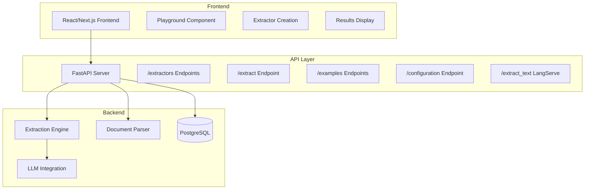
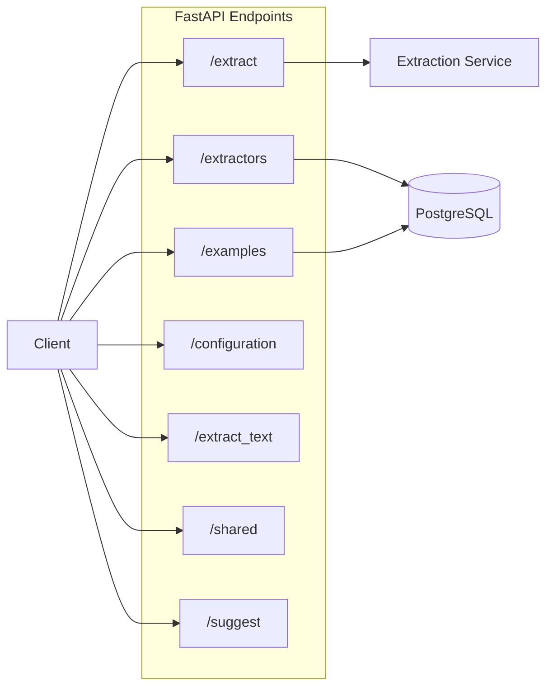
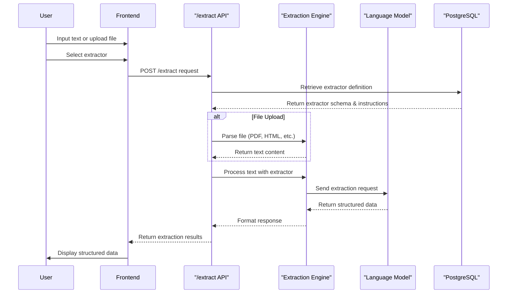

<!-- source: DeepWiki mcp.deepwiki.com · repo langchain-ai/langchain-extract · page 1 Overview · fetched 2026-10-26 -->

# Overview

<details>
<summary>Relevant source files</summary>

The following files were used as context for generating this wiki page:

- [README.md](README.md)
- [docker-compose.yml](docker-compose.yml)

</details>


LangChain Extract is a web application designed to extract structured information from text and files using Large Language Models (LLMs). It provides a complete system for defining extraction schemas, creating and managing extractors, and processing documents to extract structured data according to those schemas.

For detailed setup instructions, see [Getting Started](#1.1).

## Purpose and Scope

LangChain Extract serves as both a functional application and a reference implementation for building extraction systems with LLMs. It is built using FastAPI, LangChain, and PostgreSQL, following the [extraction use-case documentation](https://python.langchain.com/docs/use_cases/extraction) from LangChain.

The system enables users to:
- Define JSON schemas specifying the structure of data to extract
- Create, save, and manage extractors with custom instructions
- Extract information from text or uploaded files (PDF, HTML, etc.)
- Improve extraction quality through few-shot examples
- Share extractors with other users

Sources: [README.md:19-25]()

## System Architecture

LangChain Extract follows a three-tier architecture pattern:



Sources: [README.md:27-36](), [docker-compose.yml:3-59]()

## Core Components

### Frontend
The React/Next.js frontend provides an intuitive interface for working with extractors:

- **Playground**: Test extractors with different text inputs or file uploads
- **Extractor Creation**: Define schemas and instructions for new extractors
- **Results Display**: View extracted data in structured format

### Backend API
The FastAPI backend exposes several endpoints:



Sources: [README.md:50-136]()

### Extraction Engine
The extraction engine is the core component responsible for:

1. Processing document inputs (text or files)
2. Retrieving and applying the appropriate extractor schema
3. Executing the extraction using LLMs
4. Returning structured results

### Data Storage
PostgreSQL database stores:
- Extractor definitions (schema, instructions)
- Few-shot examples
- User information

Sources: [docker-compose.yml:4-23]()

## Extraction Workflow

The extraction process follows this sequence:



Sources: [README.md:106-136]()

## Extractor Definition

Extractors are defined using JSON Schema, with three key components:

1. **Schema**: Defines the structure of data to extract (properties, types, required fields)
2. **Instructions**: Custom instructions for the extraction process
3. **Examples**: Optional few-shot examples to improve extraction quality

Example extractor definition:

```json
{
  "name": "Personal Information",
  "description": "Use to extract personal information",
  "schema": {
    "type": "object",
    "title": "Person",
    "required": ["name", "age"],
    "properties": {
      "age": {
        "type": "integer",
        "title": "Age"
      },
      "name": {
        "type": "string",
        "title": "Name"
      }
    }
  },
  "instruction": "Use information about the person from the given user input."
}
```

Sources: [README.md:67-95]()

## Extraction Modes

LangChain Extract supports different extraction modes:

1. **entire_document**: Processes the entire document by splitting into chunks, extracting from each chunk, and deduplicating results
2. **retrieval**: Uses vector retrieval to find relevant context before extraction

Sources: [README.md:115-118]()

## Technology Stack

LangChain Extract is built on:

| Component | Technology |
|-----------|------------|
| Frontend | React/Next.js |
| Backend | FastAPI, LangChain |
| Database | PostgreSQL |
| Container | Docker/Docker Compose |
| LLM Integration | OpenAI, Fireworks, Together AI |

The system is containerized using Docker, with separate containers for the frontend, backend, and database services.

Sources: [docker-compose.yml:3-59](), [README.md:160-194]()

## API and Integration

The backend provides a REST API for all operations and includes a LangServe endpoint for integration with LangChain's `RemoteRunnable`. This allows the extraction service to be used as part of larger LangChain workflows.

The service exposes OpenAPI documentation to explore available endpoints and their parameters.

Sources: [README.md:27-36]()

---

