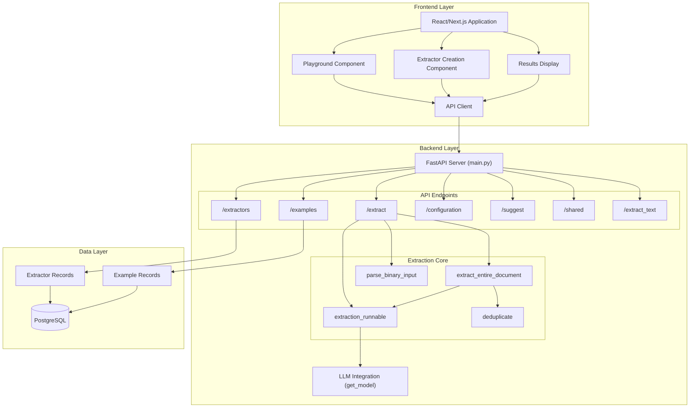
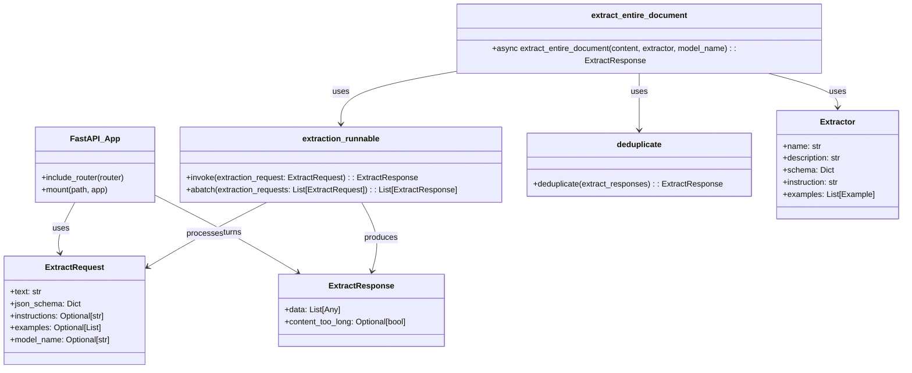
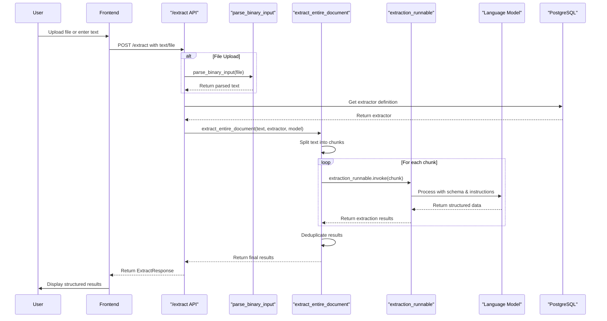
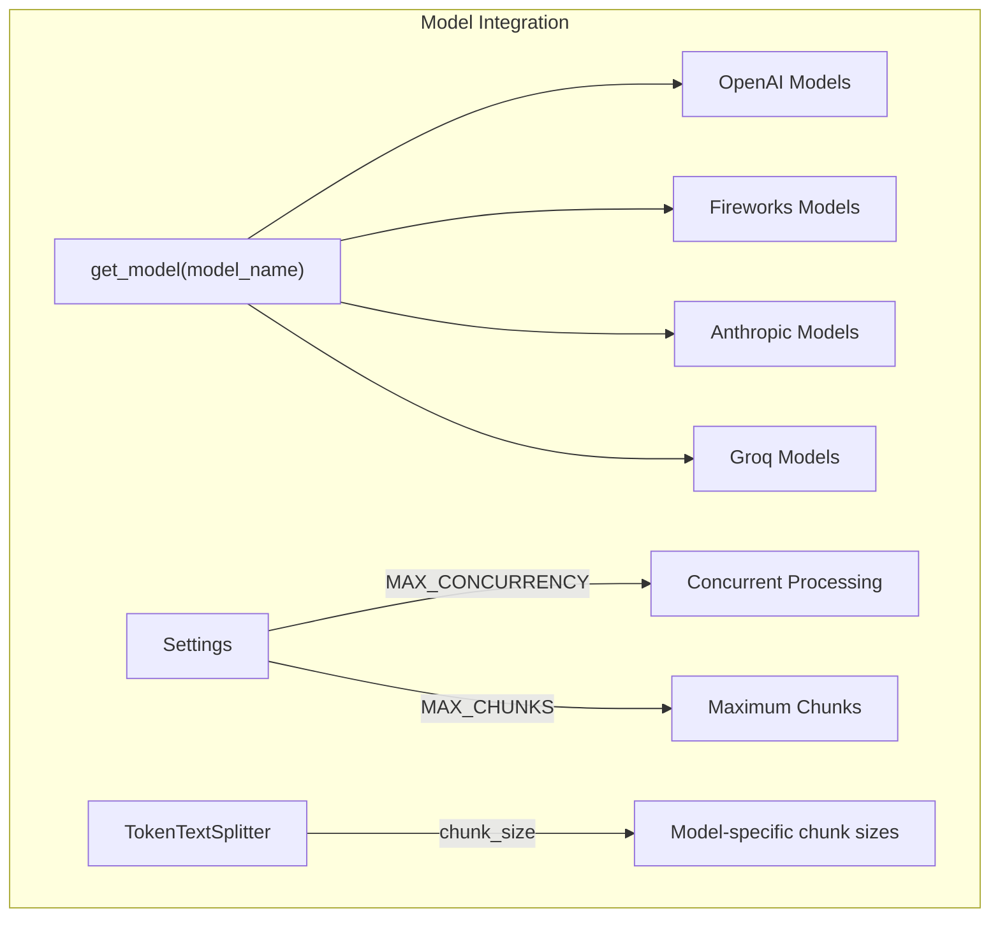
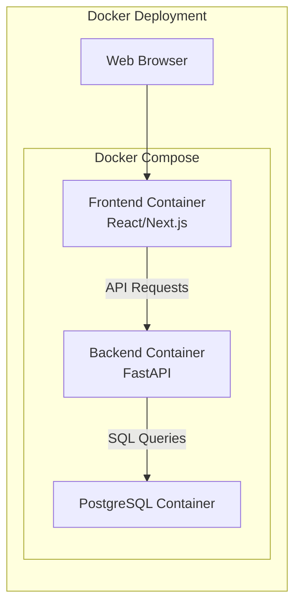

<!-- source: DeepWiki mcp.deepwiki.com · repo langchain-ai/langchain-extract · page 2 Architecture · fetched 2026-10-26 -->

# Architecture

Relevant source files

The following files were used as context for generating this wiki page:

- [README.md](README.md)
- [backend/server/extraction_runnable.py](backend/server/extraction_runnable.py)
- [backend/server/main.py](backend/server/main.py)
- [backend/server/settings.py](backend/server/settings.py)
- [docker-compose.yml](docker-compose.yml)

This document provides a comprehensive overview of the LangChain Extract system architecture, describing the major components and how they interact. For information about specific data flows during extraction operations, see [Data Flow](#2.1).

LangChain Extract is a web application designed to extract structured information from text and files using Large Language Models (LLMs). The system allows users to define extraction schemas, create extractors, and process documents to extract structured data according to those schemas.

## System Overview

LangChain Extract follows a modern three-tier architecture with clear separation between the frontend user interface, backend API services, and data storage layers.

Sources: [backend/server/main.py:1-82](), [backend/server/extraction_runnable.py:1-223](), [docker-compose.yml:1-60]()

## Component Architecture

The system is composed of several key components that work together to provide the extraction functionality.

### Frontend Components

The frontend is built with React/Next.js and provides interfaces for:
- Creating and managing extractors
- Uploading and processing documents
- Viewing extraction results
- Sharing extractors

### Backend Components

The backend is a FastAPI server with several key components:

1. **API Endpoints**: The main interface for client applications
   - `/extractors` - Create, read, update, delete extractors
   - `/examples` - Manage examples used for few-shot learning
   - `/extract` - Main endpoint for extraction operations
   - `/suggest` - LLM-based suggestions
   - `/shared` - Share extractors via unique URLs
   - `/configuration` - Expose system capabilities to clients
   - `/extract_text` - LangServe-compatible endpoint for extraction

2. **Extraction Core**: The engine for processing text and extracting information
   - `extraction_runnable` - Core LangChain runnable that processes extraction requests
   - `extract_entire_document` - Handles extraction from large documents by chunking
   - `deduplicate` - Removes duplicate extraction results

3. **Model Integration**: Interfaces with various LLM providers
   - Support for OpenAI, Fireworks, Anthropic, and Groq models

Sources: [backend/server/main.py:10-65](), [backend/server/extraction_runnable.py:36-65](), [backend/server/extraction_runnable.py:159-223]()

### Database Schema

The system uses PostgreSQL to store:
- Extractor definitions (schema, instructions)
- Examples for few-shot learning
- User information

## Extraction Process Flow

The extraction process follows a sequence of operations to convert unstructured text into structured data:

Sources: [backend/server/extraction_runnable.py:182-223](), [backend/server/extraction_runnable.py:159-179]()

## Model Integration

The system supports multiple LLM providers through LangChain's model abstraction. Configuration parameters control chunking size and concurrency:

Sources: [backend/server/settings.py:31-40](), [backend/server/extraction_runnable.py:191-196]()

## Deployment Architecture

The system is designed to be deployed using Docker containers:

Sources: [docker-compose.yml:1-60](), [README.md:158-194]()

## System Boundaries and Constraints

The LangChain Extract system has several notable constraints:

1. **Document Size Limitations**: Large documents are split into chunks, with configurable limits:
   - `MAX_CHUNKS`: Controls the maximum number of document chunks processed
   - `MAX_CONCURRENCY`: Limits how many chunks are processed simultaneously

2. **Model Context Limitations**: Each LLM has context window limitations that affect extraction capability

3. **Data Persistence**: The system uses PostgreSQL for storing extractors and examples, but not the extracted data itself

Sources: [backend/server/settings.py:31-40](), [backend/server/extraction_runnable.py:208-213]()

## Key Design Patterns

The LangChain Extract architecture leverages several important design patterns:

1. **Repository Pattern**: Database access is abstracted through model classes
2. **Chain Pattern**: LangChain runnables are chained together for the extraction process
3. **Strategy Pattern**: Different extraction strategies can be selected (entire document vs. retrieval)
4. **Factory Pattern**: Models are created through a factory function
5. **Middleware Pattern**: FastAPI middleware for CORS and other cross-cutting concerns

Sources: [backend/server/main.py:37-44](), [backend/server/extraction_runnable.py:159-179]()

---

