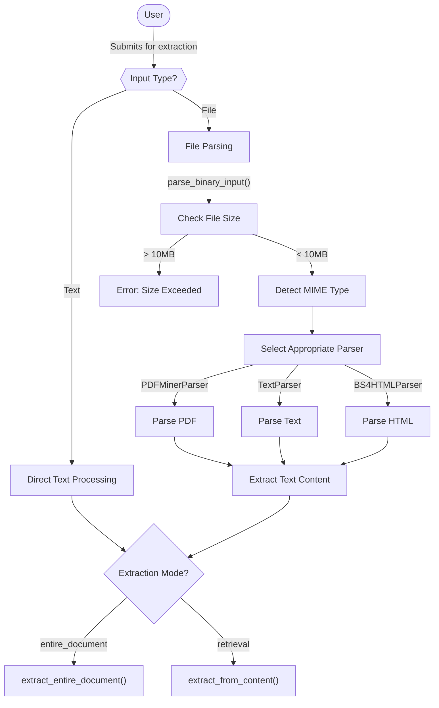
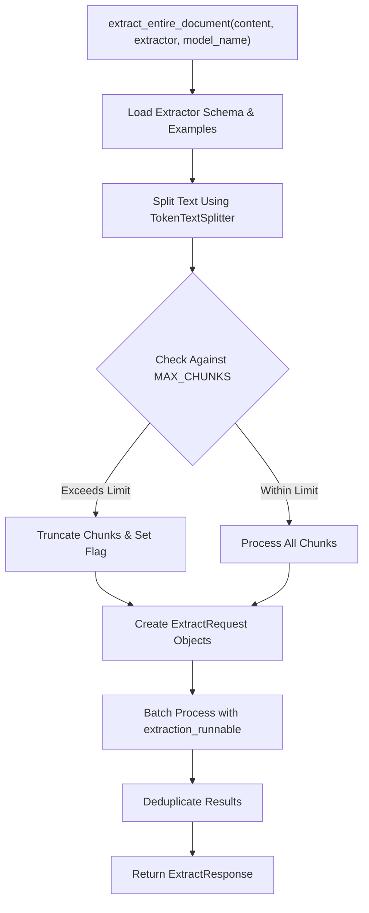
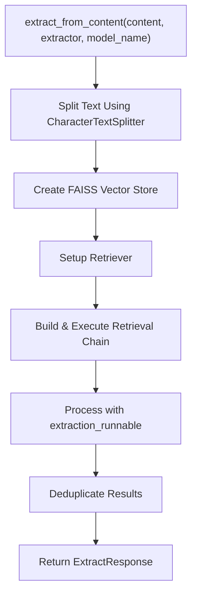
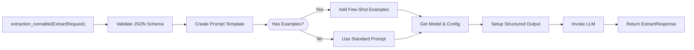
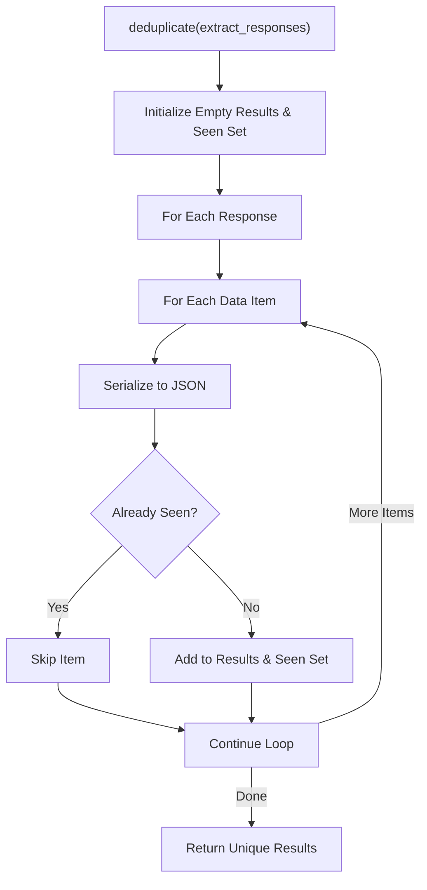
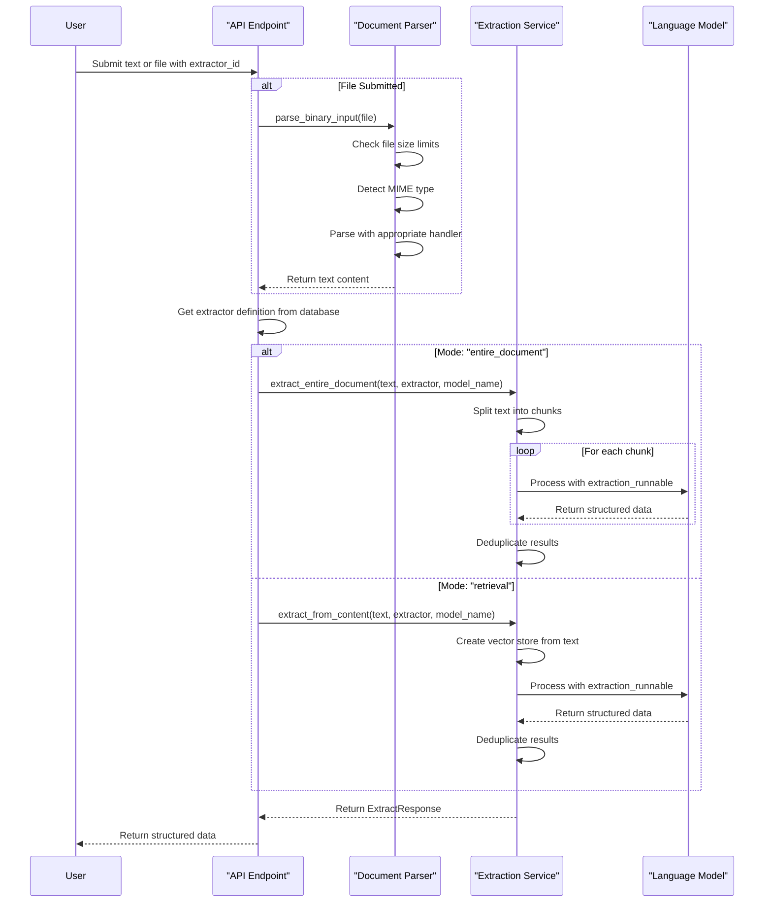

<!-- source: DeepWiki mcp.deepwiki.com · repo langchain-ai/langchain-extract · page 2.1 Data Flow · fetched 2026-10-26 -->

# Data Flow

<details>
<summary>Relevant source files</summary>

The following files were used as context for generating this wiki page:

- [backend/extraction/parsing.py](backend/extraction/parsing.py)
- [backend/server/extraction_runnable.py](backend/server/extraction_runnable.py)
- [backend/server/retrieval.py](backend/server/retrieval.py)
- [backend/server/settings.py](backend/server/settings.py)
- [backend/tests/unit_tests/api/test_api_extract.py](backend/tests/unit_tests/api/test_api_extract.py)
- [backend/tests/unit_tests/conftest.py](backend/tests/unit_tests/conftest.py)
- [backend/tests/unit_tests/test_deduplication.py](backend/tests/unit_tests/test_deduplication.py)

</details>


This document explains how data flows through the LangChain Extract system during the extraction process - from initial user input to the final structured output. It details the path that text or files take through the system components, the processing steps applied, and how the system handles different extraction modes.

For information about the overall system architecture, see [Architecture](#2). For details about the core extraction functionality implementation, see [Extraction Engine](#4.1).

## Input Processing Flow

When a user submits content for extraction, the system follows one of two paths depending on whether the input is text or a file.



Sources: [extraction/parsing.py:83-86](), [extraction/parsing.py:62-70](), [extraction/parsing.py:31-42]()

## File Parsing Subsystem

The system can process various file formats by converting them to text:

| MIME Type | Parser Used | Description |
|-----------|-------------|-------------|
| application/pdf | PDFMinerParser | Extracts text from PDF documents |
| text/plain | TextParser | Processes plain text files |
| text/html | BS4HTMLParser | Extracts content from HTML files |

The file parsing process has these constraints:
- Maximum file size: 10MB by default
- Limited to supported MIME types defined in the HANDLERS dictionary

Sources: [extraction/parsing.py:13-26](), [extraction/parsing.py:56-59]()

## Extraction Modes

The system supports two primary extraction modes with different data flows:

### Entire Document Extraction



When using the `entire_document` mode:
1. Text is divided into chunks using TokenTextSplitter
2. Each chunk is processed independently
3. Results are deduplicated to remove duplicates
4. A flag is set if the document was too long and had to be truncated

Sources: [backend/server/extraction_runnable.py:182-223](), [backend/server/settings.py:32-40]()

### Retrieval-Based Extraction



In the `retrieval` mode:
1. Text is split using CharacterTextSplitter
2. A vector store is created from the text chunks
3. A retrieval system finds relevant chunks
4. The extraction is performed on retrieved content
5. Results are deduplicated

Sources: [backend/server/retrieval.py:24-68]()

## Core Extraction Process

The heart of the extraction system is the `extraction_runnable` function that processes text with an LLM:



Sources: [backend/server/extraction_runnable.py:160-179](), [backend/server/extraction_runnable.py:78-125]()

## Deduplication Mechanism

When multiple chunks are processed, the system deduplicates the results:



Sources: [backend/server/extraction_runnable.py:131-151](), [backend/tests/unit_tests/test_deduplication.py:4-54]()

## End-to-End Data Flow

This sequence diagram shows the complete flow from user input to structured output:



Sources: [backend/tests/unit_tests/api/test_api_extract.py:41-205](), [backend/server/extraction_runnable.py:182-223](), [backend/server/retrieval.py:24-68]()

## Key Data Structures

Understanding the data structures is crucial for following the data flow:

### ExtractRequest
```
ExtractRequest:
  - text: str                           # Text to extract from
  - json_schema: Dict                   # Schema defining extraction structure
  - instructions: Optional[str]         # Additional system instructions
  - examples: Optional[List[Example]]   # Example extractions for few-shot learning
  - model_name: Optional[str]           # LLM to use
```

### ExtractResponse
```
ExtractResponse:
  - data: List[Any]                     # Extracted structured data
  - content_too_long: Optional[bool]    # Flag indicating if content was truncated
```

Sources: [backend/server/extraction_runnable.py:36-58](), [backend/server/extraction_runnable.py:61-67]()

## Configuration Parameters Affecting Data Flow

Several configuration parameters impact how data flows through the system:

| Parameter | Description | Default | Impact on Data Flow |
|-----------|-------------|---------|---------------------|
| MAX_CONCURRENCY | Max chunks processed concurrently | 1 | Controls parallel processing of document chunks |
| MAX_CHUNKS | Max chunks processed per document | -1 (unlimited) | Limits document size; if exceeded, content is truncated |
| MAX_FILE_SIZE_MB | Max file size in MB | 10 | Restricts input file size |

Sources: [backend/server/settings.py:32-40](), [extraction/parsing.py:28]()

## Technical Constraints

The data flow through the system operates under these constraints:

1. File size limitation (10MB default)
2. Text length limitations based on model context windows
3. Processing capacity limited by MAX_CHUNKS and MAX_CONCURRENCY settings
4. Only supports certain file types (PDF, text, HTML)
5. Extraction quality depends on:
   - Quality of the schema definition
   - Clarity of instructions
   - Quality of provided examples
   - Capabilities of the selected LLM

Sources: [extraction/parsing.py:62-70](), [backend/server/extraction_runnable.py:195-213]()

---

