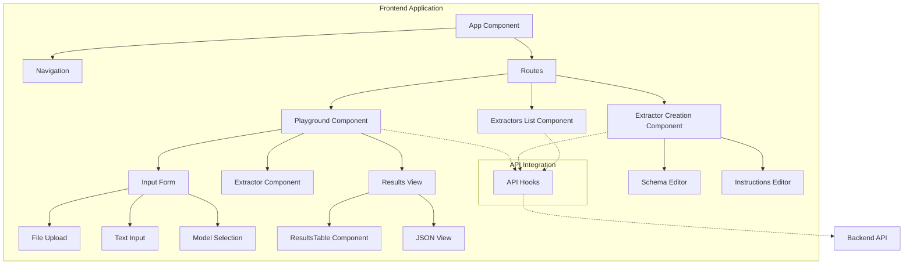
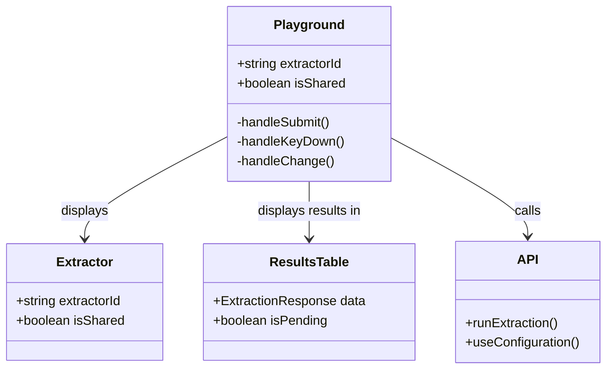
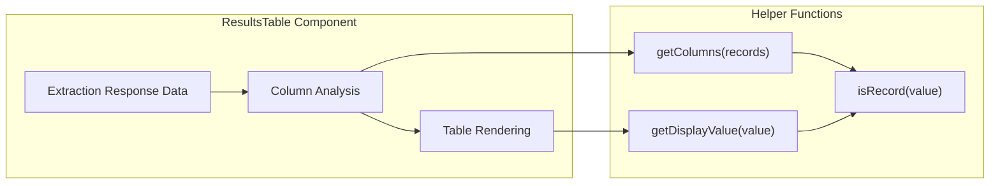
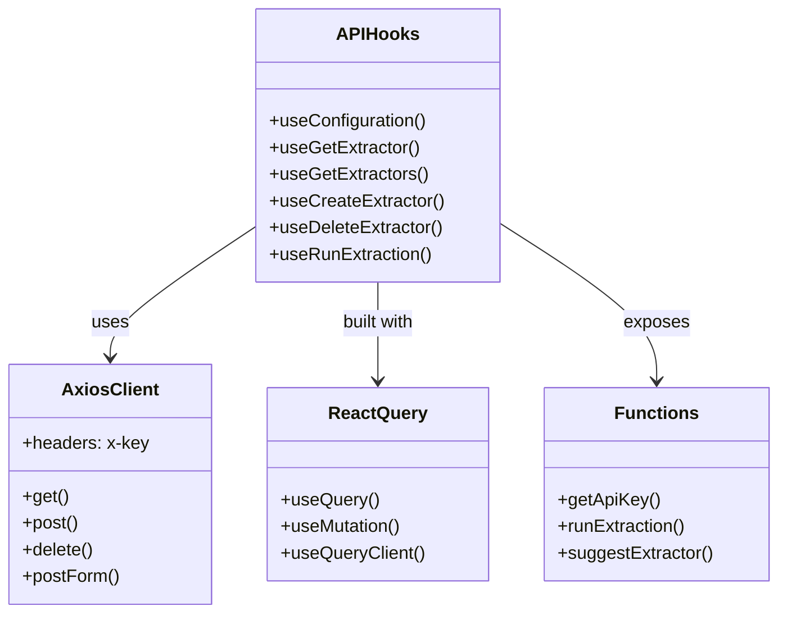
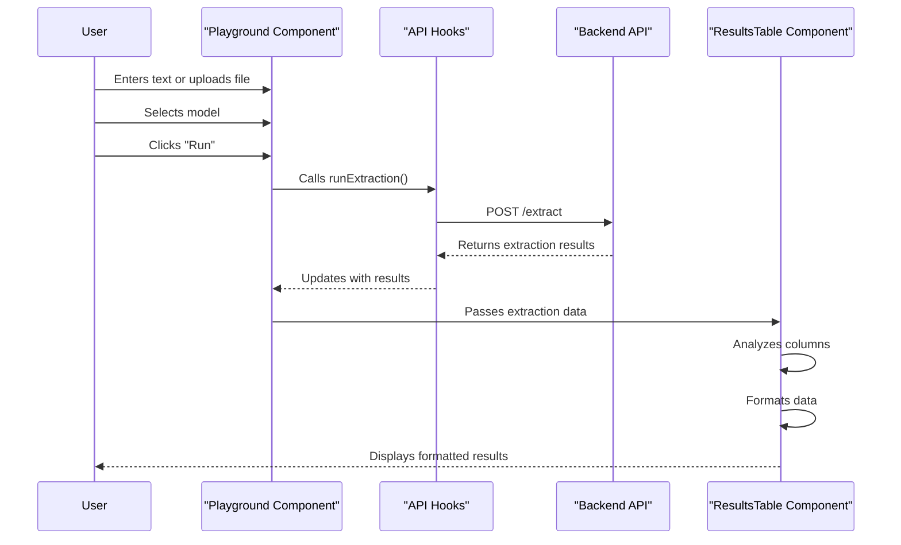
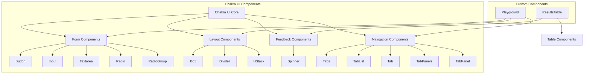

<!-- source: DeepWiki mcp.deepwiki.com · repo langchain-ai/langchain-extract · page 3 Frontend Components · fetched 2026-10-26 -->

# Frontend Components

Relevant source files

The following files were used as context for generating this wiki page:

- [frontend/app/components/Playground.tsx](frontend/app/components/Playground.tsx)
- [frontend/app/components/ResultsTable.tsx](frontend/app/components/ResultsTable.tsx)
- [frontend/app/utils/api.tsx](frontend/app/utils/api.tsx)

This page provides an overview of the key frontend components in the LangChain Extract application. The frontend is built using React and Next.js, providing an interactive user interface for creating extractors, running extractions, and viewing results.

For information about the backend API that these components interact with, see [Backend System](#4) and [API Endpoints](#4.2). For details on the creation and management of extractors, see [Creating and Managing Extractors](#3.2).

## Component Architecture

The frontend is organized into modular components that handle specific aspects of the extraction workflow. Below is a high-level architecture diagram showing the main components and their relationships:

Sources: [frontend/app/components/Playground.tsx:1-196](). [frontend/app/utils/api.tsx:1-184]()

## Key Components

### Playground Component

The Playground is the primary interface for testing extractors. It allows users to input text or upload files, select an extraction model, and view extraction results.

The Playground component:
- Displays extractor details using the Extractor component
- Provides a form for text input or file upload
- Allows selection of different LLM models for extraction
- Runs the extraction process
- Displays results in both table and JSON formats

Sources: [frontend/app/components/Playground.tsx:29-196]()

### ResultsTable Component

The ResultsTable component displays extraction results in a tabular format, dynamically determining columns based on the extracted data.

Key features:
- Dynamically determines table columns from extraction results
- Formats complex data types (arrays, objects) into readable strings
- Shows a loading spinner during extraction
- Displays extracted data in rows and columns

Sources: [frontend/app/components/ResultsTable.tsx:1-120]()

## API Integration

The frontend uses a set of React Query hooks to communicate with the backend API. These hooks manage API requests, caching, and state updates.

The API hooks provide:
- Authentication through client-side API keys
- Functions for CRUD operations on extractors
- Methods for running extractions
- Configuration retrieval
- Suggestion functionality for extractors

Sources: [frontend/app/utils/api.tsx:1-184]()

## Data Flow

The following diagram illustrates how data flows through the frontend components when a user runs an extraction:

When a user runs an extraction:
1. The user inputs text or uploads a file in the Playground component
2. The Playground component captures form data and calls the `runExtraction` function
3. The request is sent to the backend API with the extractor ID, input data, and model selection
4. The backend processes the extraction and returns results
5. The ResultsTable component receives the data, analyzes it to determine columns, and displays it

Sources: [frontend/app/components/Playground.tsx:50-65](), [frontend/app/utils/api.tsx:130-141]()

## User Interface Components

The frontend uses Chakra UI components for a consistent and responsive interface:

Key UI elements include:
- Form controls for text input and file upload
- Radio buttons for model selection
- Tabs for switching between table and JSON views
- Spinners for loading states
- Tables for displaying structured data

Sources: [frontend/app/components/Playground.tsx:2-20](), [frontend/app/components/ResultsTable.tsx:1-11]()

## Component State Management

The frontend components use React hooks for state management and API communication:

| Hook Type | Usage | Example |
|-----------|-------|---------|
| useState | Local component state | Managing form state, disabled buttons |
| useMutation | API mutations | Running extractions, creating extractors |
| useQuery | Data fetching | Getting extractors, configuration |
| useQueryClient | Cache invalidation | Refreshing lists after mutations |

The Playground component uses state to:
- Track whether the form is valid for submission
- Handle the extraction request and response
- Manage loading states during extraction

Sources: [frontend/app/components/Playground.tsx:43-48](), [frontend/app/utils/api.tsx:94-98](), [frontend/app/utils/api.tsx:147-152]()

---

