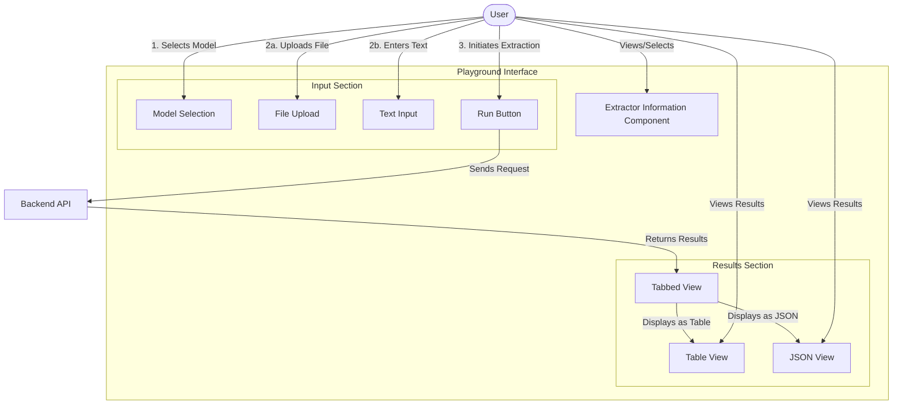
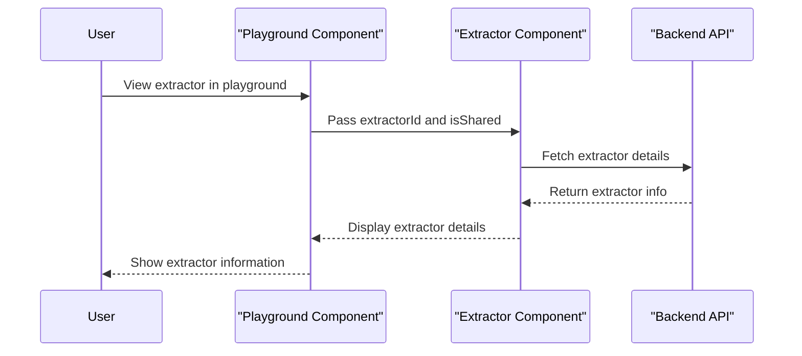
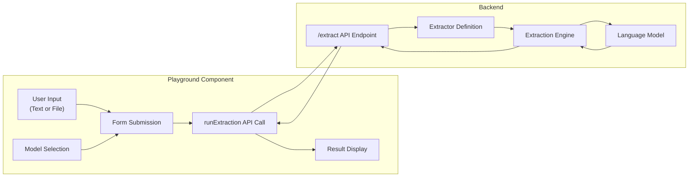
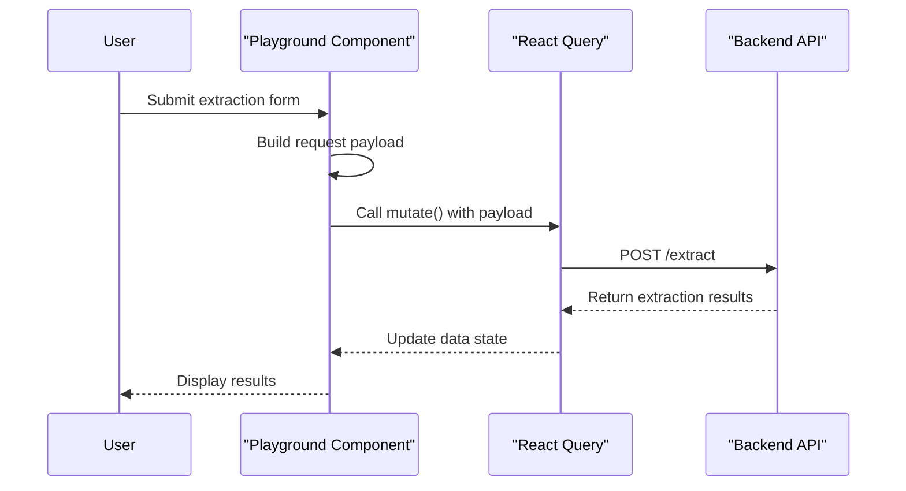
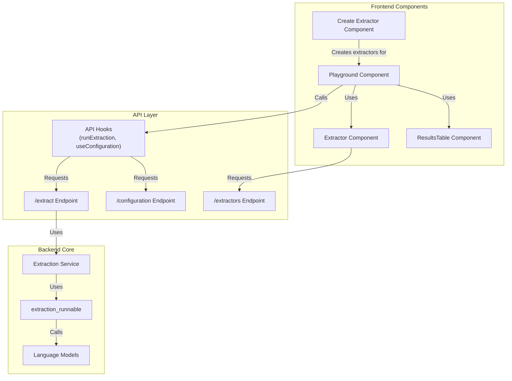

<!-- source: DeepWiki mcp.deepwiki.com · repo langchain-ai/langchain-extract · page 3.1 Playground Interface · fetched 2026-10-26 -->

# Playground Interface

Relevant source files

The following files were used as context for generating this wiki page:

- [frontend/app/components/Playground.tsx](frontend/app/components/Playground.tsx)
- [frontend/app/components/ResultsTable.tsx](frontend/app/components/ResultsTable.tsx)

## Purpose and Scope

The Playground Interface is a core frontend component of LangChain Extract that enables users to test and experiment with extractors in real-time. It provides an interactive environment where users can input text or upload files, select a language model, run extractions, and view the structured results. This page documents the interface structure, functionality, and how it integrates with the rest of the system.

For information about creating and managing extractors, see [Creating and Managing Extractors](#3.2).

## Component Overview

The Playground Interface consists of three main sections:
1. **Extractor Information** - Displays details about the currently selected extractor
2. **Input Section** - Allows users to provide content and configure extraction settings
3. **Results Section** - Shows extraction results in both tabular and JSON formats

Sources: [frontend/app/components/Playground.tsx:41-196]()

## Interface Components

### Extractor Information

The Playground displays information about the current extractor through the `Extractor` component. This includes:
- The extractor's name and description
- The JSON schema that defines the extraction structure
- An indicator if the extractor is shared

Sources: [frontend/app/components/Playground.tsx:104-106]()

### Input Section

The input section provides the following functionality:

1. **Model Selection**: Radio button group that displays available LLM models from the server configuration
2. **File Upload**: Allows users to upload supported file types with size restrictions
3. **Text Input**: Text area for direct input of content to extract from
4. **Run Button**: Triggers the extraction process

The interface prevents users from simultaneously using both file upload and text input methods, ensuring only one input source is active at a time.

Sources: [frontend/app/components/Playground.tsx:109-165]()

### Results Section

After extraction runs, results are displayed in a tabbed interface with two views:

1. **Table View**: Displays extraction results in a structured table format
   - Columns are dynamically generated based on the extracted data fields
   - Complex nested data (arrays, objects) is formatted for readability
   - Handles missing values gracefully
   
2. **JSON View**: Shows the raw JSON output from the extraction process
   - Uses syntax highlighting for improved readability
   - Displays the complete response including metadata

Additionally, warnings are shown if content was too long and had to be truncated.

Sources: [frontend/app/components/Playground.tsx:167-192](), [frontend/app/components/ResultsTable.tsx:63-120]()

## Data Flow

The Playground component manages the complete extraction workflow, from user input to result display:

Sources: [frontend/app/components/Playground.tsx:50-65]()

## Implementation Details

### Form Handling

The Playground implements several form handling functions:

1. **handleSubmit**: Processes form submission, builds the extraction request payload, and triggers the API call
2. **handleKeyDown**: Enables form submission when the user presses Enter in the text area
3. **handleChange**: Validates input state and manages the Run button's disabled state

The component ensures that users can only run extractions when valid input is provided (either text or file, but not both or neither).

Sources: [frontend/app/components/Playground.tsx:50-98]()

### API Integration

The Playground uses React Query's `useMutation` hook to interact with the backend API:

The component integrates with two main API endpoints:
1. Configuration endpoint - to retrieve available models and file constraints
2. Extraction endpoint - to process content and return structured data

Sources: [frontend/app/components/Playground.tsx:43-45](), [frontend/app/components/Playground.tsx:47]()

### Results Table Rendering

The `ResultsTable` component handles the complexities of displaying extraction results:

1. Dynamically determines columns from the extracted data
2. Formats complex data types for display
3. Handles loading states and empty results
4. Renders a responsive table with the extraction results

The table renderer recursively formats nested objects and arrays to create a readable string representation in table cells.

Sources: [frontend/app/components/ResultsTable.tsx:15-61](), [frontend/app/components/ResultsTable.tsx:87-119]()

## Usage Workflow

A typical user workflow in the Playground Interface follows these steps:

1. Navigate to an extractor (either created by the user or shared)
2. Review the extractor information to understand what data will be extracted
3. Select a language model for extraction
4. Either:
   - Upload a supported file type, or
   - Enter text directly in the text area
5. Click the Run button (or press Enter in the text area)
6. View the extraction results in the Table or JSON view
7. Iterate by adjusting input or selecting different models

This interactive cycle allows users to refine their extraction approach and evaluate different models' effectiveness for their specific use case.

Sources: [frontend/app/components/Playground.tsx:100-196]()

## Integration with System

The Playground Interface is a central component in the LangChain Extract system, connecting various parts of the application:

The Playground serves as the primary interface for testing extractors, enabling users to validate extraction schemas and configurations before using them in production scenarios.

Sources: [frontend/app/components/Playground.tsx:25-27](), [frontend/app/components/Playground.tsx:41-196]()

---

