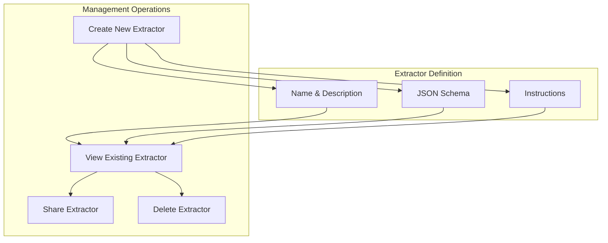
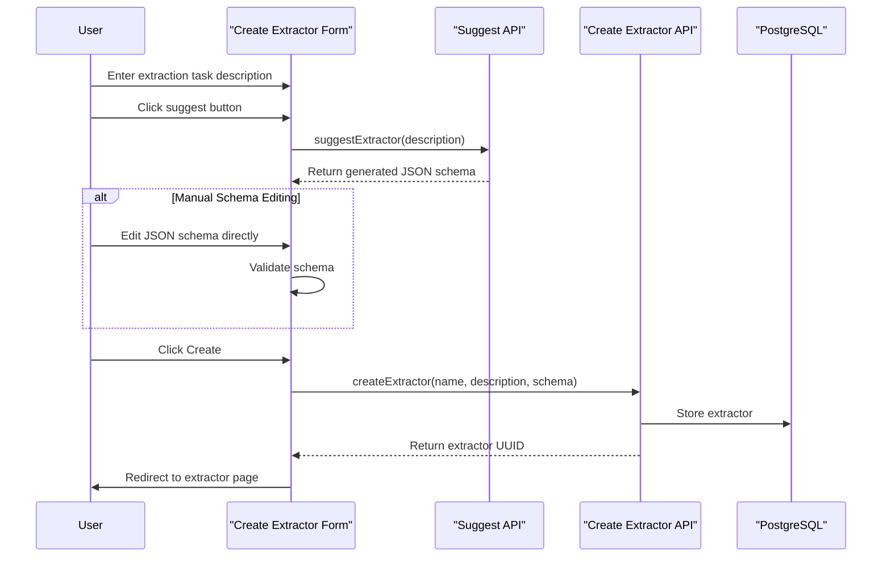
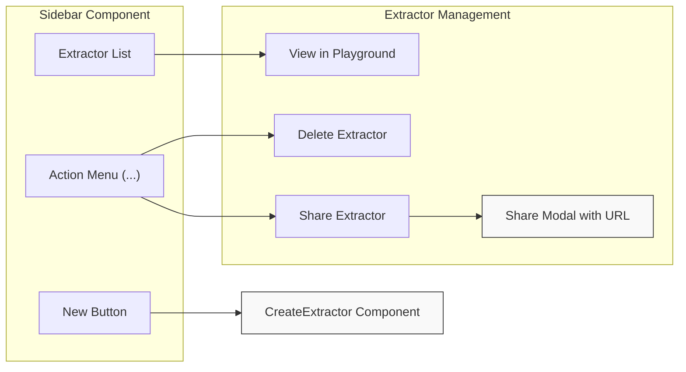
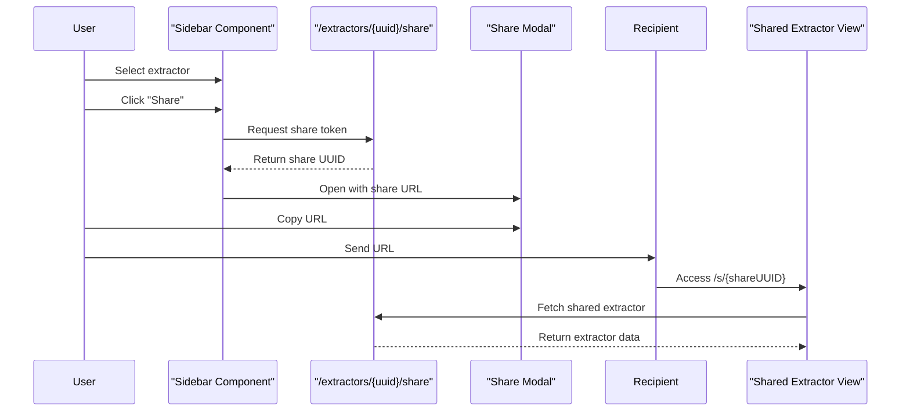
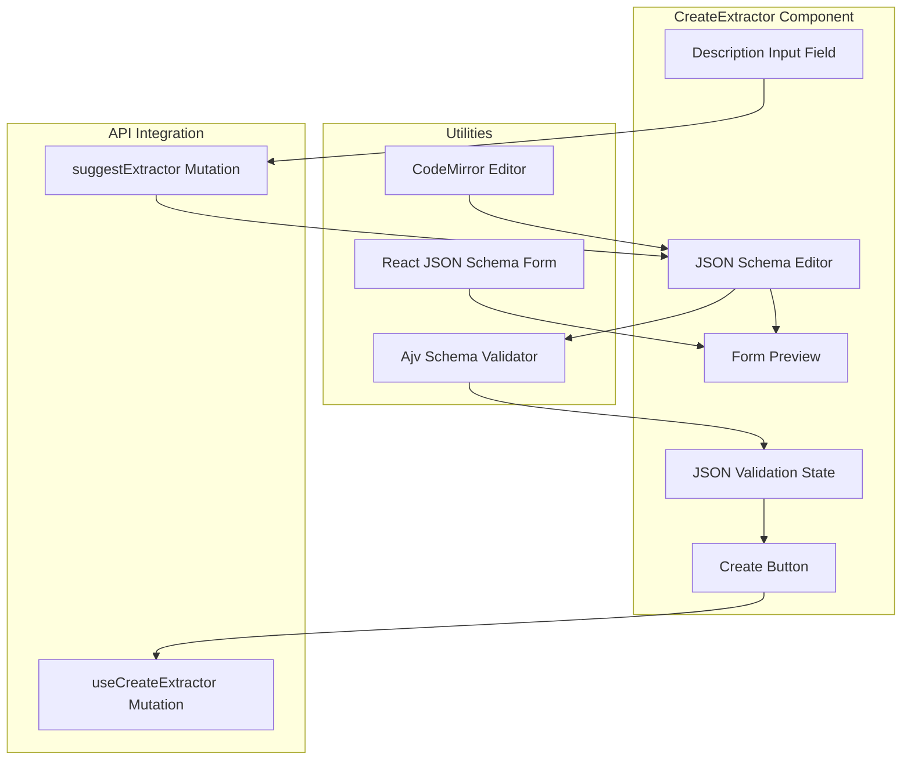

<!-- source: DeepWiki mcp.deepwiki.com · repo langchain-ai/langchain-extract · page 3.2 Creating and Managing Extractors · fetched 2026-10-26 -->

# Creating and Managing Extractors

<details>
<summary>Relevant source files</summary>

The following files were used as context for generating this wiki page:

- [backend/server/api/api_key.py](backend/server/api/api_key.py)
- [backend/server/api/shared.py](backend/server/api/shared.py)
- [frontend/app/components/CreateExtractor.tsx](frontend/app/components/CreateExtractor.tsx)
- [frontend/app/components/Extractor.tsx](frontend/app/components/Extractor.tsx)
- [frontend/app/components/ShareModal.tsx](frontend/app/components/ShareModal.tsx)
- [frontend/app/components/Sidebar.tsx](frontend/app/components/Sidebar.tsx)
- [frontend/app/e/[extractorId]/page.tsx](frontend/app/e/[extractorId]/page.tsx)
- [frontend/app/s/[sharedExtractorId]/page.tsx](frontend/app/s/[sharedExtractorId]/page.tsx)
- [frontend/package.json](frontend/package.json)
- [frontend/yarn.lock](frontend/yarn.lock)

</details>


This page documents how to create, edit, and share extractors within the LangChain Extract system. Extractors are the core definitions that specify what structured data should be extracted from unstructured text. For information about using extractors to process documents, see [Playground Interface](#3.1).

## Extractor Overview

An extractor in LangChain Extract consists of:

1. A name and description to identify its purpose
2. A JSON schema that defines the structure of data to extract
3. Instructions that guide the extraction process

Extractors can be created, viewed, shared, and deleted through the system's frontend interface.



Sources: [frontend/app/components/CreateExtractor.tsx:48-114](), [frontend/app/components/Extractor.tsx:23-62]()

## Creating a New Extractor

The extractor creation interface allows you to define what data you want to extract from text documents. You can access this interface by clicking the "New" button in the sidebar.

### Using Natural Language to Generate Schemas

The easiest way to create an extractor is by describing what you want to extract in natural language:

1. Enter a description of your extraction task in the input field
2. Click the suggestion button to generate a JSON schema
3. The system uses an LLM to create an appropriate schema for your task
4. Preview and adjust the generated schema as needed
5. Click "Create" to save the extractor

### Manually Editing JSON Schema

Alternatively, you can directly edit the JSON schema:

1. Expand the "Edit JSON Schema" accordion
2. Write or paste a valid JSON schema
3. The schema must be a valid JSON object with a `type: "object"` property
4. Preview updates in real-time with the form below
5. Click "Create" to save the extractor



Sources: [frontend/app/components/CreateExtractor.tsx:48-221](), [frontend/app/utils/api.ts]()

### JSON Schema Structure

The JSON schema defines the structure of data to be extracted. A valid schema:

- Must be a JSON object with `type: "object"`
- Should include `title` and `description` for better usability
- Defines properties to extract with appropriate types
- Can include nested objects and arrays for complex data
- May specify format constraints for properties (e.g., date-time, email)

The system automatically extracts the extractor name from the schema's `title` property and the description from the `description` property.

Example schema structure:

```json
{
  "title": "Resume Information",
  "description": "Extract key information from resumes",
  "type": "object",
  "properties": {
    "name": {
      "type": "string",
      "description": "Full name of the candidate"
    },
    "email": {
      "type": "string",
      "format": "email",
      "description": "Contact email address"
    },
    "skills": {
      "type": "array",
      "items": {
        "type": "string"
      },
      "description": "List of professional skills"
    }
  }
}
```

Sources: [frontend/app/components/CreateExtractor.tsx:80-92]()

## Managing Existing Extractors

Once created, extractors are listed in the sidebar where they can be managed.

### Viewing Extractors

1. Extractors are displayed in the sidebar with their names and descriptions
2. Click on an extractor to open it in the Playground
3. The Extractor component displays the schema as both:
   - A visual form representation
   - The raw JSON schema code

### Extractor Actions

Each extractor in the sidebar has a menu with the following options:

- **Share**: Generate a unique URL to share the extractor with others
- **Delete**: Remove the extractor from the system



Sources: [frontend/app/components/Sidebar.tsx:36-138](), [frontend/app/components/ShareModal.tsx:1-52]()

## Sharing Extractors

The system allows you to share extractors with others who don't have direct access to your account.

### How to Share an Extractor

1. Select an extractor from the sidebar
2. Click the "..." menu and select "Share"
3. A modal appears with a unique URL
4. Copy the URL and share it with collaborators

### How Shared Extractors Work

1. The system generates a unique share token for the extractor
2. This token is included in a URL (e.g., `/s/{shareUUID}`)
3. Anyone with this URL can access a read-only version of your extractor
4. Shared extractors can be used in the Playground but cannot be modified



Sources: [frontend/app/components/ShareModal.tsx:1-52](), [frontend/app/s/[sharedExtractorId]/page.tsx:1-13](), [backend/server/api/shared.py:1-51]()

## Technical Implementation

### Extractor Creation Component

The `CreateExtractor` component is the main interface for creating new extractors. Key features:

- Uses React state to manage the JSON schema
- Provides real-time validation of schema syntax
- Renders a live preview using `@rjsf/chakra-ui` form library
- Integrates with the suggestion API to generate schemas using LLMs
- Submits the final schema to create an extractor in the database

The component extracts metadata (name and description) from the schema itself, making the UI more streamlined.



Sources: [frontend/app/components/CreateExtractor.tsx:36-221]()

### Extractor Component

The `Extractor` component displays an existing extractor with tabs for different views:

- Form view: Shows how the extracted data will be structured
- Code view: Displays the raw JSON schema

This component is used both in the main application and in the shared extractor view.

Sources: [frontend/app/components/Extractor.tsx:18-62]()

### Database Storage

Extractors are stored in a PostgreSQL database with the following key elements:

- UUID: Unique identifier for each extractor
- Name: Display name for the extractor
- Description: Brief explanation of what the extractor does
- Schema: JSON schema that defines the structure
- Instruction: Optional guidance for the extraction process
- Share tokens: Separate table that maps extractors to share UUIDs

Sources: [backend/server/api/shared.py:9-51]()

## Common Use Cases

### 1. Creating a Contact Information Extractor

1. Click "New" in the sidebar
2. Enter "Extract contact information including name, email, phone number, and address"
3. Use the suggestion feature to generate a schema
4. Review and adjust field definitions as needed
5. Click "Create" to save the extractor

### 2. Sharing an Extractor with Team Members

1. Select the extractor from the sidebar
2. Click the menu button (...)
3. Select "Share"
4. Copy the generated URL
5. Send the URL to team members who need to use the same extractor

### 3. Iterating on an Extractor Schema

1. Create an initial extractor
2. Test it in the Playground with sample text
3. If results need improvement, create a new extractor with an enhanced schema
4. Use more specific property descriptions or add additional fields
5. Share the improved extractor when finalized

## Summary

The extractor creation and management interfaces allow you to:

1. Define structured data extraction requirements as JSON schemas
2. Use AI assistance to generate schemas from natural language descriptions
3. View and test extractors in an interactive playground
4. Share extractors with collaborators using unique URLs
5. Delete extractors when no longer needed

For information about using these extractors to process documents and extract data, see [Extraction Engine](#4.1).

---

