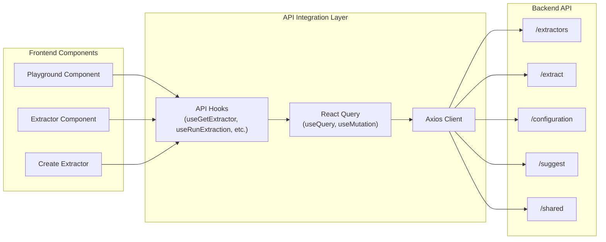
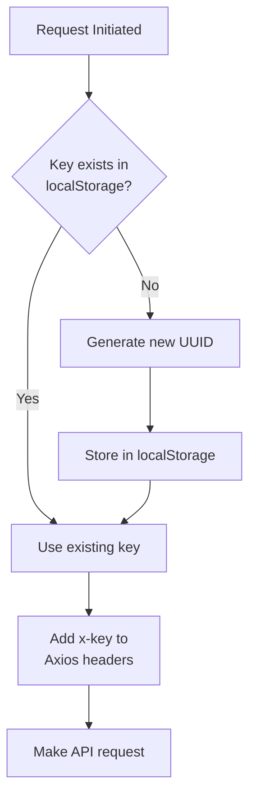
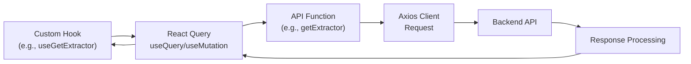
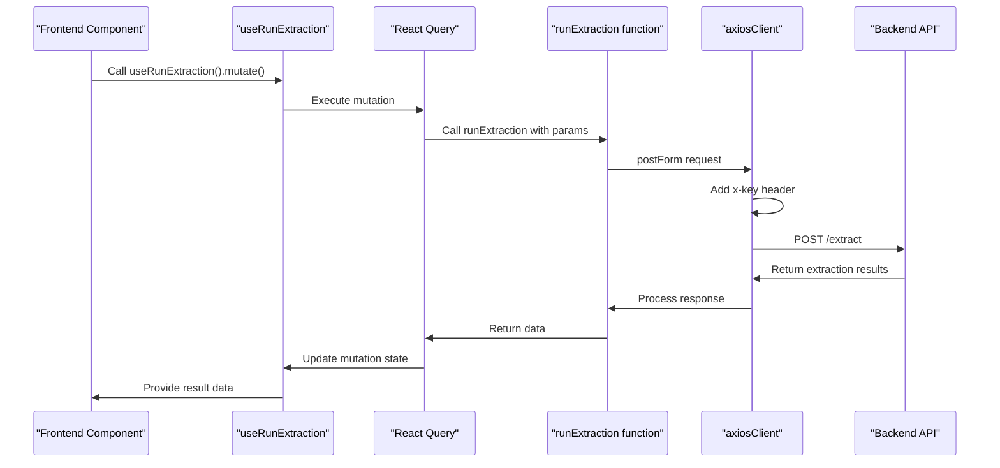
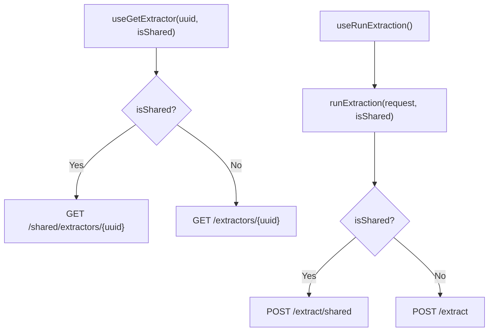
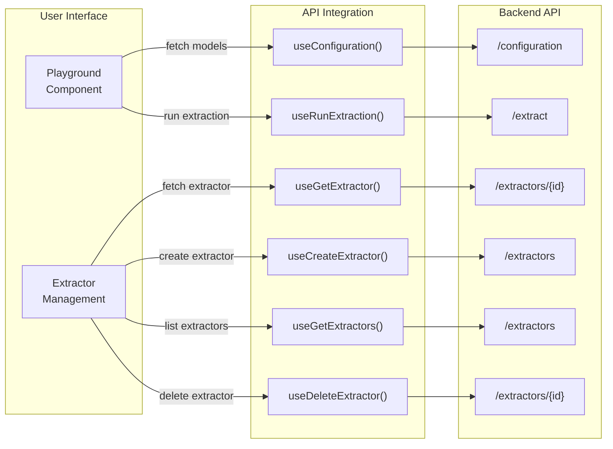

<!-- source: DeepWiki mcp.deepwiki.com · repo langchain-ai/langchain-extract · page 3.3 API Integration · fetched 2026-10-26 -->

# API Integration

<details>
<summary>Relevant source files</summary>

The following files were used as context for generating this wiki page:

- [frontend/app/utils/api.tsx](frontend/app/utils/api.tsx)
- [frontend/app/utils/api_url.ts](frontend/app/utils/api_url.ts)

</details>


This page documents the API integration approach used in LangChain Extract, focusing on how the frontend communicates with the backend API services. It covers the architecture, key API hooks, request flow, and data handling mechanisms that enable frontend components to interact with extraction services.

## Overview

The LangChain Extract frontend uses a React Query-based approach to communicate with the backend API. The integration is built around custom hooks that provide a clean interface for components to fetch data, trigger extractions, and manage extractors without needing to handle HTTP request details directly.



Sources: [frontend/app/utils/api.tsx:1-184]()

## API Client Configuration

The API integration layer is built on Axios with a custom configuration that includes automatic client identification and environment-aware URL determination.

### Client Authentication

Each client instance is identified by a unique UUID stored in the browser's localStorage. This key is included in all API requests as the `x-key` header.



Sources: [frontend/app/utils/api.tsx:22-42]()

### Base URL Determination

The system automatically determines the appropriate API base URL based on the current environment:

- Development: `http://localhost:8000`
- Production: Uses the value from `NEXT_PUBLIC_BASE_API_URL` environment variable

This configuration allows the same code to work across different deployment environments without modification.

Sources: [frontend/app/utils/api_url.ts:1-11]()

## API Hooks

The API integration provides several React hooks that encapsulate common operations needed by the frontend components. These hooks are implemented using React Query to manage state, caching, and refetching.

### Available Hooks

| Hook | Purpose | Backend Endpoint |
|------|---------|------------------|
| `useConfiguration` | Fetch server configuration (models, accepted file types) | GET /configuration |
| `useGetExtractor` | Fetch a single extractor by UUID | GET /extractors/{uuid} |
| `useGetExtractors` | Fetch list of all extractors | GET /extractors |
| `useCreateExtractor` | Create a new extractor | POST /extractors |
| `useDeleteExtractor` | Delete an extractor | DELETE /extractors/{uuid} |
| `useRunExtraction` | Run an extraction with text/file | POST /extract |

Sources: [frontend/app/utils/api.tsx:94-183]()

### Hook Implementation Pattern

Most hooks follow a consistent pattern leveraging React Query's `useQuery` or `useMutation`:



Sources: [frontend/app/utils/api.tsx:48-62](), [frontend/app/utils/api.tsx:147-152]()

## Request Flow

Let's examine the flow of a typical API request using the extraction process as an example:



Sources: [frontend/app/utils/api.tsx:130-145]()

## Data Types

The API integration defines several data types to structure the communication between frontend and backend:

### Core Types

```typescript
// Extractor definition
type ExtractorData = {
  uuid: string;
  name: string;
  description: string;
  schema: any;
};

// Available LLM model
type Model = {
  name: string;
  description: string;
};

// Server capabilities
type ServerConfiguration = {
  max_file_size_mb: number;
  accepted_mimetypes: string[];
  models: Model[];
};

// Extraction request
type ExtractionRequest = {
  extractor_id: string;
  text?: string;
  file?: File;
};

// Extraction response
type ExtractionResponse = {
  data: unknown[];
  content_too_long?: boolean;
};
```

Sources: [frontend/app/utils/api.tsx:14-20](), [frontend/app/utils/api.tsx:77-86](), [frontend/app/utils/api.tsx:119-128]()

## Shared Extractor Handling

The API integration includes special handling for shared extractors, which allows accessing extractors through a separate endpoint:



Sources: [frontend/app/utils/api.tsx:48-62](), [frontend/app/utils/api.tsx:130-141]()

## Integration with UI Components

The API hooks are designed to be easily consumed by frontend components. They handle loading states, errors, and data caching automatically.



Sources: [frontend/app/utils/api.tsx:94-183]()

## Related Systems

The API integration layer connects to several other system components:

- For more information about the backend API endpoints, see [API Endpoints](#4.2)
- For details on the Playground Interface that uses these hooks, see [Playground Interface](#3.1)
- For information about the Extractor management UI, see [Creating and Managing Extractors](#3.2)

## Summary

The API integration in LangChain Extract provides a clean, structured approach to communicate with the backend services. By using React Query and custom hooks, the frontend components can focus on presentation while the API layer handles data fetching, caching, and state management. This separation of concerns makes the codebase more maintainable and provides a consistent pattern for adding new API interactions as needed.

Key benefits of this approach include:
- Automatic loading and error states
- Data caching and background refetching
- Consistent client identification
- Environment-aware configuration
- Type-safe API interactions

Sources: [frontend/app/utils/api.tsx:1-184](), [frontend/app/utils/api_url.ts:1-11]()

---

