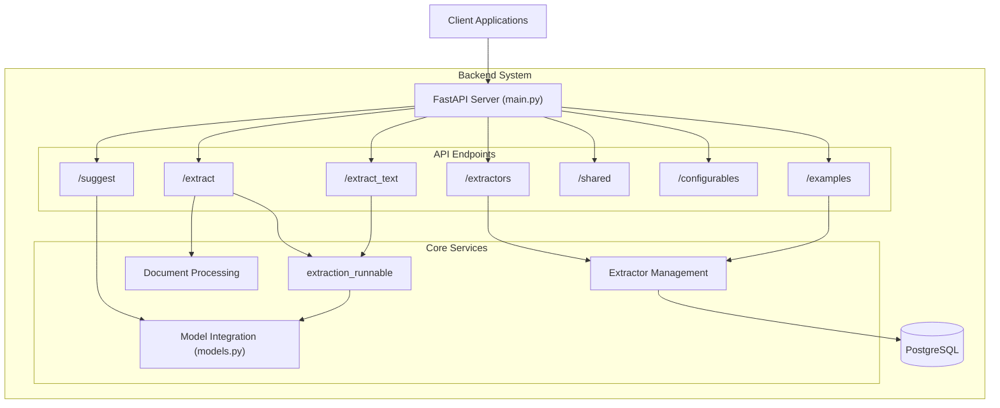
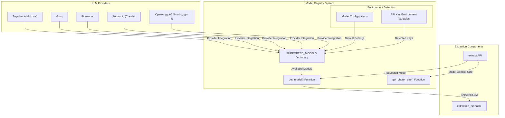
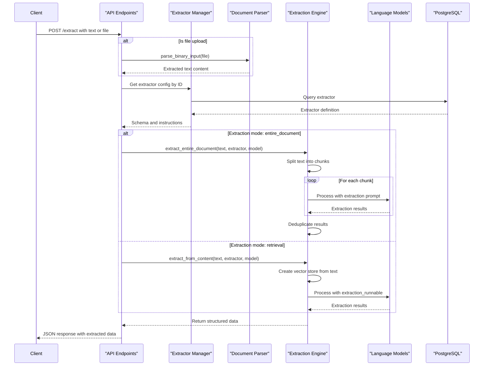
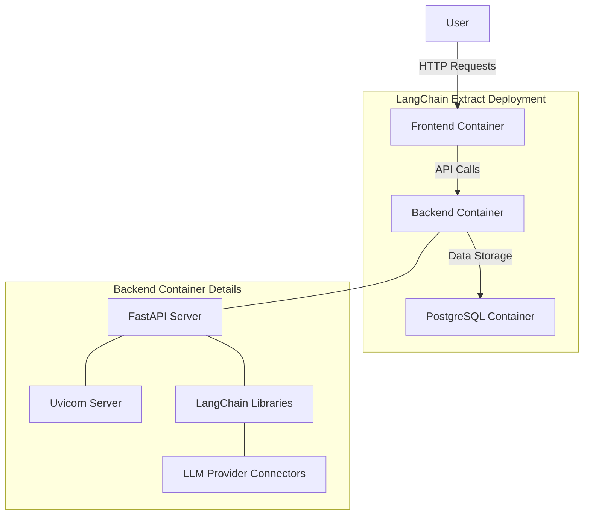

<!-- source: DeepWiki mcp.deepwiki.com · repo langchain-ai/langchain-extract · page 4 Backend System · fetched 2026-10-26 -->

# Backend System

<details>
<summary>Relevant source files</summary>

The following files were used as context for generating this wiki page:

- [backend/poetry.lock](backend/poetry.lock)
- [backend/pyproject.toml](backend/pyproject.toml)
- [backend/server/main.py](backend/server/main.py)
- [backend/server/models.py](backend/server/models.py)
- [backend/tests/unit_tests/fake/test_fake_chat_model.py](backend/tests/unit_tests/fake/test_fake_chat_model.py)

</details>


The Backend System of LangChain Extract is a FastAPI-based server that provides RESTful APIs for extracting structured information from text and documents using various Language Models (LLMs). It forms the core processing engine of the application, handling extractor definitions, document parsing, and the actual extraction process.

For information about specific extraction functionality, see [Extraction Engine](#4.1). For API endpoint details, see [API Endpoints](#4.2).

## System Architecture

The LangChain Extract backend consists of a FastAPI server exposing several API endpoints, with core services for model integration, document processing, and extraction logic.



Sources: [backend/server/main.py:1-83](), [backend/server/models.py:1-87]()

## FastAPI Server

The server is built using FastAPI, defined in `main.py`. It configures middleware, registers API routes, and serves the frontend application when available.

Key components include:
- CORS middleware for cross-origin request handling
- Registration of various API routers
- LangServe integration for the extraction runnable
- Static file serving for the frontend

```python
# FastAPI application configuration
app = FastAPI(
    title="Extraction Powered by LangChain",
    description="An extraction service powered by LangChain.",
    version="0.0.1",
    openapi_tags=[
        {
            "name": "extraction",
            "description": "Operations related to extracting content from text.",
        }
    ],
)
```

The API routes are registered as follows:

```python
# Include API endpoints
app.include_router(extractors.router)
app.include_router(examples.router)
app.include_router(extract.router)
app.include_router(suggest.router)
app.include_router(shared.router)
app.include_router(configurables.router)

# Add LangServe route
add_routes(
    app,
    extraction_runnable.with_types(
        input_type=ExtractRequest, output_type=ExtractResponse
    ),
    path="/extract_text",
    enabled_endpoints=["invoke", "batch"],
)
```

Sources: [backend/server/main.py:6-76]()

## API Endpoints

The backend exposes several API endpoints that handle different aspects of the extraction system:

| Endpoint | Purpose |
|----------|---------|
| `/extractors` | Managing extraction schemas and configurations |
| `/extract` | Performing extraction on text or documents |
| `/examples` | Managing few-shot examples for improving extraction accuracy |
| `/suggest` | Generating schema or extraction suggestions |
| `/shared` | Handling shared extractor links |
| `/configurables` | Exposing system capabilities and configurations |
| `/extract_text` | LangServe route for extraction runnable |

Sources: [backend/server/main.py:52-58](), [backend/server/main.py:60-67]()

## Model Integration

The system integrates with multiple LLM providers through the `models.py` module, which provides a unified interface for accessing different language models. Available models are determined based on API keys present in the environment.



The model registry dynamically loads models based on environment configuration:

```python
def get_supported_models():
    """Get models according to environment secrets."""
    models = {}
    if "OPENAI_API_KEY" in os.environ:
        models["gpt-3.5-turbo"] = {
            "chat_model": ChatOpenAI(model="gpt-3.5-turbo", temperature=0),
            "description": "GPT-3.5 Turbo",
        }
        if os.environ.get("DISABLE_GPT4", "").lower() != "true":
            models["gpt-4-0125-preview"] = {
                "chat_model": ChatOpenAI(model="gpt-4-0125-preview", temperature=0),
                "description": "GPT-4 0125 Preview",
            }
    # Additional model providers...
```

Sources: [backend/server/models.py:1-87](), [backend/pyproject.toml:15-30]()

## Extraction Process Flow

The following sequence diagram illustrates the data flow during an extraction process:



Sources: [backend/server/main.py:11-16](), [backend/server/main.py:52-58]()

## Document Processing

The backend includes utilities for parsing different document types before extraction:

- PDF processing using `pdfminer-six`
- HTML processing with `beautifulsoup4` and `lxml`
- Plain text handling

The document processing pipeline handles:
1. File type detection
2. Text extraction appropriate to the file type
3. Preprocessing text for the extraction engine

Sources: [backend/pyproject.toml:21-25]()

## Dependencies and Technologies

The backend relies on several key technologies and libraries:

| Category | Dependencies |
|----------|-------------|
| Core Framework | FastAPI, Uvicorn, Starlette |
| LLM Integration | LangChain, LangServe, OpenAI, Anthropic, Fireworks, Groq |
| Database | PostgreSQL, Alembic, SQLAlchemy |
| Document Processing | pdfminer-six, BeautifulSoup4, lxml |
| Vector Storage | FAISS |
| API Utilities | Pydantic, Python-multipart, jsonschema |

Sources: [backend/pyproject.toml:9-31]()

## Configuration and Deployment

The backend can be configured through environment variables:

| Variable | Purpose |
|----------|---------|
| `CORS_ORIGINS` | Comma-separated list of allowed origins for CORS |
| `OPENAI_API_KEY` | API key for OpenAI integration |
| `ANTHROPIC_API_KEY` | API key for Anthropic integration |
| `FIREWORKS_API_KEY` | API key for Fireworks integration |
| `GROQ_API_KEY` | API key for Groq integration |
| `TOGETHER_API_KEY` | API key for Together AI integration |
| `DISABLE_GPT4` | Flag to disable GPT-4 models even if API key is present |

The system is designed to be deployed using Docker, with containers for the backend, frontend, and PostgreSQL database.



Sources: [backend/server/main.py:35-44](), [backend/server/models.py:10-67](), [backend/pyproject.toml:9-31]()

## Error Handling and Logging

The backend system implements error handling through FastAPI's exception handling mechanisms. Logging is configured to track important system events and potential issues:

```python
logger = logging.getLogger(__name__)
# Later in the code
logger.warning("No UI directory found, serving API only.")
```

Sources: [backend/server/main.py:18](), [backend/server/main.py:76]()

## Testing Infrastructure

The backend includes a comprehensive testing infrastructure with pytest fixtures and utilities. The test suite includes unit tests, integration tests, and tools like `GenericFakeChatModel` for mocking LLM responses during testing.

Sources: [backend/tests/unit_tests/fake/test_fake_chat_model.py:1-39]()

---

