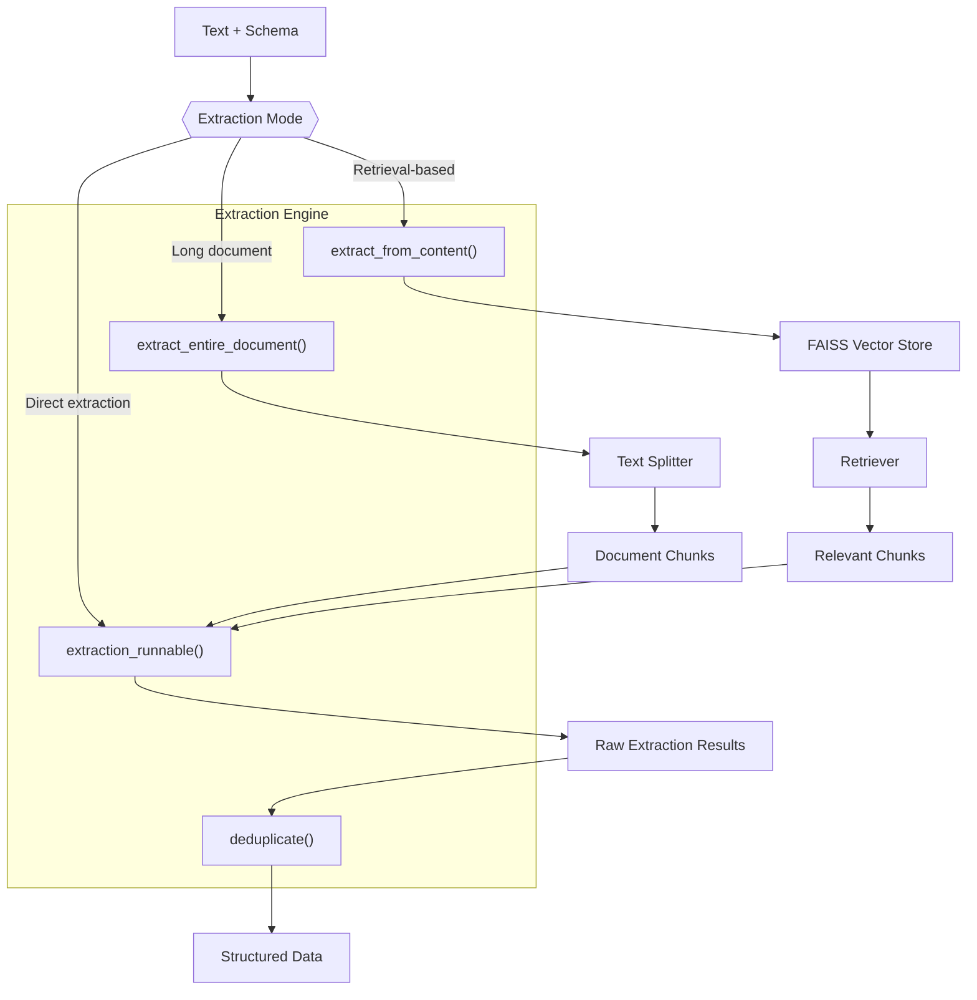
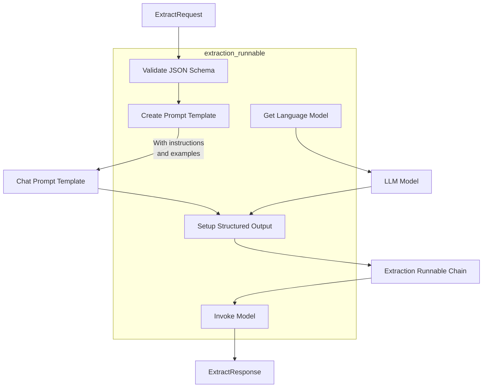
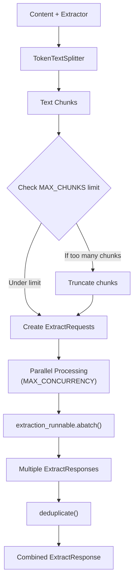
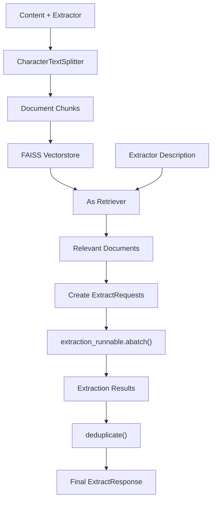
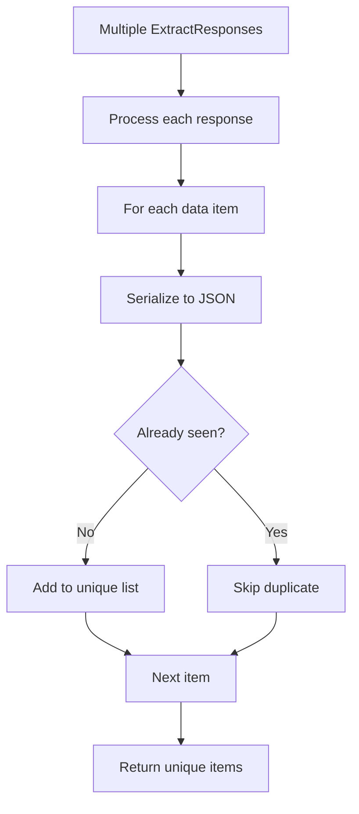
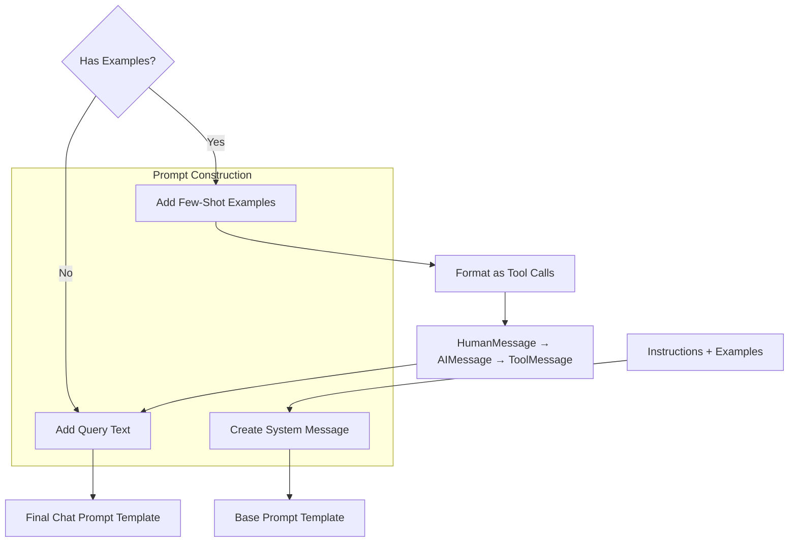
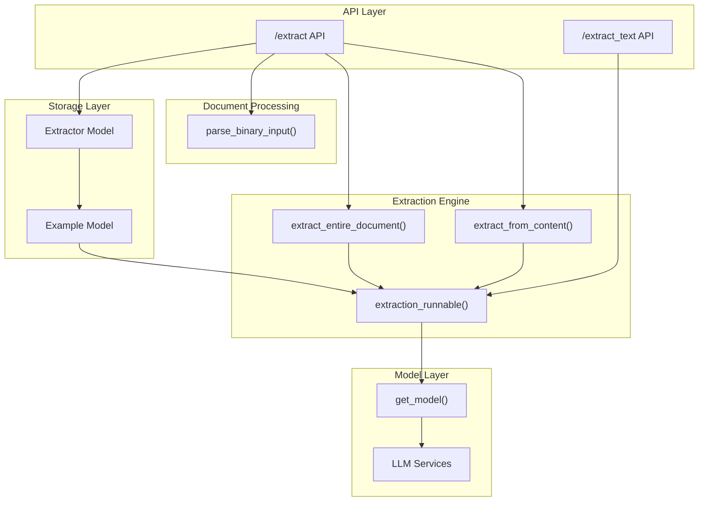

<!-- source: DeepWiki mcp.deepwiki.com · repo langchain-ai/langchain-extract · page 4.1 Extraction Engine · fetched 2026-10-26 -->

# Extraction Engine

<details>
<summary>Relevant source files</summary>

The following files were used as context for generating this wiki page:

- [backend/server/extraction_runnable.py](backend/server/extraction_runnable.py)
- [backend/server/retrieval.py](backend/server/retrieval.py)
- [backend/server/settings.py](backend/server/settings.py)
- [backend/tests/unit_tests/conftest.py](backend/tests/unit_tests/conftest.py)
- [backend/tests/unit_tests/test_deduplication.py](backend/tests/unit_tests/test_deduplication.py)
- [backend/tests/unit_tests/test_utils.py](backend/tests/unit_tests/test_utils.py)

</details>


The Extraction Engine is the core component of LangChain Extract's backend system responsible for converting unstructured text into structured data according to user-defined schemas. This page documents the architecture, functionality, and implementation details of the extraction system.

For API endpoints that expose this functionality, see [API Endpoints](#4.2). For information about document parsing prior to extraction, see [Document Parsing](#4.3).

## Overview

The Extraction Engine provides the fundamental capabilities for extracting structured information from text using Large Language Models (LLMs). It supports two primary extraction modes:

1. **Entire Document Processing**: Processes large documents by splitting them into chunks, extracting information from each chunk, and deduplicating the results.
2. **Retrieval-Based Processing**: Creates vector embeddings of document chunks and selectively processes the most relevant chunks based on the extraction task.



Sources: [backend/server/extraction_runnable.py:159-223](), [backend/server/retrieval.py:24-68]()

## Core Components

### Extraction Runnable

The `extraction_runnable` function is the primary extraction engine component. It processes a single text input against a JSON schema to extract structured information using an LLM.



Sources: [backend/server/extraction_runnable.py:159-179]()

### Document Processing

For long documents, the engine splits the content into manageable chunks, processes each chunk, and then combines and deduplicates the results.



Sources: [backend/server/extraction_runnable.py:182-223](), [backend/server/settings.py:32-40]()

### Retrieval-Based Extraction

For retrieval-based extraction, the engine uses vector embeddings to identify the most relevant chunks of a document for processing.



Sources: [backend/server/retrieval.py:24-68]()

### Deduplication

The deduplication mechanism ensures that identical extraction results are only included once in the final output.



Sources: [backend/server/extraction_runnable.py:131-151](), [backend/tests/unit_tests/test_deduplication.py:1-54]()

## Data Models

The Extraction Engine uses several key data models to structure requests and responses:

| Model | Description | Key Fields |
|-------|-------------|------------|
| `ExtractRequest` | Input to extraction functions | `text`, `json_schema`, `instructions`, `examples`, `model_name` |
| `ExtractResponse` | Output from extraction functions | `data` (extracted items), `content_too_long` (truncation flag) |
| `ExtractionExample` | Example for few-shot learning | `text`, `output` (expected extraction) |

Sources: [backend/server/extraction_runnable.py:24-68]()

## Prompt Engineering

The Extraction Engine uses a sophisticated prompt template strategy to communicate the extraction task to the LLM.



The system message uses a specific format:
```
You are a top-tier algorithm for extracting information from text. 
Only extract information that is relevant to the provided text. 
If no information is relevant, use the schema and output 
an empty list where appropriate.

[Custom Instructions If Provided]
```

Sources: [backend/server/extraction_runnable.py:78-125](), [backend/tests/unit_tests/test_utils.py:66-103]()

## Configuration Options

The Extraction Engine behavior can be configured through environment variables:

| Setting | Environment Variable | Default | Description |
|---------|---------------------|---------|-------------|
| `MAX_CONCURRENCY` | `MAX_CONCURRENCY` | 1 | Controls how many document chunks are processed concurrently |
| `MAX_CHUNKS` | `MAX_CHUNKS` | -1 | Maximum number of chunks to process per document (-1 = no limit) |

Sources: [backend/server/settings.py:32-40]()

## JSON Schema Handling

The extraction engine adapts input JSON schemas to a format suitable for structured output extraction:

1. Takes the original schema (e.g., a `Person` schema with `name` and `age` fields)
2. Wraps it in a container schema with a `data` array property
3. Sets the title to "extractor" and adds a description

This transformation enables the LLM to return properly structured arrays of extracted items.

Sources: [backend/tests/unit_tests/test_utils.py:8-63]()

## Extraction Modes Comparison

| Feature | Direct Extraction | Entire Document | Retrieval-Based |
|---------|------------------|-----------------|-----------------|
| **Best for** | Short texts | Long, structured documents | Documents with sparse relevant info |
| **Processing** | Single pass | Split into chunks | Vector similarity search |
| **Memory Usage** | Low | High | Medium |
| **Speed** | Fast | Slower (many API calls) | Medium |
| **Accuracy** | High for short texts | High for dense information | Better for targeted extraction |

Sources: [backend/server/extraction_runnable.py:159-223](), [backend/server/retrieval.py:24-68]()

## Integration with Other Components



Sources: [backend/server/extraction_runnable.py:159-223](), [backend/server/retrieval.py:24-68]()

## Implementation Details

### Chunking Strategy

The Extraction Engine uses different text splitters depending on the extraction mode:

- **Entire Document Mode**: Uses `TokenTextSplitter` with token-based chunking to respect LLM context windows
- **Retrieval Mode**: Uses `CharacterTextSplitter` with character-based chunking optimized for vector search

Sources: [backend/server/extraction_runnable.py:191-196](), [backend/server/retrieval.py:32-39]()

### Few-Shot Learning

The Extraction Engine supports few-shot learning through examples. When examples are provided, they are formatted as a sequence of:
1. Human message with example text
2. AI message with a tool call containing the expected extraction
3. Tool message confirming correct extraction

This approach effectively teaches the model the expected extraction pattern before processing new text.

Sources: [backend/server/extraction_runnable.py:96-116]()

### Error Handling

The engine includes error handling for invalid schemas, employing `Draft202012Validator` to validate schemas before processing. If a schema is invalid, the system raises an HTTP 422 error with details about the validation failure.

Sources: [backend/server/extraction_runnable.py:163-167]()

---

