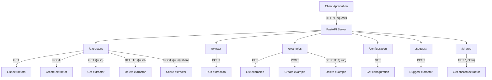
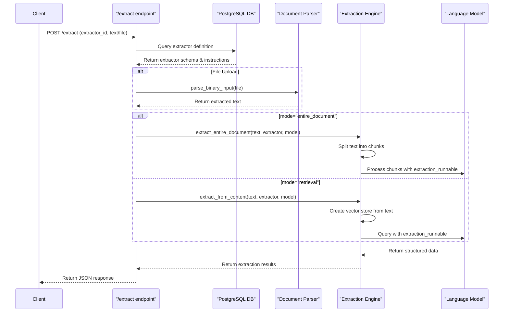
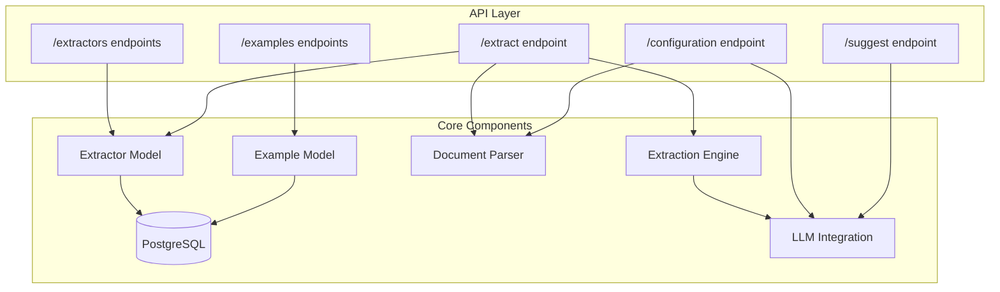

<!-- source: DeepWiki mcp.deepwiki.com · repo langchain-ai/langchain-extract · page 4.2 API Endpoints · fetched 2026-10-26 -->

# API Endpoints

<details>
<summary>Relevant source files</summary>

The following files were used as context for generating this wiki page:

- [backend/extraction/parsing.py](backend/extraction/parsing.py)
- [backend/server/api/configurables.py](backend/server/api/configurables.py)
- [backend/server/api/examples.py](backend/server/api/examples.py)
- [backend/server/api/extractors.py](backend/server/api/extractors.py)
- [backend/server/api/suggest.py](backend/server/api/suggest.py)
- [backend/tests/unit_tests/api/test_api_configuration.py](backend/tests/unit_tests/api/test_api_configuration.py)
- [backend/tests/unit_tests/api/test_api_extract.py](backend/tests/unit_tests/api/test_api_extract.py)
- [backend/tests/unit_tests/test_parsing.py](backend/tests/unit_tests/test_parsing.py)

</details>


This page documents the backend API endpoints in the LangChain Extract system. These RESTful APIs serve as the interface between the frontend application and the backend extraction functionality, handling operations such as managing extractors, processing extraction requests, managing examples, and retrieving system configuration.

For details about the underlying extraction functionality, see [Extraction Engine](#4.1).

## API Structure Overview

The following diagram illustrates the organization of API endpoints in the system:

### API Structure Diagram


Sources: [backend/server/api/extractors.py](), [backend/server/api/examples.py](), [backend/server/api/configurables.py](), [backend/server/api/suggest.py]()

## Authentication

Most API endpoints require authentication using an `x-key` header containing a user ID. This is implemented through the `UserToken` dependency in the API routes.

## Extraction Request Flow

The following diagram illustrates how a typical extraction request flows through the system:

### Extraction Flow Diagram


Sources: [backend/tests/unit_tests/api/test_api_extract.py](), [backend/extraction/parsing.py]()

## API Endpoints Reference

### Extractors API

The extractors API allows managing extractor definitions - the templates that define the structure and instructions for extracting information.

| Endpoint | Method | Description | Authentication |
|----------|--------|-------------|----------------|
| `/extractors` | GET | List extractors with pagination | Required |
| `/extractors` | POST | Create a new extractor | Required |
| `/extractors/{uuid}` | GET | Get extractor by UUID | Required |
| `/extractors/{uuid}` | DELETE | Delete an extractor | Required |
| `/extractors/{uuid}/share` | POST | Share an extractor | Required |

Sources: [backend/server/api/extractors.py:109-179]()

#### Extractor Object Structure

```json
{
  "uuid": "550e8400-e29b-41d4-a716-446655440000",
  "name": "Person Extractor",
  "description": "Extract person information",
  "schema": {
    "type": "object",
    "properties": {
      "name": {
        "type": "string",
        "description": "Full name of the person"
      },
      "age": {
        "type": "integer",
        "description": "Age of the person"
      }
    }
  },
  "instruction": "Extract person information including name and age."
}
```

### Extract API

The extract API handles the actual extraction of structured data from text or files.

| Endpoint | Method | Description | Authentication |
|----------|--------|-------------|----------------|
| `/extract` | POST | Run an extraction | Required |

Sources: [backend/tests/unit_tests/api/test_api_extract.py:41-140]()

#### Extract Request Parameters (form data)

- `extractor_id`: UUID of the extractor to use
- `text` (optional): Text content to extract from
- `file` (optional): File to extract from (if text is not provided)
- `mode` (optional, default: "entire_document"): Extraction mode ("entire_document" or "retrieval")
- `model_name` (optional): Language model to use for extraction

#### Extract Response Structure

```json
{
  "data": [
    {
      "name": "John Doe",
      "age": 30
    }
  ],
  "content_too_long": false
}
```

### Examples API

The examples API manages examples for extractors, which can be used to improve extraction accuracy through few-shot learning.

| Endpoint | Method | Description | Authentication |
|----------|--------|-------------|----------------|
| `/examples` | GET | List examples for an extractor | Required |
| `/examples` | POST | Create a new example | Required |
| `/examples/{uuid}` | DELETE | Delete an example | Required |

Sources: [backend/server/api/examples.py:35-93]()

#### Example Object Structure

```json
{
  "uuid": "550e8400-e29b-41d4-a716-446655440001",
  "extractor_id": "550e8400-e29b-41d4-a716-446655440000",
  "content": "John Smith is 25 years old.",
  "output": [
    {
      "name": "John Smith",
      "age": 25
    }
  ]
}
```

### Configuration API

The configuration API provides system configuration information, including available models and file format support.

| Endpoint | Method | Description | Authentication |
|----------|--------|-------------|----------------|
| `/configuration` | GET | Get system configuration | Not required |

Sources: [backend/server/api/configurables.py:29-45](), [backend/tests/unit_tests/api/test_api_configuration.py:4-23]()

#### Configuration Response Structure

```json
{
  "available_models": ["gpt-3.5-turbo", "gpt-4", "claude-3-haiku-20240307"],
  "models": [
    {
      "name": "gpt-3.5-turbo",
      "description": "OpenAI's GPT-3.5 Turbo model"
    }
  ],
  "accepted_mimetypes": ["application/pdf", "text/plain", "text/html"],
  "max_file_size_mb": 10,
  "max_concurrency": 5,
  "max_chunks": 20
}
```

### Suggest API

The suggest API provides AI-driven suggestions for extractors based on natural language descriptions.

| Endpoint | Method | Description | Authentication |
|----------|--------|-------------|----------------|
| `/suggest` | POST | Get an extractor suggestion | Not required |

Sources: [backend/server/api/suggest.py:105-112]()

#### Suggest Request Structure

```json
{
  "description": "Extract information about companies including name, industry, and founding date",
  "jsonSchema": null
}
```

## File Handling and Constraints

### Supported File Formats

The system supports the following file formats for extraction:

| MIME Type | Description | Parser |
|-----------|-------------|--------|
| application/pdf | PDF documents | PDFMinerParser |
| text/plain | Plain text files | TextParser |
| text/html | HTML documents | BS4HTMLParser |

Sources: [backend/extraction/parsing.py:13-26](), [backend/tests/unit_tests/test_parsing.py:13-23]()

### File Size Limits

Files must be under the maximum size limit (default: 10MB) to be processed. This is enforced in the `parse_binary_input` function, which will return a 413 status code if the file is too large.

Sources: [backend/extraction/parsing.py:28-70]()

## Error Handling

The API follows standard HTTP status codes for indicating success or failure:

| Status Code | Description | Common Scenarios |
|-------------|-------------|------------------|
| 200 | OK | Successful request |
| 400 | Bad Request | Invalid parameters or JSON schema |
| 404 | Not Found | Extractor or resource not found |
| 413 | Payload Too Large | File size exceeds maximum limit |

Error responses include a JSON body with an error message:

```json
{
  "detail": "Error message describing the issue"
}
```

Sources: [backend/tests/unit_tests/api/test_api_extract.py:147-205]()

## API-Code Integration

The following diagram shows how the API endpoints integrate with the underlying code components:

### API Code Integration Diagram


Sources: [backend/server/api/extractors.py](), [backend/server/api/examples.py](), [backend/tests/unit_tests/api/test_api_extract.py](), [backend/server/api/configurables.py](), [backend/server/api/suggest.py]()

## Usage Summary

The API endpoints provide a complete set of functionality for:
1. Creating and managing extractors with custom schemas
2. Adding examples to improve extraction quality
3. Processing text and files to extract structured data
4. Discovering system capabilities and constraints
5. Getting AI-generated extractor suggestions

These endpoints form the foundation of the LangChain Extract system's functionality, enabling the frontend to provide a robust user experience for information extraction.

---

