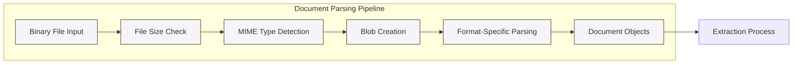
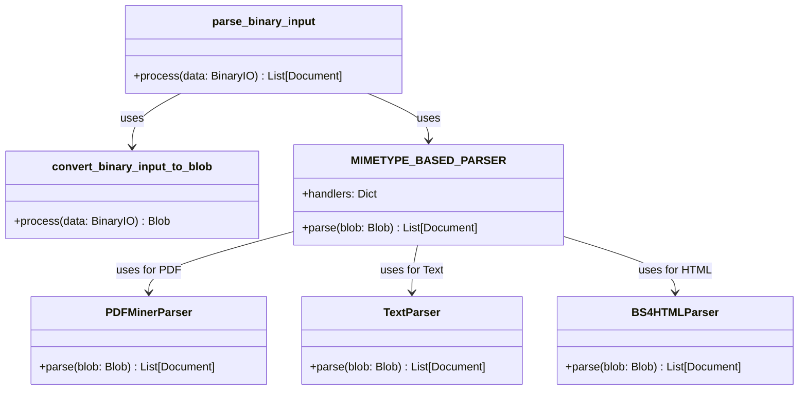
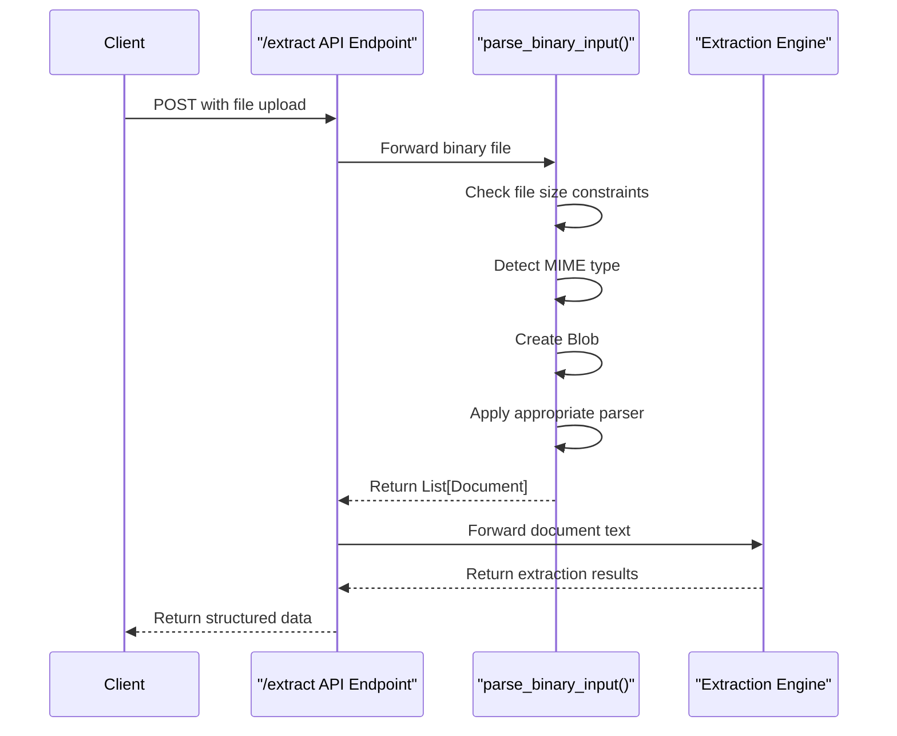
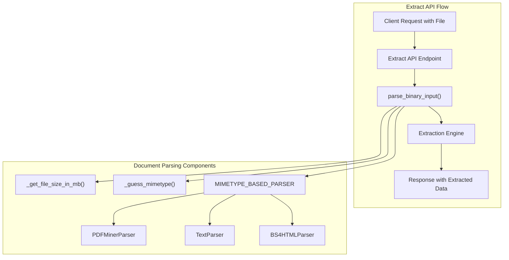

<!-- source: DeepWiki mcp.deepwiki.com · repo langchain-ai/langchain-extract · page 4.3 Document Parsing · fetched 2026-10-26 -->

# Document Parsing

<details>
<summary>Relevant source files</summary>

The following files were used as context for generating this wiki page:

- [backend/extraction/parsing.py](backend/extraction/parsing.py)
- [backend/tests/unit_tests/api/test_api_extract.py](backend/tests/unit_tests/api/test_api_extract.py)

</details>


## Purpose and Scope

This document describes the document parsing subsystem in LangChain Extract, which is responsible for converting uploaded files of various formats into text content that can be processed by the extraction engine. The document parsing functionality acts as the bridge between binary file inputs and the text-based extraction process. For information about how the extracted text is processed, see [Extraction Engine](#4.1).

## Document Parsing Flow

The document parsing system follows a straightforward pipeline that converts binary files into document objects containing extractable text.



Sources: [backend/extraction/parsing.py:83-86](). [backend/extraction/parsing.py:62-80]().

## Document Parsing Components

The document parsing system consists of several key components that work together to process different file types.



Sources: [backend/extraction/parsing.py:56-59](). [backend/extraction/parsing.py:13-24]().

## Supported File Formats

The system can parse the following file types:

| MIME Type | Parser | Description |
|-----------|--------|-------------|
| application/pdf | PDFMinerParser | Extracts text from PDF documents |
| text/plain | TextParser | Processes plain text files |
| text/html | BS4HTMLParser | Extracts text from HTML documents |

Sources: [backend/extraction/parsing.py:13-24]().

## Integration with Extraction Process

Document parsing is integrated with the extraction API endpoint, allowing users to upload files directly for extraction.



Sources: [backend/tests/unit_tests/api/test_api_extract.py:124-140](). [backend/extraction/parsing.py:83-86]().

## Implementation Details

### Key Functions

#### parse_binary_input

The main entry point for document parsing, which handles binary file input and returns parsed documents.

```python
def parse_binary_input(data: BinaryIO) -> List[Document]:
    """Parse binary input."""
    blob = convert_binary_input_to_blob(data)
    return MIMETYPE_BASED_PARSER.parse(blob)
```

Sources: [backend/extraction/parsing.py:83-86]().

#### convert_binary_input_to_blob

Converts binary input to a Blob object, which is a standardized representation of file content used by the parsers.

```python
def convert_binary_input_to_blob(data: BinaryIO) -> Blob:
    """Convert ingestion input to blob."""
    file_size_in_mb = _get_file_size_in_mb(data)

    if file_size_in_mb > MAX_FILE_SIZE_MB:
        raise HTTPException(
            status_code=413,
            detail=f"File size exceeds the maximum limit of {MAX_FILE_SIZE_MB} MB.",
        )

    file_data = data.read()
    mimetype = _guess_mimetype(file_data)
    file_name = data.name

    return Blob.from_data(
        data=file_data,
        path=file_name,
        mime_type=mimetype,
    )
```

Sources: [backend/extraction/parsing.py:62-80]().

### MIME Type Detection

The system uses the `magic` library to automatically detect the MIME type of uploaded files, allowing it to select the appropriate parser.

```python
def _guess_mimetype(file_bytes: bytes) -> str:
    """Guess the mime-type of a file."""
    try:
        import magic
    except ImportError as e:
        raise ImportError(
            "magic package not found, please install it with `pip install python-magic`"
        ) from e

    mime = magic.Magic(mime=True)
    mime_type = mime.from_buffer(file_bytes)
    return mime_type
```

Sources: [backend/extraction/parsing.py:31-42]().

## Constraints and Limitations

### File Size Limits

The system enforces a maximum file size of 10MB to prevent resource exhaustion and ensure system stability.

```python
MAX_FILE_SIZE_MB = 10  # in MB
```

If a file exceeds this limit, an HTTP 413 (Payload Too Large) error is returned to the client.

Sources: [backend/extraction/parsing.py:28](). [backend/extraction/parsing.py:64-70]().

### Parser Configuration

The system uses a configuration of parsers based on MIME types:

```python
HANDLERS = {
    "application/pdf": PDFMinerParser(),
    "text/plain": TextParser(),
    "text/html": BS4HTMLParser(),
    # Disabled parsers commented out in code
    # "application/msword": MsWordParser(),
    # "application/vnd.openxmlformats-officedocument.wordprocessingml.document": MsWordParser(),
}
```

Sources: [backend/extraction/parsing.py:13-24]().

## Document Parsing in the Context of Extract API

The document parsing functionality is used by the `/extract` API endpoint when processing file uploads. The extraction process:

1. Receives a file upload from the client
2. Parses the file into text using `parse_binary_input`
3. Passes the extracted text to the extraction engine
4. Returns the structured extraction results to the client



Sources: [backend/tests/unit_tests/api/test_api_extract.py:124-140](). [backend/extraction/parsing.py:56-59]().

## Testing

The document parsing functionality is tested with unit tests that verify:

- Parsing of temporary files
- File size limit enforcement
- Proper integration with the extraction API

The tests use temporary files and mocks to simulate different file types and sizes.

Sources: [backend/tests/unit_tests/api/test_api_extract.py:124-140](). [backend/tests/unit_tests/api/test_api_extract.py:148-205]().

---

