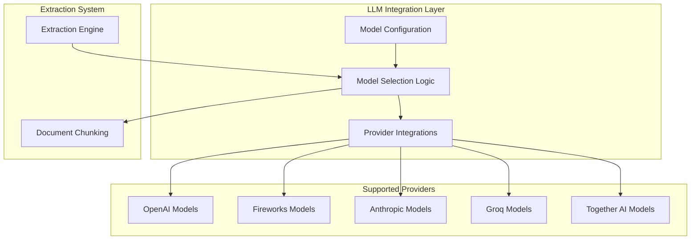
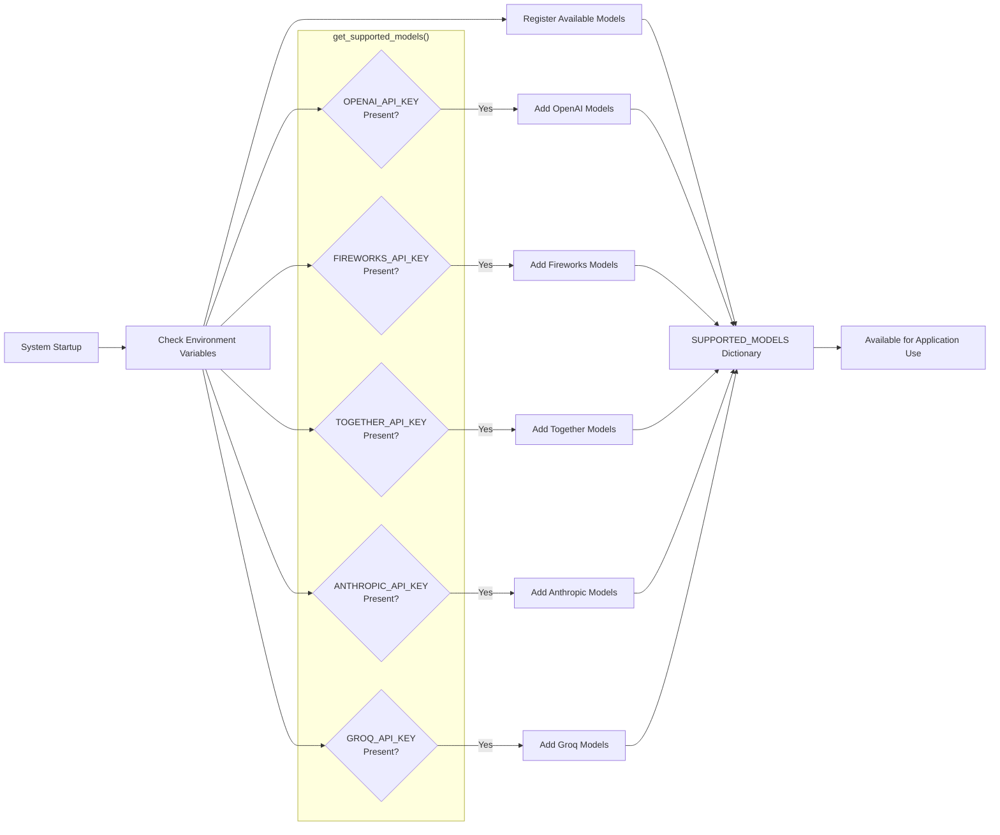
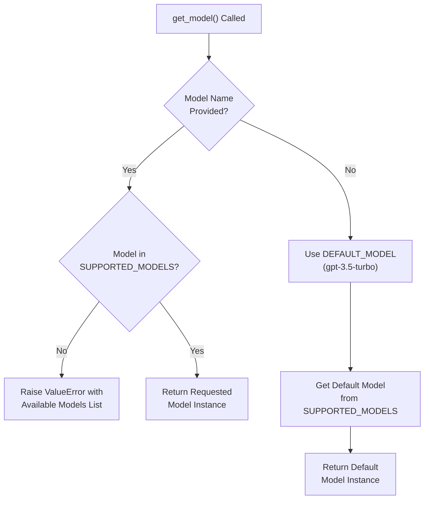
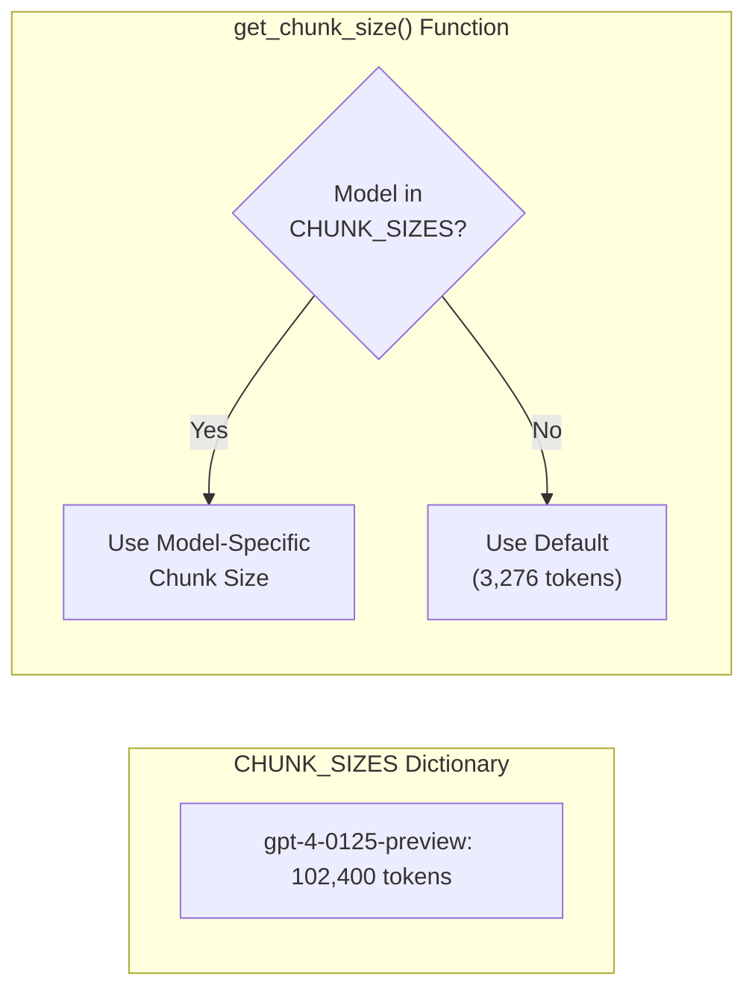
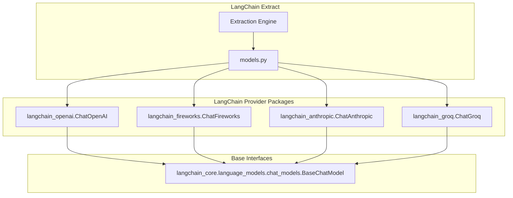
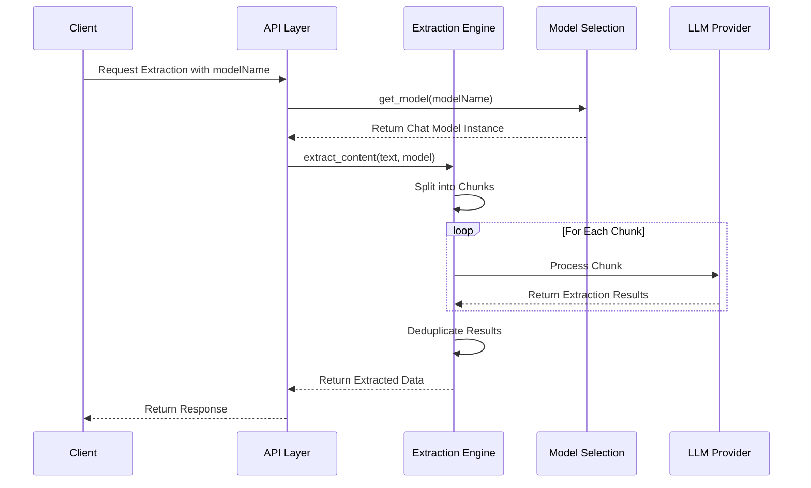

<!-- source: DeepWiki mcp.deepwiki.com · repo langchain-ai/langchain-extract · page 4.4 LLM Integration · fetched 2026-10-26 -->

# LLM Integration

Relevant source files

The following files were used as context for generating this wiki page:

- [backend/poetry.lock](backend/poetry.lock)
- [backend/pyproject.toml](backend/pyproject.toml)
- [backend/server/models.py](backend/server/models.py)
- [backend/tests/unit_tests/fake/test_fake_chat_model.py](backend/tests/unit_tests/fake/test_fake_chat_model.py)

This documentation covers how LangChain Extract integrates with various Language Model (LLM) providers to power its extraction capabilities. The system supports multiple LLM providers through a unified interface, allowing for flexible model selection based on availability and performance requirements.

For information about the core extraction functionality that utilizes these LLMs, see [Extraction Engine](#4.1).

## Overview

LangChain Extract uses a modular approach to integrate with different LLM providers. The system determines available models based on environment variables and provides a consistent interface for model selection and usage throughout the application.

Sources: [backend/server/models.py:1-88]()

## Supported LLM Providers

LangChain Extract supports multiple LLM providers through environment-based configuration:

| Provider | Models | Environment Variable | Description |
|----------|--------|---------------------|-------------|
| OpenAI | gpt-3.5-turbo, gpt-4-0125-preview | OPENAI_API_KEY | OpenAI's GPT models |
| Fireworks | firefunction-v1 | FIREWORKS_API_KEY | Fireworks AI models |
| Together AI | Mixtral-8x7B-Instruct-v0.1 | TOGETHER_API_KEY | Mixtral models via Together API |
| Anthropic | claude-3-sonnet-20240229 | ANTHROPIC_API_KEY | Claude models |
| Groq | llama3-8b-8192 | GROQ_API_KEY | Llama models via Groq |

The system initializes models when the server starts by checking for the presence of specific environment variables.

Sources: [backend/server/models.py:11-57](), [backend/pyproject.toml:17-30]()

## Model Configuration and Management

### Model Discovery and Registration

The system uses a dynamic approach to discover and register available models based on environment variables:

Sources: [backend/server/models.py:11-61]()

### Model Selection Logic

The system provides a function `get_model` that handles model selection based on name or defaults:

Sources: [backend/server/models.py:75-87]()

## Chunk Size Management

The system manages different chunk sizes for different models to optimize performance and stay within context limits:

The system uses a default chunk size of 3,276 tokens (80% of 4,096) for most models, with specific overrides for larger models like GPT-4 which can handle up to 102,400 tokens (80% of 128,000).

Sources: [backend/server/models.py:65-72]()

## Provider-Specific Implementations

Each supported LLM provider is integrated through LangChain's provider-specific packages:

Each provider implementation inherits from the `BaseChatModel` class, providing a consistent interface for the extraction engine to use regardless of the underlying LLM provider.

Sources: [backend/server/models.py:4-8](), [backend/pyproject.toml:17-30]()

## Integration in the Extraction Process

The LLM integration component serves as a critical part of the extraction pipeline:

The extraction engine uses the model selection logic to get the appropriate LLM model, then processes document chunks through that model based on the configured chunk size.

Sources: [backend/server/models.py:75-87]()

## Configuration Examples

To configure LangChain Extract to use different LLM providers, set the appropriate environment variables:

| Provider | Configuration |
|----------|---------------|
| OpenAI | `OPENAI_API_KEY=sk-...` |
| OpenAI with GPT-4 disabled | `OPENAI_API_KEY=sk-...` `DISABLE_GPT4=true` |
| Fireworks | `FIREWORKS_API_KEY=...` |
| Anthropic | `ANTHROPIC_API_KEY=...` |
| Groq | `GROQ_API_KEY=...` |
| Together AI | `TOGETHER_API_KEY=...` |

Multiple providers can be configured simultaneously, giving the system multiple options for model selection.

Sources: [backend/server/models.py:14-56]()

## Summary

The LLM integration in LangChain Extract provides a flexible, modular approach to leveraging various LLM providers. By abstracting provider-specific implementations behind a consistent interface, the system can easily switch between models based on availability, performance requirements, or user preference. This architecture enables the extraction engine to focus on document processing logic without being tightly coupled to any specific LLM provider.

The implementation uses environment variables for configuration, making it easy to deploy with different LLM providers in various environments without code changes.

---

