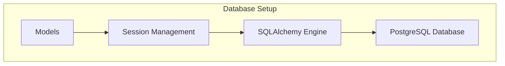
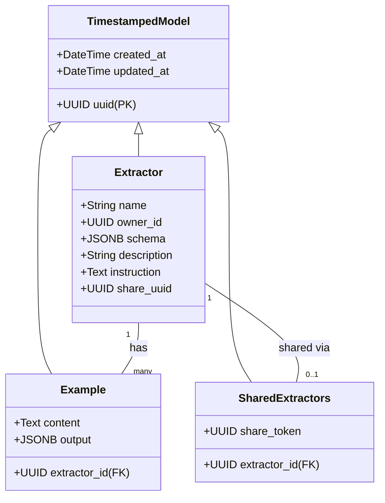
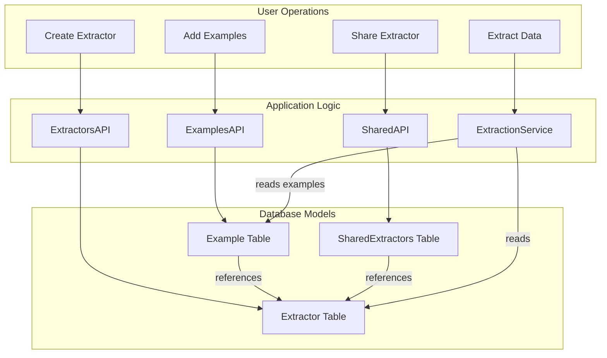

<!-- source: DeepWiki mcp.deepwiki.com · repo langchain-ai/langchain-extract · page 4.5 Database Models · fetched 2026-10-26 -->

# Database Models

<details>
<summary>Relevant source files</summary>

The following files were used as context for generating this wiki page:

- [backend/db/models.py](backend/db/models.py)
- [backend/tests/unit_tests/api/test_api_defining_extractors.py](backend/tests/unit_tests/api/test_api_defining_extractors.py)
- [backend/tests/unit_tests/api/test_api_examples.py](backend/tests/unit_tests/api/test_api_examples.py)

</details>


This document describes the database models used in LangChain Extract, which define the persistent data structures for storing extractors, examples, and shared links. The database schema is implemented using SQLAlchemy ORM with PostgreSQL as the underlying database system.

For information about how these models are accessed through the API, see [API Endpoints](#4.2).

## Database Setup and Configuration

LangChain Extract uses PostgreSQL for data persistence. The database connection is configured using SQLAlchemy, with connection parameters derived from environment variables.



The database connection is established in `models.py` using the PostgreSQL URL from application settings:

```python
ENGINE = create_engine(get_postgres_url())
SessionClass = sessionmaker(bind=ENGINE)
```

A session management function `get_session()` provides a context manager for database operations, handling transaction management and cleanup:

Sources: [backend/db/models.py:26-37]()

## Core Abstract Model

All database models inherit from a base `TimestampedModel` class, which provides common fields and functionality.



### TimestampedModel

The `TimestampedModel` is an abstract base class that provides common fields for all models:

| Field | Type | Description |
|-------|------|-------------|
| uuid | UUID | Primary key, automatically generated |
| created_at | DateTime | When the record was created |
| updated_at | DateTime | When the record was last updated |

This model uses SQLAlchemy's `__abstract__ = True` pattern to provide reusable functionality without creating a database table.

Sources: [backend/db/models.py:40-64]()

## Primary Database Models

The system contains three primary database models, each representing a key entity in the extraction workflow.

### Extractor Model

The `Extractor` model represents a configured extraction definition, including its schema, instructions, and metadata.

| Field | Type | Description |
|-------|------|-------------|
| name | String(100) | The name of the extractor |
| owner_id | UUID | Owner identifier |
| schema | JSONB | JSON Schema defining what should be extracted |
| description | String(100) | User-facing description |
| instruction | Text | Instructions for the language model |
| share_uuid | UUID | Optional UUID for sharing (nullable) |

The extractor contains a one-to-many relationship with `Example` records through the `examples` attribute.

Sources: [backend/db/models.py:135-175]()

### Example Model

The `Example` model stores example inputs and outputs for training extractors, implementing few-shot learning.

| Field | Type | Description |
|-------|------|-------------|
| content | Text | The input portion of the example |
| output | JSONB | The expected output in JSON format |
| extractor_id | UUID | Foreign key to the associated extractor |

The `output` field contains JSON that conforms to the schema defined in the linked extractor.

Sources: [backend/db/models.py:67-101]()

### SharedExtractors Model

The `SharedExtractors` model manages the sharing of extractors between users via unique tokens.

| Field | Type | Description |
|-------|------|-------------|
| extractor_id | UUID | Reference to the extractor being shared |
| share_token | UUID | Unique token for accessing the shared extractor |

This model includes a unique constraint on the combination of `extractor_id` and `share_token`.

Sources: [backend/db/models.py:104-132]()

## Database Relationships and Data Flow

The following diagram illustrates how data flows through the database models during typical operations in the LangChain Extract system:



Sources: [backend/db/models.py](), [backend/tests/unit_tests/api/test_api_defining_extractors.py](), [backend/tests/unit_tests/api/test_api_examples.py]()

## Model Usage Patterns

The database models support several key operations in the LangChain Extract system:

### Extractor Management

Extractors are created with a schema, description, and instructions. The schema defines the structure of data to extract, while the instructions guide the LLM in performing the extraction. Each extractor is associated with an owner via the `owner_id` field.

Test cases show typical creation and management patterns:

```python
# Create an extractor
create_request = {
    "name": "my extractor",
    "description": "Test Description",
    "schema": {"type": "object"},
    "instruction": "Test Instruction",
}
response = await client.post("/extractors", json=create_request, headers=headers)
```

Sources: [backend/tests/unit_tests/api/test_api_defining_extractors.py:84-96]()

### Example Management

Examples provide sample inputs and expected outputs for an extractor, improving extraction accuracy through few-shot learning. Each example is linked to an extractor through the `extractor_id` foreign key.

```python
# Create an example
create_request = {
    "extractor_id": extractor_id,
    "content": "Test Content",
    "output": [
        {
            "age": 100,
            "name": "Grung",
        }
    ],
}
response = await client.post("/examples", json=create_request, headers=headers)
```

Sources: [backend/tests/unit_tests/api/test_api_examples.py:40-52]()

### Extractor Sharing

The system allows sharing extractors via unique tokens, stored in the `SharedExtractors` table. This enables collaboration while controlling access.

```python
# Generate a share UUID
response = await client.post(f"/extractors/{uuid_str}/share", headers=headers)
share_uuid = response.json()["share_uuid"]

# Retrieve the shared extractor
response = await client.get(f"/shared/extractors/{share_uuid}")
```

Sources: [backend/tests/unit_tests/api/test_api_defining_extractors.py:126-156]()

## Database Security Model

The database implements a basic ownership model where each extractor is associated with an owner through the `owner_id` field. API endpoints validate ownership before allowing operations on extractors, as seen in the `validate_extractor_owner` function:

```python
def validate_extractor_owner(
    session: Session, extractor_id: UUID, user_id: UUID
) -> Extractor:
    """Validate the extractor id."""
    extractor = (
        session.query(Extractor).filter_by(uuid=extractor_id, owner_id=user_id).first()
    )
    return extractor is not None
```

Sources: [backend/db/models.py:178-185]()

---

