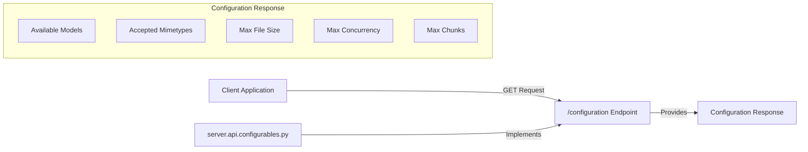
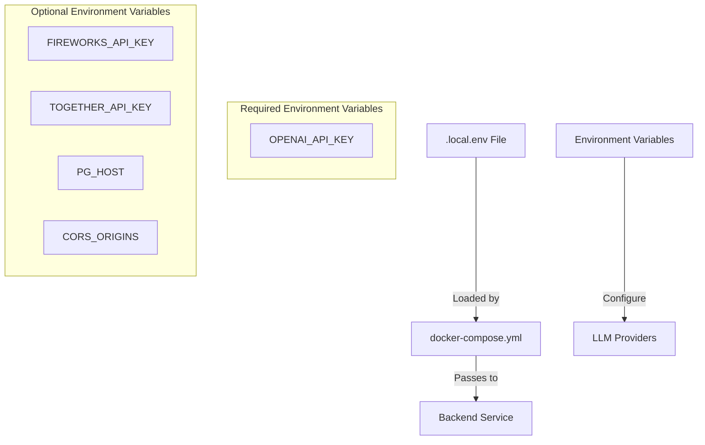
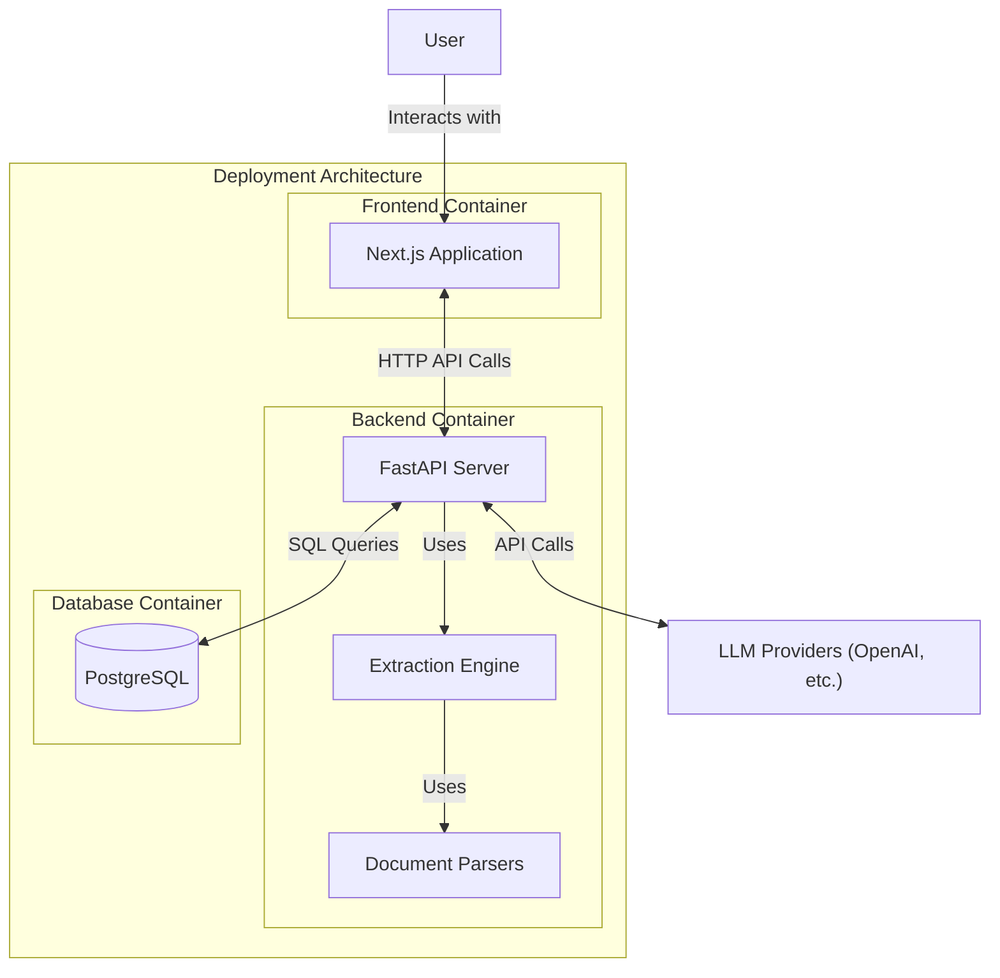
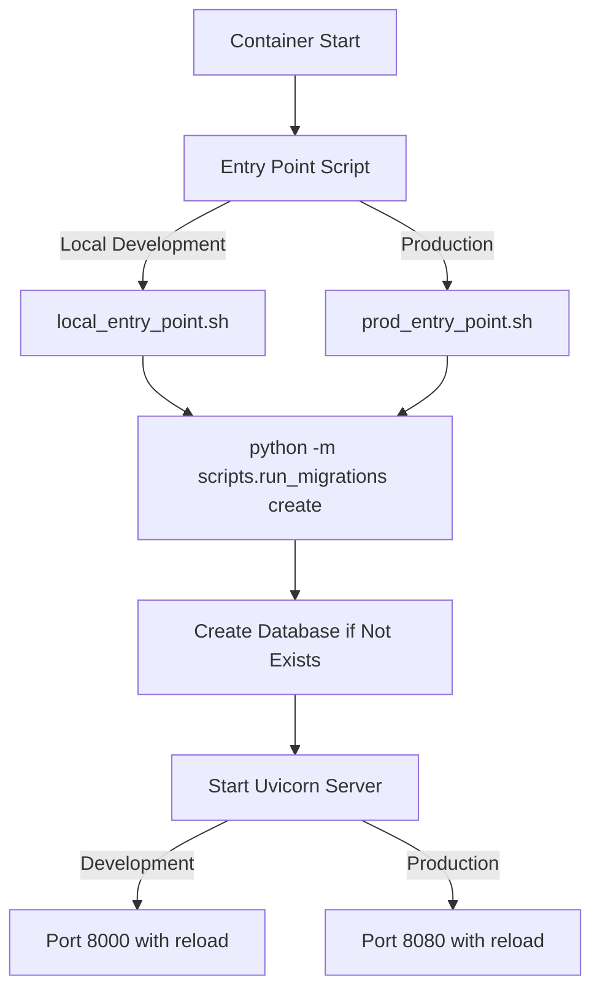

<!-- source: DeepWiki mcp.deepwiki.com · repo langchain-ai/langchain-extract · page 5 Configuration & Deployment · fetched 2026-10-26 -->

# Configuration & Deployment

<details>
<summary>Relevant source files</summary>

The following files were used as context for generating this wiki page:

- [.gitignore](.gitignore)
- [Dockerfile](Dockerfile)
- [README.md](README.md)
- [backend/Dockerfile](backend/Dockerfile)
- [backend/scripts/local_entry_point.sh](backend/scripts/local_entry_point.sh)
- [backend/scripts/prod_entry_point.sh](backend/scripts/prod_entry_point.sh)
- [backend/server/api/configurables.py](backend/server/api/configurables.py)
- [backend/tests/unit_tests/api/test_api_configuration.py](backend/tests/unit_tests/api/test_api_configuration.py)
- [backend/tests/unit_tests/test_parsing.py](backend/tests/unit_tests/test_parsing.py)
- [docker-compose.yml](docker-compose.yml)

</details>


This document covers how to configure and deploy the LangChain Extract system. It includes details about environment variables, system settings, deployment options, and infrastructure components. For information about the overall system architecture, please refer to [Architecture](#2).

## 1. System Configuration

LangChain Extract provides several configuration options that control the behavior of the extraction system, model selection, and system limits.

### 1.1 Configuration Endpoint

The system exposes a `/configuration` endpoint that provides information about the current server configuration:



Sources: [backend/server/api/configurables.py:1-46]()

The configuration response includes the following information:

| Configuration Item | Description |
|-------------------|-------------|
| `available_models` | List of supported language models |
| `models` | Detailed information about each model |
| `accepted_mimetypes` | Supported document types |
| `max_file_size_mb` | Maximum file size in MB |
| `max_concurrency` | Maximum number of concurrent extraction processes |
| `max_chunks` | Maximum number of text chunks for extraction |

Sources: [backend/server/api/configurables.py:19-26](), [backend/server/api/configurables.py:29-45]()

### 1.2 Environment Variables

LangChain Extract requires specific environment variables to be set for proper functionality:



Required environment variables:
- `OPENAI_API_KEY`: API key for OpenAI services

Optional environment variables:
- `FIREWORKS_API_KEY`: API key for Fireworks AI
- `TOGETHER_API_KEY`: API key for Together AI
- `PG_HOST`: PostgreSQL host name (defaults to "postgres" in Docker Compose)
- `CORS_ORIGINS`: CORS allowed origins (e.g., `http://localhost:3000` for development)

Sources: [README.md:162-169](), [docker-compose.yml:30-36]()

## 2. Deployment Architecture

LangChain Extract follows a three-tier architecture with containerized services:



Sources: [docker-compose.yml:1-59](), [README.md:184-185]()

### 2.1 Container Components

LangChain Extract consists of three main container components:

| Container | Description | Port |
|-----------|-------------|------|
| `postgres` | PostgreSQL database for storing extractors and examples | 5432 |
| `backend` | FastAPI application providing the API endpoints | 8000 (dev), 8080 (prod) |
| `frontend` | Next.js application providing the user interface | 3000 |

Sources: [docker-compose.yml:4-56](), [Dockerfile:37-38](), [backend/Dockerfile:37]()

## 3. Deployment Options

### 3.1 Docker Compose Deployment (Recommended)

The easiest way to deploy LangChain Extract is using Docker Compose:

1. Create a `.local.env` file with required environment variables:
   ```
   OPENAI_API_KEY=your_openai_api_key
   # Optional: FIREWORKS_API_KEY=your_fireworks_api_key
   # Optional: TOGETHER_API_KEY=your_together_api_key
   ```

2. Build the Docker images:
   ```bash
   docker compose build
   ```

3. Run the services:
   ```bash
   docker compose up
   ```

4. Access the application:
   - Frontend: http://localhost:3000
   - Backend API: http://localhost:8000
   - API Documentation: http://localhost:8000/docs

Sources: [README.md:160-184](), [docker-compose.yml:1-59]()

### 3.2 Development Setup

For local development without Docker:

1. Install Poetry (Python dependency manager)
2. Navigate to the `backend` directory
3. Install dependencies:
   ```bash
   poetry install --with lint,dev,test
   ```
4. Initialize the database:
   ```bash
   python -m scripts.run_migrations create
   ```
5. Start the backend server:
   ```bash
   OPENAI_API_KEY=your_api_key python -m server.main
   ```

Sources: [README.md:203-227]()

## 4. Database Management

### 4.1 Database Initialization

The system automatically initializes the database on startup using the entry point scripts:



Sources: [backend/scripts/local_entry_point.sh:1-11](), [backend/scripts/prod_entry_point.sh:1-11]()

### 4.2 Database Configuration

The PostgreSQL database is configured with the following default settings:

| Setting | Value |
|---------|-------|
| Database Name | langchain |
| Username | langchain |
| Password | langchain |
| Host | postgres (container name) |
| Port | 5432 |

Data persistence is handled through a Docker volume (`postgres_data`).

Sources: [docker-compose.yml:4-23]()

## 5. Supported File Types and Limits

The system supports various file types for extraction and has specific limits on file size and processing capacity:

### 5.1 Supported File Types

The following MIME types are supported:

- `application/pdf`: PDF documents
- `text/html`: HTML documents
- `text/plain`: Plain text documents

Sources: [backend/tests/unit_tests/test_parsing.py:15-23]()

### 5.2 System Limits

The system enforces the following limits:

- Maximum file size: Configured via `MAX_FILE_SIZE_MB` (default varies)
- Maximum concurrency: Configured via `MAX_CONCURRENCY` (controls parallel extraction processes)
- Maximum chunks: Configured via `MAX_CHUNKS` (limits the number of text chunks processed in a single extraction)

These limits are exposed through the `/configuration` endpoint.

Sources: [backend/server/api/configurables.py:7-9](), [backend/server/api/configurables.py:32-44]()

## 6. Security Considerations

The LangChain Extract system does not implement robust user authentication or authorization. Instead, it uses a basic user ID system:

- Users generate a UUID to identify themselves
- This ID should be treated as a secret
- It is passed in the `x-key` header when making API requests
- Access to extractors and examples is controlled via this ID

For production deployments, you should consider implementing proper authentication and authorization mechanisms.

Sources: [README.md:58-63]()

## 7. Production Deployment Considerations

For production deployments, consider the following:

1. **Security**: Implement proper authentication and authorization
2. **Environment Variables**: Secure storage of API keys and credentials
3. **Database Backup**: Regular backups of the PostgreSQL database
4. **Scaling**: Adjust concurrency settings based on your infrastructure capacity
5. **Monitoring**: Add logging and monitoring for system performance
6. **API Rate Limiting**: Implement rate limiting to prevent abuse

The production container exposes port 8080 (instead of 8000 used in development).

Sources: [Dockerfile:37-44](), [backend/scripts/prod_entry_point.sh:10]()

---

