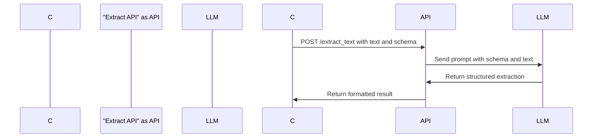
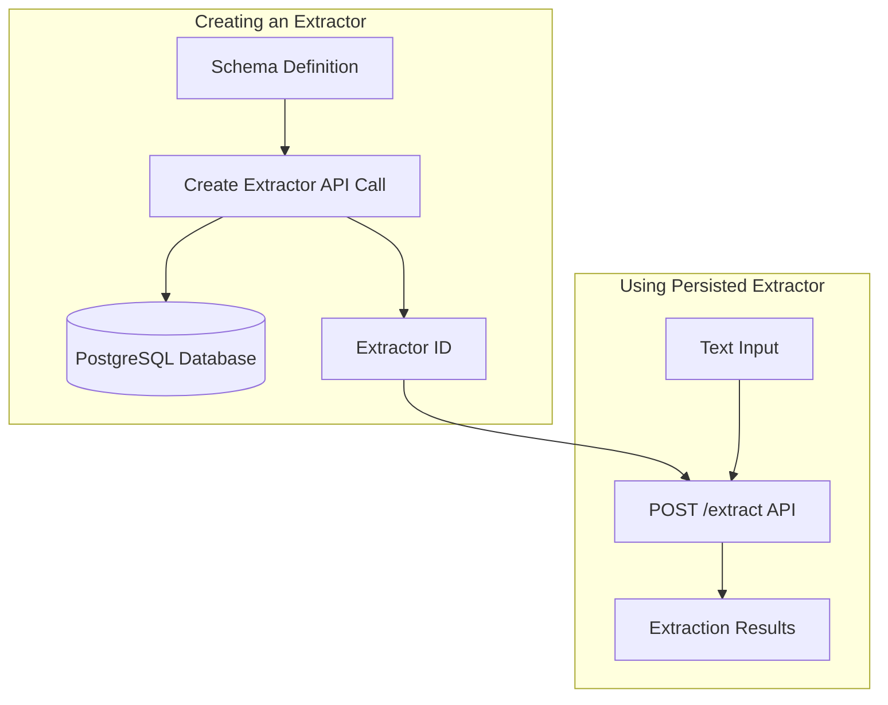
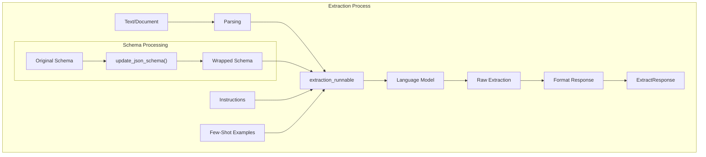
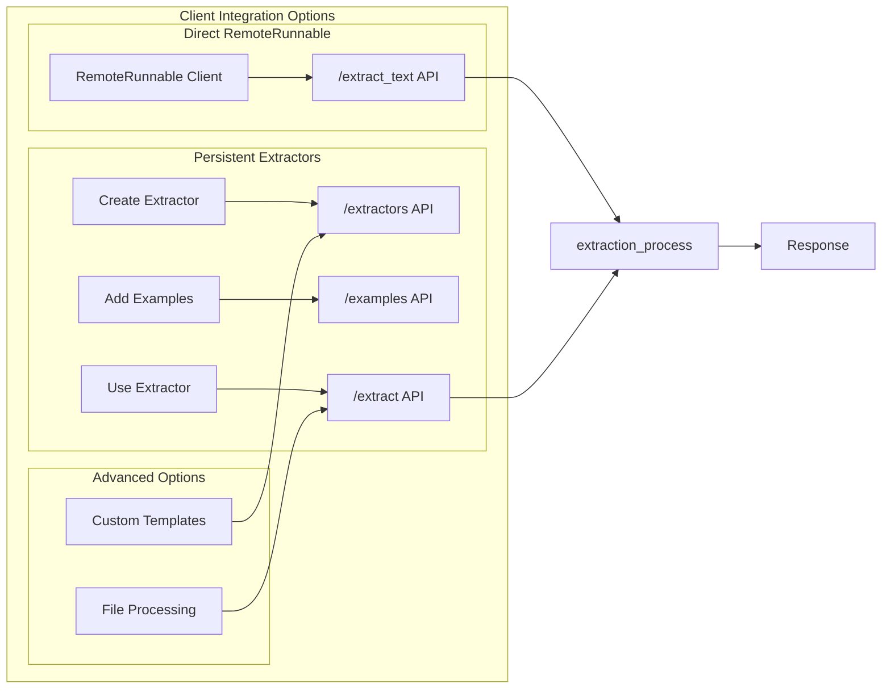

<!-- source: DeepWiki mcp.deepwiki.com · repo langchain-ai/langchain-extract · page 6 Usage Examples · fetched 2026-10-26 -->

# Usage Examples

<details>
<summary>Relevant source files</summary>

The following files were used as context for generating this wiki page:

- [backend/extraction/utils.py](backend/extraction/utils.py)
- [backend/tests/integration_tests/test_extraction.py](backend/tests/integration_tests/test_extraction.py)
- [docs/source/notebooks/earnings_call_example.ipynb](docs/source/notebooks/earnings_call_example.ipynb)
- [docs/source/notebooks/quick_start.ipynb](docs/source/notebooks/quick_start.ipynb)

</details>


This page provides practical examples of how to use LangChain Extract for extracting structured information from unstructured text and documents. It demonstrates different extraction scenarios, including schema design, few-shot learning, and document processing. For information about schema design specifically, see [Schema Design](#6.1).

## Basic Extraction

LangChain Extract allows you to extract structured data from text by defining a schema and using LLMs to identify and extract information matching that schema.

### Using the RemoteRunnable Client

The simplest way to use the extraction service is through the `RemoteRunnable` client:

```python
from langserve import RemoteRunnable
from pydantic import BaseModel, Field
from typing import Optional

# Define your extraction schema
class Person(BaseModel):
    age: Optional[int] = Field(None, description="The age of the person in years.")
    name: Optional[str] = Field(None, description="The name of the person.")

# Create a client to the extraction service
runnable = RemoteRunnable("http://localhost:8000/extract_text/")

# Define your text
text = """
My name is Chester. I am 42 years old. My friend Jane is a year older than me.
"""

# Extract data
response = runnable.invoke({"text": text, "schema": Person.schema()})
# Result: {'data': [{'name': 'Chester', 'age': 42}]}
```

Sources: [docs/source/notebooks/quick_start.ipynb:1-88]()

### Extraction Process



Sources: [docs/source/notebooks/quick_start.ipynb:42-88](), [backend/tests/integration_tests/test_extraction.py:32-87]()

## Enhancing Extraction with Instructions

You can customize extraction behavior by providing specific instructions:

```python
instructions = "Redact all names using the characters `######`"

response = runnable.invoke({
    "text": text,
    "schema": Person.schema(),
    "instructions": instructions,
})
# Result: {'data': [{'name': '######', 'age': 42}]}
```

Sources: [docs/source/notebooks/quick_start.ipynb:91-128](), [backend/tests/integration_tests/test_extraction.py:55-67]()

## Few-Shot Learning with Examples

Adding examples significantly improves extraction quality by demonstrating the expected output format and handling special cases:

```python
instructions = "Redact all names using the characters `######`"
examples = [
    {
        "text": "My name is Grung. I am 100.",
        "output": [ {"age": 100, "name": "######"} ],
    }
]

response = runnable.invoke({
    "text": text,
    "schema": Person.schema(),
    "instructions": instructions,
    "examples": examples,
})
# Result: {'data': [{'name': '######', 'age': 42}, {'name': 'Jane', 'age': 43}]}
```

This example shows how adding an example improved extraction by:
1. Properly redacting the name as instructed
2. Extracting both people mentioned in the text

Sources: [docs/source/notebooks/quick_start.ipynb:132-175](), [backend/tests/integration_tests/test_extraction.py:69-87]()

## Creating and Persisting Extractors

For repeated use, you can create and store extractors in the database:



### Creating an Extractor

```python
import requests
from uuid import uuid4

url = "http://localhost:8000"
user_id = str(uuid4())  # indicates owner for extractor
headers = {"x-key": user_id}

data = {
    "name": "people_extractor",
    "description": "Extract references to people, having properties name and age.",
    "schema": Person.schema(),
    "instruction": "Redact all names using the characters `######`",
}

response = requests.post(f"{url}/extractors", json=data, headers=headers)
uuid = response.json()['uuid']
```

Sources: [docs/source/notebooks/quick_start.ipynb:182-262]()

### Adding Examples to Extractors

```python
examples = [
    {
        "text": "My name is Grung. I am 100.",
        "output": [Person(age=100, name="######").dict()],
    }
]

for example in examples:
    create_request = {
        "extractor_id": uuid,
        "content": example["text"],
        "output": example['output'],
    }
    response = requests.post(f"{url}/examples", json=create_request, headers=headers)
```

Sources: [docs/source/notebooks/quick_start.ipynb:269-299]()

### Using a Persisted Extractor

```python
request_data = {"extractor_id": uuid, "text": text}
response = requests.post(f"{url}/extract", data=request_data, headers=headers)
# Result: {"data":[{"name":"######","age":42},{"name":"######","age":43}]}
```

Sources: [docs/source/notebooks/quick_start.ipynb:358-427]()

## Real-World Example: Earnings Call Data Extraction

This section demonstrates a practical application of LangChain Extract for extracting financial data from an earnings call transcript.

### Designing the Financial Data Schema

```python
from pydantic import BaseModel, Field

class FinancialData(BaseModel):
    name: str = Field(..., description="Name of the financial figure, such as revenue.")
    value: int = Field(..., description="Nominal earnings in local currency.")
    scale: str = Field(..., description="Scale of figure, such as MM, B, or percent.")
    period_start: str = Field(..., description="The start of the time period in ISO format.")
    period_duration: int = Field(..., description="Duration of period, in months")
    evidence: str = Field(..., description="Verbatim sentence of text where figure was found.")
```

The `evidence` field is particularly important as it provides context for verification of the extracted data.

Sources: [docs/source/notebooks/earnings_call_example.ipynb:8-67](), [docs/source/notebooks/earnings_call_example.ipynb:87-110]()

### Creating a Financial Data Extractor

```python
data = {
    "user_id": user_id,
    "description": "Financial revenues and other figures.",
    "schema": FinancialData.schema(),
    "instruction": (
        "Extract standard financial figures, specifically earnings and "
        "revenue figures."
    )
}

response = requests.post(f"{url}/extractors", json=data, headers=headers)
extractor = response.json()
```

Sources: [docs/source/notebooks/earnings_call_example.ipynb:102-134]()

### Extracting Data from PDF Documents

```python
# Get PDF bytes from a URL
pdf_url = "https://s23.q4cdn.com/407969754/files/doc_earnings/2023/q4/transcript/Uber-Q4-23-Prepared-Remarks.pdf"
pdf_response = requests.get(pdf_url)
pdf_bytes = pdf_response.content

# Extract data from PDF
result = requests.post(
    f"{url}/extract",
    data={"extractor_id": extractor["uuid"]},
    files={"file": pdf_bytes},
    headers=headers,
)
```

Initial extraction results without examples:

```json
{
  "data": [
    {
      "name": "Adjusted EBITDA",
      "scale": "million",
      "value": 1300,
      "evidence": "Q4 was a standout quarter to cap off a standout year... translated to $1.3 billion in Adjusted EBITDA",
      "period_start": "2023-10-01",
      "period_duration": 3
    },
    {
      "name": "GAAP operating income",
      "scale": "million",
      "value": 652,
      "evidence": "translated to $1.3 billion in Adjusted EBITDA and $652 million in GAAP operating income",
      "period_start": "2023-10-01",
      "period_duration": 3
    }
    // Additional financial data...
  ]
}
```

Sources: [docs/source/notebooks/earnings_call_example.ipynb:38-54](), [docs/source/notebooks/earnings_call_example.ipynb:135-219]()

### Improving Extraction with Few-Shot Examples

```python
examples = [
    {
        "text": "In 2022, Revenue was $1 million and EBIT was $2M.",
        "output": [
            FinancialData(
                name="revenue",
                value=1,
                scale="MM",
                period_start="2022-01-01",
                period_duration=12,
                evidence="In 2022, Revenue was $1 million and EBIT was $2M.",
            ).dict(),
            FinancialData(
                name="ebit",
                value=2,
                scale="MM",
                period_start="2022-01-01",
                period_duration=12,
                evidence="In 2022, Revenue was $1 million and EBIT was $2M.",
            ).dict()
        ],
    },
]

for example in examples:
    create_request = {
        "extractor_id": extractor["uuid"],
        "content": example["text"],
        "output": example['output'],
    }
    response = requests.post(f"{url}/examples", json=create_request, headers=headers)
```

Enhanced extraction results with examples:

```json
{
  "data": [
    {
      "name": "adjusted ebitda",
      "scale": "MM",
      "value": 1300,
      "evidence": "These strong top-line trends, combined with continued rigor on costs, translated to $1.3 billion in Adjusted EBITDA and $652 million in GAAP operating income.",
      "period_start": "2023-10-01",
      "period_duration": 3
    },
    {
      "name": "revenue",
      "scale": "MM",
      "value": 9900,
      "evidence": "We grew our revenue by 13% YoY on a constant-currency basis to $9.9 billion.",
      "period_start": "2023-10-01",
      "period_duration": 3
    }
    // Additional standardized financial data...
  ]
}
```

The examples improved extraction quality by:
1. Standardizing scale notation (using "MM" instead of "million")
2. Normalizing financial metric names (lowercase)
3. Providing complete evidence sentences

Sources: [docs/source/notebooks/earnings_call_example.ipynb:239-308](), [docs/source/notebooks/earnings_call_example.ipynb:317-353]()

## Internal Architecture for Processing Extractions



The core of the extraction process involves:

1. **Schema Processing**: Schemas are processed by the `update_json_schema()` function in [backend/extraction/utils.py:23-47]() to standardize the format and add support for multiple records.

2. **Parsing**: Documents are parsed to extract text content.

3. **extraction_runnable**: Combines the schema, instructions, examples, and text to create a prompt for the LLM.

4. **LLM Processing**: The language model extracts structured data based on the prompt.

5. **Response Formatting**: Results are formatted according to the defined schema.

Sources: [backend/extraction/utils.py:23-47]()

## Extract API Integration Patterns



This diagram shows the different ways to integrate with the Extract API:

1. **Direct RemoteRunnable**: Simple one-off extractions using the `/extract_text` endpoint
2. **Persistent Extractors**: Creating and reusing extractors with the `/extractors` and `/extract` endpoints
3. **Advanced Options**: Handling file uploads and customizing extraction

Sources: [docs/source/notebooks/quick_start.ipynb:1-88](), [docs/source/notebooks/quick_start.ipynb:182-427](), [docs/source/notebooks/earnings_call_example.ipynb:135-219]()

## Best Practices for Effective Extraction

Based on the examples provided, here are some best practices for using LangChain Extract effectively:

| Best Practice | Description | Example |
|---------------|-------------|---------|
| **Include descriptions in schema fields** | Add detailed descriptions to schema fields to guide the LLM | `Field(..., description="Nominal earnings in local currency.")` |
| **Use few-shot examples** | Provide examples to demonstrate desired output format | See examples section above |
| **Include evidence fields** | Add fields to capture the source text for verification | `evidence: str = Field(..., description="Verbatim sentence of text where figure was found.")` |
| **Provide specific instructions** | Give clear instructions to handle edge cases | `"Redact all names using the characters `######`"` |
| **Normalize output format** | Use examples to standardize output formats | Converting "million" to "MM" in financial data |
| **Validate results** | Check extracted data against evidence for accuracy | Compare extracted values with evidence text |

Sources: [docs/source/notebooks/earnings_call_example.ipynb:239-353](), [docs/source/notebooks/quick_start.ipynb:132-175]()

## Common Extraction Scenarios

| Scenario | Schema Example | Notes |
|----------|---------------|-------|
| **Person Information** | `class Person(BaseModel): name: str, age: int` | Useful for extracting biographical information |
| **Financial Data** | `class FinancialData(BaseModel): name: str, value: int, scale: str` | Extract figures from financial documents |
| **Event Details** | `class Event(BaseModel): name: str, date: str, location: str` | Extract event information from announcements |
| **Product Information** | `class Product(BaseModel): name: str, price: float, features: List[str]` | Extract product details from descriptions |
| **Contact Information** | `class Contact(BaseModel): name: str, email: str, phone: str` | Extract contact details from documents |

Sources: [docs/source/notebooks/quick_start.ipynb:32-38](), [docs/source/notebooks/earnings_call_example.ipynb:87-97]()

---

