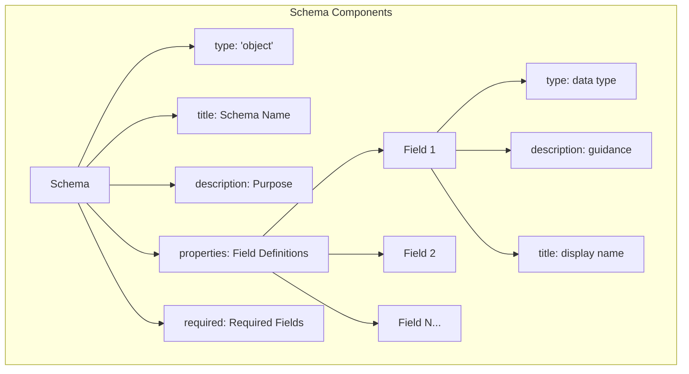
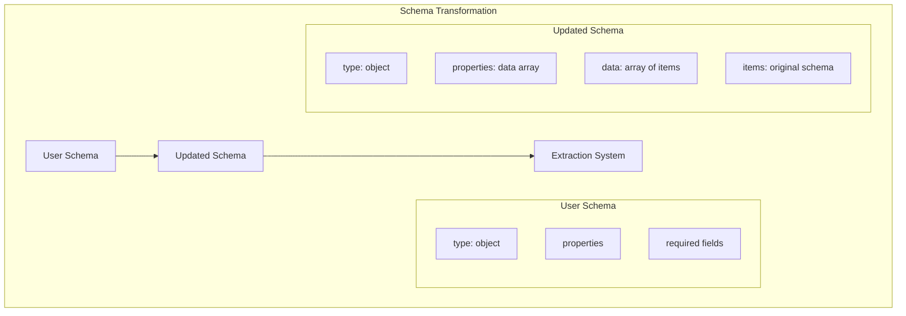
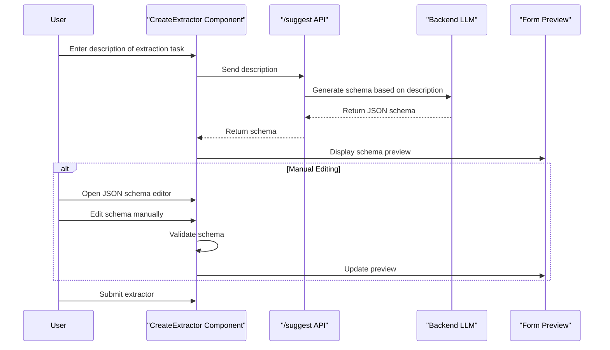
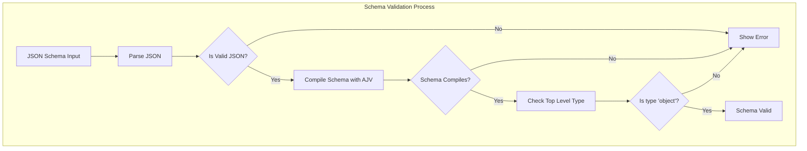
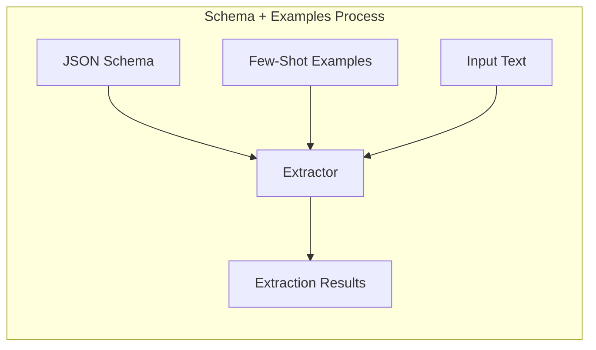
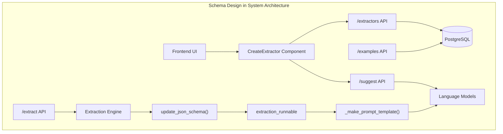

<!-- source: DeepWiki mcp.deepwiki.com · repo langchain-ai/langchain-extract · page 6.1 Schema Design · fetched 2026-10-26 -->

# Schema Design

<details>
<summary>Relevant source files</summary>

The following files were used as context for generating this wiki page:

- [backend/tests/unit_tests/test_utils.py](backend/tests/unit_tests/test_utils.py)
- [docs/source/notebooks/earnings_call_example.ipynb](docs/source/notebooks/earnings_call_example.ipynb)
- [docs/source/notebooks/quick_start.ipynb](docs/source/notebooks/quick_start.ipynb)
- [frontend/app/components/CreateExtractor.tsx](frontend/app/components/CreateExtractor.tsx)
- [frontend/package.json](frontend/package.json)
- [frontend/yarn.lock](frontend/yarn.lock)

</details>


This page provides a comprehensive guide to designing effective extraction schemas for LangChain Extract. Schemas define the structure of data you want to extract from unstructured text, serving as a blueprint that guides the LLM's extraction process.

## Purpose and Scope

This document covers:
- Schema structure and components
- Best practices for effective schema design
- Examples of different schema patterns
- How schemas are transformed during extraction

For information about the overall extraction process and how schemas are applied, see [Extraction Engine](#4.1).

## Understanding Schema Structure

In LangChain Extract, schemas follow the JSON Schema specification with some additional conventions specific to extraction tasks. At the core, a schema defines the properties you want to extract from text.

### Basic Schema Components

A schema contains the following key elements:



Sources: [backend/tests/unit_tests/test_utils.py:11-33](), [docs/source/notebooks/quick_start.ipynb:33-37](), [docs/source/notebooks/earnings_call_example.ipynb:91-97]()

### Schema Definition Methods

Schemas can be defined in two primary ways:

1. **Pydantic Model Approach** - Used for programmatic API interactions:
   ```python
   from pydantic import BaseModel, Field
   
   class Person(BaseModel):
       name: str = Field(..., description="The name of the person.")
       age: int = Field(..., description="The age of the person.")
   
   schema = Person.schema()
   ```

2. **Direct JSON Approach** - Used in the web interface, supports JSON Schema specification:
   ```json
   {
     "type": "object",
     "title": "Person",
     "properties": {
       "name": {
         "type": "string",
         "description": "The name of the person."
       },
       "age": {
         "type": "integer",
         "description": "The age of the person."
       }
     },
     "required": ["name", "age"]
   }
   ```

Sources: [backend/tests/unit_tests/test_utils.py:11-33](), [docs/source/notebooks/quick_start.ipynb:33-37](), [docs/source/notebooks/earnings_call_example.ipynb:91-97]()

## Schema Transformation Process

When a schema is submitted to the extraction system, it undergoes a transformation to prepare it for the extraction process:



The transformation wraps the original schema in a structure with a `data` array to support multiple extractions:

```json
{
  "type": "object",
  "properties": {
    "data": {
      "type": "array",
      "items": {
        // Original schema
      }
    }
  },
  "required": ["data"],
  "title": "extractor",
  "description": "Extract information matching the given schema."
}
```

Sources: [backend/tests/unit_tests/test_utils.py:35-63]()

## Best Practices for Schema Design

### 1. Clear Field Descriptions

The field descriptions are critical to guiding the LLM. They should be:
- Specific and unambiguous
- Include format expectations
- Mention acceptable values or ranges

```
"description": "The age of the person in years (whole number)."
```

### 2. Choose Appropriate Field Types

Use the appropriate JSON Schema data types:
- `string`: For text values
- `integer`: For whole numbers
- `number`: For decimal values
- `boolean`: For true/false values
- `array`: For lists
- `object`: For nested structures

### 3. Specify Required vs. Optional Fields

Mark fields as required when they must be extracted:

```json
{
  "type": "object",
  "properties": { ... },
  "required": ["name", "age"]
}
```

### 4. Use Nested Structures When Appropriate

For complex data, use nested objects:

```json
{
  "type": "object",
  "properties": {
    "person": {
      "type": "object",
      "properties": {
        "name": { "type": "string" },
        "contact": {
          "type": "object",
          "properties": {
            "email": { "type": "string" },
            "phone": { "type": "string" }
          }
        }
      }
    }
  }
}
```

### 5. Include Evidence Fields

For verification purposes, include evidence fields to capture the source text:

```json
{
  "type": "object",
  "properties": {
    "claim": { "type": "string" },
    "evidence": { 
      "type": "string",
      "description": "The exact text from the document supporting this claim."
    }
  }
}
```

Sources: [docs/source/notebooks/earnings_call_example.ipynb:91-97]()

## Schema Design Patterns

### Pattern: Simple Entity Extraction

Best for extracting basic entities like people, companies, or locations:

```json
{
  "type": "object",
  "title": "Person",
  "properties": {
    "name": {
      "type": "string",
      "description": "Full name of the person."
    },
    "age": {
      "type": "integer",
      "description": "Age in years."
    }
  }
}
```

### Pattern: Financial Data Extraction

Suitable for extracting structured financial information:

```json
{
  "type": "object",
  "title": "FinancialData",
  "properties": {
    "name": {
      "type": "string", 
      "description": "Name of the financial figure, such as revenue."
    },
    "value": {
      "type": "number",
      "description": "Nominal earnings in local currency."
    },
    "scale": {
      "type": "string",
      "description": "Scale of figure, such as MM, B, or percent."
    },
    "period_start": {
      "type": "string",
      "description": "The start of the time period in ISO format."
    },
    "period_duration": {
      "type": "integer",
      "description": "Duration of period, in months"
    },
    "evidence": {
      "type": "string",
      "description": "Verbatim sentence of text where figure was found."
    }
  }
}
```

Sources: [docs/source/notebooks/earnings_call_example.ipynb:91-97]()

### Pattern: Relationship Extraction

For extracting relationships between entities:

```json
{
  "type": "object",
  "title": "Relationship",
  "properties": {
    "entity1": {
      "type": "string",
      "description": "First entity in relationship"
    },
    "entity2": {
      "type": "string",
      "description": "Second entity in relationship"
    },
    "relation_type": {
      "type": "string",
      "description": "Type of relationship between entities"
    }
  }
}
```

## Schema Creation Flow

The frontend application supports schema creation through two approaches - automatic suggestion and manual editing:



Sources: [frontend/app/components/CreateExtractor.tsx:48-221]()

## Schema Validation

The system validates schemas to ensure they are well-formed:



Sources: [frontend/app/components/CreateExtractor.tsx:80-93]()

## Enhancing Extraction with Examples

While schemas define the structure, examples provide context for how data should be extracted. Examples dramatically improve extraction quality by demonstrating the desired output:



An example pairs input text with the expected structured output:

```python
examples = [
    {
        "text": "In 2022, Revenue was $1 million and EBIT was $2M.",
        "output": [
            {
                "name": "revenue",
                "value": 1,
                "scale": "MM",
                "period_start": "2022-01-01",
                "period_duration": 12,
                "evidence": "In 2022, Revenue was $1 million and EBIT was $2M."
            },
            {
                "name": "ebit",
                "value": 2,
                "scale": "MM",
                "period_start": "2022-01-01",
                "period_duration": 12,
                "evidence": "In 2022, Revenue was $1 million and EBIT was $2M."
            }
        ]
    }
]
```

Sources: [docs/source/notebooks/earnings_call_example.ipynb:240-274](), [docs/source/notebooks/quick_start.ipynb:158-165](), [backend/tests/unit_tests/test_utils.py:66-103]()

## Technical Implementation

The schema design system interacts with several components in the LangChain Extract architecture:



Key system components involved:
- **Frontend**: `CreateExtractor.tsx` provides UI for schema creation
- **APIs**: `/extractors`, `/examples`, `/suggest` endpoints manage schemas
- **Utils**: `update_json_schema()` transforms schemas for extraction
- **Extraction**: `extraction_runnable` uses schemas to guide LLMs

Sources: [frontend/app/components/CreateExtractor.tsx:48-221](), [backend/tests/unit_tests/test_utils.py:8-103]()

## Advanced Schema Features

### Format Specifications

You can specify formats for string fields using JSON Schema format attributes:

```json
{
  "type": "string",
  "format": "date-time",
  "description": "ISO 8601 formatted date and time"
}
```

Common formats supported:
- `date-time`: ISO 8601 date and time
- `date`: ISO 8601 date
- `email`: Email address
- `uri`: URI/URL
- `uuid`: UUID string

The system uses `ajv-formats` to validate these formats:

Sources: [frontend/app/components/CreateExtractor.tsx:37-42](), [frontend/package.json:38-39]()

### Constraints and Validations

JSON Schema supports constraints that can guide extraction:

```json
{
  "type": "integer",
  "minimum": 0,
  "maximum": 120,
  "description": "Age in years (0-120)"
}
```

```json
{
  "type": "string",
  "enum": ["low", "medium", "high"],
  "description": "Risk level (must be one of: low, medium, high)"
}
```

## Summary

Effective schema design is crucial for successful information extraction. The key principles to remember:

1. **Clear Descriptions**: Field descriptions are the primary way to guide the LLM
2. **Appropriate Types**: Choose the correct data types for each field
3. **Structural Design**: Design schemas to match the natural structure of your data
4. **Examples**: Enhance extraction with examples to demonstrate desired outputs
5. **Evidence**: Include evidence fields for verification where appropriate

By following these guidelines, you can create schemas that effectively extract structured information from unstructured text documents.