# Page: Overview

# Overview

<details>
<summary>Relevant source files</summary>

The following files were used as context for generating this wiki page:

- [README.md](README.md)
- [docker-compose.yml](docker-compose.yml)

</details>


LangChain Extract is a web application designed to extract structured information from text and files using Large Language Models (LLMs). It provides a complete system for defining extraction schemas, creating and managing extractors, and processing documents to extract structured data according to those schemas.

For detailed setup instructions, see [Getting Started](#1.1).

## Purpose and Scope

LangChain Extract serves as both a functional application and a reference implementation for building extraction systems with LLMs. It is built using FastAPI, LangChain, and PostgreSQL, following the [extraction use-case documentation](https://python.langchain.com/docs/use_cases/extraction) from LangChain.

The system enables users to:
- Define JSON schemas specifying the structure of data to extract
- Create, save, and manage extractors with custom instructions
- Extract information from text or uploaded files (PDF, HTML, etc.)
- Improve extraction quality through few-shot examples
- Share extractors with other users

Sources: [README.md:19-25]()

## System Architecture

LangChain Extract follows a three-tier architecture pattern:

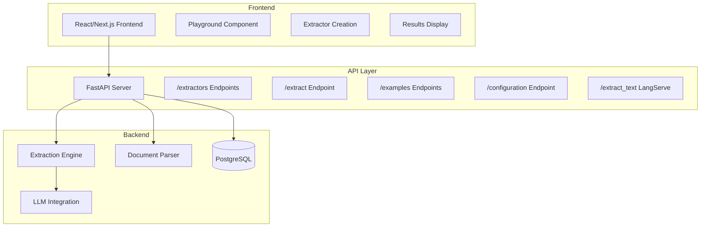

Sources: [README.md:27-36](), [docker-compose.yml:3-59]()

## Core Components

### Frontend
The React/Next.js frontend provides an intuitive interface for working with extractors:

- **Playground**: Test extractors with different text inputs or file uploads
- **Extractor Creation**: Define schemas and instructions for new extractors
- **Results Display**: View extracted data in structured format

### Backend API
The FastAPI backend exposes several endpoints:

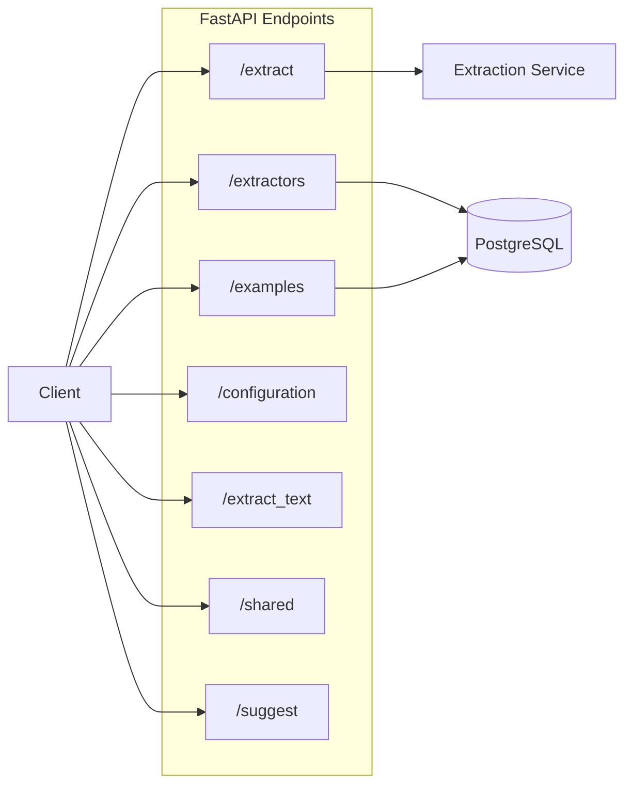

Sources: [README.md:50-136]()

### Extraction Engine
The extraction engine is the core component responsible for:

1. Processing document inputs (text or files)
2. Retrieving and applying the appropriate extractor schema
3. Executing the extraction using LLMs
4. Returning structured results

### Data Storage
PostgreSQL database stores:
- Extractor definitions (schema, instructions)
- Few-shot examples
- User information

Sources: [docker-compose.yml:4-23]()

## Extraction Workflow

The extraction process follows this sequence:

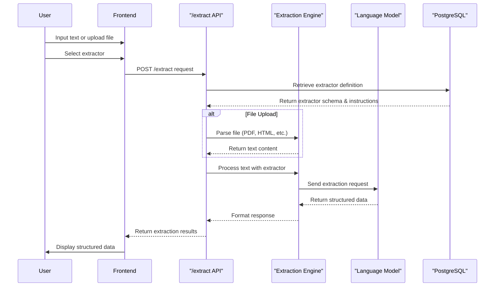

Sources: [README.md:106-136]()

## Extractor Definition

Extractors are defined using JSON Schema, with three key components:

1. **Schema**: Defines the structure of data to extract (properties, types, required fields)
2. **Instructions**: Custom instructions for the extraction process
3. **Examples**: Optional few-shot examples to improve extraction quality

Example extractor definition:

```json
{
  "name": "Personal Information",
  "description": "Use to extract personal information",
  "schema": {
    "type": "object",
    "title": "Person",
    "required": ["name", "age"],
    "properties": {
      "age": {
        "type": "integer",
        "title": "Age"
      },
      "name": {
        "type": "string",
        "title": "Name"
      }
    }
  },
  "instruction": "Use information about the person from the given user input."
}
```

Sources: [README.md:67-95]()

## Extraction Modes

LangChain Extract supports different extraction modes:

1. **entire_document**: Processes the entire document by splitting into chunks, extracting from each chunk, and deduplicating results
2. **retrieval**: Uses vector retrieval to find relevant context before extraction

Sources: [README.md:115-118]()

## Technology Stack

LangChain Extract is built on:

| Component | Technology |
|-----------|------------|
| Frontend | React/Next.js |
| Backend | FastAPI, LangChain |
| Database | PostgreSQL |
| Container | Docker/Docker Compose |
| LLM Integration | OpenAI, Fireworks, Together AI |

The system is containerized using Docker, with separate containers for the frontend, backend, and database services.

Sources: [docker-compose.yml:3-59](), [README.md:160-194]()

## API and Integration

The backend provides a REST API for all operations and includes a LangServe endpoint for integration with LangChain's `RemoteRunnable`. This allows the extraction service to be used as part of larger LangChain workflows.

The service exposes OpenAPI documentation to explore available endpoints and their parameters.

Sources: [README.md:27-36]()

---

# Page: Getting Started

# Getting Started

<details>
<summary>Relevant source files</summary>

The following files were used as context for generating this wiki page:

- [Dockerfile](Dockerfile)
- [README.md](README.md)
- [backend/scripts/prod_entry_point.sh](backend/scripts/prod_entry_point.sh)
- [docker-compose.yml](docker-compose.yml)

</details>


This guide provides instructions for setting up and running LangChain Extract locally. It covers environment configuration, launching the application, and verifying your installation. For information about the system architecture and components, see [Architecture](#2).

## What is LangChain Extract?

LangChain Extract is a web application for extracting structured information from text and documents using Large Language Models (LLMs). It allows you to:

- Define JSON schemas for structured data extraction
- Create and save extractors for reuse
- Process text and files to extract information
- Use examples to improve extraction quality
- Access the functionality through both a web UI and REST API

The system consists of three main components:

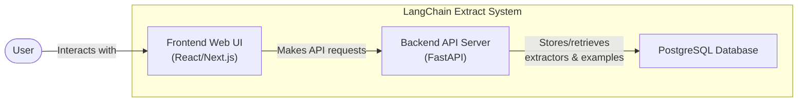

Sources: [README.md:19-25](), [docker-compose.yml:3-56]()

## Prerequisites

Before getting started, ensure you have the following installed:

- [Docker](https://www.docker.com/get-started)
- [Docker Compose](https://docs.docker.com/compose/install/)
- API key from at least one LLM provider (OpenAI, Fireworks, Together, etc.)

## Environment Setup

1. **Clone the repository**

   ```bash
   git clone https://github.com/langchain-ai/langchain-extract.git
   cd langchain-extract
   ```

2. **Configure environment variables**

   Create a `.local.env` file in the root directory with your API keys:

   ```
   OPENAI_API_KEY=your_openai_api_key
   # Optional additional provider keys
   FIREWORKS_API_KEY=your_fireworks_api_key
   TOGETHER_API_KEY=your_together_api_key
   ```

   The following API keys are supported:

   | Provider | Environment Variable | Required |
   |----------|---------------------|----------|
   | OpenAI   | OPENAI_API_KEY      | Yes      |
   | Fireworks| FIREWORKS_API_KEY   | No       |
   | Together | TOGETHER_API_KEY    | No       |

Sources: [README.md:158-171]()

## Running the System

### Using Docker Compose (Recommended)

1. **Build the Docker images**

   ```bash
   docker compose build
   ```

2. **Start the services**

   ```bash
   docker compose up
   ```

   This command launches three containers:
   - PostgreSQL database
   - Backend API server
   - Frontend web application

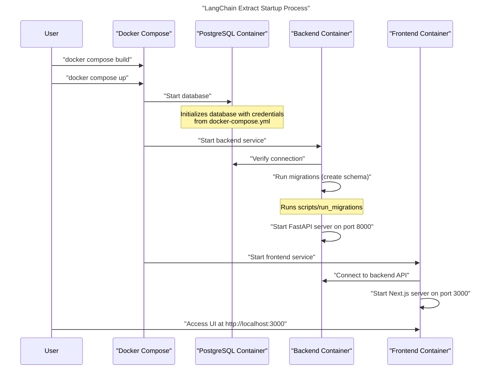

Sources: [README.md:172-193](), [docker-compose.yml:3-56](), [backend/scripts/prod_entry_point.sh:1-10]()

## Verifying Installation

1. **Check if the backend server is ready**

   ```bash
   curl -X 'GET' 'http://localhost:8000/ready'
   ```

   You should receive an `ok` response.

2. **Access the web interface**

   Open your browser and navigate to:
   
   ```
   http://localhost:3000
   ```

Sources: [README.md:185-194]()

## Basic Usage Example

Here's a quick example to create an extractor and use it:

1. **Generate a user ID**

   ```bash
   USER_ID=$(uuidgen)
   export USER_ID
   ```

2. **Create an extractor**

   ```bash
   curl -X 'POST' \
     'http://localhost:8000/extractors' \
     -H 'accept: application/json' \
     -H 'Content-Type: application/json' \
     -H "x-key: ${USER_ID}" \
     -d '{
     "name": "Personal Information",
     "description": "Use to extract personal information",
     "schema": {
         "type": "object",
         "title": "Person",
         "required": [
           "name",
           "age"
         ],
         "properties": {
           "age": {
             "type": "integer",
             "title": "Age"
           },
           "name": {
             "type": "string",
             "title": "Name"
           }
         }
       },
     "instruction": "Use information about the person from the given user input."
   }'
   ```

   This will return an extractor ID:
   ```json
   {
     "uuid": "e07f389f-3577-4e94-bd88-6b201d1b10b9"
   }
   ```

3. **Use the extractor**

   ```bash
   curl -s -X 'POST' \
   'http://localhost:8000/extract' \
   -H 'accept: application/json' \
   -H 'Content-Type: multipart/form-data' \
   -H "x-key: ${USER_ID}" \
   -F 'extractor_id=e07f389f-3577-4e94-bd88-6b201d1b10b9' \
   -F 'text=my name is chester and i am 20 years old. My name is eugene and I am 1 year older than chester.' \
   -F 'mode=entire_document' \
   -F 'file='
   ```

   Response:
   ```json
   {
     "data": [
       {
         "name": "chester",
         "age": 20
       },
       {
         "name": "eugene",
         "age": 21
       }
     ]
   }
   ```

Sources: [README.md:49-136]()

## Development Setup

If you prefer to run the system without Docker for development:

1. **Install Poetry**

   First, install [Poetry](https://python-poetry.org/) for Python dependency management.

2. **Set up the backend**

   ```bash
   cd backend
   poetry install --with lint,dev,test
   python -m scripts.run_migrations create
   OPENAI_API_KEY=[YOUR API KEY] python -m server.main
   ```

3. **Set up the frontend**

   In a separate terminal:
   ```bash
   cd frontend
   npm install
   npm run dev
   ```

Sources: [README.md:201-228]()

## Next Steps

After successfully setting up LangChain Extract, you might want to:

1. Explore the UI at http://localhost:3000
2. Test creating extractors with different schemas
3. Try processing different document types
4. Review the API documentation at http://localhost:8000/docs
5. Learn more about the [system architecture](#2) and [extraction engine](#4.1)

For more detailed examples and usage patterns, see the [Usage Examples](#6) section.

---

# Page: Architecture

# Architecture

<details>
<summary>Relevant source files</summary>

The following files were used as context for generating this wiki page:

- [README.md](README.md)
- [backend/server/extraction_runnable.py](backend/server/extraction_runnable.py)
- [backend/server/main.py](backend/server/main.py)
- [backend/server/settings.py](backend/server/settings.py)
- [docker-compose.yml](docker-compose.yml)

</details>


This document provides a comprehensive overview of the LangChain Extract system architecture, describing the major components and how they interact. For information about specific data flows during extraction operations, see [Data Flow](#2.1).

LangChain Extract is a web application designed to extract structured information from text and files using Large Language Models (LLMs). The system allows users to define extraction schemas, create extractors, and process documents to extract structured data according to those schemas.

## System Overview

LangChain Extract follows a modern three-tier architecture with clear separation between the frontend user interface, backend API services, and data storage layers.

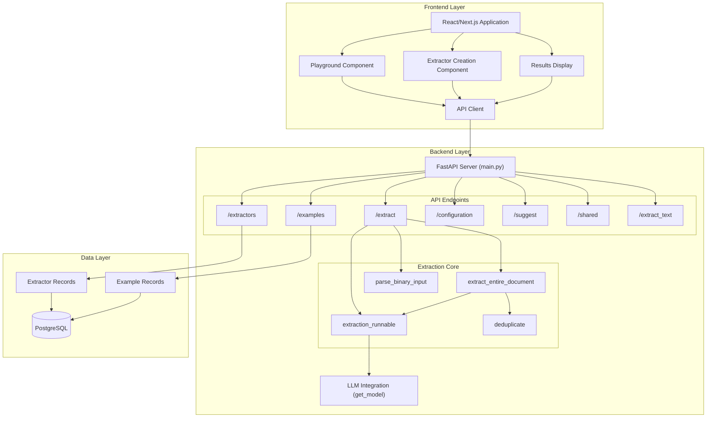

Sources: [backend/server/main.py:1-82](), [backend/server/extraction_runnable.py:1-223](), [docker-compose.yml:1-60]()

## Component Architecture

The system is composed of several key components that work together to provide the extraction functionality.

### Frontend Components

The frontend is built with React/Next.js and provides interfaces for:
- Creating and managing extractors
- Uploading and processing documents
- Viewing extraction results
- Sharing extractors

### Backend Components

The backend is a FastAPI server with several key components:

1. **API Endpoints**: The main interface for client applications
   - `/extractors` - Create, read, update, delete extractors
   - `/examples` - Manage examples used for few-shot learning
   - `/extract` - Main endpoint for extraction operations
   - `/suggest` - LLM-based suggestions
   - `/shared` - Share extractors via unique URLs
   - `/configuration` - Expose system capabilities to clients
   - `/extract_text` - LangServe-compatible endpoint for extraction

2. **Extraction Core**: The engine for processing text and extracting information
   - `extraction_runnable` - Core LangChain runnable that processes extraction requests
   - `extract_entire_document` - Handles extraction from large documents by chunking
   - `deduplicate` - Removes duplicate extraction results

3. **Model Integration**: Interfaces with various LLM providers
   - Support for OpenAI, Fireworks, Anthropic, and Groq models

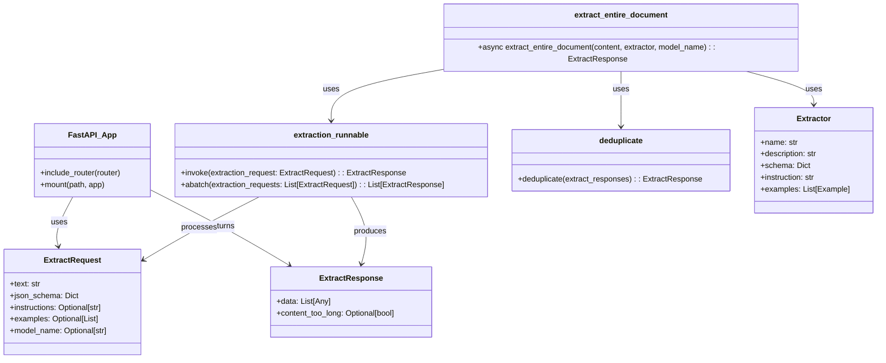

Sources: [backend/server/main.py:10-65](), [backend/server/extraction_runnable.py:36-65](), [backend/server/extraction_runnable.py:159-223]()

### Database Schema

The system uses PostgreSQL to store:
- Extractor definitions (schema, instructions)
- Examples for few-shot learning
- User information

## Extraction Process Flow

The extraction process follows a sequence of operations to convert unstructured text into structured data:

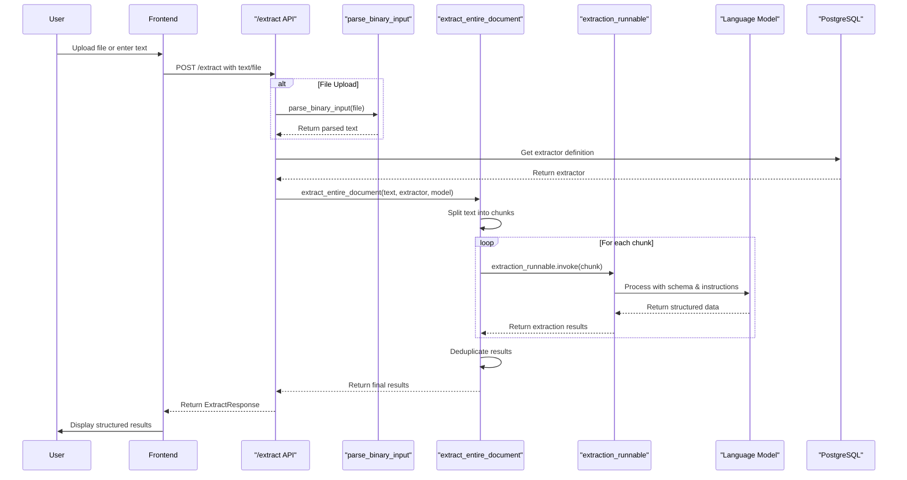

Sources: [backend/server/extraction_runnable.py:182-223](), [backend/server/extraction_runnable.py:159-179]()

## Model Integration

The system supports multiple LLM providers through LangChain's model abstraction. Configuration parameters control chunking size and concurrency:

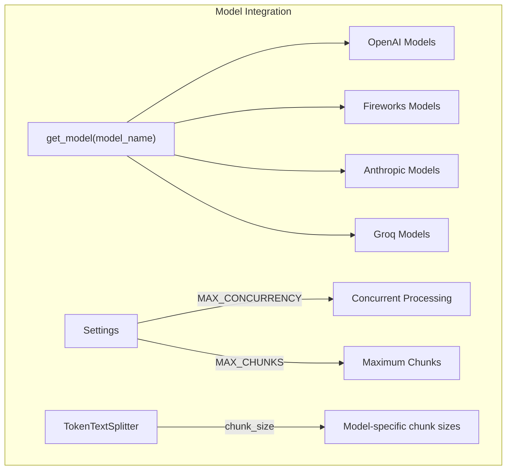

Sources: [backend/server/settings.py:31-40](), [backend/server/extraction_runnable.py:191-196]()

## Deployment Architecture

The system is designed to be deployed using Docker containers:

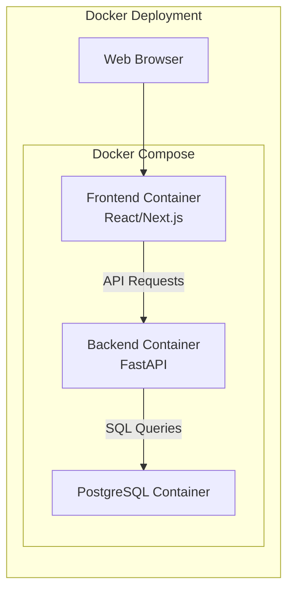

Sources: [docker-compose.yml:1-60](), [README.md:158-194]()

## System Boundaries and Constraints

The LangChain Extract system has several notable constraints:

1. **Document Size Limitations**: Large documents are split into chunks, with configurable limits:
   - `MAX_CHUNKS`: Controls the maximum number of document chunks processed
   - `MAX_CONCURRENCY`: Limits how many chunks are processed simultaneously

2. **Model Context Limitations**: Each LLM has context window limitations that affect extraction capability

3. **Data Persistence**: The system uses PostgreSQL for storing extractors and examples, but not the extracted data itself

Sources: [backend/server/settings.py:31-40](), [backend/server/extraction_runnable.py:208-213]()

## Key Design Patterns

The LangChain Extract architecture leverages several important design patterns:

1. **Repository Pattern**: Database access is abstracted through model classes
2. **Chain Pattern**: LangChain runnables are chained together for the extraction process
3. **Strategy Pattern**: Different extraction strategies can be selected (entire document vs. retrieval)
4. **Factory Pattern**: Models are created through a factory function
5. **Middleware Pattern**: FastAPI middleware for CORS and other cross-cutting concerns

Sources: [backend/server/main.py:37-44](), [backend/server/extraction_runnable.py:159-179]()

---

# Page: Data Flow

# Data Flow

<details>
<summary>Relevant source files</summary>

The following files were used as context for generating this wiki page:

- [backend/extraction/parsing.py](backend/extraction/parsing.py)
- [backend/server/extraction_runnable.py](backend/server/extraction_runnable.py)
- [backend/server/retrieval.py](backend/server/retrieval.py)
- [backend/server/settings.py](backend/server/settings.py)
- [backend/tests/unit_tests/api/test_api_extract.py](backend/tests/unit_tests/api/test_api_extract.py)
- [backend/tests/unit_tests/conftest.py](backend/tests/unit_tests/conftest.py)
- [backend/tests/unit_tests/test_deduplication.py](backend/tests/unit_tests/test_deduplication.py)

</details>


This document explains how data flows through the LangChain Extract system during the extraction process - from initial user input to the final structured output. It details the path that text or files take through the system components, the processing steps applied, and how the system handles different extraction modes.

For information about the overall system architecture, see [Architecture](#2). For details about the core extraction functionality implementation, see [Extraction Engine](#4.1).

## Input Processing Flow

When a user submits content for extraction, the system follows one of two paths depending on whether the input is text or a file.

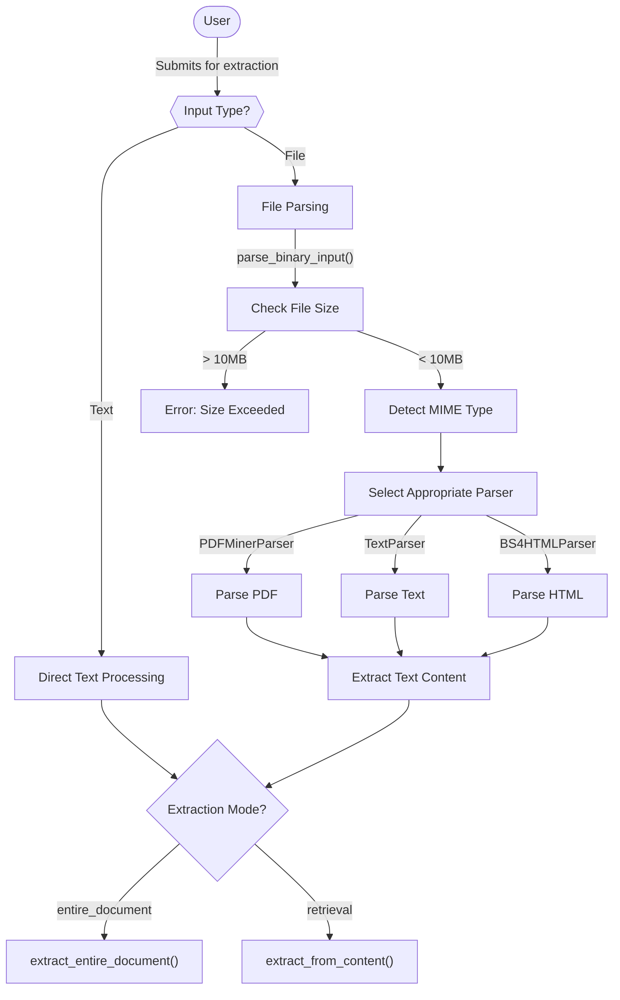

Sources: [extraction/parsing.py:83-86](), [extraction/parsing.py:62-70](), [extraction/parsing.py:31-42]()

## File Parsing Subsystem

The system can process various file formats by converting them to text:

| MIME Type | Parser Used | Description |
|-----------|-------------|-------------|
| application/pdf | PDFMinerParser | Extracts text from PDF documents |
| text/plain | TextParser | Processes plain text files |
| text/html | BS4HTMLParser | Extracts content from HTML files |

The file parsing process has these constraints:
- Maximum file size: 10MB by default
- Limited to supported MIME types defined in the HANDLERS dictionary

Sources: [extraction/parsing.py:13-26](), [extraction/parsing.py:56-59]()

## Extraction Modes

The system supports two primary extraction modes with different data flows:

### Entire Document Extraction

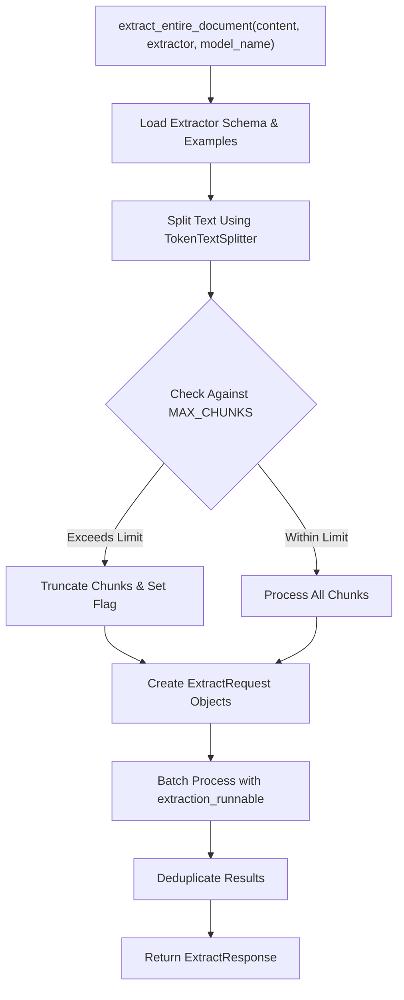

When using the `entire_document` mode:
1. Text is divided into chunks using TokenTextSplitter
2. Each chunk is processed independently
3. Results are deduplicated to remove duplicates
4. A flag is set if the document was too long and had to be truncated

Sources: [backend/server/extraction_runnable.py:182-223](), [backend/server/settings.py:32-40]()

### Retrieval-Based Extraction

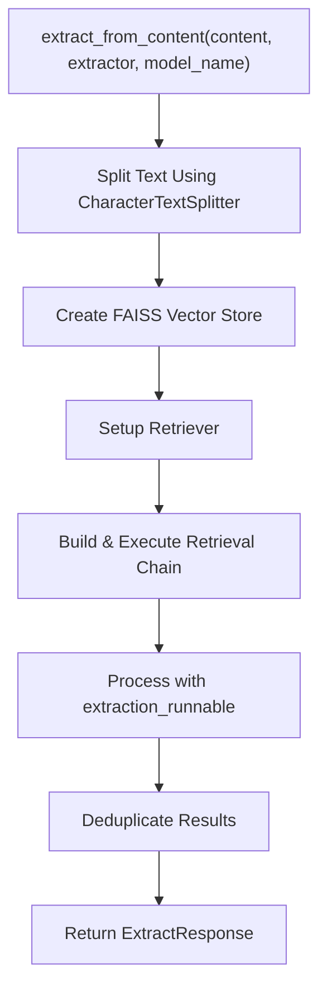

In the `retrieval` mode:
1. Text is split using CharacterTextSplitter
2. A vector store is created from the text chunks
3. A retrieval system finds relevant chunks
4. The extraction is performed on retrieved content
5. Results are deduplicated

Sources: [backend/server/retrieval.py:24-68]()

## Core Extraction Process

The heart of the extraction system is the `extraction_runnable` function that processes text with an LLM:

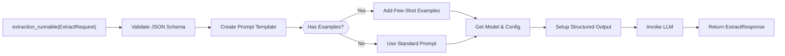

Sources: [backend/server/extraction_runnable.py:160-179](), [backend/server/extraction_runnable.py:78-125]()

## Deduplication Mechanism

When multiple chunks are processed, the system deduplicates the results:

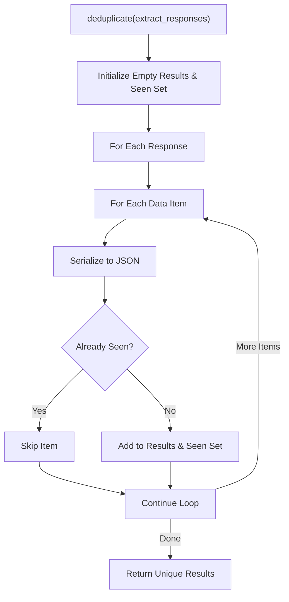

Sources: [backend/server/extraction_runnable.py:131-151](), [backend/tests/unit_tests/test_deduplication.py:4-54]()

## End-to-End Data Flow

This sequence diagram shows the complete flow from user input to structured output:

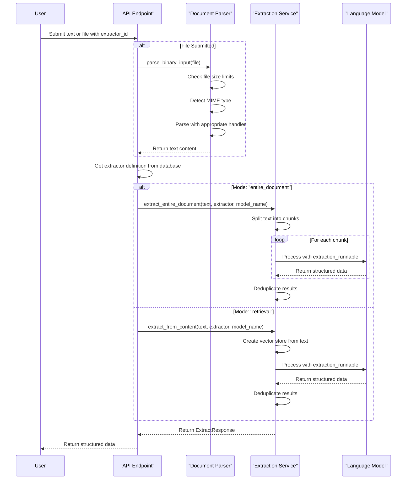

Sources: [backend/tests/unit_tests/api/test_api_extract.py:41-205](), [backend/server/extraction_runnable.py:182-223](), [backend/server/retrieval.py:24-68]()

## Key Data Structures

Understanding the data structures is crucial for following the data flow:

### ExtractRequest
```
ExtractRequest:
  - text: str                           # Text to extract from
  - json_schema: Dict                   # Schema defining extraction structure
  - instructions: Optional[str]         # Additional system instructions
  - examples: Optional[List[Example]]   # Example extractions for few-shot learning
  - model_name: Optional[str]           # LLM to use
```

### ExtractResponse
```
ExtractResponse:
  - data: List[Any]                     # Extracted structured data
  - content_too_long: Optional[bool]    # Flag indicating if content was truncated
```

Sources: [backend/server/extraction_runnable.py:36-58](), [backend/server/extraction_runnable.py:61-67]()

## Configuration Parameters Affecting Data Flow

Several configuration parameters impact how data flows through the system:

| Parameter | Description | Default | Impact on Data Flow |
|-----------|-------------|---------|---------------------|
| MAX_CONCURRENCY | Max chunks processed concurrently | 1 | Controls parallel processing of document chunks |
| MAX_CHUNKS | Max chunks processed per document | -1 (unlimited) | Limits document size; if exceeded, content is truncated |
| MAX_FILE_SIZE_MB | Max file size in MB | 10 | Restricts input file size |

Sources: [backend/server/settings.py:32-40](), [extraction/parsing.py:28]()

## Technical Constraints

The data flow through the system operates under these constraints:

1. File size limitation (10MB default)
2. Text length limitations based on model context windows
3. Processing capacity limited by MAX_CHUNKS and MAX_CONCURRENCY settings
4. Only supports certain file types (PDF, text, HTML)
5. Extraction quality depends on:
   - Quality of the schema definition
   - Clarity of instructions
   - Quality of provided examples
   - Capabilities of the selected LLM

Sources: [extraction/parsing.py:62-70](), [backend/server/extraction_runnable.py:195-213]()

---

# Page: Frontend Components

# Frontend Components

<details>
<summary>Relevant source files</summary>

The following files were used as context for generating this wiki page:

- [frontend/app/components/Playground.tsx](frontend/app/components/Playground.tsx)
- [frontend/app/components/ResultsTable.tsx](frontend/app/components/ResultsTable.tsx)
- [frontend/app/utils/api.tsx](frontend/app/utils/api.tsx)

</details>


This page provides an overview of the key frontend components in the LangChain Extract application. The frontend is built using React and Next.js, providing an interactive user interface for creating extractors, running extractions, and viewing results.

For information about the backend API that these components interact with, see [Backend System](#4) and [API Endpoints](#4.2). For details on the creation and management of extractors, see [Creating and Managing Extractors](#3.2).

## Component Architecture

The frontend is organized into modular components that handle specific aspects of the extraction workflow. Below is a high-level architecture diagram showing the main components and their relationships:

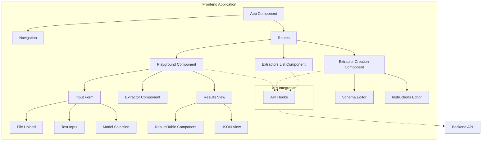

Sources: [frontend/app/components/Playground.tsx:1-196](). [frontend/app/utils/api.tsx:1-184]()

## Key Components

### Playground Component

The Playground is the primary interface for testing extractors. It allows users to input text or upload files, select an extraction model, and view extraction results.

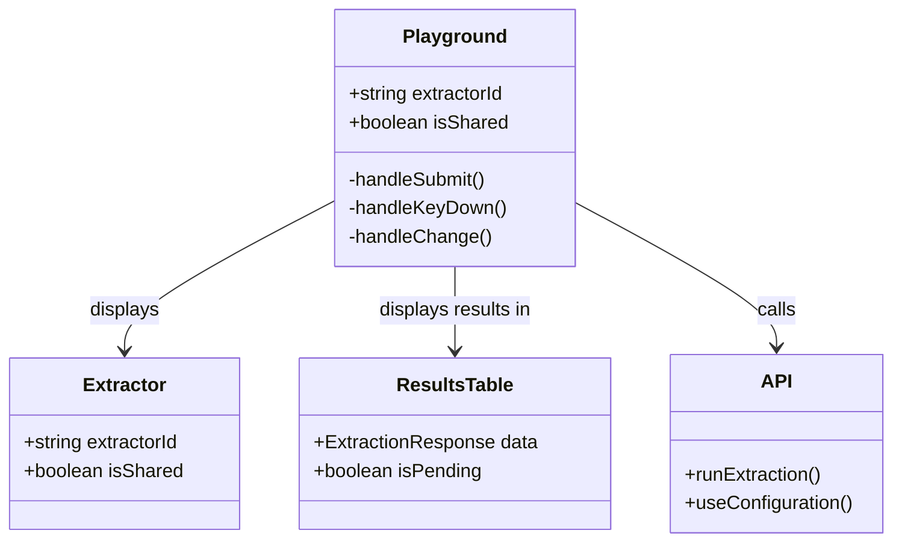

The Playground component:
- Displays extractor details using the Extractor component
- Provides a form for text input or file upload
- Allows selection of different LLM models for extraction
- Runs the extraction process
- Displays results in both table and JSON formats

Sources: [frontend/app/components/Playground.tsx:29-196]()

### ResultsTable Component

The ResultsTable component displays extraction results in a tabular format, dynamically determining columns based on the extracted data.

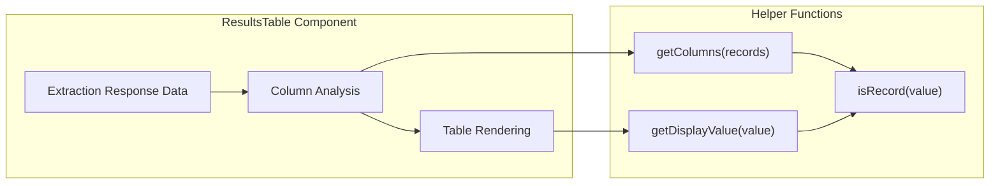

Key features:
- Dynamically determines table columns from extraction results
- Formats complex data types (arrays, objects) into readable strings
- Shows a loading spinner during extraction
- Displays extracted data in rows and columns

Sources: [frontend/app/components/ResultsTable.tsx:1-120]()

## API Integration

The frontend uses a set of React Query hooks to communicate with the backend API. These hooks manage API requests, caching, and state updates.

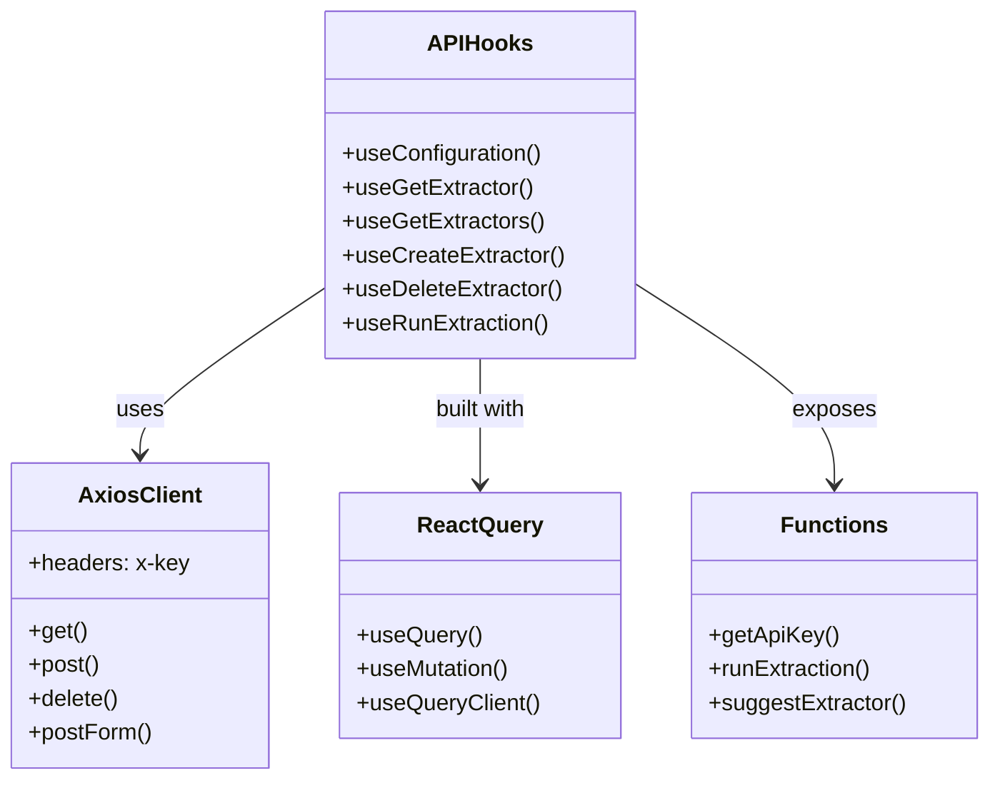

The API hooks provide:
- Authentication through client-side API keys
- Functions for CRUD operations on extractors
- Methods for running extractions
- Configuration retrieval
- Suggestion functionality for extractors

Sources: [frontend/app/utils/api.tsx:1-184]()

## Data Flow

The following diagram illustrates how data flows through the frontend components when a user runs an extraction:

```mermaid
sequenceDiagram
    participant User
    participant Playground as "Playground Component"
    participant APIHooks as "API Hooks"
    participant Backend as "Backend API"
    participant ResultsTable as "ResultsTable Component"
    
    User->>Playground: Enters text or uploads file
    User->>Playground: Selects model
    User->>Playground: Clicks "Run"
    
    Playground->>APIHooks: Calls runExtraction()
    
    APIHooks->>Backend: POST /extract
    Backend-->>APIHooks: Returns extraction results
    
    APIHooks-->>Playground: Updates with results
    Playground->>ResultsTable: Passes extraction data
    ResultsTable->>ResultsTable: Analyzes columns
    ResultsTable->>ResultsTable: Formats data
    ResultsTable-->>User: Displays formatted results
```

When a user runs an extraction:
1. The user inputs text or uploads a file in the Playground component
2. The Playground component captures form data and calls the `runExtraction` function
3. The request is sent to the backend API with the extractor ID, input data, and model selection
4. The backend processes the extraction and returns results
5. The ResultsTable component receives the data, analyzes it to determine columns, and displays it

Sources: [frontend/app/components/Playground.tsx:50-65](), [frontend/app/utils/api.tsx:130-141]()

## User Interface Components

The frontend uses Chakra UI components for a consistent and responsive interface:

```mermaid
flowchart TD
    subgraph "Chakra UI Components"
        ChakraCore["Chakra UI Core"]
        
        ChakraCore --> Forms["Form Components"]
        ChakraCore --> Layout["Layout Components"]
        ChakraCore --> Feedback["Feedback Components"]
        ChakraCore --> Navigation["Navigation Components"]
        
        Forms --> Button["Button"]
        Forms --> Input["Input"]
        Forms --> Textarea["Textarea"]
        Forms --> Radio["Radio"]
        Forms --> RadioGroup["RadioGroup"]
        
        Layout --> Box["Box"]
        Layout --> Divider["Divider"]
        Layout --> HStack["HStack"]
        
        Feedback --> Spinner["Spinner"]
        
        Navigation --> Tabs["Tabs"]
        Navigation --> TabList["TabList"]
        Navigation --> Tab["Tab"]
        Navigation --> TabPanels["TabPanels"]
        Navigation --> TabPanel["TabPanel"]
    end
    
    subgraph "Custom Components"
        Playground["Playground"]
        ResultsTable["ResultsTable"]
    end
    
    Playground --> Forms
    Playground --> Layout
    Playground --> Navigation
    
    ResultsTable --> Feedback
    ResultsTable --> Table["Table Components"]
```

Key UI elements include:
- Form controls for text input and file upload
- Radio buttons for model selection
- Tabs for switching between table and JSON views
- Spinners for loading states
- Tables for displaying structured data

Sources: [frontend/app/components/Playground.tsx:2-20](), [frontend/app/components/ResultsTable.tsx:1-11]()

## Component State Management

The frontend components use React hooks for state management and API communication:

| Hook Type | Usage | Example |
|-----------|-------|---------|
| useState | Local component state | Managing form state, disabled buttons |
| useMutation | API mutations | Running extractions, creating extractors |
| useQuery | Data fetching | Getting extractors, configuration |
| useQueryClient | Cache invalidation | Refreshing lists after mutations |

The Playground component uses state to:
- Track whether the form is valid for submission
- Handle the extraction request and response
- Manage loading states during extraction

Sources: [frontend/app/components/Playground.tsx:43-48](), [frontend/app/utils/api.tsx:94-98](), [frontend/app/utils/api.tsx:147-152]()

---

# Page: Playground Interface

# Playground Interface

<details>
<summary>Relevant source files</summary>

The following files were used as context for generating this wiki page:

- [frontend/app/components/Playground.tsx](frontend/app/components/Playground.tsx)
- [frontend/app/components/ResultsTable.tsx](frontend/app/components/ResultsTable.tsx)

</details>


## Purpose and Scope

The Playground Interface is a core frontend component of LangChain Extract that enables users to test and experiment with extractors in real-time. It provides an interactive environment where users can input text or upload files, select a language model, run extractions, and view the structured results. This page documents the interface structure, functionality, and how it integrates with the rest of the system.

For information about creating and managing extractors, see [Creating and Managing Extractors](#3.2).

## Component Overview

The Playground Interface consists of three main sections:
1. **Extractor Information** - Displays details about the currently selected extractor
2. **Input Section** - Allows users to provide content and configure extraction settings
3. **Results Section** - Shows extraction results in both tabular and JSON formats

```mermaid
graph TD
    subgraph "Playground Interface"
        direction TB
        ExtractorInfo["Extractor Information Component"]
        
        subgraph "Input Section"
            ModelSelect["Model Selection"]
            FileUpload["File Upload"]
            TextInput["Text Input"]
            RunButton["Run Button"]
        end
        
        subgraph "Results Section"
            TabView["Tabbed View"]
            TableView["Table View"]
            JSONView["JSON View"]
        end
    end
    
    User(["User"]) -->|"Views/Selects"| ExtractorInfo
    User -->|"1. Selects Model"| ModelSelect
    User -->|"2a. Uploads File"| FileUpload
    User -->|"2b. Enters Text"| TextInput
    User -->|"3. Initiates Extraction"| RunButton
    
    RunButton -->|"Sends Request"| API["Backend API"]
    API -->|"Returns Results"| TabView
    
    TabView -->|"Displays as Table"| TableView
    TabView -->|"Displays as JSON"| JSONView
    
    User -->|"Views Results"| TableView
    User -->|"Views Results"| JSONView
```

Sources: [frontend/app/components/Playground.tsx:41-196]()

## Interface Components

### Extractor Information

The Playground displays information about the current extractor through the `Extractor` component. This includes:
- The extractor's name and description
- The JSON schema that defines the extraction structure
- An indicator if the extractor is shared

```mermaid
sequenceDiagram
    participant User
    participant Playground as "Playground Component"
    participant Extractor as "Extractor Component"
    participant API as "Backend API"
    
    User->>Playground: View extractor in playground
    Playground->>Extractor: Pass extractorId and isShared
    Extractor->>API: Fetch extractor details
    API-->>Extractor: Return extractor info
    Extractor-->>Playground: Display extractor details
    Playground-->>User: Show extractor information
```

Sources: [frontend/app/components/Playground.tsx:104-106]()

### Input Section

The input section provides the following functionality:

1. **Model Selection**: Radio button group that displays available LLM models from the server configuration
2. **File Upload**: Allows users to upload supported file types with size restrictions
3. **Text Input**: Text area for direct input of content to extract from
4. **Run Button**: Triggers the extraction process

The interface prevents users from simultaneously using both file upload and text input methods, ensuring only one input source is active at a time.

Sources: [frontend/app/components/Playground.tsx:109-165]()

### Results Section

After extraction runs, results are displayed in a tabbed interface with two views:

1. **Table View**: Displays extraction results in a structured table format
   - Columns are dynamically generated based on the extracted data fields
   - Complex nested data (arrays, objects) is formatted for readability
   - Handles missing values gracefully
   
2. **JSON View**: Shows the raw JSON output from the extraction process
   - Uses syntax highlighting for improved readability
   - Displays the complete response including metadata

Additionally, warnings are shown if content was too long and had to be truncated.

Sources: [frontend/app/components/Playground.tsx:167-192](), [frontend/app/components/ResultsTable.tsx:63-120]()

## Data Flow

The Playground component manages the complete extraction workflow, from user input to result display:

```mermaid
flowchart LR
    subgraph "Playground Component"
        UserInput["User Input\n(Text or File)"]
        ModelSelection["Model Selection"]
        SubmitAction["Form Submission"]
        RunExtraction["runExtraction API Call"]
        ResultDisplay["Result Display"]
    end
    
    subgraph "Backend"
        ExtractAPI["/extract API Endpoint"]
        ExtractorStorage["Extractor Definition"]
        ExtractionEngine["Extraction Engine"]
        LLM["Language Model"]
    end
    
    UserInput --> SubmitAction
    ModelSelection --> SubmitAction
    SubmitAction --> RunExtraction
    RunExtraction --> ExtractAPI
    
    ExtractAPI --> ExtractorStorage
    ExtractorStorage --> ExtractionEngine
    ExtractionEngine --> LLM
    LLM --> ExtractionEngine
    ExtractionEngine --> ExtractAPI
    
    ExtractAPI --> RunExtraction
    RunExtraction --> ResultDisplay
```

Sources: [frontend/app/components/Playground.tsx:50-65]()

## Implementation Details

### Form Handling

The Playground implements several form handling functions:

1. **handleSubmit**: Processes form submission, builds the extraction request payload, and triggers the API call
2. **handleKeyDown**: Enables form submission when the user presses Enter in the text area
3. **handleChange**: Validates input state and manages the Run button's disabled state

The component ensures that users can only run extractions when valid input is provided (either text or file, but not both or neither).

Sources: [frontend/app/components/Playground.tsx:50-98]()

### API Integration

The Playground uses React Query's `useMutation` hook to interact with the backend API:

```mermaid
sequenceDiagram
    participant User
    participant Playground as "Playground Component"
    participant ReactQuery as "React Query"
    participant API as "Backend API"
    
    User->>Playground: Submit extraction form
    Playground->>Playground: Build request payload
    Playground->>ReactQuery: Call mutate() with payload
    ReactQuery->>API: POST /extract
    
    API-->>ReactQuery: Return extraction results
    ReactQuery-->>Playground: Update data state
    Playground-->>User: Display results
```

The component integrates with two main API endpoints:
1. Configuration endpoint - to retrieve available models and file constraints
2. Extraction endpoint - to process content and return structured data

Sources: [frontend/app/components/Playground.tsx:43-45](), [frontend/app/components/Playground.tsx:47]()

### Results Table Rendering

The `ResultsTable` component handles the complexities of displaying extraction results:

1. Dynamically determines columns from the extracted data
2. Formats complex data types for display
3. Handles loading states and empty results
4. Renders a responsive table with the extraction results

The table renderer recursively formats nested objects and arrays to create a readable string representation in table cells.

Sources: [frontend/app/components/ResultsTable.tsx:15-61](), [frontend/app/components/ResultsTable.tsx:87-119]()

## Usage Workflow

A typical user workflow in the Playground Interface follows these steps:

1. Navigate to an extractor (either created by the user or shared)
2. Review the extractor information to understand what data will be extracted
3. Select a language model for extraction
4. Either:
   - Upload a supported file type, or
   - Enter text directly in the text area
5. Click the Run button (or press Enter in the text area)
6. View the extraction results in the Table or JSON view
7. Iterate by adjusting input or selecting different models

This interactive cycle allows users to refine their extraction approach and evaluate different models' effectiveness for their specific use case.

Sources: [frontend/app/components/Playground.tsx:100-196]()

## Integration with System

The Playground Interface is a central component in the LangChain Extract system, connecting various parts of the application:

```mermaid
graph TD
    subgraph "Frontend Components"
        Playground["Playground Component"]
        Extractor["Extractor Component"]
        ResultsTable["ResultsTable Component"]
        CreateExtractor["Create Extractor Component"]
    end
    
    subgraph "API Layer"
        APIHooks["API Hooks\n(runExtraction, useConfiguration)"]
        ExtractAPI["/extract Endpoint"]
        ConfigAPI["/configuration Endpoint"]
        ExtractorsAPI["/extractors Endpoint"]
    end
    
    subgraph "Backend Core"
        ExtractionService["Extraction Service"]
        ExtractionRunnable["extraction_runnable"]
        Models["Language Models"]
    end
    
    Playground -->|"Uses"| Extractor
    Playground -->|"Uses"| ResultsTable
    CreateExtractor -->|"Creates extractors for"| Playground
    
    Playground -->|"Calls"| APIHooks
    APIHooks -->|"Requests"| ExtractAPI
    APIHooks -->|"Requests"| ConfigAPI
    Extractor -->|"Requests"| ExtractorsAPI
    
    ExtractAPI -->|"Uses"| ExtractionService
    ExtractionService -->|"Uses"| ExtractionRunnable
    ExtractionRunnable -->|"Calls"| Models
```

The Playground serves as the primary interface for testing extractors, enabling users to validate extraction schemas and configurations before using them in production scenarios.

Sources: [frontend/app/components/Playground.tsx:25-27](), [frontend/app/components/Playground.tsx:41-196]()

---

# Page: Creating and Managing Extractors

# Creating and Managing Extractors

<details>
<summary>Relevant source files</summary>

The following files were used as context for generating this wiki page:

- [backend/server/api/api_key.py](backend/server/api/api_key.py)
- [backend/server/api/shared.py](backend/server/api/shared.py)
- [frontend/app/components/CreateExtractor.tsx](frontend/app/components/CreateExtractor.tsx)
- [frontend/app/components/Extractor.tsx](frontend/app/components/Extractor.tsx)
- [frontend/app/components/ShareModal.tsx](frontend/app/components/ShareModal.tsx)
- [frontend/app/components/Sidebar.tsx](frontend/app/components/Sidebar.tsx)
- [frontend/app/e/[extractorId]/page.tsx](frontend/app/e/[extractorId]/page.tsx)
- [frontend/app/s/[sharedExtractorId]/page.tsx](frontend/app/s/[sharedExtractorId]/page.tsx)
- [frontend/package.json](frontend/package.json)
- [frontend/yarn.lock](frontend/yarn.lock)

</details>


This page documents how to create, edit, and share extractors within the LangChain Extract system. Extractors are the core definitions that specify what structured data should be extracted from unstructured text. For information about using extractors to process documents, see [Playground Interface](#3.1).

## Extractor Overview

An extractor in LangChain Extract consists of:

1. A name and description to identify its purpose
2. A JSON schema that defines the structure of data to extract
3. Instructions that guide the extraction process

Extractors can be created, viewed, shared, and deleted through the system's frontend interface.

```mermaid
flowchart TD
    subgraph "Extractor Definition"
        direction LR
        Name["Name & Description"]
        Schema["JSON Schema"]
        Instructions["Instructions"]
    end
    
    subgraph "Management Operations"
        direction LR
        Create["Create New Extractor"]
        View["View Existing Extractor"]
        Share["Share Extractor"]
        Delete["Delete Extractor"]
    end
    
    Create --> Name & Schema & Instructions
    Name & Schema & Instructions --> View
    View --> Share
    View --> Delete
```

Sources: [frontend/app/components/CreateExtractor.tsx:48-114](), [frontend/app/components/Extractor.tsx:23-62]()

## Creating a New Extractor

The extractor creation interface allows you to define what data you want to extract from text documents. You can access this interface by clicking the "New" button in the sidebar.

### Using Natural Language to Generate Schemas

The easiest way to create an extractor is by describing what you want to extract in natural language:

1. Enter a description of your extraction task in the input field
2. Click the suggestion button to generate a JSON schema
3. The system uses an LLM to create an appropriate schema for your task
4. Preview and adjust the generated schema as needed
5. Click "Create" to save the extractor

### Manually Editing JSON Schema

Alternatively, you can directly edit the JSON schema:

1. Expand the "Edit JSON Schema" accordion
2. Write or paste a valid JSON schema
3. The schema must be a valid JSON object with a `type: "object"` property
4. Preview updates in real-time with the form below
5. Click "Create" to save the extractor

```mermaid
sequenceDiagram
    participant User
    participant CreateForm as "Create Extractor Form"
    participant SuggestAPI as "Suggest API"
    participant CreateAPI as "Create Extractor API"
    participant DB as "PostgreSQL"
    
    User->>CreateForm: Enter extraction task description
    User->>CreateForm: Click suggest button
    CreateForm->>SuggestAPI: suggestExtractor(description)
    SuggestAPI-->>CreateForm: Return generated JSON schema
    
    alt Manual Schema Editing
        User->>CreateForm: Edit JSON schema directly
        CreateForm->>CreateForm: Validate schema
    end
    
    User->>CreateForm: Click Create
    CreateForm->>CreateAPI: createExtractor(name, description, schema)
    CreateAPI->>DB: Store extractor
    CreateAPI-->>CreateForm: Return extractor UUID
    CreateForm->>User: Redirect to extractor page
```

Sources: [frontend/app/components/CreateExtractor.tsx:48-221](), [frontend/app/utils/api.ts]()

### JSON Schema Structure

The JSON schema defines the structure of data to be extracted. A valid schema:

- Must be a JSON object with `type: "object"`
- Should include `title` and `description` for better usability
- Defines properties to extract with appropriate types
- Can include nested objects and arrays for complex data
- May specify format constraints for properties (e.g., date-time, email)

The system automatically extracts the extractor name from the schema's `title` property and the description from the `description` property.

Example schema structure:

```json
{
  "title": "Resume Information",
  "description": "Extract key information from resumes",
  "type": "object",
  "properties": {
    "name": {
      "type": "string",
      "description": "Full name of the candidate"
    },
    "email": {
      "type": "string",
      "format": "email",
      "description": "Contact email address"
    },
    "skills": {
      "type": "array",
      "items": {
        "type": "string"
      },
      "description": "List of professional skills"
    }
  }
}
```

Sources: [frontend/app/components/CreateExtractor.tsx:80-92]()

## Managing Existing Extractors

Once created, extractors are listed in the sidebar where they can be managed.

### Viewing Extractors

1. Extractors are displayed in the sidebar with their names and descriptions
2. Click on an extractor to open it in the Playground
3. The Extractor component displays the schema as both:
   - A visual form representation
   - The raw JSON schema code

### Extractor Actions

Each extractor in the sidebar has a menu with the following options:

- **Share**: Generate a unique URL to share the extractor with others
- **Delete**: Remove the extractor from the system

```mermaid
flowchart LR
    subgraph "Sidebar Component"
        direction TB
        ExtractorList["Extractor List"]
        NewButton["New Button"]
        ActionMenu["Action Menu (...)"]
    end
    
    subgraph "Extractor Management"
        direction TB
        ViewExtractor["View in Playground"]
        DeleteExtractor["Delete Extractor"]
        ShareExtractor["Share Extractor"]
        ShareModal["Share Modal with URL"]
    end
    
    NewButton --> CreateExtractor["CreateExtractor Component"]
    ExtractorList --> ViewExtractor
    ActionMenu --> DeleteExtractor
    ActionMenu --> ShareExtractor
    ShareExtractor --> ShareModal
    
    classDef component fill:#f9f9f9,stroke:#333,stroke-width:1px;
    class CreateExtractor,ShareModal component;
```

Sources: [frontend/app/components/Sidebar.tsx:36-138](), [frontend/app/components/ShareModal.tsx:1-52]()

## Sharing Extractors

The system allows you to share extractors with others who don't have direct access to your account.

### How to Share an Extractor

1. Select an extractor from the sidebar
2. Click the "..." menu and select "Share"
3. A modal appears with a unique URL
4. Copy the URL and share it with collaborators

### How Shared Extractors Work

1. The system generates a unique share token for the extractor
2. This token is included in a URL (e.g., `/s/{shareUUID}`)
3. Anyone with this URL can access a read-only version of your extractor
4. Shared extractors can be used in the Playground but cannot be modified

```mermaid
sequenceDiagram
    participant User
    participant Sidebar as "Sidebar Component"
    participant ShareAPI as "/extractors/{uuid}/share"
    participant ShareModal as "Share Modal"
    participant Recipient
    participant SharedView as "Shared Extractor View"
    
    User->>Sidebar: Select extractor
    User->>Sidebar: Click "Share"
    Sidebar->>ShareAPI: Request share token
    ShareAPI-->>Sidebar: Return share UUID
    Sidebar->>ShareModal: Open with share URL
    User->>ShareModal: Copy URL
    User->>Recipient: Send URL
    Recipient->>SharedView: Access /s/{shareUUID}
    SharedView->>ShareAPI: Fetch shared extractor
    ShareAPI-->>SharedView: Return extractor data
```

Sources: [frontend/app/components/ShareModal.tsx:1-52](), [frontend/app/s/[sharedExtractorId]/page.tsx:1-13](), [backend/server/api/shared.py:1-51]()

## Technical Implementation

### Extractor Creation Component

The `CreateExtractor` component is the main interface for creating new extractors. Key features:

- Uses React state to manage the JSON schema
- Provides real-time validation of schema syntax
- Renders a live preview using `@rjsf/chakra-ui` form library
- Integrates with the suggestion API to generate schemas using LLMs
- Submits the final schema to create an extractor in the database

The component extracts metadata (name and description) from the schema itself, making the UI more streamlined.

```mermaid
flowchart TD
    subgraph "CreateExtractor Component"
        direction TB
        SuggestionInput["Description Input Field"]
        SchemaEditor["JSON Schema Editor"]
        SchemaPreview["Form Preview"]
        ValidationState["JSON Validation State"]
        CreateButton["Create Button"]
    end
    
    subgraph "API Integration"
        SuggestMutation["suggestExtractor Mutation"]
        CreateMutation["useCreateExtractor Mutation"]
    end
    
    subgraph "Utilities"
        AJV["Ajv Schema Validator"]
        CodeMirror["CodeMirror Editor"]
        RJSF["React JSON Schema Form"]
    end
    
    SuggestionInput --> SuggestMutation
    SuggestMutation --> SchemaEditor
    SchemaEditor --> AJV
    AJV --> ValidationState
    SchemaEditor --> SchemaPreview
    RJSF --> SchemaPreview
    ValidationState --> CreateButton
    CreateButton --> CreateMutation
    CodeMirror --> SchemaEditor
```

Sources: [frontend/app/components/CreateExtractor.tsx:36-221]()

### Extractor Component

The `Extractor` component displays an existing extractor with tabs for different views:

- Form view: Shows how the extracted data will be structured
- Code view: Displays the raw JSON schema

This component is used both in the main application and in the shared extractor view.

Sources: [frontend/app/components/Extractor.tsx:18-62]()

### Database Storage

Extractors are stored in a PostgreSQL database with the following key elements:

- UUID: Unique identifier for each extractor
- Name: Display name for the extractor
- Description: Brief explanation of what the extractor does
- Schema: JSON schema that defines the structure
- Instruction: Optional guidance for the extraction process
- Share tokens: Separate table that maps extractors to share UUIDs

Sources: [backend/server/api/shared.py:9-51]()

## Common Use Cases

### 1. Creating a Contact Information Extractor

1. Click "New" in the sidebar
2. Enter "Extract contact information including name, email, phone number, and address"
3. Use the suggestion feature to generate a schema
4. Review and adjust field definitions as needed
5. Click "Create" to save the extractor

### 2. Sharing an Extractor with Team Members

1. Select the extractor from the sidebar
2. Click the menu button (...)
3. Select "Share"
4. Copy the generated URL
5. Send the URL to team members who need to use the same extractor

### 3. Iterating on an Extractor Schema

1. Create an initial extractor
2. Test it in the Playground with sample text
3. If results need improvement, create a new extractor with an enhanced schema
4. Use more specific property descriptions or add additional fields
5. Share the improved extractor when finalized

## Summary

The extractor creation and management interfaces allow you to:

1. Define structured data extraction requirements as JSON schemas
2. Use AI assistance to generate schemas from natural language descriptions
3. View and test extractors in an interactive playground
4. Share extractors with collaborators using unique URLs
5. Delete extractors when no longer needed

For information about using these extractors to process documents and extract data, see [Extraction Engine](#4.1).

---

# Page: API Integration

# API Integration

<details>
<summary>Relevant source files</summary>

The following files were used as context for generating this wiki page:

- [frontend/app/utils/api.tsx](frontend/app/utils/api.tsx)
- [frontend/app/utils/api_url.ts](frontend/app/utils/api_url.ts)

</details>


This page documents the API integration approach used in LangChain Extract, focusing on how the frontend communicates with the backend API services. It covers the architecture, key API hooks, request flow, and data handling mechanisms that enable frontend components to interact with extraction services.

## Overview

The LangChain Extract frontend uses a React Query-based approach to communicate with the backend API. The integration is built around custom hooks that provide a clean interface for components to fetch data, trigger extractions, and manage extractors without needing to handle HTTP request details directly.

```mermaid
flowchart LR
    subgraph "Frontend Components"
        PC["Playground Component"]
        EC["Extractor Component"]
        CE["Create Extractor"]
    end

    subgraph "API Integration Layer"
        AH["API Hooks\n(useGetExtractor, useRunExtraction, etc.)"]
        RQ["React Query\n(useQuery, useMutation)"]
        AC["Axios Client"]
    end

    subgraph "Backend API"
        EXT["/extractors"]
        EXTRACT["/extract"]
        CONFIG["/configuration"]
        SUGGEST["/suggest"]
        SHARED["/shared"]
    end

    PC --> AH
    EC --> AH
    CE --> AH
    AH --> RQ
    RQ --> AC
    AC --> EXT & EXTRACT & CONFIG & SUGGEST & SHARED
```

Sources: [frontend/app/utils/api.tsx:1-184]()

## API Client Configuration

The API integration layer is built on Axios with a custom configuration that includes automatic client identification and environment-aware URL determination.

### Client Authentication

Each client instance is identified by a unique UUID stored in the browser's localStorage. This key is included in all API requests as the `x-key` header.

```mermaid
flowchart TD
    A["Request Initiated"] --> B{"Key exists in\nlocalStorage?"}
    B -- "Yes" --> C["Use existing key"]
    B -- "No" --> D["Generate new UUID"]
    D --> E["Store in localStorage"]
    E --> C
    C --> F["Add x-key to\nAxios headers"]
    F --> G["Make API request"]
```

Sources: [frontend/app/utils/api.tsx:22-42]()

### Base URL Determination

The system automatically determines the appropriate API base URL based on the current environment:

- Development: `http://localhost:8000`
- Production: Uses the value from `NEXT_PUBLIC_BASE_API_URL` environment variable

This configuration allows the same code to work across different deployment environments without modification.

Sources: [frontend/app/utils/api_url.ts:1-11]()

## API Hooks

The API integration provides several React hooks that encapsulate common operations needed by the frontend components. These hooks are implemented using React Query to manage state, caching, and refetching.

### Available Hooks

| Hook | Purpose | Backend Endpoint |
|------|---------|------------------|
| `useConfiguration` | Fetch server configuration (models, accepted file types) | GET /configuration |
| `useGetExtractor` | Fetch a single extractor by UUID | GET /extractors/{uuid} |
| `useGetExtractors` | Fetch list of all extractors | GET /extractors |
| `useCreateExtractor` | Create a new extractor | POST /extractors |
| `useDeleteExtractor` | Delete an extractor | DELETE /extractors/{uuid} |
| `useRunExtraction` | Run an extraction with text/file | POST /extract |

Sources: [frontend/app/utils/api.tsx:94-183]()

### Hook Implementation Pattern

Most hooks follow a consistent pattern leveraging React Query's `useQuery` or `useMutation`:

```mermaid
flowchart LR
    A["Custom Hook\n(e.g., useGetExtractor)"] --> B["React Query\nuseQuery/useMutation"]
    B --> C["API Function\n(e.g., getExtractor)"]
    C --> D["Axios Client\nRequest"]
    D --> E["Backend API"]
    E --> F["Response Processing"]
    F --> B
    B --> A
```

Sources: [frontend/app/utils/api.tsx:48-62](), [frontend/app/utils/api.tsx:147-152]()

## Request Flow

Let's examine the flow of a typical API request using the extraction process as an example:

```mermaid
sequenceDiagram
    participant Component as "Frontend Component"
    participant Hook as "useRunExtraction"
    participant Query as "React Query"
    participant API as "runExtraction function"
    participant Axios as "axiosClient"
    participant Backend as "Backend API"
    
    Component->>Hook: Call useRunExtraction().mutate()
    Hook->>Query: Execute mutation
    Query->>API: Call runExtraction with params
    API->>Axios: postForm request
    Axios->>Axios: Add x-key header
    Axios->>Backend: POST /extract
    Backend->>Axios: Return extraction results
    Axios->>API: Process response
    API->>Query: Return data
    Query->>Hook: Update mutation state
    Hook->>Component: Provide result data
```

Sources: [frontend/app/utils/api.tsx:130-145]()

## Data Types

The API integration defines several data types to structure the communication between frontend and backend:

### Core Types

```typescript
// Extractor definition
type ExtractorData = {
  uuid: string;
  name: string;
  description: string;
  schema: any;
};

// Available LLM model
type Model = {
  name: string;
  description: string;
};

// Server capabilities
type ServerConfiguration = {
  max_file_size_mb: number;
  accepted_mimetypes: string[];
  models: Model[];
};

// Extraction request
type ExtractionRequest = {
  extractor_id: string;
  text?: string;
  file?: File;
};

// Extraction response
type ExtractionResponse = {
  data: unknown[];
  content_too_long?: boolean;
};
```

Sources: [frontend/app/utils/api.tsx:14-20](), [frontend/app/utils/api.tsx:77-86](), [frontend/app/utils/api.tsx:119-128]()

## Shared Extractor Handling

The API integration includes special handling for shared extractors, which allows accessing extractors through a separate endpoint:

```mermaid
flowchart TD
    A["useGetExtractor(uuid, isShared)"] --> B{"isShared?"}
    B -- "Yes" --> C["GET /shared/extractors/{uuid}"]
    B -- "No" --> D["GET /extractors/{uuid}"]
    
    E["useRunExtraction()"] --> F["runExtraction(request, isShared)"]
    F --> G{"isShared?"}
    G -- "Yes" --> H["POST /extract/shared"]
    G -- "No" --> I["POST /extract"]
```

Sources: [frontend/app/utils/api.tsx:48-62](), [frontend/app/utils/api.tsx:130-141]()

## Integration with UI Components

The API hooks are designed to be easily consumed by frontend components. They handle loading states, errors, and data caching automatically.

```mermaid
flowchart LR
    subgraph "User Interface"
        PC["Playground\nComponent"]
        EC["Extractor\nManagement"]
    end
    
    subgraph "API Integration" 
        PC --> |"fetch models"| UC["useConfiguration()"]
        PC --> |"run extraction"| UE["useRunExtraction()"]
        EC --> |"fetch extractor"| UGE["useGetExtractor()"]
        EC --> |"create extractor"| UCE["useCreateExtractor()"]
        EC --> |"list extractors"| UGES["useGetExtractors()"]
        EC --> |"delete extractor"| UDE["useDeleteExtractor()"]
    end
    
    subgraph "Backend API"
        UC --> CONFIG["/configuration"]
        UE --> EXTRACT["/extract"]
        UGE --> EXTR["/extractors/{id}"]
        UCE --> CEXTR["/extractors"]
        UGES --> LEXTR["/extractors"]
        UDE --> DEXTR["/extractors/{id}"]
    end
```

Sources: [frontend/app/utils/api.tsx:94-183]()

## Related Systems

The API integration layer connects to several other system components:

- For more information about the backend API endpoints, see [API Endpoints](#4.2)
- For details on the Playground Interface that uses these hooks, see [Playground Interface](#3.1)
- For information about the Extractor management UI, see [Creating and Managing Extractors](#3.2)

## Summary

The API integration in LangChain Extract provides a clean, structured approach to communicate with the backend services. By using React Query and custom hooks, the frontend components can focus on presentation while the API layer handles data fetching, caching, and state management. This separation of concerns makes the codebase more maintainable and provides a consistent pattern for adding new API interactions as needed.

Key benefits of this approach include:
- Automatic loading and error states
- Data caching and background refetching
- Consistent client identification
- Environment-aware configuration
- Type-safe API interactions

Sources: [frontend/app/utils/api.tsx:1-184](), [frontend/app/utils/api_url.ts:1-11]()

---

# Page: Backend System

# Backend System

<details>
<summary>Relevant source files</summary>

The following files were used as context for generating this wiki page:

- [backend/poetry.lock](backend/poetry.lock)
- [backend/pyproject.toml](backend/pyproject.toml)
- [backend/server/main.py](backend/server/main.py)
- [backend/server/models.py](backend/server/models.py)
- [backend/tests/unit_tests/fake/test_fake_chat_model.py](backend/tests/unit_tests/fake/test_fake_chat_model.py)

</details>


The Backend System of LangChain Extract is a FastAPI-based server that provides RESTful APIs for extracting structured information from text and documents using various Language Models (LLMs). It forms the core processing engine of the application, handling extractor definitions, document parsing, and the actual extraction process.

For information about specific extraction functionality, see [Extraction Engine](#4.1). For API endpoint details, see [API Endpoints](#4.2).

## System Architecture

The LangChain Extract backend consists of a FastAPI server exposing several API endpoints, with core services for model integration, document processing, and extraction logic.

```mermaid
graph TD
    subgraph "Backend System"
        FastAPI["FastAPI Server (main.py)"]
        
        subgraph "API Endpoints"
            ExtractorsAPI["/extractors"]
            ExtractAPI["/extract"]
            ExamplesAPI["/examples"]
            SuggestAPI["/suggest"]
            SharedAPI["/shared"]
            ConfigAPI["/configurables"]
            LangServeAPI["/extract_text"]
        end
        
        subgraph "Core Services"
            ModelIntegration["Model Integration (models.py)"]
            ExtractRunnable["extraction_runnable"]
            DocProcessing["Document Processing"]
            ExtractorMgmt["Extractor Management"]
        end
        
        Database[(PostgreSQL)]
    end
    
    Client["Client Applications"] --> FastAPI
    
    FastAPI --> ExtractorsAPI & ExtractAPI & ExamplesAPI & SuggestAPI & SharedAPI & ConfigAPI & LangServeAPI
    
    ExtractorsAPI --> ExtractorMgmt
    ExtractAPI --> ExtractRunnable
    ExtractAPI --> DocProcessing
    ExamplesAPI --> ExtractorMgmt
    SuggestAPI --> ModelIntegration
    LangServeAPI --> ExtractRunnable
    
    ExtractorMgmt --> Database
    ExtractRunnable --> ModelIntegration
```

Sources: [backend/server/main.py:1-83](), [backend/server/models.py:1-87]()

## FastAPI Server

The server is built using FastAPI, defined in `main.py`. It configures middleware, registers API routes, and serves the frontend application when available.

Key components include:
- CORS middleware for cross-origin request handling
- Registration of various API routers
- LangServe integration for the extraction runnable
- Static file serving for the frontend

```python
# FastAPI application configuration
app = FastAPI(
    title="Extraction Powered by LangChain",
    description="An extraction service powered by LangChain.",
    version="0.0.1",
    openapi_tags=[
        {
            "name": "extraction",
            "description": "Operations related to extracting content from text.",
        }
    ],
)
```

The API routes are registered as follows:

```python
# Include API endpoints
app.include_router(extractors.router)
app.include_router(examples.router)
app.include_router(extract.router)
app.include_router(suggest.router)
app.include_router(shared.router)
app.include_router(configurables.router)

# Add LangServe route
add_routes(
    app,
    extraction_runnable.with_types(
        input_type=ExtractRequest, output_type=ExtractResponse
    ),
    path="/extract_text",
    enabled_endpoints=["invoke", "batch"],
)
```

Sources: [backend/server/main.py:6-76]()

## API Endpoints

The backend exposes several API endpoints that handle different aspects of the extraction system:

| Endpoint | Purpose |
|----------|---------|
| `/extractors` | Managing extraction schemas and configurations |
| `/extract` | Performing extraction on text or documents |
| `/examples` | Managing few-shot examples for improving extraction accuracy |
| `/suggest` | Generating schema or extraction suggestions |
| `/shared` | Handling shared extractor links |
| `/configurables` | Exposing system capabilities and configurations |
| `/extract_text` | LangServe route for extraction runnable |

Sources: [backend/server/main.py:52-58](), [backend/server/main.py:60-67]()

## Model Integration

The system integrates with multiple LLM providers through the `models.py` module, which provides a unified interface for accessing different language models. Available models are determined based on API keys present in the environment.

```mermaid
graph TD
    subgraph "Model Registry System"
        SUPPORTED_MODELS["SUPPORTED_MODELS Dictionary"]
        get_model["get_model() Function"]
        get_chunk_size["get_chunk_size() Function"]
        
        subgraph "Environment Detection"
            EnvVars["API Key Environment Variables"]
            ModelConfig["Model Configurations"]
        end
    end
    
    subgraph "LLM Providers"
        OpenAI["OpenAI (gpt-3.5-turbo, gpt-4)"]
        Anthropic["Anthropic (Claude)"]
        Fireworks["Fireworks"]
        Groq["Groq"]
        TogetherAI["Together AI (Mixtral)"]
    end
    
    subgraph "Extraction Components"
        extraction_runnable["extraction_runnable"]
        extract_api["extract API"]
    end
    
    EnvVars -->|"Detected Keys"| SUPPORTED_MODELS
    ModelConfig -->|"Default Settings"| SUPPORTED_MODELS
    
    OpenAI & Anthropic & Fireworks & Groq & TogetherAI -->|"Provider Integration"| SUPPORTED_MODELS
    
    extract_api -->|"Requested Model"| get_model
    SUPPORTED_MODELS -->|"Available Models"| get_model
    get_model -->|"Selected LLM"| extraction_runnable
    extract_api -->|"Model Context Size"| get_chunk_size
```

The model registry dynamically loads models based on environment configuration:

```python
def get_supported_models():
    """Get models according to environment secrets."""
    models = {}
    if "OPENAI_API_KEY" in os.environ:
        models["gpt-3.5-turbo"] = {
            "chat_model": ChatOpenAI(model="gpt-3.5-turbo", temperature=0),
            "description": "GPT-3.5 Turbo",
        }
        if os.environ.get("DISABLE_GPT4", "").lower() != "true":
            models["gpt-4-0125-preview"] = {
                "chat_model": ChatOpenAI(model="gpt-4-0125-preview", temperature=0),
                "description": "GPT-4 0125 Preview",
            }
    # Additional model providers...
```

Sources: [backend/server/models.py:1-87](), [backend/pyproject.toml:15-30]()

## Extraction Process Flow

The following sequence diagram illustrates the data flow during an extraction process:

```mermaid
sequenceDiagram
    participant Client
    participant API as "API Endpoints"
    participant Extractor as "Extractor Manager"
    participant Parser as "Document Parser"
    participant Engine as "Extraction Engine"
    participant LLM as "Language Models"
    participant DB as "PostgreSQL"
    
    Client->>API: POST /extract with text or file
    
    alt Is file upload
        API->>Parser: parse_binary_input(file)
        Parser-->>API: Extracted text content
    end
    
    API->>Extractor: Get extractor config by ID
    Extractor->>DB: Query extractor
    DB-->>Extractor: Extractor definition
    Extractor-->>API: Schema and instructions
    
    alt Extraction mode: entire_document
        API->>Engine: extract_entire_document(text, extractor, model)
        Engine->>Engine: Split text into chunks
        loop For each chunk
            Engine->>LLM: Process with extraction prompt
            LLM-->>Engine: Extraction results
        end
        Engine->>Engine: Deduplicate results
    else Extraction mode: retrieval
        API->>Engine: extract_from_content(text, extractor, model)
        Engine->>Engine: Create vector store from text
        Engine->>LLM: Process with extraction_runnable
        LLM-->>Engine: Extraction results
    end
    
    Engine-->>API: Return structured data
    API-->>Client: JSON response with extracted data
```

Sources: [backend/server/main.py:11-16](), [backend/server/main.py:52-58]()

## Document Processing

The backend includes utilities for parsing different document types before extraction:

- PDF processing using `pdfminer-six`
- HTML processing with `beautifulsoup4` and `lxml`
- Plain text handling

The document processing pipeline handles:
1. File type detection
2. Text extraction appropriate to the file type
3. Preprocessing text for the extraction engine

Sources: [backend/pyproject.toml:21-25]()

## Dependencies and Technologies

The backend relies on several key technologies and libraries:

| Category | Dependencies |
|----------|-------------|
| Core Framework | FastAPI, Uvicorn, Starlette |
| LLM Integration | LangChain, LangServe, OpenAI, Anthropic, Fireworks, Groq |
| Database | PostgreSQL, Alembic, SQLAlchemy |
| Document Processing | pdfminer-six, BeautifulSoup4, lxml |
| Vector Storage | FAISS |
| API Utilities | Pydantic, Python-multipart, jsonschema |

Sources: [backend/pyproject.toml:9-31]()

## Configuration and Deployment

The backend can be configured through environment variables:

| Variable | Purpose |
|----------|---------|
| `CORS_ORIGINS` | Comma-separated list of allowed origins for CORS |
| `OPENAI_API_KEY` | API key for OpenAI integration |
| `ANTHROPIC_API_KEY` | API key for Anthropic integration |
| `FIREWORKS_API_KEY` | API key for Fireworks integration |
| `GROQ_API_KEY` | API key for Groq integration |
| `TOGETHER_API_KEY` | API key for Together AI integration |
| `DISABLE_GPT4` | Flag to disable GPT-4 models even if API key is present |

The system is designed to be deployed using Docker, with containers for the backend, frontend, and PostgreSQL database.

```mermaid
graph TB
    subgraph "LangChain Extract Deployment"
        Frontend["Frontend Container"]
        Backend["Backend Container"]
        Database["PostgreSQL Container"]
    end
    
    User["User"] -->|"HTTP Requests"| Frontend
    Frontend -->|"API Calls"| Backend
    Backend -->|"Data Storage"| Database
    
    subgraph "Backend Container Details"
        FastAPI["FastAPI Server"]
        Uvicorn["Uvicorn Server"]
        LangChain["LangChain Libraries"]
        LLMConnectors["LLM Provider Connectors"]
    end
    
    Backend --- FastAPI
    FastAPI --- Uvicorn
    FastAPI --- LangChain
    LangChain --- LLMConnectors
```

Sources: [backend/server/main.py:35-44](), [backend/server/models.py:10-67](), [backend/pyproject.toml:9-31]()

## Error Handling and Logging

The backend system implements error handling through FastAPI's exception handling mechanisms. Logging is configured to track important system events and potential issues:

```python
logger = logging.getLogger(__name__)
# Later in the code
logger.warning("No UI directory found, serving API only.")
```

Sources: [backend/server/main.py:18](), [backend/server/main.py:76]()

## Testing Infrastructure

The backend includes a comprehensive testing infrastructure with pytest fixtures and utilities. The test suite includes unit tests, integration tests, and tools like `GenericFakeChatModel` for mocking LLM responses during testing.

Sources: [backend/tests/unit_tests/fake/test_fake_chat_model.py:1-39]()

---

# Page: Extraction Engine

# Extraction Engine

<details>
<summary>Relevant source files</summary>

The following files were used as context for generating this wiki page:

- [backend/server/extraction_runnable.py](backend/server/extraction_runnable.py)
- [backend/server/retrieval.py](backend/server/retrieval.py)
- [backend/server/settings.py](backend/server/settings.py)
- [backend/tests/unit_tests/conftest.py](backend/tests/unit_tests/conftest.py)
- [backend/tests/unit_tests/test_deduplication.py](backend/tests/unit_tests/test_deduplication.py)
- [backend/tests/unit_tests/test_utils.py](backend/tests/unit_tests/test_utils.py)

</details>


The Extraction Engine is the core component of LangChain Extract's backend system responsible for converting unstructured text into structured data according to user-defined schemas. This page documents the architecture, functionality, and implementation details of the extraction system.

For API endpoints that expose this functionality, see [API Endpoints](#4.2). For information about document parsing prior to extraction, see [Document Parsing](#4.3).

## Overview

The Extraction Engine provides the fundamental capabilities for extracting structured information from text using Large Language Models (LLMs). It supports two primary extraction modes:

1. **Entire Document Processing**: Processes large documents by splitting them into chunks, extracting information from each chunk, and deduplicating the results.
2. **Retrieval-Based Processing**: Creates vector embeddings of document chunks and selectively processes the most relevant chunks based on the extraction task.

```mermaid
flowchart TD
    subgraph "Extraction Engine"
        extraction_runnable["extraction_runnable()"]
        extract_entire_document["extract_entire_document()"]
        extract_from_content["extract_from_content()"]
        deduplicate["deduplicate()"]
    end

    input["Text + Schema"] --> extraction_mode{{"Extraction Mode"}}
    extraction_mode -->|"Direct extraction"| extraction_runnable
    extraction_mode -->|"Long document"| extract_entire_document
    extraction_mode -->|"Retrieval-based"| extract_from_content
    
    extract_entire_document --> text_splitter["Text Splitter"]
    text_splitter --> chunks["Document Chunks"]
    chunks --> extraction_runnable
    
    extract_from_content --> vector_store["FAISS Vector Store"]
    vector_store --> retriever["Retriever"]
    retriever --> relevant_chunks["Relevant Chunks"]
    relevant_chunks --> extraction_runnable
    
    extraction_runnable --> raw_results["Raw Extraction Results"]
    raw_results --> deduplicate
    deduplicate --> final_output["Structured Data"]
```

Sources: [backend/server/extraction_runnable.py:159-223](), [backend/server/retrieval.py:24-68]()

## Core Components

### Extraction Runnable

The `extraction_runnable` function is the primary extraction engine component. It processes a single text input against a JSON schema to extract structured information using an LLM.

```mermaid
flowchart TD
    subgraph "extraction_runnable"
        validate_schema["Validate JSON Schema"]
        create_prompt["Create Prompt Template"]
        get_model["Get Language Model"]
        structured_output["Setup Structured Output"]
        invoke_model["Invoke Model"]
    end
    
    input["ExtractRequest"] --> validate_schema
    validate_schema --> create_prompt
    
    create_prompt --> |"With instructions\nand examples"| prompt["Chat Prompt Template"]
    prompt --> structured_output
    
    get_model --> model["LLM Model"]
    model --> structured_output
    
    structured_output --> runnable["Extraction Runnable Chain"]
    runnable --> invoke_model
    invoke_model --> output["ExtractResponse"]
```

Sources: [backend/server/extraction_runnable.py:159-179]()

### Document Processing

For long documents, the engine splits the content into manageable chunks, processes each chunk, and then combines and deduplicates the results.

```mermaid
flowchart TD
    input["Content + Extractor"] --> text_splitter["TokenTextSplitter"]
    text_splitter --> chunks["Text Chunks"]
    
    chunks --> check_limit{"Check MAX_CHUNKS limit"}
    check_limit -->|"If too many chunks"| truncate["Truncate chunks"] 
    check_limit -->|"Under limit"| extraction_requests["Create ExtractRequests"]
    truncate --> extraction_requests
    
    extraction_requests --> parallel["Parallel Processing\n(MAX_CONCURRENCY)"]
    parallel --> extraction_runnable["extraction_runnable.abatch()"]
    extraction_runnable --> extract_responses["Multiple ExtractResponses"]
    
    extract_responses --> deduplicate["deduplicate()"]
    deduplicate --> final_output["Combined ExtractResponse"]
```

Sources: [backend/server/extraction_runnable.py:182-223](), [backend/server/settings.py:32-40]()

### Retrieval-Based Extraction

For retrieval-based extraction, the engine uses vector embeddings to identify the most relevant chunks of a document for processing.

```mermaid
flowchart TD
    input["Content + Extractor"] --> text_splitter["CharacterTextSplitter"]
    text_splitter --> documents["Document Chunks"]
    
    documents --> vectorstore["FAISS Vectorstore"]
    vectorstore --> retriever["As Retriever"]
    
    description["Extractor Description"] --> retriever
    retriever --> relevant_docs["Relevant Documents"]
    
    relevant_docs --> create_requests["Create ExtractRequests"]
    create_requests --> extraction_runnable["extraction_runnable.abatch()"]
    extraction_runnable --> results["Extraction Results"]
    
    results --> deduplicate["deduplicate()"]
    deduplicate --> final_output["Final ExtractResponse"]
```

Sources: [backend/server/retrieval.py:24-68]()

### Deduplication

The deduplication mechanism ensures that identical extraction results are only included once in the final output.

```mermaid
flowchart TD
    inputs["Multiple ExtractResponses"] --> process["Process each response"]
    process --> for_each["For each data item"]
    for_each --> serialize["Serialize to JSON"]
    serialize --> check{"Already seen?"}
    check -->|"No"| add["Add to unique list"]
    check -->|"Yes"| skip["Skip duplicate"]
    add --> next["Next item"]
    skip --> next
    next --> return["Return unique items"]
```

Sources: [backend/server/extraction_runnable.py:131-151](), [backend/tests/unit_tests/test_deduplication.py:1-54]()

## Data Models

The Extraction Engine uses several key data models to structure requests and responses:

| Model | Description | Key Fields |
|-------|-------------|------------|
| `ExtractRequest` | Input to extraction functions | `text`, `json_schema`, `instructions`, `examples`, `model_name` |
| `ExtractResponse` | Output from extraction functions | `data` (extracted items), `content_too_long` (truncation flag) |
| `ExtractionExample` | Example for few-shot learning | `text`, `output` (expected extraction) |

Sources: [backend/server/extraction_runnable.py:24-68]()

## Prompt Engineering

The Extraction Engine uses a sophisticated prompt template strategy to communicate the extraction task to the LLM.

```mermaid
flowchart TD
    subgraph "Prompt Construction"
        system_message["Create System Message"]
        add_examples["Add Few-Shot Examples"]
        add_query["Add Query Text"]
    end
    
    input["Instructions + Examples"] --> system_message
    system_message --> base_prompt["Base Prompt Template"]
    
    has_examples{"Has Examples?"} --> |"Yes"| add_examples
    has_examples --> |"No"| add_query
    
    add_examples --> tool_calls["Format as Tool Calls"]
    tool_calls --> example_sequence["HumanMessage → AIMessage → ToolMessage"]
    example_sequence --> add_query
    
    add_query --> final_prompt["Final Chat Prompt Template"]
```

The system message uses a specific format:
```
You are a top-tier algorithm for extracting information from text. 
Only extract information that is relevant to the provided text. 
If no information is relevant, use the schema and output 
an empty list where appropriate.

[Custom Instructions If Provided]
```

Sources: [backend/server/extraction_runnable.py:78-125](), [backend/tests/unit_tests/test_utils.py:66-103]()

## Configuration Options

The Extraction Engine behavior can be configured through environment variables:

| Setting | Environment Variable | Default | Description |
|---------|---------------------|---------|-------------|
| `MAX_CONCURRENCY` | `MAX_CONCURRENCY` | 1 | Controls how many document chunks are processed concurrently |
| `MAX_CHUNKS` | `MAX_CHUNKS` | -1 | Maximum number of chunks to process per document (-1 = no limit) |

Sources: [backend/server/settings.py:32-40]()

## JSON Schema Handling

The extraction engine adapts input JSON schemas to a format suitable for structured output extraction:

1. Takes the original schema (e.g., a `Person` schema with `name` and `age` fields)
2. Wraps it in a container schema with a `data` array property
3. Sets the title to "extractor" and adds a description

This transformation enables the LLM to return properly structured arrays of extracted items.

Sources: [backend/tests/unit_tests/test_utils.py:8-63]()

## Extraction Modes Comparison

| Feature | Direct Extraction | Entire Document | Retrieval-Based |
|---------|------------------|-----------------|-----------------|
| **Best for** | Short texts | Long, structured documents | Documents with sparse relevant info |
| **Processing** | Single pass | Split into chunks | Vector similarity search |
| **Memory Usage** | Low | High | Medium |
| **Speed** | Fast | Slower (many API calls) | Medium |
| **Accuracy** | High for short texts | High for dense information | Better for targeted extraction |

Sources: [backend/server/extraction_runnable.py:159-223](), [backend/server/retrieval.py:24-68]()

## Integration with Other Components

```mermaid
flowchart TD
    subgraph "API Layer"
        extract_api["/extract API"]
        extract_text_api["/extract_text API"]
    end
    
    subgraph "Extraction Engine"
        extraction_runnable["extraction_runnable()"]
        extract_entire_document["extract_entire_document()"]
        extract_from_content["extract_from_content()"]
    end
    
    subgraph "Storage Layer"
        extractor["Extractor Model"]
        examples["Example Model"]
    end
    
    subgraph "Document Processing"
        parse_binary_input["parse_binary_input()"]
    end
    
    subgraph "Model Layer"
        get_model["get_model()"]
        llm_services["LLM Services"]
    end
    
    extract_api --> extractor
    extract_api --> parse_binary_input
    extract_api --> extract_entire_document
    extract_api --> extract_from_content
    
    extract_text_api --> extraction_runnable
    
    extractor --> examples
    examples --> extraction_runnable
    
    extract_entire_document --> extraction_runnable
    extract_from_content --> extraction_runnable
    
    extraction_runnable --> get_model
    get_model --> llm_services
```

Sources: [backend/server/extraction_runnable.py:159-223](), [backend/server/retrieval.py:24-68]()

## Implementation Details

### Chunking Strategy

The Extraction Engine uses different text splitters depending on the extraction mode:

- **Entire Document Mode**: Uses `TokenTextSplitter` with token-based chunking to respect LLM context windows
- **Retrieval Mode**: Uses `CharacterTextSplitter` with character-based chunking optimized for vector search

Sources: [backend/server/extraction_runnable.py:191-196](), [backend/server/retrieval.py:32-39]()

### Few-Shot Learning

The Extraction Engine supports few-shot learning through examples. When examples are provided, they are formatted as a sequence of:
1. Human message with example text
2. AI message with a tool call containing the expected extraction
3. Tool message confirming correct extraction

This approach effectively teaches the model the expected extraction pattern before processing new text.

Sources: [backend/server/extraction_runnable.py:96-116]()

### Error Handling

The engine includes error handling for invalid schemas, employing `Draft202012Validator` to validate schemas before processing. If a schema is invalid, the system raises an HTTP 422 error with details about the validation failure.

Sources: [backend/server/extraction_runnable.py:163-167]()

---

# Page: API Endpoints

# API Endpoints

<details>
<summary>Relevant source files</summary>

The following files were used as context for generating this wiki page:

- [backend/extraction/parsing.py](backend/extraction/parsing.py)
- [backend/server/api/configurables.py](backend/server/api/configurables.py)
- [backend/server/api/examples.py](backend/server/api/examples.py)
- [backend/server/api/extractors.py](backend/server/api/extractors.py)
- [backend/server/api/suggest.py](backend/server/api/suggest.py)
- [backend/tests/unit_tests/api/test_api_configuration.py](backend/tests/unit_tests/api/test_api_configuration.py)
- [backend/tests/unit_tests/api/test_api_extract.py](backend/tests/unit_tests/api/test_api_extract.py)
- [backend/tests/unit_tests/test_parsing.py](backend/tests/unit_tests/test_parsing.py)

</details>


This page documents the backend API endpoints in the LangChain Extract system. These RESTful APIs serve as the interface between the frontend application and the backend extraction functionality, handling operations such as managing extractors, processing extraction requests, managing examples, and retrieving system configuration.

For details about the underlying extraction functionality, see [Extraction Engine](#4.1).

## API Structure Overview

The following diagram illustrates the organization of API endpoints in the system:

### API Structure Diagram
```mermaid
graph TD
    Client["Client Application"] --> |"HTTP Requests"| API["FastAPI Server"]
    
    API --> Extractors["/extractors"]
    API --> Extract["/extract"]
    API --> Examples["/examples"]
    API --> Configuration["/configuration"]
    API --> Suggest["/suggest"]
    API --> Shared["/shared"]
    
    Extractors --> |"GET"| ListExtractors["List extractors"]
    Extractors --> |"POST"| CreateExtractor["Create extractor"]
    Extractors --> |"GET /{uuid}"| GetExtractor["Get extractor"]
    Extractors --> |"DELETE /{uuid}"| DeleteExtractor["Delete extractor"]
    Extractors --> |"POST /{uuid}/share"| ShareExtractor["Share extractor"]
    
    Extract --> |"POST"| RunExtraction["Run extraction"]
    
    Examples --> |"GET"| ListExamples["List examples"]
    Examples --> |"POST"| CreateExample["Create example"]
    Examples --> |"DELETE /{uuid}"| DeleteExample["Delete example"]
    
    Configuration --> |"GET"| GetConfiguration["Get configuration"]
    
    Suggest --> |"POST"| SuggestExtractor["Suggest extractor"]
    
    Shared --> |"GET /{token}"| GetSharedExtractor["Get shared extractor"]
```

Sources: [backend/server/api/extractors.py](), [backend/server/api/examples.py](), [backend/server/api/configurables.py](), [backend/server/api/suggest.py]()

## Authentication

Most API endpoints require authentication using an `x-key` header containing a user ID. This is implemented through the `UserToken` dependency in the API routes.

## Extraction Request Flow

The following diagram illustrates how a typical extraction request flows through the system:

### Extraction Flow Diagram
```mermaid
sequenceDiagram
    participant Client
    participant API as "/extract endpoint"
    participant DB as "PostgreSQL DB"
    participant Parser as "Document Parser"
    participant Engine as "Extraction Engine"
    participant LLM as "Language Model"
    
    Client->>API: POST /extract (extractor_id, text/file)
    API->>DB: Query extractor definition
    DB-->>API: Return extractor schema & instructions
    
    alt File Upload
        API->>Parser: parse_binary_input(file)
        Parser-->>API: Return extracted text
    end
    
    alt mode="entire_document"
        API->>Engine: extract_entire_document(text, extractor, model)
        Engine->>Engine: Split text into chunks
        Engine->>LLM: Process chunks with extraction_runnable
    else mode="retrieval"
        API->>Engine: extract_from_content(text, extractor, model)
        Engine->>Engine: Create vector store from text
        Engine->>LLM: Query with extraction_runnable
    end
    
    LLM-->>Engine: Return structured data
    Engine-->>API: Return extraction results
    API-->>Client: Return JSON response
```

Sources: [backend/tests/unit_tests/api/test_api_extract.py](), [backend/extraction/parsing.py]()

## API Endpoints Reference

### Extractors API

The extractors API allows managing extractor definitions - the templates that define the structure and instructions for extracting information.

| Endpoint | Method | Description | Authentication |
|----------|--------|-------------|----------------|
| `/extractors` | GET | List extractors with pagination | Required |
| `/extractors` | POST | Create a new extractor | Required |
| `/extractors/{uuid}` | GET | Get extractor by UUID | Required |
| `/extractors/{uuid}` | DELETE | Delete an extractor | Required |
| `/extractors/{uuid}/share` | POST | Share an extractor | Required |

Sources: [backend/server/api/extractors.py:109-179]()

#### Extractor Object Structure

```json
{
  "uuid": "550e8400-e29b-41d4-a716-446655440000",
  "name": "Person Extractor",
  "description": "Extract person information",
  "schema": {
    "type": "object",
    "properties": {
      "name": {
        "type": "string",
        "description": "Full name of the person"
      },
      "age": {
        "type": "integer",
        "description": "Age of the person"
      }
    }
  },
  "instruction": "Extract person information including name and age."
}
```

### Extract API

The extract API handles the actual extraction of structured data from text or files.

| Endpoint | Method | Description | Authentication |
|----------|--------|-------------|----------------|
| `/extract` | POST | Run an extraction | Required |

Sources: [backend/tests/unit_tests/api/test_api_extract.py:41-140]()

#### Extract Request Parameters (form data)

- `extractor_id`: UUID of the extractor to use
- `text` (optional): Text content to extract from
- `file` (optional): File to extract from (if text is not provided)
- `mode` (optional, default: "entire_document"): Extraction mode ("entire_document" or "retrieval")
- `model_name` (optional): Language model to use for extraction

#### Extract Response Structure

```json
{
  "data": [
    {
      "name": "John Doe",
      "age": 30
    }
  ],
  "content_too_long": false
}
```

### Examples API

The examples API manages examples for extractors, which can be used to improve extraction accuracy through few-shot learning.

| Endpoint | Method | Description | Authentication |
|----------|--------|-------------|----------------|
| `/examples` | GET | List examples for an extractor | Required |
| `/examples` | POST | Create a new example | Required |
| `/examples/{uuid}` | DELETE | Delete an example | Required |

Sources: [backend/server/api/examples.py:35-93]()

#### Example Object Structure

```json
{
  "uuid": "550e8400-e29b-41d4-a716-446655440001",
  "extractor_id": "550e8400-e29b-41d4-a716-446655440000",
  "content": "John Smith is 25 years old.",
  "output": [
    {
      "name": "John Smith",
      "age": 25
    }
  ]
}
```

### Configuration API

The configuration API provides system configuration information, including available models and file format support.

| Endpoint | Method | Description | Authentication |
|----------|--------|-------------|----------------|
| `/configuration` | GET | Get system configuration | Not required |

Sources: [backend/server/api/configurables.py:29-45](), [backend/tests/unit_tests/api/test_api_configuration.py:4-23]()

#### Configuration Response Structure

```json
{
  "available_models": ["gpt-3.5-turbo", "gpt-4", "claude-3-haiku-20240307"],
  "models": [
    {
      "name": "gpt-3.5-turbo",
      "description": "OpenAI's GPT-3.5 Turbo model"
    }
  ],
  "accepted_mimetypes": ["application/pdf", "text/plain", "text/html"],
  "max_file_size_mb": 10,
  "max_concurrency": 5,
  "max_chunks": 20
}
```

### Suggest API

The suggest API provides AI-driven suggestions for extractors based on natural language descriptions.

| Endpoint | Method | Description | Authentication |
|----------|--------|-------------|----------------|
| `/suggest` | POST | Get an extractor suggestion | Not required |

Sources: [backend/server/api/suggest.py:105-112]()

#### Suggest Request Structure

```json
{
  "description": "Extract information about companies including name, industry, and founding date",
  "jsonSchema": null
}
```

## File Handling and Constraints

### Supported File Formats

The system supports the following file formats for extraction:

| MIME Type | Description | Parser |
|-----------|-------------|--------|
| application/pdf | PDF documents | PDFMinerParser |
| text/plain | Plain text files | TextParser |
| text/html | HTML documents | BS4HTMLParser |

Sources: [backend/extraction/parsing.py:13-26](), [backend/tests/unit_tests/test_parsing.py:13-23]()

### File Size Limits

Files must be under the maximum size limit (default: 10MB) to be processed. This is enforced in the `parse_binary_input` function, which will return a 413 status code if the file is too large.

Sources: [backend/extraction/parsing.py:28-70]()

## Error Handling

The API follows standard HTTP status codes for indicating success or failure:

| Status Code | Description | Common Scenarios |
|-------------|-------------|------------------|
| 200 | OK | Successful request |
| 400 | Bad Request | Invalid parameters or JSON schema |
| 404 | Not Found | Extractor or resource not found |
| 413 | Payload Too Large | File size exceeds maximum limit |

Error responses include a JSON body with an error message:

```json
{
  "detail": "Error message describing the issue"
}
```

Sources: [backend/tests/unit_tests/api/test_api_extract.py:147-205]()

## API-Code Integration

The following diagram shows how the API endpoints integrate with the underlying code components:

### API Code Integration Diagram
```mermaid
graph TD
    subgraph "API Layer"
        ExtractorsAPI["/extractors endpoints"]
        ExtractAPI["/extract endpoint"]
        ExamplesAPI["/examples endpoints"]
        ConfigAPI["/configuration endpoint"]
        SuggestAPI["/suggest endpoint"]
    end

    subgraph "Core Components"
        DB[(PostgreSQL)]
        ExtractorModel["Extractor Model"]
        ExampleModel["Example Model"]
        Parser["Document Parser"]
        ExtractionEngine["Extraction Engine"]
        Models["LLM Integration"]
    end

    ExtractorsAPI --> ExtractorModel
    ExtractorModel --> DB
    ExamplesAPI --> ExampleModel
    ExampleModel --> DB
    
    ExtractAPI --> Parser
    ExtractAPI --> ExtractorModel
    ExtractAPI --> ExtractionEngine
    ExtractionEngine --> Models
    
    ConfigAPI --> Models
    ConfigAPI --> Parser
    
    SuggestAPI --> Models
```

Sources: [backend/server/api/extractors.py](), [backend/server/api/examples.py](), [backend/tests/unit_tests/api/test_api_extract.py](), [backend/server/api/configurables.py](), [backend/server/api/suggest.py]()

## Usage Summary

The API endpoints provide a complete set of functionality for:
1. Creating and managing extractors with custom schemas
2. Adding examples to improve extraction quality
3. Processing text and files to extract structured data
4. Discovering system capabilities and constraints
5. Getting AI-generated extractor suggestions

These endpoints form the foundation of the LangChain Extract system's functionality, enabling the frontend to provide a robust user experience for information extraction.

---

# Page: Document Parsing

# Document Parsing

<details>
<summary>Relevant source files</summary>

The following files were used as context for generating this wiki page:

- [backend/extraction/parsing.py](backend/extraction/parsing.py)
- [backend/tests/unit_tests/api/test_api_extract.py](backend/tests/unit_tests/api/test_api_extract.py)

</details>


## Purpose and Scope

This document describes the document parsing subsystem in LangChain Extract, which is responsible for converting uploaded files of various formats into text content that can be processed by the extraction engine. The document parsing functionality acts as the bridge between binary file inputs and the text-based extraction process. For information about how the extracted text is processed, see [Extraction Engine](#4.1).

## Document Parsing Flow

The document parsing system follows a straightforward pipeline that converts binary files into document objects containing extractable text.

```mermaid
flowchart LR
    subgraph "Document Parsing Pipeline"
        direction LR
        input["Binary File Input"] --> sizeCheck["File Size Check"]
        sizeCheck --> mimeDetect["MIME Type Detection"]
        mimeDetect --> blobCreation["Blob Creation"]
        blobCreation --> parsing["Format-Specific Parsing"]
        parsing --> documents["Document Objects"]
    end
    
    documents --> extraction["Extraction Process"]
    
    classDef process fill:#f5f5f5,stroke:#333,stroke-width:1px;
    class input,sizeCheck,mimeDetect,blobCreation,parsing,documents process;
```

Sources: [backend/extraction/parsing.py:83-86](). [backend/extraction/parsing.py:62-80]().

## Document Parsing Components

The document parsing system consists of several key components that work together to process different file types.

```mermaid
classDiagram
    class parse_binary_input {
        +process(data: BinaryIO) List[Document]
    }
    
    class convert_binary_input_to_blob {
        +process(data: BinaryIO) Blob
    }
    
    class MIMETYPE_BASED_PARSER {
        +handlers: Dict
        +parse(blob: Blob) List[Document]
    }
    
    class PDFMinerParser {
        +parse(blob: Blob) List[Document]
    }
    
    class TextParser {
        +parse(blob: Blob) List[Document]
    }
    
    class BS4HTMLParser {
        +parse(blob: Blob) List[Document]
    }
    
    parse_binary_input --> convert_binary_input_to_blob: uses
    parse_binary_input --> MIMETYPE_BASED_PARSER: uses
    MIMETYPE_BASED_PARSER --> PDFMinerParser: uses for PDF
    MIMETYPE_BASED_PARSER --> TextParser: uses for Text
    MIMETYPE_BASED_PARSER --> BS4HTMLParser: uses for HTML
```

Sources: [backend/extraction/parsing.py:56-59](). [backend/extraction/parsing.py:13-24]().

## Supported File Formats

The system can parse the following file types:

| MIME Type | Parser | Description |
|-----------|--------|-------------|
| application/pdf | PDFMinerParser | Extracts text from PDF documents |
| text/plain | TextParser | Processes plain text files |
| text/html | BS4HTMLParser | Extracts text from HTML documents |

Sources: [backend/extraction/parsing.py:13-24]().

## Integration with Extraction Process

Document parsing is integrated with the extraction API endpoint, allowing users to upload files directly for extraction.

```mermaid
sequenceDiagram
    participant Client
    participant ExtractAPI as "/extract API Endpoint"
    participant Parser as "parse_binary_input()"
    participant Extractor as "Extraction Engine"
    
    Client->>ExtractAPI: POST with file upload
    ExtractAPI->>Parser: Forward binary file
    Parser->>Parser: Check file size constraints
    Parser->>Parser: Detect MIME type
    Parser->>Parser: Create Blob
    Parser->>Parser: Apply appropriate parser
    Parser-->>ExtractAPI: Return List[Document]
    ExtractAPI->>Extractor: Forward document text
    Extractor-->>ExtractAPI: Return extraction results
    ExtractAPI-->>Client: Return structured data
```

Sources: [backend/tests/unit_tests/api/test_api_extract.py:124-140](). [backend/extraction/parsing.py:83-86]().

## Implementation Details

### Key Functions

#### parse_binary_input

The main entry point for document parsing, which handles binary file input and returns parsed documents.

```python
def parse_binary_input(data: BinaryIO) -> List[Document]:
    """Parse binary input."""
    blob = convert_binary_input_to_blob(data)
    return MIMETYPE_BASED_PARSER.parse(blob)
```

Sources: [backend/extraction/parsing.py:83-86]().

#### convert_binary_input_to_blob

Converts binary input to a Blob object, which is a standardized representation of file content used by the parsers.

```python
def convert_binary_input_to_blob(data: BinaryIO) -> Blob:
    """Convert ingestion input to blob."""
    file_size_in_mb = _get_file_size_in_mb(data)

    if file_size_in_mb > MAX_FILE_SIZE_MB:
        raise HTTPException(
            status_code=413,
            detail=f"File size exceeds the maximum limit of {MAX_FILE_SIZE_MB} MB.",
        )

    file_data = data.read()
    mimetype = _guess_mimetype(file_data)
    file_name = data.name

    return Blob.from_data(
        data=file_data,
        path=file_name,
        mime_type=mimetype,
    )
```

Sources: [backend/extraction/parsing.py:62-80]().

### MIME Type Detection

The system uses the `magic` library to automatically detect the MIME type of uploaded files, allowing it to select the appropriate parser.

```python
def _guess_mimetype(file_bytes: bytes) -> str:
    """Guess the mime-type of a file."""
    try:
        import magic
    except ImportError as e:
        raise ImportError(
            "magic package not found, please install it with `pip install python-magic`"
        ) from e

    mime = magic.Magic(mime=True)
    mime_type = mime.from_buffer(file_bytes)
    return mime_type
```

Sources: [backend/extraction/parsing.py:31-42]().

## Constraints and Limitations

### File Size Limits

The system enforces a maximum file size of 10MB to prevent resource exhaustion and ensure system stability.

```python
MAX_FILE_SIZE_MB = 10  # in MB
```

If a file exceeds this limit, an HTTP 413 (Payload Too Large) error is returned to the client.

Sources: [backend/extraction/parsing.py:28](). [backend/extraction/parsing.py:64-70]().

### Parser Configuration

The system uses a configuration of parsers based on MIME types:

```python
HANDLERS = {
    "application/pdf": PDFMinerParser(),
    "text/plain": TextParser(),
    "text/html": BS4HTMLParser(),
    # Disabled parsers commented out in code
    # "application/msword": MsWordParser(),
    # "application/vnd.openxmlformats-officedocument.wordprocessingml.document": MsWordParser(),
}
```

Sources: [backend/extraction/parsing.py:13-24]().

## Document Parsing in the Context of Extract API

The document parsing functionality is used by the `/extract` API endpoint when processing file uploads. The extraction process:

1. Receives a file upload from the client
2. Parses the file into text using `parse_binary_input`
3. Passes the extracted text to the extraction engine
4. Returns the structured extraction results to the client

```mermaid
graph TD
    subgraph "Extract API Flow"
        direction LR
        A["Client Request with File"] --> B["Extract API Endpoint"]
        B --> C["parse_binary_input()"]
        C --> D["Extraction Engine"]
        D --> E["Response with Extracted Data"]
    end
    
    subgraph "Document Parsing Components"
        direction LR
        C ---> F["_get_file_size_in_mb()"]
        C ---> G["_guess_mimetype()"]
        C ---> H["MIMETYPE_BASED_PARSER"]
        
        H --> I["PDFMinerParser"]
        H --> J["TextParser"]
        H --> K["BS4HTMLParser"]
    end
```

Sources: [backend/tests/unit_tests/api/test_api_extract.py:124-140](). [backend/extraction/parsing.py:56-59]().

## Testing

The document parsing functionality is tested with unit tests that verify:

- Parsing of temporary files
- File size limit enforcement
- Proper integration with the extraction API

The tests use temporary files and mocks to simulate different file types and sizes.

Sources: [backend/tests/unit_tests/api/test_api_extract.py:124-140](). [backend/tests/unit_tests/api/test_api_extract.py:148-205]().

---

# Page: LLM Integration

# LLM Integration

<details>
<summary>Relevant source files</summary>

The following files were used as context for generating this wiki page:

- [backend/poetry.lock](backend/poetry.lock)
- [backend/pyproject.toml](backend/pyproject.toml)
- [backend/server/models.py](backend/server/models.py)
- [backend/tests/unit_tests/fake/test_fake_chat_model.py](backend/tests/unit_tests/fake/test_fake_chat_model.py)

</details>


This documentation covers how LangChain Extract integrates with various Language Model (LLM) providers to power its extraction capabilities. The system supports multiple LLM providers through a unified interface, allowing for flexible model selection based on availability and performance requirements.

For information about the core extraction functionality that utilizes these LLMs, see [Extraction Engine](#4.1).

## Overview

LangChain Extract uses a modular approach to integrate with different LLM providers. The system determines available models based on environment variables and provides a consistent interface for model selection and usage throughout the application.

```mermaid
flowchart TD
    subgraph "LLM Integration Layer"
        ModelConfig["Model Configuration"]
        ModelSelection["Model Selection Logic"]
        ProviderIntegration["Provider Integrations"]
    end
    
    subgraph "Supported Providers"
        OpenAI["OpenAI Models"]
        Fireworks["Fireworks Models"]
        Anthropic["Anthropic Models"]
        Groq["Groq Models"]
        Together["Together AI Models"]
    end
    
    subgraph "Extraction System"
        ExtractorEngine["Extraction Engine"]
        ChunkHandling["Document Chunking"]
    end
    
    ModelConfig --> ModelSelection
    ModelSelection --> ProviderIntegration
    ProviderIntegration --> OpenAI
    ProviderIntegration --> Fireworks
    ProviderIntegration --> Anthropic
    ProviderIntegration --> Groq
    ProviderIntegration --> Together
    
    ExtractorEngine --> ModelSelection
    ModelSelection --> ChunkHandling
```

Sources: [backend/server/models.py:1-88]()

## Supported LLM Providers

LangChain Extract supports multiple LLM providers through environment-based configuration:

| Provider | Models | Environment Variable | Description |
|----------|--------|---------------------|-------------|
| OpenAI | gpt-3.5-turbo, gpt-4-0125-preview | OPENAI_API_KEY | OpenAI's GPT models |
| Fireworks | firefunction-v1 | FIREWORKS_API_KEY | Fireworks AI models |
| Together AI | Mixtral-8x7B-Instruct-v0.1 | TOGETHER_API_KEY | Mixtral models via Together API |
| Anthropic | claude-3-sonnet-20240229 | ANTHROPIC_API_KEY | Claude models |
| Groq | llama3-8b-8192 | GROQ_API_KEY | Llama models via Groq |

The system initializes models when the server starts by checking for the presence of specific environment variables.

Sources: [backend/server/models.py:11-57](), [backend/pyproject.toml:17-30]()

## Model Configuration and Management

### Model Discovery and Registration

The system uses a dynamic approach to discover and register available models based on environment variables:

```mermaid
flowchart LR
    start["System Startup"] --> checkEnv["Check Environment Variables"]
    checkEnv --> registerModels["Register Available Models"]
    registerModels --> modelRegistry["SUPPORTED_MODELS Dictionary"]
    modelRegistry --> appUse["Available for Application Use"]
    
    subgraph "get_supported_models()"
        checkOpenAI{"OPENAI_API_KEY\nPresent?"}
        checkFireworks{"FIREWORKS_API_KEY\nPresent?"}
        checkTogether{"TOGETHER_API_KEY\nPresent?"}
        checkAnthropic{"ANTHROPIC_API_KEY\nPresent?"}
        checkGroq{"GROQ_API_KEY\nPresent?"}
    end
    
    checkEnv --> checkOpenAI
    checkEnv --> checkFireworks
    checkEnv --> checkTogether
    checkEnv --> checkAnthropic
    checkEnv --> checkGroq
    
    checkOpenAI -->|"Yes"| addOpenAI["Add OpenAI Models"]
    checkFireworks -->|"Yes"| addFireworks["Add Fireworks Models"]
    checkTogether -->|"Yes"| addTogether["Add Together Models"]
    checkAnthropic -->|"Yes"| addAnthropic["Add Anthropic Models"]
    checkGroq -->|"Yes"| addGroq["Add Groq Models"]
    
    addOpenAI --> modelRegistry
    addFireworks --> modelRegistry
    addTogether --> modelRegistry
    addAnthropic --> modelRegistry
    addGroq --> modelRegistry
```

Sources: [backend/server/models.py:11-61]()

### Model Selection Logic

The system provides a function `get_model` that handles model selection based on name or defaults:

```mermaid
flowchart TD
    start["get_model() Called"] --> checkModelName{"Model Name\nProvided?"}
    
    checkModelName -->|"No"| useDefault["Use DEFAULT_MODEL\n(gpt-3.5-turbo)"]
    checkModelName -->|"Yes"| checkSupported{"Model in\nSUPPORTED_MODELS?"}
    
    checkSupported -->|"No"| raiseError["Raise ValueError with\nAvailable Models List"]
    checkSupported -->|"Yes"| returnModel["Return Requested\nModel Instance"]
    
    useDefault --> getDefaultModel["Get Default Model\nfrom SUPPORTED_MODELS"]
    getDefaultModel --> returnDefaultModel["Return Default\nModel Instance"]
```

Sources: [backend/server/models.py:75-87]()

## Chunk Size Management

The system manages different chunk sizes for different models to optimize performance and stay within context limits:

```mermaid
flowchart LR
    subgraph "CHUNK_SIZES Dictionary"
        gpt4["gpt-4-0125-preview: 102,400 tokens"]
    end
    
    subgraph "get_chunk_size() Function"
        checkModel{"Model in\nCHUNK_SIZES?"}
        useSpecific["Use Model-Specific\nChunk Size"]
        useDefault["Use Default\n(3,276 tokens)"]
    end
    
    checkModel -->|"Yes"| useSpecific
    checkModel -->|"No"| useDefault
```

The system uses a default chunk size of 3,276 tokens (80% of 4,096) for most models, with specific overrides for larger models like GPT-4 which can handle up to 102,400 tokens (80% of 128,000).

Sources: [backend/server/models.py:65-72]()

## Provider-Specific Implementations

Each supported LLM provider is integrated through LangChain's provider-specific packages:

```mermaid
graph TD
    subgraph "LangChain Extract"
        models["models.py"]
        extractionEngine["Extraction Engine"]
    end
    
    subgraph "LangChain Provider Packages"
        openai["langchain_openai.ChatOpenAI"]
        fireworks["langchain_fireworks.ChatFireworks"]
        anthropic["langchain_anthropic.ChatAnthropic"]
        groq["langchain_groq.ChatGroq"]
    end
    
    subgraph "Base Interfaces"
        baseChatModel["langchain_core.language_models.chat_models.BaseChatModel"]
    end
    
    models --> openai
    models --> fireworks
    models --> anthropic
    models --> groq
    
    openai --> baseChatModel
    fireworks --> baseChatModel
    anthropic --> baseChatModel
    groq --> baseChatModel
    
    extractionEngine --> models
```

Each provider implementation inherits from the `BaseChatModel` class, providing a consistent interface for the extraction engine to use regardless of the underlying LLM provider.

Sources: [backend/server/models.py:4-8](), [backend/pyproject.toml:17-30]()

## Integration in the Extraction Process

The LLM integration component serves as a critical part of the extraction pipeline:

```mermaid
sequenceDiagram
    participant Client
    participant API as API Layer
    participant Extractor as Extraction Engine
    participant ModelSelector as Model Selection
    participant LLM as LLM Provider
    
    Client->>API: Request Extraction with modelName
    API->>ModelSelector: get_model(modelName)
    ModelSelector-->>API: Return Chat Model Instance
    
    API->>Extractor: extract_content(text, model)
    
    Extractor->>Extractor: Split into Chunks
    
    loop For Each Chunk
        Extractor->>LLM: Process Chunk
        LLM-->>Extractor: Return Extraction Results
    end
    
    Extractor->>Extractor: Deduplicate Results
    Extractor-->>API: Return Extracted Data
    API-->>Client: Return Response
```

The extraction engine uses the model selection logic to get the appropriate LLM model, then processes document chunks through that model based on the configured chunk size.

Sources: [backend/server/models.py:75-87]()

## Configuration Examples

To configure LangChain Extract to use different LLM providers, set the appropriate environment variables:

| Provider | Configuration |
|----------|---------------|
| OpenAI | `OPENAI_API_KEY=sk-...` |
| OpenAI with GPT-4 disabled | `OPENAI_API_KEY=sk-...`<br>`DISABLE_GPT4=true` |
| Fireworks | `FIREWORKS_API_KEY=...` |
| Anthropic | `ANTHROPIC_API_KEY=...` |
| Groq | `GROQ_API_KEY=...` |
| Together AI | `TOGETHER_API_KEY=...` |

Multiple providers can be configured simultaneously, giving the system multiple options for model selection.

Sources: [backend/server/models.py:14-56]()

## Summary

The LLM integration in LangChain Extract provides a flexible, modular approach to leveraging various LLM providers. By abstracting provider-specific implementations behind a consistent interface, the system can easily switch between models based on availability, performance requirements, or user preference. This architecture enables the extraction engine to focus on document processing logic without being tightly coupled to any specific LLM provider.

The implementation uses environment variables for configuration, making it easy to deploy with different LLM providers in various environments without code changes.

---

# Page: Database Models

# Database Models

<details>
<summary>Relevant source files</summary>

The following files were used as context for generating this wiki page:

- [backend/db/models.py](backend/db/models.py)
- [backend/tests/unit_tests/api/test_api_defining_extractors.py](backend/tests/unit_tests/api/test_api_defining_extractors.py)
- [backend/tests/unit_tests/api/test_api_examples.py](backend/tests/unit_tests/api/test_api_examples.py)

</details>


This document describes the database models used in LangChain Extract, which define the persistent data structures for storing extractors, examples, and shared links. The database schema is implemented using SQLAlchemy ORM with PostgreSQL as the underlying database system.

For information about how these models are accessed through the API, see [API Endpoints](#4.2).

## Database Setup and Configuration

LangChain Extract uses PostgreSQL for data persistence. The database connection is configured using SQLAlchemy, with connection parameters derived from environment variables.

```mermaid
graph TD
    subgraph "Database Setup"
        A["SQLAlchemy Engine"] --> B["PostgreSQL Database"]
        C["Session Management"] --> A
        D["Models"] --> C
    end
```

The database connection is established in `models.py` using the PostgreSQL URL from application settings:

```python
ENGINE = create_engine(get_postgres_url())
SessionClass = sessionmaker(bind=ENGINE)
```

A session management function `get_session()` provides a context manager for database operations, handling transaction management and cleanup:

Sources: [backend/db/models.py:26-37]()

## Core Abstract Model

All database models inherit from a base `TimestampedModel` class, which provides common fields and functionality.

```mermaid
classDiagram
    class TimestampedModel {
        +UUID uuid (PK)
        +DateTime created_at
        +DateTime updated_at
    }
    
    class Extractor {
        +String name
        +UUID owner_id
        +JSONB schema
        +String description
        +Text instruction
        +UUID share_uuid
    }
    
    class Example {
        +Text content
        +JSONB output
        +UUID extractor_id (FK)
    }
    
    class SharedExtractors {
        +UUID extractor_id (FK)
        +UUID share_token
    }
    
    TimestampedModel <|-- Extractor
    TimestampedModel <|-- Example
    TimestampedModel <|-- SharedExtractors
    Extractor "1" -- "many" Example : has
    Extractor "1" -- "0..1" SharedExtractors : shared via
```

### TimestampedModel

The `TimestampedModel` is an abstract base class that provides common fields for all models:

| Field | Type | Description |
|-------|------|-------------|
| uuid | UUID | Primary key, automatically generated |
| created_at | DateTime | When the record was created |
| updated_at | DateTime | When the record was last updated |

This model uses SQLAlchemy's `__abstract__ = True` pattern to provide reusable functionality without creating a database table.

Sources: [backend/db/models.py:40-64]()

## Primary Database Models

The system contains three primary database models, each representing a key entity in the extraction workflow.

### Extractor Model

The `Extractor` model represents a configured extraction definition, including its schema, instructions, and metadata.

| Field | Type | Description |
|-------|------|-------------|
| name | String(100) | The name of the extractor |
| owner_id | UUID | Owner identifier |
| schema | JSONB | JSON Schema defining what should be extracted |
| description | String(100) | User-facing description |
| instruction | Text | Instructions for the language model |
| share_uuid | UUID | Optional UUID for sharing (nullable) |

The extractor contains a one-to-many relationship with `Example` records through the `examples` attribute.

Sources: [backend/db/models.py:135-175]()

### Example Model

The `Example` model stores example inputs and outputs for training extractors, implementing few-shot learning.

| Field | Type | Description |
|-------|------|-------------|
| content | Text | The input portion of the example |
| output | JSONB | The expected output in JSON format |
| extractor_id | UUID | Foreign key to the associated extractor |

The `output` field contains JSON that conforms to the schema defined in the linked extractor.

Sources: [backend/db/models.py:67-101]()

### SharedExtractors Model

The `SharedExtractors` model manages the sharing of extractors between users via unique tokens.

| Field | Type | Description |
|-------|------|-------------|
| extractor_id | UUID | Reference to the extractor being shared |
| share_token | UUID | Unique token for accessing the shared extractor |

This model includes a unique constraint on the combination of `extractor_id` and `share_token`.

Sources: [backend/db/models.py:104-132]()

## Database Relationships and Data Flow

The following diagram illustrates how data flows through the database models during typical operations in the LangChain Extract system:

```mermaid
flowchart TD
    subgraph "User Operations"
        CreateExtractor["Create Extractor"]
        AddExamples["Add Examples"]
        ShareExtractor["Share Extractor"]
        ExtractData["Extract Data"]
    end

    subgraph "Database Models"
        ExtractorModel["Extractor Table"]
        ExampleModel["Example Table"]
        SharedModel["SharedExtractors Table"]
    end

    subgraph "Application Logic"
        ExtractorAPI["ExtractorsAPI"]
        ExamplesAPI["ExamplesAPI"]
        SharedAPI["SharedAPI"]
        ExtractionService["ExtractionService"]
    end
    
    CreateExtractor --> ExtractorAPI
    ExtractorAPI --> ExtractorModel
    
    AddExamples --> ExamplesAPI
    ExamplesAPI --> ExampleModel
    ExampleModel --> |"references"| ExtractorModel
    
    ShareExtractor --> SharedAPI
    SharedAPI --> SharedModel
    SharedModel --> |"references"| ExtractorModel
    
    ExtractData --> ExtractionService
    ExtractionService --> |"reads"| ExtractorModel
    ExtractionService --> |"reads examples"| ExampleModel
```

Sources: [backend/db/models.py](), [backend/tests/unit_tests/api/test_api_defining_extractors.py](), [backend/tests/unit_tests/api/test_api_examples.py]()

## Model Usage Patterns

The database models support several key operations in the LangChain Extract system:

### Extractor Management

Extractors are created with a schema, description, and instructions. The schema defines the structure of data to extract, while the instructions guide the LLM in performing the extraction. Each extractor is associated with an owner via the `owner_id` field.

Test cases show typical creation and management patterns:

```python
# Create an extractor
create_request = {
    "name": "my extractor",
    "description": "Test Description",
    "schema": {"type": "object"},
    "instruction": "Test Instruction",
}
response = await client.post("/extractors", json=create_request, headers=headers)
```

Sources: [backend/tests/unit_tests/api/test_api_defining_extractors.py:84-96]()

### Example Management

Examples provide sample inputs and expected outputs for an extractor, improving extraction accuracy through few-shot learning. Each example is linked to an extractor through the `extractor_id` foreign key.

```python
# Create an example
create_request = {
    "extractor_id": extractor_id,
    "content": "Test Content",
    "output": [
        {
            "age": 100,
            "name": "Grung",
        }
    ],
}
response = await client.post("/examples", json=create_request, headers=headers)
```

Sources: [backend/tests/unit_tests/api/test_api_examples.py:40-52]()

### Extractor Sharing

The system allows sharing extractors via unique tokens, stored in the `SharedExtractors` table. This enables collaboration while controlling access.

```python
# Generate a share UUID
response = await client.post(f"/extractors/{uuid_str}/share", headers=headers)
share_uuid = response.json()["share_uuid"]

# Retrieve the shared extractor
response = await client.get(f"/shared/extractors/{share_uuid}")
```

Sources: [backend/tests/unit_tests/api/test_api_defining_extractors.py:126-156]()

## Database Security Model

The database implements a basic ownership model where each extractor is associated with an owner through the `owner_id` field. API endpoints validate ownership before allowing operations on extractors, as seen in the `validate_extractor_owner` function:

```python
def validate_extractor_owner(
    session: Session, extractor_id: UUID, user_id: UUID
) -> Extractor:
    """Validate the extractor id."""
    extractor = (
        session.query(Extractor).filter_by(uuid=extractor_id, owner_id=user_id).first()
    )
    return extractor is not None
```

Sources: [backend/db/models.py:178-185]()

---

# Page: Configuration & Deployment

# Configuration & Deployment

<details>
<summary>Relevant source files</summary>

The following files were used as context for generating this wiki page:

- [.gitignore](.gitignore)
- [Dockerfile](Dockerfile)
- [README.md](README.md)
- [backend/Dockerfile](backend/Dockerfile)
- [backend/scripts/local_entry_point.sh](backend/scripts/local_entry_point.sh)
- [backend/scripts/prod_entry_point.sh](backend/scripts/prod_entry_point.sh)
- [backend/server/api/configurables.py](backend/server/api/configurables.py)
- [backend/tests/unit_tests/api/test_api_configuration.py](backend/tests/unit_tests/api/test_api_configuration.py)
- [backend/tests/unit_tests/test_parsing.py](backend/tests/unit_tests/test_parsing.py)
- [docker-compose.yml](docker-compose.yml)

</details>


This document covers how to configure and deploy the LangChain Extract system. It includes details about environment variables, system settings, deployment options, and infrastructure components. For information about the overall system architecture, please refer to [Architecture](#2).

## 1. System Configuration

LangChain Extract provides several configuration options that control the behavior of the extraction system, model selection, and system limits.

### 1.1 Configuration Endpoint

The system exposes a `/configuration` endpoint that provides information about the current server configuration:

```mermaid
graph LR
    Client["Client Application"]
    ConfigEndpoint["/configuration Endpoint"]
    ConfigModule["server.api.configurables.py"]
    
    Client -->|"GET Request"| ConfigEndpoint
    ConfigEndpoint -->|"Provides"| ConfigResponse["Configuration Response"]
    ConfigModule -->|"Implements"| ConfigEndpoint
    
    subgraph "Configuration Response"
        Models["Available Models"]
        Mimetypes["Accepted Mimetypes"]
        FileSizeLimit["Max File Size"]
        ConcurrencyLimit["Max Concurrency"]
        ChunksLimit["Max Chunks"]
    end
```

Sources: [backend/server/api/configurables.py:1-46]()

The configuration response includes the following information:

| Configuration Item | Description |
|-------------------|-------------|
| `available_models` | List of supported language models |
| `models` | Detailed information about each model |
| `accepted_mimetypes` | Supported document types |
| `max_file_size_mb` | Maximum file size in MB |
| `max_concurrency` | Maximum number of concurrent extraction processes |
| `max_chunks` | Maximum number of text chunks for extraction |

Sources: [backend/server/api/configurables.py:19-26](), [backend/server/api/configurables.py:29-45]()

### 1.2 Environment Variables

LangChain Extract requires specific environment variables to be set for proper functionality:

```mermaid
graph TD
    EnvFile[".local.env File"]
    EnvVars["Environment Variables"]
    DockerCompose["docker-compose.yml"]
    BackendService["Backend Service"]
    LLMProviders["LLM Providers"]
    
    EnvFile -->|"Loaded by"| DockerCompose
    DockerCompose -->|"Passes to"| BackendService
    EnvVars -->|"Configure"| LLMProviders
    
    subgraph "Required Environment Variables"
        OPENAI_API_KEY["OPENAI_API_KEY"]
    end
    
    subgraph "Optional Environment Variables"
        FIREWORKS_API_KEY["FIREWORKS_API_KEY"]
        TOGETHER_API_KEY["TOGETHER_API_KEY"]
        PG_HOST["PG_HOST"]
        CORS_ORIGINS["CORS_ORIGINS"]
    end
```

Required environment variables:
- `OPENAI_API_KEY`: API key for OpenAI services

Optional environment variables:
- `FIREWORKS_API_KEY`: API key for Fireworks AI
- `TOGETHER_API_KEY`: API key for Together AI
- `PG_HOST`: PostgreSQL host name (defaults to "postgres" in Docker Compose)
- `CORS_ORIGINS`: CORS allowed origins (e.g., `http://localhost:3000` for development)

Sources: [README.md:162-169](), [docker-compose.yml:30-36]()

## 2. Deployment Architecture

LangChain Extract follows a three-tier architecture with containerized services:

```mermaid
graph TD
    subgraph "Deployment Architecture"
        subgraph "Frontend Container"
            FE["Next.js Application"]
        end
        
        subgraph "Backend Container"
            API["FastAPI Server"]
            ExtractionEngine["Extraction Engine"]
            Parsers["Document Parsers"]
        end
        
        subgraph "Database Container"
            PG[(PostgreSQL)]
        end
        
        FE <-->|"HTTP API Calls"| API
        API <-->|"SQL Queries"| PG
        API -->|"Uses"| ExtractionEngine
        ExtractionEngine -->|"Uses"| Parsers
    end
    
    User["User"] -->|"Interacts with"| FE
    
    LLMProviders["LLM Providers (OpenAI, etc.)"]
    API <-->|"API Calls"| LLMProviders
```

Sources: [docker-compose.yml:1-59](), [README.md:184-185]()

### 2.1 Container Components

LangChain Extract consists of three main container components:

| Container | Description | Port |
|-----------|-------------|------|
| `postgres` | PostgreSQL database for storing extractors and examples | 5432 |
| `backend` | FastAPI application providing the API endpoints | 8000 (dev), 8080 (prod) |
| `frontend` | Next.js application providing the user interface | 3000 |

Sources: [docker-compose.yml:4-56](), [Dockerfile:37-38](), [backend/Dockerfile:37]()

## 3. Deployment Options

### 3.1 Docker Compose Deployment (Recommended)

The easiest way to deploy LangChain Extract is using Docker Compose:

1. Create a `.local.env` file with required environment variables:
   ```
   OPENAI_API_KEY=your_openai_api_key
   # Optional: FIREWORKS_API_KEY=your_fireworks_api_key
   # Optional: TOGETHER_API_KEY=your_together_api_key
   ```

2. Build the Docker images:
   ```bash
   docker compose build
   ```

3. Run the services:
   ```bash
   docker compose up
   ```

4. Access the application:
   - Frontend: http://localhost:3000
   - Backend API: http://localhost:8000
   - API Documentation: http://localhost:8000/docs

Sources: [README.md:160-184](), [docker-compose.yml:1-59]()

### 3.2 Development Setup

For local development without Docker:

1. Install Poetry (Python dependency manager)
2. Navigate to the `backend` directory
3. Install dependencies:
   ```bash
   poetry install --with lint,dev,test
   ```
4. Initialize the database:
   ```bash
   python -m scripts.run_migrations create
   ```
5. Start the backend server:
   ```bash
   OPENAI_API_KEY=your_api_key python -m server.main
   ```

Sources: [README.md:203-227]()

## 4. Database Management

### 4.1 Database Initialization

The system automatically initializes the database on startup using the entry point scripts:

```mermaid
flowchart TD
    Start["Container Start"] --> EntryPoint["Entry Point Script"]
    EntryPoint -->|"Local Development"| LocalScript["local_entry_point.sh"]
    EntryPoint -->|"Production"| ProdScript["prod_entry_point.sh"]
    
    LocalScript --> RunMigrations["python -m scripts.run_migrations create"]
    ProdScript --> RunMigrations
    
    RunMigrations --> CreateDB["Create Database if Not Exists"]
    CreateDB --> StartServer["Start Uvicorn Server"]
    
    StartServer -->|"Development"| DevServer["Port 8000 with reload"]
    StartServer -->|"Production"| ProdServer["Port 8080 with reload"]
```

Sources: [backend/scripts/local_entry_point.sh:1-11](), [backend/scripts/prod_entry_point.sh:1-11]()

### 4.2 Database Configuration

The PostgreSQL database is configured with the following default settings:

| Setting | Value |
|---------|-------|
| Database Name | langchain |
| Username | langchain |
| Password | langchain |
| Host | postgres (container name) |
| Port | 5432 |

Data persistence is handled through a Docker volume (`postgres_data`).

Sources: [docker-compose.yml:4-23]()

## 5. Supported File Types and Limits

The system supports various file types for extraction and has specific limits on file size and processing capacity:

### 5.1 Supported File Types

The following MIME types are supported:

- `application/pdf`: PDF documents
- `text/html`: HTML documents
- `text/plain`: Plain text documents

Sources: [backend/tests/unit_tests/test_parsing.py:15-23]()

### 5.2 System Limits

The system enforces the following limits:

- Maximum file size: Configured via `MAX_FILE_SIZE_MB` (default varies)
- Maximum concurrency: Configured via `MAX_CONCURRENCY` (controls parallel extraction processes)
- Maximum chunks: Configured via `MAX_CHUNKS` (limits the number of text chunks processed in a single extraction)

These limits are exposed through the `/configuration` endpoint.

Sources: [backend/server/api/configurables.py:7-9](), [backend/server/api/configurables.py:32-44]()

## 6. Security Considerations

The LangChain Extract system does not implement robust user authentication or authorization. Instead, it uses a basic user ID system:

- Users generate a UUID to identify themselves
- This ID should be treated as a secret
- It is passed in the `x-key` header when making API requests
- Access to extractors and examples is controlled via this ID

For production deployments, you should consider implementing proper authentication and authorization mechanisms.

Sources: [README.md:58-63]()

## 7. Production Deployment Considerations

For production deployments, consider the following:

1. **Security**: Implement proper authentication and authorization
2. **Environment Variables**: Secure storage of API keys and credentials
3. **Database Backup**: Regular backups of the PostgreSQL database
4. **Scaling**: Adjust concurrency settings based on your infrastructure capacity
5. **Monitoring**: Add logging and monitoring for system performance
6. **API Rate Limiting**: Implement rate limiting to prevent abuse

The production container exposes port 8080 (instead of 8000 used in development).

Sources: [Dockerfile:37-44](), [backend/scripts/prod_entry_point.sh:10]()

---

# Page: Usage Examples

# Usage Examples

<details>
<summary>Relevant source files</summary>

The following files were used as context for generating this wiki page:

- [backend/extraction/utils.py](backend/extraction/utils.py)
- [backend/tests/integration_tests/test_extraction.py](backend/tests/integration_tests/test_extraction.py)
- [docs/source/notebooks/earnings_call_example.ipynb](docs/source/notebooks/earnings_call_example.ipynb)
- [docs/source/notebooks/quick_start.ipynb](docs/source/notebooks/quick_start.ipynb)

</details>


This page provides practical examples of how to use LangChain Extract for extracting structured information from unstructured text and documents. It demonstrates different extraction scenarios, including schema design, few-shot learning, and document processing. For information about schema design specifically, see [Schema Design](#6.1).

## Basic Extraction

LangChain Extract allows you to extract structured data from text by defining a schema and using LLMs to identify and extract information matching that schema.

### Using the RemoteRunnable Client

The simplest way to use the extraction service is through the `RemoteRunnable` client:

```python
from langserve import RemoteRunnable
from pydantic import BaseModel, Field
from typing import Optional

# Define your extraction schema
class Person(BaseModel):
    age: Optional[int] = Field(None, description="The age of the person in years.")
    name: Optional[str] = Field(None, description="The name of the person.")

# Create a client to the extraction service
runnable = RemoteRunnable("http://localhost:8000/extract_text/")

# Define your text
text = """
My name is Chester. I am 42 years old. My friend Jane is a year older than me.
"""

# Extract data
response = runnable.invoke({"text": text, "schema": Person.schema()})
# Result: {'data': [{'name': 'Chester', 'age': 42}]}
```

Sources: [docs/source/notebooks/quick_start.ipynb:1-88]()

### Extraction Process

```mermaid
sequenceDiagram
    participant "Client" as C
    participant "Extract API" as API
    participant "LLM" as LLM
    
    C->>API: POST /extract_text with text and schema
    API->>LLM: Send prompt with schema and text
    LLM->>API: Return structured extraction
    API->>C: Return formatted result
```

Sources: [docs/source/notebooks/quick_start.ipynb:42-88](), [backend/tests/integration_tests/test_extraction.py:32-87]()

## Enhancing Extraction with Instructions

You can customize extraction behavior by providing specific instructions:

```python
instructions = "Redact all names using the characters `######`"

response = runnable.invoke({
    "text": text,
    "schema": Person.schema(),
    "instructions": instructions,
})
# Result: {'data': [{'name': '######', 'age': 42}]}
```

Sources: [docs/source/notebooks/quick_start.ipynb:91-128](), [backend/tests/integration_tests/test_extraction.py:55-67]()

## Few-Shot Learning with Examples

Adding examples significantly improves extraction quality by demonstrating the expected output format and handling special cases:

```python
instructions = "Redact all names using the characters `######`"
examples = [
    {
        "text": "My name is Grung. I am 100.",
        "output": [ {"age": 100, "name": "######"} ],
    }
]

response = runnable.invoke({
    "text": text,
    "schema": Person.schema(),
    "instructions": instructions,
    "examples": examples,
})
# Result: {'data': [{'name': '######', 'age': 42}, {'name': 'Jane', 'age': 43}]}
```

This example shows how adding an example improved extraction by:
1. Properly redacting the name as instructed
2. Extracting both people mentioned in the text

Sources: [docs/source/notebooks/quick_start.ipynb:132-175](), [backend/tests/integration_tests/test_extraction.py:69-87]()

## Creating and Persisting Extractors

For repeated use, you can create and store extractors in the database:

```mermaid
flowchart TD
    subgraph "Creating an Extractor"
        S["Schema Definition"] --> C["Create Extractor API Call"]
        C --> DB[(PostgreSQL Database)]
        C --> EID["Extractor ID"]
    end
    
    subgraph "Using Persisted Extractor"
        EID --> Extract["POST /extract API"]
        T["Text Input"] --> Extract
        Extract --> R["Extraction Results"]
    end
```

### Creating an Extractor

```python
import requests
from uuid import uuid4

url = "http://localhost:8000"
user_id = str(uuid4())  # indicates owner for extractor
headers = {"x-key": user_id}

data = {
    "name": "people_extractor",
    "description": "Extract references to people, having properties name and age.",
    "schema": Person.schema(),
    "instruction": "Redact all names using the characters `######`",
}

response = requests.post(f"{url}/extractors", json=data, headers=headers)
uuid = response.json()['uuid']
```

Sources: [docs/source/notebooks/quick_start.ipynb:182-262]()

### Adding Examples to Extractors

```python
examples = [
    {
        "text": "My name is Grung. I am 100.",
        "output": [Person(age=100, name="######").dict()],
    }
]

for example in examples:
    create_request = {
        "extractor_id": uuid,
        "content": example["text"],
        "output": example['output'],
    }
    response = requests.post(f"{url}/examples", json=create_request, headers=headers)
```

Sources: [docs/source/notebooks/quick_start.ipynb:269-299]()

### Using a Persisted Extractor

```python
request_data = {"extractor_id": uuid, "text": text}
response = requests.post(f"{url}/extract", data=request_data, headers=headers)
# Result: {"data":[{"name":"######","age":42},{"name":"######","age":43}]}
```

Sources: [docs/source/notebooks/quick_start.ipynb:358-427]()

## Real-World Example: Earnings Call Data Extraction

This section demonstrates a practical application of LangChain Extract for extracting financial data from an earnings call transcript.

### Designing the Financial Data Schema

```python
from pydantic import BaseModel, Field

class FinancialData(BaseModel):
    name: str = Field(..., description="Name of the financial figure, such as revenue.")
    value: int = Field(..., description="Nominal earnings in local currency.")
    scale: str = Field(..., description="Scale of figure, such as MM, B, or percent.")
    period_start: str = Field(..., description="The start of the time period in ISO format.")
    period_duration: int = Field(..., description="Duration of period, in months")
    evidence: str = Field(..., description="Verbatim sentence of text where figure was found.")
```

The `evidence` field is particularly important as it provides context for verification of the extracted data.

Sources: [docs/source/notebooks/earnings_call_example.ipynb:8-67](), [docs/source/notebooks/earnings_call_example.ipynb:87-110]()

### Creating a Financial Data Extractor

```python
data = {
    "user_id": user_id,
    "description": "Financial revenues and other figures.",
    "schema": FinancialData.schema(),
    "instruction": (
        "Extract standard financial figures, specifically earnings and "
        "revenue figures."
    )
}

response = requests.post(f"{url}/extractors", json=data, headers=headers)
extractor = response.json()
```

Sources: [docs/source/notebooks/earnings_call_example.ipynb:102-134]()

### Extracting Data from PDF Documents

```python
# Get PDF bytes from a URL
pdf_url = "https://s23.q4cdn.com/407969754/files/doc_earnings/2023/q4/transcript/Uber-Q4-23-Prepared-Remarks.pdf"
pdf_response = requests.get(pdf_url)
pdf_bytes = pdf_response.content

# Extract data from PDF
result = requests.post(
    f"{url}/extract",
    data={"extractor_id": extractor["uuid"]},
    files={"file": pdf_bytes},
    headers=headers,
)
```

Initial extraction results without examples:

```json
{
  "data": [
    {
      "name": "Adjusted EBITDA",
      "scale": "million",
      "value": 1300,
      "evidence": "Q4 was a standout quarter to cap off a standout year... translated to $1.3 billion in Adjusted EBITDA",
      "period_start": "2023-10-01",
      "period_duration": 3
    },
    {
      "name": "GAAP operating income",
      "scale": "million",
      "value": 652,
      "evidence": "translated to $1.3 billion in Adjusted EBITDA and $652 million in GAAP operating income",
      "period_start": "2023-10-01",
      "period_duration": 3
    }
    // Additional financial data...
  ]
}
```

Sources: [docs/source/notebooks/earnings_call_example.ipynb:38-54](), [docs/source/notebooks/earnings_call_example.ipynb:135-219]()

### Improving Extraction with Few-Shot Examples

```python
examples = [
    {
        "text": "In 2022, Revenue was $1 million and EBIT was $2M.",
        "output": [
            FinancialData(
                name="revenue",
                value=1,
                scale="MM",
                period_start="2022-01-01",
                period_duration=12,
                evidence="In 2022, Revenue was $1 million and EBIT was $2M.",
            ).dict(),
            FinancialData(
                name="ebit",
                value=2,
                scale="MM",
                period_start="2022-01-01",
                period_duration=12,
                evidence="In 2022, Revenue was $1 million and EBIT was $2M.",
            ).dict()
        ],
    },
]

for example in examples:
    create_request = {
        "extractor_id": extractor["uuid"],
        "content": example["text"],
        "output": example['output'],
    }
    response = requests.post(f"{url}/examples", json=create_request, headers=headers)
```

Enhanced extraction results with examples:

```json
{
  "data": [
    {
      "name": "adjusted ebitda",
      "scale": "MM",
      "value": 1300,
      "evidence": "These strong top-line trends, combined with continued rigor on costs, translated to $1.3 billion in Adjusted EBITDA and $652 million in GAAP operating income.",
      "period_start": "2023-10-01",
      "period_duration": 3
    },
    {
      "name": "revenue",
      "scale": "MM",
      "value": 9900,
      "evidence": "We grew our revenue by 13% YoY on a constant-currency basis to $9.9 billion.",
      "period_start": "2023-10-01",
      "period_duration": 3
    }
    // Additional standardized financial data...
  ]
}
```

The examples improved extraction quality by:
1. Standardizing scale notation (using "MM" instead of "million")
2. Normalizing financial metric names (lowercase)
3. Providing complete evidence sentences

Sources: [docs/source/notebooks/earnings_call_example.ipynb:239-308](), [docs/source/notebooks/earnings_call_example.ipynb:317-353]()

## Internal Architecture for Processing Extractions

```mermaid
flowchart TD
    subgraph "Extraction Process"
        T["Text/Document"] --> P["Parsing"]
        P --> E["extraction_runnable"]
        
        subgraph "Schema Processing"
            S["Original Schema"] --> M["update_json_schema()"]
            M --> WS["Wrapped Schema"]
        end
        
        WS --> E
        I["Instructions"] --> E
        FE["Few-Shot Examples"] --> E
        
        E --> LLM["Language Model"]
        LLM --> R["Raw Extraction"]
        R --> F["Format Response"]
        F --> ER["ExtractResponse"]
    end
```

The core of the extraction process involves:

1. **Schema Processing**: Schemas are processed by the `update_json_schema()` function in [backend/extraction/utils.py:23-47]() to standardize the format and add support for multiple records.

2. **Parsing**: Documents are parsed to extract text content.

3. **extraction_runnable**: Combines the schema, instructions, examples, and text to create a prompt for the LLM.

4. **LLM Processing**: The language model extracts structured data based on the prompt.

5. **Response Formatting**: Results are formatted according to the defined schema.

Sources: [backend/extraction/utils.py:23-47]()

## Extract API Integration Patterns

```mermaid
flowchart LR
    subgraph "Client Integration Options"
        direction TB
        
        subgraph "Direct RemoteRunnable"
            RR["RemoteRunnable Client"] --> ETA["/extract_text API"]
        end
        
        subgraph "Persistent Extractors"
            CR["Create Extractor"] --> EX["/extractors API"]
            AE["Add Examples"] --> EA["/examples API"]
            UE["Use Extractor"] --> ET["/extract API"]
        end
        
        subgraph "Advanced Options"
            FA["File Processing"] --> ET
            CT["Custom Templates"] --> EX
        end
    end
    
    ETA --> EP["extraction_process"]
    ET --> EP
    EP --> RE["Response"]
```

This diagram shows the different ways to integrate with the Extract API:

1. **Direct RemoteRunnable**: Simple one-off extractions using the `/extract_text` endpoint
2. **Persistent Extractors**: Creating and reusing extractors with the `/extractors` and `/extract` endpoints
3. **Advanced Options**: Handling file uploads and customizing extraction

Sources: [docs/source/notebooks/quick_start.ipynb:1-88](), [docs/source/notebooks/quick_start.ipynb:182-427](), [docs/source/notebooks/earnings_call_example.ipynb:135-219]()

## Best Practices for Effective Extraction

Based on the examples provided, here are some best practices for using LangChain Extract effectively:

| Best Practice | Description | Example |
|---------------|-------------|---------|
| **Include descriptions in schema fields** | Add detailed descriptions to schema fields to guide the LLM | `Field(..., description="Nominal earnings in local currency.")` |
| **Use few-shot examples** | Provide examples to demonstrate desired output format | See examples section above |
| **Include evidence fields** | Add fields to capture the source text for verification | `evidence: str = Field(..., description="Verbatim sentence of text where figure was found.")` |
| **Provide specific instructions** | Give clear instructions to handle edge cases | `"Redact all names using the characters `######`"` |
| **Normalize output format** | Use examples to standardize output formats | Converting "million" to "MM" in financial data |
| **Validate results** | Check extracted data against evidence for accuracy | Compare extracted values with evidence text |

Sources: [docs/source/notebooks/earnings_call_example.ipynb:239-353](), [docs/source/notebooks/quick_start.ipynb:132-175]()

## Common Extraction Scenarios

| Scenario | Schema Example | Notes |
|----------|---------------|-------|
| **Person Information** | `class Person(BaseModel): name: str, age: int` | Useful for extracting biographical information |
| **Financial Data** | `class FinancialData(BaseModel): name: str, value: int, scale: str` | Extract figures from financial documents |
| **Event Details** | `class Event(BaseModel): name: str, date: str, location: str` | Extract event information from announcements |
| **Product Information** | `class Product(BaseModel): name: str, price: float, features: List[str]` | Extract product details from descriptions |
| **Contact Information** | `class Contact(BaseModel): name: str, email: str, phone: str` | Extract contact details from documents |

Sources: [docs/source/notebooks/quick_start.ipynb:32-38](), [docs/source/notebooks/earnings_call_example.ipynb:87-97]()

---

# Page: Schema Design

# Schema Design

<details>
<summary>Relevant source files</summary>

The following files were used as context for generating this wiki page:

- [backend/tests/unit_tests/test_utils.py](backend/tests/unit_tests/test_utils.py)
- [docs/source/notebooks/earnings_call_example.ipynb](docs/source/notebooks/earnings_call_example.ipynb)
- [docs/source/notebooks/quick_start.ipynb](docs/source/notebooks/quick_start.ipynb)
- [frontend/app/components/CreateExtractor.tsx](frontend/app/components/CreateExtractor.tsx)
- [frontend/package.json](frontend/package.json)
- [frontend/yarn.lock](frontend/yarn.lock)

</details>


This page provides a comprehensive guide to designing effective extraction schemas for LangChain Extract. Schemas define the structure of data you want to extract from unstructured text, serving as a blueprint that guides the LLM's extraction process.

## Purpose and Scope

This document covers:
- Schema structure and components
- Best practices for effective schema design
- Examples of different schema patterns
- How schemas are transformed during extraction

For information about the overall extraction process and how schemas are applied, see [Extraction Engine](#4.1).

## Understanding Schema Structure

In LangChain Extract, schemas follow the JSON Schema specification with some additional conventions specific to extraction tasks. At the core, a schema defines the properties you want to extract from text.

### Basic Schema Components

A schema contains the following key elements:

```mermaid
graph TD
    subgraph "Schema Components"
        Schema["Schema"] --> Type["type: 'object'"]
        Schema --> Title["title: Schema Name"]
        Schema --> Description["description: Purpose"]
        Schema --> Properties["properties: Field Definitions"] 
        Schema --> Required["required: Required Fields"]
        
        Properties --> Field1["Field 1"]
        Properties --> Field2["Field 2"]
        Properties --> FieldN["Field N..."]
        
        Field1 --> F1Type["type: data type"]
        Field1 --> F1Desc["description: guidance"]
        Field1 --> F1Title["title: display name"]
    end
```

Sources: [backend/tests/unit_tests/test_utils.py:11-33](), [docs/source/notebooks/quick_start.ipynb:33-37](), [docs/source/notebooks/earnings_call_example.ipynb:91-97]()

### Schema Definition Methods

Schemas can be defined in two primary ways:

1. **Pydantic Model Approach** - Used for programmatic API interactions:
   ```python
   from pydantic import BaseModel, Field
   
   class Person(BaseModel):
       name: str = Field(..., description="The name of the person.")
       age: int = Field(..., description="The age of the person.")
   
   schema = Person.schema()
   ```

2. **Direct JSON Approach** - Used in the web interface, supports JSON Schema specification:
   ```json
   {
     "type": "object",
     "title": "Person",
     "properties": {
       "name": {
         "type": "string",
         "description": "The name of the person."
       },
       "age": {
         "type": "integer",
         "description": "The age of the person."
       }
     },
     "required": ["name", "age"]
   }
   ```

Sources: [backend/tests/unit_tests/test_utils.py:11-33](), [docs/source/notebooks/quick_start.ipynb:33-37](), [docs/source/notebooks/earnings_call_example.ipynb:91-97]()

## Schema Transformation Process

When a schema is submitted to the extraction system, it undergoes a transformation to prepare it for the extraction process:

```mermaid
flowchart LR
    subgraph "Schema Transformation"
        direction LR
        UserSchema["User Schema"] --> UpdatedSchema["Updated Schema"]
        UpdatedSchema --> ExtractionSystem["Extraction System"]
        
        subgraph "User Schema"
            US_Type["type: object"]
            US_Props["properties"]
            US_Req["required fields"]
        end
        
        subgraph "Updated Schema"
            UPS_Type["type: object"]
            UPS_Props["properties: data array"]
            UPS_Array["data: array of items"]
            UPS_Items["items: original schema"]
        end
    end
```

The transformation wraps the original schema in a structure with a `data` array to support multiple extractions:

```json
{
  "type": "object",
  "properties": {
    "data": {
      "type": "array",
      "items": {
        // Original schema
      }
    }
  },
  "required": ["data"],
  "title": "extractor",
  "description": "Extract information matching the given schema."
}
```

Sources: [backend/tests/unit_tests/test_utils.py:35-63]()

## Best Practices for Schema Design

### 1. Clear Field Descriptions

The field descriptions are critical to guiding the LLM. They should be:
- Specific and unambiguous
- Include format expectations
- Mention acceptable values or ranges

```
"description": "The age of the person in years (whole number)."
```

### 2. Choose Appropriate Field Types

Use the appropriate JSON Schema data types:
- `string`: For text values
- `integer`: For whole numbers
- `number`: For decimal values
- `boolean`: For true/false values
- `array`: For lists
- `object`: For nested structures

### 3. Specify Required vs. Optional Fields

Mark fields as required when they must be extracted:

```json
{
  "type": "object",
  "properties": { ... },
  "required": ["name", "age"]
}
```

### 4. Use Nested Structures When Appropriate

For complex data, use nested objects:

```json
{
  "type": "object",
  "properties": {
    "person": {
      "type": "object",
      "properties": {
        "name": { "type": "string" },
        "contact": {
          "type": "object",
          "properties": {
            "email": { "type": "string" },
            "phone": { "type": "string" }
          }
        }
      }
    }
  }
}
```

### 5. Include Evidence Fields

For verification purposes, include evidence fields to capture the source text:

```json
{
  "type": "object",
  "properties": {
    "claim": { "type": "string" },
    "evidence": { 
      "type": "string",
      "description": "The exact text from the document supporting this claim."
    }
  }
}
```

Sources: [docs/source/notebooks/earnings_call_example.ipynb:91-97]()

## Schema Design Patterns

### Pattern: Simple Entity Extraction

Best for extracting basic entities like people, companies, or locations:

```json
{
  "type": "object",
  "title": "Person",
  "properties": {
    "name": {
      "type": "string",
      "description": "Full name of the person."
    },
    "age": {
      "type": "integer",
      "description": "Age in years."
    }
  }
}
```

### Pattern: Financial Data Extraction

Suitable for extracting structured financial information:

```json
{
  "type": "object",
  "title": "FinancialData",
  "properties": {
    "name": {
      "type": "string", 
      "description": "Name of the financial figure, such as revenue."
    },
    "value": {
      "type": "number",
      "description": "Nominal earnings in local currency."
    },
    "scale": {
      "type": "string",
      "description": "Scale of figure, such as MM, B, or percent."
    },
    "period_start": {
      "type": "string",
      "description": "The start of the time period in ISO format."
    },
    "period_duration": {
      "type": "integer",
      "description": "Duration of period, in months"
    },
    "evidence": {
      "type": "string",
      "description": "Verbatim sentence of text where figure was found."
    }
  }
}
```

Sources: [docs/source/notebooks/earnings_call_example.ipynb:91-97]()

### Pattern: Relationship Extraction

For extracting relationships between entities:

```json
{
  "type": "object",
  "title": "Relationship",
  "properties": {
    "entity1": {
      "type": "string",
      "description": "First entity in relationship"
    },
    "entity2": {
      "type": "string",
      "description": "Second entity in relationship"
    },
    "relation_type": {
      "type": "string",
      "description": "Type of relationship between entities"
    }
  }
}
```

## Schema Creation Flow

The frontend application supports schema creation through two approaches - automatic suggestion and manual editing:

```mermaid
sequenceDiagram
    participant User
    participant CreateExtractor as "CreateExtractor Component"
    participant SuggestAPI as "/suggest API"
    participant BackendLLM as "Backend LLM"
    participant FormPreview as "Form Preview"
    
    User->>CreateExtractor: Enter description of extraction task
    CreateExtractor->>SuggestAPI: Send description
    SuggestAPI->>BackendLLM: Generate schema based on description
    BackendLLM-->>SuggestAPI: Return JSON schema
    SuggestAPI-->>CreateExtractor: Return schema
    CreateExtractor->>FormPreview: Display schema preview
    
    alt Manual Editing
        User->>CreateExtractor: Open JSON schema editor
        User->>CreateExtractor: Edit schema manually
        CreateExtractor->>CreateExtractor: Validate schema
        CreateExtractor->>FormPreview: Update preview
    end
    
    User->>CreateExtractor: Submit extractor
```

Sources: [frontend/app/components/CreateExtractor.tsx:48-221]()

## Schema Validation

The system validates schemas to ensure they are well-formed:

```mermaid
graph TD
    subgraph "Schema Validation Process"
        Input["JSON Schema Input"] --> ParseJSON["Parse JSON"]
        ParseJSON --> ValidSchema{Is Valid JSON?}
        
        ValidSchema -->|Yes| CompileSchema["Compile Schema with AJV"]
        ValidSchema -->|No| Error["Show Error"]
        
        CompileSchema --> SchemaValid{Schema Compiles?}
        SchemaValid -->|Yes| CheckTopLevel["Check Top Level Type"]
        SchemaValid -->|No| Error
        
        CheckTopLevel --> IsObject{Is type 'object'?}
        IsObject -->|Yes| Valid["Schema Valid"]
        IsObject -->|No| Error
    end
```

Sources: [frontend/app/components/CreateExtractor.tsx:80-93]()

## Enhancing Extraction with Examples

While schemas define the structure, examples provide context for how data should be extracted. Examples dramatically improve extraction quality by demonstrating the desired output:

```mermaid
graph LR
    subgraph "Schema + Examples Process"
        Schema["JSON Schema"] --> Extractor["Extractor"]
        Examples["Few-Shot Examples"] --> Extractor
        Text["Input Text"] --> Extractor
        Extractor --> Results["Extraction Results"]
    end
```

An example pairs input text with the expected structured output:

```python
examples = [
    {
        "text": "In 2022, Revenue was $1 million and EBIT was $2M.",
        "output": [
            {
                "name": "revenue",
                "value": 1,
                "scale": "MM",
                "period_start": "2022-01-01",
                "period_duration": 12,
                "evidence": "In 2022, Revenue was $1 million and EBIT was $2M."
            },
            {
                "name": "ebit",
                "value": 2,
                "scale": "MM",
                "period_start": "2022-01-01",
                "period_duration": 12,
                "evidence": "In 2022, Revenue was $1 million and EBIT was $2M."
            }
        ]
    }
]
```

Sources: [docs/source/notebooks/earnings_call_example.ipynb:240-274](), [docs/source/notebooks/quick_start.ipynb:158-165](), [backend/tests/unit_tests/test_utils.py:66-103]()

## Technical Implementation

The schema design system interacts with several components in the LangChain Extract architecture:

```mermaid
graph TD
    subgraph "Schema Design in System Architecture"
        Frontend["Frontend UI"] --> CreateExtractor["CreateExtractor Component"]
        CreateExtractor --> SuggestAPI["/suggest API"]
        CreateExtractor --> ExtractorsAPI["/extractors API"]
        
        ExtractorsAPI --> DB[(PostgreSQL)]
        SuggestAPI --> LLM["Language Models"]
        
        ExamplesAPI["/examples API"] --> DB
        
        ExtractAPI["/extract API"] --> ExtractionEngine["Extraction Engine"]
        ExtractionEngine --> UpdateSchema["update_json_schema()"]
        UpdateSchema --> ExtractRunnable["extraction_runnable"]
        ExtractRunnable --> PromptTemplate["_make_prompt_template()"]
        PromptTemplate --> LLM
    end
```

Key system components involved:
- **Frontend**: `CreateExtractor.tsx` provides UI for schema creation
- **APIs**: `/extractors`, `/examples`, `/suggest` endpoints manage schemas
- **Utils**: `update_json_schema()` transforms schemas for extraction
- **Extraction**: `extraction_runnable` uses schemas to guide LLMs

Sources: [frontend/app/components/CreateExtractor.tsx:48-221](), [backend/tests/unit_tests/test_utils.py:8-103]()

## Advanced Schema Features

### Format Specifications

You can specify formats for string fields using JSON Schema format attributes:

```json
{
  "type": "string",
  "format": "date-time",
  "description": "ISO 8601 formatted date and time"
}
```

Common formats supported:
- `date-time`: ISO 8601 date and time
- `date`: ISO 8601 date
- `email`: Email address
- `uri`: URI/URL
- `uuid`: UUID string

The system uses `ajv-formats` to validate these formats:

Sources: [frontend/app/components/CreateExtractor.tsx:37-42](), [frontend/package.json:38-39]()

### Constraints and Validations

JSON Schema supports constraints that can guide extraction:

```json
{
  "type": "integer",
  "minimum": 0,
  "maximum": 120,
  "description": "Age in years (0-120)"
}
```

```json
{
  "type": "string",
  "enum": ["low", "medium", "high"],
  "description": "Risk level (must be one of: low, medium, high)"
}
```

## Summary

Effective schema design is crucial for successful information extraction. The key principles to remember:

1. **Clear Descriptions**: Field descriptions are the primary way to guide the LLM
2. **Appropriate Types**: Choose the correct data types for each field
3. **Structural Design**: Design schemas to match the natural structure of your data
4. **Examples**: Enhance extraction with examples to demonstrate desired outputs
5. **Evidence**: Include evidence fields for verification where appropriate

By following these guidelines, you can create schemas that effectively extract structured information from unstructured text documents.