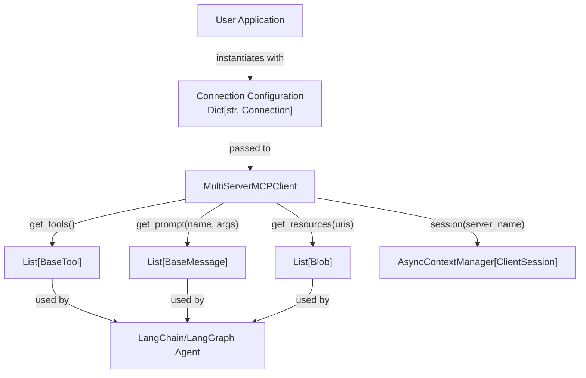
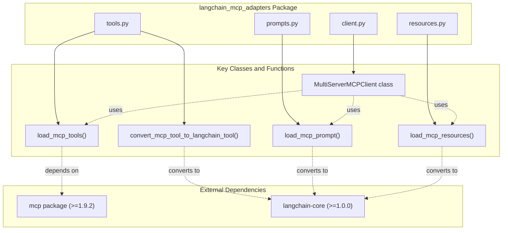
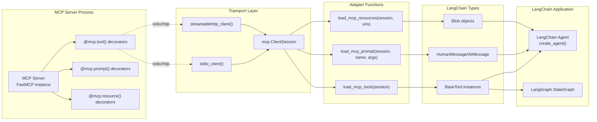

<!-- source: DeepWiki mcp.deepwiki.com · repo langchain-ai/langchain-mcp-adapters · page 1 Overview · fetched 2026-10-26 -->

# Overview

<details>
<summary>Relevant source files</summary>

The following files were used as context for generating this wiki page:

- [README.md](README.md)
- [langchain_mcp_adapters/py.typed](langchain_mcp_adapters/py.typed)
- [static/img/mcp.png](static/img/mcp.png)
- [uv.lock](uv.lock)

</details>


This document provides an introduction to the `langchain-mcp-adapters` package, explaining its purpose as a bridge between Anthropic's Model Context Protocol (MCP) servers and LangChain/LangGraph applications. It covers the core concepts, architecture, and use cases that define the package's scope.

For installation instructions, see [Installation](#1.1). For hands-on examples, see [Quick Start](#1.2). For detailed architecture, see [Architecture Overview](#1.3).

## Purpose and Scope

The `langchain-mcp-adapters` package is a Python library that converts [Anthropic Model Context Protocol (MCP)](https://modelcontextprotocol.io/introduction) tools, prompts, and resources into formats compatible with [LangChain](https://github.com/langchain-ai/langchain) and [LangGraph](https://github.com/langchain-ai/langgraph) agents. It enables developers to:

1. **Connect to MCP servers** via multiple transport mechanisms (stdio, HTTP, WebSocket, SSE) [[README.md:116-133]()]
2. **Convert MCP tools** into `langchain.tools.BaseTool` instances that LangChain agents can invoke [[README.md:12-13](), [README.md:58-82]()]
3. **Load MCP prompts** and convert them to LangChain message formats [[README.md:238-257]()]
4. **Access MCP resources** and convert them to LangChain `Blob` objects [[README.md:259-281]()]
5. **Manage multiple servers** simultaneously through a unified client interface [[README.md:84-138]()]

**Sources:** [pyproject.toml:5-9](), [README.md:1-13]()

## What is MCP?

The Model Context Protocol (MCP) is an open standard developed by Anthropic for exposing tools, prompts, and contextual resources to AI applications. MCP servers are standalone processes that:

- Define **tools** (functions) that AI agents can call [[README.md:41-49]()]
- Provide **prompts** (template messages) for agents to use [[README.md:238-257]()]
- Expose **resources** (text/binary data) as context [[README.md:259-281]()]

MCP servers can be written in any language and deployed locally (via stdio) or remotely (via HTTP/WebSocket/SSE). This package enables LangChain/LangGraph applications to consume these MCP capabilities seamlessly.

**Sources:** [README.md:3](), [README.md:36-53]()

## Core Components

The package is organized around three main layers:

### Client Layer: MultiServerMCPClient

The `MultiServerMCPClient` class provides the primary interface for connecting to one or more MCP servers and retrieving their capabilities.



**Title:** MultiServerMCPClient API Surface

**Sources:** [README.md:116-138](), [README.md:143-149]()

### Adapter Layer: Format Converters

Three adapter modules convert between MCP types and LangChain types:

| Adapter Module | MCP Type | LangChain Type | Key Function |
|----------------|----------|----------------|--------------|
| `tools.py` | `mcp.types.Tool` | `langchain.tools.BaseTool` | `load_mcp_tools()`, `convert_mcp_tool_to_langchain_tool()` |
| `prompts.py` | `mcp.types.PromptMessage` | `langchain.schema.BaseMessage` | `load_mcp_prompt()`, `convert_mcp_prompt_message_to_langchain_message()` |
| `resources.py` | `mcp.types.ResourceContents` | `langchain.schema.Blob` | `load_mcp_resources()`, `convert_mcp_resource_to_langchain_blob()` |

**Sources:** [README.md:58-82](), [README.md:238-281]()

### Transport Layer: Session Management

The package abstracts several transport mechanisms defined in the MCP specification:

- **stdio**: Local subprocess communication for development [[README.md:65-69]()]
- **http**: Streamable HTTP for stateless remote servers [[README.md:151-204]()]
- **sse**: Server-Sent Events for streaming [[README.md:208-212]()]
- **websocket**: WebSocket for full-duplex communication

For detailed transport documentation, see [Connection Types](#3.1).

**Sources:** [README.md:65-69](), [README.md:151-204](), [README.md:208-212]()

## Architecture Overview

The following diagram maps the package architecture to concrete code entities:



**Title:** Package Structure and Code Entity Relationships

**Sources:** [pyproject.toml:15-19](), [README.md:58-82]()

## Data Flow: MCP Server to LangChain Agent

The following diagram illustrates how data flows from MCP servers through the adapter layers to LangChain agents:



**Title:** End-to-End Data Flow from MCP Servers to LangChain Agents

**Sources:** [README.md:36-82](), [README.md:238-281]()

## Use Cases

The `langchain-mcp-adapters` package is designed for scenarios where:

### 1. Integrating Existing MCP Tools
You have existing MCP servers (developed in Python, Node.js, or other languages) and want to use their tools in LangChain agents without rewriting them. [[README.md:12-13]()]

### 2. Multi-Server Tool Aggregation
You need to connect to multiple MCP servers simultaneously and aggregate their tools into a single agent. For example, combining a local math server (stdio) with a remote weather API (HTTP). [[README.md:84-138]()]

**Example Configuration:**
```python
client = MultiServerMCPClient({
    "math": {"transport": "stdio", "command": "python", "args": ["/path/to/math_server.py"]},
    "weather": {"transport": "http", "url": "http://localhost:8000/mcp"}
})
```

**Sources:** [README.md:116-133]()

### 3. LangGraph Deployment
You want to deploy LangGraph agents that use MCP tools to production environments like LangGraph API Server, where tools need to be loaded asynchronously at graph creation time. [[README.md:283-329]()]

For deployment guidance, see [LangGraph API Server Deployment](#5.3).

### 4. Custom Transport Headers
You need to pass authentication tokens or custom metadata to remote MCP servers via `http` or `sse` transports. [[README.md:206-236]()]

**Sources:** [README.md:219-230]()

## Package Dependencies

The package has minimal required dependencies to maintain a lightweight footprint:

| Dependency | Version Constraint | Purpose |
|------------|-------------------|---------|
| `langchain-core` | `>=1.0.0,<2.0.0` | Provides `BaseTool`, `BaseMessage`, `Blob` types |
| `mcp` | `>=1.9.2` | Anthropic's MCP SDK for protocol implementation |

**Sources:** [pyproject.toml:15-19]()

## Version and License

- **Current Version:** 0.2.1 [[pyproject.toml:7]()]
- **License:** MIT [[pyproject.toml:14]()]
- **Python Requirement:** >=3.10 [[pyproject.toml:6]()]
- **Repository:** https://github.com/langchain-ai/langchain-mcp-adapters

**Sources:** [pyproject.toml:6-14]()

## Next Steps

To get started with the package:

1. Follow [Installation](#1.1) instructions to install dependencies.
2. Walk through the [Quick Start](#1.2) guide for a minimal working example.
3. Review [Architecture Overview](#1.3) for deeper understanding of the system design.

**Sources:** [README.md:15-28]()

---

