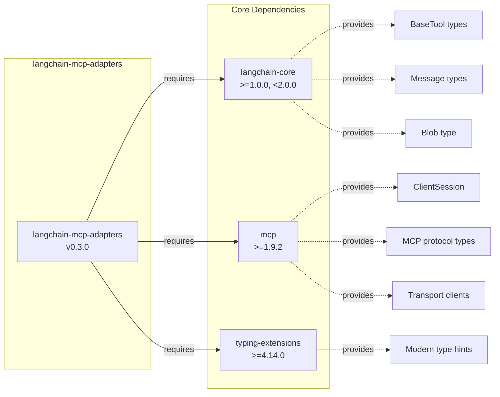
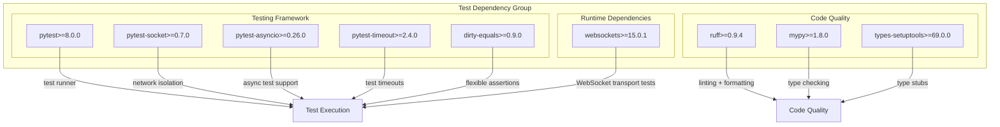
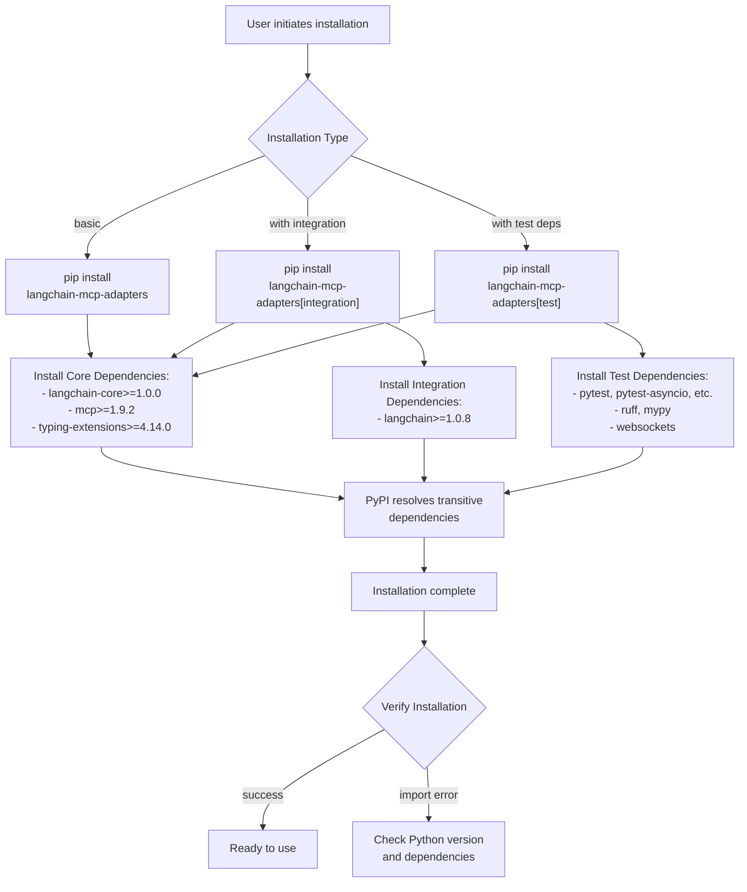
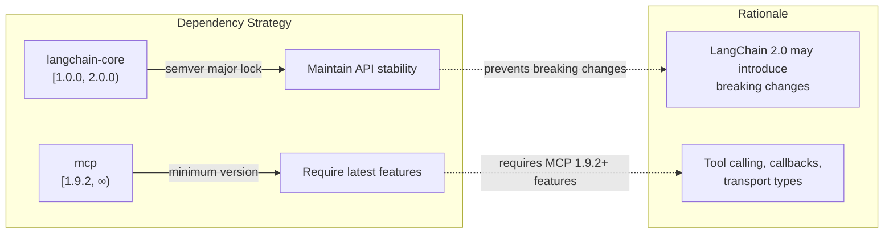

<!-- source: DeepWiki mcp.deepwiki.com · repo langchain-ai/langchain-mcp-adapters · page 1.1 Installation · fetched 2026-10-26 -->

# Installation

<details>
<summary>Relevant source files</summary>

The following files were used as context for generating this wiki page:

- [pyproject.toml](pyproject.toml)
- [uv.lock](uv.lock)

</details>


This page provides instructions for installing the `langchain-mcp-adapters` package and understanding its dependency requirements. For information about getting started with the package after installation, see [Quick Start](1.2). For development setup including testing tools and workflows, see [Development](7).

---

## System Requirements

The `langchain-mcp-adapters` package requires Python 3.10 or higher. This requirement is enforced at the package level to ensure compatibility with modern type hints and async features.

| Requirement | Version Constraint | Source |
|-------------|-------------------|---------|
| Python | >=3.10 | [pyproject.toml:14]() |

**Sources:** [pyproject.toml:14]()

---

## Basic Installation

Install the package from PyPI using pip:

```bash
pip install langchain-mcp-adapters
```

This installs the core package along with its required dependencies. The package is distributed via the Python Package Index and uses the `pdm-backend` build system [pyproject.toml:1-3]().

**Package Metadata:**

| Property | Value |
|----------|-------|
| Package Name | `langchain-mcp-adapters` |
| Current Version | 0.3.0 |
| License | MIT |
| Build Backend | pdm-backend |

**Sources:** [pyproject.toml:1-19]()

---

## Core Dependencies

The basic installation automatically includes three core dependencies that provide the essential functionality for bridging MCP servers and LangChain:



**Dependency Details:**

| Dependency | Version Constraint | Purpose |
|------------|-------------------|---------|
| `langchain-core` | >=1.0.0, <2.0.0 | Provides base types (`BaseTool`, `HumanMessage`, `AIMessage`, `Blob`) for LangChain integration |
| `mcp` | >=1.9.2 | Official Model Context Protocol SDK providing `ClientSession` and transport clients |
| `typing-extensions` | >=4.14.0 | Backports modern typing features for Python 3.10 compatibility |

**Sources:** [pyproject.toml:15-19]()

---

## Optional Dependencies

### Integration Dependency Group

For full LangChain agent functionality, install the integration dependency group:

```bash
pip install "langchain-mcp-adapters[integration]"
```

This adds the `langchain` package (>=1.0.8), which provides higher-level agent abstractions and utilities. The core package only requires `langchain-core`, keeping the base installation lightweight.

| Dependency | Version Constraint | Included In |
|------------|-------------------|-------------|
| `langchain` | >=1.0.8 | integration group |

**Sources:** [pyproject.toml:21-24]()

### Test Dependency Group

For contributors and developers running the test suite, install the test dependency group:

```bash
pip install "langchain-mcp-adapters[test]"
```

This installs development tools for testing, linting, and type checking:



**Test Dependencies:**

| Dependency | Version | Purpose |
|------------|---------|---------|
| `pytest` | >=8.0.0 | Test framework and runner |
| `pytest-socket` | >=0.7.0 | Network access control in tests |
| `pytest-asyncio` | >=0.26.0 | Async/await test support |
| `pytest-timeout` | >=2.4.0 | Test timeout enforcement |
| `dirty-equals` | >=0.9.0 | Flexible assertion matching |
| `ruff` | >=0.9.4 | Fast Python linter and formatter |
| `mypy` | >=1.8.0 | Static type checker |
| `types-setuptools` | >=69.0.0 | Type stubs for setuptools |
| `websockets` | >=15.0.1 | WebSocket protocol implementation for transport tests |

**Sources:** [pyproject.toml:25-35]()

---

## Installation Flow

The following diagram shows how the installation process resolves and installs dependencies based on the installation method chosen:



**Sources:** [pyproject.toml:15-35]()

---

## Verifying Installation

After installation, verify the package is correctly installed and can import successfully:

```python
import langchain_mcp_adapters
from langchain_mcp_adapters.client import MultiServerMCPClient
from langchain_mcp_adapters.tools import load_mcp_tools

# Check version
print(langchain_mcp_adapters.__version__)
```

The package provides a `py.typed` marker file indicating it includes type hints for static type checking with tools like mypy.

**Expected Import Structure:**

| Module Path | Primary Exports |
|-------------|-----------------|
| `langchain_mcp_adapters.client` | `MultiServerMCPClient` |
| `langchain_mcp_adapters.tools` | `load_mcp_tools`, `convert_mcp_tool_to_langchain_tool` |
| `langchain_mcp_adapters.prompts` | `load_mcp_prompt` |
| `langchain_mcp_adapters.resources` | `load_mcp_resources` |
| `langchain_mcp_adapters.sessions` | `create_session` |
| `langchain_mcp_adapters.callbacks` | `Callbacks` |
| `langchain_mcp_adapters.interceptors` | `ToolCallInterceptor` |

**Sources:** Architecture overview and project directory structure.

---

## Dependency Version Management

The package uses a lockfile system for reproducible builds during development. The `uv.lock` file pins exact versions of all transitive dependencies to ensure consistency across environments.

**Version Constraints Strategy:**



**Version Constraint Rationale:**

| Package | Constraint Type | Reasoning |
|---------|----------------|-----------|
| `langchain-core` | Upper bound (<2.0.0) | Prevents automatic upgrades to potentially breaking LangChain 2.x [pyproject.toml:16]() |
| `mcp` | Lower bound (>=1.9.2) | Requires features introduced in MCP 1.9.2 for full functionality [pyproject.toml:17]() |
| `typing-extensions` | Lower bound (>=4.14.0) | Ensures availability of modern typing constructs [pyproject.toml:18]() |

**Sources:** [pyproject.toml:15-19](), [uv.lock:1-7]()

---

## Build System Configuration

The package uses PDM (Python Development Master) as its build backend, specified in the `[build-system]` section. This is primarily relevant for contributors building the package from source or creating distributions.

**Build System Specification:**

| Property | Value |
|----------|-------|
| Build System | `pdm-backend` |
| Build Requirements | `["pdm-backend"]` |

For development workflows including building from source, see [Development Automation](7.3) and [Dependency Management](7.2).

**Sources:** [pyproject.toml:1-3]()

---

## Troubleshooting Installation

### Python Version Issues

If you encounter errors about Python version compatibility:

```
ERROR: Package 'langchain-mcp-adapters' requires a different Python: 3.9.0 not in '>=3.10'
```

**Solution:** Upgrade to Python 3.10 or higher. The package requires modern async features and type hints available only in Python 3.10+ [pyproject.toml:14]().

### Dependency Conflicts

If pip reports dependency conflicts with existing packages:

**Solution:** Create a fresh virtual environment to isolate dependencies:

```bash
python -m venv venv
source venv/bin/activate  # On Windows: venv\Scripts\activate
pip install langchain-mcp-adapters
```

### Import Errors After Installation

If imports fail with `ModuleNotFoundError`:

**Solution:** Verify the package is installed in the active Python environment:

```bash
pip list | grep langchain-mcp-adapters
python -c "import langchain_mcp_adapters; print(langchain_mcp_adapters.__file__)"
```

**Sources:** General Python packaging best practices and [pyproject.toml:14]() for version requirements.

---

