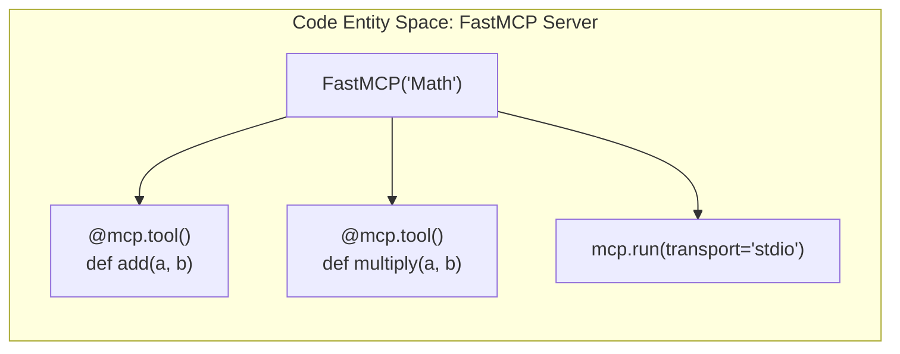
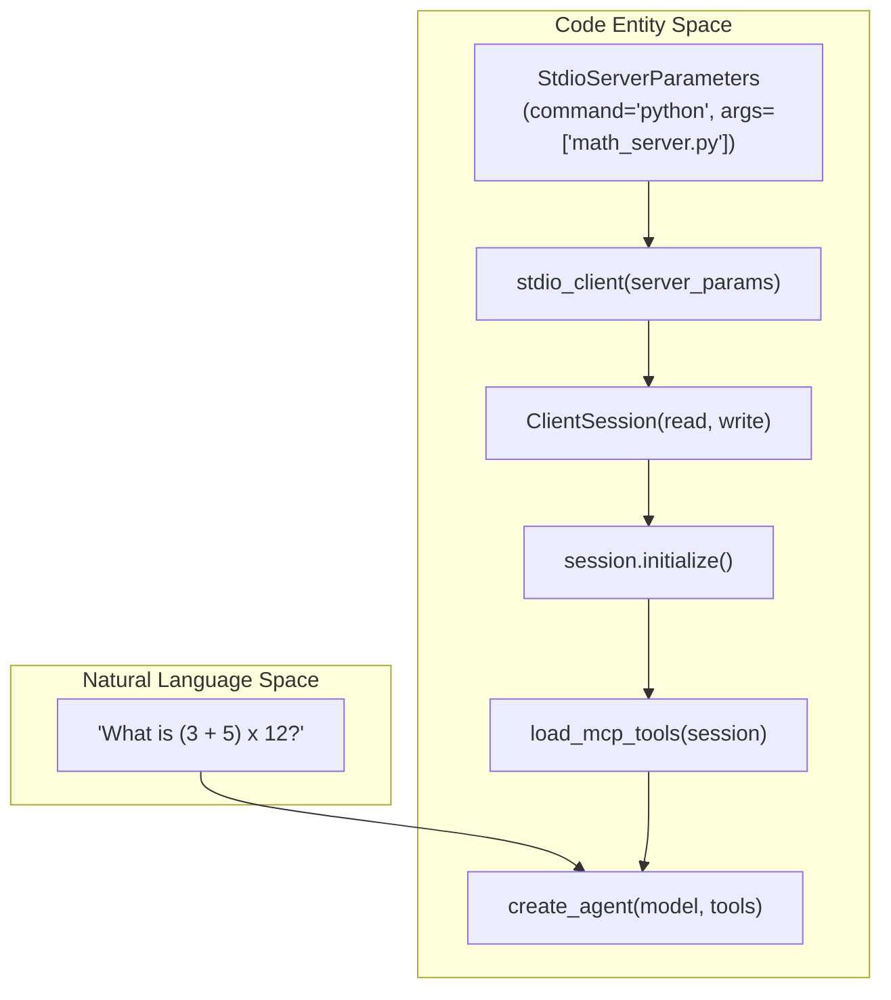
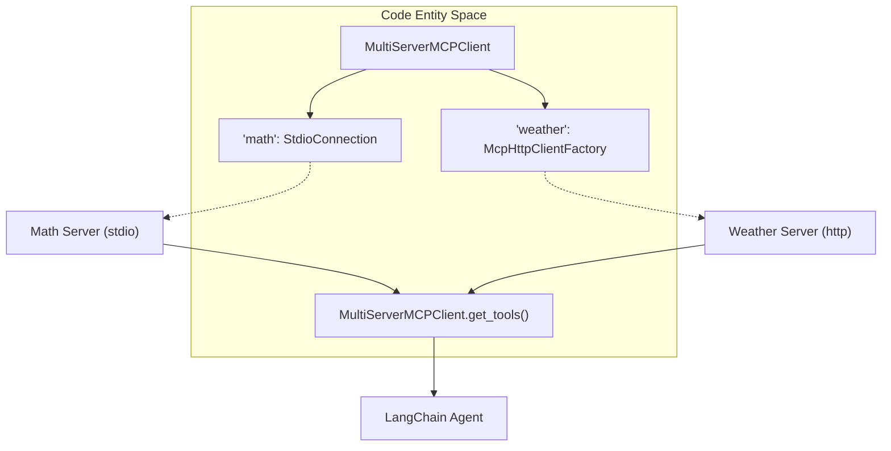
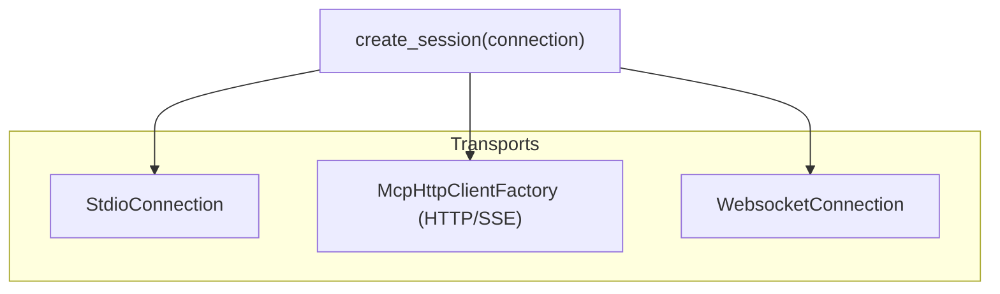
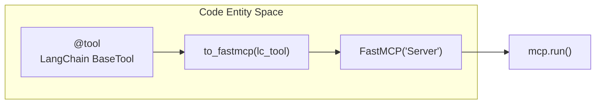

<!-- source: DeepWiki mcp.deepwiki.com · repo langchain-ai/langchain-mcp-adapters · page 1.2 Quick Start · fetched 2026-10-26 -->

# Quick Start

<details>
<summary>Relevant source files</summary>

The following files were used as context for generating this wiki page:

- [README.md](README.md)
- [langchain_mcp_adapters/client.py](langchain_mcp_adapters/client.py)
- [static/img/mcp.png](static/img/mcp.png)

</details>


This page provides working examples to get you up and running with `langchain-mcp-adapters` immediately. It demonstrates the core usage patterns for connecting MCP servers to LangGraph agents, covering both single-server and multi-server configurations.

For detailed documentation of individual components, see **2. Core Components**. For advanced transport configuration options, see **3.1 Connection Types**. For creating custom MCP servers, see **4.3 Creating Custom MCP Servers**.

## Prerequisites

Install the required packages:

```bash
pip install langchain-mcp-adapters langgraph "langchain[openai]"
export OPENAI_API_KEY=<your_api_key>
```

## Basic Single Server Example

The simplest usage pattern involves connecting to a single MCP server and loading its tools into a LangChain agent.

### Server Setup

**MCP Server with FastMCP**


Create a simple math server using `FastMCP`:

*Sources: [README.md:32-53]()*

### Client Connection

**Single Server Connection Flow**


The client code demonstrates the standard connection pattern using the `mcp` Python SDK and `langchain_mcp_adapters.tools.load_mcp_tools` [langchain_mcp_adapters/tools.py:108-111]():

1. Create `StdioServerParameters` with command and args.
2. Establish connection using `stdio_client`.
3. Initialize `ClientSession`.
4. Load tools using `load_mcp_tools` [langchain_mcp_adapters/tools.py:108-111]().
5. Run the agent.

*Sources: [README.md:55-83]()*

## Multi-Server Configuration

The `MultiServerMCPClient` [langchain_mcp_adapters/client.py:45-49]() enables connecting to multiple MCP servers simultaneously, aggregating their tools into a unified interface.

### Server Configuration

**Multi-Server Architecture**


The weather server example shows HTTP transport usage:

*Sources: [README.md:87-114](), [langchain_mcp_adapters/client.py:86-103]()*

### Client Usage

The multi-server client configuration accepts a dictionary mapping server names to their `Connection` [langchain_mcp_adapters/sessions.py:41-41]() parameters:

| Server | Transport | Configuration Key |
|--------|-----------|---------------|
| math | `stdio` | `command`, `args` [langchain_mcp_adapters/sessions.py:44-48]() |
| weather | `http` | `url` [langchain_mcp_adapters/sessions.py:65-68]() |

Key methods:
- `client.get_tools()` [langchain_mcp_adapters/client.py:162-162](): Returns aggregated tools from all servers. It creates a new session for each tool call by default [langchain_mcp_adapters/client.py:171-171]().
- `client.session(server_name)` [langchain_mcp_adapters/client.py:124-124](): An `asynccontextmanager` that yields an initialized `ClientSession` for a specific server.

*Sources: [README.md:116-149](), [langchain_mcp_adapters/client.py:124-161]()*

## Transport Options

The adapter supports multiple transport mechanisms for connecting to MCP servers via the `create_session` utility [langchain_mcp_adapters/sessions.py:128-128]().

**Transport Layer Overview**


### Streamable HTTP Example

For HTTP-based MCP servers, `MultiServerMCPClient` supports the `http` transport type, which handles streamable HTTP [langchain_mcp_adapters/sessions.py:65-68]():

```python
client = MultiServerMCPClient({
    "math": {
        "transport": "http",
        "url": "http://localhost:3000/mcp"
    }
})
```

*Sources: [README.md:186-204](), [langchain_mcp_adapters/sessions.py:65-68]()*

### Passing Runtime Headers

When using `http` or `sse` transports, you can include custom headers for authentication:

```python
client = MultiServerMCPClient({
    "weather": {
        "transport": "http",
        "url": "http://localhost:8000/mcp",
        "headers": {
            "Authorization": "Bearer YOUR_TOKEN"
        }
    }
})
```

*Sources: [README.md:213-234](), [langchain_mcp_adapters/sessions.py:61-61]()*

## Bidirectional Tool Conversion

The adapter supports converting LangChain tools to MCP format using `to_fastmcp` [langchain_mcp_adapters/tools.py:353-353]():

**LangChain to MCP Conversion**


This enables using existing LangChain tools within MCP servers by wrapping them in a `FastMCP` instance.

*Sources: [README.md:293-316](), [langchain_mcp_adapters/tools.py:353-376]()*

---

