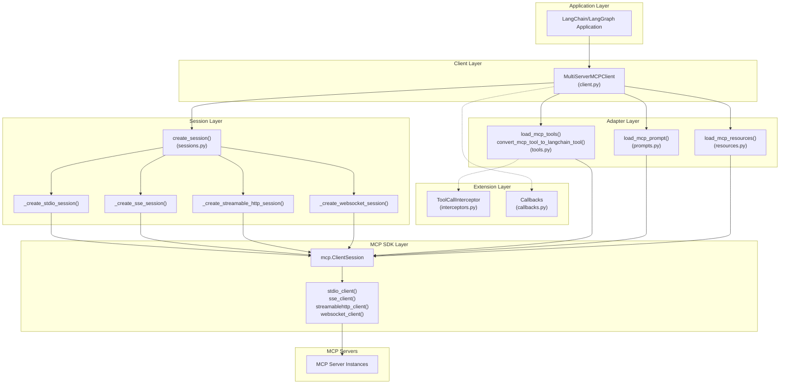
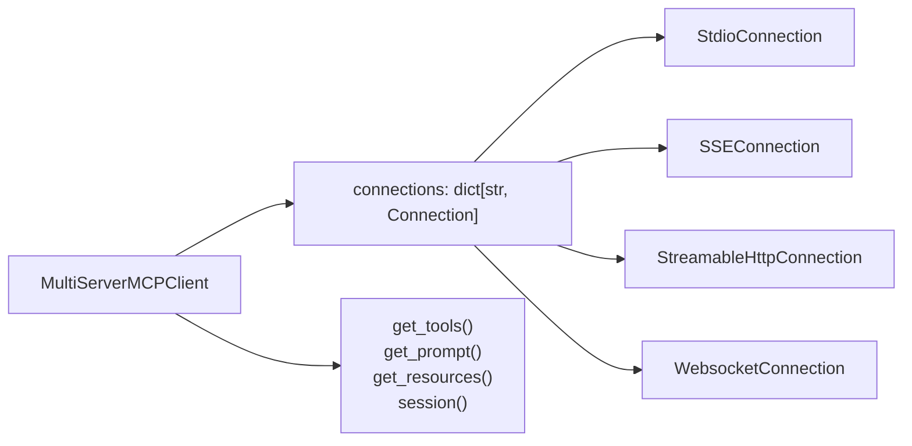
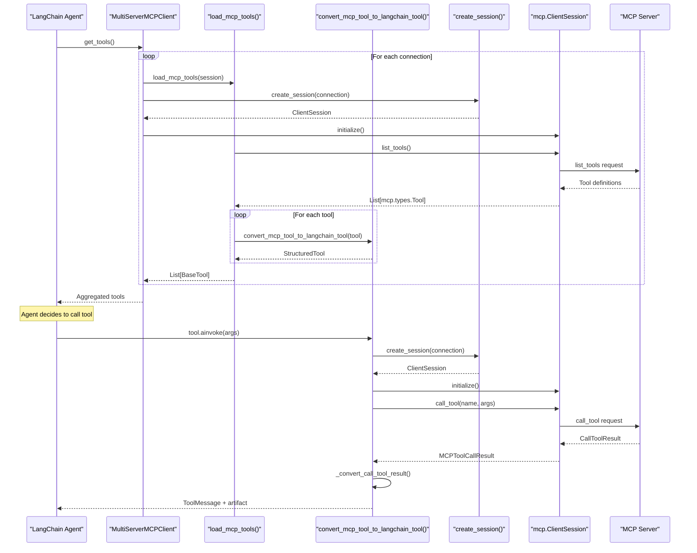
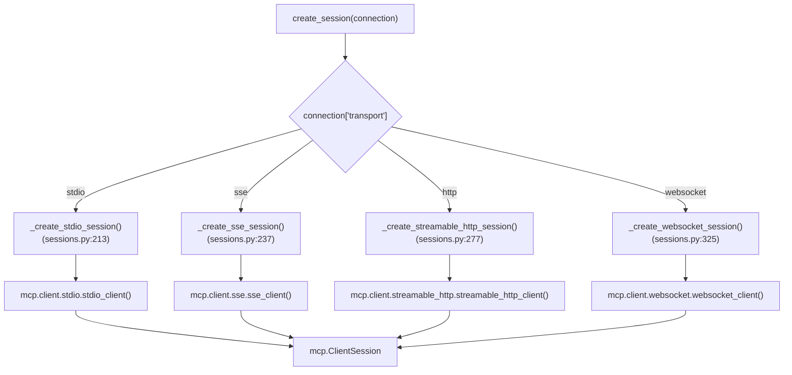
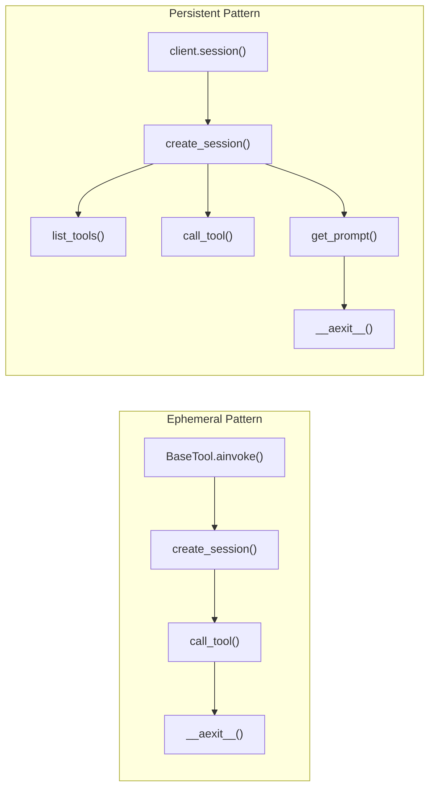

<!-- source: DeepWiki mcp.deepwiki.com · repo langchain-ai/langchain-mcp-adapters · page 1.3 Architecture Overview · fetched 2026-10-26 -->

# Architecture Overview

Relevant source files

The following files were used as context for generating this wiki page:

- [README.md](README.md)
- [langchain_mcp_adapters/client.py](langchain_mcp_adapters/client.py)
- [langchain_mcp_adapters/sessions.py](langchain_mcp_adapters/sessions.py)
- [langchain_mcp_adapters/tools.py](langchain_mcp_adapters/tools.py)
- [static/img/mcp.png](static/img/mcp.png)

This document explains the high-level architecture of `langchain-mcp-adapters`, showing how components interact to bridge Model Context Protocol (MCP) servers with LangChain/LangGraph agents. It covers the layered design, data flow patterns, transport abstraction, and extension mechanisms.

## System Overview

The `langchain-mcp-adapters` package implements a layered architecture that provides protocol translation between MCP servers and LangChain agents. The system is organized into five primary layers:

Title: High-Level Component Interaction

Sources: [langchain_mcp_adapters/client.py:1-42](), [langchain_mcp_adapters/tools.py:1-48](), [langchain_mcp_adapters/sessions.py:1-5]()

## Core Architecture Layers

The system is decomposed into distinct layers with well-defined responsibilities:

| Layer | Primary Components | Responsibility | Key Files |
|-------|-------------------|----------------|-----------|
| **Client Layer** | `MultiServerMCPClient` | Entry point for managing multiple MCP server connections | `client.py` |
| **Adapter Layer** | Tool, Prompt, Resource adapters | Protocol translation between MCP and LangChain formats | `tools.py`, `prompts.py`, `resources.py` |
| **Extension Layer** | `ToolCallInterceptor`, `Callbacks` | Request/response modification and event handling | `interceptors.py`, `callbacks.py` |
| **Session Layer** | `create_session()`, transport implementations | Connection management and transport abstraction | `sessions.py` |
| **MCP SDK Layer** | `mcp.ClientSession` | Low-level MCP protocol implementation | External dependency |

### Client Layer

The `MultiServerMCPClient` class ([langchain_mcp_adapters/client.py:45-49]()) serves as the primary interface for applications. It manages a dictionary of server connections ([langchain_mcp_adapters/client.py:116-118]()), aggregates tools from multiple servers ([langchain_mcp_adapters/client.py:162-200]()), and provides methods for accessing prompts and resources.

Title: MultiServerMCPClient Structure

Sources: [langchain_mcp_adapters/client.py:45-123](), [langchain_mcp_adapters/sessions.py:207-209]()

### Adapter Layer

The adapter layer provides specialized conversion functions:

1. **Tool Adapter**: Converts `mcp.types.Tool` to `langchain_core.tools.BaseTool` using `load_mcp_tools()` ([langchain_mcp_adapters/tools.py:436-497]()). Each converted tool wraps the MCP tool call mechanism and converts results using `_convert_call_tool_result()` ([langchain_mcp_adapters/tools.py:135-198]()).
2. **Prompt Adapter**: Transforms `mcp.types.PromptMessage` to LangChain messages (`HumanMessage`/`AIMessage`) through `load_mcp_prompt()` ([langchain_mcp_adapters/prompts.py:1-5]()).
3. **Resource Adapter**: Loads MCP resources and converts them to `langchain_core.documents.Blob` objects via `load_mcp_resources()` ([langchain_mcp_adapters/resources.py:1-5]()).

Sources: [langchain_mcp_adapters/tools.py:1-5](), [langchain_mcp_adapters/prompts.py:1-5](), [langchain_mcp_adapters/resources.py:1-5]()

## Data Flow Pipeline

The following diagram shows the complete data flow for tool execution, the most common operation:

Title: Tool Execution Data Flow

**Key data transformations:**

| Stage | Input Type | Output Type | Function |
|-------|-----------|-------------|----------|
| Tool Discovery | `mcp.types.Tool` | `langchain_core.tools.BaseTool` | `convert_mcp_tool_to_langchain_tool()` [langchain_mcp_adapters/tools.py:436]() |
| Result Conversion | `MCPToolCallResult` | `list[ToolMessageContentBlock]` | `_convert_call_tool_result()` [langchain_mcp_adapters/tools.py:135]() |
| Content Block | `mcp.types.ContentBlock` | `ToolMessageContentBlock` | `_convert_mcp_content_to_lc_block()` [langchain_mcp_adapters/tools.py:175]() |

Sources: [langchain_mcp_adapters/tools.py:84-497](), [langchain_mcp_adapters/client.py:162-200]()

## Transport Abstraction

The session layer implements a dispatcher pattern to abstract transport differences:

Title: Session Dispatcher Pattern

### Connection Type Configurations

Each transport type uses a `TypedDict` configuration ([langchain_mcp_adapters/sessions.py:82-205]()):

| Transport | Config Type | Required Fields | Transport Mechanism |
|-----------|-------------|-----------------|---------------------|
| `stdio` | `StdioConnection` | `command`, `args` | Subprocess stdin/stdout |
| `sse` | `SSEConnection` | `url` | Server-Sent Events over HTTP |
| `streamable_http` | `StreamableHttpConnection` | `url` | HTTP streaming with SSE |
| `websocket` | `WebsocketConnection` | `url` | WebSocket bidirectional |

Sources: [langchain_mcp_adapters/sessions.py:82-357]()

## Component Interaction Patterns

### Session Creation Modes

The system supports two session creation patterns:

1. **Ephemeral Sessions**: A new session is created for each tool call when only a `Connection` is provided. This is the default behavior when using `MultiServerMCPClient.get_tools()` ([langchain_mcp_adapters/client.py:171]()).
2. **Persistent Sessions**: Applications can explicitly manage sessions using the `MultiServerMCPClient.session()` context manager ([langchain_mcp_adapters/client.py:125-161]()) for long-lived connections.

Title: Session Lifecycle Patterns

Sources: [langchain_mcp_adapters/client.py:114-161](), [langchain_mcp_adapters/client.py:169-171]()

### Interceptor Chain Composition

The interceptor mechanism uses function composition to build an onion-layer architecture. The `MultiServerMCPClient` accepts a list of `tool_interceptors` ([langchain_mcp_adapters/client.py:56]()) which are applied to tool calls.

Title: Tool Call Interceptor Chain

Sources: [langchain_mcp_adapters/client.py:56-59](), [langchain_mcp_adapters/interceptors.py:1-5]()

---

