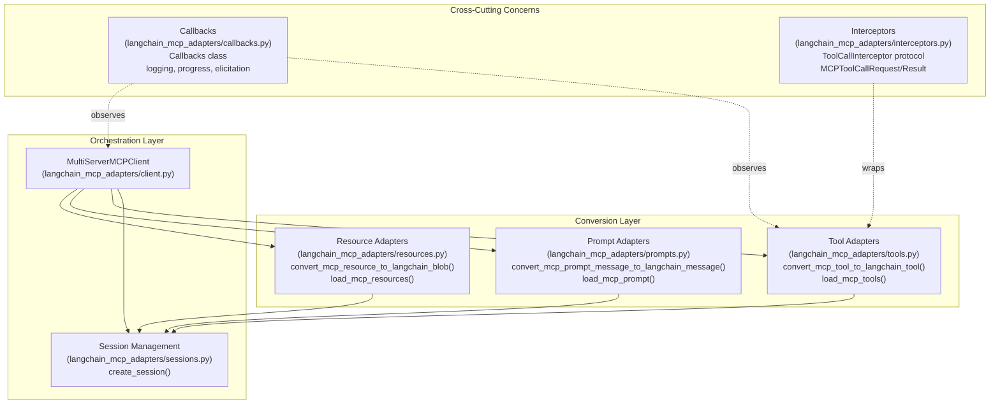
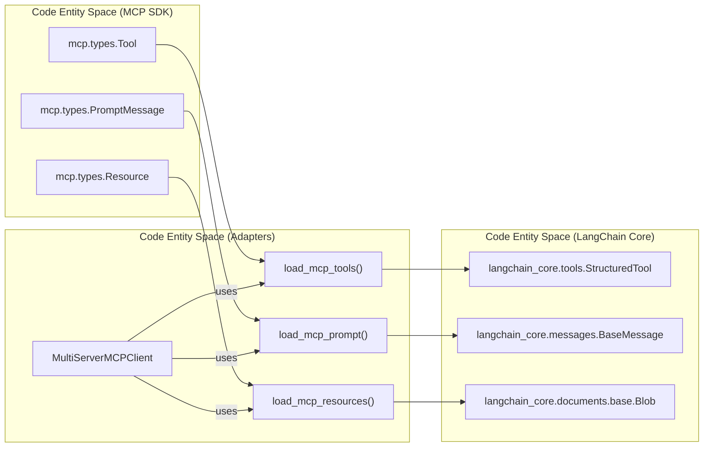
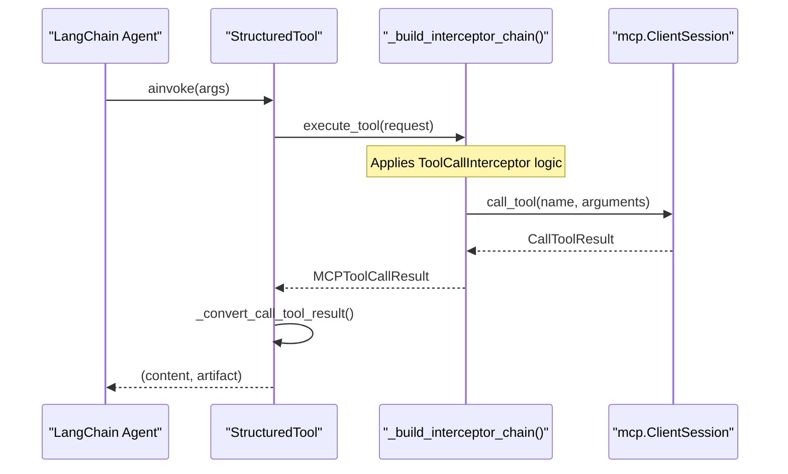

<!-- source: DeepWiki mcp.deepwiki.com · repo langchain-ai/langchain-mcp-adapters · page 2 Core Components · fetched 2026-10-26 -->

# Core Components

Relevant source files

The following files were used as context for generating this wiki page:

- [examples/servers/streamable-http-stateless/mcp_simple_streamablehttp_stateless/server.py](examples/servers/streamable-http-stateless/mcp_simple_streamablehttp_stateless/server.py)
- [langchain_mcp_adapters/__init__.py](langchain_mcp_adapters/__init__.py)
- [langchain_mcp_adapters/client.py](langchain_mcp_adapters/client.py)
- [langchain_mcp_adapters/tools.py](langchain_mcp_adapters/tools.py)

## Purpose and Scope

This document provides an overview of the main components that constitute the `langchain-mcp-adapters` system. These components work together to bridge Anthropic's Model Context Protocol (MCP) with LangChain and LangGraph frameworks. The focus is on the architectural structure and how the core modules interact to enable MCP-to-LangChain translation.

For detailed information about specific transport mechanisms and connection management, see [Session Management and Transport](#3). For integration patterns with LangChain agents and LangGraph workflows, see [Integration with LangChain and LangGraph](#5).

## Component Architecture

The adapter system consists of six primary components organized in three layers: orchestration, conversion, and cross-cutting concerns.

**Sources:** [langchain_mcp_adapters/client.py:1-42](), [langchain_mcp_adapters/tools.py:1-49]()

## Core Components Overview

### MultiServerMCPClient

The `MultiServerMCPClient` class serves as the primary entry point for interacting with MCP servers. It orchestrates connections to multiple servers simultaneously and provides unified methods for retrieving tools, prompts, and resources. For details, see [MultiServerMCPClient](#2.1).

| Method | Purpose | Return Type |
|--------|---------|-------------|
| `session(server_name)` | Create async context manager for server connection | `AsyncIterator[ClientSession]` |
| `get_tools(server_name?)` | Load tools from one or all servers | `list[BaseTool]` |
| `get_prompt(server_name, prompt_name)` | Load specific prompt from server | `list[HumanMessage \| AIMessage]` |
| `get_resources(server_name?, uris?)` | Load resources from one or all servers | `list[Blob]` |

**Sources:** [langchain_mcp_adapters/client.py:45-280]()

### Tool Adapters

The tool adapter system converts MCP tool definitions into LangChain `BaseTool` instances. The core conversion function is `convert_mcp_tool_to_langchain_tool()`, which creates `StructuredTool` objects. For details, see [Tool Adapters](#2.2).

The conversion handles complex content types via `_convert_mcp_content_to_lc_block()`:

| MCP Content Type | LangChain Content Block |
|-----------------|------------------------|
| `TextContent` | `{"type": "text", "text": ...}` |
| `ImageContent` | `{"type": "image", "image_url": {"url": "data:..."}}` |
| `ResourceLink` (image) | `{"type": "image", "image_url": {"url": ...}}` |
| `ResourceLink` (other) | `{"type": "file", "file_data": {"url": ...}}` |
| `EmbeddedResource` (text) | `{"type": "text", "text": ...}` |
| `AudioContent` | Not supported (raises `NotImplementedError`) |

**Sources:** [langchain_mcp_adapters/tools.py:175-233](), [langchain_mcp_adapters/tools.py:416-497]()

### Prompt Adapters

Prompt adapters convert MCP `PromptMessage` objects to LangChain message types. The system maps role-based messages:
- `role="user"` → `HumanMessage`
- `role="assistant"` → `AIMessage`

For details, see [Prompt Adapters](#2.3).

**Sources:** [langchain_mcp_adapters/client.py:202-211]()

### Resource Adapters

Resource adapters transform MCP resources into LangChain `Blob` objects. The `load_mcp_resources()` function supports loading all resources or filtering by specific URIs. For details, see [Resource Adapters](#2.4).

**Sources:** [langchain_mcp_adapters/client.py:213-253]()

## Data Flow Through Components

The following diagram maps the transition from MCP server entities to LangChain code entities.

**Sources:** [langchain_mcp_adapters/client.py:152-253](), [langchain_mcp_adapters/tools.py:416-497]()

## Cross-Cutting Concerns

### Callbacks System

The `Callbacks` class provides observability into MCP operations. It supports logging, progress tracking, and elicitation (interactive prompts). Callbacks are contextualized via `CallbackContext`. For details, see [Callbacks](#2.5).

**Sources:** [langchain_mcp_adapters/client.py:119](), [langchain_mcp_adapters/client.py:151-153]()

### Interceptors System

The `ToolCallInterceptor` protocol enables request/response modification using an "onion pattern". The chain is built via `_build_interceptor_chain()`. For details, see [Interceptors](#2.6).

**Sources:** [langchain_mcp_adapters/tools.py:201-232](), [langchain_mcp_adapters/client.py:56-57]()

## Tool Execution Pipeline

This diagram bridges the high-level execution flow to the internal adapter functions.

**Sources:** [langchain_mcp_adapters/tools.py:305-414](), [langchain_mcp_adapters/tools.py:201-232]()

## Tool Name Prefixing and Error Handling

- **Prefixing**: The `tool_name_prefix` parameter on `MultiServerMCPClient` prevents name collisions (e.g., `"weather_search"`).
- **Error Handling**: `handle_tool_errors=True` converts MCP execution errors (`isError=True`) into `ToolMessage` with `status="error"`, allowing agents to self-correct.

**Sources:** [langchain_mcp_adapters/client.py:68-79](), [langchain_mcp_adapters/tools.py:99-158]()

## Pagination Support

The `_list_all_tools()` helper function handles MCP's pagination protocol using the `nextCursor` field, with a safety limit of `MAX_ITERATIONS=1000`.

**Sources:** [langchain_mcp_adapters/tools.py:235-269](), [langchain_mcp_adapters/tools.py:67]()

---

