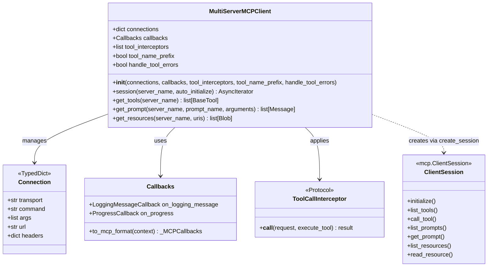
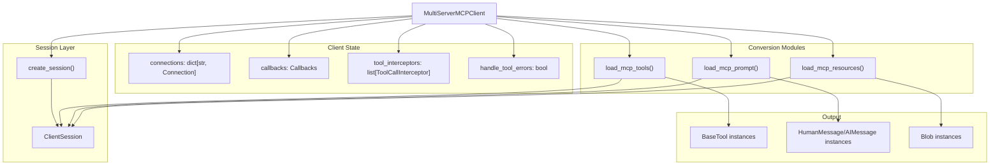
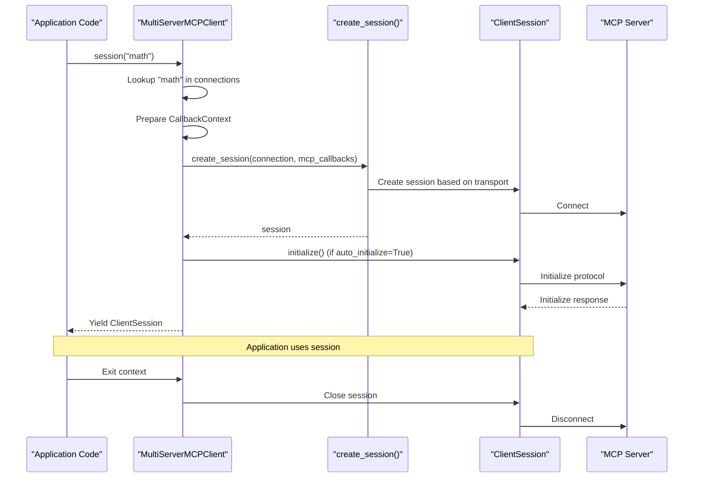

<!-- source: DeepWiki mcp.deepwiki.com · repo langchain-ai/langchain-mcp-adapters · page 2.1 MultiServerMCPClient · fetched 2026-10-26 -->

# MultiServerMCPClient

<details>
<summary>Relevant source files</summary>

The following files were used as context for generating this wiki page:

- [langchain_mcp_adapters/client.py](langchain_mcp_adapters/client.py)
- [tests/test_client.py](tests/test_client.py)

</details>


## Purpose and Scope

The `MultiServerMCPClient` class is the primary interface for connecting to and managing multiple MCP (Model Context Protocol) servers within a LangChain application. This class provides a unified API for loading tools, prompts, and resources from one or more MCP servers, abstracting the complexity of managing individual server connections and transport protocols.

This page documents the client's architecture, initialization, session management, and methods for accessing MCP artifacts. For details on how tools are converted from MCP to LangChain format, see [Tool Adapters](2.2). For prompt and resource conversion details, see [Prompt Adapters](2.3) and [Resource Adapters](2.4).

## Class Architecture

The `MultiServerMCPClient` serves as an orchestration layer that manages multiple MCP server connections and delegates to specialized conversion modules for transforming MCP artifacts into LangChain-compatible objects.

### Core Class Structure



**Sources:** [langchain_mcp_adapters/client.py:45-122](), [langchain_mcp_adapters/callbacks.py:1-99](), [langchain_mcp_adapters/sessions.py:22-30]()

### Component Relationships

The following diagram shows how `MultiServerMCPClient` interacts with other adapter components to fulfill requests:



**Sources:** [langchain_mcp_adapters/client.py:1-31](), [langchain_mcp_adapters/tools.py:1-31](), [langchain_mcp_adapters/prompts.py:1-20](), [langchain_mcp_adapters/resources.py:1-21]()

## Initialization

### Constructor Parameters

The `MultiServerMCPClient` constructor accepts parameters for configuring client behavior and error handling:

| Parameter | Type | Required | Description |
|-----------|------|----------|-------------|
| `connections` | `dict[str, Connection] \| None` | No | Dictionary mapping server names to connection configurations |
| `callbacks` | `Callbacks \| None` | No | Callback handlers for logging and progress events |
| `tool_interceptors` | `list[ToolCallInterceptor] \| None` | No | Chain of interceptors for modifying tool requests/responses |
| `tool_name_prefix` | `bool` | No | If `True`, prefixes tool names with server name (e.g., `"math_add"`) |
| `handle_tool_errors` | `bool` | No | If `True` (default), returns `isError=True` as a `ToolMessage` status="error" for agent self-correction |

**Sources:** [langchain_mcp_adapters/client.py:51-80]()

### Tool Execution Error Handling

The `handle_tool_errors` parameter controls how the client behaves when an MCP tool execution fails (`isError=True` in `CallToolResult`):
- **True (Default):** The error is captured and returned as a `ToolMessage` with `status="error"`. This allows LangChain agents to observe the error and attempt to self-correct. [langchain_mcp_adapters/client.py:72-75]()
- **False:** A `ToolException` is raised immediately. [langchain_mcp_adapters/client.py:75-76]()

Note that transport failures or content conversion errors (e.g., unsupported audio) will always raise exceptions regardless of this setting. [langchain_mcp_adapters/client.py:76-79]()

#### Tool Name Prefixing

When `tool_name_prefix=True`, the client automatically prefixes tool names with their server name using an underscore separator:

```python
client = MultiServerMCPClient(
    connections={
        "math": {...},
        "weather": {...}
    },
    tool_name_prefix=True
)

tools = await client.get_tools()
# Tool names will be: "math_add", "weather_get_weather"
```

**Sources:** [langchain_mcp_adapters/client.py:68-71](), [langchain_mcp_adapters/client.py:121]()

### Connection Configuration Structure

Each entry in the `connections` dictionary maps a user-defined server name to a `Connection` configuration. Supported transports include `stdio`, `http`, `sse`, and `websocket`.

#### Stdio Transport

```python
{
    "math": {
        "transport": "stdio",
        "command": "python3",
        "args": ["math_server.py"],
        "env": {"API_KEY": "secret"} # Optional environment variables
    }
}
```

**Sources:** [langchain_mcp_adapters/sessions.py:33-42](), [tests/test_client.py:133-137]()

#### HTTP and WebSocket Transports

```python
{
    "weather": {
        "transport": "http", # or "sse" or "websocket"
        "url": "http://localhost:8000/mcp",
        "headers": {"Authorization": "Bearer ..."} # Optional
    }
}
```

**Sources:** [langchain_mcp_adapters/client.py:95-99](), [langchain_mcp_adapters/sessions.py:45-66]()

## Session Management

### The `session()` Method

The `session()` method creates and manages a temporary connection to a specific MCP server. It returns an async context manager that yields an initialized `ClientSession`.

```python
@asynccontextmanager
async def session(
    self,
    server_name: str,
    *,
    auto_initialize: bool = True,
) -> AsyncIterator[ClientSession]:
```

**Sources:** [langchain_mcp_adapters/client.py:124-143]()

### Session Request Flow



**Sources:** [langchain_mcp_adapters/client.py:144-161](), [langchain_mcp_adapters/sessions.py:100-110]()

## Loading Capabilities

### Tools: `get_tools()`

The `get_tools()` method loads MCP tools from one or all configured servers.

#### Method Signature

```python
async def get_tools(self, *, server_name: str | None = None) -> list[BaseTool]:
```

If `server_name` is `None`, the client iterates through all configured connections and loads tools concurrently using `asyncio.gather`. [langchain_mcp_adapters/client.py:177-192]()

**Important:** A new session is created for every tool invocation when tools are loaded via `get_tools()`. [langchain_mcp_adapters/client.py:169-171]()

### Prompts: `get_prompt()`

Loads a specific prompt from an MCP server and converts it to LangChain messages.

```python
async def get_prompt(
    self,
    server_name: str,
    prompt_name: str,
    *,
    arguments: dict[str, Any] | None = None,
) -> list[HumanMessage | AIMessage]:
```

**Sources:** [langchain_mcp_adapters/client.py:194-211]()

### Resources: `get_resources()`

Loads resources (text or binary) from MCP servers as LangChain `Blob` objects.

```python
async def get_resources(
    self,
    server_name: str | None = None,
    *,
    uris: str | list[str] | None = None,
) -> list[Blob]:
```

**Sources:** [langchain_mcp_adapters/client.py:213-253]()

## Context Manager Deprecation

As of `langchain-mcp-adapters 0.1.0`, `MultiServerMCPClient` cannot be used directly as a context manager (e.g., `async with MultiServerMCPClient(...)`). Attempting to do so will raise an error explaining the correct usage patterns.

**Correct Patterns:**
1. Call methods directly: `await client.get_tools()`
2. Use explicit sessions: `async with client.session(server_name) as session:`

**Sources:** [langchain_mcp_adapters/client.py:33-42](), [langchain_mcp_adapters/client.py:255-263]()

---

