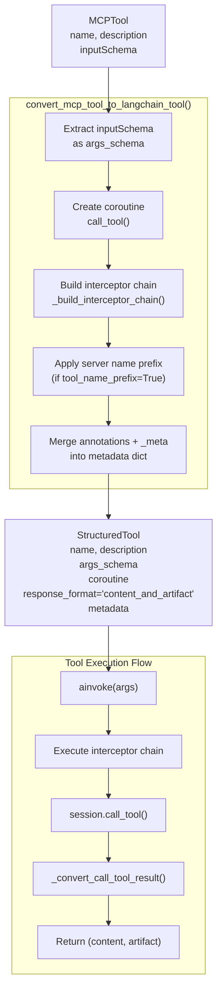
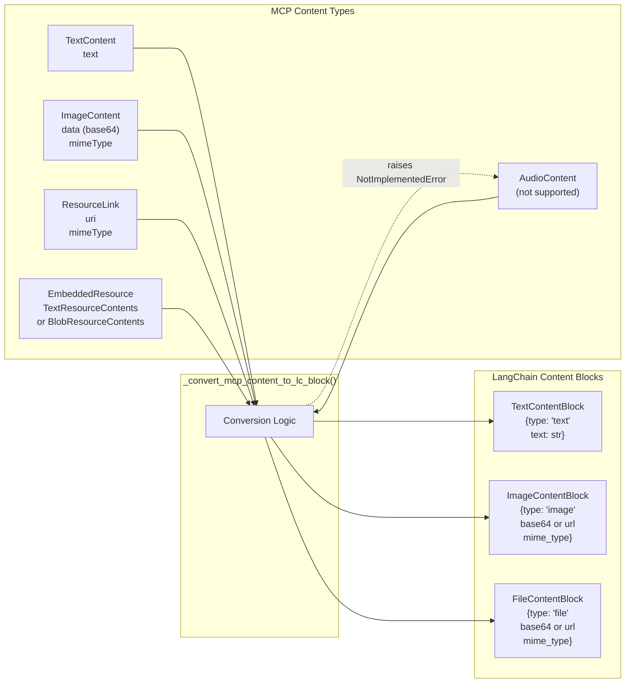
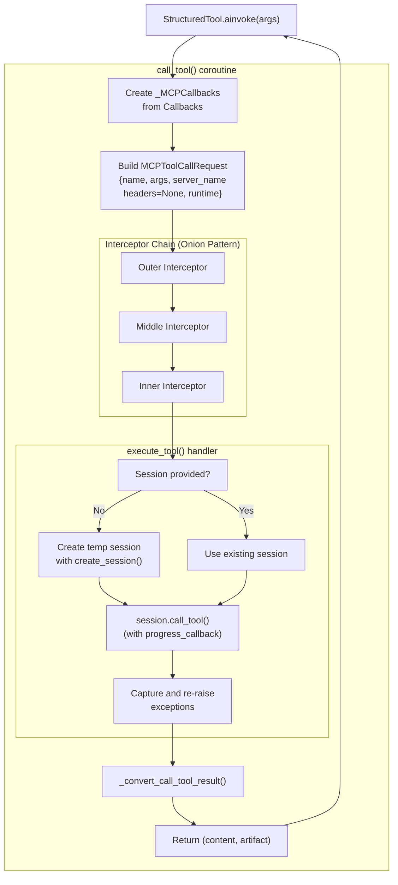
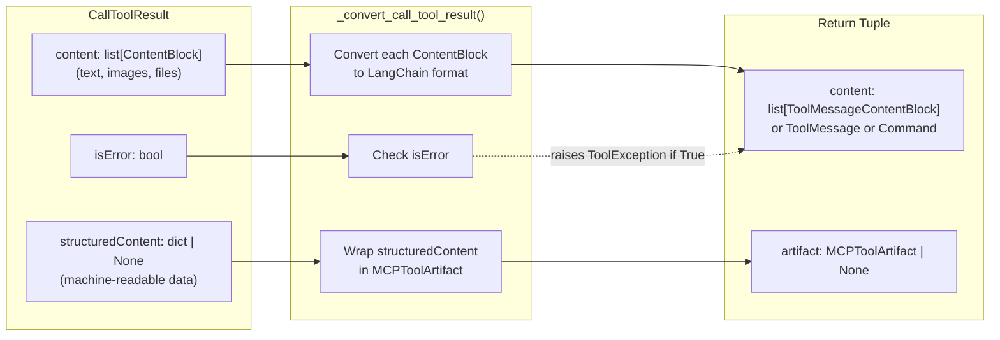
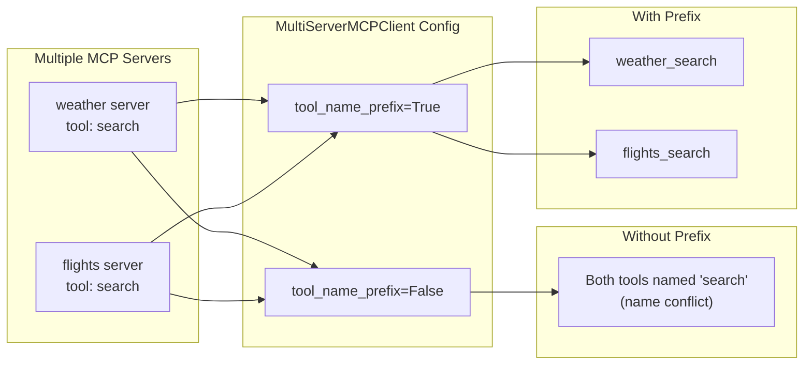
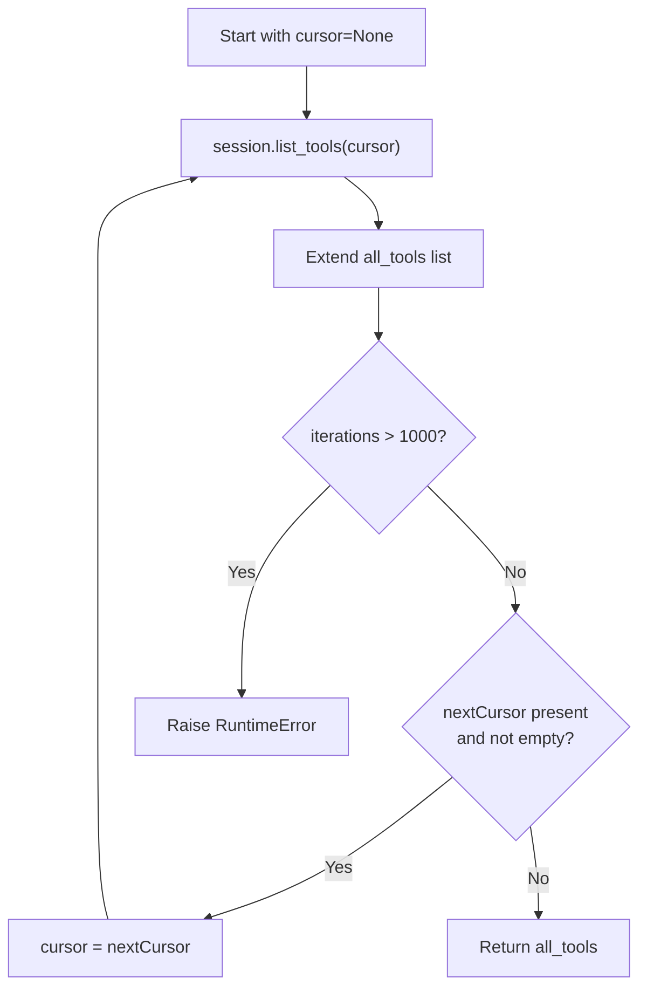
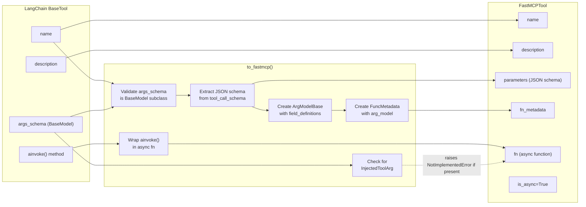

<!-- source: DeepWiki mcp.deepwiki.com · repo langchain-ai/langchain-mcp-adapters · page 2.2 Tool Adapters · fetched 2026-10-26 -->

# Tool Adapters

<details>
<summary>Relevant source files</summary>

The following files were used as context for generating this wiki page:

- [langchain_mcp_adapters/tools.py](langchain_mcp_adapters/tools.py)
- [tests/test_tools.py](tests/test_tools.py)

</details>


## Purpose and Scope

This document describes how MCP (Model Context Protocol) tools are converted to LangChain-compatible `BaseTool` instances. Tool adapters enable MCP server tools to be used in LangChain agents and LangGraph workflows by translating between MCP's tool format and LangChain's tool interface.

For information about managing connections to MCP servers, see [MultiServerMCPClient](2.1). For details on interceptors and callbacks that modify tool behavior, see [Callbacks](2.5) and [Interceptors](2.6).

**Sources**: [langchain_mcp_adapters/tools.py:1-48]()

## Core Conversion Functions

The tools module provides three primary functions for tool conversion:

| Function | Purpose | Input | Output |
|----------|---------|-------|--------|
| `convert_mcp_tool_to_langchain_tool()` | Convert a single MCP tool | `MCPTool` | `BaseTool` (specifically `StructuredTool`) |
| `load_mcp_tools()` | Load all tools from a session | `ClientSession` or `Connection` | `list[BaseTool]` |
| `to_fastmcp()` | Convert LangChain tool back to FastMCP | `BaseTool` | `FastMCPTool` |

All conversion functions support optional parameters for callbacks, interceptors, and server naming. The `load_mcp_tools()` function automatically handles pagination when listing tools from MCP servers.

**Sources**: [langchain_mcp_adapters/tools.py:436-538](), [langchain_mcp_adapters/tools.py:541-602](), [langchain_mcp_adapters/tools.py:630-677]()

## MCP Tool to LangChain Tool Conversion



The conversion process creates a `StructuredTool` instance where:
- `name` is derived from the MCP tool name, optionally prefixed with server name [langchain_mcp_adapters/tools.py:526-529]().
- `description` comes from the MCP tool description [langchain_mcp_adapters/tools.py:530]().
- `args_schema` is the MCP `inputSchema` dictionary (JSON Schema format) [langchain_mcp_adapters/tools.py:531]().
- `coroutine` is the async `call_tool()` function that handles execution [langchain_mcp_adapters/tools.py:436-515]().
- `response_format` is set to `"content_and_artifact"` to return both content and structured data [langchain_mcp_adapters/tools.py:532]().
- `metadata` merges tool annotations and optional `_meta` fields [langchain_mcp_adapters/tools.py:521-525]().

**Sources**: [langchain_mcp_adapters/tools.py:436-538]()

## Content Block Conversion

MCP tools return results as `CallToolResult` objects containing a list of content blocks. These blocks must be converted to LangChain's content block format:



### Content Block Mapping Rules

| MCP Type | Condition | LangChain Type | Fields |
|----------|-----------|----------------|--------|
| `TextContent` | Always | `TextContentBlock` | `text` |
| `ImageContent` | Always | `ImageContentBlock` | `base64`, `mime_type` |
| `ResourceLink` | `mimeType` starts with `image/` | `ImageContentBlock` | `url`, `mime_type` |
| `ResourceLink` | Other `mimeType` | `FileContentBlock` | `url`, `mime_type` |
| `EmbeddedResource` | Contains `TextResourceContents` | `TextContentBlock` | `text` |
| `EmbeddedResource` | Contains `BlobResourceContents` with image MIME | `ImageContentBlock` | `base64`, `mime_type` |
| `EmbeddedResource` | Contains `BlobResourceContents` with other MIME | `FileContentBlock` | `base64`, `mime_type` |
| `AudioContent` | N/A | Not supported | Raises `NotImplementedError` |

**Sources**: [langchain_mcp_adapters/tools.py:175-223](), [langchain_mcp_adapters/tools.py:226-289](), [tests/test_tools.py:41-404]()

## Tool Execution Flow with Interceptors

The tool execution process involves multiple layers, with interceptors forming an "onion pattern" around the core execution:



### Key Execution Details

1. **Session Handling**: If no `session` is provided, a temporary session is created using `connection` config [langchain_mcp_adapters/tools.py:471-498]().

2. **Interceptor Chain**: Interceptors are composed in reverse order using `_build_interceptor_chain()`, creating an onion pattern where the first interceptor in the list becomes the outermost layer [langchain_mcp_adapters/tools.py:306-337]().

3. **Runtime Context**: The `runtime` parameter (from LangGraph's `InjectedToolArg`) is passed through `MCPToolCallRequest` to interceptors [langchain_mcp_adapters/tools.py:411-516]().

4. **Header Modification**: Interceptors can modify headers in `MCPToolCallRequest`, which creates a new connection config for HTTP-based transports [langchain_mcp_adapters/tools.py:450-467]().

5. **Exception Handling**: Exceptions are captured and re-raised outside the context manager to work around MCP SDK issues [langchain_mcp_adapters/tools.py:487-498]().

**Sources**: [langchain_mcp_adapters/tools.py:411-519](), [langchain_mcp_adapters/tools.py:306-337](), [langchain_mcp_adapters/tools.py:434-506]()

## Tool Artifacts and Structured Content

MCP tools can return structured content in addition to human-readable content. This is handled via the `MCPToolArtifact` TypedDict:



### MCPToolArtifact Structure

```python
class MCPToolArtifact(TypedDict):
    """Artifact returned from MCP tool calls.
    
    Attributes:
        structured_content: The structured content returned by the MCP tool,
            corresponding to the structuredContent field in CallToolResult.
    """
    structured_content: dict[str, Any]
```

The artifact system allows tools to return both human-readable content (for display) and structured data (for programmatic processing). LangChain agents can access artifacts via `ToolMessage.artifact`.

**Sources**: [langchain_mcp_adapters/tools.py:161-172](), [langchain_mcp_adapters/tools.py:226-289](), [tests/test_tools.py:134-148]()

## Tool Naming and Metadata

### Server Name Prefixing

When working with multiple MCP servers that may have identically-named tools, the `tool_name_prefix` parameter prevents name conflicts:



When `tool_name_prefix=True` and `server_name` is provided, the tool name becomes `{server_name}_{tool.name}` [langchain_mcp_adapters/tools.py:526-529]().

### Metadata Handling

Tool metadata is constructed by merging MCP tool annotations and optional `_meta` fields:

```python
# From convert_mcp_tool_to_langchain_tool()
meta = getattr(tool, "meta", None)
base = tool.annotations.model_dump() if tool.annotations is not None else {}
meta = {"_meta": meta} if meta is not None else {}
metadata = {**base, **meta} or None
```

MCP `ToolAnnotations` fields are flattened into the metadata dict:
- `title`: String title for the tool
- `readOnlyHint`: Boolean indicating read-only operations
- `idempotentHint`: Boolean indicating idempotent operations
- `destructiveHint`: Boolean indicating destructive operations
- `openWorldHint`: Boolean indicating open-world assumptions

If a tool has `_meta` attribute, it's nested under `"_meta"` key in the metadata dict.

**Sources**: [langchain_mcp_adapters/tools.py:521-525](), [tests/test_tools.py:796-861](), [tests/test_tools.py:1024-1128]()

## Tool Pagination

The `_list_all_tools()` helper function handles pagination when listing tools from MCP servers:



The function implements a safety limit of 1000 iterations to prevent infinite loops [langchain_mcp_adapters/tools.py:67](). The MCP pagination spec allows `nextCursor` to be either `None` or an empty string to indicate no more pages [langchain_mcp_adapters/tools.py:340-374]().

**Sources**: [langchain_mcp_adapters/tools.py:340-374](), [langchain_mcp_adapters/tools.py:67]()

## Reverse Conversion: to_fastmcp()

The `to_fastmcp()` function converts LangChain tools back to FastMCP tools for use in creating MCP servers:



### Limitations

- Only supports tools where `args_schema` is a `BaseModel` subclass (not dict-based schemas) [langchain_mcp_adapters/tools.py:630-635]().
- Does not support tools with `InjectedToolArg` annotations [langchain_mcp_adapters/tools.py:605-627]().
- Always creates async functions regardless of original tool type [langchain_mcp_adapters/tools.py:677]().

**Sources**: [langchain_mcp_adapters/tools.py:630-677](), [langchain_mcp_adapters/tools.py:605-627](), [tests/test_tools.py:596-682]()

## Usage Examples

### Basic Tool Loading

```python
from langchain_mcp_adapters.client import MultiServerMCPClient

# Load tools from a single server
client = MultiServerMCPClient({
    "weather": {
        "url": "http://localhost:8080/mcp",
        "transport": "streamable_http"
    }
})

tools = await client.get_tools(server_name="weather")
```

### Multi-Server with Name Prefixing

```python
# Prevent name conflicts across servers
client = MultiServerMCPClient(
    {
        "weather": {"url": "...", "transport": "streamable_http"},
        "flights": {"url": "...", "transport": "streamable_http"}
    },
    tool_name_prefix=True  # Creates weather_search and flights_search
)

tools = await client.get_tools()  # Get from all servers
```

### Direct Conversion

```python
from langchain_mcp_adapters.tools import convert_mcp_tool_to_langchain_tool
from langchain_mcp_adapters.sessions import create_session

async with create_session(connection_config) as session:
    await session.initialize()
    
    # Get MCP tools
    mcp_tools = await session.list_tools()
    
    # Convert each tool
    lc_tools = [
        convert_mcp_tool_to_langchain_tool(session, tool)
        for tool in mcp_tools.tools
    ]
```

### Accessing Tool Artifacts

```python
# Tool returns structured content
result = await tool.ainvoke({"args": {...}, "id": "call_1", "type": "tool_call"})

# Access human-readable content
print(result.content)  # List of content blocks

# Access structured data if present
if result.artifact:
    structured_data = result.artifact["structured_content"]
    print(structured_data)  # Dict with machine-readable data
```

**Sources**: [tests/test_tools.py:455-533](), [tests/test_tools.py:1024-1128](), [tests/test_tools.py:134-148]()

---

