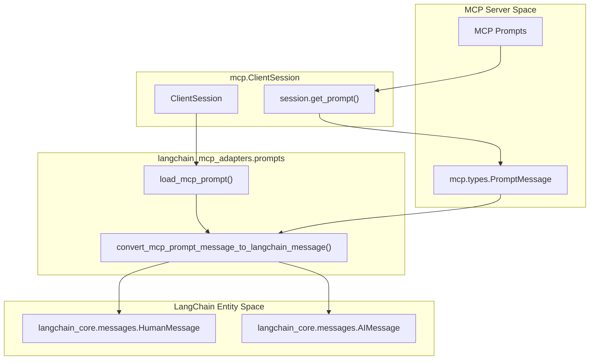
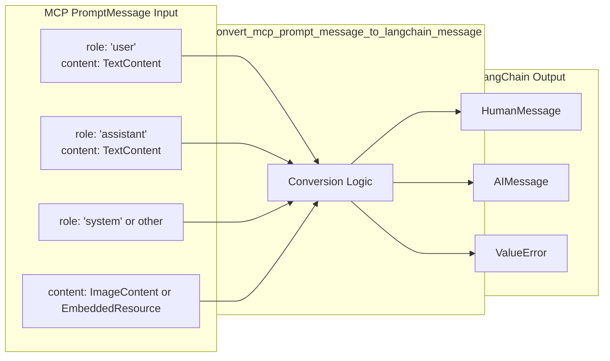
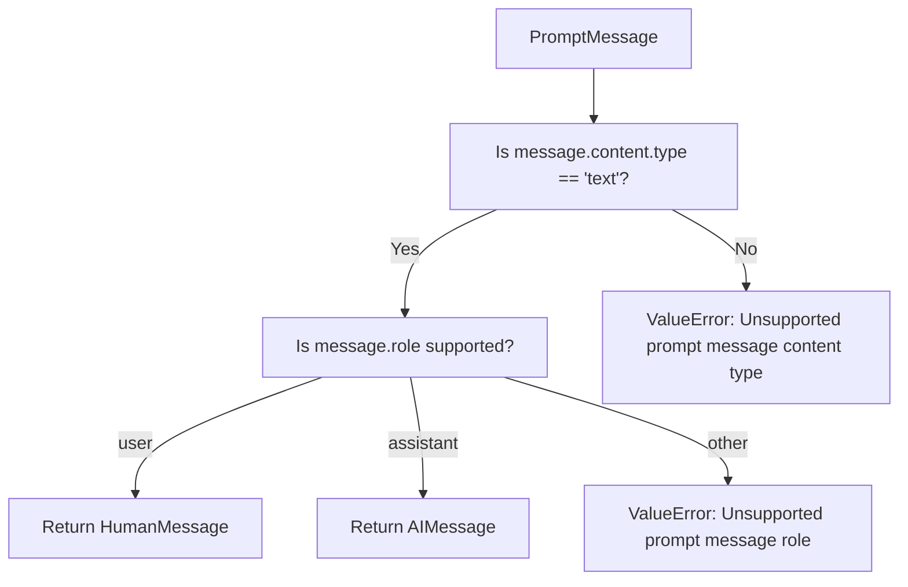

<!-- source: DeepWiki mcp.deepwiki.com · repo langchain-ai/langchain-mcp-adapters · page 2.3 Prompt Adapters · fetched 2026-10-26 -->

# Prompt Adapters

<details>
<summary>Relevant source files</summary>

The following files were used as context for generating this wiki page:

- [langchain_mcp_adapters/prompts.py](langchain_mcp_adapters/prompts.py)
- [tests/test_prompts.py](tests/test_prompts.py)
- [tests/test_resources.py](tests/test_resources.py)

</details>


The prompt adapters module provides functionality for converting Model Context Protocol (MCP) prompts into LangChain message formats. This enables LangChain agents to utilize structured prompts defined on MCP servers, handling the bidirectional mapping between MCP `PromptMessage` objects and LangChain's `HumanMessage` and `AIMessage` classes.

## Architecture Overview

The prompt adapter system operates as a transformation layer between the MCP `ClientSession` and LangChain's message-based interfaces. It encapsulates the logic for fetching remote prompts and iterating through their message contents to produce LangChain-compatible objects.

### Data Flow: MCP to LangChain



Sources: [langchain_mcp_adapters/prompts.py:1-60](), [tests/test_prompts.py:63-83]()

## Message Conversion Process

The core conversion process maps MCP prompt message roles and content types to appropriate LangChain message classes. Currently, the adapter strictly supports text-based content.



Sources: [langchain_mcp_adapters/prompts.py:14-35](), [tests/test_prompts.py:19-61]()

## Key Functions

### `convert_mcp_prompt_message_to_langchain_message`

This function handles the low-level mapping of a single `PromptMessage` to a LangChain message. [langchain_mcp_adapters/prompts.py:14-16]()

| MCP Role | LangChain Message Type | Content Support |
|----------|----------------------|-----------------|
| `user` | `HumanMessage` | `TextContent` only |
| `assistant` | `AIMessage` | `TextContent` only |
| Other roles | N/A | Raises `ValueError` |

**Supported Content Types:**
- `TextContent`: The `text` field is extracted and assigned to the LangChain message `content`. [langchain_mcp_adapters/prompts.py:26-30]()
- `ImageContent`: Not supported; raises `ValueError`. [tests/test_prompts.py:54-60]()
- `EmbeddedResource`: Not supported; raises `ValueError`. [tests/test_prompts.py:35-50]()

Sources: [langchain_mcp_adapters/prompts.py:26-35](), [tests/test_prompts.py:19-32]()

### `load_mcp_prompt`

An asynchronous utility that retrieves a prompt from an MCP server and converts all its messages into a list of LangChain messages. [langchain_mcp_adapters/prompts.py:38-43]()

**Workflow:**
1. Calls `session.get_prompt(name, arguments)` to fetch the prompt definition from the server. [langchain_mcp_adapters/prompts.py:55]()
2. Iterates through the `messages` list in the response. [langchain_mcp_adapters/prompts.py:56-59]()
3. Applies `convert_mcp_prompt_message_to_langchain_message` to each message. [langchain_mcp_adapters/prompts.py:57]()

Sources: [langchain_mcp_adapters/prompts.py:38-59](), [tests/test_prompts.py:63-83]()

## Error Handling

The implementation enforces strict schema validation for MCP messages to ensure compatibility with LangChain's core message types.



Sources: [langchain_mcp_adapters/prompts.py:26-35](), [tests/test_prompts.py:49-60]()

## Implementation Examples

### Manual Message Conversion
You can convert individual messages if you have already retrieved them from an MCP server:

```python
from mcp.types import PromptMessage, TextContent
from langchain_mcp_adapters.prompts import convert_mcp_prompt_message_to_langchain_message

mcp_msg = PromptMessage(
    role="user", 
    content=TextContent(type="text", text="Hello from MCP")
)
lc_msg = convert_mcp_prompt_message_to_langchain_message(mcp_msg)
# Result: HumanMessage(content="Hello from MCP")
```
Sources: [tests/test_prompts.py:23-32]()

### Loading a Remote Prompt
To load a template defined on an MCP server (e.g., a "translator" prompt):

```python
# Assuming 'session' is an active mcp.ClientSession
from langchain_mcp_adapters.prompts import load_mcp_prompt

messages = await load_mcp_prompt(
    session, 
    "translator", 
    arguments={"language": "French", "text": "Hello"}
)
# Result: [HumanMessage(...), AIMessage(...)]
```
Sources: [langchain_mcp_adapters/prompts.py:38-59](), [tests/test_prompts.py:77-82]()

---

