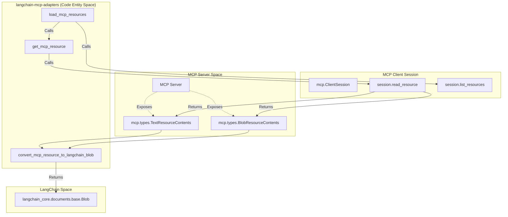
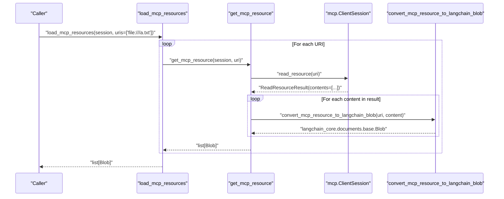

<!-- source: DeepWiki mcp.deepwiki.com · repo langchain-ai/langchain-mcp-adapters · page 2.4 Resource Adapters · fetched 2026-10-26 -->

# Resource Adapters

<details>
<summary>Relevant source files</summary>

The following files were used as context for generating this wiki page:

- [langchain_mcp_adapters/resources.py](langchain_mcp_adapters/resources.py)
- [tests/test_prompts.py](tests/test_prompts.py)
- [tests/test_resources.py](tests/test_resources.py)

</details>


Resource Adapters provide functionality for loading and converting MCP (Model Context Protocol) resources into LangChain `Blob` objects. This system enables seamless integration of file-based and data resources from MCP servers into LangChain applications, handling both text and binary content.

For information about converting MCP tools to LangChain tools, see [Tool Adapters](#2.2). For MCP prompt conversion, see [Prompt Adapters](#2.3).

## Core Functionality

The resource adapter system handles the conversion between MCP's resource format and LangChain's `Blob` format. Resources are fetched from MCP servers through established `ClientSession` objects and converted to a standardized format that LangChain applications can consume.

### Resource Content Types

The system supports two primary MCP resource content types defined in the MCP specification:

| Content Type | MCP Class | Description | Conversion Method |
|--------------|-----------|-------------|-------------------|
| Text Resources | `TextResourceContents` | Plain text content with MIME type | Direct text extraction |
| Binary Resources | `BlobResourceContents` | Base64-encoded binary data | Base64 decoding |

Sources: [langchain_mcp_adapters/resources.py:11-37]()

## Resource Conversion Architecture

The following diagram illustrates the flow from an MCP Server's internal representation to LangChain `Blob` objects.

### Data Flow: MCP to LangChain Space

Sources: [langchain_mcp_adapters/resources.py:14-103]()

## Core Functions

### convert_mcp_resource_to_langchain_blob

The fundamental conversion function that transforms MCP resource content into LangChain `Blob` objects.

```python
def convert_mcp_resource_to_langchain_blob(
    resource_uri: str, contents: ResourceContents
) -> Blob:
```

**Processing Logic:**
- **Text resources:** If the content is `TextResourceContents`, the `text` attribute is used as data [langchain_mcp_adapters/resources.py:27-28]().
- **Binary resources:** If the content is `BlobResourceContents`, the `blob` attribute is decoded from base64 [langchain_mcp_adapters/resources.py:29-30]().
- **Metadata:** The resulting `Blob` includes the original URI in its metadata and preserves the `mimeType` [langchain_mcp_adapters/resources.py:35-37]().

Sources: [langchain_mcp_adapters/resources.py:14-37]()

### get_mcp_resource

Fetches a single resource from an MCP server and converts it to a list of LangChain `Blob` objects.

```python
async def get_mcp_resource(session: ClientSession, uri: str) -> list[Blob]:
```

**Process Flow:**
1. Calls `session.read_resource(uri)` [langchain_mcp_adapters/resources.py:50]().
2. Validates that the result contains data [langchain_mcp_adapters/resources.py:51-52]().
3. Maps each item in the `contents` list through `convert_mcp_resource_to_langchain_blob` [langchain_mcp_adapters/resources.py:54-57]().

Sources: [langchain_mcp_adapters/resources.py:40-57]()

### load_mcp_resources

Primary entry point for loading multiple MCP resources with flexible URI specification.

```python
async def load_mcp_resources(
    session: ClientSession,
    *,
    uris: str | list[str] | None = None,
) -> list[Blob]:
```

**URI Handling Logic:**
- **`None`:** The function calls `session.list_resources()` to discover all available static resources [langchain_mcp_adapters/resources.py:85-87]().
- **`str`:** A single URI is wrapped in a list for processing [langchain_mcp_adapters/resources.py:88-89]().
- **`list[str]`:** The provided list is used directly [langchain_mcp_adapters/resources.py:91]().

**Dynamic Resource Limitation:** When `uris` is `None`, dynamic resources (templates) are not loaded because they require specific parameters and are not returned by the MCP SDK's `list_resources` method [langchain_mcp_adapters/resources.py:70-75]().

Sources: [langchain_mcp_adapters/resources.py:60-103]()

## Sequence of Operations

The following diagram shows the interaction between the adapter and the MCP session during a resource load.

### Resource Loading Sequence

Sources: [langchain_mcp_adapters/resources.py:40-103]()

## Content Type Handling

### Text Resources
Text-based resources are processed without encoding conversion. The `TextResourceContents` object provides the raw string which is passed to `Blob.from_data`.
Sources: [langchain_mcp_adapters/resources.py:27-28]()

### Binary Resources
Binary resources are handled via `BlobResourceContents`. The `blob` field in MCP is a base64-encoded string, which the adapter decodes using `base64.b64decode()` before creating the `Blob`.
Sources: [langchain_mcp_adapters/resources.py:29-30](), [langchain_mcp_adapters/resources.py:7]()

## Error Handling

The resource adapter system implements specific error handling for conversion and retrieval:

- **Type Errors:** If a resource content type is encountered that is neither `TextResourceContents` nor `BlobResourceContents`, a `TypeError` is raised [langchain_mcp_adapters/resources.py:31-33]().
- **Runtime Errors:** If any exception occurs during the iteration and fetching of resources in `load_mcp_resources`, it is caught and re-raised as a `RuntimeError` with the context of the specific URI that failed [langchain_mcp_adapters/resources.py:94-101]().

Sources: [langchain_mcp_adapters/resources.py:31-33](), [langchain_mcp_adapters/resources.py:94-101]()

---

