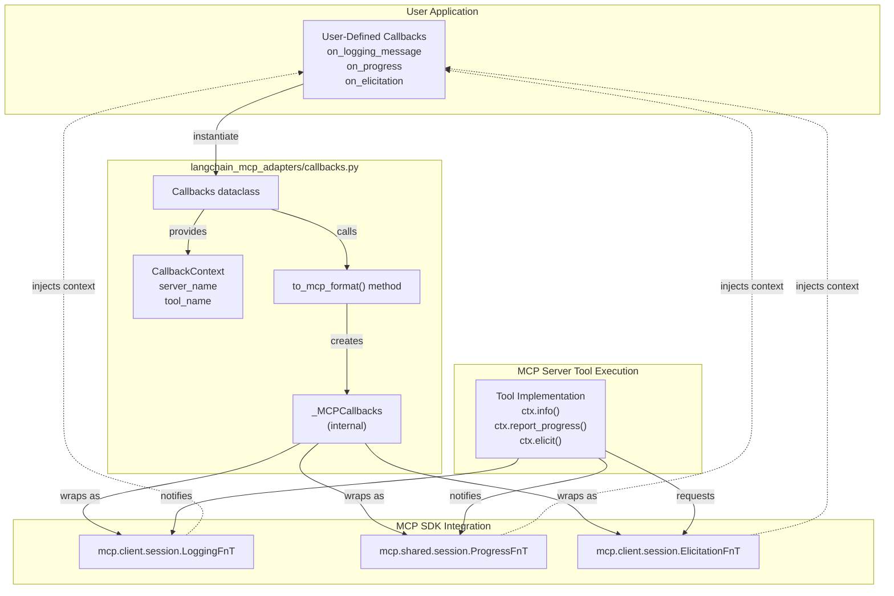
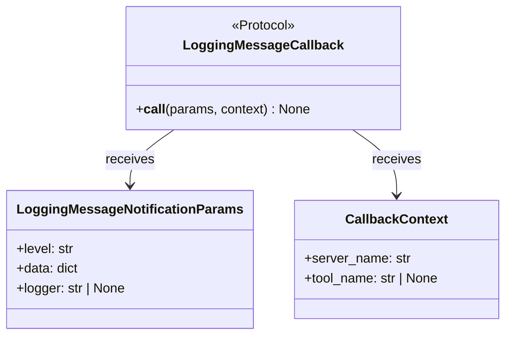
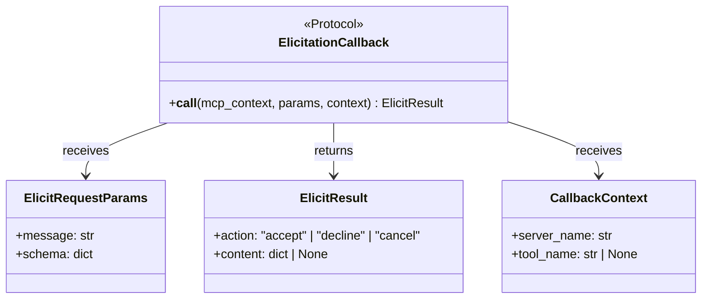
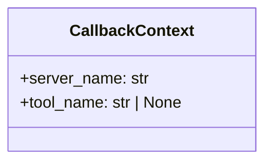
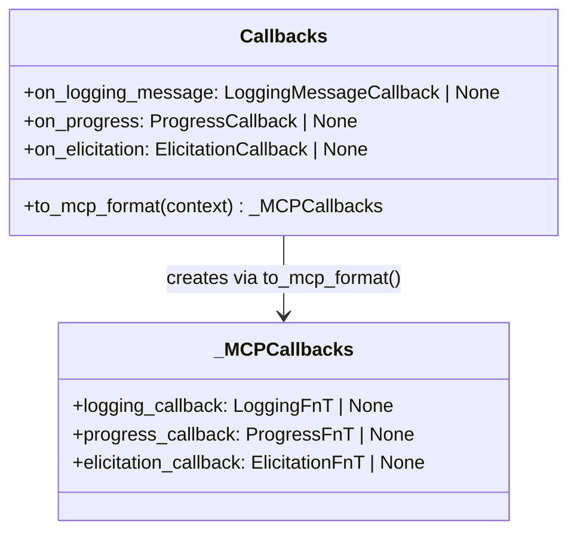
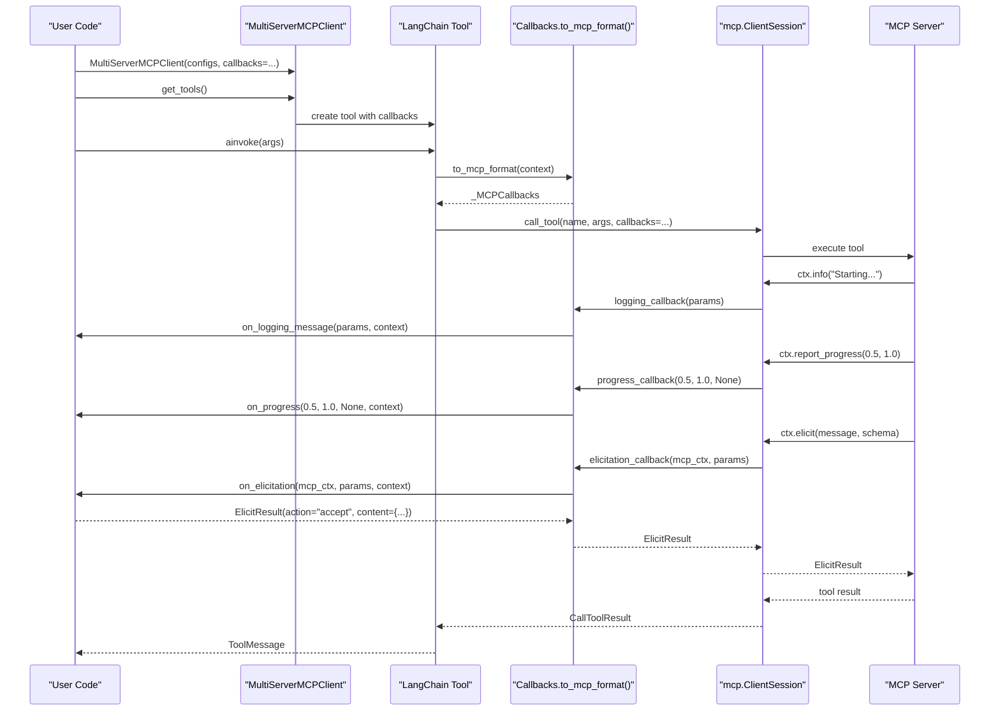

<!-- source: DeepWiki mcp.deepwiki.com · repo langchain-ai/langchain-mcp-adapters · page 2.5 Callbacks · fetched 2026-10-26 -->

# Callbacks

<details>
<summary>Relevant source files</summary>

The following files were used as context for generating this wiki page:

- [langchain_mcp_adapters/callbacks.py](langchain_mcp_adapters/callbacks.py)
- [langchain_mcp_adapters/interceptors.py](langchain_mcp_adapters/interceptors.py)
- [tests/test_callbacks.py](tests/test_callbacks.py)
- [tests/test_elicitation.py](tests/test_elicitation.py)
- [tests/test_interceptors.py](tests/test_interceptors.py)

</details>


The callback system provides mechanisms for monitoring and responding to asynchronous notifications from MCP servers during tool execution. This includes logging messages, progress updates, and elicitation requests (interactive prompts for user input). Callbacks enable visibility into long-running tool operations and support interactive workflows.

For modifying tool requests and responses, see [Interceptors](2.6). For the client class that accepts callbacks, see [MultiServerMCPClient](2.1).

**Sources:** [langchain_mcp_adapters/callbacks.py:1-142]()

## Purpose and Scope

The callback system addresses three operational needs when executing MCP tools:

1. **Observability**: Logging messages emitted by MCP servers during tool execution.
2. **Progress Tracking**: Monitoring long-running operations with progress notifications.
3. **User Interaction**: Handling elicitation requests where tools require user input mid-execution.

The system wraps MCP SDK callback interfaces with LangChain-specific context, providing the server name and tool name for each notification.

**Sources:** [langchain_mcp_adapters/callbacks.py:1-26](), [tests/test_callbacks.py:1-144]()

## Callback Architecture



**Diagram: Callback System Data Flow**

The callback system acts as an adapter layer between user-defined callback functions and the MCP SDK's callback interfaces. The `to_mcp_format()` method creates wrapper functions that inject `CallbackContext` before invoking user callbacks.

**Sources:** [langchain_mcp_adapters/callbacks.py:87-142](), [tests/test_callbacks.py:86-144]()

## Callback Types

### LoggingMessageCallback

Receives logging messages emitted by MCP servers during tool execution. The MCP SDK defines several log levels (debug, info, warning, error, critical).



**Diagram: LoggingMessageCallback Protocol**

**Type Signature:** [langchain_mcp_adapters/callbacks.py:36-49]()

```python
async def __call__(
    self,
    params: LoggingMessageNotificationParams,
    context: CallbackContext,
) -> None
```

**Fields:**
- `params.level`: Log level (debug, info, warning, error, critical).
- `params.data`: Log message data.
- `params.logger`: Optional logger name.
- `context.server_name`: Name of the MCP server.
- `context.tool_name`: Name of the tool being executed (if applicable).

**Sources:** [langchain_mcp_adapters/callbacks.py:36-49](), [tests/test_callbacks.py:86-144]()

### ProgressCallback

Receives progress notifications for long-running tool operations. The MCP server can report progress as a fraction with optional total and message.

```mermaid
classDiagram
    class ProgressCallback {
        <<Protocol>>
        +__call__(progress, total, message, context) None
    }
    
    class CallbackContext {
        +server_name: str
        +tool_name: str | None
    }
    
    ProgressCallback --> CallbackContext : receives
    ProgressCallback : progress: float
    ProgressCallback : total: float | None
    ProgressCallback : message: str | None
```

**Diagram: ProgressCallback Protocol**

**Type Signature:** [langchain_mcp_adapters/callbacks.py:52-67]()

```python
async def __call__(
    self,
    progress: float,
    total: float | None,
    message: str | None,
    context: CallbackContext,
) -> None
```

**Parameters:**
- `progress`: Current progress value.
- `total`: Total expected progress (if known).
- `message`: Optional human-readable progress message.
- `context`: Callback context with server and tool names.

**Sources:** [langchain_mcp_adapters/callbacks.py:52-67](), [tests/test_callbacks.py:62-84]()

### ElicitationCallback

Handles elicitation requests where an MCP tool needs user input during execution. The callback must return an `ElicitResult` indicating the user's action.



**Diagram: ElicitationCallback Protocol**

**Type Signature:** [langchain_mcp_adapters/callbacks.py:70-84]()

```python
async def __call__(
    self,
    mcp_context: MCPRequestContext,
    params: ElicitRequestParams,
    context: CallbackContext,
) -> MCPElicitResult
```

**Parameters:**
- `mcp_context`: MCP SDK request context (`mcp.shared.context.RequestContext`).
- `params.message`: Elicitation prompt message.
- `params.schema`: JSON schema for expected input.
- `context`: Callback context with server and tool names.

**Return Actions:**
- `accept`: User provided data (included in `content` field).
- `decline`: User declined to provide data.
- `cancel`: User cancelled the operation.

**Sources:** [langchain_mcp_adapters/callbacks.py:70-84](), [tests/test_elicitation.py:1-165]()

## CallbackContext

The `CallbackContext` dataclass provides contextual information about the MCP operation that triggered a callback.



**Diagram: CallbackContext Structure**

**Definition:** [langchain_mcp_adapters/callbacks.py:28-34]()

| Field | Type | Description |
|-------|------|-------------|
| `server_name` | `str` | Name of the MCP server handling the request. |
| `tool_name` | `str \| None` | Name of the tool being executed (None if not tool-specific). |

The context enables callback implementations to route or filter notifications based on which server or tool generated them.

**Sources:** [langchain_mcp_adapters/callbacks.py:28-34](), [tests/test_callbacks.py:40-60]()

## Callbacks Class

The `Callbacks` dataclass aggregates the three callback types into a single configuration object.



**Diagram: Callbacks Class and Conversion**

**Definition:** [langchain_mcp_adapters/callbacks.py:96-142]()

| Field | Type | Description |
|-------|------|-------------|
| `on_logging_message` | `LoggingMessageCallback \| None` | Handler for logging notifications. |
| `on_progress` | `ProgressCallback \| None` | Handler for progress updates. |
| `on_elicitation` | `ElicitationCallback \| None` | Handler for elicitation requests. |

**Sources:** [langchain_mcp_adapters/callbacks.py:96-142]()

## Integration with MultiServerMCPClient

The `Callbacks` object is passed to `MultiServerMCPClient` during initialization and applied to all tool executions across all connected servers.

### Usage Example

**Test Reference:** [tests/test_callbacks.py:86-144]()

```python
from langchain_mcp_adapters.callbacks import Callbacks, CallbackContext
from langchain_mcp_adapters.client import MultiServerMCPClient

async def progress_callback(progress, total, message, context):
    print(f"[{context.tool_name}] Progress: {progress}/{total} - {message}")

async def logging_callback(params, context):
    print(f"[{context.server_name}] {params.level}: {params.data}")

callbacks = Callbacks(
    on_progress=progress_callback,
    on_logging_message=logging_callback,
)

client = MultiServerMCPClient(
    {
        "math": {"command": "python", "args": ["server.py"], "transport": "stdio"}
    },
    callbacks=callbacks,
)

tools = await client.get_tools()
# Callbacks are automatically attached to all tool executions
```

**Sources:** [tests/test_callbacks.py:86-144](), [langchain_mcp_adapters/client.py:103-111]()

## Callback Execution Flow



**Diagram: Callback Execution During Tool Invocation**

This sequence shows how callbacks flow through the system during a tool execution:

1. User creates `MultiServerMCPClient` with `Callbacks` object.
2. Tools are created with callback references.
3. During `ainvoke()`, callbacks are converted to MCP SDK format via `to_mcp_format()`.
4. MCP server emits notifications (logging, progress, elicitation).
5. MCP SDK invokes wrapped callbacks.
6. Wrapped callbacks inject `CallbackContext` and invoke user callbacks.

**Sources:** [tests/test_callbacks.py:86-144](), [tests/test_elicitation.py:52-103]()

## Implementation: to_mcp_format() Method

The `to_mcp_format()` method converts LangChain-style callbacks to MCP SDK-compatible functions by wrapping them with context injection.

**Method Signature:** [langchain_mcp_adapters/callbacks.py:104-141]()

```python
def to_mcp_format(self, *, context: CallbackContext) -> _MCPCallbacks:
    """Convert the LangChain MCP client callbacks to MCP SDK callbacks.
    
    Injects the LangChain CallbackContext as the last argument.
    """
```

### Conversion Logic

For each callback type, the method:

1. **Checks if callback is defined** (`if self.on_logging_message is not None`).
2. **Creates wrapper function** that captures the `context` parameter.
3. **Wrapper invokes user callback** with MCP parameters plus injected context.
4. **Returns None-safe wrapper** (None if user callback not provided).

**Example for logging callback:** [langchain_mcp_adapters/callbacks.py:109-116]()

```python
if (on_logging_message := self.on_logging_message) is not None:
    async def mcp_logging_callback(
        params: LoggingMessageNotificationParams,
    ) -> None:
        await on_logging_message(params, context)
else:
    mcp_logging_callback = None
```

The wrapper functions match the MCP SDK's expected signatures (`mcp.client.session.LoggingFnT`, `mcp.shared.session.ProgressFnT`, `mcp.client.session.ElicitationFnT`) while adding the `CallbackContext` parameter for user convenience.

**Sources:** [langchain_mcp_adapters/callbacks.py:104-141]()

## Testing Patterns

### Testing Logging and Progress Callbacks

**Test Reference:** [tests/test_callbacks.py:86-144]()

The test creates an MCP server tool using `FastMCP` that emits various notifications during execution:

```python
@server.tool()
async def execute_task(task: str, ctx: Context[ServerSession, None]) -> str:
    await ctx.info(f"Starting task: {task}")
    await ctx.report_progress(progress=0.0, total=1.0)
    # ... more work ...
    await ctx.report_progress(progress=1.0, total=1.0)
    return f"Executed: {task}"
```

The test verifies that callbacks receive the correct parameters and context:

```python
assert len(progress_calls) >= 3
assert 0.0 in [call[0] for call in progress_calls]
assert 1.0 in [call[0] for call in progress_calls]
```

**Sources:** [tests/test_callbacks.py:62-144]()

### Testing Elicitation Callbacks

**Test Reference:** [tests/test_elicitation.py:52-103]()

The test verifies all three elicitation actions:

| Action | Test | Expected Behavior |
|--------|------|-------------------|
| `accept` | [tests/test_elicitation.py:52-103]() | Callback returns data, tool completes normally. |
| `decline` | [tests/test_elicitation.py:105-134]() | Callback returns decline, tool handles gracefully. |
| `cancel` | [tests/test_elicitation.py:136-165]() | Callback returns cancel, tool terminates. |

The tests verify that tool code before `ctx.elicit()` only executes once, ensuring the server does not re-execute logic when resuming from elicitation.

**Sources:** [tests/test_elicitation.py:1-165]()

## Type Aliases

The module defines type aliases to avoid direct MCP SDK type dependencies in user code:

| Alias | MCP SDK Type | Purpose |
|-------|--------------|---------|
| `LoggingFnT` | `mcp.client.session.LoggingFnT` | Logging callback signature. |
| `ProgressFnT` | `mcp.shared.session.ProgressFnT` | Progress callback signature. |
| `ElicitationFnT` | `mcp.client.session.ElicitationFnT` | Elicitation callback signature. |
| `LoggingMessageNotificationParams` | `mcp.types.LoggingMessageNotificationParams` | Logging parameters. |
| `ElicitRequestParams` | `mcp.types.ElicitRequestParams` | Elicitation request parameters. |

**Definition:** [langchain_mcp_adapters/callbacks.py:20-25]()

**Sources:** [langchain_mcp_adapters/callbacks.py:1-26]()

## Summary Table

| Component | File Location | Purpose |
|-----------|---------------|---------|
| `Callbacks` | [langchain_mcp_adapters/callbacks.py:97-102]() | Main callbacks configuration class. |
| `CallbackContext` | [langchain_mcp_adapters/callbacks.py:28-34]() | Context passed to all callbacks. |
| `LoggingMessageCallback` | [langchain_mcp_adapters/callbacks.py:37-50]() | Protocol for logging notifications. |
| `ProgressCallback` | [langchain_mcp_adapters/callbacks.py:53-68]() | Protocol for progress updates. |
| `ElicitationCallback` | [langchain_mcp_adapters/callbacks.py:71-85]() | Protocol for elicitation requests. |
| `to_mcp_format()` | [langchain_mcp_adapters/callbacks.py:104-141]() | Converts callbacks to MCP SDK format. |
| `_MCPCallbacks` | [langchain_mcp_adapters/callbacks.py:88-94]() | Internal MCP SDK callback wrapper. |

**Sources:** [langchain_mcp_adapters/callbacks.py:1-142]()

---

