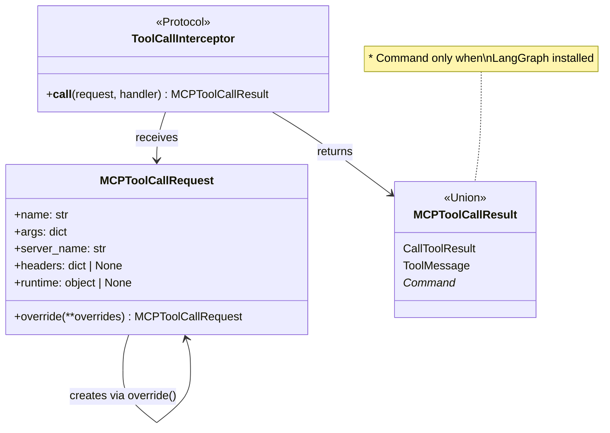
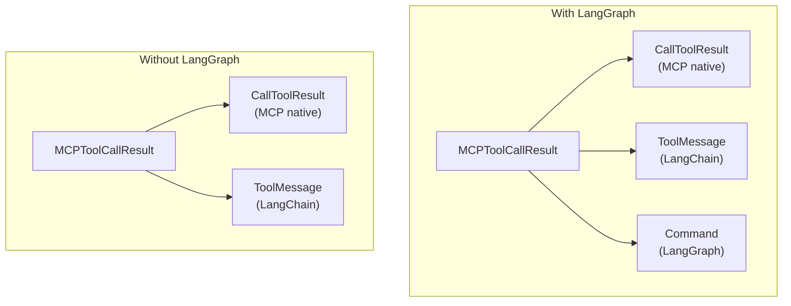
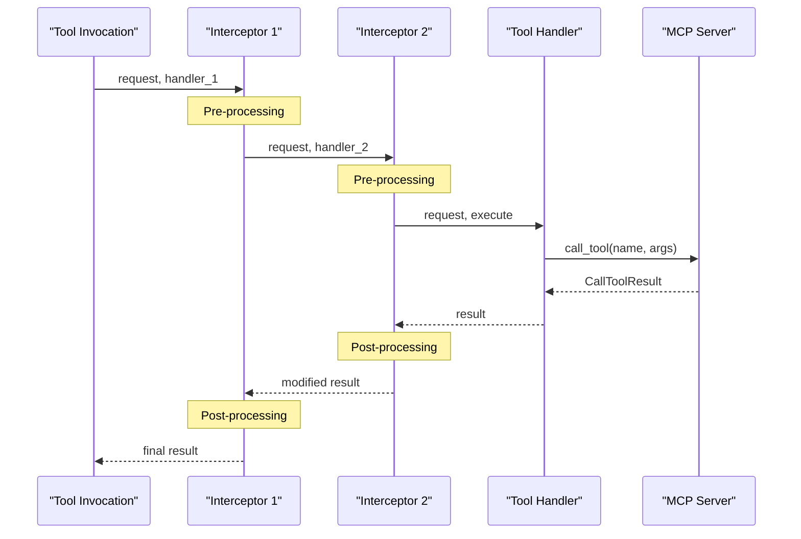
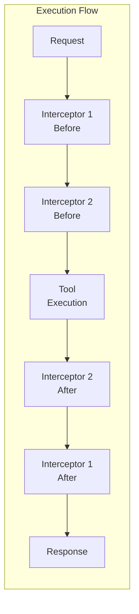

<!-- source: DeepWiki mcp.deepwiki.com · repo langchain-ai/langchain-mcp-adapters · page 2.6 Interceptors · fetched 2026-10-26 -->

# Interceptors

<details>
<summary>Relevant source files</summary>

The following files were used as context for generating this wiki page:

- [langchain_mcp_adapters/interceptors.py](langchain_mcp_adapters/interceptors.py)
- [tests/test_callbacks.py](tests/test_callbacks.py)
- [tests/test_interceptors.py](tests/test_interceptors.py)
- [tests/test_tools.py](tests/test_tools.py)

</details>


This document describes the interceptor system for MCP tool call execution in `langchain-mcp-adapters`. Interceptors provide a handler callback pattern for wrapping and controlling tool invocations, enabling request/response modification, caching, retry logic, rate limiting, and other cross-cutting concerns.

For information about tool conversion and execution, see [Tool Adapters](#2.2). For callback handling during tool execution, see [Callbacks](#2.5).

---

## Overview

The interceptor system provides middleware-style control over MCP tool execution. Interceptors wrap the tool call lifecycle using a handler callback pattern, where each interceptor receives the request and a handler function to invoke the next layer or the actual tool.

**Key characteristics:**
- **Handler callback pattern**: Each interceptor receives a `handler` callable that it can invoke, skip, or call multiple times.
- **Onion composition**: Multiple interceptors compose in layers, with the first interceptor in the list forming the outermost layer.
- **Request/response control**: Interceptors can modify requests before execution and responses after execution.
- **Short-circuiting**: Interceptors can skip tool execution entirely and return cached or synthetic results.
- **LangGraph integration**: Interceptors can return `Command` objects to update agent state.

Sources: [langchain_mcp_adapters/interceptors.py:1-142]()

---

## Protocol and Types

### ToolCallInterceptor Protocol

The `ToolCallInterceptor` protocol defines the interceptor interface as a runtime-checkable protocol [langchain_mcp_adapters/interceptors.py:111-112]():



**Interceptor signature:**

```python
async def __call__(
    self,
    request: MCPToolCallRequest,
    handler: Callable[[MCPToolCallRequest], Awaitable[MCPToolCallResult]],
) -> MCPToolCallResult
```

The interceptor receives the `request` and a `handler` callable that executes the next interceptor or the actual tool. The interceptor controls whether and how to invoke the handler [langchain_mcp_adapters/interceptors.py:125-140]().

Sources: [langchain_mcp_adapters/interceptors.py:111-142]()

### MCPToolCallRequest

The request object contains both modifiable fields and read-only context [langchain_mcp_adapters/interceptors.py:52-73]():

| Field | Type | Category | Description |
|-------|------|----------|-------------|
| `name` | `str` | Modifiable | Tool name to invoke |
| `args` | `dict[str, Any]` | Modifiable | Tool arguments as key-value pairs |
| `headers` | `dict[str, Any] \| None` | Modifiable | HTTP headers for applicable transports |
| `server_name` | `str` | Context | Name of the MCP server handling the tool |
| `runtime` | `object \| None` | Context | LangGraph runtime context (if any) |

The `override()` method creates a new request with modified fields while preserving context using an immutable pattern [langchain_mcp_adapters/interceptors.py:75-108]():

```python
# Modify arguments
new_request = request.override(args={"value": 10})

# Change tool name
new_request = request.override(name="different_tool")
```

Sources: [langchain_mcp_adapters/interceptors.py:51-109]()

### MCPToolCallResult

The result type is a union that varies based on whether LangGraph is installed [langchain_mcp_adapters/interceptors.py:19-36]():



- **`CallToolResult`**: MCP's native result format with content and error flag [mcp.types:CallToolResult]().
- **`ToolMessage`**: LangChain message type, allows direct message construction [langchain_core.messages:ToolMessage]().
- **`Command`**: LangGraph state update command (only available when LangGraph is installed) [langgraph.types:Command]().

Sources: [langchain_mcp_adapters/interceptors.py:19-36]()

---

## Handler Callback Pattern

The handler callback pattern gives interceptors fine-grained control over execution:



**Handler invocation patterns:**

| Pattern | Description | Example Use Case |
|---------|-------------|------------------|
| **Pass-through** | `return await handler(request)` | Logging, monitoring |
| **Skip** | Return result without calling handler | Caching, mocking |
| **Modify request** | Modify request, then call handler | Argument transformation, routing |
| **Modify response** | Call handler, modify result | Content filtering, enrichment |
| **Retry** | Call handler multiple times on failure | Transient error handling |
| **Conditional** | Call handler based on request properties | Feature flags, A/B testing |

Sources: [langchain_mcp_adapters/interceptors.py:111-142](), [tests/test_interceptors.py:35-217]()

---

## Interceptor Composition

Multiple interceptors compose in an "onion" pattern where the first interceptor in the list forms the outermost layer [langchain_mcp_adapters/interceptors.py:117-118]():



**Composition order:**

```python
tool_interceptors=[interceptor_1, interceptor_2, interceptor_3]
```

Results in execution order:
1. `interceptor_1` (before)
2. `interceptor_2` (before)
3. `interceptor_3` (before)
4. Tool execution
5. `interceptor_3` (after)
6. `interceptor_2` (after)
7. `interceptor_1` (after)

Sources: [langchain_mcp_adapters/interceptors.py:111-124](), [tests/test_interceptors.py:219-262]()

---

## Common Use Cases

### Request Modification

**Modifying arguments:**
Interceptors can intercept a request and call `request.override(args=...)` before passing it to the next handler [tests/test_interceptors.py:41-48]().

```python
async def modify_args_interceptor(request, handler):
    # Double the arguments
    modified_args = {k: v * 2 for k, v in request.args.items()}
    modified_request = request.override(args=modified_args)
    return await handler(modified_request)
```

Sources: [tests/test_interceptors.py:38-63]()

**Redirecting to different tools:**
An interceptor can change the `name` of the tool being called [tests/test_interceptors.py:68-76]().

```python
async def redirect_tool_interceptor(request, handler):
    if request.name == "add":
        modified_request = request.override(name="multiply")
        return await handler(modified_request)
    return await handler(request)
```

Sources: [tests/test_interceptors.py:65-91]()

### Response Modification

**Transforming results:**
Interceptors can wait for the handler to return a `CallToolResult` and then modify its `content` [tests/test_interceptors.py:100-120]().

```python
async def modify_result_interceptor(request, handler):
    result = await handler(request)
    modified_content = [
        TextContent(type="text", text=f"Modified: {c.text}") if isinstance(c, TextContent) else c 
        for c in result.content
    ]
    return CallToolResult(content=modified_content, isError=result.isError)
```

Sources: [tests/test_interceptors.py:97-136]()

### Caching

**Implement result caching to avoid redundant server calls:**
By checking a cache before calling the handler, an interceptor can short-circuit the execution [tests/test_interceptors.py:176-189]().

```python
async def caching_interceptor(request, handler):
    cache_key = f"{request.name}:{request.args}"
    if cache_key in cache:
        return cache[cache_key]
    result = await handler(request)
    cache[cache_key] = result
    return result
```

Sources: [tests/test_interceptors.py:171-217]()

### LangGraph State Updates

**Return Command objects to update agent state:**
When LangGraph is used, interceptors can return a `Command` object. This allows the tool execution to trigger graph state updates or control flow changes [langchain_mcp_adapters/interceptors.py:34]().

```python
async def counter_interceptor(request, handler):
    # Return Command instead of executing tool
    return Command(
        update={"counter": 42},
        goto="__end__",
    )
```

Sources: [langchain_mcp_adapters/interceptors.py:19-36](), [tests/test_tools.py:897-995]()

---

## Integration with MultiServerMCPClient

Interceptors are registered when creating the `MultiServerMCPClient` or via `load_mcp_tools`.

**Global interceptors:**

```python
client = MultiServerMCPClient(
    connections={...},
    tool_interceptors=[logging_interceptor, retry_interceptor],
)
```

**Per-connection interceptors:**

```python
tools = await load_mcp_tools(
    session=None,
    connection={"url": "...", "transport": "streamable_http"},
    tool_interceptors=[custom_interceptor],
)
```

Sources: [langchain_mcp_adapters/client.py](), [langchain_mcp_adapters/tools.py:35](), [tests/test_interceptors.py:51-58]()

---

## Error Handling

Exceptions in interceptors propagate to the caller. Interceptors can also wrap the `handler` in a try-except block to provide custom error handling or fallbacks [tests/test_interceptors.py:264-289]().

```python
async def error_handling_interceptor(request, handler):
    try:
        return await handler(request)
    except Exception as e:
        return CallToolResult(
            content=[TextContent(type="text", text=f"Handled error: {str(e)}")],
            isError=True,
        )
```

Sources: [tests/test_interceptors.py:264-289]()

---

