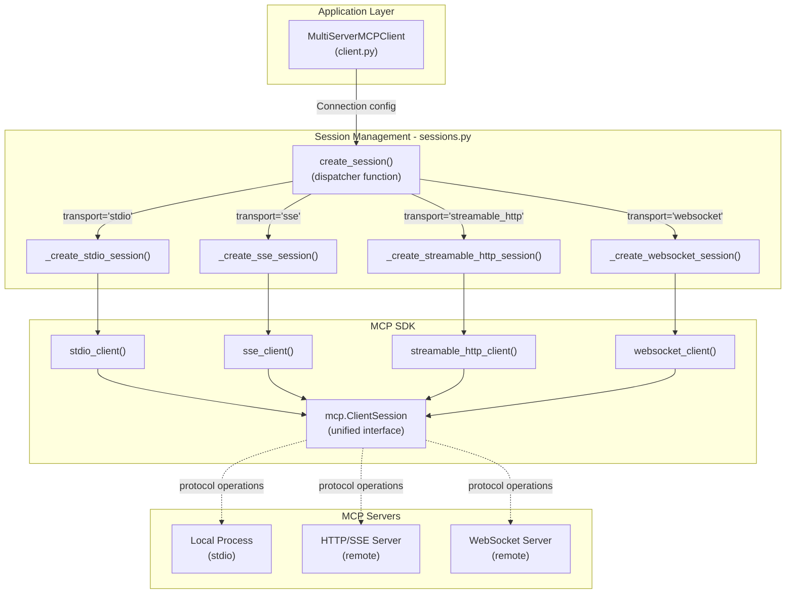
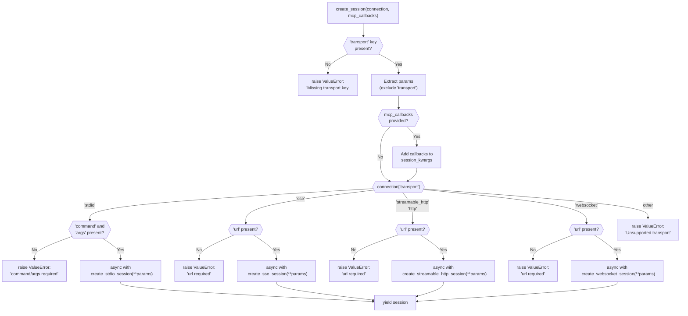

<!-- source: DeepWiki mcp.deepwiki.com · repo langchain-ai/langchain-mcp-adapters · page 3 Session Management and Transport · fetched 2026-10-26 -->

# Session Management and Transport

<details>
<summary>Relevant source files</summary>

The following files were used as context for generating this wiki page:

- [langchain_mcp_adapters/client.py](langchain_mcp_adapters/client.py)
- [langchain_mcp_adapters/sessions.py](langchain_mcp_adapters/sessions.py)

</details>


## Purpose and Scope

This document covers the session management and transport layer in `langchain-mcp-adapters`. This layer provides the abstraction for creating and managing connections to MCP servers over four different transport protocols: stdio, HTTP (streamable), Server-Sent Events (SSE), and WebSocket. 

For details on specific transport configurations and when to use each type, see [Connection Types](#3.1). For information on session initialization and lifecycle patterns, see [Session Lifecycle](#3.2). For how the `MultiServerMCPClient` uses sessions, see [MultiServerMCPClient](#2.1).

**Sources**: [langchain_mcp_adapters/sessions.py:1-433]()

## Overview

The session management layer serves as a transport abstraction that allows the `MultiServerMCPClient` to interact with MCP servers regardless of their deployment model. A **session** represents an active connection to an MCP server and provides the interface for executing protocol operations (listing tools, calling tools, getting prompts, etc.).

The key abstraction is the `mcp.ClientSession` class from the MCP SDK [langchain_mcp_adapters/client.py:16-16](). All transport-specific implementations converge on this unified interface, allowing higher-level code to remain transport-agnostic.

### Transport to Code Entity Mapping

This diagram bridges the conceptual transport mechanisms to the specific implementation functions and SDK components used in the codebase.



**Sources**: [langchain_mcp_adapters/sessions.py:191-433](), [langchain_mcp_adapters/client.py:125-161]()

## Connection Configuration Types

The session management layer defines connection configurations as `TypedDict` classes. Each transport type has its own configuration structure, and these are unified under the `Connection` union type [langchain_mcp_adapters/sessions.py:207-209]():

| Configuration Class | Transport Value | Primary Use Case | Required Fields |
|-------------------|-----------------|------------------|-----------------|
| `StdioConnection` | `"stdio"` | Local MCP servers running as subprocesses | `command`, `args` |
| `SSEConnection` | `"sse"` | Remote servers using Server-Sent Events | `url` |
| `StreamableHttpConnection` | `"streamable_http"` | Remote servers with HTTP streaming support | `url` |
| `WebsocketConnection` | `"websocket"` | Remote servers using WebSocket protocol | `url` |

The `Connection` union type is defined as:

```python
Connection = (
    StdioConnection | SSEConnection | StreamableHttpConnection | WebsocketConnection
)
```

All configuration types share optional fields for customization:
- `session_kwargs`: Additional arguments passed to `mcp.ClientSession` [langchain_mcp_adapters/sessions.py:125-126]()
- HTTP-based transports support `headers`, `timeout`, `auth`, and `httpx_client_factory` [langchain_mcp_adapters/sessions.py:137-162]()

**Sources**: [langchain_mcp_adapters/sessions.py:82-209]()

## The create_session Dispatcher

The `create_session` function is the primary entry point for creating sessions. It implements a dispatcher pattern that routes to transport-specific implementations based on the `transport` field in the connection configuration [langchain_mcp_adapters/sessions.py:360-433]().

### Dispatcher Logic Flow

The following diagram maps the internal logic of `create_session` to the specific validation and session creation entities in `sessions.py`.



**Sources**: [langchain_mcp_adapters/sessions.py:360-433]()

## Transport-Specific Session Creation

Each transport type has a dedicated async context manager function that handles the specifics of establishing a connection and creating a `ClientSession`. These functions follow a consistent pattern of wrapping the MCP SDK client context managers.

### Function Mapping Table

| Function | MCP SDK Client | Lines | Key Characteristics |
|----------|---------------|-------|---------------------|
| `_create_stdio_session` | `stdio_client()` | [213-234]() | Spawns subprocess, manages stdin/stdout streams |
| `_create_sse_session` | `sse_client()` | [237-274]() | HTTP GET with SSE event stream |
| `_create_streamable_http_session` | `streamable_http_client()` | [277-322]() | HTTP POST with streaming response |
| `_create_websocket_session` | `websocket_client()` | [325-357]() | WebSocket connection, requires `mcp[ws]` |

**Sources**: [langchain_mcp_adapters/sessions.py:213-357]()

## Default Configuration Values

The session module defines sensible defaults for timeout and encoding configurations:

| Constant | Value | Applies To | Purpose |
|----------|-------|------------|---------|
| `DEFAULT_ENCODING` | `"utf-8"` | stdio | Text encoding for process I/O [langchain_mcp_adapters/sessions.py:50-50]() |
| `DEFAULT_ENCODING_ERROR_HANDLER` | `"strict"` | stdio | Encoding error handling policy [langchain_mcp_adapters/sessions.py:51-51]() |
| `DEFAULT_HTTP_TIMEOUT` | `5` seconds | SSE | HTTP request timeout [langchain_mcp_adapters/sessions.py:53-53]() |
| `DEFAULT_SSE_READ_TIMEOUT` | `300` seconds | SSE | SSE stream read timeout [langchain_mcp_adapters/sessions.py:54-54]() |
| `DEFAULT_STREAMABLE_HTTP_TIMEOUT` | `30` seconds | streamable_http | HTTP request timeout [langchain_mcp_adapters/sessions.py:56-56]() |
| `DEFAULT_STREAMABLE_HTTP_SSE_READ_TIMEOUT` | `300` seconds | streamable_http | SSE stream read timeout [langchain_mcp_adapters/sessions.py:57-57]() |

**Sources**: [langchain_mcp_adapters/sessions.py:50-57]()

## The McpHttpClientFactory Protocol

For HTTP-based transports, the package supports custom HTTP client configuration through the `McpHttpClientFactory` protocol [langchain_mcp_adapters/sessions.py:60-80](). This allows advanced users to customize HTTP behavior (proxies, auth, etc.) by providing a callable that returns an `httpx.AsyncClient`.

**Sources**: [langchain_mcp_adapters/sessions.py:60-80]()

## Callback Integration

The `create_session` function supports integration with the callback system. When `mcp_callbacks` are provided, the function injects logging and elicitation callbacks into the session's initialization parameters at lines [389-398]().

**Sources**: [langchain_mcp_adapters/sessions.py:389-398]()

## Usage Pattern

Sessions are designed to be used as async context managers, ensuring proper resource cleanup. The `MultiServerMCPClient` uses the `session()` method [langchain_mcp_adapters/client.py:125-161]() to wrap `create_session` and provide automatic initialization.

```python
# MultiServerMCPClient internal pattern
async with self.session("server_name") as session:
    # Session is initialized and ready
    tools = await load_mcp_tools(session)
```

**Sources**: [langchain_mcp_adapters/client.py:125-161](), [langchain_mcp_adapters/sessions.py:360-433]()

---

