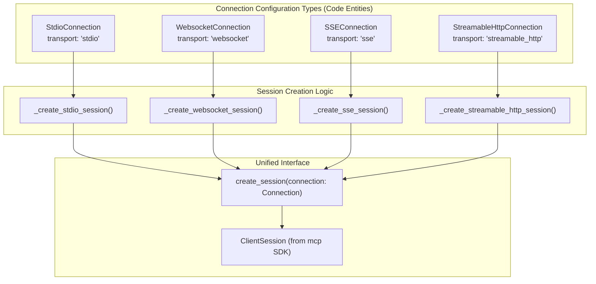
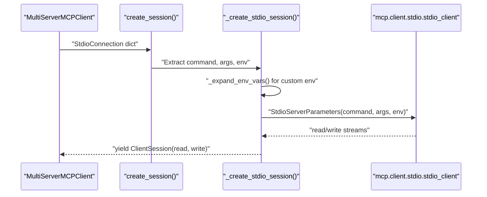
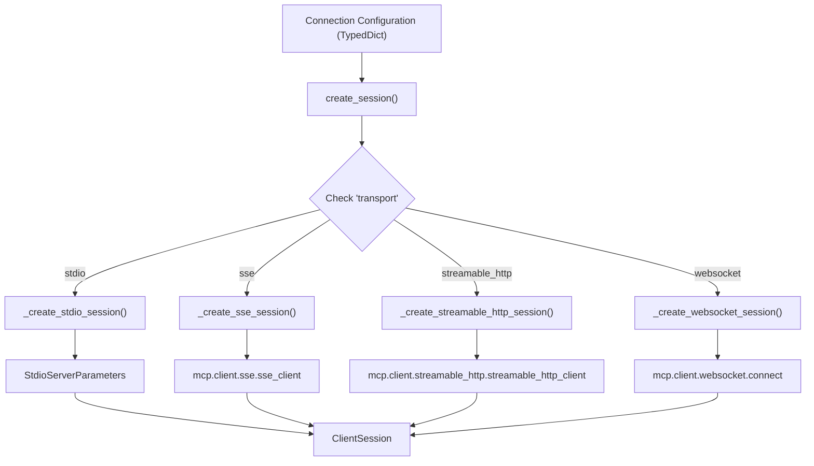

<!-- source: DeepWiki mcp.deepwiki.com · repo langchain-ai/langchain-mcp-adapters · page 3.1 Connection Types · fetched 2026-10-26 -->

# Connection Types

Relevant source files

The following files were used as context for generating this wiki page:

- [README.md](README.md)
- [langchain_mcp_adapters/sessions.py](langchain_mcp_adapters/sessions.py)
- [static/img/mcp.png](static/img/mcp.png)

This document covers the four transport protocols supported by `langchain-mcp-adapters` for connecting to MCP servers: **stdio**, **WebSocket**, **Server-Sent Events (SSE)**, and **Streamable HTTP**. Each connection type has specific configuration requirements and use cases.

For information about how these connections are managed and used within the `MultiServerMCPClient`, see [MultiServerMCPClient](2.1). For broader session management concepts, see [Session Management and Transport](3).

## Overview

The `langchain-mcp-adapters` library supports four distinct transport mechanisms for connecting to MCP servers. Each transport is implemented as a typed configuration dictionary and has a corresponding session creation function. The connection types are defined as the union type `Connection` [langchain_mcp_adapters/sessions.py:207-209]() and handled by the `create_session` factory function [langchain_mcp_adapters/sessions.py:262-262]().

### Connection Type Mapping

**Sources:** [langchain_mcp_adapters/sessions.py:82-209](), [langchain_mcp_adapters/sessions.py:262-343]()

---

## stdio Connection

The `StdioConnection` type is used for connecting to MCP servers that run as command-line executables and communicate via standard input/output streams [langchain_mcp_adapters/sessions.py:82-83](). This is the most common connection type for locally-hosted MCP servers.

### Configuration Parameters

| Parameter | Type | Required | Default | Description |
|-----------|------|----------|---------|-------------|
| `transport` | `"stdio"` | Yes | - | Transport type identifier [langchain_mcp_adapters/sessions.py:85-85]() |
| `command` | `str` | Yes | - | Executable command to run [langchain_mcp_adapters/sessions.py:87-88]() |
| `args` | `list[str]` | Yes | - | Command line arguments [langchain_mcp_adapters/sessions.py:90-91]() |
| `env` | `dict[str, str] \| None` | No | `None` | Environment variables [langchain_mcp_adapters/sessions.py:93-93]() |
| `cwd` | `str \| Path \| None` | No | `None` | Working directory [langchain_mcp_adapters/sessions.py:106-106]() |
| `encoding` | `str` | No | `"utf-8"` | Text encoding [langchain_mcp_adapters/sessions.py:109-109]() |
| `encoding_error_handler` | `EncodingErrorHandler` | No | `"strict"` | Error handling strategy [langchain_mcp_adapters/sessions.py:115-115]() |

### Implementation Details

The `_create_stdio_session` function manages the subprocess lifecycle using the `mcp.client.stdio.stdio_client` [langchain_mcp_adapters/sessions.py:19-19](). It includes a utility function `_expand_env_vars` to resolve `${VAR}` references within the configuration [langchain_mcp_adapters/sessions.py:35-45]().

**Sources:** [langchain_mcp_adapters/sessions.py:35-45](), [langchain_mcp_adapters/sessions.py:82-128](), [langchain_mcp_adapters/sessions.py:125-166]()

---

## WebSocket Connection

The `WebsocketConnection` type enables communication with MCP servers over WebSocket protocols [langchain_mcp_adapters/sessions.py:195-196]().

### Configuration Parameters

| Parameter | Type | Required | Default | Description |
|-----------|------|----------|---------|-------------|
| `transport` | `"websocket"` | Yes | - | Transport type identifier [langchain_mcp_adapters/sessions.py:198-198]() |
| `url` | `str` | Yes | - | WebSocket endpoint URL [langchain_mcp_adapters/sessions.py:200-201]() |
| `session_kwargs` | `dict[str, Any] \| None` | No | `None` | Additional ClientSession arguments [langchain_mcp_adapters/sessions.py:203-204]() |

### Dependencies
This transport requires the `mcp[ws]` extra or the `websockets` package. The implementation in `_create_websocket_session` performs a runtime check and raises an `ImportError` with installation instructions if missing [langchain_mcp_adapters/sessions.py:233-243]().

**Sources:** [langchain_mcp_adapters/sessions.py:195-206](), [langchain_mcp_adapters/sessions.py:233-259]()

---

## Server-Sent Events (SSE) Connection

The `SSEConnection` type is used for servers providing a unidirectional streaming connection from server to client with HTTP-based message posting [langchain_mcp_adapters/sessions.py:129-130]().

### Configuration Parameters

| Parameter | Type | Required | Default | Description |
|-----------|------|----------|---------|-------------|
| `transport` | `"sse"` | Yes | - | Transport identifier [langchain_mcp_adapters/sessions.py:132-132]() |
| `url` | `str` | Yes | - | SSE endpoint URL [langchain_mcp_adapters/sessions.py:134-135]() |
| `headers` | `dict[str, Any] \| None` | No | `None` | Custom HTTP headers [langchain_mcp_adapters/sessions.py:137-138]() |
| `timeout` | `float` | No | `5.0` | Connection timeout [langchain_mcp_adapters/sessions.py:140-145]() |
| `sse_read_timeout` | `float` | No | `300.0` | Event read timeout [langchain_mcp_adapters/sessions.py:147-152]() |

### HTTP Client Customization
Users can provide a `McpHttpClientFactory` to control how the underlying `httpx.AsyncClient` is instantiated [langchain_mcp_adapters/sessions.py:60-80](), [langchain_mcp_adapters/sessions.py:157-158]().

**Sources:** [langchain_mcp_adapters/sessions.py:129-163](), [langchain_mcp_adapters/sessions.py:169-196]()

---

## Streamable HTTP Connection

The `StreamableHttpConnection` type supports the newer MCP "Streamable HTTP" transport specification, which allows for stateless-friendly bidirectional communication [README.md:151-153]().

### Configuration Parameters

| Parameter | Type | Required | Default | Description |
|-----------|------|----------|---------|-------------|
| `transport` | `"streamable_http"` | Yes | - | Transport identifier [langchain_mcp_adapters/sessions.py:167-167]() |
| `url` | `str` | Yes | - | Endpoint URL [langchain_mcp_adapters/sessions.py:169-170]() |
| `headers` | `dict[str, Any] \| None` | No | `None` | Custom HTTP headers [langchain_mcp_adapters/sessions.py:172-173]() |
| `timeout` | `float \| timedelta` | No | `30s` | Operation timeout [langchain_mcp_adapters/sessions.py:175-176]() |
| `terminate_on_close` | `bool` | No | `True` | Close session on exit [langchain_mcp_adapters/sessions.py:182-183]() |

### Usage with MultiServerMCPClient
The `MultiServerMCPClient` maps the `"http"` transport string to `streamable_http` internally for convenience [README.md:196-197]().

**Sources:** [langchain_mcp_adapters/sessions.py:164-194](), [langchain_mcp_adapters/sessions.py:199-230](), [README.md:151-204]()

---

## Factory Logic and Validation

The `create_session` function acts as a dispatcher. It validates the configuration dictionary and routes it to the appropriate internal creator [langchain_mcp_adapters/sessions.py:262-343]().

### Error Handling

| Scenario | Resulting Error |
|----------|-----------------|
| Missing `transport` key | `ValueError: Connection configuration must contain a 'transport' key.` [langchain_mcp_adapters/sessions.py:277-279]() |
| Unknown `transport` value | `ValueError: Unsupported transport: <type>` [langchain_mcp_adapters/sessions.py:339-340]() |
| Missing `command` for stdio | `ValueError: 'command' is required for stdio transport.` [langchain_mcp_adapters/sessions.py:316-318]() |
| Missing `url` for HTTP/SSE/WS | `ValueError: 'url' is required for <type> transport.` [langchain_mcp_adapters/sessions.py:290-292]() |

### Data Flow Diagram

**Sources:** [langchain_mcp_adapters/sessions.py:262-343](), [langchain_mcp_adapters/sessions.py:125-259]()

---

