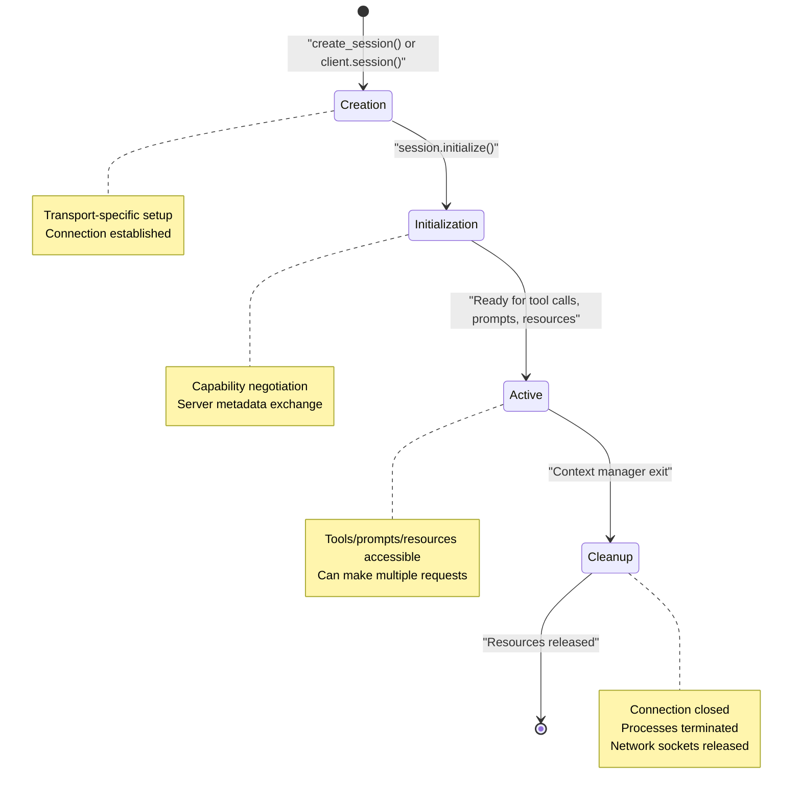
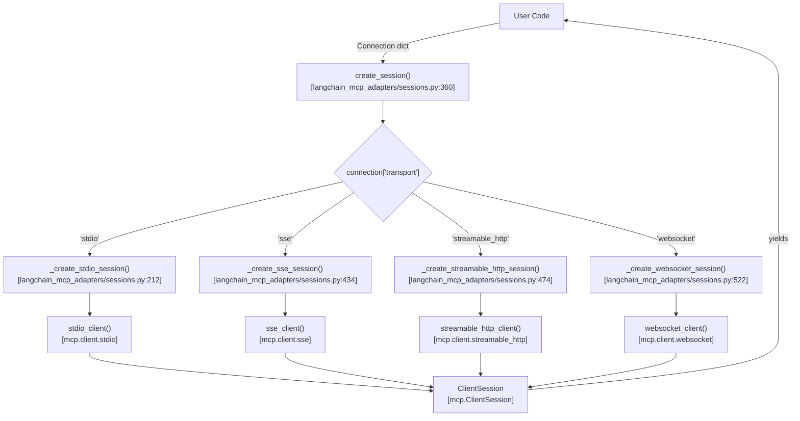
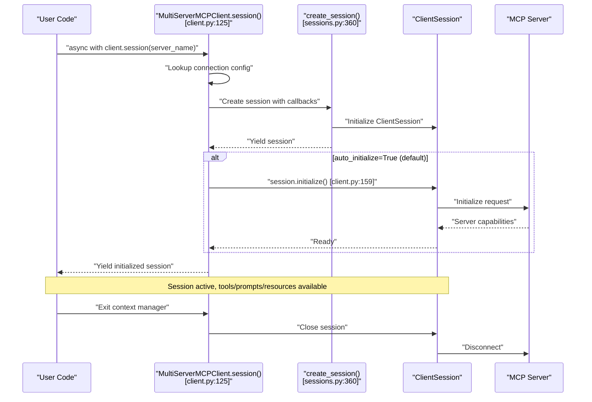
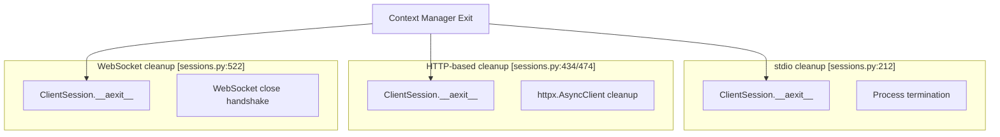

<!-- source: DeepWiki mcp.deepwiki.com · repo langchain-ai/langchain-mcp-adapters · page 3.2 Session Lifecycle · fetched 2026-10-26 -->

# Session Lifecycle

<details>
<summary>Relevant source files</summary>

The following files were used as context for generating this wiki page:

- [langchain_mcp_adapters/client.py](langchain_mcp_adapters/client.py)
- [langchain_mcp_adapters/sessions.py](langchain_mcp_adapters/sessions.py)
- [tests/test_client.py](tests/test_client.py)

</details>


This document explains how sessions are created, managed, and cleaned up in the `langchain-mcp-adapters` library. It covers the context manager pattern used for session management, the distinction between temporary and persistent sessions, and best practices for resource management.

For information about the different transport types and their specific configurations, see [Connection Types](3.1).

## Overview

A **session** represents an active connection to an MCP server. Sessions are implemented using the `ClientSession` class from the `mcp` SDK and manage the bidirectional communication channel between the client and server. All sessions in this library follow the async context manager pattern, ensuring proper resource cleanup.

The session lifecycle consists of four distinct stages:

### Session State Diagram



Sources: [langchain_mcp_adapters/sessions.py:360-431](), [langchain_mcp_adapters/client.py:125-161]()

## Session Creation

Session creation is handled by the `create_session` factory function, which dispatches to transport-specific session factories based on the `Connection` configuration.

### Code Entity Space: Creation Flow

This diagram maps the high-level creation logic to specific internal functions and external SDK calls.



Sources: [langchain_mcp_adapters/sessions.py:360-431](), [langchain_mcp_adapters/sessions.py:212-234](), [langchain_mcp_adapters/sessions.py:434-471](), [langchain_mcp_adapters/sessions.py:474-519](), [langchain_mcp_adapters/sessions.py:522-554]()

### Creation Parameters

The `create_session` function [langchain_mcp_adapters/sessions.py:360-363]() accepts:

| Parameter | Type | Purpose |
|-----------|------|---------|
| `connection` | `Connection` | Transport configuration (`StdioConnection`, `SSEConnection`, etc.) |
| `mcp_callbacks` | `_MCPCallbacks \| None` | Optional callbacks for logging and event handling |

The function extracts the `transport` key [langchain_mcp_adapters/sessions.py:386]() and passes remaining parameters to the appropriate factory. If `mcp_callbacks` are provided, they are injected into the `session_kwargs` [langchain_mcp_adapters/sessions.py:389-397]().

### Transport Dispatch

The `create_session` function validates the transport type and dispatches:

- **stdio**: Requires `command` and `args` parameters [langchain_mcp_adapters/sessions.py:411-418](). Environment variables in `env` are expanded using `_expand_env_vars` [langchain_mcp_adapters/sessions.py:35-45]().
- **sse**: Requires `url` parameter [langchain_mcp_adapters/sessions.py:399-404]().
- **streamable_http**: Requires `url` parameter [langchain_mcp_adapters/sessions.py:405-410]().
- **websocket**: Requires `url` parameter [langchain_mcp_adapters/sessions.py:420-425]().

Sources: [langchain_mcp_adapters/sessions.py:360-431]()

## Session Initialization

After creation, sessions must be **initialized** to negotiate capabilities. This is handled by calling `session.initialize()` on the `ClientSession` object.

The `MultiServerMCPClient.session()` method [langchain_mcp_adapters/client.py:125-161]() provides automatic initialization through its `auto_initialize` parameter:



The `auto_initialize` parameter defaults to `True` [langchain_mcp_adapters/client.py:129]().

Sources: [langchain_mcp_adapters/client.py:125-161]()

## Session Usage Patterns

The library supports two distinct session usage patterns: **temporary sessions** and **persistent sessions**.

### Temporary Sessions (Ephemeral)

Temporary sessions are created on-demand for individual operations. This is the default behavior when calling `client.get_tools()` [langchain_mcp_adapters/client.py:162-192]().

```mermaid
graph TB
    GetTools["client.get_tools()<br/>[client.py:162]"]
    LoadTools["load_mcp_tools()<br/>[tools.py]"]
    ExecuteTool["tool.ainvoke()"]
    CreateTempSession["create_session() [via tool.py]"]
    AutoCleanup["Automatic cleanup"]
    
    GetTools -->|"No session provided"| LoadTools
    LoadTools -->|"Stores Connection in tool"| ExecuteTool
    ExecuteTool --> CreateTempSession
    CreateTempSession --> AutoCleanup
    
    note right of CreateTempSession
        Session created when tool invoked
        [client.py:169]
    end note
```

When `get_tools()` is called without an active session [langchain_mcp_adapters/client.py:169-172](), the returned tools are configured to open a new session for every `ainvoke` call.

Sources: [langchain_mcp_adapters/client.py:162-192]()

### Persistent Sessions

Persistent sessions are explicitly managed by the user and can be reused for multiple operations, reducing connection overhead.

```python
# Example from [langchain_mcp_adapters/client.py:105-114]
client = MultiServerMCPClient({...})
async with client.session("math") as session:
    tools = await load_mcp_tools(session)
    # The same session is used for subsequent operations
```

**Comparison Table:**

| Aspect | Temporary Sessions | Persistent Sessions |
|--------|-------------------|---------------------|
| **Creation** | Automatic per tool call | Explicit via `client.session()` |
| **Resource Usage** | Higher (repeated handshakes) | Lower (connection reused) |
| **Use Case** | Simple agent scripts | High-performance/Stateful agents |

Sources: [langchain_mcp_adapters/client.py:81-115]()

## Session Cleanup and Resource Management

All session creation functions are async context managers that guarantee proper resource cleanup using the `@asynccontextmanager` decorator [langchain_mcp_adapters/sessions.py:212](), [langchain_mcp_adapters/sessions.py:434](), [langchain_mcp_adapters/sessions.py:474](), [langchain_mcp_adapters/sessions.py:522]().

### Code Entity Space: Cleanup Responsibilities



Sources: [langchain_mcp_adapters/sessions.py:212-234](), [langchain_mcp_adapters/sessions.py:434-471](), [langchain_mcp_adapters/sessions.py:474-519](), [langchain_mcp_adapters/sessions.py:522-554]()

## Context Manager Removal

As of version 0.1.0, the `MultiServerMCPClient` itself cannot be used as a context manager [langchain_mcp_adapters/client.py:33-42](). Attempting to do so will raise a `TypeError` or `NotImplementedError` with a migration guide [langchain_mcp_adapters/client.py:225-249]().

**Migration:**
- **Old:** `async with MultiServerMCPClient(...) as client:`
- **New:** `client = MultiServerMCPClient(...)` then `async with client.session("name") as session:`

Sources: [langchain_mcp_adapters/client.py:33-42](), [langchain_mcp_adapters/client.py:225-249]()

## Best Practices

1. **Environment Variables**: For `stdio` connections, use `${VAR}` syntax in the `env` dict to safely expand variables from the host environment [langchain_mcp_adapters/sessions.py:35-45]().
2. **Error Handling**: Enable `handle_tool_errors=True` in `MultiServerMCPClient` to allow agents to self-correct on MCP execution errors rather than crashing the session [langchain_mcp_adapters/client.py:72-79]().
3. **Timeouts**: Default HTTP timeouts are 5s [langchain_mcp_adapters/sessions.py:53](). For slow tools, increase the `timeout` in the `Connection` dict [langchain_mcp_adapters/sessions.py:140]().

Sources: [langchain_mcp_adapters/sessions.py:35-58](), [langchain_mcp_adapters/client.py:72-79]()

---

