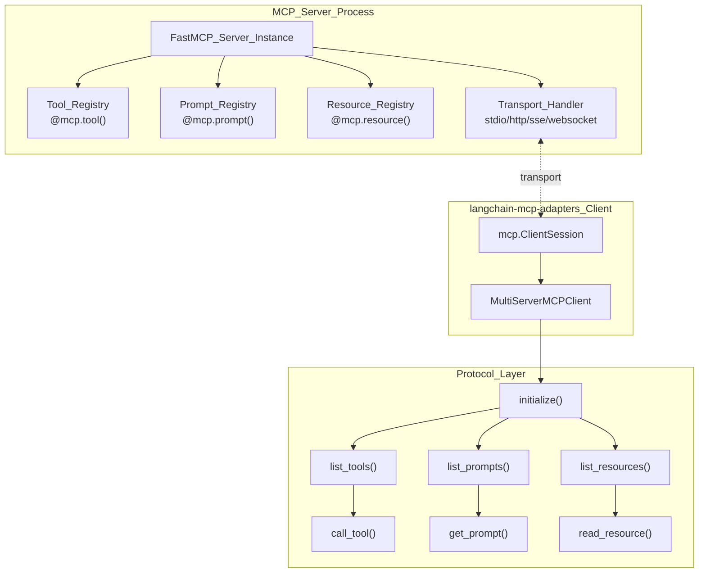
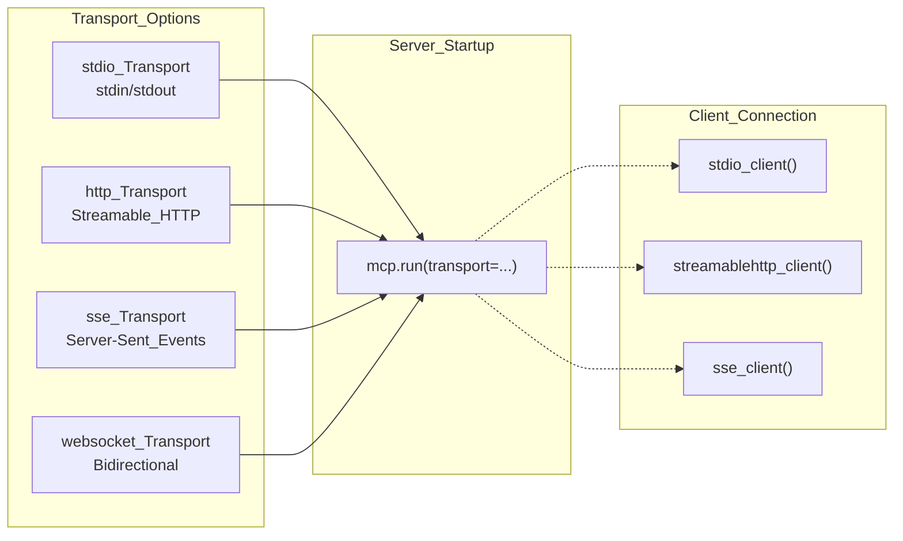
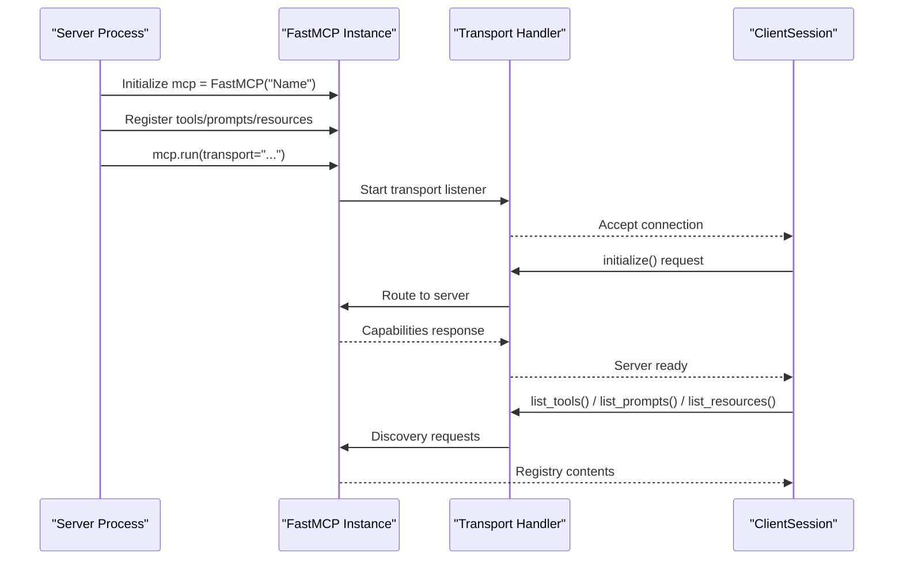
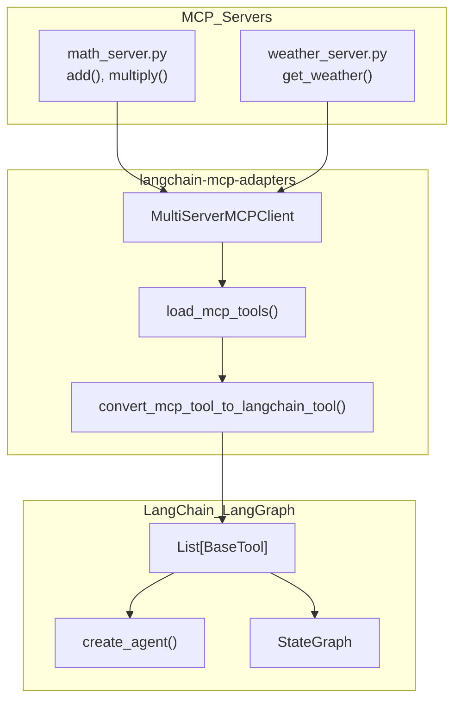

<!-- source: DeepWiki mcp.deepwiki.com · repo langchain-ai/langchain-mcp-adapters · page 4 MCP Servers · fetched 2026-10-26 -->

# MCP Servers

<details>
<summary>Relevant source files</summary>

The following files were used as context for generating this wiki page:

- [examples/servers/streamable-http-stateless/uv.lock](examples/servers/streamable-http-stateless/uv.lock)
- [tests/servers/__init__.py](tests/servers/__init__.py)
- [tests/servers/math_server.py](tests/servers/math_server.py)
- [tests/servers/weather_server.py](tests/servers/weather_server.py)

</details>


This document provides an overview of Model Context Protocol (MCP) servers and their role in the `langchain-mcp-adapters` ecosystem. MCP servers are external processes or services that expose tools, prompts, and resources through the Model Context Protocol, which the adapters translate into LangChain-compatible types.

For detailed information about:
- Understanding MCP server architecture and communication patterns, see [Understanding MCP Servers](#4.1)
- Example server implementations in the test suite, see [Example Servers](#4.2)
- Creating your own MCP servers, see [Creating Custom MCP Servers](#4.3)
- How the adapters connect to and manage MCP servers, see [MultiServerMCPClient](#2.1) and [Session Management and Transport](#3)

## What Are MCP Servers

MCP servers are standalone processes or network services that implement the Anthropic Model Context Protocol. They provide capabilities to LLM applications by exposing three types of entities:

| Entity Type | Purpose | Example |
|-------------|---------|---------|
| **Tools** | Functions that agents can invoke to perform actions | `add()`, `get_weather()` |
| **Prompts** | Pre-configured message templates for system instructions | `configure_assistant()` |
| **Resources** | Static or dynamic content accessible via URI schemes | `math://formulas`, `weather://forecast` |

The `langchain-mcp-adapters` library acts as a bridge, converting these MCP entities into LangChain types (`BaseTool`, `HumanMessage`/`AIMessage`, `Blob`) that can be used with LangChain agents and LangGraph workflows.

**Sources:** [tests/servers/math_server.py:6-34](), [tests/servers/weather_server.py:6-15]()

## MCP Server Architecture

### Server-Client Communication Model



**Diagram: MCP Server Communication Architecture**

The server-client relationship follows a request-response pattern where:
1. The server starts and listens on a transport (stdio, HTTP, SSE, or WebSocket).
2. The client establishes a `ClientSession` via the appropriate transport mechanism.
3. The client calls `initialize()` to negotiate capabilities.
4. The client discovers available tools, prompts, and resources via `list_*()` methods.
5. The client invokes specific capabilities via `call_tool()`, `get_prompt()`, or `read_resource()`.

**Sources:** [tests/servers/math_server.py:37-38](), [tests/servers/weather_server.py:18-19]()

## Server Components

### FastMCP Server Instance

MCP servers are typically built using the `FastMCP` class from `mcp.server.fastmcp`. This provides a decorator-based API for registering tools, prompts, and resources:

```python
from mcp.server.fastmcp import FastMCP

mcp = FastMCP("Math")
```

The server name ("Math", "Weather", etc.) identifies the server in client connections.

**Sources:** [tests/servers/math_server.py:1-3](), [tests/servers/weather_server.py:1-3]()

### Tools Registration

Tools are Python functions decorated with `@mcp.tool()` that become callable operations for LLM agents:

```python
@mcp.tool()
def add(a: int, b: int) -> int:
    """Add two numbers"""
    return a + b

@mcp.tool()
async def get_weather(location: str) -> str:
    """Get weather for location."""
    return f"It's always sunny in {location}"
```

Key characteristics:
- Function signatures define the tool's input schema (parameter names and types).
- Docstrings provide the tool description exposed to LLM agents.
- Functions can be synchronous or asynchronous.
- Return values are serialized and sent back to clients.

**Sources:** [tests/servers/math_server.py:6-15](), [tests/servers/weather_server.py:6-9]()

### Prompts Registration

Prompts are template functions decorated with `@mcp.prompt()` that return message structures:

```python
@mcp.prompt()
def configure_assistant(skills: str) -> list[dict]:
    return [
        {
            "role": "assistant",
            "content": (
                f"You are a helpful assistant. You have these skills: {skills}. "
                "Always use only one tool at a time."
            ),
        },
    ]
```

Prompts return a list of message dictionaries with `role` and `content` fields, which the adapters convert to LangChain message types.

**Sources:** [tests/servers/math_server.py:18-28]()

### Resources Registration

Resources are content providers decorated with `@mcp.resource()` that respond to URI-based requests:

```python
@mcp.resource("math://formulas")
def get_math_formulas() -> str:
    """Get math formulas."""
    return "E = mc^2"

@mcp.resource("weather://forecast")
def get_weather_forecast() -> str:
    """Get weather forecast."""
    return "Sunny with a chance of clouds"
```

Resources are identified by URI schemes (e.g., `math://`, `weather://`) and can provide text or binary content.

**Sources:** [tests/servers/math_server.py:31-34](), [tests/servers/weather_server.py:12-15]()

## Transport Mechanisms

MCP servers support multiple transport mechanisms for client communication:



**Diagram: MCP Server Transport Mechanisms**

| Transport | Use Case | Server Code | Client Code |
|-----------|----------|-------------|-------------|
| `stdio` | Local processes on user's machine | `mcp.run(transport="stdio")` | `stdio_client(StdioServerParameters)` |
| `http` | Stateless network services | `mcp.run(transport="http")` | `streamablehttp_client(url)` |
| `sse` | Server-sent events streaming | `mcp.run(transport="sse")` | `sse_client(url)` |
| `websocket` | Bidirectional real-time communication | `mcp.run(transport="websocket")` | WebSocket client |

**Sources:** [tests/servers/math_server.py:37-38](), [tests/servers/weather_server.py:18-19]()

## Server Lifecycle

### Startup Sequence



**Diagram: MCP Server Startup and Initialization**

1. **Server Creation**: The Python script instantiates `FastMCP` with a server name.
2. **Registration Phase**: Decorated functions are registered in the tool, prompt, and resource registries.
3. **Transport Start**: `mcp.run()` starts the appropriate transport listener.
4. **Client Connection**: The client establishes a connection via the transport.
5. **Initialization**: The client sends `initialize()` to negotiate protocol version and capabilities.
6. **Discovery**: The client lists available tools, prompts, and resources.
7. **Operation**: The client invokes specific capabilities as needed.

**Sources:** [tests/servers/math_server.py:1-38](), [tests/servers/weather_server.py:1-19]()

## Server Examples in Test Suite

The repository includes example MCP servers in the test suite:

| Server | File | Tools | Prompts | Resources | Transport |
|--------|------|-------|---------|-----------|-----------|
| Math | `tests/servers/math_server.py` | `add()`, `multiply()` | `configure_assistant()` | `math://formulas` | stdio |
| Weather | `tests/servers/weather_server.py` | `get_weather()` | - | `weather://forecast` | stdio |

These servers demonstrate:
- Tool registration with type-annotated parameters.
- Prompt templates with dynamic content.
- Resource URIs with custom schemes.
- Both synchronous and asynchronous tool implementations.

**Sources:** [tests/servers/math_server.py:1-39](), [tests/servers/weather_server.py:1-20]()

## Integration with Adapters



**Diagram: MCP Server to LangChain Integration Flow**

The adapters provide the translation layer:
1. **Discovery**: `MultiServerMCPClient` connects to servers and lists available capabilities.
2. **Conversion**: `load_mcp_tools()` retrieves tools from sessions and converts them using `convert_mcp_tool_to_langchain_tool()`.
3. **Usage**: Converted `BaseTool` instances work seamlessly with LangChain agents and LangGraph workflows.

For details on the conversion process, see [Tool Adapters](#2.2).

**Sources:** [tests/servers/math_server.py:6-15](), [tests/servers/weather_server.py:6-9]()

---

