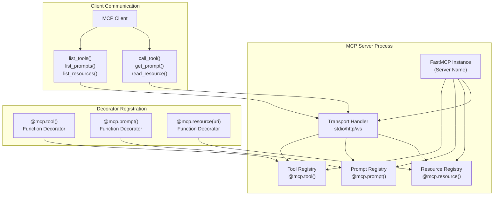
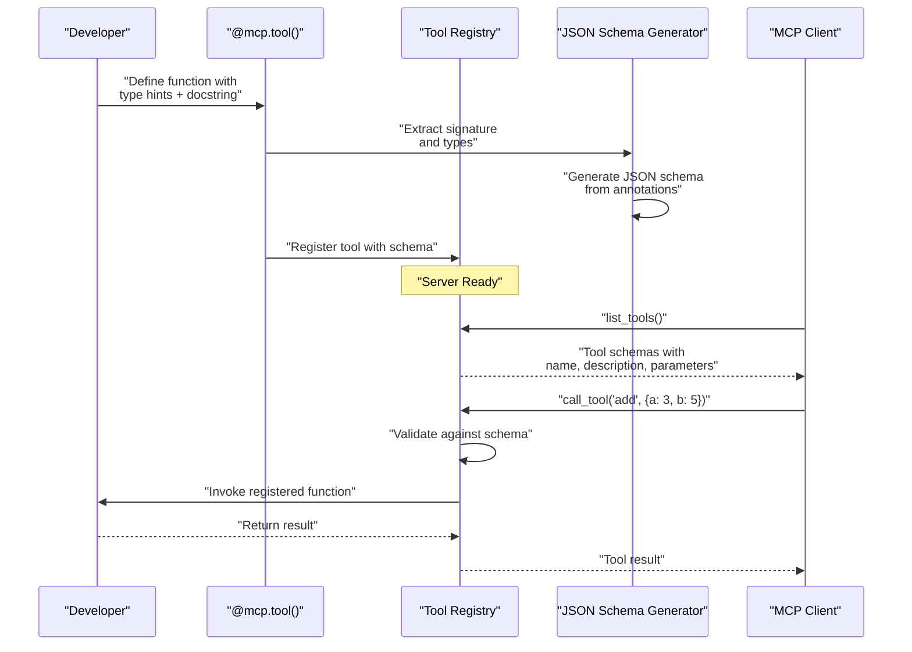
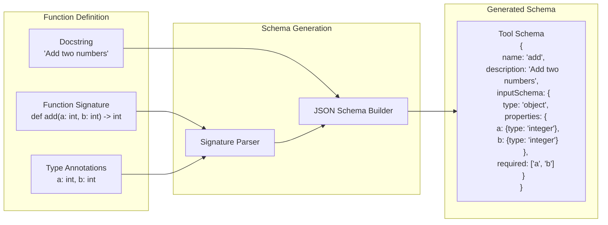
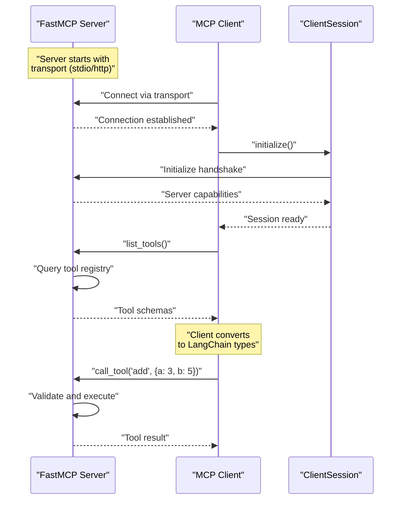
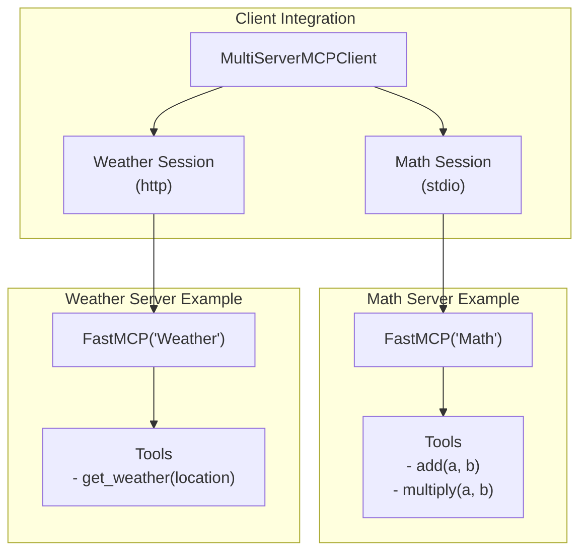

<!-- source: DeepWiki mcp.deepwiki.com · repo langchain-ai/langchain-mcp-adapters · page 4.1 Understanding MCP Servers · fetched 2026-10-26 -->

# Understanding MCP Servers

<details>
<summary>Relevant source files</summary>

The following files were used as context for generating this wiki page:

- [README.md](README.md)
- [static/img/mcp.png](static/img/mcp.png)
- [uv.lock](uv.lock)

</details>


## Purpose and Scope

This page explains the fundamental concepts of Model Context Protocol (MCP) servers, the FastMCP framework used to build them, and the decorator-based patterns for defining capabilities. It covers how servers expose tools, prompts, and resources to clients through a standardized protocol. For examples of specific server implementations, see [Example Servers](#4.2). For guidance on building your own servers, see [Creating Custom MCP Servers](#4.3).

## What is an MCP Server?

An MCP server is a process that exposes capabilities (tools, prompts, and resources) through the Model Context Protocol. The server receives requests from MCP clients and executes the corresponding functionality. In the context of `langchain-mcp-adapters`, these servers provide tools that can be converted into LangChain `BaseTool` instances and used by agents.

MCP servers are standalone processes that communicate with clients through various transport mechanisms (stdio, HTTP, WebSocket, SSE). They implement the MCP specification, which defines how to list, describe, and invoke capabilities.

**Key Characteristics:**
- Stateless or stateful operation depending on transport [README.md:151-155]()
- Declarative capability definition using decorators [README.md:41-49]()
- Support for multiple transport mechanisms (stdio, http, sse) [README.md:208-212]()
- Automatic JSON schema generation for tools [README.md:41-49]()
- Built-in type validation and error handling [README.md:41-49]()

Sources: [README.md:1-53](), [README.md:151-155](), [README.md:208-212]()

## The FastMCP Framework

FastMCP is a Python framework from the MCP SDK that simplifies MCP server creation. It provides a decorator-based API for defining server capabilities and handles protocol implementation details automatically.

### Server Initialization

An MCP server is initialized by creating a `FastMCP` instance with a server name:

```python
from mcp.server.fastmcp import FastMCP

mcp = FastMCP("Math")
```

The server name identifies the server to clients and appears in logging and error messages. Each server instance maintains registries for tools, prompts, and resources defined through decorators.

Sources: [README.md:37-39](), [README.md:98]()

### FastMCP Architecture



Sources: [README.md:37-53](), [README.md:98-107]()

## Defining Tools with @mcp.tool()

The `@mcp.tool()` decorator registers a function as an executable tool that clients can invoke. FastMCP automatically generates JSON schemas from function signatures and docstrings.

### Tool Definition Pattern

```python
@mcp.tool()
def add(a: int, b: int) -> int:
    """Add two numbers"""
    return a + b
```

**Key Elements:**
- **Type Annotations**: Required for parameter validation and schema generation (`a: int`, `b: int`) [README.md:42]()
- **Return Type**: Specifies the output type (`-> int`) [README.md:42]()
- **Docstring**: Used as the tool description in the schema [README.md:43]()
- **Function Name**: Becomes the tool identifier (`add`) [README.md:42]()

Sources: [README.md:41-44](), [README.md:100-103]()

### Tool Registration Flow



Sources: [README.md:41-53](), [README.md:71-82]()

### Synchronous vs Asynchronous Tools

Tools can be defined as synchronous or asynchronous functions:

**Synchronous:**
```python
@mcp.tool()
def multiply(a: int, b: int) -> int:
    """Multiply two numbers"""
    return a * b
```

**Asynchronous:**
```python
@mcp.tool()
async def get_weather(location: str) -> str:
    """Get weather for location."""
    return "It's always sunny in New York"
```

FastMCP handles both types transparently, awaiting async functions when necessary.

Sources: [README.md:46-49](), [README.md:100-103]()

### Tool Schema Generation



Sources: [README.md:41-49]()

## Defining Prompts and Resources

While the provided files focus heavily on tool integration via `load_mcp_tools` [README.md:62, 77](), the Model Context Protocol also supports prompts and resources.

### Prompts
Prompts are templates that clients can fetch to configure language models. They are defined using the `@mcp.prompt()` decorator and return a list of messages.

### Resources
Resources are data or documents identified by URIs that clients can read. They are defined using the `@mcp.resource()` decorator.

Sources: [README.md:144-149]()

## Server Initialization and Transport

### Running the Server

Servers start by calling the `run()` method with a transport type:

```python
if __name__ == "__main__":
    mcp.run(transport="stdio")
```

**Supported Transports:**
- `"stdio"`: Standard input/output for local process communication [README.md:52]()
- `"http"`: HTTP transport (including streamable HTTP) [README.md:106, 153]()
- `"sse"`: Server-Sent Events [README.md:208]()

Sources: [README.md:52-53](), [README.md:106](), [README.md:153-155]()

### Transport Selection Guide

| Transport | Use Case | Client Config | Server Config |
|-----------|----------|---------------|---------------|
| `stdio` | Local development, CLI tools | `StdioServerParameters` [README.md:65]() | `transport="stdio"` |
| `http` | Remote servers, stateless | `url` parameter [README.md:129]() | `transport="http"` |
| `sse` | Streaming updates | `url` parameter with SSE endpoint | `transport="sse"` |

Sources: [README.md:65-69](), [README.md:128-131](), [README.md:208-212]()

## Server Lifecycle and Capability Discovery



Sources: [README.md:71-82](), [README.md:134-137]()

## Capability Registration Summary



Sources: [README.md:37-53](), [README.md:98-107](), [README.md:119-137]()

## Key Takeaways

**Server Structure:**
- Servers are initialized with `FastMCP(name)` [README.md:39]()
- Capabilities are registered using decorators like `@mcp.tool()` [README.md:41]()
- Servers run with `mcp.run(transport=...)` [README.md:52]()

**Type Safety:**
- Type annotations are used for automatic schema generation [README.md:42]()
- FastMCP validates tool parameters against these schemas [README.md:41-49]()

**Transport Flexibility:**
- Same server logic can be exposed via `stdio` or `http` [README.md:52, 106]()
- Clients like `MultiServerMCPClient` can mix and match these transports [README.md:119-133]()

Sources: [README.md:37-53](), [README.md:98-107](), [README.md:119-137]()

---

