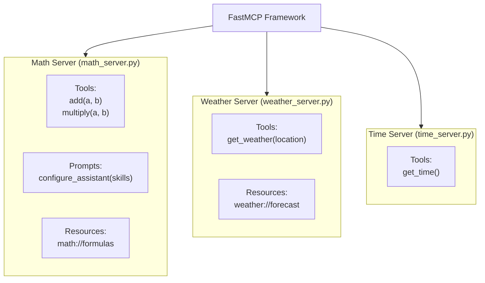
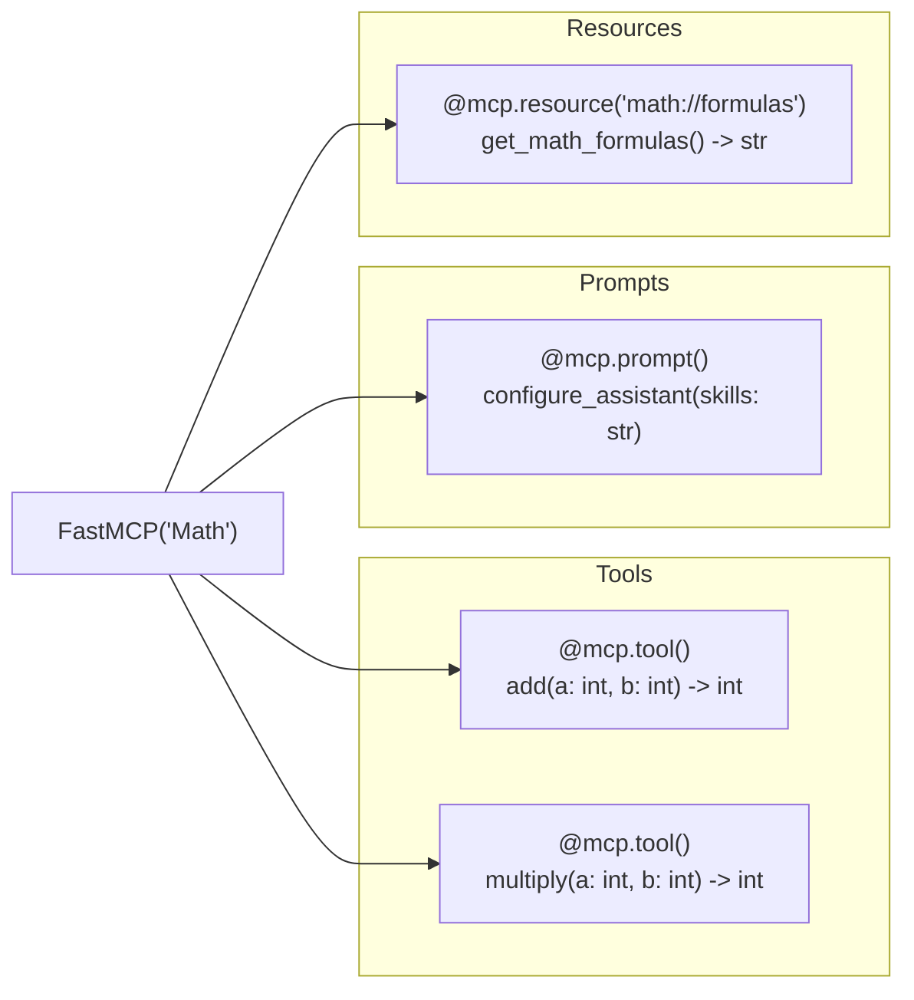
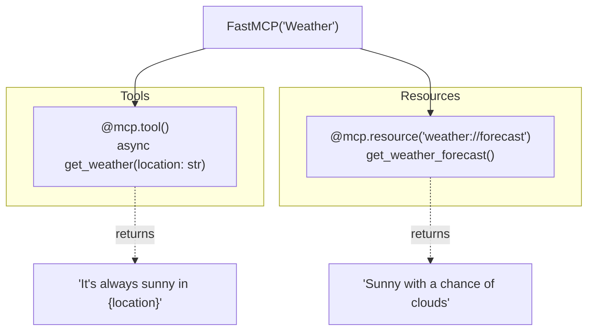
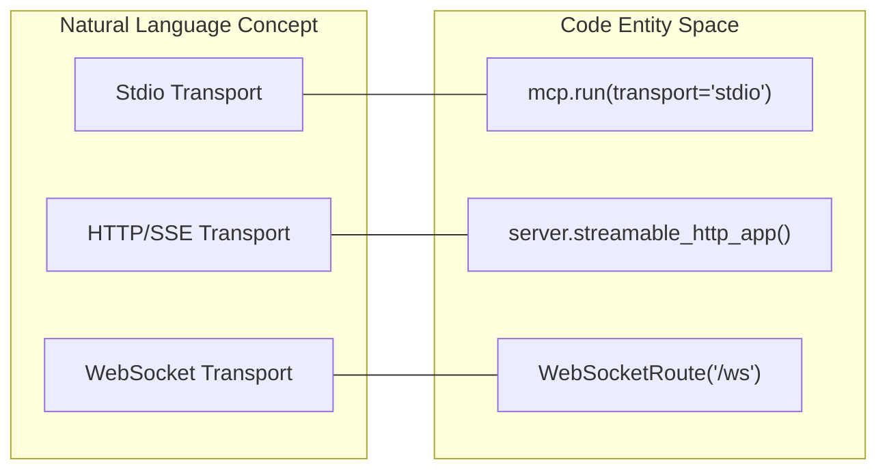
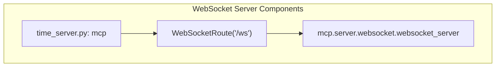

<!-- source: DeepWiki mcp.deepwiki.com · repo langchain-ai/langchain-mcp-adapters · page 4.2 Example Servers · fetched 2026-10-26 -->

# Example Servers

Relevant source files

The following files were used as context for generating this wiki page:

- [tests/servers/__init__.py](tests/servers/__init__.py)
- [tests/servers/math_server.py](tests/servers/math_server.py)
- [tests/servers/time_server.py](tests/servers/time_server.py)
- [tests/servers/weather_server.py](tests/servers/weather_server.py)

This document describes the example FastMCP servers included in the test suite. These servers demonstrate different MCP capabilities including tools, prompts, resources, and various transport mechanisms.

For information about understanding the MCP protocol and server architecture, see [Understanding MCP Servers](#4.1). For guidance on creating your own custom MCP servers, see [Creating Custom MCP Servers](#4.3).

## Purpose and Scope

The langchain-mcp-adapters repository includes three example servers in the `tests/servers/` directory that serve as both reference implementations and test fixtures. These servers showcase:

- Different types of tools (synchronous and asynchronous)
- Prompt templates with dynamic arguments
- Resource endpoints for retrieving data
- Transport mechanisms (stdio, HTTP/SSE, WebSocket)

These servers are implemented using [FastMCP](https://github.com/jlowin/fastmcp), a Python framework for building MCP servers.

## Example Server Overview

The following table summarizes the three example servers:

| Server | File | Tools | Prompts | Resources | Transport Support |
|--------|------|-------|---------|-----------|-------------------|
| Math | [tests/servers/math_server.py:1-39]() | `add`, `multiply` | `configure_assistant` | `math://formulas` | stdio, HTTP/SSE |
| Weather | [tests/servers/weather_server.py:1-20]() | `get_weather` | None | `weather://forecast` | stdio, HTTP/SSE |
| Time | [tests/servers/time_server.py:1-14]() | `get_time` | None | None | stdio, HTTP/SSE, WebSocket |

**Server Feature Distribution**

Sources: [tests/servers/math_server.py:3-31](), [tests/servers/weather_server.py:3-12](), [tests/servers/time_server.py:3-7]()

## Math Server

The Math server is the most feature-complete example, demonstrating tools, prompts, and resources.

### Server Definition

Sources: [tests/servers/math_server.py:3-34]()

### Tools

The Math server exposes two arithmetic tools:

**`add`** - Adds two integers  
[tests/servers/math_server.py:6-9]()

The function signature defines the tool's input schema: `a` and `b` are both required integer parameters. The docstring provides the tool description.

**`multiply`** - Multiplies two integers  
[tests/servers/math_server.py:12-15]()

Both tools use synchronous implementations, demonstrating that FastMCP automatically handles the async protocol wrapper.

### Prompts

**`configure_assistant`** - Returns a system prompt template  
[tests/servers/math_server.py:18-28]()

This prompt accepts a `skills` parameter and returns a list of message dictionaries with:
- `role`: "assistant" 
- `content`: A formatted string describing the assistant's skills and constraints [tests/servers/math_server.py:24-25]()

### Resources

**`math://formulas`** - Returns mathematical formulas  
[tests/servers/math_server.py:31-34]()

The resource is identified by the URI scheme `math://formulas` and returns the static string `"E = mc^2"`.

### Entry Point

[tests/servers/math_server.py:37-38]()

The `if __name__ == "__main__"` block demonstrates running the server as a standalone process using stdio transport via `mcp.run(transport="stdio")`.

Sources: [tests/servers/math_server.py:1-39]()

## Weather Server

The Weather server demonstrates asynchronous tool implementation and resource endpoints.

### Server Structure

Sources: [tests/servers/weather_server.py:1-20]()

### Asynchronous Tool

**`get_weather`** - Async tool returning weather for a location  
[tests/servers/weather_server.py:6-9]()

This tool is defined as `async def`, demonstrating that FastMCP supports both synchronous and asynchronous tool implementations.

### Resource

**`weather://forecast`** - Returns weather forecast data  
[tests/servers/weather_server.py:12-15]()

Similar to the Math server's resource, this uses a custom URI scheme (`weather://`) to identify the resource endpoint.

Sources: [tests/servers/weather_server.py:1-20]()

## Time Server

The Time server is a minimal implementation primarily used for verifying tool execution and WebSocket transport capabilities in the test suite.

### Server Implementation

[tests/servers/time_server.py:3-13]()

**`get_time`** - Returns a hardcoded current time  
[tests/servers/time_server.py:6-9]()

The server uses the default `mcp.run()` which defaults to stdio unless configured otherwise by the test harness.

Sources: [tests/servers/time_server.py:1-14]()

## Running Example Servers

The test suite includes utilities for running these servers in different modes.

### Natural Language to Code Mapping: Server Execution

Sources: [tests/servers/math_server.py:38](), [tests/servers/weather_server.py:19]()

### HTTP/SSE Transport

Example servers can be wrapped in an HTTP/SSE interface using FastMCP's `streamable_http_app()` method. This allows the servers to be hosted by standard ASGI servers like Uvicorn.

### WebSocket Transport

For WebSocket testing, the `time_server` is typically wrapped in a Starlette application with a `WebSocketRoute`.

Sources: [tests/servers/time_server.py:3-13]()

## Key Observations

### Feature Coverage

The three example servers collectively demonstrate:

1. **Tool Variety**: Synchronous (`add`, `multiply`) and asynchronous (`get_weather`, `get_time`) implementations.
2. **Prompts**: Dynamic template rendering with parameters (`configure_assistant`).
3. **Resources**: Static data endpoints with custom URI schemes (`math://formulas`, `weather://forecast`).
4. **Transports**: Explicit stdio configuration and default execution modes.

### Production Guidance

While these are test servers, they demonstrate production-ready patterns:
- Type annotations for input schemas (e.g., `a: int, b: int`).
- Descriptive docstrings for tool descriptions.
- Resource URI conventions.
- Async/sync flexibility.

Sources: [tests/servers/math_server.py](), [tests/servers/weather_server.py](), [tests/servers/time_server.py]()

---

